# Linux 教程

> **原文作者：**苏丙榅　｜　**来源：**[爱编程的大丙](https://subingwen.cn/linux/)　｜　**许可协议：**[CC BY-NC-SA 4.0](https://creativecommons.org/licenses/by-nc-sa/4.0/deed.zh-hans)
>
> 以下内容由我保存的37篇课程网页整理导入，仅用于本地非商业学习。页面结构和资源路径经过适配，正文、代码与课程图片保留原作者署名；如有改动，改动内容继续采用相同许可协议。

## 第1章 Linux 基础

### 1.1 初识Linux操作系统

> 原文：[《初识Linux操作系统》](https://subingwen.cn/linux/version-path/)　作者：苏丙榅　来源：爱编程的大丙

#### 1. Linux介绍
##### 1.1 Linux的诞生
> 1991年，GNU计划已经开发出了许多工具软件，最受期盼的GNU C编译器已经出现，GNU的操作系统核心HURD一直处于实验阶段(GNU工程从1984年起就在做这件事)，没有任何可用性，实质上也没能开发出完整的GNU操作系统。 也是这一年, `Linux`诞生了, `Linux 是 UNIX 操作系统的一个克隆系统, 但是Linux是开源的。` 那时候它只是一个系统内核, 没有与之配套的应用软件，这时候 `Linux` 和 `GNU`一拍即合, 就有了我们现在使用的操作系统，GNU奠定了Linux用户基础和开发环境。

- Linux时间线 1991年初，林纳斯·托瓦兹开始在一台386sx兼容微机上学习minix操作系统。
- 1991年4月，林纳斯·托瓦兹开始酝酿并着手编制自己的操作系统。
- 1991 年4 月13 日在comp.os.minix 上发布说自己已经成功地将 bash 移植到了minix 上，而且已经爱不释手、不能离开这个[shell](https://baike.baidu.com/item/shell/99702)软件了。
- 1991年的10月5日，林纳斯·托瓦兹在comp.os.minix新闻组上发布消息，正式向外宣布Linux内核的诞生
- 1992年Linux与其他GNU软件结合，完全自由的操作系统正式诞生。该操作系统往往被称为“GNU/Linux”
- 1993年，大约有100余名程序员参与了Linux内核代码编写/修改工作，其中核心组由5人组成，此时Linux 0.99的代码大约有十万行，用户大约有10万左右。
- 1994年3月，Linux1.0发布，代码量17万行，当时是按照完全自由免费的协议发布，随后正式采用GPL协议。
- Linux主要特性 Linux是一个基于文件的操作系统 操作系统需要和硬件进行交互, 对应Linux来说这些硬件都是文件，比如: 操作系统会将 `硬盘`, `鼠标`, `键盘`, `显示屏`等抽象成一个设备文件来进行管理。
- Linux 操作系统是一种自由软件，是免费的，并且公开源代码。
- 可以同时登陆多个用户，并且每个用户可以同时运行多个应用程序。
- 提供了友好的图形用户界面, 操作简单， 易于快速上手。
- 支持多平台（这里指的是基于不同CPU架构的平台，比如国产Linux使用的龙芯等）。
- `Linux`的发音 – 关于 Linux 的发音有各种说法，主要有两种: 第一种读作 `['linΛks]` ，汉语发音：“喱呐科斯”
- 第二种是按照 Torvalds 的说法，Linux 中 `Li 中 i 的发音`类似于 `Minix 中 i 的发音`，而 `nux 中 u 的发音`类似于英文单词 `pronounce 中第一个 o 的发音`。根据 Torvalds 对此的解释，依照国际音标其发音为`['linэks]`。在网络上有一份 Torvalds 本人说话的音频，音频中的内容为`“Hello, this is Linus Torvalds, and I pronounce Linux as Linux”。`
##### 1.2 一些名词
> 在学习和使用Linux的过程中, 我们经常会见到一些特有名词, 下面给大家介绍一些常用的:
- `GNU`：Gnu’s Not Unix. 可以理解成一种口号，最早由Richard Stallman呼吁并倡导的，号召软件自由。
- `GPL`：General Public License. GNU通用公共许可证，GPL 授予程序的接受方下述的权利，即 GPL 所倡导的“自由”： 可以以任何目的运行所购买的程序；
- 在得到程序代码的前提下，可以以学习为目的，对源程序进行修改；
- 可以对复制件进行再发行；
- 对所购买的程序进行改进，并进行公开发布。
- `LGPL(GNU Lesser General Public License)`: LGPL是GPL的一个为主要为类库使用设计的开源协议。 LGPL允许商业软件通过类库引用(link)方式使用LGPL类库而不需要开源商业软件的代码。
- 采用LGPL协议的开源代码可以被商业软件作为类库引用并发布和销售。
- `BSD开源协议`: BSD开源协议是一个给于使用者很大自由的协议。基本上使用者可以”为所欲为”，以BSD协议代码为基础做二次开发自己的产品时，需要满足三个条件： 如果再发布的产品中包含源代码，则在源代码中必须带有原来代码中的BSD协议。
- 不可以用开源代码的作者/机构名字和原来产品的名字做市场推广。
- BSD代码鼓励代码共享，但需要尊重代码作者的著作权。
- `FSF`：自由软件基本会，给GNU提供资金支付的，毕竟没钱难成事啊。
- `自由软件`：GNU项目下的所有软件都基于GPL许可证（非GNU项目也可使用GPL），都是自由软件。
- `开源软件`：是美国Open Source Initiative协会定义，软件开放源代码。
- `POSIX：`（Portable Operating System Interface for Computing Systems）是由 IEEE 和 ISO/IEC 开发的一套标准。POSIX 标准是对 UNIX 操作系统的经验和实践的总结，`对操作系统调用的服务接口进行了标准化，保证所编制的应用程序在源代码一级可以在多种操作系统上进行移植。 `
##### 1.3 Linux发行版
> Linux 的发行版本众多，曾有人收集过超过 300 种的发行版本。这里对最常用的发行版本进行简单的介绍，下表 为用户经常使用的版本。大家可以去相关网址查找，选择适合的版本使用。

| 版本名称 | 网 址 | 特 点 | 软件包管理器 |
| --- | --- | --- | --- |
| Debian Linux | www.debian.org | 开放的开发模式，并且易于进行软件包升级 | apt |
| Fedora Core | www.redhat.com | 拥有数量庞大的用户，优秀的社区技术支持， 并且有许多创新 | up2date （rpm) yum（rpm） |
| CentOS | www.centos.org | CentOS 是一种对 RHEL（Red Hat Enterprise Linux）源代码再编译的产物，由于 Linux 是 开发源代码的操作系统，并不排斥基于源代 码的再分发，CentOS 就是将商业的 Linux 操 作系统 RHEL 进行源代码再编译后分发，并 在 RHEL 的基础上修正了不少已知的漏洞 | rpm |
| SUSE Linux | www.suse.com | 专业的操作系统，易用的 YaST 软件包管理 系统 | YaST（rpm），第 三方 apt（rpm）软 件库 |
| Gentoo Linux | www.gentoo.org | 高度的可定制性，使用手册完整 | portage |
| Ubuntu | www.ubuntu.com | 优秀易用的桌面环境，基于 Debian 构建 | apt |
想要安装稳定版的 ubuntu, 应该如何选择版本呢?
官方每年会发布两个版本, 每个版本的版本号由两部分组成: `主版本号` + `副版本号`
- 主版本号为当年年份, 长期支持版的年份为偶数, 测试版年份为奇数
- 副版本号为月份，在4月份发布的为相对稳定版， 在10月份发布的为测试版
因此应当选择`主版本号为偶数，副版本号为 04`的版本，进行安装使用。
##### 1.4 Linux 内核
> Linux 系统从应用角度来看，分为内核空间和用户空间两个部分。内核空间是 Linux 操作系统的主要部分，但是仅有内核的操作系统是不能完成用户任务的。丰富并且功能强大的应用程序包是一个操作系统成功的必要件。这个和武林秘籍一样, 不仅得有招式还得有内功心法。 Linux 的内核主要由 5 个子系统组成：进程调度、内存管理、虚拟文件系统、网络接口、进程间通信。下面将依次讲解这 5 个子系统。
- 进程调度 SCHED 进程调度指的是系统对进程的多种状态之间转换的策略。Linux 下的进程调度有 3 种策略：SCHED_OTHER、SCHED_FIFO 和 SCHED_RR。 SCHED_OTHER：分时调度策略（默认），是用于针对普通进程的时间片轮转调度策略。
- SCHED_FIFO：实时调度策略，是针对运行的实时性要求比较高、运行时间短的进程调度策略
- SCHED_RR：实时调度策略，是针对实时性要求比较高、运行时间比较长的进程调度策略。
- 内存管理 MMU 内存管理是多个进程间的内存共享策略。在Linux中，内存管理主要说的是虚拟内存。
- 虚拟内存可以让进程拥有比实际物理内存更大的内存，可以是实际内存的很多倍。
- 每个进程的虚拟内存有不同的地址空间，多个进程的虚拟内存不会冲突。
- 虚拟文件系统 VFS 在 Linux 下支持多种文件系统，如 ext、ext2、minix、umsdos、msdos、vfat、ntfs、proc、smb、ncp、iso9660、sysv、hpfs、affs 等。
- 目前 Linux 下最常用的文件格式是 ext2 和 ext3。
- 网络接口 Linux 是在 Internet 飞速发展的时期成长起来的，所以 Linux 支持多种网络接口和协议。`网络接口分为网络协议和驱动程序`，网络协议是一种网络传输的通信标准，而网络驱动则是对硬件设备的驱动程序。Linux 支持的网络设备多种多样，几乎目前所有网络设备都有驱动程序。
- 进程间通信 Linux 操作系统支持多进程，进程之间需要进行数据的交流才能完成控制、协同工作等功能，Linux 的进程间通信是从 UNIX 系统继承过来的。Linux 下的进程间的通信方式主要有`管道`、`信号`、`消息队列`、`共享内存`和`套接字`等方法。 [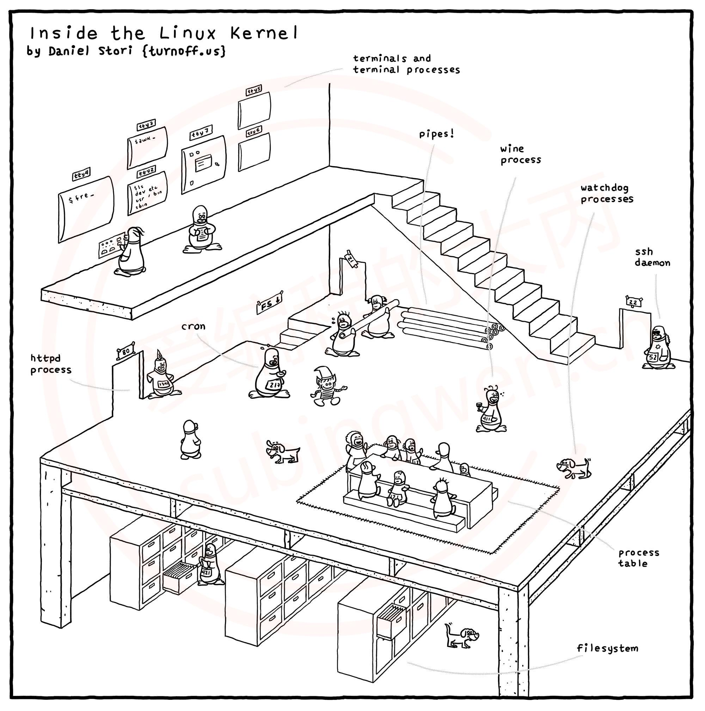](assets/linux-course/remote-1542fd0cbdb8-kernel.jpg)
#### 2. Linux 目录
> 与 Windows 下的文件组织结构不同，Linux 不使用磁盘分区符号来访问文件系统，而是将整个文件系统表示成树状的结构，Linux 系统每增加一个文件系统都会将其加入到这个树中。 操作系统文件结构的开始，只有一个单独的顶级目录结构，叫做`根目录`。所有一切都`从“根”开始，用“/”代表`，并且延伸到子目录。Linux 则通过“挂接”的方式把所有分区都放置在“根”下各个目录里。一个 Linux 系统的文件结构如下图所示。
##### 2.1 Linux目录结构
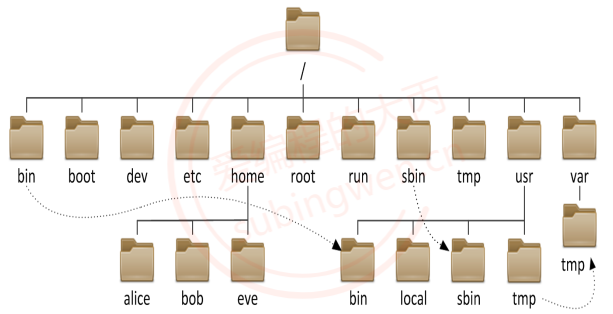
在linux中根目录的子目录结构相对是固定的(名字固定), 不同的目录功能是也是固定的
- `bin`: binary, 二进制文件目录, 存储了可执行程序, 今天要将的命令对应的可执行程序都在这个目录中
- `sbin`: super binary, root用户使用的一些二进制可执行程序
- `etc`: 配置文件目录, 系统的或者用户自己安装的应用程序的配置文件都存储在这个目录中
- `lib`: library, 存储了一些动态库和静态库，给系统或者安装的软件使用
- `media`: 挂载目录, 挂载外部设备，比如: 光驱, 扫描仪
- `mnt`: 临时挂载目录, 比如我们可以将U盘临时挂载到这个目录下
- `proc`: 内存使用的一个映射目录, 给操作系统使用的
- `tmp`: 临时目录, 存放临时数据, 重启电脑数据就被自动删除了
- `boot`: 存储了开机相关的设置
- `home`: 存储了普通用户的家目录，家目录名和用户名相同
- `root`: root用户的家目录
- `dev`: device , 设备目录, Linux中一切皆文件, 所有的硬件会抽象成文件存储起来，比如：键盘， 鼠标
- `lost+found`: 一般时候是空的, 电脑异常关闭/崩溃时用来存储这些无家可归的文件, 用于用户系统恢复
- `opt`: 第三方软件的安装目录
- `var`: 存储了系统使用的一些经常会发生变化的文件， 比如：日志文件
- `usr`: `unix system resource`, 系统的资源目录 `/usr/bin`: 可执行的二进制应用程序
- `/usr/games`: 游戏目录
- `/usr/include`: 包含的标准头文件目录
- `/usr/local`: 和`opt`目录作用相同, 安装第三方软件
> 对于用户自己的文件, 一般都是存放到自己的家目录中, 也就是 `/home/用户名`里边, 通过指定的相应的路径就可以找到这个文件了。关于路径的指定的有两种方式：`相对路径`和`绝对路径`。
```bash
# 这是在root用户的家目录中, 并且展示了家目录中的子目录的从属关系
[root@VM-8-14-centos ~]# tree
.
|-- ace
|   `-- brother
|       `-- finally
|           `-- die.txt
`-- luffy
    `-- get
        `-- onepiece
            `-- haha.txt
```
##### 2.2 相对路径
相对路径：相对路径就是相对于当前文件的路径。在Linux中有两个表示路径的特殊符号:
- `./`：代表目前所在的目录，也可以使用 `.`表示。
- `../`：代表当前目录的上一层目录，也可以使用 `..`表示。
```bash
[root@VM-8-14-centos ~]# cd luffy/get/onepiece/
```
- 以上边的目录为例, 从当前root家目录 `/root`, 进入到 `onepiece`目录使用相对路径
接下来研究一下相对路径的优缺点:
- 优点: 简洁, 目录相对较短, 书写方便
- 缺点: 变更工作目录之后, 使用相同的相对路径就找不到原来的文件了
##### 2.3 绝对路径
绝对路径：从系统磁盘起始节点开始描述的路径。
- Linux：起始节点为`根目录`，比如： `/root/luffy/get/onepiece`
- Windows: 起始节点为某个磁盘的盘符，比如：`f:\\root\\luffy\\get\\onepiece`
```bash
[root@VM-8-14-centos ~]# cd /root/luffy/get/onepiece/
```
- 以上边的目录为例, 从当前root家目录 `/root`, 进入到 `onepiece`目录使用绝对路径
接下来研究一下绝对路径的优缺点:
- 优点: 在操作系统的任意位置都可以通过绝对路径访问到对应的文件
- 缺点: 字符串较长, 书写起来比较麻烦, 看起来也不够简洁
#### 3. 命令解析器
> 在Linux中需要通过终端执行对应的命令来完成某些操作, 那么这些命令是如何被执行的呢? 这些命令都是通过命令解析器解析完成并执行的, 如果用户在终端输入是正确的内部指令, 命令解析器就执行这个命令, 如果不是正确的指令, 则提示命令无法解析。 下图是Windows是命令行窗口，平台虽然不同但是命令解析器的工作原理是相同的。
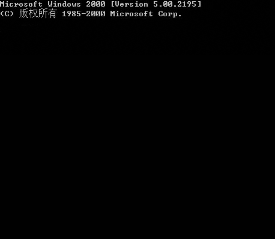
##### 3.1 工作原理
> 命令解析器在Linux操作系统中就是一个进程(运行的应用程序), 它的名字叫做`bash`通常我们更习惯将其称之为`shell (即: sh)`。他们之间的渊源是这样的，在`Unix`操作系统诞生之后一个叫伯恩(Bourne )的人为其编写了命令解析器取名为`shell`, `Linux`操作系统诞生之后伯恩再次改写了`shell (sh)`, 将其称之为`bash (Bourne Again SHell)`, bash 就是 sh 的增强版本。 在`Linux`操作系统中默认使用的命令解析器是 `bash`, 当然也同样支持使用`sh`。当用户打开一个终端窗口，并输入相关指令， 按回车键， 这时候命令解析器就开始工作了， 具体步骤如下：
```bash
# 通过 echo 命令可以查看环境变量 PATH 中的值, 在shell中变量名前加 $ 就是取值
[root@VM-8-14-centos ~]# echo $PATH
/usr/local/sbin:/usr/local/bin:/usr/sbin:/usr/bin:/root/bin
```
- 在Linux中有一个叫做`PATH`的环境变量, 里边存储了一些系统目录 (`windows也有, 叫 Path`)
- 命令解析器需要依次搜索 `PATH`中的各个目录, 检查这些目录中是否有用户输入的指令 如果找到了, 执行该目录下的可执行程序, 用户输入的命令就被执行完毕了
```bash
[root@VM-8-14-centos ~]# asdjflksd
-bash: asdjflksd: command not found
```
- 如果没有找到, 继续搜索其他目录, 最后还是没有找到, 会提示命令找不到, 因此无法被执行
##### 3.2 命令提示行
> 在Linux终端中, 输入要执行的指令之前会有想用的命令提示, 我们将其称之为命令提示行, 例如:
```bash
[root@VM-8-14-centos ~/luffy/get/onepiece]#
[robin@VM-8-14-centos ~/luffy/get/onepiece]$ 
```
- `root` : 当前登录的用户的用户名
- `@`: at -> 在
- `VM-8-14-centos`: 主机名, 在安装这个linux操作系统的时候手动指定, 可以修改 `~`: 当前用户的家目录 在linux中有很多用户, 每个用户都用一个属于自己的目录, 这个目录称之为家目录
- 普通用户家目录`/home/用户名`, root用户家目录 `/root`
- `~/luffy/get/onepiece`: 当前用户所在的工作目录, 也可以使用 `pwd`命令查看
- `#`: 代表当前用户是root用户
- `$`: 当前用户是普通用户, 也就是说例子中的 `robin`是一个普通用户
##### 3.3 命令行快捷键
> 我们在命令行输入一些指令的时候, 经常需要移动光标, 或者删除一些字符, 对应的一些快捷键操作如下表:
| 快捷键 | 功能 | 备注 |
| --- | --- | --- |
| Tab | 命令自动补齐 | 在终端中输入 某个命令的前一个或若干个字符, 再按Tab键 |
| Ctrl+p | 显示输入的上一个历史命令 | 从输入的最后一个命令往前倒, 也可以使用 ↑键 |
| Ctrl+n | 显示输入的下一个历史命令 | 也可以使用 ↓键 |
| Ctrl+a | 光标移动命命令行首 | 也可以使用 Home键 |
| Ctrl+e | 光标移动命命令行尾 | 也可以使用 End键 |
| Ctrl+u | 删除光标前的部分字符串 | 无 |
| Ctrl+k | 删除光标后的部分字符串 | 无 |
| → | 光标向右移动一个字符 | 无 |
| ← | 光标向右移动一个字符 | 无 |
| Backspace/Delete | 删除光标前/后的一个字符 | 无 |
关于Tab的补充:
- `由于很定shell命令的开头字母是相同的, 在这种情况下, 按一次Tab是不会自动补齐的，我们可以连续按两次Tab键，在当前终端中就可以显示出所有匹配成功的shell命令`
- 为了能够快速补全shell指令, 我们可以多输入一些前缀字符之后, 再按`Tab`键
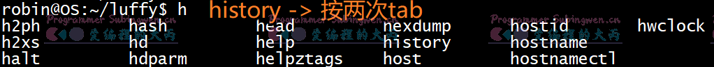
#### 4. 视频讲解
> 以上知识点对应的视频讲解可以关注 [B站-爱编程的大丙](https://space.bilibili.com/147020887) 视频地址: [https://www.bilibili.com/video/BV13U4y1p7kB](https://www.bilibili.com/video/BV13U4y1p7kB)

### 1.2 文件管理命令

> 原文：[《文件管理命令》](https://subingwen.cn/linux/file-commands/)　作者：苏丙榅　来源：爱编程的大丙

#### 1. cd 命令
> 在Linux终端中如果想要进行工作路径的切换, 需要使用`cd`命令。在进行目录的切换的时候， 我们可以使用相对路径也可以使用绝对路径。
```bash
$ cd 目录名
```
- 进入指定目录 `目录名`: 使用相对路径/绝对路径都可以, 该路径必须是一个有效路径
- `特殊的目录`: `..`: 表示当前目录的上一级目录, 使用`cd ..` 或者 `cd ../`都可以
- `.` : 表示当前目录, 使用 `.`或者`./`都可以, `cd .`不会切换目录
- 进入家目录 每个用户(普通用户和root)都有一个属于自己的目录, 比如: robin是普通用户, 家目录: /home/robin
- luffy是用户, 家目录: /home/luffy
- root是管理员用户, 家目录: /root
按照上边的格式来表示家目录书写起来比较麻烦, 有一种相对简单的写法就是使用 `~` 表示。如果是使用`cd`命令切换到家目录, 后边可以什么路径都不加, 这样也可以进入到当前用户的家目录。综上所述也就是通过`cd`进入到当前用户的家目录一共有三种不同的方式。
```bash
$ cd                    # 方式1
$ cd ~                  # 方式2
$ cd /home/用户名        # 方式3
```
```bash
# 通过cd进入到目录1:  /usr/include/c++/7.5.0/ext/pb_ds/detail/list_update_map_/
# 通过cd进入到目录2:  /home/luffy/get/onepiece/itis/a/goldfish
# 频繁在两个目录之间切换
$ cd -
```
- 在临近的两个目录之间切换 如果我们要频繁的在两个路径之间切换, 也有相关的快捷操作, 尤其是对于比较长的路径, 可以是这简直是一个福利:
#### 2. ls 命令
> `ls` 就是 list, 打印指定的文件信息, 如果是目录, 显示对应目录中有哪些子文件, 语法格式如下:
```bash
$ ls [args]           # 查看当前目录
$ ls [args] 目录名 	# 查看指定目录
$ ls [args] 文件名 	# 查看某个文件的信息
```
##### 2.1 显示所有文件
> 给 `ls`添加 `-a`参数（就是 `all `的意思）就可以显示指定目录中是所有文件了, 因为默认情况下具有隐藏属性的文件是不会显示出来的。那么在Linux中什么样是文件才能被隐藏呢？起始很简单只需要在文件名前边加一个点(`.`)文件就具有隐藏属性了， 例如： `.demo`, `.a.txt`
```bash
# 查看root家目录下所有非隐藏文件
[root@VM-8-14-centos ~]# ls
ace  luffy

# 查看root家目录下所有文件 (隐藏 + 非隐藏)
[root@VM-8-14-centos ~]# ls -a
.   ace            .bash_logout   .bashrc  .config  .lesshst  .pip  .pydistutils.cfg 
..  .bash_history  .bash_profile  .cache   .cshrc   luffy     .pki  .ssh  .viminfo
```
##### 2.2 显示文件详细信息
> 给 `ls`添加 `-l`参数（就是 `list `的意思）我们就可以看到文件的详细信息了, 里边的信息量还是非常大的, 其中包括: `文件类型`, `文件所有者对文件的操作权限`, `文件所属组用户对文件的操作权限`, `其他人对文件的操作权限`, `硬链接计数`, `文件所有者`, `文件所属组`, `文件大小`, `文件的修改日期`, `文件名`
```bash
# 显示文件的详细信息
robin@OS:~$ ls -l
total 204
-rw-rw-r--  1 robin robin    268 Mar 22 17:32 a.c
drwxrwxr-x  2 robin robin   4096 Aug  4  2019 config
-rw-r--r--  1 robin robin 129487 Dec 25 11:28 english.txt
drwxrwxr-x  4 robin robin   4096 Jan 15 17:48 libevent
drwxrwxr-x 17 robin robin   4096 Apr 13 22:42 Linux
drwxrwxr-x  8 robin robin   4096 Feb  5 16:57 luffy
-rw-r--r--  1 robin robin   2223 Mar  2 14:39 main.cpp
-rw-rw-r--  1 robin robin   2167 Dec  1 22:41 mysql_test.c
drwxrwxr-x  9 robin robin   4096 Mar 26 19:19 network
-rw-r--r--  1 robin robin   1406 Mar  2 20:18 occi.cpp
drwxrwxr-x  3 robin robin   4096 Oct 30 12:09 oradiag_robin
drwxrwxr-x 11 robin robin   4096 Mar 26 09:40 package
drwxrwxr-x  2 robin robin   4096 Dec 29 17:11 process
drwxrwxr-x 17 robin robin   4096 Mar 29 22:31 projects
-rw-r--r--  1 robin robin   1816 Jan  6 09:37 sidtime.c
drwxrwxr-x  2 robin robin   4096 Mar 22 11:31 socket
-rw-r--r--  1 robin robin    583 Oct 18 17:21 test.c
-rw-r--r--  1 robin robin   2015 Mar  1 17:05 test.cpp
-rw-rw-r--  1 robin robin   2218 Dec  2 17:02 test_mysql.c
drwxrwxr-x  5 robin robin   4096 Jan 13 17:35 udp

# 文件详细信息介绍
 d      rwx       rwx     r-x     5    robin    robin    4096    Jan 13 17:35    udp
 |       |         |       |      |      |        |       |          |	          |
文件    文件所    文件所   其他人 硬链接  文件     文件   文件大小  文件修改时间     文件名
类型   有者权限  属组权限  权限   计数   所有者   所属组    
```
在查看文件详细信息的时候, 还有一种简单的写法, 可以使用`ll`命令：
- 有些版本的Linux中`ll 等价于 ls -l`；
- 有些版本的Linux中`ll 等价于 ls -laF`；
###### 2.2.1 文件类型
> 在Linux操作系统中, 一共有7中文件类型, 这7中类型是根据文件属性进行划分的, 而不是根据文件后缀划分的。
1. `-`: 普通的文件, 在Linux终端中没有执行权限的为白色, 压缩包为红色, 可执行程序为绿色字体
1. `d`: 目录(directory), 在Linux终端中为蓝色字体, 如果目录的所有权限都是开放的, 有绿色的背景色
1. `l`: 软链接文件(link), 相当于windows中的快捷方式, 在Linux终端中为淡蓝色(青色)字体
1. `c`: 字符设备(char), 在Linux终端中为黄色字体
1. `b`: 块设备(block), 在Linux终端中为黄色字体
1. `p`: 管道文件(pipe), 在Linux终端中为棕黄色字体
1. `s`: 本地套接字文件(socket), 在Linux终端中为粉色字体
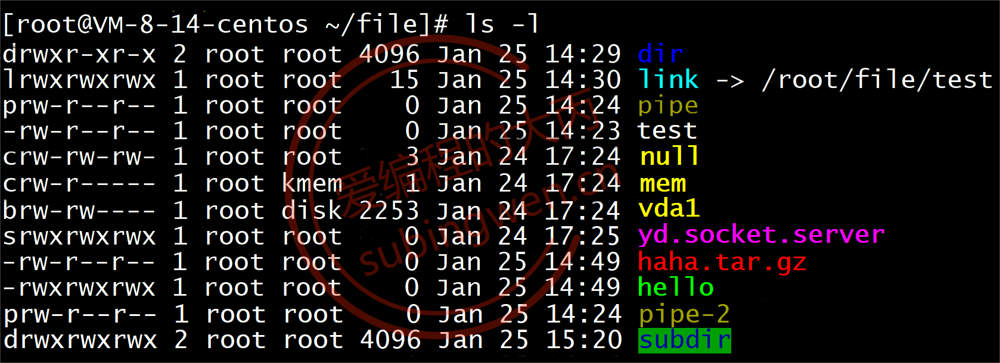
###### 2.2.2 用户类型
> 在Linux中有三大类用户: `文件所有者`, `文件所属组用户`, `其他人`, 我们可以对同一个文件给这三种人设置不同的操作权限, 用于限制用户对文件的访问。
- 文件所有者 Linux中的所有的文件都有一个所有者, 就是文件的主人
- 文件所属组 文件的主人属于哪个组, 这个文件默认也就属于哪个组
- 用户组中可以有多个用户, 这些组中的其他用户和所有者的权限可以是不一样的
- 其他人 这个用户既不是文件所有者也不是文件所属组中的用户，就称之为其他人
- 其他人对文件也可以拥有某些权限

###### 2.2.3 文件权限
> Linux中不同的用户可以对文件拥有不同的操作权限, 权限一共有四种: `读权限`, `写权限`, `执行权限`, `无权限`。
- 读权限：使用 `r`表示, 即: `read`
- 写权限：使用 `w`表示, 即: `write`
- 执行权限：使用 `x`表示, 即: `excute`
- 没有任何权限：使用`-`表示
```bash
   -           rwx          rw-          r--  1 robin robin   2218 Dec  2 17:02 app
   |            |            |            |
文件类型      文件所有      文件所属     其他人权限
             者权限        组权限
```
从上边的例子中可以看出:
- 文件所有者对文件有`读、写、执行权限`
- 文件所属组用户对文件有 `读、写权限, 没有执行权限`
- 其他人对文件有 `读权限, 没有写、执行权限`
###### 2.2.4 硬链接计数
> 硬链接计数是一个整数，如果这个数为N(`N>=1`)，就说明在一个或者多个目录下一共有N个文件, 但是这N个文件并不占用多块磁盘空间, 他们使用的是同一块, 如果通过其中一个文件修改了磁盘数据, 那么其他文件中的内容也就变了。每当我们给给磁盘文件创建一个硬链接（`使用 ln`），磁盘上就会出现一个新的文件名，硬链接计数加1，但是这新文件并不占用任何的磁盘空间，文件名还是映射到原来的磁盘地址上。 下图中为大家展示了给文件创建硬链接, 和直接进行文件拷贝的区别, `创建硬链接只是多了一个新的文件名, 拷贝文件不仅多了新的文件名在磁盘上数据也进行了拷贝`
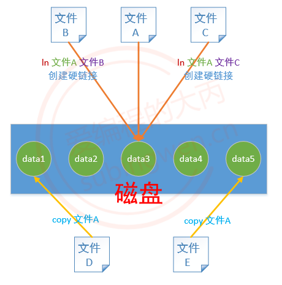
###### 2.2.5 其他属性
> 关于`ls -l`得到的其他属性相对比较简单, 最后再给大家介绍一下:
- 文件大小 —> `单位是字节` 如果文件是目录显示为`4096`, 这是目录自身大小, 不包括目录中的文件大小
- 文件日期: 显示的是文件的修改日期, 只要文件被更新, 日期也会随之变化
- 文件名: 文件自己的名字（没啥可解释的） 如果文件类型是软连接会这样显示：` link -> /root/file/test`, 后边的路径表示快捷方式链接的是哪个磁盘文件
##### 2.3 其他参数
###### 2.3.1 单位显示
> 在查看文件大小的时候, 如果文件比较大对应的数组自然也就很大, 我们还需要基于字节进行相关的换算, 不能直观得到我们想要的结果, 如果数学不好, 我们可以使用一个参数 `-h (human)`(就是命令说人话)。
```bash
# 直接查看文件大小
[root@VM-8-14-centos ~]# ls -l ipc.tar.gz 
-rw-r--r-- 1 root root 122962 Apr 25  2020 ipc.tar.gz

# 添加 -h 参数查看文件大小
[root@VM-8-14-centos ~]# ls -lh ipc.tar.gz 
-rw-r--r-- 1 root root 121K Apr 25  2020 ipc.tar.gz
```
###### 2.3.2 显示目录后缀
> 在查看文件信息的时候, 处理通过文件类型区分该文件是不是一个目录之外, 还可以通过一个参数 `-F`在目录名后边显示一个`/`, 这样就可以直接区分出来了。
```bash
# 直接查看文件信息
[root@VM-8-14-centos ~/file]# ls -l
total 8
drwxr-xr-x 2 root root 4096 Jan 25 14:29 dir
-rw-r--r-- 1 root root    0 Jan 25 14:49 haha.tar.gz
-rwxrwxrwx 1 root root    0 Jan 25 14:49 hello
lrwxrwxrwx 1 root root   15 Jan 25 14:30 link -> /root/file/test
prw-r--r-- 1 root root    0 Jan 25 14:24 pipe-2
drwxrwxrwx 2 root root 4096 Jan 25 15:20 subdir
-rw-r--r-- 1 root root    0 Jan 25 14:23 test

# 添加了 -F 参数查看文件信息
[root@VM-8-14-centos ~/file]# ls -lF
total 8
drwxr-xr-x 2 root root 4096 Jan 25 14:29 dir/
-rw-r--r-- 1 root root    0 Jan 25 14:49 haha.tar.gz
-rwxrwxrwx 1 root root    0 Jan 25 14:49 hello*
lrwxrwxrwx 1 root root   15 Jan 25 14:30 link -> /root/file/test
prw-r--r-- 1 root root    0 Jan 25 14:24 pipe-2|
drwxrwxrwx 2 root root 4096 Jan 25 15:20 subdir/
-rw-r--r-- 1 root root    0 Jan 25 14:23 test
```
#### 3. 创建删除目录
```bash
# 单层目录
$ mkdir 新目录的名字

# 多层目录, 需要加参数 -p
$ mkdir parent/child/baby1/baby2 -p
```
- 创建目录 目录的创建分为两种, 一种是创建单个目录, 另一种是一次性创建多层目录, 使用的命令是`mkdir`, 后边参数是要创建的目录的名字, 如果是多层目录需要添加参数`-p`。 关于创建的目录所在的路径可以是相对路径， 也可以是绝对路径。
- 删除目录 如果要删除已经存在的路径一共有两种方式, 可以使用`rmdir`或者`rm` `rmdir`: 只能删除空目录，有点low，不好用
- `rm`: 可以删除文件也可以删除目录, 如果删除的的是目录, 需要加参数 `-r`, 意思是递归(recursion)
`rm`命令还有另外两个经常使用的参数:
- `-i`: 删除的时候给提示
- `-f`: 强制删除文件, 没有提示直接删除并且不能恢复, 慎用
```bash
# 1. low, 矮穷矬, 只能删除空目录
$ rmdir 目录名

# 2. 高大上, 可以删除目录也可以删除文件
# 删除目录需要加参数 -r, 递归的意思, 删除之后是不能恢复的
$ rm 目录名  -r
```
#### 4. cp 命令
> cp 就是copy, 拷贝, 使用这个命令可以拷贝文件也可以拷贝目录
```bash
# `语法: cp 要拷贝的文件  得到的文件`

# `场景1: 文件A, 将A拷贝一份得到文件B`
$ cp 文件A 文件B

# `场景2: 文件A存在的, 文件B也是存在的, 执行下边的拷贝 ==> 文件A覆盖文件B`
$ cp 文件A 文件B
```
- 拷贝文件 => `文件不存在得到新文件, 文件存在就覆盖`
```bash
# 拷贝目录需要参数 -r
# 场景1: 目录A, 通过拷贝得到不存在的目录B
$ cp 目录A 目录B -r

# 场景2: 目录A存在的, 目录B也是存在的, 执行下边的拷贝 ==> 目录A会被拷贝并将其放到目录B中
$ cp 目录A 目录B -r

# 场景3: 把A目录里的某一个或者多个文件拷贝到B目录中
$ cp A/a.txt B	# 拷贝 A目录中的 a.txt 到目录B中
$ cp A/* B -r	# 拷贝 A目录中的所有文件到目录B中, 不能确定A目录中是否有子目录, 因此需要加 -r
```
- 拷贝目录 ==> `目录不存在得到新目录, 该目录被拷贝到存在的目录中`
#### 5. mv 命令
> mv 就是move, 这个Linux命令既能移动文件所在目录也可以给文件改名。
```bash
# 语法: mv 要移动的文件  目录
# 有一个文件A, 移动到目录B中
# 其中A可以是文件也可以是目录, B必须是目录而且必须是存在的
$ mv A B
```
- 文件的移动
```bash
# 语法: mv 要改名的文件  新名字(原来是不存在的，这点很重要)
# 其中A可以是文件也可以是目录，并且是存在的, B原来是不存在的
$ mv A B
```
- 文件改名
```bash
# 语法: mv 存在文件A  存在的文件B
# 其中A是文件（非目录）并且是存在的, B也是一个文件（非目录）并且也存在
# A文件中的内容覆盖B文件中的内容, A文件被删除, 只剩下B文件
$ mv A B
```
- 文件覆盖
#### 6 查看文件内容
> 如果想要查看文件内容方式有很多, 最常用的是`vim`, 下面介绍一下`vim`以外的一些的一些方式:
```bash
$ cat 文件名
```
- cat 该命令可以将文件内容显示到终端, 由于终端是有缓存的, 因此能显示的字节数也是受限制的。 `如果文件太大数据就不能完全显示出来了，因此该命令适合查看比较小的文件内容。`
```bash
$ more 文件名
# 快捷键
- 回车: 显示下一行
- 空格: 向下滚动一屏
- b: 返回上一屏
- q: 退出more
```
- more 该命令比`cat`要高级一点, 我们可以以翻屏的方式查看文件中的内容，使用方式如下：
```bash
$ less 文件名
# 快捷键
- b: 向上翻页
- 空格: 向后翻页
- 回车: 显示下一行
- 上下键: 上下滚动
- q:退出
```
- less 该命令和`more`命令差不多, 我们可以以翻屏的方式查看文件中的内容，使用方式如下：
```bash
# 默认显示文件的前10行
$ head 文件名
# 指定显示头部的前多少行
$ head -行数 文件名
```
- head 使用该命令可以查看文件头部的若干行信息, 使用方式如下:
```bash
# 默认显示文件的后10行
$ tail 文件名
# 指定显示尾部的最后多少行
$ tail -行数 文件名
```
- tail 使用该命令可以查看文件尾部的若干行信息, 使用方式如下:
#### 7. 链接的创建
> 链接分两种类型: `软连接`和`硬链接`。软连接相当于windows中的快捷方式，硬链接前边也已经介绍过了文件并不会进行拷贝，只是多出一个新的文件名并且硬链接计数会加1。
```bash
# 语法: ln -s 源文件路径 软链接文件的名字(可以带路径)

# 查看目录文件
[root@VM-8-14-centos ~/luffy]# ll
total 8
drwxr-xr-x 3 root root 4096 Jan 25 17:27 get
-rw-r--r-- 1 root root   37 Jan 25 17:26 onepiece.txt

# 给 onepiece.txt 创建软连接, 放到子目录 get 中
[root@VM-8-14-centos ~/luffy]# ln -s /root/luffy/onepiece.txt get/link.lnk  
[root@VM-8-14-centos ~/luffy]# ll get
total 4
lrwxrwxrwx 1 root root   24 Jan 25 17:27 link.lnk -> /root/luffy/onepiece.txt
drwxr-xr-x 2 root root 4096 Jan 24 21:37 onepiece
```
- 软连接 shell1234567891011121314 **在创建软链接的时候， 命令中的 `源文件路径`建议使用绝对路径, 这样才能保证创建出的软链接文件在任意目录中移动都可以访问到链接的那个源文件。
```bash
# 语法: ln 源文件 硬链接文件的名字(可以带路径)

# 创建硬链接文件, 放到子目录中
[root@VM-8-14-centos ~/luffy]# ln onepiece.txt get/link.txt

# 查看链接文件和硬链接计数, 从 1 --> 2
[root@VM-8-14-centos ~/luffy]# ll get
total 8
lrwxrwxrwx 1 root root   24 Jan 25 17:27 link.lnk -> /root/luffy/onepiece.txt
-rw-r--r-- 2 root root   37 Jan 25 17:26 link.txt
drwxr-xr-x 2 root root 4096 Jan 24 21:37 onepiece
```
- 硬链接 shell1234567891011 **硬链接和软链接不同, 它是通话文件名直接找对应的硬盘地址, 而不是基于路径, 因此 `源文件`使用相对路径即可, 无需为其制定绝对路径。 `目录是不允许创建硬链接的。`
#### 8. 文件属性
> 文件属性相关的命令主要是修改用户对文件的操作权限, 文件所有者, 文件所属组的相关信息。
##### 8.1 修改文件文件权限
> 文件权限是针对`文件所有者`, `文件所属组用户`, `其他人`这三类人而言的, 对应的操作指令是`chmod`。设置方式也有两种，分别为`文字设定法`和`数字设定法`。 文字设定法是通过一些关键字`r`, `w`, `x`, `-`来描述用户对文件的操作权限。 数字设定法是通过一些数字 `0`, `1`, `2`, `4`, `5`, `6`, `7` 来描述用户对文件的操作权限。
```bash
#chmod
# 语法格式: chmod who [+|-|=] mod 文件名
	- who:
		- u: user  -> 文件所有者
		- g: group -> 文件所属组用户
		- o: other -> 其他
		- a: all, 以上是三类人 u+g+o
	- 对权限的操作:
		+: 添加权限
		-: 去除权限
		=: 权限的覆盖
	- mod: 权限
		r: read, 读
		w: write, 写
		x: execute, 执行
		-: 没有权限
		
# 将文件所有者权限设置为读和执行, 也就是权限覆盖
robin@OS:~/Linux$ chmod u=rx b.txt 
robin@OS:~/Linux$ ll b.txt         
-r-xrw-r-- 2 robin robin 2929 Apr 14 18:53 b.txt*

# 给其他人添加写和执行权限
robin@OS:~/Linux$ chmod o+wx b.txt 
robin@OS:~/Linux$ ll b.txt         
-r-xrw-rwx 2 robin robin 2929 Apr 14 18:53 b.txt*

# 给文件所属组用户去掉读和执行权限
robin@OS:~/Linux$ chmod g-rx b.txt 
robin@OS:~/Linux$ ll b.txt         
-r-x-w-rwx 2 robin robin 2929 Apr 14 18:53 b.txt*

# 将文件所有者,文件所属组用户,其他人权限设置为读+写+执行
robin@OS:~/Linux$ chmod a=rwx b.txt
robin@OS:~/Linux$ ll b.txt 
-rwxrwxrwx 2 robin robin 2929 Apr 14 18:53 b.txt*
```
- 文字设定法
```bash
# 语法格式: chmod [+|-|=] mod 文件名
	- 对权限的操作:
		+: 添加权限
		-: 去除权限
		=: 权限的覆盖, 等号可以不写
	- mod: 权限描述, 所有权限都放开是 7
		- 4: read, r
		- 2: write, w
		- 1: execute , x
		- 0: 没有权限
		
# 分解: chmod 0567 a.txt

    0           5           6             7
  八进制     文件所有者  文件所属组用户    其他人
              r + x       r + w         r+w+x

######################### 举例 #########################
# 查看文件 c.txt 的权限			   
robin@OS:~/Linux$ ll c.txt 
-rwxrwxrwx 2 robin robin 2929 Apr 14 18:53 c.txt*

# 文件所有者去掉执行权限, 所属组用户去掉写权限, 其他人去掉读+写权限
robin@OS:~/Linux$ chmod -123 c.txt
robin@OS:~/Linux$ ll c.txt 
-rw-r-xr-- 2 robin robin 2929 Apr 14 18:53 c.txt*

# 文件所有者添加执行权限, 所属组用户和其他人权限不变
robin@OS:~/Linux$ chmod +100 c.txt
robin@OS:~/Linux$ ll c.txt 
-rwxr-xr-- 2 robin robin 2929 Apr 14 18:53 c.txt*

# 将文件所有者,文件所属组用户,其他人权限设置为读+写, 没有执行权限
robin@OS:~/Linux$ chmod 666 c.txt
robin@OS:~/Linux$ ll c.txt 
-rw-rw-rw- 2 robin robin 2929 Apr 14 18:53 c.txt
```
- 数字设定法
##### 8.2 修改文件所有者
> 默认情况下, 文件是通过哪个用户创建出来的, 就属于哪个用户, 这个用户属于哪个组, 文件就属于哪个组。如果有特殊需求，可以修改文件所有者，对应的操作命令是`chown`。因为修改文件所有者就跨用户操作, 普通用户没有这个权限, 需要借助管理员权限才能完成该操作。 `普通用户借助管理员权限执行某些shell命令, 需要在命令前加关键字sudo, 但是普通用户默认是没有使用 sudo的资格的, 需要修改 /etc/sudoers 文件 `。 [**普通用户添加sudo权限](https://subingwen.cn/linux/sudoers/)
```bash
# 语法1-只修改所有者: 
$ sudo chown 新的所有者 文件名

# 语法2-同时修改所有者和所属组: 
$ sudo chown 新的所有者:新的组名 文件名

# 查看文件所有者：b.txt 属于 robin 用户
robin@OS:~/Linux$ ll b.txt 
-rw-rw-rw- 2 robin robin 2929 Apr 14 18:53 b.txt

# 将 b.txt 的所有者修改为 luffy
robin@OS:~/Linux$ sudo chown luffy b.txt
[sudo] password for robin: 
robin@OS:~/Linux$ ll b.txt 
-rw-rw-rw- 2 luffy robin 2929 Apr 14 18:53 b.txt

# 修改文件所有者和文件所属组
# 查看文件所有者和所属组
robin@OS:~/Linux$ ll b.txt 
-rw-rw-rw- 2 luffy robin 2929 Apr 14 18:53 b.txt

# 同时修改文件所有者和文件所属组
robin@OS:~/Linux$ sudo chown robin:luffy b.txt 
robin@OS:~/Linux$ ll b.txt 
-rw-rw-rw- 2 robin luffy 2929 Apr 14 18:53 b.txt
```
##### 8.3 修改文件所属组
> 普通用户没有修改文件所属组的权限, 如果需要修改需要借助管理员权限才能完成，需要使用的命令是`chgrp`。当然了这个属性的修改也可以使用`chown`命令来完成。
```bash
# 只修改文件所属的组, 普通用户没有这个权限, 借助管理员的权限
# 语法: sudo chgrp 新的组 文件名

# 查看文件所属组信息
robin@OS:~/Linux$ ll b.txt 
-rw-rw-rw- 2 robin luffy 2929 Apr 14 18:53 b.txt

# 修改文件所属的组
robin@OS:~/Linux$ sudo chgrp robin b.txt 
robin@OS:~/Linux$ ll b.txt 
-rw-rw-rw- 2 robin robin 2929 Apr 14 18:53 b.txt
```
#### 9. 其他命令
##### 9.1 tree命令
> 该命令的作用是`以树状结构显示目录`, tree工具默认是没有的, 需要手动安装, 系统版本不同安装方式也不尽相同: ubuntu: `sudo apt install tree` centos: `sudo yum install tree` 如果是基于管理员用户安装软件，不需要加sudo。该命令有一个常用参数 `-L`, 即 (layer) 显示目录的层数。
```bash
# 语法格式
$ tree [-L n]         # 查看当前目录的结构, n为显示的目录层数
$ tree 目录名  [-L n]	# 查看指定目录的结构, n为显示的目录层数

# 只显示1层
[root@VM-8-14-centos ~]# tree -L 1
.
|-- ace
|-- file
|-- ipc.tar.gz
|-- link.lnk -> /root/luffy/onepiece.txt
`-- luffy

# 显示2层目录
[root@VM-8-14-centos ~]# tree -L 2
.
|-- ace
|   `-- brother
|-- file
|   |-- dir
|   |-- haha.tar.gz
|   |-- hello
|   |-- link -> /root/file/test
|   |-- pipe-2
|   |-- subdir
|   `-- test
|-- ipc.tar.gz
|-- link.lnk -> /root/luffy/onepiece.txt
`-- luffy
    |-- get
    `-- onepiece.txt
```
##### 9.2 pwd命令
> pwd命令用户当前所在的工作目录, 没有参数, 直接执行该命令即可。
```bash
# 查看当前用户在哪个目录中, 所在的目录一般称之为工作目录
[root@VM-8-14-centos ~/luffy/get/onepiece]# pwd
/root/luffy/get/onepiece		# 当前工作目录
```
##### 9.3 touch命令
> 使用`touch`命令可以创建一个`新的空文件`, 如果指定的文件是已存在的, 只会更新文件的修改日期, 对内容没有任何影响。
```bash
# 语法: touch 文件名

# 查看目录信息
[root@VM-8-14-centos ~/luffy]# ll
total 8
drwxr-xr-x 3 root root 4096 Jan 25 17:38 get
-rw-r--r-- 2 root root   37 Jan 25 17:26 onepiece.txt

# 创建一个新的文件 robin.txt
[root@VM-8-14-centos ~/luffy]# touch robin.txt

# 再次查看目录中的文件信息, 发现 robin.txt是空的, 大小为 0
[root@VM-8-14-centos ~/luffy]# ll
total 8
drwxr-xr-x 3 root root 4096 Jan 25 17:38 get
-rw-r--r-- 2 root root   37 Jan 25 17:26 onepiece.txt
-rw-r--r-- 1 root root    0 Jan 25 17:54 robin.txt

# touch 后的参数指定一个已经存在的文件名
[root@VM-8-14-centos ~/luffy]# touch onepiece.txt 

# 继续查看目录中的文件信息, 发现文件时间被更新了: 37 Jan 25 17:26 --> 37 Jan 25 17:54
[root@VM-8-14-centos ~/luffy]# ll
total 8
drwxr-xr-x 3 root root 4096 Jan 25 17:38 get
-rw-r--r-- 2 root root   37 Jan 25 17:54 onepiece.txt
-rw-r--r-- 1 root root    0 Jan 25 17:54 robin.txt
```
##### 9.4 which命令
> which命令可以查看要执行的命令所在的实际路径, 命令解析器工作的时候也会搜索这个目录。`需要注意的是该命令只能查看非内建的shell指令所在的实际路径, 有些命令是直接写到内核中的, 无法查看`。 我们使用的大部分shell命令都是放在系统的`/bin`或者`/usr/bin`目录下:
```bash
# 由于使用的Linux版本不同, 得到的路径也会有不同
[root@VM-8-14-centos ~]# which ls
alias ls='ls --color=auto'
        /usr/bin/ls
        
[root@VM-8-14-centos ~]# which date
/usr/bin/date

[root@VM-8-14-centos ~]# which cp
alias cp='cp -i'
        /usr/bin/cp
        
[root@VM-8-14-centos ~]# which mv
alias mv='mv -i'
        /usr/bin/mv
        
[root@VM-8-14-centos ~]# which pwd
/usr/bin/pwd
```
##### 9.5 重定向命令
> 关于重定向使用最多的是就是`输出重定向`, 顾名思义就是修改输出的数据的位置, 通过重定向操作我们可以非常方便的进行文件的复制, 或者文件内容的追加。输出重定向使用的不是某个关键字而是符号 `>`或者`>>`。 `>`: 将文件内容写入到指定文件中, 如果文件中已有数据, 则会使用新数据覆盖原数据 `>>`: 将输出的内容追加到指定的文件尾部
```bash
# 输出的重定向举例: printf默认是要将数据打印到终端, 可以修改默认的输出位置 => 重定向到某个文件中
# 关键字 >
# 执行一个shell指令, 获得一个输出, 这个输出默认显示到终端, 如果要将其保存到文件中, 就可以使用重定向
# 如果当前目录下test.txt不存在, 会被创建, 如果存在, 内容被覆盖
$ date > test.txt
# 日期信息被写入到文件 test.txt中
robin@OS:~/Linux$ cat test.txt 
Wed Apr 15 09:37:52 CST 2020

# 如果不希望文件被覆盖, 而是追加, 需要使用 >>
in@OS:~/Linux$ date >> test.txt
# 日期信息被追加到 test.txt中
robin@OS:~/Linux$ cat test.txt 
Wed Apr 15 09:37:52 CST 2020
Wed Apr 15 09:38:44 CST 2020

# 继续追加信息
robin@OS:~/Linux$ date >> test.txt
robin@OS:~/Linux$ cat test.txt    
Wed Apr 15 09:37:52 CST 2020
Wed Apr 15 09:38:44 CST 2020
Wed Apr 15 09:39:03 CST 2020
```
#### 10. 视频讲解
> 以上知识点对应的视频讲解可以关注 [B站-爱编程的大丙](https://space.bilibili.com/147020887) 视频地址: [https://www.bilibili.com/video/BV13U4y1p7kB](https://www.bilibili.com/video/BV13U4y1p7kB)

### 1.3 用户管理命令

> 原文：[《用户管理命令》](https://subingwen.cn/linux/user-commands/)　作者：苏丙榅　来源：爱编程的大丙

#### 1. 切换用户
> Linux是一个多用户的操作系统, 可以同时登陆多个用户, 因此很多时候需要在多个用户之间切换, 用户切换需要使用`su`或者`su -`。使用`su`只切换用户, 当前的工作目录不会变化, 但是使用 `su -`不仅会切换用户也会切换工作目录, 工作目录切换为当前用户的家目录。 从用户A切换到用户B， 如果还想再切换回用户A，可以直接使用 `exit`。
```bash
# 只切换用户, 工作目录不变
$ su 用户名
# 举例:
robin@OS:~/Linux$ su luffy
Password:                       # 需要输入luffy用户的密码
luffy@OS:/home/robin/Linux$	    # 工作目录不变

# 切换用户和工作目录, 会自动跳转到当前用户的家目录中
$ su - 用户名
# 举例:
robin@OS:~/Linux$ su - luffy
Password: 		# 需要输入luffy用户的密码
luffy@OS:~$ pwd
/home/luffy		# 工作目录变成了luffy的家目录

# 回到原来的用户
$ exit
```
#### 2. 添加删除用户
> 作为一个普通用户是没有给系统添加新用户这个权限的, 如果想要添加新用户可以先切换到root用户, 或者基于普通用户为其添加管理员权限来完成新用户的添加。添加新用户需要使用`adduser/useradd`命令来完成。 普通用户没有添加/删除用户的权限, 需要授权, [**给普通用于添加sudo权限](https://subingwen.cn/linux/sudoers/)
##### 2.1 添加新用户
```bash
# 添加用户
# sudo -> 使用管理员权限执行这个命令
$ sudo adduser 用户名

# centos
$ sudo useradd 用户名

# ubuntu
$ sudo useradd -m -s /bin/bash  用户名

# 在使用 adduser 添加新用户的时候，有的Linux版本执行完命令就结束了，有的版本会提示设置密码等用户信息
robin@OS:~/Linux$ sudo adduser lisi
Adding user `lisi' ...
Adding new group `lisi' (1004) ...
Adding new user `lisi' (1004) with group `lisi' ...
Creating home directory `/home/lisi' ...
Copying files from `/etc/skel' ...
Enter new UNIX password: 
Retype new UNIX password: 
passwd: password updated successfully
Changing the user information for lisi
Enter the new value, or press ENTER for the default
        Full Name []: 
        Room Number []: 
        Work Phone []: 
        Home Phone []: 
        Other []: 
Is the information correct? [Y/n] y
```
> 当新用户添加完毕之后, 我们可以切换到新添加的用户下, 用来检测是否真的添加成功了, 另外我们也可以使用其他方式来检验, 首先在 `/home`目录中会出现一个和用户名同名的目录, 这就是新创建的用户的家目录, 另外我们还可以查看 `/etc/passwd`文件, 里边记录着新添加的用户的更加详细的信息:

##### 2.2 删除用户
> 删除用户并不是将`/home`下的用户家目录删除就完事儿了, 我们需要使用`userdle`命令才能删除用户在系统中的用户ID和所属组ID等相关信息，`但是需要注意的是在某些Linux版本中用户虽然被删除了， 但是它的家目录却没有被删除，需要我们手动将其删除。`
```bash
# 删除用户, 添加参数 -r 就可以一并删除用户的家目录了
$ sudo userdel 用户名 -r

# 删除用户 lisi
$ sudo userdel lisi -r

# 使用deluser不能添加参数-r, 家目录不能被删除, 需要使用 rm 命令删除用户的家目录, 比如:
$ sudo rm /home/用户名 -r
```
由于Linux的版本很多, 删除用户对应的操作指令不是唯一的, 经测试在 `CentOS 版本只支持 userdel命令`, 在`Ubuntu中既支持 userdel 也支持 deluser命令`。
#### 3. 添加删除用户组
> 默认情况下, 只要创建新用户就会得到一个同名的用户组, 并且这个用户属于这个组。一般情况下不需要创建新的用户组，如果有需求可以使用 `groupadd`添加用户组, 使用 `groupdel`删除用户组。 由于普通用户没有添加删除用户组权限，因此需要在管理员（root）用户下操作，或者在普通用户下借助管理员权限完成该操作。
```bash
# 基于普通用户创建新的用户组
$ sudo groupadd 组名

# 基于普通用户删除已经存在的用户组
$ sudo groupdel 组名
```
如果验证用户组是否添加成功了, 可以查看 `/etc/group`文件, 里边有用户组相关的信息:

在Ubuntu中添加删除用户组可以使用 `addgroup/groupadd` 和 `delgroup/groupdel`
在CentOS中添加和删除用户只能使用 `groupadd` 和 `groupdel`
我们只需要通过 `which 命令名` 查看，就能知道该Linux版本是不是支持使用该命令了。
#### 4. 修改密码
> Linux中设置用户密码和修改用户密码的方式是一样的, 修改用户密码又分几种情况: `修改当前用户密码`, `普通用户A修改其他普通用户密码`, `普通用户A修改root用户密码`, `root用户修改普通用户密码`。修改密码需要使用`passwd`命令。当创建了一个普通用户却没有提示指定密码, 或者忘记了用户密码都可以通过该命令来实现自己重置密码的需求。
- 当前用户修改自己的密码, 默认是有权限操作的
- 当前普通用户修改其他用户密码, 默认没有权限, 需要借助管理员权限才能完成操作
- 当前普通用户修改root用户密码, 默认没有权限, 需要借助管理员权限才能完成操作
- root用户修改其他普通用户密码, 默认有权限, 可以直接修改
```bash
# passwd
# 修改当前用户
$ passwd

# 修改非当前用户密码
$ sudo passwd 用户名

# 修改root
$ sudo passwd root
```
通过以上介绍的相关命令我们可以知道，如果让一个普通用户可以使用管理员权限执行一些指令其实是非常危险的的， 因此普通用户默认是没有使用 `sudo`的权限的, 必须授权才能使用，工作场景中授权操作一定要慎重，要三思。
#### 5. 视频讲解
> 以上知识点对应的视频讲解可以关注 [B站-爱编程的大丙](https://space.bilibili.com/147020887) 视频地址: [https://www.bilibili.com/video/BV13U4y1p7kB](https://www.bilibili.com/video/BV13U4y1p7kB)

### 1.4 压缩命令

> 原文：[《压缩命令》](https://subingwen.cn/linux/commpress/)　作者：苏丙榅　来源：爱编程的大丙

不管是在Linux还是其他操作系统中，关于数据的压缩和解压缩操作是经常被用到的。由于在windows平台文件的相关操作被傻瓜化了，到了Linux平台让好多小伙伴感觉有点束手无策，本篇文章中主要为大家讲解基于Linux的常用压缩包操作，格式包含：`tar.gz`, `.tgz`, `.tar.bz2`, `.zip`, `.rar`, `.tar.xz`。
#### 1. tar
在Linux操作系统中默认自带两个原始的压缩工具分别是 `gzip`和`bzip2`, 但是它们都有先天的缺陷, `不能打包压缩文件, 每个文件都会生成一个单独的压缩包, 并且压缩之后不会保留原文件`， 这是一件叔能忍婶也不能忍的事情。
Linux中自带一个打包工具，叫做`tar`, 默认情况下该工具是不能进行压缩操作的，在这种情况下`tar`和`gzip`, `bzip2`就联姻了, 各自发挥各自的优势, Linux下最强大的打包压缩工具至此诞生。
我们在使用`tar`进行压缩和解压缩的时候, 只需要指定相对用的参数, 在其内部就会调用对应的压缩工具`gzip`或者`bzip2`完成指定的操作。
##### 1.1 压缩 (.tar.gz .tar.bz2 .tgz)
> 如果使用`tar`完成文件压缩, 涉及的参数如下, 在使用过程中参数没有先后顺序:
- `c`: 创建压缩文件
- `z`: 使用`gzip`的方式进行文件压缩
- `j`: 使用`bzip2`的方式进行文件压缩
- `v`: 压缩过程中显示压缩信息, 可以省略不写
- `f`: 指定压缩包的名字
> 一般认为 `.tgz` 文件就等同于 `.tar.gz` 文件, 因此它们的压缩方式是相同的。
```bash
# 语法: 
$ tar 参数 生成的压缩包的名字 要压缩的文件(文件或者目录)

# 备注: 关于生成的压缩包的名字, 建议使用标准后缀, 方便识别:
	- 压缩使用 gzip 方式,  标准后缀格式为: .tar.gz
	- 压缩使用 bzip2 方式, 标准后缀格式为: .tar.bz2	
```
> 举例: 使用`gzip`的方式进行文件压缩
```bash
# 查看目录内容
[root@VM-8-14-centos ~/luffy]# ls
get  onepiece.txt  robin.txt

# 压缩目录中所有文件, 如果要压缩某几个文件, 直接指定文件名即可
[root@VM-8-14-centos ~/luffy]# tar zcvf all.tar.gz *
get/                     # ....... 压缩信息
get/link.lnk             # ....... 压缩信息
get/onepiece/            # ....... 压缩信息
get/onepiece/haha.txt
get/link.txt
onepiece.txt
robin.txt

# 查看目录文件, 多了一个压缩文件 all.tar.gz
[root@VM-8-14-centos ~/luffy]# ls
all.tar.gz  get  onepiece.txt  robin.txt
```
> 举例: 使用`bzip2`的方式进行文件压缩
```bash
# 查看目录内容
[root@VM-8-14-centos ~/luffy]# ls
all.tar.gz  get  onepiece.txt  robin.txt

# 压缩目录中除 all.tar.gz 的文件和目录
[root@VM-8-14-centos ~/luffy]# tar jcvf part.tar.bz2 get onepiece.txt robin.txt 
get/                   # ....... 压缩信息
get/link.lnk           # ....... 压缩信息
get/onepiece/          # ....... 压缩信息
get/onepiece/haha.txt
get/link.txt
onepiece.txt
robin.txt

# 查看目录信息, 多了一个压缩文件 part.tar.bz2
[root@VM-8-14-centos ~/luffy]# ls
all.tar.gz  get  onepiece.txt  part.tar.bz2  robin.txt
```
##### 1.2 解压缩 (.tar.gz .tar.bz2 .tgz)
> 如果使用`tar`进行文件的解压缩, 涉及的参数如下, 在使用过程中参数没有先后顺序:
- `x`: 释放压缩文件内容
- `z`: 使用`gzip`的方式进行文件压缩, 压缩包后缀为`.tar.gz`
- `j`: 使用`bzip2`的方式进行文件压缩, 压缩包后缀为`.tar.bz2`
- `v`: 解压缩过程中显示解压缩信息
- `f`: 指定压缩包的名字
> 使用以上参数是将压缩包解压到当前目录, 如果需要解压到指定目录, 需要指定参数 `-C`。 一般认为 `.tgz` 文件就等同于 `.tar.gz` 文件, 解压缩方式是相同的。解压的语法格式如下:
```bash
# 语法1: 解压到当前目录中
$ tar 参数 压缩包名 

# 语法2: 解压到指定目录中
$ tar 参数 压缩包名 -C 解压目录
```
> 举例: 使用`gzip`的方式进行文件解压缩
```bash
# 查看目录文件信息
[root@VM-8-14-centos ~/luffy]# ls
all.tar.gz  get  onepiece.txt  part.tar.bz2  robin.txt  temp

# 将 all.tar.gz 压缩包解压缩到 temp 目录中
[root@VM-8-14-centos ~/luffy]# tar zxvf all.tar.gz -C temp
get/                      # 解压缩文件信息
get/link.lnk              # 解压缩文件信息
get/onepiece/             # 解压缩文件信息
get/onepiece/haha.txt     # 解压缩文件信息
get/link.txt
onepiece.txt
robin.txt

# 查看temp目录内容, 都是从压缩包中释放出来的
[root@VM-8-14-centos ~/luffy]# ls temp/
get  onepiece.txt  robin.txt
```
> 举例: 使用`bzip2`的方式进行文件解压缩
```bash
# 删除 temp 目录中的所有文件
[root@VM-8-14-centos ~/luffy]# rm temp/* -rf

# 查看 luffy 目录中的文件信息
[root@VM-8-14-centos ~/luffy]# ls
all.tar.gz  get  onepiece.txt  part.tar.bz2  robin.txt  temp

# 将 part.tar.bz2 中的文件加压缩到 temp 目录中
[root@VM-8-14-centos ~/luffy]# tar jxvf part.tar.bz2 -C temp
get/                         # 解压缩文件信息
get/link.lnk                 # 解压缩文件信息
get/onepiece/                # 解压缩文件信息
get/onepiece/haha.txt        # 解压缩文件信息
get/link.txt
onepiece.txt
robin.txt

# 查看 temp 目录中的文件信息
[root@VM-8-14-centos ~/luffy]# ls temp/
get  onepiece.txt  robin.txt
```
#### 2. zip
> zip格式的压缩包在Linux中也是很常见的, 在某些版本中需要安装才能使用 [**给普通用于添加sudo权限](https://subingwen.cn/linux/sudoers/)
```bash
$ sudo apt install zip    	# 压缩
$ sudo apt install unzip	# 解压缩
```
- Ubuntu
```bash
# 因为 centos 可以使用 root 用户登录, 基于 root 用户安装软件, 不需要加 sudo
$ sudo yum install zip    	# 压缩
$ sudo yum install unzip	# 解压缩
```
- CentOS
##### 2.1 压缩 (.zip)
> 使用`zip`压缩目录需要注意一点, 必须要添加参数 `-r`, 这样才能将子目录中的文件一并压缩, 如果要压缩的文件中没有目录, 该参数就可以不写了。 另外使用`zip`压缩文件, 会自动生成文件后缀`.zip`, 因此就不需要额外指定了。
```bash
# 语法: 后自动添加压缩包后缀 .zip, 如果要压缩目录, 需要添加参数 r
$ zip [-r]  压缩包名 要压缩的文件
```
> 举例:
```bash
# 查看目录文件信息
[root@VM-8-14-centos ~/luffy]# ls
get  onepiece.txt  robin.txt  temp

# 压缩目录 get 和文件 onepiece.txt robin.txt 得到压缩包 all.zip(不需要指定后缀, 自动添加)
[root@VM-8-14-centos ~/luffy]# zip all onepiece.txt robin.txt get/ -r
  adding: onepiece.txt (stored 0%)
  adding: robin.txt (stored 0%)
  adding: get/ (stored 0%)
  adding: get/link.lnk (stored 0%)             # 子目录中的文件也被压缩进去了
  adding: get/onepiece/ (stored 0%)            # 子目录中的文件也被压缩进去了
  adding: get/onepiece/haha.txt (stored 0%)    # 子目录中的文件也被压缩进去了
  adding: get/link.txt (stored 0%)             # 子目录中的文件也被压缩进去了
  
# 查看目录文件信息, 多了一个压缩包文件 all.zip
[root@VM-8-14-centos ~/luffy]# ls
all.zip  get  onepiece.txt  robin.txt  temp
```
##### 2.2 解压缩 (.zip)
> 对应`zip`格式的文件解压缩, 必须要使用`unzip`命令, 和压缩的时候使用的命令是不一样的。如果压缩包中的文件要解压到指定目录需要指定参数`-d`, 默认是解压缩到当前目录中。
```bash
# 语法1: 解压到当前目录中 
$ unzip 压缩包名

# 语法: 解压到指定目录, 需要添加参数 -d
$ unzip 压缩包名 -d 解压目录
```
> 举例:
```bash
# 查看目录文件信息
[root@VM-8-14-centos ~/luffy]# ls
all.zip  get  onepiece.txt  robin.txt  temp

# 删除 temp 目录中的所有文件
[root@VM-8-14-centos ~/luffy]# rm temp/* -rf

# 将 all.zip 解压缩到 temp 目录中
[root@VM-8-14-centos ~/luffy]# unzip all.zip -d temp/
Archive:  all.zip
 extracting: temp/onepiece.txt           # 释放压缩的子目录中的文件            
 extracting: temp/robin.txt              # 释放压缩的子目录中的文件            
   creating: temp/get/
 extracting: temp/get/link.lnk       
   creating: temp/get/onepiece/
 extracting: temp/get/onepiece/haha.txt  # 释放压缩的子目录中的文件
 extracting: temp/get/link.txt      
 
# 查看 temp 目录中的文件信息 
[root@VM-8-14-centos ~/luffy]# ls temp/
get  onepiece.txt  robin.txt
```
#### 3. rar
> `rar`这种压缩格式在Linux中并不常用, 这是Windows常用的压缩格式, 如果想要在Linux压缩和解压这种格式的文件需要额外安装对应的工具, 不同版本的Linux安装方式也是不同的。
```bash
# 执行在线下载命令即可
$ sudo apt install rar
```
- Ubuntu
```bash
# 需要下载安装包, 官方地址: https://www.rarlab.com/download.htm
# 从下载页面找到 Linux 版本的下载链接并复制链接地址, 使用 wget 下载到本地
$ wget https://www.rarlab.com/rar/rarlinux-x64-6.0.0.tar.gz

# 将下载得到的 rarlinux-x64-6.0.0.tar.gz 压缩包解压缩, 得到解压目录 rar
$ tar zxvf rarlinux-x64-6.0.0.tar.gz 

# 将得到的解压目录移动到 /opt 目录中 (因为/opt软件安装目录, 移动是为了方便管理, 不移动也没事儿)
# 该操作需要管理员权限, 我是使用 root 用户操作的
$ mv ./rar /opt

# 给 /opt/rar 目录中的可执行程序添加软连接, 方便命令解析器可以找到该压缩命令
$ ln -s /opt/rar/rar /usr/local/bin/rar
$ ln -s /opt/rar/unrar /usr/local/bin/unrar
```
- CentOS shell1234567891011121314 **该方法在任何版本的Linux系统中都适用
##### 3.1 压缩 (.rar)
> 使用`rar`压缩过程中的注意事项和`zip`是一样的, `如果压缩的是目录, 需要指定参 -r`, 如果只压缩文件就不需要添加了。压缩过程中需要使用参数 `a (archive)`, 压缩归档的意思。 `rar`工具在生成压缩包的时候也会自动添加后缀, 名字为`.rar`, 因此我们只需要指定压缩包的名字。
```bash
# 文件压缩, 需要使用参数 a, 压缩包名会自动添加后缀 .rar
# 如果压缩了目录, 需要加参数 -r
# 语法: 
$ rar a 压缩包名 要压缩的文件 [-r]

# 举例
# 查看目录文件信息
[root@VM-8-14-centos ~/luffy]# ls
get  onepiece.txt  robin.txt  temp

# 压缩文件 onepiece.txt, robin.txt 和目录 get/ 到要是文件 all.rar 中
[root@VM-8-14-centos ~/luffy]# rar a all onepiece.txt get/ robin.txt -r 

RAR 6.00   Copyright (c) 1993-2020 Alexander Roshal   1 Dec 2020
Trial version             Type 'rar -?' for help

Evaluation copy. Please register.

Creating archive all.rar

Adding    onepiece.txt                     OK 
Adding    get/link.lnk                     OK        # 子目录中的文件也被压缩了 
Adding    get/onepiece/haha.txt            OK        # 子目录中的文件也被压缩了
Adding    get/link.txt                     OK        # 子目录中的文件也被压缩了  
Adding    robin.txt                        OK 
Adding    get/onepiece                     OK         
Done
[root@VM-8-14-centos ~/luffy]# ls
all.rar  get  onepiece.txt  robin.txt  temp
```
##### 3.2 解压缩 (.rar)
> 解压缩`.rar`格式的文件的时候, 可以使用 `rar`也可以使用`unrar`, 操作方式是一样的, 需要添加参数 `x`, 默认是将压缩包内容释放到当前目录中, 如果要释放到指定目录直接指定解压目录名即可, 不需要使用任何参数。
```bash
# 解压缩: 需要参数 x
# 语法: 解压缩到当前目录中
$ rar/unrar x 压缩包名字

# 语法: 解压缩到指定目录中
rar/unrar x 压缩包名字 解压目录
```
> 举例:
```bash
# 查看目录文件信息
[root@VM-8-14-centos ~/luffy]# ls
all.rar  get  onepiece.txt  robin.txt  temp

# 删除 temp 目录中的所有文件
[root@VM-8-14-centos ~/luffy]# rm temp/* -rf

# 将 all.rar 中的文件解压缩到 temp 目录中
[root@VM-8-14-centos ~/luffy]# rar x all.rar temp/ 

RAR 6.00   Copyright (c) 1993-2020 Alexander Roshal   1 Dec 2020
Trial version             Type 'rar -?' for help

Extracting from all.rar

Extracting  temp/onepiece.txt               OK 
Creating    temp/get                        OK
Extracting  temp/get/link.lnk               OK          # 子目录文件也被释放出来了
Extracting  temp/get/link.lnk               OK          # 子目录文件也被释放出来了
Extracting  temp/get/link.lnk               OK          # 子目录文件也被释放出来了
Creating    temp/get/onepiece               OK                    
Extracting  temp/get/link.lnk               OK          # 子目录文件也被释放出来了 
Extracting  temp/get/link.lnk               OK          # 子目录文件也被释放出来了 
Extracting  temp/get/onepiece/haha.txt      OK
Extracting  temp/get/link.txt               OK 
Extracting  temp/robin.txt                  OK 
All OK

# 查看 temp 目录中文件信息
[root@VM-8-14-centos ~/luffy]# ls temp/
get  onepiece.txt  robin.txt
```
#### 4. xz
> `.xz`格式的文件压缩和解压缩都相对比较麻烦, 通过一个命令是完不成对应的操作的, 需要通过两步操作才行。并且操作过程中需要使用`tar`工具进行打包, 压缩使用的则是 `xz`工具。
##### 4.1 压缩（.tar.xz)
> 创建文件的步骤如下, 首先 将需要压缩的文件打包 `tar cvf xxx.tar files`, 然后再对打包文件进行压缩 `xz -z xxx.tar`, 这样我们就可以得到一个打包之后的压缩文件了。 使用 `xz`工具压缩文件的时候需要添加参数 `-z`
```bash
# 语法:
# 第一步
$ tar cvf xxx.tar 要压缩的文件
# 第二步, 最终得到一个xxx.tar.xz 格式的压缩文件
$ xz -z xxx.tar
```
> 举例:
```bash
# 查看目录文件信息
[root@VM-8-14-centos ~/luffy]# ls
get  onepiece.txt  robin.txt  temp

# 将文件 onepiece.txt, robin.txt 和目录 get 打包到 all.tar 中
[root@VM-8-14-centos ~/luffy]# tar cvf all.tar onepiece.txt robin.txt get/
onepiece.txt
robin.txt
get/
get/link.lnk
get/onepiece/
get/onepiece/haha.txt
get/link.txt

# 查看目录文件信息, 多了一个打包文件 all.tar
[root@VM-8-14-centos ~/luffy]# ls
all.tar  get  onepiece.txt  robin.txt  temp

# 使用 xz 工具压缩打包文件 all.tar
[root@VM-8-14-centos ~/luffy]# xz -z all.tar 

# 最终得到了压缩之后的打包文件 all.tar.xz
[root@VM-8-14-centos ~/luffy]# ls
all.tar.xz  get  onepiece.txt  robin.txt  temp
```
##### 4.2 解压缩(.tar.xz)
> 解压缩的步骤和压缩的步骤相反, 需要先解压缩, 然后将文件包中的文件释放出来。 使用`xz`工具解压需要使用参数`-d`。
```bash
# 语法:
# 第一步： 压缩包解压缩, 得到 xxx.tar
$ xz -d xxx.tar.xz
# 第二步: 将 xxx.tar 中的文件释放到当前目录
$ tar xvf xxx.tar 			
```
> 举例:
```bash
# 查看目录中文件信息, 有一个 all.tar.xz
[root@VM-8-14-centos ~/luffy]# ls
all.tar.xz  get  onepiece.txt  robin.txt  temp

# 将 all.tar.xz 解压缩, 得到 all.tar
[root@VM-8-14-centos ~/luffy]# xz -d all.tar.xz 

# 查看目录文件, 得到了 all.tar
[root@VM-8-14-centos ~/luffy]# ls
all.tar  get  onepiece.txt  robin.txt  temp

# 释放 all.tar 到当前目录
[root@VM-8-14-centos ~/luffy]# tar xvf all.tar 
onepiece.txt
robin.txt
get/
get/link.lnk
get/onepiece/
get/onepiece/haha.txt
get/link.txt
```
#### 5. 视频讲解
> 以上知识点对应的视频讲解可以关注 [B站-爱编程的大丙](https://space.bilibili.com/147020887) 视频地址: [https://www.bilibili.com/video/BV13U4y1p7kB](https://www.bilibili.com/video/BV13U4y1p7kB)

### 1.5 查找命令

> 原文：[《查找命令》](https://subingwen.cn/linux/search/)　作者：苏丙榅　来源：爱编程的大丙

在使用Linux系统的时候, 我们经常会需要查找某些文件，但是大多数情况下我们并不能确定这些文件的具体位置，这样的话就非常浪费我们的时间。Linux为我们提供了很多的用于文件搜索的命令, 如果需求比较简单可以使用 `locate`，`which`，`whereis` 来完成搜索, 如果需求复杂可以使用 `find`, `grep`进行搜索。其中 [which](https://subingwen.cn/linux/file-commands/#9-4-which%E5%91%BD%E4%BB%A4)在前边已经介绍过了, [使用方法和功能](https://subingwen.cn/linux/file-commands/#9-4-which%E5%91%BD%E4%BB%A4)就直接略过了, `whereis`局限性太大, 不常用这里也就不介绍了。
#### 1. find
> `find`是Linux中一个搜索功能非常强大的工具, 它的主要功能是根据文件的属性, 查找对应的磁盘文件, 比如说我们常用的一些属性 `文件名`, `文件类型`, `文件大小`, `文件的目录深度` 等, 下面基于这些常用数据来讲解一些具体的使用方法。 如果想用通过属性对文件进行搜索， 只需要指定出属性对应的参数就可以了， 下面将依次进行介绍。
##### 1.1 文件名 (-name)
> 根据文件名进行搜索有两种方式: `精确查询`和`模糊查询`。关于模糊查询必须要使用对应的通配符，最常用的有两个， 分别为 `*` 和 `?`。其中 `* 可以匹配零个或者多个字符, ?用于匹配单个字符`。 如果我们进行模糊查询，建议（非必须）将带有通配符的文件名写到引号中（单引号或者双引号都可以），这样可以避免搜索命令执行失败（如果不加引号，某些情况下会这样）。 如果需要根据文件名进行搜索, 需要使用参数 `-name`。
```bash
# 语法格式: 根据文件名搜索 
$ find 搜索的路径 -name 要搜索的文件名
```
> 根据文件名搜索举例:
```bash
# 模式搜索
# 搜索 root 家目录下文件后缀为 txt 的文件
[root@VM-8-14-centos ~]# find /root -name "*.txt"
/root/luffy/get/onepiece/haha.txt
/root/luffy/get/onepiece/onepiece.txt
/root/luffy/get/onepiece.txt
/root/luffy/get/link.txt
/root/luffy/robin.txt
/root/luffy/onepiece.txt
/root/ace/brother/finally/die.txt
/root/onepiece.txt

##################################################

# 精确搜索
# 搜索 root 家目录下文件名为 onepiece.txt 的文件
[root@VM-8-14-centos ~]# find /root -name "onepiece.txt"
/root/luffy/get/onepiece/onepiece.txt
/root/luffy/get/onepiece.txt
/root/luffy/onepiece.txt
/root/onepiece.txt
```
##### 1.2 文件类型 (-type)
> 在前边文章中已经介绍过[Linux中有7中文件类型](https://subingwen.cn/linux/file-commands/#2-2-1-%E6%96%87%E4%BB%B6%E7%B1%BB%E5%9E%8B), 如果有去求我们可以通过`find`对指定类型的文件进行搜索, 该属性对应的参数为 `-type`。其中每种类型都有对应的关键字，如下表：
| 文件类型 | 类型的字符描述 |
| --- | --- |
| 普通文件类型 | f |
| 目录类型 | d |
| 软连接类型 | l |
| 字符设备类型 | c |
| 块设备类型 | b |
| 管道类型 | p |
| 本地套接字类型 | s |
```bash
# 语法格式: 
$ find 搜索的路径 -type 文件类型
```
> 根据文件类型搜索举例:
```bash
# 搜索 root 用户家目录下, 软连接类型的文件
[root@VM-8-14-centos ~]# find /root -type l
/root/link.lnk
/root/luffy/get/link.lnk
/root/file/link
```
##### 1.3 文件大小 (-size)
> 如果需要根据文件大小进行搜索, 需要使用参数 `-size`。关于文件大小的单位有很多，可以根据实际需求选择，常用的分别有 `k(小写)`, `M(大写)`, `G(大写)`。 在进行文件大小判断的时候，需要指定相应的范围，涉及的符号有两个分别为: 加号(`+`) 和 减号(`-`)，下面具体说明其使用方法：
```bash
# 语法格式: 
$ find 搜索的路径 -size [+|-]文件大小
	- 文件大小需要加单位: 
		- k (小写)
		- M (大写)
		- G (大写)
```
关于文件大小的区间划分非常重要, 请仔细阅读, 并思考, 可以自己画个图, 这里以 `4k`来举例:
1. -size 4k 表示的区间为 (4-1k，4k], 表示一个区间, 大于3k,小于等于4k
1. -size -4k: [0k, 4-1k], 表示一个区间, 大于等于0 并且 小于等于3k
1. -size +4k: (4k, 正无穷), 表示搜索大于4k的文件
> 根据文件大小搜索举例:
```bash
# 搜索当前目录下 大于1M的所有文件 (file>3M)
$ find ./ -size +3M

# 搜索当前目录下 大于等于0M并且小于等于2M的文件 (0M <= file <=2M)
$ find ./ -size -3M

# 搜索当前目录下 大于2M并且小于等于3M的文件 (2M < file <=3M)
$ find ./ -size 3M

# 搜索当前目录下 大于1M 并且 小于等于 3M 的文件
$ find ./ -size +1M -size -4M
```
##### 1.4 目录层级
> 因为Linux的目录是树状结构, 所有目录可能有很多层, 在搜索某些属性的时候可以指定只搜索某几层目录, 相关的参数有两个, 分别为: `-maxdepth`和`-mindepth`。 这两个参数不能单独使用， 必须和其他属性一起使用，也就是搜索某几层目录中满足条件的文件。
- `-maxdepth`: 最多搜索到第多少层目录 ,
- `-mindepth`: 至少从第多少层开始搜索
> 下面通过`find`搜索某几层目录中文件名满足条件的文件:
```bash
# 查找文件, 从根目录开始, 最多搜索5层, 这个文件叫做 *.txt (1 <= 层数 <= 5)
$ sudo find / -maxdepth 5 -name "*.txt"

# 查找文件, 从根目录开始, 至少从第5层开始搜索, 这个文件叫做 *.txt (层数>=5层)
$ sudo find / -mindepth 5 -name "*.txt"
```
##### 1.5 同时执行多个操作
> 在搜索文件的时候如果想在一个`find`执行多个操作, 通过使用管道(`|`)的方式是行不通的, 比如下面的操作:
```bash
# 比如: 通过find搜索最多两层目录中后缀为 .txt 的文件, 然后再查看这些满足条件的文件的详细信息
# 在find操作中直接通过管道操作多个指令, 最终输出的结果是有问题, 因此不能直接这样使用
$ find ./ -maxdepth 2  -name "*.txt" | ls -l
total 612
drwxr-xr-x 2 root root   4096 Jan 26 18:11 a
-rw-r--r-- 1 root root    269 Jan 26 17:44 a.c
drwxr-xr-x 3 root root   4096 Jan 26 18:39 ace
drwxr-xr-x 4 root root   4096 Jan 25 15:21 file
lrwxrwxrwx 1 root root     24 Jan 25 17:27 link.lnk -> /root/luffy/onepiece.txt
drwxr-xr-x 4 root root   4096 Jan 26 18:39 luffy
-r--r--r-- 1 root root     37 Jan 26 16:50 onepiece.txt
-rw-r--r-- 1 root root 598314 Dec  2 02:07 rarlinux-x64-6.0.0.tar.gz
```
如果想要实现上面的需求, 需要在`find`中使用 `exec`, `ok`, `xargs`, 这样就可以在find命令执行完毕之后, 再执行其他的子命令了。
###### 1.5.1 exec
> `-exec` 是find的参数, `可以在exec参数后添加其他需要被执行的shell命令`。 find 添加了 exec 参数之后, 命令的`尾部需要加`一个后缀 `{} \;`, 注意 `{}`和`\`之间需要有一个空格。 在参数`-exec`后添加的shell命令处理的是find搜索之后的结果, find的结果会作为 新添加的shell命令 的输入，最后在终端上输出最终的处理结果。
```bash
# 语法：
$ find 路径 参数 参数值 -exec shell命令2 {} \;
```
> 命令的使用效果演示:
```bash
# 搜索最多两层目录, 文件名后缀为 .txt的文件
$ find ./ -maxdepth 2  -name "*.txt" 
./luffy/robin.txt
./luffy/onepiece.txt
./onepiece.txt

# 搜索到满足条件的文件之后, 再继续查看文件的详细属性信息
$ find ./ -maxdepth 2  -name "*.txt" -exec ls -l {} \; 
-rw-r--r-- 1 root root 0 Jan 25 17:54 ./luffy/robin.txt
-r--r--r-- 2 root root 37 Jan 25 17:54 ./luffy/onepiece.txt
-r--r--r-- 1 root root 37 Jan 26 16:50 ./onepiece.txt
```
###### 1.5.2 ok
> `-ok` 和 `-exec` 都是`find`命令的参数, 使用方式类似, 但是这个参数是交互式的, 在处理`find`的结果的时候, 会向用户发起询问，比如在删除搜索结果的时候，为了保险起见，就需要询问机制了。 语法格式如下:
```bash
# 语法: 其实就是将 -exec 替换为 -ok, 其他都不变
$ find 路径 参数 参数值 -ok shell命令2 {} \;
```
> 命令效果演示:
```bash
# 搜索到了2个满足条件的文件
$ find ./ -maxdepth 1  -name "*.txt"
./aaaaa.txt 
./english.txt

# 查找并显示文件详细信息
$ find ./ -maxdepth 1  -name "*.txt" -ok ls -l {} \;     
< ls ... ./aaaaa.txt > ? y		# 同意显示文件详细信息
-rw-rw-r-- 1 robin robin 10 Apr 17 11:34 ./aaaaa.txt
< ls ... ./english.txt > ? n	# 不同意显示文件详细信息, 会跳过显示该条信息

# 什么时候需要交互呢? ---> 删除文件的时候
$ find ./ -maxdepth 1  -name "*.txt" -ok rm -rf {} \;     
< rm ... ./aaaaa.txt > ? y		# 同意删除
< rm ... ./english.txt > ? n	# 不同意删除

# 删除一个文件之后再次进行相同的搜索
$ find ./ -maxdepth 1  -name "*.txt"
./english.txt		# 只剩下了一个.txt 文件
```
###### 1.5.3 xargs
> 在使用`find`的`-exec`参数的时候, 需要在指定的子命令尾部添加几个特殊字符`{} \;`，一不小心就容易写错，有一种看起来更加直观、书写更加简便的方式，我们可以使用 `xargs`替换掉`-exec`参数, 而且在处理数据的时候`xargs更高效`。有了`xargs`的加持我们就可以在`find`命令中直接使用管道完成前后命令的数据传递, 使用方法如下:
```bash
# 在find 中 使用 xargs 关键字我们就可以使用管道了, 否则使用管道也不会起作用
# 将 find 搜索的结果通过管道传递给后边的shell命令继续处理
$ find 路径 参数 参数值 | xargs shell命令2
```
> 命令效果演示:
```bash
# 查找文件
$ find ./ -maxdepth 1  -name "*.cpp" 
./occi.cpp
./main.cpp
./test.cpp

# 查找文件, 并且显示文件的详细信息
robin@OS:~$ find ./ -maxdepth 1  -name "*.cpp" | xargs ls -l
-rw-r--r-- 1 robin robin 2223 Mar  2  2020 ./main.cpp
-rw-r--r-- 1 robin robin 1406 Mar  2  2020 ./occi.cpp
-rw-r--r-- 1 robin robin 2015 Mar  1  2020 ./test.cpp

# xargs的效率比使用 -exec 效率高
	-exec:  将find查询的结果逐条传递给后边的shell命令
	-xargs: 将find查询的结果一次性传递给后边的shell命令
```
#### 2. grep
> 和`find`不同 `grep` 命令用于查找文件里符合条件的字符串。`grep`命令中有几个常用参数, 下面介绍一下:
- `-r`: 如果需要搜索目录中的文件内容, 需要进行递归操作, 必须指定该参数
- `-i`: 对应要搜索的关键字, 忽略字符大小写的差别
- `-n`: 在显示符合样式的那一行之前，标示出该行的列数编号
```bash
# 语法格式: 
$ grep "搜索的内容" 搜索的路径/文件 参数
```
对应要搜索的文件内容, 建议放到引号中, 因为关键字中可能有特殊字符, 或者有空格, 从而导致解析错误。
关于引号， 单双都可以，可根据自己的需求选择。
搜索举例:
```bash
# 搜索指定文件中是否有字符串 include
[root@VM-8-14-centos ~]# grep "include" a.c
#include <stdio.h>
#include <unistd.h>
#include <fcntl.h>

# 不区分大小写进行搜索
[root@VM-8-14-centos ~]# grep "INCLUDE" a.c
[root@VM-8-14-centos ~]# grep "INCLUDE" a.c -i
#include <stdio.h>
#include <unistd.h>
#include <fcntl.h>

# 搜索指定目录中哪些文件中包含字符串 include 并且显示关键字所在的行号
[root@VM-8-14-centos ~]# grep "include" ./ -rn        
./a.c:1:#include <stdio.h>
./a.c:2:#include <unistd.h>
./a.c:3:#include <fcntl.h>
./luffy/get/e.c:1:#include <stdio.h>
./luffy/get/e.c:2:#include <unistd.h>
./luffy/get/e.c:3:#include <fcntl.h>
./luffy/c.c:1:#include <stdio.h>
./luffy/c.c:2:#include <unistd.h>
./luffy/c.c:3:#include <fcntl.h>
./ace/b.c:1:#include <stdio.h>
./ace/b.c:2:#include <unistd.h>
./ace/b.c:3:#include <fcntl.h>
./.bash_history:1449:grep "include" ./
./.bash_history:1451:grep "include" ./ -r
./.bash_history:1465:grep "include" a.c
```
#### 3. locate
> 我们可以将`locate`看作是一个简化版的`find`, 使用这个命令我们可以`根据文件名搜索本地的磁盘文件`, 但是`locate的效率比find要高很多`。原因在于它不搜索具体目录，而是搜索一个本地的数据库文件，这个数据库中含有本地所有文件信息。Linux系统自动创建这个数据库，并且每天自动更新一次，所以使用locate命令查不到最新变动过的文件。为了避免这种情况，`可以在使用locate之前，先使用updatedb命令，手动更新数据库。`
```bash
# 使用管理员权限更新本地数据库文件, root用户这样做
$ updatedb
# 非root用户需要加 sudo
$ sudo updatedb
```
`locate`有一些常用参数, 使用之前先来介绍一下:
1. 搜索所有目录下以某个关键字开头的文件
```bash
$ locate test		# 搜索所有目录下以 test 开头的文件
```
1. 搜索指定目录下以某个关键字开头的文件, `指定的目录必须要使用绝对路径`
```bash
$ locate /home/robin/test    # 指定搜索目录为 /home/robin/, 文件以 test 开头
```
1. 搜索文件的时候, 忽略文件名的大小写, 使用参数 `-i`
```bash
$ locate TEST -i	# 文件名以小写的test为前缀的文件也能被搜索到
```
1. 列出前N个匹配到的文件名称或路径名称, 使用参数`-n`
```bash
$ locate test -n 5		# 搜索文件前缀为 test 的文件, 并且只显示5条信息
```
1. 基于`正则表达式`进行文件名匹配, 查找符合条件的文件, 使用参数 `-r`
```bash
# 使用该参数, 需要有正则表达式基础
$ locate -r "\.cpp$"		# 搜索以 .cpp 结尾的文件
```
正则表达式小科普:
1. 在正则表达式中 `.`可以匹配任意一个 非 `\n`的单字符
1. 上边的命令中使用转译字符`\`对特殊字符`.`转译, 就得到了普通的字符`.`
1. 在正则表达式中 `$`放到字符尾部, 表示字符串必须以这个字符结尾, 上边的命令中修饰的是字符`p`
1. 正则表达式中的 字符`c`和后边的字符`p`需要进行字节匹配, 没有特殊含义
1. 通过上面的解释就能明白 `\.cpp$` 说的就是以 `.cpp`结尾的字符串
#### 4. 视频讲解
> 以上知识点对应的视频讲解可以关注 [B站-爱编程的大丙](https://space.bilibili.com/147020887) 视频地址: [https://www.bilibili.com/video/BV13U4y1p7kB](https://www.bilibili.com/video/BV13U4y1p7kB)

### 1.6 Vim 的使用

> 原文：[《Vim 的使用》](https://subingwen.cn/linux/vim/)　作者：苏丙榅　来源：爱编程的大丙

#### 1. vim的安装
> `Vim`是Linux操作系统中一款功能强大的文本编辑器, 支持安装各种插件。但是vim和windows中的文件编辑器所不同的是它没有UI界面，所有的操作都是通过键盘快捷键操作完成的，因此要想熟练使用`vim`在Linux中进行文本编辑是有成本的, 需要花费一定的时间去练习。 如果我们拿到了一个纯净版的Linux, 里边是没有vim的，但是有一个类似的文本编辑器叫做`Vi`。vi编辑器的功能不是很强，可以这样理解`vim`就是`vi`的增强版。 首先介绍一下如何在线安装vim，`软件安装需要管理员权限`:
```bash
$ sudo apt install vim		# 如果是root用户就不用加 sudo 了
```
- Ubuntu
```bash
$ sudo yum install vim		# 如果是root用户就不用加 sudo 了
```
- CentOS
vim安装完毕之后, 可以先查看一下版本 (`在线安装不能保证安装的软件是最新版本`)
```bash
$ vim --version
```
另外vim还提供了使用文档, 直接在终端执行下面的命令就可以打开了
```bash
$ vimtutor
```
#### 2. vim的模式
在vim中一共有三种模式, 分别是 `命令模式`, `末行模式`, `编辑模式`，当我们打开vim之后默认进入的是`命令模式`。
- 命令模式：在该模式下我们可以进行`查看文件内容`, `修改文件`, `关键的搜索`等操作。
- 编辑模式：在该模式下主要对文件内容进行修改和内容添加。
- 末行模式：在该模式下可以进行 `执行Linux命令`, `保存文件`, `进行行的跳转`, `窗口分屏`等操作。
介绍的以上三种模式之间是可以相互切换的：
- 命令模式 -> 编辑模式 -> 命令模式
- 命令模式 -> 末行模式 -> 命令模式
- `编辑模式和末行模式之间是不能相互直接切换的`
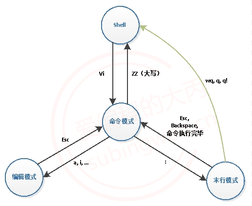
#### 3. 命令模式下的操作
通过vim打开一个文件, 如果文件不存在, 在退出的时候进行了保存, 文件就会被创建出来
```bash
# 打开一个文件
$ vim 文件名
```
##### 3.1 保存退出
直接在键盘上操作, 通过键盘按两个连续的大写的Z (`此处是大写的Z, 需要先按住 Shift 再操作哦`)
```bash
# 先按住 shift 键, 然后连续按两次 z
ZZ
```
##### 3.2 代码格式化
在编码过程中, 为了便于阅读和代码维护, 代码都需要按照样式对其, 如果代码格式凌乱, 可以在命令模式下快速进行代码的格式化, 让其看起来更加美观，这个操作需要在键盘上连续输入多个字符。
```bash
# 假设写的c/c+代码没有对齐, 通过该命令可以对齐代码
# 一定要注意最后一个字符是 大写的 G, 因此需要先按 shift
gg=G
```
##### 3.3 光标移动
> 在vim中可以使用键盘上的方向键(`↑`, `↓`, `←`, `→`)来移动光标，这种操作相对比较麻烦， 有一种更加简便的操作方式， 就是使用键盘上的 `h`, `j`, `k`, `l`。
```bash
# 标准的移动光标的方法: 使用 h, j, k, l

                                        光标上移   
                                           ↑
                                           |
                     光标左移 <-- h    j    k    l --> 光标右移
                                       |
                                       ↓
                                    光标下移    
```
除此之外我们还可以使用一些快捷键实现光标的快速跳转, 常用的有:
| 快捷键 | 功能 | 备注 |
| --- | --- | --- |
| 0 | 光标移动到行首 | 无 |
| $ | 光标移动到行尾部 | 选按两个键: shift + 4 |
| gg | 光标移动到文件头 | 第一行的开始 |
| G | 光标移动到文件尾部 | 最后一行的开始 |
| nG | 行跳转 | n 代表要跳转到哪一行 |
| n+回车 | 相对跳转 n 行 | 从光标所在当前行往下跳 n 行, n 对应的是一个整数 |
##### 3.4 删除命令
> 在vim中是没有删除操作的, 其实所谓的删除就是剪切, 被删除的数据都可被粘贴到文档的任意位置, 即便如此我们还是习惯性的将剪切操作称之为删除, 常用的删除操作如下表所示:
| 快捷键 | 功能 | 备注 |
| --- | --- | --- |
| x (小写) | 删除光标后边的字符 | vim中的光标比较宽会盖住后边的字符 |
| X (大写) | 删除光标前边的字符 | 无 |
| dw | 删除单词 | 要先把光标移动到单词的第一个字母上再删除, 否则单词只能被删除一部分 |
| d0 | 删除光标前的字符串 | 从字符串开头到光标当前位置的字符串被删除了 |
| d$ (D) | 删除光标后的字符串 | 从光标当前位置到字符串尾部的字符串被删除了, 使用 D也行 |
| dd | 删除光标所在行 | 无 |
| ndd | 删除n行 | 从光标所在行开始删除n行, n对应的是一个整数 |
##### 3.5 撤销和反撤销
> 撤销和反撤销对应windows中的 `ctrl+z`和`ctrl+y`, 但是在vim中使用这两个快捷键是不行的。
| 快捷键 | 功能 | 备注 |
| --- | --- | --- |
| u | 撤销 | 等价于 windows 中的 ctrl+z |
| ctrl+r | 反撤销 | 等价于 windows 中的 ctrl+y |
##### 3.6 复制和粘贴
> 前边已经介绍了, 在vim中做删除操作就相当于剪切, 剪切或者复制之后的数据都可以用来做粘贴操作, 在vim中对应的快捷键如下:
| 快捷键 | 功能 | 备注 |
| --- | --- | --- |
| p | 粘贴到光标所在行的下边 | 小写的 p |
| P | 粘贴到光标所在行的上边 | 大写的 P |
| yy | 复制光标所在行 | 无 |
| nyy | 从光标所在行向下复制 n 行 | n是要复制的行数, 代表一个整数 |
##### 3.7 可视模式
> 在编辑文件的过程中, 有时候需要删除或者需要复制的数据不整行的, 而是一行中的某一部分, 这时候可以使用可视模式进行文本的选择, 之后再通过相关的快捷键对所选中的数据块进行复制或者删除操作。 有三种方式可以切换到可视模式:
- `v`： 进入的字符可视化模式（Characterwise visual mode)，文本选择是以字符为单位的。
- `V `：进入的行可视化模式（Linewise visual mode)，文本选择是以行为单位的。
- `ctrl-v`： 进入的块可视化模式（Blockwise visual mode），可以选择一个矩形内的文本。
进入到可视模式之后，就可以进行文本块的选择和复制以及删除了
| 快捷键 | 功能 | 备注 |
| --- | --- | --- |
| h | 光标向左移动 | 移动光标用于可视模式下的数据块选择 |
| j | 光标向下移动 | 移动光标用于可视模式下的数据块选择 |
| k | 光标向上移动 | 移动光标用于可视模式下的数据块选择 |
| l | 光标向右移动 | 移动光标用于可视模式下的数据块选择 |
| d | 删除(剪切) | 删除可视模式下选中的数据块 |
| y | 复制 | 复制可视模式下选中的数据块 |
| p (小写) | 数据粘贴到光标的后边 | 粘贴在可视模式下复制或者剪切的数据块 |
| P (大写) | 数据粘贴到光标的前边 | 粘贴在可视模式下复制或者剪切的数据块 |
###### 3.7.1 字符可视模式
控制光标方向用来选择文件中的不规则数据块, 可以对选中的文本信息进行复制和删除
```bash
# 进入到字符可视模式，直接在键盘上按 v 即可: 
v
```
通过 v 切换到字符可视模式之后， 在窗口的最下方会看到 `-- VISUAL--` 字样。

###### 3.7.2 行可视模式
向下移动光标可以选择一整行, 向上移动光标可以取消整行选择
```bash
# 进入行可视模式, 键盘上按 shift+v 
V
```
通过 V 切换到行可视模式之后， 在窗口的最下方会看到 `-- VISUAL LINE --` 字样。

###### 3.7.3 块可视化模式
通过向上，下移动光标控制矩形文本块的高度，通过向左，右移动光标控制矩形文本块的宽度。
```bash
# 进入块可视模式, 选择一个矩形文本块
ctrl+v
```
通过 ctrl+v 切换到块可视模式之后， 在窗口的最下方会看到 `-- VISUAL BLOCK --` 字样。

###### 3.7.4 代码注释
代码块注释可以使用块可视模式，具体操作步骤如下：
1. 通过 `ctrl+v`进入块可视模式
1. 移动光标上移（k）或者下移（j），选中多个代码行的开头，如下图所示 [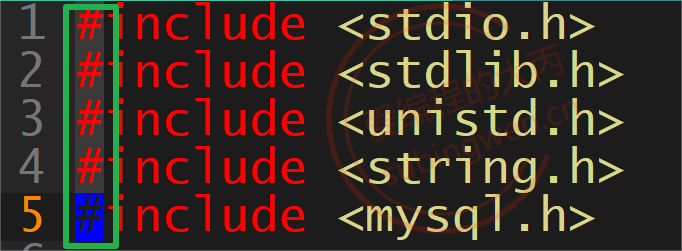](assets/linux-course/remote-1750bef77eab-image-20210130204615601.png)
1. 选择完毕后，按大写的的`I`键，此时下方会提示进入“insert” 模式，输入你要插入的注释符，例如: //
1. 最后按ESC键，你就会发现选中的多行代码已经被注释了
删除多行注释的方法，同样 Ctrl+v 进入列选择模式，移动光标把要删除的注释符选中，按下d，注释就被删除了。
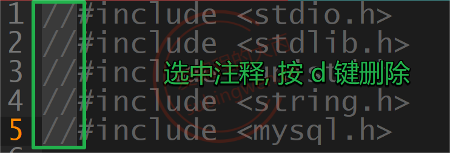
##### 3.8 替换
> 命令模式下的替换功能并不强, 常用于某个单字符的替换。
| 快捷键 | 功能 | 备注 |
| --- | --- | --- |
| r | 替换光标后的单个字符 | 无 |
| R | 替换光标后的多个字符 | 按 esc 结束替换 |
##### 3.9 查找
> 在vim的命令模式下一共有三种查找方式, 首先需要在键盘上输入对应的字符, 然后按回车键vim会进行关键字匹配, 之后就可以通过 `n`或者`N`进行关键字之间的切换了。
| 搜索快捷键 | 关键字遍历 | 描述 | 备注 |
| --- | --- | --- | --- |
| / | n | 从当前位置向下 | 直接按键盘上的 /即可 |
|  | N | 从当前位置向上 |  |
| ? | n | 从当前位置向上 | 直接按键盘上的 ?即可, 需要使用组合键 |
|  | N | 从当前位置向下 |  |
| # | n | 从当前位置向上 | 光标需要先放在被搜索的关键字上, 键盘上按 # |
|  | N | 从当前位置向下 |  |
关于 `?` 和 `#` 都需要使用组合键, 这点要注意一下。
下面总结一下这三种搜索方式：
1. 使用 `/` 或者 `?` 搜索效果一样, 只是遍历关键字的时候的顺序是相反的
1. 使用 `#` 必须先从被搜索的文件中找到要搜索的关键字, 好处就是搜索的内容不需要通过键盘输入
1. 以上两种搜索方式各有优劣, 请根据实际情况选择使用。
##### 3.10 查看man文档
> man 文档, 是Linux中默认自带的帮助文档, 作为程序猿可以通过这个文档来查询shell命令或者标准API函数或者系统自带的配置文件格式的说明等信息。 man文档一共有9个章节， 具体如下：
| 章节 | 说明 |
| --- | --- |
| section 1 | Linux提供的所有shell命令 |
| section 2 | 系统函数（由内核提供的） |
| section 3 | 库调函数(程序库中的函数) |
| section 4 | 特殊文件(通常在/dev目录中可以找到) |
| section 5 | 系统配置文件格式和约定，比如：/etc/passwd |
| section 6 | 游戏（如果有的话） |
| section 7 | 杂项(包括宏包和约定) |
| section 8 | 系统管理命令(通常仅针对root用户) |
| section 9 | 内核例程[非标准] |
```bash
# 打开 man 文档首页
$ man man
# 退出 man 文档，直接按键盘上的 q 即可
q
```
那么，我们如何通过 man 文档查询相关的shell命令或者函数等信息呢？
```bash
# 下边举几个例子:

# 查询第一章的shell命令
$ man 1 cp

# 查询第二章的系统函数 (如: read, write, open 等)
$ man 2 read

# 查询第三章的标准的库函数 (如: fread, fwrite, fopen 等)
$ man 3 fread

# 查询第五章的特殊的配置文件说明, 比如: /etc/passwd 或者 /etc/group
$ man 5 passwd
```
查询的时候章节号是可以省略的，只是查到的结果不精确。如果不写章节号，从第一章开始搜索查询的关键字，如果查询到了, 直接就结束了。也就是说如果查询的是函数，但是这个函数和某个命令的名字是相同的，查询到第一章搜索就结束了。
如果当前是在vim的命令模式下，我们可以直接跳转到man 文档：
- 找到要查看的函数，然后将光标放到该函数上
- 在键盘上依次输入: 章节号(可选) + K`(shift+k)(大写的k)`，就会自动调整到 man 文档中了
##### 3.11 切换到编辑模式
> 如果要编辑文件, 需要从命令模式切换到文件编辑模式, 切换模式的快捷键有很多, 不同的快捷键对应的效果有所不同, 效果如下表所示:
| 快捷键 | 功能 |
| --- | --- |
| i | 从光标前边开始输入 |
| a | 从光标的后边开始输入 |
| o | 在光标下边创建新行, 在新行中输入 |
| s | 删除光标后边的字符(盖住的字符), 从删除的字符位置开始输入 |
| I (大写的i) | 从当前行行首开始输入 |
| A | 从当前行行尾开始输入 |
| O | 在光标上边创建新行, 在新行中输入 |
| S | 删除当前行, 在当前行开始输入 |
文件编辑完成之后, 从编辑模式回到命令模式只需要按键盘上的`Esc`即可。
#### 4. 末行模式下的操作
##### 4.1 命令模式到末行模式
> 从命令模式切换到末行模式只需要在键盘上输入一个 `:`，同时这个符号也会出现在窗口的最下端，这时候我们就可以在最后一行输入我们执行的命令了。
```bash
# 命令模式切换到末行模式
在命令模式下键盘输入一个 冒号  -> :

# 从末行模式 -> 命令模式
1. 按两次esc
2. 在末行模式下执行一个完整指令, 执行完毕, 自动回到命令模式
```

从末行模式切换回命令模式有两种方式：
1. 按两次 `Esc`
1. 在末行模式下执行一个完整指令, 执行完毕, 自动回到命令模式
##### 4.2 保存退出
> 使用vim对文件编辑完成之后, 需要保存或者退出vim一般都是在末行模式下完成的, 不管是进行那种操作都有对应的操作命令, 如下表:
| 末行模式下输入的命令 | 功能 |
| --- | --- |
| q | 退出, 如果退出的时候文件没有保存, vim会提示是否要保存 |
| q! | 直接退出, 不保存 (强制退出) |
| w | 保存, 不退出 (相当在windows中于按了ctrl+s) |
| wq | 保存退出 |
| x | 保存退出 |
##### 4.3 替换
> 末行模式下的替换比命令模式下的替换功能要强大的多, 在末行模式下可以指定将什么样的内容替换为什么样的内容, 并且可以指定替换某一行或者某几行或者是全文替换。 替换对应的命令是 `s`并且可以给其指定参数，默认情况下只替换相关行的第一个满足条件的关键字， 如果需要整行替换需要加参数`/g`。
| 末行模式下的替换命令 | 说明 |
| --- | --- |
| s/被替换的关键字/新的关键字/g | 只对光标所在行进行替换 |
| 行号1, 行号2s/被替换的关键字/新的关键字/g | [行号1 , 行号2] 是一个从小到大的范围, 对这个范围进行替换 |
| %s/被替换的关键字/新的关键字/g | %代表对所有行进行替换 |
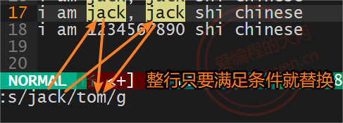
##### 4.3 分屏
> 分屏就是将当前屏幕中的窗口以`水平`或者`垂直`的方式拆分成多个, 在不同的子窗口中可以显示同一个文件或者不同文件中的内容，下边介绍一下相关的分屏命令：
| 末行模式命令或者快捷键 | 说明 | 备注 |
| --- | --- | --- |
| sp | 水平分屏 , 多个窗口垂直排列 | 多个窗口中显示同一个文件里的内容 |
| vsp | 垂直分屏, 多个窗口水平排列 | 多个窗口中显示同一个文件里的内容 |
| ctrl+w+w | 光标在打开的屏幕之间切换 | 快捷键操作 (按住ctrl然后按两次w) |
| qall | 同时退出多个屏幕 |  |
| wqall | 同时保存退出多个屏幕 |  |
| sp 文件名 | 分屏的同时指定打开的文件的名字 | 在新窗口中显示指定的文件的内容 |
| vsp 文件名 | 分屏的同时指定打开的文件的名字 | 在新窗口中显示指定的文件的内容 |
除了在命令模式下分屏, 我们也可以在使用vim打开文件的时候直接分屏, 下边是需要用到的参数:
- `-o`: 水平分屏
- `-O`: 垂直分屏
```bash
# 在vim打开文件的时候指定打开多个文件和分屏方式
# 水平分屏
$ vim -o 文件1, 文件2, 文件3 ...
# 垂直分屏
$ vim -O 文件1, 文件2, 文件3 ...
```
##### 4.4 行跳转
> 在vim中不仅可以在命令模式下进行行的跳转, 也可以在末行模式下进行行跳转, 末行模式下指定哪一行光标就可以跳转到哪一行。
```bash
:行号   # 输入完行号之后敲回车
```
##### 4.5 执行shell命令
> 在使用vim编辑文件的过程中, 还可以在末行模式下执行需要的shell命令，在执行shell命令之前需要在前边加上一个叹号`!`。
```bash
# 语法:
:!shell命令

# 举例
:!ls		# 回车即可
```
#### 5. vim配置文件
> vim 是一个文本编辑器工具, 这个工具也是有配置文件的，文件的名字叫做`vimrc`，在里边可以设置`样式`，`功能`, `快捷键`等属性 。对应的配置文件分为两种 `用户级别`和`系统级别`。
- 用户级别的配置文件（`~/.vimrc`）只对当前用户有效
- 系统级别的配置文件（`/etc/vim/vimrc`）对所有Linux用户都有效
- 如果两个配置文件都设置了, 用户级别的配置文件起作用（用户级别优先级高）。

### 1.7 GCC

> 原文：[《GCC》](https://subingwen.cn/linux/gcc/)　作者：苏丙榅　来源：爱编程的大丙

`GCC` 是 Linux 下的编译工具集，是 `GNU Compiler Collection` 的缩写，`包含 gcc、g++` 等编译器。这个工具集不仅包含编译器，还包含其他工具集，例如 ar、nm 等。
GCC 工具集不仅能编译 C/C++语言，其他例如 Objective-C、Pascal、Fortran、Java、Ada 等语言均能进行编译。GCC 在可以根据不同的硬件平台进行编译，即能进行交叉编译，在 A 平台上编译 B 平台的程序，支持常见的 X86、ARM、PowerPC、mips 等，以及 Linux、Windows 等软件平台。
#### 1. 安装 GCC
> 有些纯净版的Linux默认没有gcc编译器, 需要自己安装, 在线安装步骤如下:
```bash
# 安装软件必须要有管理员权限
# ubuntu
$ sudo apt update   		# 更新本地的软件下载列表, 得到最新的下载地址
$ sudo apt install gcc g++	# 通过下载列表中提供的地址下载安装包, 并安装

# centos
$ sudo yum update   		# 更新本地的软件下载列表, 得到最新的下载地址
$ sudo yum install gcc g++	# 通过下载列表中提供的地址下载安装包, 并安装
```
gcc安装完毕之后, 可以查看版本:
```bash
# 查看 gcc 版本
$ gcc -v
$ gcc --version

# 查看 g++ 版本
$ g++ -v
$ g++ --version
```
#### 2. gcc 工作流程
> GCC 编译器对程序的编译下图所示，分为 4 个阶段：`预处理（预编译）`、`编译和优化`、`汇编`和`链接`。GCC 的编译器可以将这 4 个步骤合并成一个。 先介绍一个每个步骤都分别做了写什么事儿:
1. 预处理: 在这个阶段主要做了三件事: `展开头文件` 、`宏替换` 、`去掉注释行` 这个阶段需要GCC调用预处理器来完成, 最终得到的还是源文件, 文本格式
1. 编译: 这个阶段需要GCC调用编译器对文件进行编译, 最终得到一个汇编文件
1. 汇编: 这个阶段需要GCC调用汇编器对文件进行汇编, 最终得到一个二进制文件
1. 链接: 这个阶段需要GCC调用链接器对程序需要调用的库进行链接, 最终得到一个可执行的二进制文件
| 文件名后缀 | 说明 | gcc 参数 |
| --- | --- | --- |
| .c | 源文件 | 无 |
| .i | 预处理后的 C 文件 | -E |
| .s | 编译之后得到的汇编语言的源文件 | -S |
| .o | 汇编后得到的二进制文件 | -c |
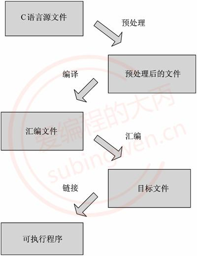
> 在 Linux 下使用 GCC 编译器编译单个文件十分简单，直接使用 gcc 命令后面加上要编译的 C 语言的源文件，GCC 会自动生成文件名为 `a.out` 的可执行文件（`也可以通过参数 -o 指定生成的文件名`），也就是通过一个简单的命令上边提到的4个步骤就全部执行完毕了。但是如果想要单步执行也是没问题的， 下边基于这段示例程序给大家演示一下。
```c
// 假设程序对应的源文件名为 test.c
#include <stdio.h>
#include <stdlib.h>
#include <unistd.h>
#include <string.h>

int main()
{
    int array[5] = {1,2,3,4,5};
    for(int i=0; i<5; ++i)
    {
        printf("array[%d] = %d\n", i, array[i]);
    }
    return 0;
}
```
> 第一步: 对源文件进行预处理, 需要使用的gcc参数为 `-E`
```bash
# 1. 预处理, -o 指定生成的文件名
$ gcc -E test.c -o test.i
```
> 第二步: 编译预处理之后的文件, 需要使用的gcc参数为 `-S`
```bash
# 2. 编译, 得到汇编文件
$ gcc -S test.i -o test.s
```
> 第三步: 对得到的汇编文件进行汇编, 需要使用的gcc参数为`-c`
```bash
# 3. 汇编
$ gcc -c test.s -o test.o
```
> 第四步: 将得到的二进制文件和标准库进制链接, 得到可执行的二进制文件, `不需要任何参数`
```bash
# 4. 链接
$ gcc test.o -o test
```
最后再次强调, 在使用gcc编译程序的时候可以通过参数控制内部自动执行几个步骤:
```bash
# 参数 -c 是进行文件的汇编, 汇编之前的两步会自动执行
$ gcc test.c -c -o app.o

# 该命令是直接进行链接生成可执行程序, 链接之前的三步会自动执行
$ gcc test.c -o app    
```
#### 3. gcc常用参数
> 下面的表格中列出了常用的一些`gcc`参数, 这些`参数在 gcc命令中没有位置要求`，只需要编译程序的时候将需要的参数指定出来即可。
| gcc编译选项 | 选项的意义 |
| --- | --- |
| -E | 预处理指定的源文件，不进行编译 |
| -S | 编译指定的源文件，但是不进行汇编 |
| -c | 编译、汇编指定的源文件，但是不进行链接 |
| -o [file1] [file2] / [file2] -o [file1] | 将文件 file2 编译成文件 file1 |
| -I directory (大写的i) | 指定 include 包含文件的搜索目录 |
| -g | 在编译的时候，生成调试信息，该程序可以被调试器调试 |
| -D | 在程序编译的时候，指定一个宏 |
| -w | 不生成任何警告信息, 不建议使用, 有些时候警告就是错误 |
| -Wall | 生成所有警告信息 |
| -On | n的取值范围：0~3。编译器的优化选项的4个级别，-O0表示没有优化，-O1为缺省值，-O3优化级别最高 |
| -l | 在程序编译的时候，指定使用的库 |
| -L | 指定编译的时候，搜索的库的路径。 |
| -fPIC/fpic | 生成与位置无关的代码 |
| -shared | 生成共享目标文件。通常用在建立共享库时 |
| -std | 指定C方言，如:-std=c99，gcc默认的方言是GNU C |
##### 3.1 指定生成的文件名 (-o)
> 该参数用于指定原文件通过 gcc 处理之后生成的新文件的名字, 有两种写法, 原文件可以写在参数 `-o`前边后缀写在后边。
```bash
# 参数 -o的用法 , 原材料 test.c 最终生成的文件名为 app
# test.c 写在 -o 之前
$ gcc test.c -o app

# test.c 写在 -o 之后
$ gcc -o app test.c
```
##### 3.2 搜索头文件 (-I)
> 如果在程序中包含了一些头文件, 但是包含的一些头文件在程序预处理的时候因为找不到无法被展开，导致程序编译失败，这时候我们可以在gcc命令中添加 `-I`参数重新指定要引用的头文件路径, 保证编译顺利完成。
```bash
# -I, 指定头文件目录
$ tree
.
├── add.c
├── div.c
├── include
│   └── head.h
├── main.c
├── mult.c
└── sub.c

# 编译当前目录中的所有源文件，得到可执行程序
$ gcc *.c -o calc
main.c:2:18: fatal error: head.h: No such file or directory
compilation terminated.
sub.c:2:18: fatal error: head.h: No such file or directory
compilation terminated.
```
> 通过编译得到的错误信息可以知道, `源文件中包含的头文件无法被找到`。通过提供的目录结构可以得知头文件 `head.h 在 include 目录中`，因此可以在编译的时候重新指定头文件位置，具体操作如下：
```bash
# 可以在编译的时候重新指定头文件位置 -I 头文件目录
$ gcc *.c -o calc -I ./include
```
##### 3.3 指定一个宏 (-D)
> 在程序中我们可以使用宏定义一个常量, 也可以通过宏控制某段代码是否能够被执行。在下面这段程序中第8行判断是否定义了一个叫做 `DEBUG`的宏, 如果没有定义第9行代码就不会被执行了, 通过阅读代码能够知道这个宏是没有在程序中被定义的。
```c
// test.c
#include <stdio.h>
#define NUMBER  3

int main()
{
    int a = 10;
#ifdef DEBUG
    printf("我是一个程序猿, 我不会爬树...\n");
#endif
    for(int i=0; i<NUMBER; ++i)
    {
        printf("hello, GCC!!!\n");
    }
    return 0;
}
```
> 如果不想在程序中定义这个宏， 但是又想让它存在，通过gcc的参数 `-D`就可以实现了，编译器会认为参数后边指定的宏在程序中是存在的。
```bash
# 在编译命令中定义这个 DEBUG 宏, 
$ gcc test.c -o app -D DEBUG

# 执行生成的程序， 可以看到程序第9行的输出
$ ./app 
我是一个程序猿, 我不会爬树...
hello, GCC!!!
hello, GCC!!!
hello, GCC!!!
```
`-D 参数的应用场景:` 在发布程序的时候, 一般都会要求将程序中所有的log输出去掉, 如果不去掉会影响程序的执行效率，很显然删除这些打印log的源代码是一件很麻烦的事情，解决方案是这样的：
- 将所有的打印log的代码都写到一个宏判定中, 可以模仿上边的例子 在编译程序的时候指定 -D 就会有log输出
- 在编译程序的时候不指定 -D, log就不会输出
#### 4. 多文件编译
> GCC 可以自动编译链接多个文件，不管是目标文件还是源文件，都可以使用同一个命令编译到一个可执行文件中。
##### 4.1 准备工作
> 首先将程序编译之前需要的代码准备出来, 例如一个项目包含3个文件，文件 string.h , string.c 中有一个函数 strLength 用于计算字符串的长度，而在 main.c 中调用这个函数将计算的结果显示出来。
```c
#ifndef _STRING_H_
#define _STRING_H_
int strLength(char *string);
#endif // _STRING_H_
```
- 头文件
```c
#include "string.h"

int strLength(char *string)
{
	int len = 0;
	while(*string++ != '\0') 	// 当*string 的值为'\0'时, 停止计算
    {
        len++;
    }
	return len; 	// 返回字符串长度
}
```
- 源文件 string.c
```c
#include <stdio.h>
#include "string.h"

int main(void)
{
	char *src = "Hello, I'am Monkey·D·Luffy!!!"; 
	printf("string length is: %d\n", strLength(src)); 
	return 0;
}
```
- 源文件 main.c
##### 4.2 编译运行
> 因为头文件是包含在源文件中的, 因此在使用gcc编译程序的时候不需要指定头文件的名字（`在头文件无法被找到的时候需要使用参数 -I 指定其具体路径而不是名字`）。我们可以通过一个 gcc 命令将多个源文件编译并生成可执行程序，也可以分多步完成这个操作。
```bash
# 直接生成可执行程序 test
$ gcc -o test string.c main.c

# 运行可执行程序
$ ./test
```
- 直接链接生成可执行程序
```bash
# 汇编生成二进制目标文件, 指定了 -c 参数之后, 源文件会自动生成 string.o 和 main.o
$ gcc –c string.c main.c

# 链接目标文件, 生成可执行程序 test
$ gcc –o test string.o main.o

# 运行可执行程序
$ ./test
```
- 先将源文件编成目标文件，然后进行链接得到可执行程序
#### 5. gcc与g++
> 关于对`gcc`和`g++`很多人的理解都是比较片面的或者是对二者的理解有一些误区，下边从三个方面介绍一下二者的区别:
1. 在代码编译阶段（第二个阶段）: 后缀为 `.c` 的，gcc 把它当作是C程序，而 g++ 当作是 C++ 程序
- 后缀为`.cpp`的，两者都会认为是 C++ 程序，C++ 的语法规则更加严谨一些
- g++会调用gcc，对于C++代码，两者是等价的, 也就是说 gcc 和 g++ 都可以编译 C/C++代码
1. 在链接阶段（最后一个阶段）: gcc 和 g++ 都可以自动链接到标准C库
- g++ 可以自动链接到标准C++库, gcc如果要链接到标准C++库需要加参数 `-lstdc++`
1. 关于 `__cplusplus`宏的定义 g++ 会自动定义`__cplusplus`宏，但是这个不影响它去编译C程序
- gcc 需要根据文件后缀判断是否需要定义 `__cplusplus` 宏 （规则参考第一条）
综上所述：
1. 不管是 gcc 还是 g++ 都可以编译 C 程序，编译程序的规则和参数都相同
1. g++可以直接编译C++程序， gcc 编译 C++程序需要添加额外参数 `-lstdc++`
1. 不管是 gcc 还是 g++ 都可以定义 `__cplusplus`宏
```bash
# 编译 c 程序
$ gcc test.c -o test	# 使用gcc
$ g++ test.c -o test	# 使用g++

# 编译 c++ 程序
$ g++ test.cpp -o test              # 使用g++
$ gcc test.cpp -lstdc++ -o test     # 使用gcc
```
#### 6. 视频讲解
> 以上知识点对应的视频讲解可以关注 [B站-爱编程的大丙](https://space.bilibili.com/147020887) 视频地址: [https://www.bilibili.com/video/BV13U4y1p7kB](https://www.bilibili.com/video/BV13U4y1p7kB)

### 1.8 静态库和动态库

> 原文：[《Linux 静态库和动态库》](https://subingwen.cn/linux/library/)　作者：苏丙榅　来源：爱编程的大丙

不管是Linux还是Windows中的库文件其本质和工作模式都是相同的, 只不过在不同的平台上库对应的文件格式和文件后缀不同。程序中调用的库有两种 `静态库`和`动态库`，不管是哪种库文件本质是还是源文件，只不过是二进制格式只有计算机能够识别，作为一个普通人就无能为力了。
在项目中使用库一般有两个目的，一个是为了使程序更加简洁不需要在项目中维护太多的源文件，另一方面是为了源代码保密，毕竟不是所有人都想把自己编写的程序开源出来。
当我们拿到了库文件（动态库、静态库）之后要想使用还必须有这些库中提供的API函数的声明，也就是头文件，把这些都添加到项目中，就可以快乐的写代码了。
#### 1. 静态库
> 在Linux中静态库由程序 `ar` 生成，现在静态库已经不像之前那么普遍了，这主要是由于程序都在使用动态库。关于静态库的命名规则如下:
- 在Linux中静态库以`lib`作为前缀, 以`.a`作为后缀, 中间是库的名字自己指定即可, 即: `libxxx.a`
- 在Windows中静态库一般以`lib`作为前缀, 以`lib`作为后缀, 中间是库的名字需要自己指定, 即: `libxxx.lib`
##### 1.1 生成静态链接库
> 生成静态库，需要先对源文件进行汇编操作 (`使用参数 -c`) 得到二进制格式的目标文件 (`.o 格式`), 然后在通过 `ar`工具将目标文件打包就可以得到静态库文件了 (`libxxx.a`)。 使用`ar`工具创建静态库的时候需要三个参数:
- `参数c`：创建一个库，不管库是否存在，都将创建。
- `参数s`：创建目标文件索引，这在创建较大的库时能加快时间。
- `参数r`：在库中插入模块(替换)。默认新的成员添加在库的结尾处，如果模块名已经在库中存在，则替换同名的模块。
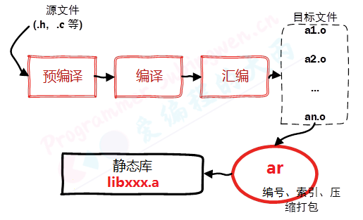
生成静态链接库的具体步骤如下:
```bash
# 执行如下操作, 默认生成二进制的 .o 文件
# -c 参数位置没有要求
$ gcc 源文件(*.c) -c	
```
1. 需要将源文件进行汇编, 得到 .o 文件, 需要使用参数 -c
```bash
$ ar rcs 静态库的名字(libxxx.a) 原材料(*.o)
```
1. 将得到的 .o 进行打包, 得到静态库
```bash
# 发布静态库
	1. 提供头文件 **.h
	2. 提供制作出来的静态库 libxxx.a
```
1. 发布静态库
##### 1.2 静态库制作举例
###### 1.2.1 准备测试程序
> 在某个目录中有如下的源文件, 用来实现一个简单的计算器:
```bash
# 目录结构 add.c div.c mult.c sub.c -> 算法的源文件, 函数声明在头文件 head.h
# main.c中是对接口的测试程序, 制作库的时候不需要将 main.c 算进去
.
├── add.c
├── div.c
├── include
│   └── head.h
├── main.c
├── mult.c
└── sub.c
```
> 加法计算源文件 `add.c`:
```c
#include <stdio.h>
#include "head.h"

int add(int a, int b)
{
    return a+b;
}
```
> 减法计算源文件 `sub.c`:
```c
#include <stdio.h>
#include "head.h"

int subtract(int a, int b)
{
    return a-b;
}
```
> 乘法计算源文件 `mult.c`:
```c
#include <stdio.h>
#include "head.h"

int multiply(int a, int b)
{
    return a*b;
}
```
> 减法计算的源文件 `div.c`
```c
#include <stdio.h>
#include "head.h"

double divide(int a, int b)
{
    return (double)a/b;
}
```
> 头文件 `head.h`
```c
#ifndef _HEAD_H
#define _HEAD_H
// 加法
int add(int a, int b);
// 减法
int subtract(int a, int b);
// 乘法
int multiply(int a, int b);
// 除法
double divide(int a, int b);
#endif
```
> 测试文件`main.c`
```c
#include <stdio.h>
#include "head.h"

int main()
{
    int a = 20;
    int b = 12;
    printf("a = %d, b = %d\n", a, b);
    printf("a + b = %d\n", add(a, b));
    printf("a - b = %d\n", subtract(a, b));
    printf("a * b = %d\n", multiply(a, b));
    printf("a / b = %f\n", divide(a, b));
    return 0;
}
```
###### 1.2.2 生成静态库
> 第一步: 将源文件`add.c`, `div.c`, `mult.c`,` sub.c` 进行汇编, 得到二进制目标文件 `add.o`, `div.o`, `mult.o`, `sub.o`
```bash
# 1. 生成.o
$ gcc add.c div.c mult.c sub.c -c
sub.c:2:18: fatal error: head.h: No such file or directory
compilation terminated.

# 提示头文件找不到, 添加参数 -I 重新头文件路径即可
$ gcc add.c div.c mult.c sub.c -c -I ./include/

# 查看目标文件是否已经生成
$ tree
.
├── add.c
├── add.o            # 目标文件
├── div.c
├── div.o            # 目标文件
├── include
│   └── head.h
├── main.c
├── mult.c
├── mult.o           # 目标文件
├── sub.c
└── sub.o            # 目标文件
```
> 第二步: 将生成的目标文件通过 `ar`工具打包生成静态库
```bash
# 2. 将生成的目标文件 .o 打包成静态库
$ ar rcs libcalc.a a.o b.o c.o    # a.o b.o c.o在同一个目录中可以写成 *.o

# 查看目录中的文件
$ tree
.
├── add.c
├── add.o
├── div.c
├── div.o
├── include
│   └── `head.h  ===> 和静态库一并发布
├── `libcalc.a   ===> 生成的静态库
├── main.c
├── mult.c
├── mult.o
├── sub.c
└── sub.o
```
> 第三步: 将生成的的静态库 `libcalc.a`和库对应的头文件`head.h`一并发布给使用者就可以了。
```bash
# 3. 发布静态库
	1. head.h    => 函数声明
	2. libcalc.a => 函数定义(二进制格式)
```
##### 1.3 静态库的使用
> 当我们得到了一个可用的静态库之后, 需要将其放到一个目录中, 然后根据得到的头文件编写测试代码, 对静态库中的函数进行调用。
```bash
# 1. 首先拿到了发布的静态库
	`head.h` 和 `libcalc.a`
	
# 2. 将静态库, 头文件, 测试程序放到一个目录中准备进行测试
.
├── head.h          # 函数声明
├── libcalc.a       # 函数定义（二进制格式）
└── main.c          # 函数测试
```
> 编译测试程序, 得到可执行文件。
```bash
# 3. 编译测试程序 main.c
$ gcc main.c -o app
/tmp/ccR7Fk49.o: In function `main':
main.c:(.text+0x38): undefined reference to `add'
main.c:(.text+0x58): undefined reference to `subtract'
main.c:(.text+0x78): undefined reference to `multiply'
main.c:(.text+0x98): undefined reference to `divide'
collect2: error: ld returned 1 exit status
```
上述错误分析:
编译的源文件中包含了头文件 `head.h`, 这个头文件中声明的函数对应的定义（也就是函数体实现）在静态库中，程序在编译的时候没有找到函数实现，因此提示 `undefined reference to xxxx`。
解决方案：在编译的时将`静态库的路径`和`名字`都指定出来
- `-L`: 指定库所在的目录(相对或者绝对路径)
- `-l`: 指定库的名字, 需要掐头(lib)去尾(.a) 剩下的才是需要的静态库的名字
```bash
# 4. 编译的时候指定库信息
	-L: 指定库所在的目录(相对或者绝对路径)
	-l: 指定库的名字, 掐头(lib)去尾(.a) ==> calc
# -L -l, 参数和参数值之间可以有空格, 也可以没有  -L./ -lcalc
$ gcc main.c -o app -L ./ -l calc

# 查看目录信息, 发现可执行程序已经生成了
$ tree
.
├── app   		# 生成的可执行程序
├── head.h
├── libcalc.a
└── main.c
```
#### 2. 动态库
> 动态链接库是程序运行时加载的库，当动态链接库正确部署之后，运行的多个程序可以使用同一个加载到内存中的动态库，因此在Linux中动态链接库也可称之为共享库。 动态链接库是目标文件的集合，目标文件在动态链接库中的组织方式是按照特殊方式形成的。库中函数和变量的地址使用的是相对地址（静态库中使用的是绝对地址），其真实地址是在应用程序加载动态库时形成的。 关于动态库的命名规则如下:
- 在Linux中动态库以`lib`作为前缀, 以`.so`作为后缀, 中间是库的名字自己指定即可, 即: `libxxx.so`
- 在Windows中动态库一般以`lib`作为前缀, 以`dll`作为后缀, 中间是库的名字需要自己指定, 即: `libxxx.dll`
##### 2.1 生成动态链接库
> 生成动态链接库是直接使用`gcc`命令并且需要添加`-fPIC（-fpic）` 以及`-shared` 参数。
- `-fPIC 或 -fpic` 参数的作用是`使得 gcc 生成的代码是与位置无关的，也就是使用相对位置。 `
- `-shared参数`的作用是告诉编译器生成一个动态链接库。
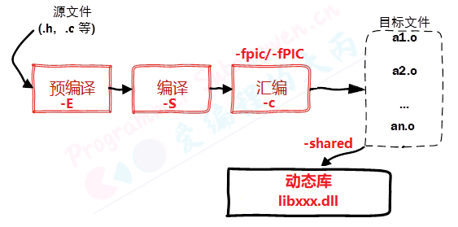
生成动态链接库的具体步骤如下:
```bash
# 得到若干个 .o文件
$ gcc 源文件(*.c) -c -fpic
```
1. 将源文件进行汇编操作, 需要使用参数 -c, 还需要添加额外参数 -fpic / -fPIC
```bash
$ gcc -shared 与位置无关的目标文件(*.o) -o 动态库(libxxx.so)
```
1. 将得到的.o文件打包成动态库, 还是使用gcc, 使用参数 -shared 指定生成动态库(位置没有要求)
```bash
# 发布
 	1. 提供头文件: xxx.h
 	2. 提供动态库: libxxx.so
```
1. 发布动态库和头文件
##### 2.2 动态库制作举例
在此还是以上面制作静态库使用的实例代码为例来制作动态库, 代码目录如下:
```bash
# 举例, 示例目录如下:
# 目录结构 add.c div.c mult.c sub.c -> 算法的源文件, 函数声明在头文件 head.h
# main.c中是对接口的测试程序, 制作库的时候不需要将 main.c 算进去
.
├── add.c
├── div.c
├── include
│   └── head.h
├── main.c
├── mult.c
└── sub.c
```
> 第一步: 使用`gcc`将源文件进行汇编(`参数-c`), 生成与位置无关的目标文件, 需要使用参数 `-fpic或者-fPIC`
```bash
# 1. 将.c汇编得到.o, 需要额外的参数 -fpic/-fPIC
$ gcc add.c div.c mult.c sub.c -c -fpic -I ./include/

# 查看目录文件信息, 检查是否生成了目标文件
$ tree
.
├── add.c
├── add.o                # 生成的目标文件
├── div.c
├── div.o                # 生成的目标文件
├── include
│   └── head.h
├── main.c
├── mult.c
├── mult.o               # 生成的目标文件
├── sub.c
└── sub.o                # 生成的目标文件
```
> 第二步: 使用`gcc`将得到的目标文件打包生成动态库, 需要使用参数 `-shared`
```bash
# 2. 将得到 .o 打包成动态库, 使用gcc , 参数 -shared
$ gcc -shared add.o div.o mult.o sub.o -o libcalc.so  

# 检查目录中是否生成了动态库
$ tree
.
├── add.c
├── add.o
├── div.c
├── div.o
├── include
│   └── `head.h   ===> 和动态库一起发布
├── `libcalc.so   ===> 生成的动态库
├── main.c
├── mult.c
├── mult.o
├── sub.c
└── sub.o
```
> 第三步: 发布生成的动态库和相关的头文件
```bash
# 3. 发布库文件和头文件
	1. head.h
	2. libcalc.so
```
##### 2.3 动态库的使用
> 当我们得到了一个可用的动态库之后, 需要将其放到一个目录中, 然后根据得到的头文件编写测试代码, 对动态库中的函数进行调用。
```bash
# 1. 拿到发布的动态库
	`head.h   libcalc.so
# 2. 基于头文件编写测试程序, 测试动态库中提供的接口是否可用
	`main.c`
# 示例目录:
.
├── head.h          ==> 函数声明
├── libcalc.so      ==> 函数定义
└── main.c          ==> 函数测试
```
> 编译测试程序
```bash
# 3. 编译测试程序
$ gcc main.c -o app
/tmp/ccwlUpVy.o: In function `main':
main.c:(.text+0x38): undefined reference to `add'
main.c:(.text+0x58): undefined reference to `subtract'
main.c:(.text+0x78): undefined reference to `multiply'
main.c:(.text+0x98): undefined reference to `divide'
collect2: error: ld returned 1 exit status
```
错误原因:
和使用静态库一样, 在编译的时候需要指定库相关的信息: `库的路径 -L`和 `库的名字 -l`
添加库信息相关参数, 重新编译测试代码:
```bash
# 在编译的时候指定动态库相关的信息: 库的路径 -L, 库的名字 -l
$ gcc main.c -o app -L./ -lcalc

# 查看是否生成了可执行程序
$ tree
.
├── app 			# 生成的可执行程序
├── head.h
├── libcalc.so
└── main.c

# 执行生成的可执行程序, 错误提示 ==> 可执行程序执行的时候找不到动态库
$ ./app 
./app: error while loading shared libraries: libcalc.so: cannot open shared object file: No such file or directory
```
关于整个操作过程的报告：
​ gcc通过指定的动态库信息生成了可执行程序, 但是可执行程序运行却提示`无法加载到动态库`。
##### 2.4 解决动态库无法加载问题
###### 2.4.1 库的工作原理
- 静态库如何被加载 在程序编译的最后一个阶段也就是链接阶段，提供的静态库会被打包到可执行程序中。当可执行程序被执行，静态库中的代码也会一并被加载到内存中，因此不会出现静态库找不到无法被加载的问题。
- 动态库如何被加载 在程序编译的最后一个阶段也就是链接阶段： 在gcc命令中虽然指定了库路径(`使用参数 -L `), 但是这个路径并没有记录到可执行程序中，只是检查了这个路径下的库文件是否存在。
- 同样对应的动态库文件也没有被打包到可执行程序中，只是在可执行程序中记录了库的名字。
- 可执行程序被执行起来之后: 程序执行的时候会`先检测`需要的动态库是否可以被加载，加载不到就会提示上边的错误信息
- `当动态库中的函数在程序中被调用了, 这个时候动态库才加载到内存，如果不被调用就不加载`
- 动态库的检测和内存加载操作都是由动态连接器来完成的
###### 2.4.2 动态链接器
> 动态链接器是一个独立于应用程序的进程, 属于操作系统, 当用户的程序需要加载动态库的时候动态连接器就开始工作了，很显然动态连接器根本就不知道用户通过 gcc 编译程序的时候通过参数 `-L`指定的路径。 那么动态链接器是如何搜索某一个动态库的呢，在它内部有一个默认的搜索顺序，按照优先级从高到低的顺序分别是：
1. 可执行文件内部的 DT_RPATH 段
1. 系统的环境变量 `LD_LIBRARY_PATH`
1. 系统动态库的缓存文件 `/etc/ld.so.cache`
1. 存储动态库/静态库的系统目录 `/lib/`, `/usr/lib`等
按照以上四个顺序, 依次搜索, 找到之后结束遍历, 最终还是没找到, 动态连接器就会提示动态库找不到的错误信息。
###### 2.4.3 解决方案
> 可执行程序生成之后, 根据动态链接器的搜索路径, 我们可以提供三种解决方案，我们只需要将动态库的路径放到对应的环境变量或者系统配置文件中，同样也可以将动态库拷贝到系统库目录（或者是将动态库的软链接文件放到这些系统库目录中）。
- 方案1: 将库路径添加到环境变量 LD_LIBRARY_PATH 中 找到相关的配置文件 `用户级别: ~/.bashrc ` —> 设置对当前用户有效
- `系统级别: /etc/profile` —> 设置对所有用户有效
```bash
# 自己把路径写进去就行了
export LD_LIBRARY_PATH =$LD_LIBRARY_PATH :动态库的绝对路径
```
1. 使用 vim 打开配置文件, 在文件最后添加这样一句话
1. 让修改的配置文件生效 修改了用户级别的配置文件, 关闭当前终端, 打开一个新的终端配置就生效了
- 修改了系统级别的配置文件, 注销或关闭系统, 再开机配置就生效了
```bash
# 修改的是哪一个就执行对应的那个命令
# source 可以简写为一个 . , 作用是让文件内容被重新加载
$ source ~/.bashrc          (. ~/.bashrc)
$ source /etc/profile       (. /etc/profile)
```
- 不想执行上边的操作, 可以执行一个命令让配置重新被加载
- 方案2: 更新 /etc/ld.so.cache 文件 找到动态库所在的绝对路径（不包括库的名字）比如：`/home/robin/Library/`
```bash
# 1. 打开文件
$ sudo vim /etc/ld.so.conf

# 2. 添加动态库路径, 并保存退出
```
1. 使用vim 修改 `/etc/ld.so.conf` 这个文件, 将上边的路径添加到文件中(独自占一行)
1. 更新 `/etc/ld.so.conf`中的数据到 `/etc/ld.so.cache` 中
```bash
# 必须使用管理员权限执行这个命令
$ sudo ldconfig   
```
```bash
# 库拷贝
sudo cp /xxx/xxx/libxxx.so /usr/lib

# 创建软连接
sudo ln -s /xxx/xxx/libxxx.so /usr/lib/libxxx.so
```
- 方案3: 拷贝动态库文件到系统库目录 `/lib/` 或者 `/usr/lib` 中 (或者将库的软链接文件放进去)
###### 2.4.4 验证
> 在启动可执行程序之前, 或者在设置了动态库路径之后, 我们可以通过一个命令检测程序能不能够通过动态链接器加载到对应的动态库, 这个命令叫做 `ldd`
```bash
# 语法:
$ ldd 可执行程序名

# 举例:
$ ldd app
	linux-vdso.so.1 =>  (0x00007ffe8fbd6000)
    libcalc.so => /home/robin/Linux/3Day/calc/test/libcalc.so (0x00007f5d85dd4000)
    libc.so.6 => /lib/x86_64-linux-gnu/libc.so.6 (0x00007f5d85a0a000)
    /lib64/ld-linux-x86-64.so.2 (0x00007f5d85fd6000)  ==> 动态链接器, 操作系统提供
```
#### 3. 优缺点
##### 3.1 静态库
- 优点： 静态库被打包到应用程序中加载速度快
- 发布程序无需提供静态库，移植方便
- 缺点： 相同的库文件数据可能在内存中被加载多份, 消耗系统资源，浪费内存
- 库文件更新需要重新编译项目文件, 生成新的可执行程序, 浪费时间。
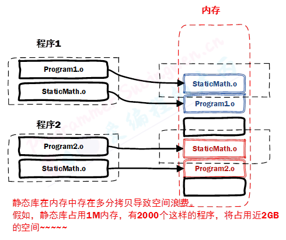
##### 3.2 动态库
- 优点： 可实现不同进程间的资源共享
- 动态库升级简单, 只需要替换库文件, 无需重新编译应用程序
- 程序猿可以控制何时加载动态库, 不调用库函数动态库不会被加载
- 缺点： 加载速度比静态库慢, 以现在计算机的性能可以忽略
- 发布程序需要提供依赖的动态库
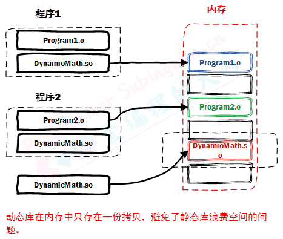
#### 4. 视频讲解
> 以上知识点对应的视频讲解可以关注 [B站-爱编程的大丙](https://space.bilibili.com/147020887) 视频地址: [https://www.bilibili.com/video/BV13U4y1p7kB](https://www.bilibili.com/video/BV13U4y1p7kB)

### 1.9 Makefile

> 原文：[《Makefile》](https://subingwen.cn/linux/makefile/)　作者：苏丙榅　来源：爱编程的大丙

使用 GCC 的命令行进行程序编译在单个文件下是比较方便的，当工程中的文件逐渐增多，甚至变得十分庞大的时候，使用 GCC 命令编译就会变得力不从心。这种情况下我们需要借助项目构造工具 make 帮助我们完成这个艰巨的任务。 **make是一个命令工具，是一个解释makefile中指令的命令工具**，一般来说，大多数的IDE都有这个命令，比如：Visual C++的nmake，QtCreator的qmake等。
make工具在构造项目的时候需要加载一个叫做`makefile`的文件，makefile关系到了整个工程的编译规则。 一个工程中的源文件不计数，其按类型、功能、模块分别放在若干个目录中，makefile定义了一系列的规则来指定哪些文件需要先编译，哪些文件需要后编 译，哪些文件需要重新编译，甚至于进行更复杂的功能操作，因为makefile就像一个Shell脚本一样，其中也可以执行操作系统的命令。
makefile带来的好处就是——“自动化编译”，一旦写好，只需要一个make命令，整个工程完全自动编译，极大的提高了软件开发的效率。
makefile文件有两种命名方式 `makefile` 和 `Makefile`，构建项目的时候在哪个目录下执行构建命令 `make`这个目录下的 makefile 文件就会别加载，因此在一个项目中可以有多个 makefile 文件，分别位于不同的项目目录中。
#### 1. 规则
> Makefile的框架是由规则构成的。make命令执行时先在Makefile文件中查找各种规则，对各种规则进行解析后运行规则。规则的基本格式为：
```makefile
# 每条规则的语法格式:
target1,target2...: depend1, depend2, ...
	command
	......
	......
```
每条规则由三个部分组成分别是`目标(target)`, `依赖(depend)`和`命令(command)`。
- `命令(command)`: 当前这条规则的动作，一般情况下这个动作就是一个 shell 命令 例如：通过某个命令编译文件、生成库文件、进入目录等。
- 动作可以是多个，`每个命令前必须有一个Tab缩进并且独占占一行`。
- `依赖(depend)`: 规则所必需的依赖条件，在规则的命令中可以使用这些依赖。 例如：生成可执行文件的目标文件（`*.o`）可以作为依赖使用
- 如果规则的命令中不需要任何依赖，那么规则的依赖可以为空
- 当前规则中的依赖可以是其他规则中的某个目标，这样就形成了规则之间的嵌套
- 依赖可以根据要执行的命令的实际需求, 指定很多个
- `目标(target)`： 规则中的目标，这个目标和规则中的命令是对应的 通过执行规则中的命令，可以生成一个和目标同名的文件
- 规则中可以有多个命令, 因此可以通过这多条命令来生成多个目标, 所有目标也可以有很多个
- 通过执行规则中的命令，可以只执行一个动作，不生成任何文件，这样的目标被称为`伪目标`
关于上面的解释可能有些晦涩, 下面通过一个例子来阐述一下:
```makefile
# 举例: 有源文件 a.c b.c c.c head.h, 需要生成可执行程序 app
################# 例1 #################
app:a.c b.c c.c
	gcc a.c b.c c.c -o app

################# 例2 #################
# 有多个目标, 多个依赖, 多个命令
app,app1:a.c b.c c.c d.c
	gcc a.c b.c -o app
	gcc c.c d.c -o app1
	
################# 例3 #################	
# 规则之间的嵌套
app:a.o b.o c.o
	gcc a.o b.o c.o -o app
# a.o 是第一条规则中的依赖
a.o:a.c
	gcc -c a.c
# b.o 是第一条规则中的依赖
b.o:b.c
	gcc -c b.c
# c.o 是第一条规则中的依赖
c.o:c.c
	gcc -c c.c
```
#### 2. 工作原理
> 在此主要为大家剖析一下通过提供的 makefile 文件，构建工具 make 什么时候编译项目中的所有文件, 什么时候只选择更新项目中的某几个文件。另外再研究一下如果makefile里边有多个规则它们之间是如何配合工作的，我们基于下边的例子，依次进行讲解。
##### 2.1 规则的执行
`在调用 make 命令编译程序的时候，make 会首先找到 Makefile 文件中的第 1 个规则，分析并执行相关的动作。`但是需要注意的是，好多时候要执行的动作（命令）中使用的依赖是不存在的，如果使用的依赖不存在，这个动作也就不会被执行。
对应的解决方案是先将需要的依赖生成出来，我们就可以在makefile中添加新的规则，将不存在的依赖作为这个新的规则中的目标，当这条新的规则对应的命令执行完毕，对应的目标就被生成了，同时另一条规则中需要的依赖也就存在了。
这样，makefile中的某一条规则在需要的时候，就会被其他的规则调用，直到makefile中的第一条规则中的所有的依赖全部被生成，第一条规则中的命令就可以基于这些依赖生成对应的目标，make 的任务也就完成了。
```makefile
# makefile
# 规则之间的嵌套
# 规则1
app:a.o b.o c.o
	gcc a.o b.o c.o -o app
# 规则2
a.o:a.c
	gcc -c a.c
# 规则3
b.o:b.c
	gcc -c b.c
# 规则4
c.o:c.c
	gcc -c c.c
```
> 在这个例子中，如果执行 make 命令就会根据这个 makefile 中的4条规则编译这三个源文件。在解析第一条规则的时候发现里边的三个依赖都是不存在的，因此规则对应的命令也就不能被执行。 当依赖不存在的时候，make就是查找其他的规则，看哪一条规则是用来生成需要的这个依赖的，找到之后就会执行这条规则中的命令。因此规则2， 规则3， 规则4里的命令会相继被执行，当规则1中依赖全部被生成之后对应的命令也就被执行了，因此规则1的目标被生成，make工作结束。
知识点拓展:
如果想要执行 makefile 中非第一条规则对应的命令, 那么就不能直接 `make`, 需要将那条规则的目标也写到 make的后边, 比如只需要执行规则3中的命令, 就需要: `make b.o`。
##### 2.2 文件的时间戳
make 命令执行的时候会根据文件的时间戳判定是否执行makefile文件中相关规则中的命令。
- 目标是通过依赖生成的，因此`正常情况下：目标时间戳 > 所有依赖的时间戳`, 如果执行 make 命令的时候检测到规则中的目标和依赖满足这个条件, 那么规则中的命令就不会被执行。
- 当依赖文件被更新了, 文件时间戳也会随之被更新, 这时候 `目标时间戳 < 某些依赖的时间戳`, 在这种情况下目标文件会通过规则中的命令被重新生成。
- 如果规则中的目标对应的文件根本就不存在， 那么规则中的命令肯定会被执行。
```makefile
# makefile
# 规则之间的嵌套
# 规则1
app:a.o b.o c.o
	gcc a.o b.o c.o -o app
# 规则2
a.o:a.c
	gcc -c a.c
# 规则3
b.o:b.c
	gcc -c b.c
# 规则4
c.o:c.c
	gcc -c c.c
```
> 根据上文的描述, 先执行 make 命令，基于这个 makefile 编译这几个源文件生成对应的目标文件。然后再修改例子中的 `a.c`, 再次通过`make`编译这几个源文件，那么这个时候先执行规则2更新目标文件`a.o`， 然后再执行规则1更新目标文件`app`，其余的规则是不会被执行的。
##### 2.3 自动推导
make 是一个功能强大的构建工具，虽然make需要根据 makefile 中指定的规则来完成源文件的编译。作为小白的我们编写makefile的时候难免写的不是那么严谨从而漏写一些构建规则，但是我们会发现程序还是会被编译 成功。这是因为 make 有自动推导的能力，不会完全依赖 makefile。
比如: 使用命令 make 编译扩展名为.c 的 C 语言文件的时候，源文件的编译规则不用明确给出。这是因为 make 进行编译的时候会使用一个默认的编译规则，按照默认规则完成对.c文件的编译，生成对应的.o 文件。它使用命令`cc -c`来编译.c 源文件。在 Makefile 中只要给出需要构建的目标文件名（一个.o 文件），make 会自动为这个.o 文件寻找合适的依赖文件（对应的.c 文件），并且使用默认的命令来构建这个目标文件。
假设本地项目目录中有以下几个源文件:
```bash
$ tree
.
├── add.c
├── div.c
├── head.h
├── main.c
├── makefile
├── mult.c
└── sub.c
```
目录中 makefile 文件内容如下
```makefile
# 这是一个完整的 makefile 文件
calc:add.o  div.o  main.o  mult.o  sub.o
        gcc  add.o  div.o  main.o  mult.o  sub.o -o calc
```
通过make构建项目:
```bash
$ make
cc    -c -o add.o add.c
cc    -c -o div.o div.c
cc    -c -o main.o main.c
cc    -c -o mult.o mult.c
cc    -c -o sub.o sub.c
gcc  add.o  div.o  main.o  mult.o  sub.o -o calc
```
> 我们可以发现上边的 makefile 文件中只有一条规则, 依赖中所有的 `.o`文件在本地项目目录中是不存在的, 并且也没有其他的规则用来生成这些依赖文件, 这时候 make 会使用内部默认的构造规则先将这些依赖文件生成出来, 然后在执行规则中的命令, 最后生成目标文件 calc。
#### 3. 变量
> 使用 Makefile 进行规则定义的时候，为了写起来更加灵活，我们可以在里边使用变量。makefile中的变量分为三种：`自定义变量`，`预定义变量`和`自动变量`。
##### 3.1 自定义变量
> 用 Makefile 进行规则定义的时候，用户可以定义自己的变量，称为用户自定义变量。makefile 中的变量是没有类型的，直接创建变量然后给其赋值就可以了。
```makefile
# 错误, 只创建了变量名, 没有赋值
变量名 
# 正确, 创建一个变量名并且给其赋值
变量名=变量值
```
在给makefile中的变量赋值之后, 如何在需要的时候将变量值取出来呢?
```makefile
# 如果将变量的值取出?
$(变量的名字)

# 举例 add.o  div.o  main.o  mult.o  sub.o
# 定义变量并赋值
obj=add.o  div.o  main.o  mult.o  sub.o
# 取变量的值
$(obj)
```
自定义变量使用举例：
```makefile
# 这是一个规则，普通写法
calc:add.o  div.o  main.o  mult.o  sub.o
        gcc  add.o  div.o  main.o  mult.o  sub.o -o calc
        
# 这是一个规则，里边使用了自定义变量
obj=add.o  div.o  main.o  mult.o  sub.o
target=calc
$(target):$(obj)
        gcc  $(obj) -o $(target)
```
##### 3.2 预定义变量
> 在 Makefile 中有一些已经定义的变量，用户可以直接使用这些变量，不用进行定义。在进行编译的时候，某些条件下 Makefile 会使用这些预定义变量的值进行编译。这些预定义变量的名字一般都是大写的，经常采用的预定义变量如下表所示：
| 变 量 名 | 含 义 | 默 认 值 |
| --- | --- | --- |
| AR | 生成静态库库文件的程序名称 | ar |
| AS | 汇编编译器的名称 | as |
| CC | C 语言编译器的名称 | cc |
| CPP | C 语言预编译器的名称 | $(CC) -E |
| CXX | C++语言编译器的名称 | g++ |
| FC | FORTRAN 语言编译器的名称 | f77 |
| RM | 删除文件程序的名称 | rm -f |
| ARFLAGS | 生成静态库库文件程序的选项 | 无默认值 |
| ASFLAGS | 汇编语言编译器的编译选项 | 无默认值 |
| CFLAGS | C 语言编译器的编译选项 | 无默认值 |
| CPPFLAGS | C 语言预编译的编译选项 | 无默认值 |
| CXXFLAGS | C++语言编译器的编译选项 | 无默认值 |
| FFLAGS | FORTRAN 语言编译器的编译选项 | 无默认 |
```makefile
# 这是一个规则，普通写法
calc:add.o  div.o  main.o  mult.o  sub.o
        gcc  add.o  div.o  main.o  mult.o  sub.o -o calc
        
# 这是一个规则，里边使用了自定义变量和预定义变量
obj=add.o  div.o  main.o  mult.o  sub.o
target=calc
CFLAGS=-O3 # 代码优化
$(target):$(obj)
        $(CC)  $(obj) -o $(target) $(CFLAGS)
```
##### 3.3 自动变量
> Makefile 中的变量除了用户自定义变量和预定义变量外，还有一类自动变量。Makefile 中的规则语句中经常会出现目标文件和依赖文件，`自动变量用来代表这些规则中的目标文件和依赖文件，并且它们只能在规则的命令中使用。` 下表中是一些常见的自动变量。
| 变 量 | 含 义 |
| --- | --- |
| $* | 表示目标文件的名称，不包含目标文件的扩展名 |
| $+ | 表示所有的依赖文件，这些依赖文件之间以空格分开，按照出现的先后为顺序，其中可能 包含重复的依赖文件 |
| $< | 表示依赖项中第一个依赖文件的名称 |
| $? | 依赖项中，所有比目标文件时间戳晚的依赖文件，依赖文件之间以空格分开 |
| $@ | 表示目标文件的名称，包含文件扩展名 |
| $^ | 依赖项中，所有不重复的依赖文件，这些文件之间以空格分开 |
下面几个例子, 演示一下自动变量如何使用。
```makefile
# 这是一个规则，普通写法
calc:add.o  div.o  main.o  mult.o  sub.o
        gcc  add.o  div.o  main.o  mult.o  sub.o -o calc
        
# 这是一个规则，里边使用了自定义变量
# 使用自动变量, 替换相关的内容
calc:add.o  div.o  main.o  mult.o  sub.o
	gcc $^ -o $@ 			# 自动变量只能在规则的命令中使用
```
#### 4. 模式匹配
在介绍概念之前, 先读一下下面的这个 makefile 文件:
```makefile
calc:add.o  div.o  main.o  mult.o  sub.o
        gcc  add.o  div.o  main.o  mult.o  sub.o -o calc
# 语法格式重复的规则, 将 .c -> .o, 使用的命令都是一样的 gcc *.c -c
add.o:add.c
        gcc add.c -c

div.o:div.c
        gcc div.c -c

main.o:main.c
        gcc main.c -c

sub.o:sub.c
        gcc sub.c -c

mult.o:mult.c
        gcc mult.c -c
```
在阅读过程中能够发现从第二个规则开始到第六个规则做的是相同的事情, 但是由于文件名不同不得不在文件中写出多个规则，这就让 makefile 文件看起来非常的冗余，我们可以将这一系列的相同操作整理成一个模板，所有类似的操作都通过模板去匹配 makefile 会因此而精简不少，只是可读性会有所下降。
这个规则模板可以写成下边的样子，这种操作就称之为模式匹配。
```makefile
# 模式匹配 -> 通过一个公式, 代表若干个满足条件的规则
# 依赖有一个, 后缀为.c, 生成的目标是一个 .o 的文件, % 是一个通配符, 匹配的是文件名
%.o:%.c
	gcc $< -c
```
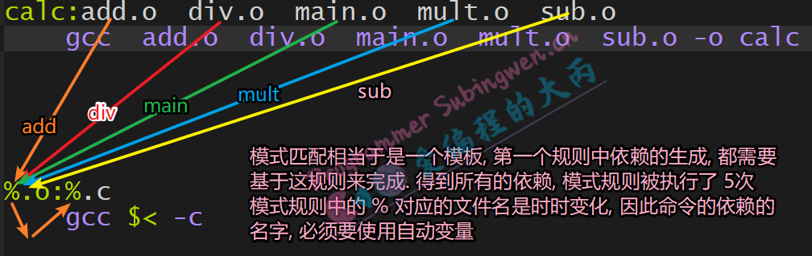
#### 5. 函数
> makefile中有很多函数并且`所有的函数都是有返回值的。`makefile中函数的格式和C/C++中函数也不同，其写法是这样的： `$(函数名 参数1, 参数2, 参数3, ...)`，主要目的是让我们能够快速方便的得到函数的返回值。 这里为大家介绍两个 makefile 中使用频率比较高的函数：`wildcard`和`patsubst`。
##### 5.1 wildcard
这个函数的主要作用是获取指定目录下指定类型的文件名，其返回值是以空格分割的、指定目录下的所有符合条件的文件名列表。函数原型如下：
```makefile
# 该函数的参数只有一个, 但是这个参数可以分成若干个部分, 通过空格间隔
$(wildcard PATTERN...)
	参数:	指定某个目录, 搜索这个路径下指定类型的文件，比如： *.c
```
- 参数功能: PATTERN 指的是某个或多个目录下的对应的某种类型的文件, 比如`当前目录下的.c`文件可以写成 `*.c`
- 可以指定多个目录，每个路径之间使用空格间隔
- 返回值： 得到的若干个文件的文件列表， 文件名之间使用空格间隔
- 示例：`$(wildcard *.c ./sub/*.c)` 返回值格式: a.c b.c c.c d.c e.c f.c ./sub/aa.c ./sub/bb.c
函数使用举例:
```makefile
# 使用举例: 分别搜索三个不同目录下的 .c 格式的源文件
src = $(wildcard /home/robin/a/*.c /home/robin/b/*.c *.c)  # *.c == ./*.c
# 返回值: 得到一个大的字符串, 里边有若干个满足条件的文件名, 文件名之间使用空格间隔
/home/robin/a/a.c /home/robin/a/b.c /home/robin/b/c.c /home/robin/b/d.c e.c f.c
```
##### 5.2 patsubst
这个函数的功能是按照指定的模式替换指定的文件名的后缀, 函数原型如下:
```makefile
# 有三个参数, 参数之间使用 逗号间隔
$(patsubst <pattern>,<replacement>,<text>)
```
- 参数功能: pattern: 这是一个模式字符串, 需要指定出要被替换的文件名中的后缀是什么 文件名和路径不需要关心, 因此使用 % 表示即可 [通配符是 %]
- 在通配符后边指定出要被替换的后缀, 比如: %.c, 意味着 .c的后缀要被替换掉
- replacement: 这是一个模式字符串, 指定参数pattern中的后缀最终要被替换为什么 还是使用 % 来表示参数pattern 中文件的路径和名字
- 在通配符 % 后边指定出新的后缀名, 比如: %.o 这表示原来的后缀被替换为 .o
- text: 该参数中存储这要被替换的原始数据
- 返回值: 函数返回被替换过后的字符串。
函数使用举例:
```makefile
src = a.cpp b.cpp c.cpp e.cpp
# 把变量 src 中的所有文件名的后缀从 .cpp 替换为 .o
obj = $(patsubst %.cpp, %.o, $(src)) 
# obj 的值为: a.o b.o c.o e.o
```
#### 6. makefile的编写
> 下面基于一个简单的项目, 为大家演示一下编写一个makefile从不标准到标准的进化过程。
```bash
# 项目目录结构
.
├── add.c
├── div.c
├── head.h
├── main.c
├── mult.c
└── sub.c
# 需要编写makefile对该项目进行自动化编译
```
##### 6.1 版本1
```makefile
calc:add.c  div.c  main.c  mult.c  sub.c
        gcc add.c  div.c  main.c  mult.c  sub.c -o calc
```
这个版本的优点：书写简单
这版本的缺点：只要依赖中的某一个源文件被修改，所有的源文件都需要被重新编译，太耗时、效率低
改进方式：提高效率，修改哪一个源文件, 哪个源文件被重新编译, 不修改就不重新编译
##### 6.2 版本2
```makefile
# 默认所有的依赖都不存在, 需要使用其他规则生成这些依赖
# 因为 add.o 被更新, 需要使用最新的依赖, 生成最新的目标
calc:add.o  div.o  main.o  mult.o  sub.o
        gcc  add.o  div.o  main.o  mult.o  sub.o -o calc

# 如果修改了add.c, add.o 被重新生成
add.o:add.c
        gcc add.c -c

div.o:div.c
        gcc div.c -c

main.o:main.c
        gcc main.c -c

sub.o:sub.c
        gcc sub.c -c

mult.o:mult.c
        gcc mult.c -c
```
这个版本的优点：相较于版本1效率提升了
这个版本的缺点：规则比较冗余, 需要精简
改进方式：在 makefile 中使用变量 和 模式匹配
##### 6.3 版本3
```makefile
# 添加自定义变量 -> makefile中注释前 使用 # 
obj=add.o  div.o  main.o  mult.o  sub.o
target=calc

$(target):$(obj)
        gcc $(obj)  -o $(target)

%.o:%.c
        gcc $< -c
```
这个版本的优点：文件精简不少，变得简洁了
这个版本的缺点：变量 obj 的值需要手动的写出来, 如果需要编译的项目文件很多，都用手写出来不现实
改进方式：在makefile中使用函数
##### 6.4 版本4
```makefile
# 添加自定义变量 -> makefile中注释前 使用 # 
# 使用函数搜索当前目录下的源文件 .c
src=$(wildcard *.c)
# 将源文件的后缀替换为 .o
# % 匹配的内容是不能被替换的, 需要替换的是第一个参数中的后缀, 替换为第二个参数中指定的后缀
# obj=$(patsubst %.cpp, %.o, $(src)) 将src中的关键字 .cpp 替换为 .o
obj=$(patsubst %.c, %.o, $(src))
target=calc

$(target):$(obj)
        gcc $(obj)  -o $(target)

%.o:%.c
        gcc $< -c
```
这个版本的优点：解决了自动加载项目文件的问题，解放了双手
这个版本的缺点：没有文件删除的功能，不能删除项目编译过程中生成的目标文件（*.o）和可执行程序
改进方式: 在makefile文件中添加新的规则用于删除生成的目标文件（*.o）和可执行程序
##### 6.5 版本5
```makefile
# 添加自定义变量 -> makefile中注释前 使用 # 
# 使用函数搜索当前目录下的源文件 .c
src=$(wildcard *.c)
# 将源文件的后缀替换为 .o
obj=$(patsubst %.c, %.o, $(src))
target=calc
# obj 的值 xxx.o xxx.o xxx.o xx.o
$(target):$(obj)
        gcc $(obj)  -o $(target)

%.o:%.c
        gcc $< -c

# 添加规则, 删除生成文件 *.o 可执行程序
# 这个规则比较特殊, clean根本不会生成, 这是一个伪目标
clean:
        rm $(obj) $(target)
```
这个版本的优点: 添加了新的规则（16行）用于文件的删除, 直接 `make clean` 就可以执行规则中的删除命令了
这个版本的缺点: 在下面有具体的问题演示和分析
改进方式: 在makefile文件中声明 `clean`是一个伪目标，让 make 放弃对它的时间戳检测。
正常情况下这个版本的makefile是可以正常工作的，但是我们如果在这个项目目录中添加一个叫做`clean`的文件（和规则中的目标名称相同），再进行 `make clean`发现这个规则就不能正常工作了。
```makefile
# 在项目目录中添加一个叫 clean的文件, 然后在 make clean 这个规则中的命令就不工作了
$ ls
add.c  calc   div.c  head.h  main.o    mult.c  sub.c
add.o  div.o  main.c  makefile  mult.o  sub.o  clean  ---> 新添加的

# 使用 makefile 中的规则删除生成的目标文件和可执行程序
$ make clean
make: 'clean' is up to date. 

# 查看目录, 发现相关文件并没有被删除, make clean 失败了
$ ls
add.c  calc   div.c  head.h  main.o    mult.c  sub.c
add.o  clean  div.o  main.c  makefile  mult.o  sub.o
```
这个问题的关键点在于 `clean`是一个伪目标, 不对应任何实体文件, 在前边讲`关于文件时间戳更新`问题的时候说过，如果目标不存在规则的命令肯定被执行， 如果目标文件存在了就需要比较规则中目标文件和依赖文件的时间戳，满足条件才执行规则的命令，否则不执行。
解决这个问题需要在 makefile 中声明 `clean`是一个伪目标，这样 make 就不会对文件的时间戳进行检测，规则中的命令也就每次都会被执行了。
在 makefile 中声明一个伪目标需要使用` .PHONY` 关键字, 声明方式为: `.PHONY:伪文件名称`
##### 6.6 最终版
```makefile
# 添加自定义变量 -> makefile中注释前 使用 # 
# 使用函数搜索当前目录下的源文件 .c
src=$(wildcard *.c)
# 将源文件的后缀替换为 .o
obj=$(patsubst %.c, %.o, $(src))
target=calc

$(target):$(obj)
        gcc $(obj)  -o $(target)

%.o:%.c
        gcc $< -c

# 添加规则, 删除生成文件 *.o 可执行程序
# 声明clean为伪文件
.PHONY:clean
clean:
        # shell命令前的 - 表示强制这个指令执行, 如果执行失败也不会终止
        -rm $(obj) $(target) 
        echo "hello, 我是测试字符串"
```
#### 7. 练习题
> 如果觉得上边讲的内容看懂了, 可以试着根据这个目录结构写出其对应的 makefile 文件。
```bash
# 目录结构
.
├── include
│   └── head.h	==> 头文件, 声明了加减乘除四个函数
├── main.c		==> 测试程序, 调用了head.h中的函数
└── src
    ├── add.c	==> 加法运算
    ├── div.c	==> 除法运算
    ├── mult.c  ==> 乘法运算
    └── sub.c   ==> 减法运算
```
根据上边的项目目录结构编写的makefile文件如下:
```makefile
# 最终的目标名 app
target = app
# 搜索当前项目目录下的源文件
src=$(wildcard *.c ./src/*.c)
# 将文件的后缀替换掉 .c -> .o
obj=$(patsubst %.c, %.o, $(src))
# 头文件目录
include=./include

# 第一条规则
# 依赖中都是 xx.o yy.o zz.o
# gcc命令执行的是链接操作
$(target):$(obj)
        gcc $^ -o $@

# 模式匹配规则
# 执行汇编操作, 前两步: 预处理, 编译是自动完成
%.o:%.c
        gcc $< -c -I $(include) -o $@

# 添加一个清除文件的规则
.PHONY:clean

clean:
        -rm $(obj) $(target) -f
```
#### 8. 视频讲解
> 以上知识点对应的视频讲解可以关注 [B站-爱编程的大丙](https://space.bilibili.com/147020887) 视频地址: [https://www.bilibili.com/video/BV13U4y1p7kB](https://www.bilibili.com/video/BV13U4y1p7kB)

### 1.10 GDB调试

> 原文：[《GDB调试》](https://subingwen.cn/linux/gdb/)　作者：苏丙榅　来源：爱编程的大丙

gdb 是由 GNU 软件系统社区提供的调试器，同 gcc 配套组成了一套完整的开发环境，可移植性很好，支持非常多的体系结构并被移植到各种系统中（包括各种类 Unix 系统与 Windows 系统里的 MinGW 和 Cygwin ）。此外，除了 C 语言之外，gcc/gdb 还支持包括 C++、Objective-C、Ada 和 Pascal 等各种语言后端的编译和调试。 gcc/gdb 是 Linux 和许多类 Unix 系统中的标准开发环境，Linux 内核也是专门针对 gcc 进行编码的。
gdb 的吉祥物是专门捕杀 bug 的射手鱼，官方有这样一段描述:
> *For a fish, the archer fish is known to shoot down bugs from low hanging plants by spitting water at them.* 作为一种鱼，射手鱼以喷水射下低垂的植物上的虫子而闻名。
`GDB 是一套字符界面的程序集，可以使用命令 gdb 加载要调试的程序。 `下面为大家介绍一些常用的GDB调试命令。
#### 1. 调试准备
项目程序如果是为了进行调试而编译时， 必须要打开调试选项(`-g`)。另外还有一些可选项，比如: 在尽量不影响程序行为的情况下关掉编译器的优化选项(`-O0`)，`-Wall`选项打开所有 warning，也可以发现许多问题，避免一些不必要的 bug。
`-g`选项的作用是在可执行文件中加入源代码的信息，比如可执行文件中第几条机器指令对应源代码的第几行，但并不是把整个源文件嵌入到可执行文件中，所以在调试时必须保证gdb能找到源文件。
习惯上如果是`c程序`就使用`gcc`编译, 如果是 `c++`程序就使用`g++`编译, 编译命令中添加上边提到的参数即可。
> 假设有一个文件 args.c, `要对其进行gdb调试，编译的时候必须要添加参数 -g`，加入了源代码信息的可执行文件比不加之前要大一些。
```bash
# -g 将调试信息写入到可执行程序中
$ gcc -g args.c -o app

# 编译不添加 -g 参数
$ gcc args.c -o app1  

# 查看生成的两个可执行程序的大小
$ ll

-rwxrwxr-x  1 robin robin 9816 Apr 19 09:25 app*	# 可以用于gdb调试
-rwxrwxr-x  1 robin robin 8608 Apr 19 09:25 app1*	# 不能用于gdb调试
```
#### 2. 启动和退出gdb
##### 2.1 启动gdb
> gdb是一个用于应用程序调试的进程, 需要先将其打开, 一定要注意 `gdb进程启动之后, 需要的被调试的应用程序是没有执行的`。打开Linux终端，切换到要调试的可执行程序所在路径，执行如下命令就可以启动 gdb了。
```bash
# 在终端中执行如下命令
# gdb程序启动了, 但是可执行程序并没有执行
$ gdb 可执行程序的名字

# 使用举例：
$ gdb app
(gdb) 		# gdb等待输入调试的相关命令
```
##### 2.2 命令行传参
> 有些程序在启动的时候需要传递命令行参数，如果要调试这类程序，这些命令行参数必须要在应用程序启动之前通过调试程序的gdb进程传递进去。下面是一段带命令行参数的程序：
```c
// args.c
#include <stdio.h>
#include <stdlib.h>
#include <unistd.h>
#include <string.h>

#define NUM 10

// argc, argv 是命令行参数
// 启动应用程序的时候
int main(int argc, char* argv[])
{
    printf("参数个数: %d\n", argc);
    for(int i=0; i<argc; ++i)
    {
        printf("%d\n", NUM);
        printf("参数 %d: %s\n", i, argv[i]);
    }
    return 0;
}
```
> 第一步: 编译出带条信息的可执行程序
```bash
$ gcc args.c -o app -g
```
> 第二步: 启动gdb进程, 指定需要gdb调试的应用程序名称
```bash
$ gdb app
(gdb) 
```
> 第三步: 在启动应用程序 `app`之前设置命令行参数。gdb中设置参数的命令叫做`set args ...`，查看设置的命令行参数命令是 `show args`。 语法格式如下：
```bash
# 设置的时机: 启动gdb之后, 在应用程序启动之前
(gdb) set args 参数1 参数2 .... ...
# 查看设置的命令行参数
(gdb) show args
```
使用举例：
```bash
# 非gdb调试命令行传参
# argc 参数总个数，argv[0] == ./app， argv[1] == "11"  argv[2] == "22"  ...  argv[5] == "55"
$ ./app 11 22 33 44 55		# 这是数据传递给main函数
 
# 使用 gdb 调试
$ gdb app
GNU gdb (Ubuntu 7.11.1-0ubuntu1~16.5) 7.11.1
Copyright (C) 2016 Free Software Foundation, Inc.
# 通过gdb给应用程序设置命令行参数
(gdb) set args 11 22 33 44 55
# 查看设置的命令行参数
(gdb) show args
Argument list to give program being debugged when it is started is "11 22 33 44 55".
```
##### 2.3 gdb中启动程序
> 在gdb中启动要调试的应用程序有两种方式, 一种是使用`run`命令, 另一种是使用`start`命令启动。在整个 gdb 调试过程中, 启动应用程序的命令只能使用一次。
- `run`: 可以缩写为 `r`, 如果程序中设置了断点会停在第一个断点的位置, 如果没有设置断点, 程序就执行完了
- `start`: 启动程序, 最终会阻塞在main函数的第一行，等待输入后续其它 `gdb` 指令
```bash
# 两种方式
# 方式1: run == r 
(gdb) run  

# 方式2: start
(gdb) start
```
如果想让程序start之后继续运行, 或者在断点处继续运行，可以使用 `continue`命令, 可以简写为 `c`
```bash
# continue == c
(gdb) continue
```
##### 2.4 退出gdb
> 退出gdb调试, 就是终止 gdb 进程, 需要使用 `quit`命令, 可以缩写为 `q`
```bash
# quit == q
(gdb) quit
```
#### 3. 查看代码
因为gdb调试没有IDE那样的完善的可视化窗口界面，给调试的程序打断点又是调试之前必须做的一项工作。因此gdb提供了查看代码的命令，这样就可以轻松定位要调试的代码行的位置了。
查看代码的命令叫做`list`可以缩写为 `l`, 通过这个命令我们可以查看项目中任意一个文件中的内容，并且还可以通过文件行号，函数名等方式查看。
##### 3.1 当前文件
> 一个项目中一般是有很多源文件的, 默认情况下通过`list`查看到代码信息位于程序入口函数`main`对应的的那个文件中。因此如果不进行文件切换`main`函数所在的文件就是当前文件, 如果进行了文件切换, 切换到哪个文件哪个文件就是当前文件。查看文件内容的方式如下：
```bash
# 使用 list 和使用 l 都可以
# 从第一行开始显示
(gdb) list 

# 列值这行号对应的上下文代码, 默认情况下只显示10行内容
(gdb) list 行号

# 显示这个函数的上下文内容, 默认显示10行
(gdb) list 函数名
```
通过list去查看文件代码, 默认只显示10行, 如果还想继续查看后边的内容, 可以继续执行list命令, 也可以直接回车（再次执行上一次执行的那个gdb命令）。
##### 3.2 切换文件
> 在查看文件内容的时候，很多情况下需要进行文件切换，我们只需要在list命令后边将要查看的文件名指定出来就可以了，切换命令执行完毕之后，这个文件就变成了当前文件。文件切换方式如下：
```bash
# 切换到指定的文件，并列出这行号对应的上下文代码, 默认情况下只显示10行内容
(gdb) l 文件名:行号

# 切换到指定的文件，并显示这个函数的上下文内容, 默认显示10行
(gdb) l 文件名:函数名
```
##### 3.3 设置显示的行数
> 默认通过list只能一次查看10行代码, 如果想显示更多, 可以通过`set listsize`设置, 同样如果想查看当前显示的行数可以通过 `show listsize`查看, 这里的`listsize`可以简写为 `list`。具体语法格式如下:
```bash
# 以下两个命令中的 listsize 都可以写成 list
(gdb) set listsize 行数

# 查看当前list一次显示的行数
(gdb) show listsize
```
#### 4. 断点操作
想要通过gdb调试某一行或者得到某个变量在运行状态下的实际值，就需要在在这一行设置断点，程序指定到断点的位置就会阻塞，我们就可以通过gdb的调试命令得到我们想要的信息了。
设置断点的命令叫做`break`可以缩写为`b`。
##### 4.1 设置断点
> 断点的设置有两种方式一种是`常规断点`，程序只要运行到这个位置就会被阻塞，还有一种叫`条件断点`，只有指定的条件被满足了程序才会在断点处阻塞。 调试程序的断点可以设置到某个具体的行, 也可以设置到某个函数上，具体的设置方式如下：
```bash
# 在当前文件的某一行上设置断点
# break == b
(gdb) b 行号
(gdb) b 函数名		# 停止在函数的第一行
```
- 设置普通断点到当前文件
```bash
# 在非当前文件的某一行上设置断点
(gdb) b 文件名:行号
(gdb) b 文件名:函数名		# 停止在函数的第一行
```
- 设置普通断点到某个非当前文件上
```bash
# 必须要满足某个条件, 程序才会停在这个断点的位置上
# 通常情况下, 在循环中条件断点用的比较多
(gdb) b 行数 if 变量名==某个值
```
- 设置条件断点
##### 4.2 查看断点
> 断点设置完毕之后, 可以通过 `info break`命令查看设置的断点信息，其中`info`可以缩写为`i`
```bash
# info == i
# 查看设置的断点信息
(gdb) i b   #info break

# 举例
(gdb) i b
Num     Type           Disp Enb Address            What
1       breakpoint     keep y   0x0000000000400cb5 in main() at test.cpp:12
2       breakpoint     keep y   0x0000000000400cbd in main() at test.cpp:13
3       breakpoint     keep y   0x0000000000400cec in main() at test.cpp:18
4       breakpoint     keep y   0x00000000004009a5 in insertionSort(int*, int) 
                                                   at insert.cpp:8
5       breakpoint     keep y   0x0000000000400cdd in main() at test.cpp:16
6       breakpoint     keep y   0x00000000004009e5 in insertionSort(int*, int) 
                                                   at insert.cpp:16
```
在显示的断点信息中有一些属性需要在其他操作中被使用, 下面介绍一下:
- `Num`: 断点的编号, 删除断点或者设置断点状态的时候都需要使用
- `Enb`: 当前断点的状态, y表示断点可用, n表示断点不可用
- `What`: 描述断点被设置在了哪个文件的哪一行或者哪个函数上
##### 4.3 删除断点
> 如果确定设置的某个断点不再被使用了, 可用将其删除, 删除命令是 `delete 断点编号`, 这个`delete`可以简写为`del`也可以再简写为`d`。 删除断点的方式有两种: `删除(一个或者多个)指定断点`或者`删除一个连续的断点区间`，具体操作如下：
```bash
# delete == del == d
# 需要 info b 查看断点的信息, 第一列就是编号
(gdb) d 断点的编号1 [断点编号2 ...]
# 举例: 
(gdb) d 1          # 删除第1个断点
(gdb) d 2 4 6      # 删除第2,4,6个断点

# 删除一个范围, 断点编号 num1 - numN 是一个连续区间
(gdb) d num1-numN
# 举例, 删除第1到第5个断点
(gdb) d 1-5
```
##### 4.4 设置断点状态
> 如果某个断点只是临时不需要了，我们可以将其设置为不可用状态, 设置命令为`disable 断点编号`，当需要的时候再将其设置回可用状态，设置命令为 `enable 断点编号`。
```bash
# 让断点失效之后, gdb调试过程中程序是不会停在这个位置的
# disable == dis
# 设置某一个或者某几个断点无效
(gdb) dis 断点1的编号 [断点2的编号 ...]

# 设置某个区间断点无效
(gdb) dis 断点1编号-断点n编号
```
```bash
# 查看断点信息
(gdb) i b
Num     Type           Disp Enb Address            What
2       breakpoint     keep y   0x0000000000400cce in main() at test.cpp:14
4       breakpoint     keep y   0x0000000000400cdd in main() at test.cpp:16
5       breakpoint     keep y   0x0000000000400d46 in main() at test.cpp:23
6       breakpoint     keep y   0x0000000000400d4e in main() at test.cpp:25
7       breakpoint     keep y   0x0000000000400d6e in main() at test.cpp:28
8       breakpoint     keep y   0x0000000000400d7d in main() at test.cpp:30

# 设置第2, 第4 个断点无效
(gdb) dis 2 4

# 查看断点信息
(gdb) i b
Num     Type           Disp Enb Address            What
2       breakpoint     keep n   0x0000000000400cce in main() at test.cpp:14
4       breakpoint     keep n   0x0000000000400cdd in main() at test.cpp:16
5       breakpoint     keep y   0x0000000000400d46 in main() at test.cpp:23
6       breakpoint     keep y   0x0000000000400d4e in main() at test.cpp:25
7       breakpoint     keep y   0x0000000000400d6e in main() at test.cpp:28
8       breakpoint     keep y   0x0000000000400d7d in main() at test.cpp:30

# 设置 第5,6,7,8个 断点无效
(gdb) dis 5-8

# 查看断点信息
(gdb) i b
Num     Type           Disp Enb Address            What
2       breakpoint     keep n   0x0000000000400cce in main() at test.cpp:14
4       breakpoint     keep n   0x0000000000400cdd in main() at test.cpp:16
5       breakpoint     keep n   0x0000000000400d46 in main() at test.cpp:23
6       breakpoint     keep n   0x0000000000400d4e in main() at test.cpp:25
7       breakpoint     keep n   0x0000000000400d6e in main() at test.cpp:28
8       breakpoint     keep n   0x0000000000400d7d in main() at test.cpp:30
```
- 设置断点无效 shell1234567 演示设置断点为无效状态:
```bash
# enable == ena
# 设置某一个或者某几个断点有效
(gdb) ena 断点1的编号 [断点2的编号 ...]

# 设置某个区间断点有效
(gdb) ena 断点1编号-断点n编号
```
```bash
# 查看断点信息
(gdb) i b
Num     Type           Disp Enb Address            What
2       breakpoint     keep n   0x0000000000400cce in main() at test.cpp:14
4       breakpoint     keep n   0x0000000000400cdd in main() at test.cpp:16
5       breakpoint     keep n   0x0000000000400d46 in main() at test.cpp:23
6       breakpoint     keep n   0x0000000000400d4e in main() at test.cpp:25
7       breakpoint     keep n   0x0000000000400d6e in main() at test.cpp:28
8       breakpoint     keep n   0x0000000000400d7d in main() at test.cpp:30

# 设置第2, 第4个断点有效
(gdb) ena 2 4

# 查看断点信息
(gdb) i b
Num     Type           Disp Enb Address            What
2       breakpoint     keep y   0x0000000000400cce in main() at test.cpp:14
4       breakpoint     keep y   0x0000000000400cdd in main() at test.cpp:16
5       breakpoint     keep n   0x0000000000400d46 in main() at test.cpp:23
6       breakpoint     keep n   0x0000000000400d4e in main() at test.cpp:25
7       breakpoint     keep n   0x0000000000400d6e in main() at test.cpp:28
8       breakpoint     keep n   0x0000000000400d7d in main() at test.cpp:30

# 设置第5,6,7个断点有效
(gdb) ena 5-7

# 查看断点信息
(gdb) i b
Num     Type           Disp Enb Address            What
2       breakpoint     keep y   0x0000000000400cce in main() at test.cpp:14
4       breakpoint     keep y   0x0000000000400cdd in main() at test.cpp:16
5       breakpoint     keep y   0x0000000000400d46 in main() at test.cpp:23
6       breakpoint     keep y   0x0000000000400d4e in main() at test.cpp:25
7       breakpoint     keep y   0x0000000000400d6e in main() at test.cpp:28
8       breakpoint     keep n   0x0000000000400d7d in main() at test.cpp:30
```
- 让无效的断点生效 shell123456 演示设置断点为有效状态:
#### 5. 调试命令
##### 5.1 继续运行gdb
> 如果调试的程序被断点阻塞了又想让程序继续执行，这时候就可以使用`continue`命令。程序会继续运行, 直到遇到下一个有效的断点。`continue`可以缩写为 `c`。
```bash
# continue == c
(gdb) continue
```
##### 5.2 手动打印信息
> 当程序被某个断点阻塞之后, 可以通过一些命令打印变量的名字或者变量的类型，并且还可以跟踪打印某个变量的值。
###### 5.2.1 打印变量值
在gdb调试的时候如果需要打印变量的值， 使用的命令是 `print`, 可缩写为 `p`。如果打印的变量是整数还可以指定输出的整数的格式, 格式化输出的整数对应的字符表如下：
| 格式化字符(/fmt) | 说明 |
| --- | --- |
| /x | 以十六进制的形式打印出整数。 |
| /d | 以有符号、十进制的形式打印出整数。 |
| /u | 以无符号、十进制的形式打印出整数。 |
| /o | 以八进制的形式打印出整数。 |
| /t | 以二进制的形式打印出整数。 |
| /f | 以浮点数的形式打印变量或表达式的值。 |
| /c | 以字符形式打印变量或表达式的值。 |
print命令的语法格式如下:
```bash
# print == p
(gdb) p 变量名

# 如果变量是一个整形, 默认对应的值是以10进制格式输出, 其他格式请参考上表
(gdb) p/fmt 变量名
```
举例:
```bash
# 举例
(gdb) p i       # 10进制
$5 = 3
(gdb) p/x i     # 16进制
$6 = 0x3
(gdb) p/o i     # 8进制
$7 = 03
```
###### 5.2.2 打印变量类型
如果在调试过程中需要查看某个变量的类型, 可以使用命令`ptype`, 语法格式如下:
```bash
# 语法格式
(gdb) ptype 变量名
```
举例:
```bash
# 打印变量类型
(gdb) ptype i
type = int
(gdb) ptype array[i]
type = int
(gdb) ptype array
type = int [12]
```
##### 5.3 自动打印信息
###### 5.3.1 设置变量名自动显示
和 print 命令一样，display 命令也用于调试阶段查看某个变量或表达式的值，它们的区别是，使用 display 命令查看变量或表达式的值，每当程序暂停执行（例如单步执行）时，GDB 调试器都会自动帮我们打印出来，而 print 命令则不会。因此，当我们想频繁查看某个变量或表达式的值从而观察它的变化情况时，使用 display 命令可以一劳永逸。display 命令没有缩写形式，常用的语法格式如下 2 种：
```bash
# 在变量的有效取值范围内, 自动打印变量的值(设置一次, 以后就会自动显示)
(gdb) display 变量名

# 以指定的整形格式打印变量的值, 关于 fmt 的取值, 请参考 print 命令
(gdb) display/fmt 变量名
```
###### 5.3.2 查看自动显示列表
对于使用 display 命令查看的目标变量或表达式，都会被记录在一张列表（称为自动显示列表）中。通过执行`info dispaly`命令，可以打印出这张表：
```bash
# info == i
(gdb) info display
Auto-display expressions now in effect:
Num Enb Expression
1:   y  i
2:   y  array[i]
3:   y  /x array[i]
```
在展示出的信息中, 每个列的含义如下:
- `Num` : 变量或表达式的编号，GDB 调试器为每个变量或表达式都分配有唯一的编号
- `Enb` : 表示当前变量（表达式）是处于激活状态还是禁用状态，如果处于激活状态（用 y 表示），则每次程序停止执行，该变量的值都会被打印出来；反之，如果处于禁用状态（用 n 表示），则该变量（表达式）的值不会被打印。
- `Expression` ：被自动打印值的变量或表达式的名字。
###### 5.3.3 取消自动显示
对于不需要再打印值的变量或表达式，可以将其删除或者禁用。
```bash
# 命令中的 num 是通过 info display 得到的编号, 编号可以是一个或者多个
(gdb) undisplay num [num1 ...]
# num1 - numN 表示一个范围
(gdb) undisplay num1-numN

(gdb) delete display num [num1 ...]
(gdb) delete display num1-numN
```
```bash
# 查看显示列表
(gdb) info display
Auto-display expressions now in effect:
Num Enb Expression
1:   y  i
2:   y  array[i]
3:   y  /x array[i]

# 删除变量显示, 需要使用 info display 得到的变量/表达式编号
(gdb) undisplay 1 2

# 查看显示列表, 只剩下一个了
(gdb) i display
Auto-display expressions now in effect:
Num Enb Expression
3:   y  /x array[i]
```
- 删除自动显示列表中的变量或表达式 shell1234567 举例说明:
```bash
# 命令中的 num 是通过 info display 得到的编号, 编号可以是一个或者多个
(gdb) disable display num [num1 ...]
# num1 - numN 表示一个范围
(gdb) disable display num1-numN
```
- 如果不想删除自动显示的变量, 也可以禁用自动显示列表中处于激活状态下的变量或表达式
```bash
# 命令中的 num 是通过 info display 得到的编号, 编号可以是一个或者多个
(gdb) enable  display num [num1 ...]
# num1 - numN 表示一个范围
(gdb) disable display num1-numN
```
- 当需要启用自动显示列表中被禁用的变量或表达式时, 可以使用下边的命令
##### 5.3 单步调试
> 当程序阻塞到某个断点上之后, 可以通过以下命令对程序进行单步调试:
###### 5.3.1 step
`step`命令可以缩写为`s`, 命令被执行一次代码被向下执行一行，如果这一行是一个函数调用，那么程序会进入到函数体内部。
```bash
# 从当前代码行位置, 一次调试当前行下的每一行代码
# step == s
# 如果这一行是函数调用, 执行这个命令, 就可以进入到函数体的内部
(gdb) step
```
###### 5.3.2 finish
如果通过 s 单步调试进入到函数内部, 想要跳出这个函数体， 可以执行`finish`命令。`如果想要跳出函数体必须要保证函数体内不能有有效断点，否则无法跳出。`
```bash
# 如果通过 s 单步调试进入到函数内部, 想要跳出这个函数体
(gdb) finish
```
###### 5.3.3 next
`next`命令和step命令功能是相似的，只是在使用next调试程序的时候不会进入到函数体内部，next可以缩写为 `n`
```bash
# next == n
# 如果这一行是函数调用, 执行这个命令, 不会进入到函数体的内部
(gdb) next
```
###### 5.3.4 until
通过` until` 命令可以直接跳出某个循环体，这样就能提高调试效率了。如果想直接从循环体中跳出, 必须要满足以下的条件，否则命令不会生效：
1. 要跳出的循环体内部不能有有效的断点
1. 必须要在循环体的开始/结束行执行该命令
```bash
(gdb) until
```
##### 5.4 设置变量值
> 在调试程序的时候, 我们需要在某个变量等于某个特殊值的时候查看程序的运行状态, 但是通过程序运行让变量等于这个值又非常困难, 这种情况下就可以在 gdb 中直接对这个变量进行值的设置, 或者是在单步调试的时候通过设置循环因子的值直接跳出某个循环, 值设置的命令格式为: `set var 变量名=值`
```bash
# 可以在循环中使用, 直接设置循环因子的值
# 假设某个变量的值在程序中==90的概率是5%, 这时候可以直接通过命令将这个变量值设置为90
(gdb) set var 变量名=值
```
#### 6. 视频讲解
> 以上知识点对应的视频讲解可以关注 [B站-爱编程的大丙](https://space.bilibili.com/147020887) 视频地址: [https://www.bilibili.com/video/BV13U4y1p7kB](https://www.bilibili.com/video/BV13U4y1p7kB)

## 第2章 文件 I/O

### 2.1 文件描述符

> 原文：[《文件描述符》](https://subingwen.cn/linux/file-descriptor/)　作者：苏丙榅　来源：爱编程的大丙

#### 1. 虚拟地址空间
虚拟地址空间是一个非常抽象的概念，先根据字面意思进行解释：
- 它可以用来加载程序数据（数据可能被加载到物理内存上，空间不够就加载到虚拟内存中）
- 它对应着一段连续的内存地址，起始位置为 0。
- 之所以说虚拟是因为这个起始的0地址是被虚拟出来的， 不是物理内存的 0地址。
虚拟地址空间的大小也由操作系统决定，`32位的操作系统虚拟地址空间的大小为` 232 字节，也就是`4G`，64位的操作系统虚拟地址空间大小为264 字节，这是一个非常大的数，感兴趣可以自己计算一下。`当我们运行磁盘上一个可执行程序, 就会得到一个进程，内核会给每一个运行的进程创建一块属于自己的虚拟地址空间，并将应用程序数据装载到虚拟地址空间对应的地址上。`
进程在运行过程中，程序内部所有的指令都是通过CPU处理完成的，CPU只进行数据运算并不具备数据存储的能力，其处理的数据都加载自物理内存，那 么进程中的数据是如何进出入到物理内存中的呢？其实是通过CPU中的内存管理单元MMU（Memory Management Unit）从进程的虚拟地址空间中映射过去的。
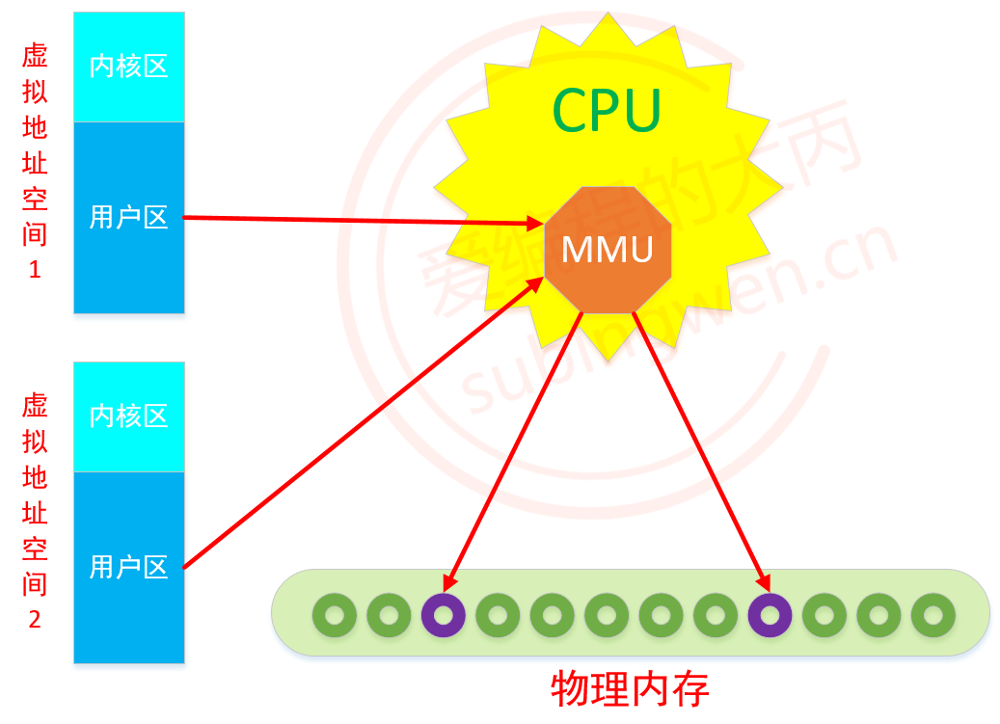
##### 1.1 存在的意义
通过上边的介绍大家会感觉到一头雾水， 为什么操作系统不直接将数据加载到物理内存中而是将数据加载到虚拟地址空间中，在通过CPU的MMU映射到物理内存中呢？
先来看一下如果直接将数据加载到物理内存会发生什么事情：

> 假设计算机的物理内存大小为1G, 进程A需要100M内存因此直接在物理内存上从0地址开始分配100M, 进程B启动需要250M内存, 因此继续在物理内存上为其分配250M内存, 并且进程A和进程B占用的内存是连续的。之后再启动其他进程继续按照这种方法进行物理内存的分配。。。 使用这种方式分配内存会有如下几个问题：
1. `每个进程的地址不隔离，有安全风险。` 由于程序都是直接访问物理内存，所以恶意程序可以通过内存寻址随意修改别的进程对应的内存数据，以达到破坏的目的。虽然有些时候是非恶意的，但是有些存在 bug 的程序可能不小心修改了其它程序的内存数据，就会导致其它程序的运行出现异常。
1. `内存效率低。` 如果直接使用物理内存的话，一个进程对应的内存块就是作为一个整体操作的，如果出现物理内存不够用的时候，我们一般的办法是将不常用的进程拷贝到磁 盘的交换分区（虚拟内存）中，以便腾出内存，因此就需要将整个进程一起拷走，如果数据量大，在内存和磁盘之间拷贝时间就会很长，效率低下。
1. `进程中数据的地址不确定，每次都会发生变化。` 由于物理内存的使用情况一直在动态的变化，我们无法确定内存现在使用到哪里了，如果直接将程序数据加载到物理内存，内存中每次存储数据的起始地址都是不一样的，这样数据的加载都需要使用相对地址，加载效率低（静态库是使用绝对地址加载的）。
有了虚拟地址空间之后就可以完美的解决上边提到的所有问题了，`虚拟地址空间就是一个中间层，相当于在程序和物理内存之间设置了一个屏障，将二者隔离开来。程序中访问的内存地址不再是实际的物理内存地址，而是一个虚拟地址，然后由操作系统将这个虚拟地址映射到适当的物理内存地址上。`这样，只要操作系统处理好虚拟地址到物理内存地址的映射，就可以保证不同的程序最终访问的内存地址位于不同的区域，彼此没有重叠，就可以达到内存地址空间隔离的效果。
##### 1.2 分区
从操作系统层级上看，虚拟地址空间主要分为两个部分`内核区`和`用户区`。
- 内核区： 内核空间为内核保留，`不允许应用程序读写该区域的内容或直接调用内核代码定义的函数。`
- 内核总是驻留在内存中，是操作系统的一部分。
- 系统中所有进程对应的虚拟地址空间的内核区都会映射到同一块物理内存上（系统内核只有一个）。
- 用户区：存储用户程序运行中用到的各种数据。
我们先来看一下进程对应的虚拟地址空间的各个分区，再来详细介绍用户区的组成（以32位系统的虚拟地址空间为例）。
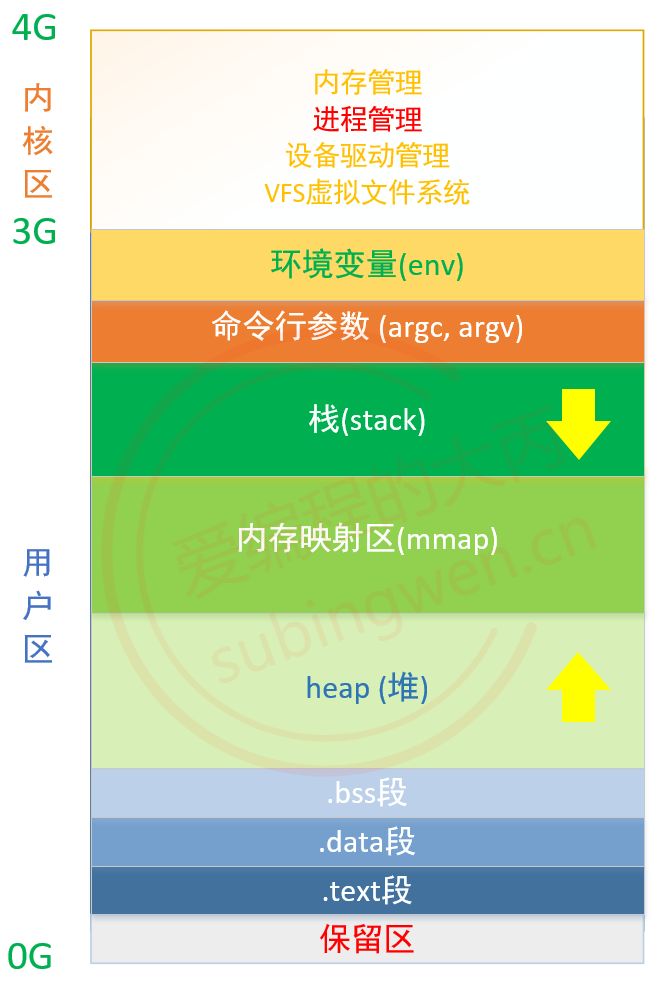
每个进程的虚拟地址空间都是从0地址开始的，我们在程序中打印的变量地址也其在虚拟地址空间中的地址，程序是无法直接访问物理内存的。虚拟地址空间中用户区地址范围是 0~3G，里边分为多个区块：
- `保留区`: 位于虚拟地址空间的最底部，未赋予物理地址。任何对它的引用都是非法的，程序中的空指针（NULL）指向的就是这块内存地址。
- `.text段`: 代码段也称正文段或文本段，通常用于存放程序的执行代码(即CPU执行的机器指令)，代码段一般情况下是只读的，这是对执行代码的一种保护机制。
- `.data段`: 数据段通常用于存放程序中已初始化且初值不为0的全局变量和静态变量。数据段属于静态内存分配(静态存储区)，可读可写。
- `.bss段`: 未初始化以及初始为0的全局变量和静态变量，操作系统会将这些未初始化变量初始化为0
- `堆(heap)`：用于存放进程运行时动态分配的内存。 堆中内容是匿名的，不能按名字直接访问，只能通过指针间接访问。
- 堆向高地址扩展(即“向上生长”)，是不连续的内存区域。这是由于系统用链表来存储空闲内存地址，自然不连续，而链表从低地址向高地址遍历。
- `内存映射区(mmap)`：作为内存映射区加载磁盘文件，或者加载程序运作过程中需要调用的动态库。
- `栈(stack)`: 存储函数内部声明的非静态局部变量，函数参数，函数返回地址等信息，栈内存由编译器自动分配释放。栈和堆相反地址“向下生长”，分配的内存是连续的。
- `命令行参数`：存储进程执行的时候传递给`main()`函数的参数，argc，argv[]
- `环境变量`: 存储和进程相关的环境变量, 比如: 工作路径, 进程所有者等信息
#### 2. 文件描述符
##### 2.1 文件描述符
在Linux操作系统中的一切都被抽象成了文件，那么一个打开的文件是如何与应用程序进行对应呢？解决方案是使用`文件描述符（file descriptor，简称fd），当在进程中打开一个现有文件或者创建一个新文件时，内核向该进程返回一个文件描述符，用于对应这个打开/新建的文件。`这些文件描述符都存储在内核为每个进程维护的一个文件描述符表中。
在程序设计中，一些涉及底层的程序编写往往会围绕着文件描述符展开。但是文件描述符这一概念往往只适用于UNIX、Linux这样的操作系统。
在Linux系统中一切皆文件，系统中一切都被抽象成了文件。对这些文件的读写都需要通过文件描述符来完成。标准C库的文件IO函数使用的文件指针`FILE*`在Linux中也需要通过文件描述符的辅助才能完成读写操作。`FILE`其实是一个结构体，其内部有一个成员就是文件描述符（下面结构体的第25行）。
**FILE结构体在Linux头文件中的定义**
```c
// linux c FILE结构体定义： /usr/include/libio.h
struct _IO_FILE {
  int _flags;		/* High-order word is _IO_MAGIC; rest is flags. */
#define _IO_file_flags _flags
 
  /* The following pointers correspond to the C++ streambuf protocol. */
  /* Note:  Tk uses the _IO_read_ptr and _IO_read_end fields directly. */
  char* _IO_read_ptr;	/* Current read pointer */
  char* _IO_read_end;	/* End of get area. */
  char* _IO_read_base;	/* Start of putback+get area. */
  char* _IO_write_base;	/* Start of put area. */
  char* _IO_write_ptr;	/* Current put pointer. */
  char* _IO_write_end;	/* End of put area. */
  char* _IO_buf_base;	/* Start of reserve area. */
  char* _IO_buf_end;	/* End of reserve area. */
  /* The following fields are used to support backing up and undo. */
  char *_IO_save_base; /* Pointer to start of non-current get area. */
  char *_IO_backup_base;  /* Pointer to first valid character of backup area */
  char *_IO_save_end; /* Pointer to end of non-current get area. */
 
  struct _IO_marker *_markers;
 
  struct _IO_FILE *_chain;
 
  int _fileno;			// 文件描述符
#if 0
  int _blksize;
#else
  int _flags2;
#endif
  _IO_off_t _old_offset; /* This used to be _offset but it's too small.  */
 
#define __HAVE_COLUMN /* temporary */
  /* 1+column number of pbase(); 0 is unknown. */
  unsigned short _cur_column;
  signed char _vtable_offset;
  char _shortbuf[1];
 
  /*  char* _save_gptr;  char* _save_egptr; */
 
  _IO_lock_t *_lock;
#ifdef _IO_USE_OLD_IO_FILE
};

// 在文件: /usr/include/stdio.h
typedef struct _IO_FILE FILE;
```
##### 2.2 文件描述符表
前面讲到启动一个进程就会得到一个对应的虚拟地址空间，这个虚拟地址空间分为两大部分，在内核区有专门用于进程管理的模块。Linux的进程控制块PCB（process control block）本质是一个叫做`task_struct`的结构体，里边包括管理进程所需的各种信息，其中有一个结构体叫做`file `，我们将它叫做文件描述符表，里边有一个整形索引表,用于存储文件描述符。
内核为每一个进程维护了一个文件描述符表，索引表中的值都是从0开始的，所以在不同的进程中你会看到相同的文件描述符，但是它们指向的不一定是同一个磁盘文件。
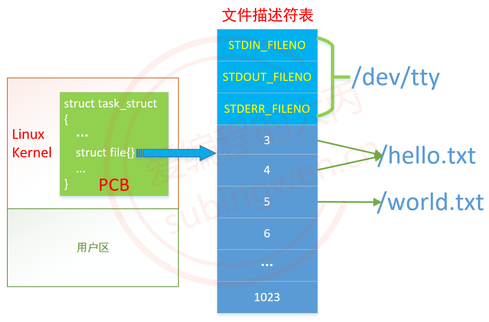
知识小科普：
Linux中用户操作的每个终端都被视作一个设备文件, 当前操作的终端文件可以使用 `/dev/tty`表示。
- **打开的最大文件数** 每一个进程对应的文件描述符表能够存储的打开的文件数是有限制的, 默认为1024个，这个默认值是可以修改的，支持打开的最大文件数据取决于操作系统的硬件配置。
- **默认分配的文件描述符** 当一个进程被启动之后，内核PCB的文件描述符表中就已经分配了三个文件描述符，这三个文件描述符对应的都是当前启动这个进程的终端文件（Linux中一切皆文件，终端就是一个设备文件，在 /dev 目录中） `STDIN_FILENO`：标准输入，可以通过这个文件描述符将数据输入到终端文件中，宏值为0。
- `STDOUT_FILENO`：标准输出，可以通过这个文件描述符将数据通过终端输出出来，宏值为1。
- `STDERR_FILENO`：标准错误，可以通过这个文件描述符将错误信息通过终端输出出来，宏值为2。
这三个默认分配的文件描述符是可以通过`close()`函数关闭掉，但是关闭之后当前进程也就不能和当前终端进行输入或者输出的信息交互了。
- **给新打开的文件分配文件描述符** 因为进程启动之后，文件描述符表中的`0`,`1`,`2`就被分配出去了，因此从`3`开始分配
- 在进程中每打开一个文件，就会给这个文件分配一个新的文件描述符，比如： 通过`open()`函数打开 `/hello.txt`，文件描述符 3 被分配给了这个文件，保持这个打开状态，再次通过`open()`函数打开 `/hello.txt`，文件描述符 4 被分配给了这个文件，也就是说一个进程中不同的文件描述符打开的磁盘文件可能是同一个。
- 通过`open()`函数打开 `/hello.txt`，文件描述符 3 被分配给了这个文件，将打开的文件关闭，此时文件描述符3就被释放了。再次通过`open()`函数打开 `/hello.txt`，文件描述符 3 被分配给了这个文件，也就是说打开的新文件会关联文件描述符表中最小的没有被占用的文件描述符。
总结:
1. 每个进程对应的文件描述符表默认支持打开的最大文件数为 1024，可以修改
1. 每个进程的文件描述符表中都已经默认分配了三个文件描述符，对应的都是当前终端文件（/dev/tty）
1. 每打开新的文件，内核会从进程的文件描述符表中找到一个空闲的没有被占用的文件描述符与其进行关联
1. 文件描述符表中不同的文件描述符可以对应同一个磁盘文件
1. 每个进程文件描述符表中的文件描述符值是唯一的，不会重复

### 2.2 Linux系统 I/O

> 原文：[《Linux系统文件IO》](https://subingwen.cn/linux/file-io/)　作者：苏丙榅　来源：爱编程的大丙

每个系统都有自己的专属函数，我们习惯称其为系统函数。`系统函数并不是内核函数`，因为内核函数是不允许用户使用的，系统函数就充当了二者之间的桥梁，这样用户就可以间接的完成某些内核操作了。
在前面介绍了文件描述符，在Linux系统中必须要使用系统提供的IO函数才能基于这些文件描述符完成对相关文件的读写操作。这些Linux系统IO函数和标准C库的IO函数使用方法类似，函数名称也类似，下边开始一一介绍。
#### 1. open/close
##### 1.1 函数原型
> 通过open函数我们即可打开一个磁盘文件，如果磁盘文件不存在还可以创建一个新的的文件，函数原型如下：
```c
#include <sys/types.h>
#include <sys/stat.h>
#include <fcntl.h>

/*
open是一个系统函数, 只能在linux系统中使用, windows不支持
fopen 是标准c库函数, 一般都可以跨平台使用, 可以这样理解:
		- 在linux中 fopen底层封装了Linux的系统API open
		- 在window中, fopen底层封装的是 window 的 api
*/
// 打开一个已经存在的磁盘文件
int open(const char *pathname, int flags);
// 打开磁盘文件, 如果文件不存在, 就会自动创建
int open(const char *pathname, int flags, mode_t mode);
```
- 参数介绍: pathname: 被打开的文件的文件名
- flags: 使用什么方式打开指定的文件，这个参数对应一些宏值，需要根据实际需求指定 `必须要指定的属性`, 以下三个属性不能同时使用, 只能任选其一 `O_RDONLY`: 以只读方式打开文件
- `O_WRONLY`: 以只写方式打开文件
- `O_RDWR`: 以读写方式打开文件
- `可选属性`, 和上边的属性一起使用 `O_APPEND`: 新数据追加到文件尾部, 不会覆盖文件的原来内容
- `O_CREAT`: 如果文件不存在, 创建该文件, 如果文件存在什么也不做
- `O_EXCL`: 检测文件是否存在, 必须要和 O_CREAT 一起使用, 不能单独使用: `O_CREAT | O_EXCL ` 检测到文件不存在, 创建新文件
- 检测到文件已经存在, 创建失败, 函数直接返回-1（如果不添加这个属性，不会返回-1）
- mode: 在创建新文件的时候才需要指定这个参数的值，用于指定新文件的权限，这是一个八进制的整数 这个参数的最大值为：0777
```bash
$ umask
0002
```
- 创建的新文件对应的最终实际权限, 计算公式:` (mode & ~umask)` umask 掩码可以通过 umask 命令查看
```bash
# umask(文件掩码):  002(八进制)  = 000000010 (二进制)  
# ~umask(掩码取反): ~000000010 (二进制) = 111111101 (二进制)  
# 参数mode指定的权限为: 0777(八进制) = 111111111(二进制)
# 计算公式: mode & ~umask
             111111111
       &     111111101
            ------------------
             111111101    二进制
            ------------------
             mod=0775     八进制  
```
- 假设 mode 参数的值为 0777, 通过计算得到的文件权限为 0775
- 返回值: 成功: 返回内核分配的文件描述符, 这个值被记录在内核的文件描述符表中，这是一个大于0的整数
- 失败: -1
##### 1.2 close函数原型
> 通过open函数可以让内核给文件分配一个文件描述符, 如果需要释放这个文件描述符就需要关闭文件。对应的这个系统函数叫做 close，函数原型如下：
```c
#include <unistd.h>
int close(int fd);
```
- 函数参数: fd 是文件描述符, 是open() 函数的返回值
- 函数返回值: 函数调用成功返回值 0, 调用失败返回 -1
##### 1.3 打开已存在文件
> 我们可以使用`open()`函数打开一个本地已经存在的文件, 假设我们想要读写这个文件, 操作代码如下:
```c
// open.c
#include <stdio.h>
#include <stdlib.h>
#include <unistd.h>
#include <string.h>
#include <fcntl.h>

int main()
{
    // 打开文件
    int fd = open("abc.txt", O_RDWR);
    if(fd == -1)
    {
        printf("打开文件失败\n");
    }
    else
    {
        printf("fd: %d\n", fd);
    }

    close(fd);
    return 0;
}
```
编译并执行程序
```bash
$ gcc open.c 
$ ./a.out 
fd: 3		# 打开的文件对应的文件描述符值为 3
```
##### 1.4 创建新文件
> 如果要创建一个新的文件，还是使用 open 函数，只不过需要添加 `O_CREAT `属性, 并且给新文件指定操作权限。
```c
#include <stdio.h>
#include <stdlib.h>
#include <unistd.h>
#include <string.h>
#include <fcntl.h>

int main()
{
    // 创建新文件
    int fd = open("./new.txt", O_CREAT|O_RDWR, 0664);
    if(fd == -1)
    {
        printf("打开文件失败\n");
    }
    else
    {
        printf("创建新文件成功, fd: %d\n", fd);
    }

    close(fd);
    return 0;
}
```
```bash
$ gcc open1.c 
$ ./a.out 
创建新文件成功, fd: 3
```
假设在创建新文件的时候, 给 open 指定第三个参数指定新文件的操作权限, 文件也是会被创建出来的, 只不过新的文件的权限可能会有点奇怪, 这个权限会随机分配而且还会出现一些特殊的权限位, 如下:
```bash
$ $ ll new.txt 
-r-x--s--T 1 robin robin 0 Jan 30 16:17 new.txt*   # T 就是一个特殊权限
```
##### 1.5 文件状态判断
> 在创建新文件的时候我们还可以通过 `O_EXCL`进行文件的检测, 具体处理方式如下:
```c
#include <stdio.h>
#include <stdlib.h>
#include <unistd.h>
#include <string.h>
#include <fcntl.h>

int main()
{
    // 创建新文件之前, 先检测是否存在
    // 文件存在创建失败, 返回-1, 文件不存在创建成功, 返回分配的文件描述符
    int fd = open("./new.txt", O_CREAT|O_EXCL|O_RDWR);
    if(fd == -1)
    {
        printf("创建文件失败, 已经存在了, fd: %d\n", fd);
    }
    else
    {
        printf("创建新文件成功, fd: %d\n", fd);
    }

    close(fd);
    return 0;
}
```
编译并执行程序:
```bash
$ gcc open1.c 
$ ./a.out 
创建文件失败, 已经存在了, fd: -1
```
#### 2. read/write
##### 2.1 read
> read 函数用于读取文件内部数据，在通过 open 打开文件的时候需要指定读权限，函数原型如下：
```c
#include <unistd.h>
ssize_t read(int fd, void *buf, size_t count);
```
- 参数: fd: 文件描述符, open() 函数的返回值, 通过这个参数定位打开的磁盘文件
- buf: 是一个传出参数, 指向一块有效的内存, 用于存储从文件中读出的数据 传出参数: 类似于返回值, 将变量地址传递给函数, 函数调用完毕, 地址中就有数据了
- count: buf指针指向的内存的大小, 指定可以存储的最大字节数
- 返回值: 大于0: 从文件中读出的字节数，读文件成功
- 等于0: 代表文件读完了，读文件成功
- -1: 读文件失败了
##### 2.2 write
> write 函数用于将数据写入到文件内部，在通过 open 打开文件的时候需要指定写权限，函数原型如下：
```c
#include <unistd.h>
ssize_t write(int fd, const void *buf, size_t count);
```
- 参数: fd: 文件描述符, open() 函数的返回值, 通过这个参数定位打开的磁盘文件
- buf: 指向一块有效的内存地址, 里边有要写入到磁盘文件中的数据 count: 要往磁盘文件中写入的字节数, 一般情况下就是buf字符串的长度, strlen(buf)
- 返回值: 大于0: 成功写入到磁盘文件中的字节数
- -1: 写文件失败了
##### 2.3 文件拷贝
> 假设有一个比较大的磁盘文件, 打开这个文件得到文件描述符fd1，然后在创建一个新的磁盘文件得到文件描述符fd2, 在程序中通过 fd1 将文件内容读出，并通过fd2将读出的数据写入到新文件中。
```c
// 文件的拷贝
#include <stdio.h>
#include <stdlib.h>
#include <unistd.h>
#include <string.h>
#include <fcntl.h>

int main()
{
    // 1. 打开存在的文件english.txt, 读这个文件
    int fd1 = open("./english.txt", O_RDONLY);
    if(fd1 == -1)
    {
        perror("open-readfile");
        return -1;
    }

    // 2. 打开不存在的文件, 将其创建出来, 将从english.txt读出的内容写入这个文件中
    int fd2 = open("copy.txt", O_WRONLY|O_CREAT, 0664);
    if(fd2 == -1)
    {
        perror("open-writefile");
        return -1;
    }

    // 3. 循环读文件, 循环写文件
    char buf[4096];
    int len = -1;
    while( (len = read(fd1, buf, sizeof(buf))) > 0 )
    {
        // 将读到的数据写入到另一个文件中
        write(fd2, buf, len); 
    }
    // 4. 关闭文件
    close(fd1);
    close(fd2);

    return 0;
}
```
#### 3. lseek
> 系统函数 lseek 的功能是比较强大的, 我们既可以通过这个函数移动文件指针, 也可以通过这个函数进行文件的拓展。这个函数的原型如下:
```c
#include <sys/types.h>
#include <unistd.h>

off_t lseek(int fd, off_t offset, int whence);
```
- 参数: fd: 文件描述符, open() 函数的返回值, 通过这个参数定位打开的磁盘文件
- offset: 偏移量，需要和第三个参数配合使用
- whence: 通过这个参数指定函数实现什么样的功能 SEEK_SET: 从文件头部开始偏移 offset 个字节
- SEEK_CUR: 从当前文件指针的位置向后偏移offset个字节
- SEEK_END: 从文件尾部向后偏移offset个字节
- 返回值: 成功: 文件指针从头部开始计算总的偏移量
- 失败: -1
##### 3.1 移动文件指针
> 通过对 lseek 函数第三个参数的设置, 经常使用该函数实现如下几个功能， 如下所示：
```c
lseek(fd, 0, SEEK_SET);
```
- 文件指针移动到文件头部
```c
lseek(fd, 0, SEEK_CUR); 
```
- 得到当前文件指针的位置
```c
lseek(fd, 0, SEEK_END);
```
- 得到文件总大小
##### 3.2 文件拓展
假设使用一个下载软件进行一个大文件下载，但是磁盘很紧张，如果不能马上将文件下载到本地，磁盘空间就可能被其他文件占用了，导致下载软件下载的文件无处存放。那么这个文件怎么解决呢？
我们可以在开始下载的时候先进行文件拓展，将一些字符写入到目标文件中，让拓展的文件和即将被下载的文件一样大，这样磁盘空间就被成功抢到手，软件就可以慢悠悠的下载对应的文件了。
使用 lseek 函数进行文件拓展必须要满足一下条件：
1. 文件指针必须要偏移到文件尾部之后， 多出来的就需要被填充的部分。
1. 文件拓展之后，必须要使用 `write()`函数进行一次写操作（写什么都可以，没有字节数要求）。
文件拓展举例：
```c
// lseek.c
// 拓展文件大小
#include <stdio.h>
#include <fcntl.h>
#include <unistd.h>

int main()
{
    int fd = open("hello.txt", O_RDWR);
    if(fd == -1)
    {
        perror("open");
        return -1;
    }

    // 文件拓展, 一共增加了 1001 个字节
    lseek(fd, 1000, SEEK_END);
    write(fd, " ", 1);
        
    close(fd);
    return 0;
}
```
查看执行执行的效果
```bash
# 编译程序 
$ gcc lseek.c

# 查看目录文件信息
$ ll
-rwxrwxr-x 1 robin robin 8808 May  6  2019 a.out*
-rwxrwxr-x 1 robin robin 1013 May  6  2019 hello.txt*
-rw-rw-r-- 1 robin robin  299 May  6  2019 lseek.c

# 执行程序, 拓展文件
$ ./a.out 

# 在查看目录文件信息
$ ll
-rwxrwxr-x 1 robin robin 8808 May  6  2019 a.out*
-rwxrwxr-x 1 robin robin 2014 Jan 30 17:39 hello.txt*   # 大小从 1013 -> 2014, 拓展了1001字节
-rw-rw-r-- 1 robin robin  299 May  6  2019 lseek.c
```
#### 4. truncate/ftruncate
truncate/ftruncate 这两个函数的功能是一样的，可以对文件进行拓展也可以截断文件。使用这两个函数拓展文件比使用lseek要简单。这两个函数的函数原型如下：
```c
// 拓展文件或截断文件
#include <unistd.h>
#include <sys/types.h>

int truncate(const char *path, off_t length);
	- 
int ftruncate(int fd, off_t length);
```
- 参数： path: 要拓展/截断的文件的文件名
- fd: 文件描述符, open() 得到的
- length: 文件的最终大小 文件原来size > length，文件被截断, 尾部多余的部分被删除, 文件最终长度为length
- 文件原来size < length，文件被拓展, 文件最终长度为length
- 返回值: 成功返回0; 失败返回值-1
truncate() 和 ftruncate() 两个函数的区别在于一个使用文件名一个使用文件描述符操作文件, 功能相同。
不管是使用这两个函数还是使用 lseek() 函数拓展文件，文件尾部填充的字符都是 0。
#### 5. perror
在查看Linux系统函数的时候, 我们可以发现一个规律: 大部分系统函数的返回值都是整形，并且通过这个返回值来描述系统函数的状态（调用是否成功了）。在man 文档中关于系统函数的返回值大部分时候都是这样描述的：
```text
RETURN VALUE
       On  success,  zero is returned.  On error, -1 is returned, and errno is set
       appropriately.
       
       如果成功，则返回0。出现错误时，返回-1，并给errno设置一个适当的值。
```
`errno`是一个全局变量，只要调用的Linux系统函数有异常（返回-1）, 错误对应的错误号就会被设置给这个全局变量。这个错误号存储在系统的两个头文件中：
1. /usr/include/asm-generic/errno-base.h
1. /usr/include/asm-generic/errno.h
得到错误号，去查询对应的头文件是非常不方便的，我们可以通过 perror 函数将错误号对应的描述信息打印出来
```c
#include <stdio.h>
// 参数, 自己指定这个字符串的值就可以, 指定什么就会原样输出, 除此之外还会输出错误号对应的描述信息
void perror(const char *s);	
```
举例: 使用 perrno 打印错误信息
```c
// open.c
#include <stdio.h>
#include <fcntl.h>
#include <unistd.h>

int main()
{
    int fd = open("hello.txt", O_RDWR|O_EXCL|O_CREAT, 0777);
    if(fd == -1)
    {
        perror("open");
        return -1;
    }
        
    close(fd);
    return 0;
}
```
编译并执行程序
```bash
$ gcc open.c
$ $ ./a.out 
open: File exists	# 通过 perror 输出的错误信息
```
#### 6. 错误号
为了方便查询, 特将全局变量 errno 和错误信息描述的对照关系贴出:
##### 6.1 Part1
信息来自头文件: /usr/include/asm-generic/errno-base.h
```c
#define EPERM            1      /* Operation not permitted */
#define ENOENT           2      /* No such file or directory */
#define ESRCH            3      /* No such process */
#define EINTR            4      /* Interrupted system call */
#define EIO              5      /* I/O error */
#define ENXIO            6      /* No such device or address */
#define E2BIG            7      /* Argument list too long */
#define ENOEXEC          8      /* Exec format error */
#define EBADF            9      /* Bad file number */
#define ECHILD          10      /* No child processes */
#define EAGAIN          11      /* Try again */
#define ENOMEM          12      /* Out of memory */
#define EACCES          13      /* Permission denied */
#define EFAULT          14      /* Bad address */
#define ENOTBLK         15      /* Block device required */
#define EBUSY           16      /* Device or resource busy */
#define EEXIST          17      /* File exists */
#define EXDEV           18      /* Cross-device link */
#define ENODEV          19      /* No such device */
#define ENOTDIR         20      /* Not a directory */
#define EISDIR          21      /* Is a directory */
#define EINVAL          22      /* Invalid argument */
#define ENFILE          23      /* File table overflow */
#define EMFILE          24      /* Too many open files */
#define ENOTTY          25      /* Not a typewriter */
#define ETXTBSY         26      /* Text file busy */
#define EFBIG           27      /* File too large */
#define ENOSPC          28      /* No space left on device */
#define ESPIPE          29      /* Illegal seek */
#define EROFS           30      /* Read-only file system */
#define EMLINK          31      /* Too many links */
#define EPIPE           32      /* Broken pipe */
#define EDOM            33      /* Math argument out of domain of func */
#define ERANGE          34      /* Math result not representable */
```
##### 6.2 Part2
信息来自头文件: /usr/include/asm-generic/errno.h
```c
#define EDEADLK         35      /* Resource deadlock would occur */
#define ENAMETOOLONG    36      /* File name too long */
#define ENOLCK          37      /* No record locks available */

/*
 * This error code is special: arch syscall entry code will return
 * -ENOSYS if users try to call a syscall that doesn't exist.  To keep
 * failures of syscalls that really do exist distinguishable from
 * failures due to attempts to use a nonexistent syscall, syscall
 * implementations should refrain from returning -ENOSYS.
 */
#define ENOSYS          38      /* Invalid system call number */

#define ENOTEMPTY       39      /* Directory not empty */
#define ELOOP           40      /* Too many symbolic links encountered */
#define EWOULDBLOCK     EAGAIN  /* Operation would block */
#define ENOMSG          42      /* No message of desired type */
#define EIDRM           43      /* Identifier removed */
#define ECHRNG          44      /* Channel number out of range */
#define EL2NSYNC        45      /* Level 2 not synchronized */
#define EL3HLT          46      /* Level 3 halted */
#define EL3RST          47      /* Level 3 reset */
#define ELNRNG          48      /* Link number out of range */
#define EUNATCH         49      /* Protocol driver not attached */
#define ENOCSI          50      /* No CSI structure available */
#define EL2HLT          51      /* Level 2 halted */
#define EBADE           52      /* Invalid exchange */
#define EBADR           53      /* Invalid request descriptor */
#define EXFULL          54      /* Exchange full */
#define ENOANO          55      /* No anode */
#define EBADRQC         56      /* Invalid request code */
#define EBADSLT         57      /* Invalid slot */

#define EDEADLOCK       EDEADLK

#define EBFONT          59      /* Bad font file format */
#define ENOSTR          60      /* Device not a stream */
#define ENODATA         61      /* No data available */
#define ETIME           62      /* Timer expired */
#define ENOSR           63      /* Out of streams resources */
#define ENONET          64      /* Machine is not on the network */
#define ENOPKG          65      /* Package not installed */
#define EREMOTE         66      /* Object is remote */
#define ENOLINK         67      /* Link has been severed */
#define EADV            68      /* Advertise error */
#define ESRMNT          69      /* Srmount error */
#define ECOMM           70      /* Communication error on send */
#define EPROTO          71      /* Protocol error */
#define EMULTIHOP       72      /* Multihop attempted */
#define EDOTDOT         73      /* RFS specific error */
#define EBADMSG         74      /* Not a data message */
#define EOVERFLOW       75      /* Value too large for defined data type */
#define ENOTUNIQ        76      /* Name not unique on network */
#define EBADFD          77      /* File descriptor in bad state */
#define EREMCHG         78      /* Remote address changed */
#define ELIBACC         79      /* Can not access a needed shared library */
#define ELIBBAD         80      /* Accessing a corrupted shared library */
#define ELIBSCN         81      /* .lib section in a.out corrupted */
#define ELIBMAX         82      /* Attempting to link in too many shared libraries */
#define ELIBEXEC        83      /* Cannot exec a shared library directly */
#define EILSEQ          84      /* Illegal byte sequence */
#define ERESTART        85      /* Interrupted system call should be restarted */
#define ESTRPIPE        86      /* Streams pipe error */
#define EUSERS          87      /* Too many users */
#define ENOTSOCK        88      /* Socket operation on non-socket */
#define EDESTADDRREQ    89      /* Destination address required */
#define EMSGSIZE        90      /* Message too long */
#define EPROTOTYPE      91      /* Protocol wrong type for socket */
#define ENOPROTOOPT     92      /* Protocol not available */
#define EPROTONOSUPPORT 93      /* Protocol not supported */
#define ESOCKTNOSUPPORT 94      /* Socket type not supported */
#define EOPNOTSUPP      95      /* Operation not supported on transport endpoint */
#define EPFNOSUPPORT    96      /* Protocol family not supported */
#define EAFNOSUPPORT    97      /* Address family not supported by protocol */
#define EADDRINUSE      98      /* Address already in use */
#define EADDRNOTAVAIL   99      /* Cannot assign requested address */
#define ENETDOWN        100     /* Network is down */
#define ENETUNREACH     101     /* Network is unreachable */
#define ENETRESET       102     /* Network dropped connection because of reset */
#define ECONNABORTED    103     /* Software caused connection abort */
#define ECONNRESET      104     /* Connection reset by peer */
#define ENOBUFS         105     /* No buffer space available */
#define EISCONN         106     /* Transport endpoint is already connected */
#define ENOTCONN        107     /* Transport endpoint is not connected */
#define ESHUTDOWN       108     /* Cannot send after transport endpoint shutdown */
#define ETOOMANYREFS    109     /* Too many references: cannot splice */
#define ETIMEDOUT       110     /* Connection timed out */
#define ECONNREFUSED    111     /* Connection refused */
#define EHOSTDOWN       112     /* Host is down */
#define EHOSTUNREACH    113     /* No route to host */
#define EALREADY        114     /* Operation already in progress */
#define EINPROGRESS     115     /* Operation now in progress */
#define ESTALE          116     /* Stale file handle */
#define EUCLEAN         117     /* Structure needs cleaning */
#define ENOTNAM         118     /* Not a XENIX named type file */
#define ENAVAIL         119     /* No XENIX semaphores available */
#define EISNAM          120     /* Is a named type file */
#define EREMOTEIO       121     /* Remote I/O error */
#define EDQUOT          122     /* Quota exceeded */

#define ENOMEDIUM       123     /* No medium found */
#define EMEDIUMTYPE     124     /* Wrong medium type */
#define ECANCELED       125     /* Operation Canceled */
#define ENOKEY          126     /* Required key not available */
#define EKEYEXPIRED     127     /* Key has expired */
#define EKEYREVOKED     128     /* Key has been revoked */
#define EKEYREJECTED    129     /* Key was rejected by service */

/* for robust mutexes */
#define EOWNERDEAD      130     /* Owner died */
#define ENOTRECOVERABLE 131     /* State not recoverable */

#define ERFKILL         132     /* Operation not possible due to RF-kill */

#define EHWPOISON       133     /* Memory page has hardware error */
```

### 2.3 文件状态和属性信息

> 原文：[《文件的属性信息》](https://subingwen.cn/linux/stat/)　作者：苏丙榅　来源：爱编程的大丙

众所周知，Linux是一个基于文件的操作系统，因此作为文件本身也就有很多属性，如果想要查看某一个文件的属性有两种方式：`命令`和`函数`。虽然有两种方式但是它们对应的名字是相同的，叫做`stat`。另外使用`file`命令也可以查看文件的一些属性信息。
#### 1. file 命令
> 该命令用来识别文件类型，也可用来辨别一些文件的编码格式。它是通过查看文件的头部信息来获取文件类型，而不是像Windows通过扩展名来确定文件类型的。
命令语法如下：
```bash
# 参数在命令中的位置没有限制
$ file 文件名 [参数] 
```
file 命令的参数是可选项, 可以不加, 常用的参数如下表:
| 参数 | 功能 |
| --- | --- |
| -b | 只显示文件类型和文件编码, 不显示文件名 |
| -i | 显示文件的 MIME 类型 |
| -F | 设置输出字符串的分隔符 |
| -L | 查看软连接文件自身文件属性 |
##### 1.1 查看文件类型和编码格式
使用不带任何选项的 file 命令，即可查看指定文件的类型和文件编码信息。
```bash
# 空文件
$ file 11.txt 
11.txt: empty

# 源文件, 编码格式为: ASCII
$ file b.cpp
b.cpp: C source, ASCII text

# 源文件, 编码格式为: UTF-8 
robin@OS:~$ file test.cpp 
test.cpp: C source, UTF-8 Unicode (with BOM) text, with CRLF line terminators

# 可执行程序, Linux中的可执行程序为 ELF 格式
robin@OS:~$ file a.out 
a.out: ELF 64-bit LSB executable, x86-64, version 1 (SYSV), dynamically linked, interpreter /lib64/l, for GNU/Linux 2.6.32, BuildID[sha1]=5317ae9fba592bf583c4f680d8cc48a8b58c96a5, not stripped
```
##### 1.2 只显示文件格式以及编码
使用`-b`参数，可以使 file 命令的输出不出现文件名，只显示文件格式以及编码。
```bash
# 空文件
$ file 11.txt -b
empty

# 源文件, 编码格式为: ASCII
$ file b.cpp -b
C source, ASCII text

# 源文件, 编码格式为: UTF-8 
robin@OS:~$ file test.cpp  -b
C source, UTF-8 Unicode (with BOM) text, with CRLF line terminators

# 可执行程序, Linux中的可执行程序为 ELF 格式
robin@OS:~$ file a.out  -b
ELF 64-bit LSB executable, x86-64, version 1 (SYSV), dynamically linked, interpreter /lib64/l, for GNU/Linux 2.6.32, BuildID[sha1]=5317ae9fba592bf583c4f680d8cc48a8b58c96a5, not stripped
```
##### 1.3 显示文件的 MIME 类型
给file命令添加`-i`参数，可以输出文件对应的 MIME 类型的字符串。
`MIME(Multipurpose Internet Mail Extensions)多用途互联网邮件扩展类型。`是设定某种扩展名的文件用一种应用程序来打开的方式类型，当该扩展名文件被访问的时候，`浏览器会自动使用指定应用程序来打开。`多用于指定一些客户端自定义的文件名，以及一些媒体文件打开方式。
```bash
# charset 为该文件的字符编码

# 源文件, MIME类型: text/x-c, 字符编码: utf-8
$ file occi.cpp -i
occi.cpp: text/x-c; charset=utf-8

# 压缩文件, MIME类型: application/gzip, 字符编码: binary
$ file fcgi.tar.gz -i
fcgi.tar.gz: application/gzip; charset=binary

# 文本文件, MIME类型: text/plain, 字符编码: utf-8
$ file english.txt -i
english.txt: text/plain; charset=utf-8

# html文件, MIME类型: text/html, 字符编码: us-ascii
$ file demo.html -i
demo.html: text/html; charset=us-ascii
```
##### 1.4 设置输出分隔符
> 在 file 命令中，文件名和后边的属性信息默认使用冒号（:）分隔，我们可以通过 `-F` 参数修改分隔符，分隔符可以是单字符也可以是一个字符串，如果分隔符是字符串需要将这个参数值写到引号中（单/双引号都可以）。
```bash
# 默认格式输出
$ file english.txt 
english.txt: UTF-8 Unicode text, with very long lines, with CRLF line terminators

# 修改分隔符为字符串 “==>"
$ file english.txt -F "==>"
english.txt==> UTF-8 Unicode text, with very long lines, with CRLF line terminators

$ file english.txt -F '==>'
english.txt==> UTF-8 Unicode text, with very long lines, with CRLF line terminators

# 修改分隔符为单字符 '='
$ file english.txt -F = 
english.txt= UTF-8 Unicode text, with very long lines, with CRLF line terminators
```
##### 1.5 查看软连接文件
> 软连接文件是一个特殊格式的文件, 查看这种格式的文件可以得到两种结果: 第一种是软连接文件本身的属性信息, 另一种是链接文件指向的那个文件的属性信息。 直接通过 file 查看文件属性得到的是链接文件指向的文件的信息，如果添加参数 `-L`得到的链接文件自身的属性信息。
```bash
# 使用 ls 查看链接文件属性信息
$ ll link.lnk 
lrwxrwxrwx 1 root root 24 Jan 25 17:27 link.lnk -> /root/luffy/onepiece.txt

# 使用file直接查看链接文件信息: 得到的是链接文件指向的那个文件的名字
$ file link.lnk 
link.lnk: symbolic link to `/root/luffy/onepiece.txt'

# 使用 file 查看链接文件自身属性信息, 添加参数 -L
$ file link.lnk -L
link.lnk: UTF-8 Unicode text
```
#### 2 stat 命令
stat命令显示文件或目录的详细属性信息包括文件系统状态，比ls命令输出的信息更详细。语法格式如下:
```bash
# 参数在命令中的位置没有限制
$ stat [参数] 文件或者目录名
```
关于这个命令的可选参数如下表:
| 参数 | 功能 |
| --- | --- |
| -f | 不显示文件本身的信息，显示文件所在文件系统的信息 |
| -L | 查看软链接文件关联的文件的属性信息 |
| -c | 查看文件某个单个的属性信息 |
| -t | 简洁模式，只显示摘要信息, 不显示属性描述 |
##### 2.1 显示所有属性
```bash
$ stat english.txt 
  File: 'english.txt'
  Size: 129567          Blocks: 256        IO Block: 4096   regular file
Device: 801h/2049d      Inode: 526273      Links: 1
Access: (0644/-rw-r--r--)  Uid: ( 1001/   robin)   Gid: ( 1001/   robin)
Access: 2021-01-31 00:00:36.791490304 +0800
Modify: 2021-01-31 00:00:36.791490304 +0800
Change: 2021-01-31 00:00:36.791490304 +0800
 Birth: -
```
在输出的信息中我们可以看到很多属性,
- `File`: 文件名
- `Size`: 文件大小, 单位是字节
- `Blocks`: 文件使用的数据块总数
- `IO Block`：IO块大小
- `regular file`：文件的实际类型，文件类型不同，该关键字也会变化
- `Device`：设备编号
- `Inode`：Inode号，操作系统用inode编号来识别不同的文件，找到文件数据所在的block，读出数据。
- `Links`：硬链接计数
- `Access`：文件所有者+所属组用户+其他人对文件的访问权限
- `Uid`： 文件所有者名字和所有者ID
- `Gid`：文件所有数组名字已经组ID
- `Access Time`：表示文件的访问时间。当文件内容被访问时，这个时间被更新
- `Modify Time`：表示文件内容的修改时间，当文件的数据内容被修改时，这个时间被更新
- `Change Time`：表示文件的状态时间，当文件的状态被修改时，这个时间被更新，例如：文件的硬链接链接数，大小，权限，Blocks数等。
- `Birth`: 文件生成的日期
##### 2.2 只显示系统信息
给 stat 命令添加 `-f`参数将只显示文件在文件系统中的相关属性信息, 文件自身属性不显示
```bash
$ stat luffy/ -f
  File: "luffy/"
    ID: 47d795d8889d00d3 Namelen: 255     Type: ext2/ext3
Block size: 4096       Fundamental block size: 4096
Blocks: Total: 10288179   Free: 8991208    Available: 8546752
Inodes: Total: 2621440    Free: 2515927
```
##### 2.3 软连接文件
使用 stat 查看软链接类型的文件, 默认显示的是这个软链接文件的属性信息, 添加参数 `-L`就可以查看这个软连接文件关联的文件的属性信息了。
```bash
# 查看软件文件属性 -> 使用 ls -l
ls -l link.lnk 
lrwxrwxrwx 1 root root 24 Jan 25 17:27 link.lnk -> /root/luffy/onepiece.txt

# 使用 stat 查看软连接文件属性信息
$ stat link.lnk 
  File: ‘link.lnk’ -> ‘/root/luffy/onepiece.txt’
  Size: 24              Blocks: 0          IO Block: 4096   symbolic link
Device: fd01h/64769d    Inode: 393832      Links: 1
Access: (0777/lrwxrwxrwx)  Uid: (    0/    root)   Gid: (    0/    root)
Access: 2021-01-30 23:46:29.922760178 +0800
Modify: 2021-01-25 17:27:12.057386837 +0800
Change: 2021-01-25 17:27:12.057386837 +0800
 Birth: -

# 使用 stat 查看软连接文件关联的文件的属性信息
$ stat link.lnk -L
  File: ‘link.lnk’
  Size: 3700              Blocks: 8          IO Block: 4096   regular file
Device: fd01h/64769d    Inode: 660353      Links: 2
Access: (0444/-r--r--r--)  Uid: (    0/    root)   Gid: (    0/    root)
Access: 2021-01-30 23:46:53.696723182 +0800
Modify: 2021-01-25 17:54:47.000000000 +0800
Change: 2021-01-26 11:57:00.587658977 +0800
 Birth: -
```
##### 2.4 简洁输出
使用 stat 进行简洁信息输出的可读性不是太好, 所有的属性描述都别忽略了, 如果只想得到属性值, 可以给该命令添加`-t`参数:
```bash
$ stat luffy/ -t
luffy/ 4096 8 41fd 1001 1001 801 662325 8 0 0 1611659086 1580893020 1580893020 0 4096
```
##### 2.5 单个属性输出
如果每次只想通过 stat 命令得到某一个文件属性, 可以给名添加 `-c`参数。 不同的文件属性分别对应一些定义好的特殊符号，想得到哪个属性值，将其指定到参数 `-c`后边即可。属性对应的字符如下表：
| 格式化字符 | 功能 |
| --- | --- |
| %a | 文件的八进制访问权限（#和0是输出标准） |
| %A | 人类可读形式的文件访问权限（rwx） |
| %b | 已分配的块数量 |
| %B | 报告的每个块的大小(以字节为单位) |
| %C | SELinux 安全上下文字符串 |
| %d | 设备编号 （十进制） |
| %D | 设备编号 （十六进制） |
| %F | 文件类型 |
| %g | 文件所属组组ID |
| %G | 文件所属组名字 |
| %h | 用连接计数 |
| %i | inode编号 |
| %m | 挂载点 |
| %n | 文件名 |
| %N | 用引号括起来的文件名，并且会显示软连接文件引用的文件路径 |
| %o | 最佳I/O传输大小提示 |
| %s | 文件总大小, 单位为字节 |
| %t | 十六进制的主要设备类型，用于字符/块设备特殊文件 |
| %T | 十六进制的次要设备类型，用于字符/块设备特殊文件 |
| %u | 文件所有者ID |
| %U | 文件所有者名字 |
| %w | 文件生成的日期 ，人类可识别的时间字符串 – 获取不到信息不显示 |
| %W | 文件生成的日期 ，自纪元以来的秒数 （参考 %X ）– 获取不到信息不显示 |
| %x | 最后访问文件的时间, 人类可识别的时间字符串 |
| %X | 最后访问文件的时间, 自纪元以来的秒数（从1970.1.1开始到最后一次文件访问的总秒数） |
| %y | 最后修改文件内容的时间, 人类可识别的时间字符串 |
| %Y | 最后修改文件内容的时间, 自纪元以来的秒数（参考 %X ） |
| %z | 最后修改文件状态的时间, 人类可识别的时间字符串 |
| %Z | 最后修改文件状态的时间, 自纪元以来的秒数（参考 %X ） |
仔细阅读上表可以知道：文件的每一个属性都有一个或者多个与之对应的格式化字符，这样就可以精确定位所需要的属性信息了，下面举了几个例子，可以作为参考：
```bash
$ stat occi.cpp -c %a
644

$ stat occi.cpp -c %A           
-rw-r--r--

# 使用 ls -l 验证权限
$ ll occi.cpp 
-rw-r--r-- 1 robin robin 1406 Jan 31 00:00 occi.cpp		# 0664

$ stat link.lnk -c %N
'link.lnk' -> '/home/robin/english.txt'

$ stat link.lnk -c %y
2021-01-31 10:48:52.317846411 +0800
```
#### 3. stat/lstat 函数
stat/lstat 函数的功能和 stat 命令的功能是一样的, 只不过是应用场景不同。这两个函数的区别在于处理软链接文件的方式上：
- lstat(): 得到的是软连接文件本身的属性信息
- stat(): 得到的是软链接文件关联的文件的属性信息
函数原型如下：
```c
#include <sys/types.h>
#include <sys/stat.h>
#include <unistd.h>

int stat(const char *pathname, struct stat *buf);
int lstat(const char *pathname, struct stat *buf);
```
- 参数: pathname: 文件名, 要获取这个文件的属性信息
- buf: 传出参数, 文件的信息被写入到了这块内存中
- 返回值: 函数调用成功返回 0，调用失败返回 -1
> 这个函数的第二个参数是一个结构体类型, 这个结构体相对复杂, 通过这个结构体可以存储得到的文件的所有属性信息, 结构体原型如下:
```c
struct stat {
    dev_t          st_dev;        	// 文件的设备编号
    ino_t           st_ino;        	// inode节点
    mode_t      st_mode;      		// 文件的类型和存取的权限, 16位整形数  -> 常用
    nlink_t        st_nlink;     	// 连到该文件的硬连接数目，刚建立的文件值为1
    uid_t           st_uid;       	// 用户ID
    gid_t           st_gid;       	// 组ID
    dev_t          st_rdev;      	// (设备类型)若此文件为设备文件，则为其设备编号
    off_t            st_size;      	// 文件字节数(文件大小)   --> 常用
    blksize_t     st_blksize;   	// 块大小(文件系统的I/O 缓冲区大小)
    blkcnt_t      st_blocks;    	// block的块数
    time_t         st_atime;     	// 最后一次访问时间
    time_t         st_mtime;     	// 最后一次修改时间(文件内容)
    time_t         st_ctime;     	// 最后一次改变时间(指属性)
};
```
##### 3.1 获取文件大小
下面调用 stat() 函数, 以代码的方式演示一下如何得到某个文件的大小:
```c
#include <sys/stat.h>

int main()
{
    // 1. 定义结构体, 存储文件信息
    struct stat myst;
    // 2. 获取文件属性 english.txt
    int ret = stat("./english.txt", &myst);
    if(ret == -1)
    {
        perror("stat");
        return -1;
    }

    printf("文件大小: %d\n", (int)myst.st_size);

    return 0;
}
```
##### 3.2 获取文件类型
文件的类型信息存储在 `struct stat `结构体的`st_mode`成员中, 它是一个 `mode_t`类型, 本质上是一个16位的整数。Linux API中为我们提供了相关的宏函数，通过对应的宏函数可以直接判断出文件是不是某种类型，这些信息都可以通过 man 文档（`man 2 stat`）查询到。
相关的宏函数原型如下：
```c
// 类型是存储在结构体的这个成员中: mode_t  st_mode;  
// 这些宏函数中的m 对应的就是结构体成员  st_mode
// 宏函数返回值: 是对应的类型返回-> 1, 不是对应类型返回0

S_ISREG(m)  is it a regular file?  
	- 普通文件
S_ISDIR(m)  directory?
	- 目录
S_ISCHR(m)  character device?
	- 字符设备
S_ISBLK(m)  block device?
	- 块设备
S_ISFIFO(m) FIFO (named pipe)?
	- 管道
S_ISLNK(m)  symbolic link?  (Not in POSIX.1-1996.)
	- 软连接
S_ISSOCK(m) socket?  (Not in POSIX.1-1996.)
    - 本地套接字文件
```
在程序中通过宏函数判断文件类型, 实例代码如下:
```c
int main()
{
    // 1. 定义结构体, 存储文件信息
    struct stat myst;
    // 2. 获取文件属性 english.txt
    int ret = stat("./hello", &myst);
    if(ret == -1)
    {
        perror("stat");
        return -1;
    }

    printf("文件大小: %d\n", (int)myst.st_size);

    // 判断文件类型
    if(S_ISREG(myst.st_mode))
    {
        printf("这个文件是一个普通文件...\n");
    }

    if(S_ISDIR(myst.st_mode))
    {
        printf("这个文件是一个目录...\n");
    }
    if(S_ISLNK(myst.st_mode))
    {
        printf("这个文件是一个软连接文件...\n");
    }

    return 0;
}
```
##### 3.2 获取文件权限
用户对文件的操作权限也存储在 `struct stat `结构体的`st_mode`成员中, 在这个16位的整数中不同用户的权限存储位置如下图，如果想知道有没有相关权限可以通过按位与(&)操作将这个标志位值取出判断即可。

Linux 中为我们提供了用于不同用户不同权限判定使用的宏，具体信息如下：
```bash
关于变量 st_mode: 
- st_mode -- 16位整数
	○ 0-2 bit -- 其他人权限
		- S_IROTH    00004  读权限   100
		- S_IWOTH    00002  写权限   010
		- S_IXOTH    00001  执行权限  001
		- S_IRWXO    00007  掩码, 过滤 st_mode中除其他人权限以外的信息
	○ 3-5 bit -- 所属组权限
		- S_IRGRP    00040  读权限
		- S_IWGRP    00020  写权限
		- S_IXGRP    00010  执行权限
		- S_IRWXG    00070  掩码, 过滤 st_mode中除所属组权限以外的信息
	○ 6-8 bit -- 文件所有者权限
		- S_IRUSR    00400    读权限
		- S_IWUSR    00200    写权限
		- S_IXUSR    00100    执行权限
		- S_IRWXU    00700    掩码, 过滤 st_mode中除文件所有者权限以外的信息
	○ 12-15 bit -- 文件类型
		- S_IFSOCK   0140000 套接字
		- S_IFLNK    0120000 符号链接（软链接）
		- S_IFREG    0100000 普通文件
		- S_IFBLK    0060000 块设备
		- S_IFDIR    0040000 目录
		- S_IFCHR    0020000 字符设备
		- S_IFIFO    0010000 管道
		- S_IFMT     0170000 掩码,过滤 st_mode中除文件类型以外的信息
			
############### 按位与操作举例 ###############			
    1111 1111 1111 1011   # st_mode
    0000 0000 0000 0100   # S_IROTH
&
----------------------------------------
    0000 0000 0000 0000   # 没有任何权限
    
```
通过仔细阅读上边提供的宏信息, 我们可以知道处理使用它们得到用户对文件的操作权限, 还可以用于判断文件的类型（判断文件类型的第二种方式），具体操作方式可以参考如下代码：
```c
#include <sys/stat.h>

int main()
{
    // 1. 定义结构体, 存储文件信息
    struct stat myst;
    // 2. 获取文件属性 english.txt
    int ret = stat("./hello", &myst);
    if(ret == -1)
    {
        perror("stat");
        return -1;
    }

    printf("文件大小: %d\n", (int)myst.st_size);

    // 判断文件类型
    if(S_ISREG(myst.st_mode))
    {
        printf("这个文件是一个普通文件...\n");
    }

    if(S_ISDIR(myst.st_mode))
    {
        printf("这个文件是一个目录...\n");
    }
    if(S_ISLNK(myst.st_mode))
    {
        printf("这个文件是一个软连接文件...\n");
    }

    // 文件所有者对文件的操作权限
    printf("文件所有者对文件的操作权限: ");
    if(myst.st_mode & S_IRUSR)
    {
        printf("r");
    }
    if(myst.st_mode & S_IWUSR)
    {
        printf("w");
    }
    if(myst.st_mode & S_IXUSR)
    {
        printf("x");
    }
    printf("\n");
    return 0;
}
```
#### 4. 练习
掌握了如何通过 stat / lstat 函数获取文件相关属性之后, 我们就可以使用这两个函数来模拟执行命令 `ls -l` 的效果，具体代码实现如下：
```c
#include <stdio.h>
#include <string.h>
#include <sys/types.h>
#include <sys/stat.h>
#include <stdlib.h>
#include <time.h>
#include <pwd.h>
#include <grp.h>

int main(int argc, char* argv[])
{
    if(argc < 2)
    {
        printf("./a.out filename\n");
        exit(1);
    }

    struct stat st;
    int ret = stat(argv[1], &st);
    if(ret == -1)
    {
        perror("stat");
        exit(1);
    }

    // 存储文件类型和访问权限
    char perms[11] = {0};
    // 判断文件类型
    switch(st.st_mode & S_IFMT)
    {
        case S_IFLNK:
            perms[0] = 'l';
            break;
        case S_IFDIR:
            perms[0] = 'd';
            break;
        case S_IFREG:
            perms[0] = '-';
            break;
        case S_IFBLK:
            perms[0] = 'b';
            break;
        case S_IFCHR:
            perms[0] = 'c';
            break;
        case S_IFSOCK:
            perms[0] = 's';
            break;
        case S_IFIFO:
            perms[0] = 'p';
            break;
        default:
            perms[0] = '?';
            break;
    }
    // 判断文件的访问权限
    // 文件所有者
    perms[1] = (st.st_mode & S_IRUSR) ? 'r' : '-';
    perms[2] = (st.st_mode & S_IWUSR) ? 'w' : '-';
    perms[3] = (st.st_mode & S_IXUSR) ? 'x' : '-';
    // 文件所属组
    perms[4] = (st.st_mode & S_IRGRP) ? 'r' : '-';
    perms[5] = (st.st_mode & S_IWGRP) ? 'w' : '-';
    perms[6] = (st.st_mode & S_IXGRP) ? 'x' : '-';
    // 其他人
    perms[7] = (st.st_mode & S_IROTH) ? 'r' : '-';
    perms[8] = (st.st_mode & S_IWOTH) ? 'w' : '-';
    perms[9] = (st.st_mode & S_IXOTH) ? 'x' : '-';

    // 硬链接计数
    int linkNum = st.st_nlink;
    // 文件所有者
    char* fileUser = getpwuid(st.st_uid)->pw_name;
    // 文件所属组
    char* fileGrp = getgrgid(st.st_gid)->gr_name;
    // 文件大小
    int fileSize = (int)st.st_size;
    // 修改时间
    char* time = ctime(&st.st_mtime);
    char mtime[512] = {0};
    strncpy(mtime, time, strlen(time)-1);

    char buf[1024];
    sprintf(buf, "%s  %d  %s  %s  %d  %s  %s", 
            perms, linkNum, fileUser, fileGrp, fileSize, mtime, argv[1]);

    printf("%s\n", buf);

    return 0;
}
```

### 2.4 文件描述符复制和重定向

> 原文：[《文件描述符复制和重定向》](https://subingwen.cn/linux/fcntl-dup2/)　作者：苏丙榅　来源：爱编程的大丙

在Linux中只要调用`open()`函数就可以给被操作的文件分配一个文件描述符，除了使用这种方式Linux系统还提供了一些其他的 API 用于文件描述符的分配，相关函数有三个：`dup`, `dup2`, `fcntl`。
#### 1. dup
##### 1.1 函数详解
dup函数的作用是复制文件描述符，这样就有多个文件描述符可以指向同一个文件了。函数原型如下：
```c
#include <unistd.h>
int dup(int oldfd);
```
- 参数： oldfd 是要被复制的文件描述符
- 返回值：函数调用成功返回被复制出的文件描述符，调用失败返回 -1
下图展示了 `dup()`函数具体行为, 这样不过使用 `fd1`还是使用`fd2`都可以对磁盘文件`A`进行操作了。
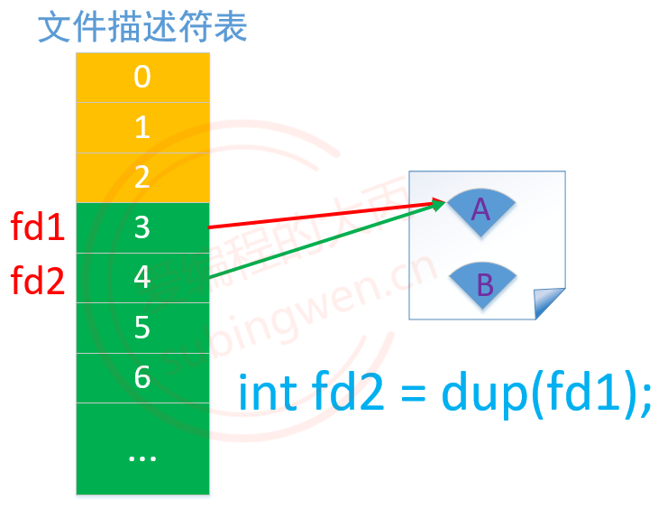
被复制出的新文件描述符是独立于旧的文件描述符的，二者没有连带关系。也就是说当旧的文件描述符被关闭了，复制出的新文件描述符还是可以继续使用的。
##### 1.2 示例代码
下面的代码中演示了通过`dup()`函数进行文件描述符复制, 并验证了复制之后两个新、旧文件描述符是独立的，二者没有连带关系。
```c
#include <stdio.h>
#include <stdlib.h>
#include <unistd.h>
#include <string.h>
#include <fcntl.h>

int main()
{
    // 1. 创建一个新的磁盘文件
    int fd = open("./mytest.txt", O_RDWR|O_CREAT, 0664);
    if(fd == -1)
    {
        perror("open");
        exit(0);
    }
    printf("fd: %d\n", fd);

    // 写数据
    const char* pt = "你好, 世界......";
    // 写成功之后, 文件指针在文件尾部
    write(fd, pt, strlen(pt));

    // 复制这个文件描述符 fd
    int newfd = dup(fd);
    printf("newfd: %d\n", newfd);

    // 关闭旧的文件描述符
    close(fd);

    // 使用新的文件描述符继续写文件
    const char* ppt = "((((((((((((((((((((((骚年，你要相信光！！！))))))))))))))))))))))";
    write(newfd, ppt, strlen(ppt));
    close(newfd);

    return 0;
}
```
#### 2. dup2
##### 2.1 函数详解
dup2() 函数是 dup() 函数的加强版，基于dup2() 既可以进行文件描述符的复制, 也可以进行文件描述符的重定向。文件描述符重定向就是改变已经分配的文件描述符关联的磁盘文件。
dup2() 函数原型如下：
```c
#include <unistd.h>
// 1. 文件描述符的复制, 和dup是一样的
// 2. 能够重定向文件描述符
// 	- 重定向: 改变文件描述符和文件的关联关系, 和新的文件建立关联关系, 和原来的文件断开关联关系
//		1. 首先通过open()打开文件 a.txt , 得到文件描述符 fd
//		2. 然后通过open()打开文件 b.txt , 得到文件描述符 fd1
//		3. 将fd1从定向 到fd上:
//			fd1和b.txt这磁盘文件断开关联, 关联到a.txt上, 以后fd和fd1都对用同一个磁盘文件 a.txt
int dup2(int oldfd, int newfd);
```
- 参数: `oldfd`和``newfd` 都是文件描述符
- 返回值: 函数调用成功返回新的文件描述符, 调用失败返回 -1
关于这个函数的两个参数虽然都是文件描述符，但是在使用过程中又对应了不同的场景，具体如下：
- 场景1: 假设参数 `oldfd` 对应磁盘文件 `a.txt`, `newfd`对应磁盘文件`b.txt`。在这种情况下调用`dup2`函数, 是给`newfd`做了重定向，`newfd 和文件 b.txt 断开关联, 相当于关闭了这个文件, 同时 newfd 指向了磁盘上的a.txt文件`，最终 oldfd 和 newfd 都指向了磁盘文件 a.txt。 [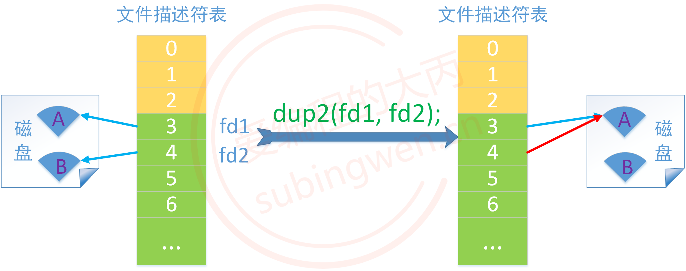](assets/linux-course/remote-3e9694d23585-image-20210131140755616.png)
- 场景2: 假设参数 `oldfd` 对应磁盘文件 `a.txt`, `newfd`不对应任何的磁盘文件（newfd 必须是一个大于等于0的整数）。在这种情况下调用`dup2`函数, 在这种情况下会进行文件描述符的复制，`newfd 指向了磁盘上的a.txt文件`，最终 oldfd 和 newfd 都指向了磁盘文件 a.txt。 [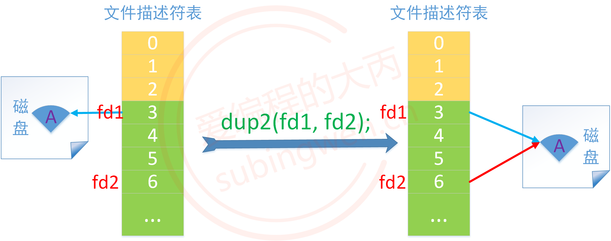](assets/linux-course/remote-a562848f490d-image-20210131144401271.png)
- 场景3: 假设参数 `oldfd` 和`newfd`两个文件描述符对应的是同一个磁盘文件 `a.txt`, 在这种情况下调用`dup2`函数, 相当于啥也没发生, 不会有任何改变。 [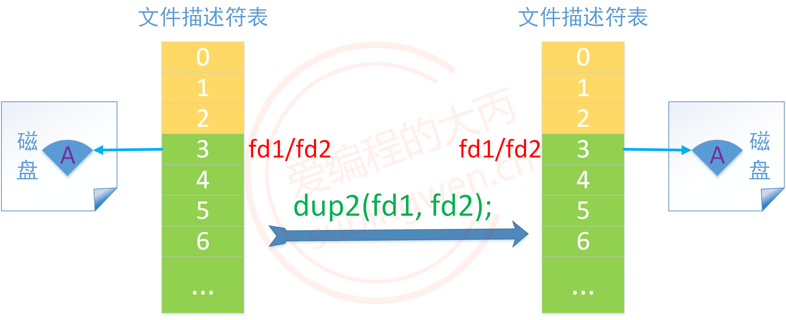](assets/linux-course/remote-376328fa97b5-image-20210131145111359.png)
##### 2.2 示例代码
> 给dup2() 的第二个参数指定一个空闲的没被占用的文件描述符就可以进行文件描述符的复制了, 示例代码如下:
```c
// 使用dup2 复制文件描述符
#include <stdio.h>
#include <stdlib.h>
#include <unistd.h>
#include <string.h>
#include <fcntl.h>

int main()
{
    // 1. 创建一个新的磁盘文件
    int fd = open("./111.txt", O_RDWR|O_CREAT, 0664);
    if(fd == -1)
    {
        perror("open");
        exit(0);
    }
    printf("fd: %d\n", fd);

    // 写数据
    const char* pt = "你好, 世界......";
    // 写成功之后, 文件指针在文件尾部
    write(fd, pt, strlen(pt));

    // 2. fd1没有对应任何的磁盘文件, fd1 必须要 >=0
    int fd1 = 1023;

    // fd -> 111.txt
    // 文件描述符复制, fd1指向fd对应的文件 111.txt
    dup2(fd, fd1);

    // 关闭旧的文件描述符
    close(fd);

    // 使用fd1写文件
    const char* ppt = "((((((((((((((((((((((骚年，你要相信光！！！))))))))))))))))))))))";
    write(fd1, ppt, strlen(ppt));
    close(fd1);

    return 0;
}
```
> 将两个有效的文件描述符分别传递给 dup2() 函数，就可以实现文件描述符的重定向了。`将第二个参数的文件描述符重定向到参数1文件描述符指向的文件上。` 示例代码如下:
```c
// 使用dup2 文件描述符重定向
#include <stdio.h>
#include <stdlib.h>
#include <unistd.h>
#include <string.h>
#include <fcntl.h>

int main()
{
    // 1. 创建一个新的磁盘文件
    int fd = open("./111.txt", O_RDWR|O_CREAT, 0664);
    if(fd == -1)
    {
        perror("open");
        exit(0);
    }
    printf("fd: %d\n", fd);

    // 写数据
    const char* pt = "你好, 世界......";
    // 写成功之后, 文件指针在文件尾部
    write(fd, pt, strlen(pt));

    // 2. 创建第二个磁盘文件 222.txt
    int fd1 = open("./222.txt", O_RDWR|O_CREAT, 0664);
    if(fd1 == -1)
    {
        perror("open1");
        exit(0);
    }

    // fd -> 111.txt, fd1->222.txt
    // 从定向, 将fd1指向fd对应的文件 111.txt
    dup2(fd, fd1);

    // 关闭旧的文件描述符
    close(fd);

    // 使用fd1写文件
    const char* ppt = "((((((((((((((((((((((骚年，你要相信光！！！))))))))))))))))))))))";
    write(fd1, ppt, strlen(ppt));
    close(fd1);

    return 0;
}
```
#### 3. fcntl
##### 3.1 函数详解
fcntl() 是一个变参函数, 并且是多功能函数，在这里只介绍如何通过这个函数实现`文件描述符的复制`和`获取/设置已打开的文件属性`。该函数的函数原型如下：
```c
#include <unistd.h>
#include <fcntl.h>	// 主要的头文件

int fcntl(int fd, int cmd, ... /* arg */ );
```
- 参数: fd: 要操作的文件描述符
- cmd: 通过该参数控制函数要实现什么功能
- 返回值：函数调用失败返回 -1，调用成功，返回正确的值： 参数 cmd = F_DUPFD：返回新的被分配的文件描述符
- 参数 cmd = F_GETFL：返回文件的flag属性信息
fcntl() 函数的 cmd 可使用的参数列表:
| 参数 cmd 的取值 | 功能描述 |
| --- | --- |
| F_DUPFD | 复制一个已经存在的文件描述符 |
| F_GETFL | 获取文件的状态标志 |
| F_SETFL | 设置文件的状态标志 |
文件的状态标志指的是在使用 open() 函数打开文件的时候指定的 flags 属性, 也就是第二个参数
```c
int open(const char *pathname, int flags);
```
下表中列出了一些常用的文件状态标志：
| 文件状态标志 | 说明 |
| --- | --- |
| O_RDONLY | 只读打开 |
| O_WRONLY | 只写打开 |
| O_RDWR | 读、写打开 |
| O_APPEND | 追加写 |
| O_NONBLOCK | 非阻塞模式 |
| O_SYNC | 等待写完成（数据和属性） |
| O_ASYNC | 异步I/O |
| O_RSYNC | 同步读和写 |
##### 3.2 复制文件描述符
使用 fcntl() 函数进行文件描述符复制, 第二个参数 cmd 需要指定为 `F_DUPFD`（这是个变参函数其他参数不需要指定）。
```c
int newfd = fcntl(fd, F_DUPFD);
```
> 使用 fcntl() 复制文件描述符, 函数返回值为新分配的文件描述符，示例代码如下:
```c
#include <stdio.h>
#include <stdlib.h>
#include <unistd.h>
#include <string.h>
#include <fcntl.h>

int main()
{
    // 1. 创建一个新的磁盘文件
    int fd = open("./mytest.txt", O_RDWR|O_CREAT, 0664);
    if(fd == -1)
    {
        perror("open");
        exit(0);
    }
    printf("fd: %d\n", fd);

    // 写数据
    const char* pt = "你好, 世界......";
    // 写成功之后, 文件指针在文件尾部
    write(fd, pt, strlen(pt));

    // 复制这个文件描述符 fd
    int newfd = fcntl(fd, F_DUPFD);
    printf("newfd: %d\n", newfd);

    // 关闭旧的文件描述符
    close(fd);

    // 使用新的文件描述符继续写文件
    const char* ppt = "((((((((((((((((((((((骚年，你要相信光！！！))))))))))))))))))))))";
    write(newfd, ppt, strlen(ppt));
    close(newfd);

    return 0;
}
```
##### 3.3 设置文件状态标志
通过 `open()`函数打开文件之后, 文件的flag属性就已经被确定下来了，如果想要在打开状态下修改这些属性，可以使用 `fcntl()`函数实现, 但是有一点需要注意, 不是所有的flag 属性都能被动态修改, 只能修改如下状态标志: `O_APPEND`, `O_NONBLOCK`, `O_SYNC`, `O_ASYNC`, `O_RSYNC`等。
得到已打开的文件的状态标志，需要将 cmd 设置为 F_GETFL，得到的信息在函数的返回值中
```c
int flag = fcntl(fd, F_GETFL);
```
设置已打开的文件的状态标志，需要将 cmd 设置为 F_SETFL，新的flag需要通过第三个参数传递给 fcntl() 函数
```c
// 得到文件的flag属性
int flag = fcntl(fd, F_GETFL);
// 添加新的flag 标志
flag = flag | O_APPEND;
// 将更新后的falg设置给文件
fcntl(fd, F_SETFL, flag);
```
> 举例： 通过fcntl()函数`获取/设置已打开的文件属性`，先来描述一下场景： 如果要往当前文件中写数据, 打开一个新文件, 文件的写指针在文件头部，数据默认也是写到文件开头，如果不想将数据写到文件头部, 可以给文件追加一个`O_APPEND`属性。实例代码如下：
```c
// 写实例程序, 给文件描述符追加 O_APPEND
#include <stdio.h>
#include <stdlib.h>
#include <unistd.h>
#include <string.h>
#include <fcntl.h>

int main()
{
    // 1. 打开一个已经存在的磁盘文件
    int fd = open("./111.txt", O_RDWR);
    if(fd == -1)
    {
        perror("open");
        exit(0);
    }
    printf("fd: %d\n", fd);

    // 如果不想将数据写到文件头部, 可以给文件描述符追加一个O_APPEND属性
    // 通过fcntl获取文件描述符的 flag属性
    int flag = fcntl(fd, F_GETFL);
    // 给得到的flag追加 O_APPEND属性
    flag = flag | O_APPEND; // flag |= O_APPEND;
    // 重新将flag属性设置给文件描述符
    fcntl(fd, F_SETFL, flag);

    // 使用fd写文件, 添加的数据应该写到文件尾部
    const char* ppp = "((((((((((((((((((((((骚年，你要相信光！！！))))))))))))))))))))))";
    write(fd, ppp, strlen(ppp));
    close(fd);

    return 0;
}
```

### 2.5 目录遍历

> 原文：[《目录遍历》](https://subingwen.cn/linux/directory/)　作者：苏丙榅　来源：爱编程的大丙

众所周知，Linux的目录是一个树状结构，了解数据结构的小伙伴都明白，遍历一棵树最简单的方式是递归。在我们已经掌握了递归的使用方法之后，遍历树状目录也不是一件难事儿。
Linux给我们提供了相关的目录遍历的函数，分别为：`opendir()`, `readdir()`, `closedir()`。目录的操作方式和标准C库提供的文件操作步骤是类似的。下面来依次介绍一下这几个函数。
#### 1. 目录三剑客
##### 1.1 opendir
> 在目录操作之前必须要先通过 opendir() 函数打开这个目录，函数原型如下：
```c
#include <sys/types.h>
#include <dirent.h>
// 打开目录
DIR *opendir(const char *name);
```
- 参数: name -> 要打开的目录的名字
- 返回值: DIR*, 结构体类型指针。打开成功返回目录的实例，打开失败返回 NULL
##### 1.2 readdir
> 目录打开之后，就可以通过 readdir() 函数遍历目录中的文件信息了。每调用一次这个函数就可以得到目录中的一个文件信息，当目录中的文件信息被全部遍历完毕会得到一个空对象。先来看一下这个函数原型：
```c
// 读目录
#include <dirent.h>
struct dirent *readdir(DIR *dirp);
```
- 参数：dirp -> opendir() 函数的返回值
- 返回值：函数调用成功，返回读到的文件的信息, 目录文件被读完了或者函数调用失败返回 NULL
函数返回值 `struct dirent `结构体原型如下:
```c
struct dirent {
    ino_t          d_ino;       /* 文件对应的inode编号, 定位文件存储在磁盘的那个数据块上 */
    off_t          d_off;       /* 文件在当前目录中的偏移量 */
    unsigned short d_reclen;    /* 文件名字的实际长度 */
    unsigned char  d_type;      /* 文件的类型, linux中有7中文件类型 */
    char           d_name[256]; /* 文件的名字 */
};
```
关于结构体中的文件类型`d_type`，可使用的宏值如下：
- `DT_BLK`：块设备文件
- `DT_CHR`：字符设备文件
- `DT_DIR`：目录文件
- `DT_FIFO` ：管道文件
- `DT_LNK`：软连接文件
- `DT_REG `：普通文件
- `DT_SOCK`：本地套接字文件
- `DT_UNKNOWN`：无法识别的文件类型
那么，如何通过 readdir() 函数遍历某一个目录中的文件呢？
```c
// 打开目录
DIR* dir = opendir("/home/test");
struct dirent* ptr = NULL;
// 遍历目录
while( (ptr=readdir(dir)) != NULL)
{
    .......
}
```
##### 1.3 closedir
目录操作完毕之后, 需要通过 `closedir()`关闭通过`opendir()`得到的实例，释放资源。函数原型如下：
```c
// 关闭目录, 参数是 opendir() 的返回值
int closedir(DIR *dirp);
```
- 参数：dirp-> opendir() 函数的返回值
- 返回值: 目录关闭成功返回0, 失败返回 -1
#### 2.遍历目录
##### 2.1 遍历单层目录
如果只遍历单层目录是不需要递归的，按照上边介绍的函数的使用方法，依次继续调用即可。假设我们需要得到某个指定目录下 `mp3` 格式文件的个数，示例代码如下：
```c
// filenum.c
#include <stdio.h>
#include <stdlib.h>
#include <unistd.h>
#include <string.h>
#include <dirent.h>

int main(int argc, char* argv[])
{
    // 1. 打开目录
    DIR* dir = opendir(argv[1]);
    if(dir == NULL)
    {
        perror("opendir");
        return -1;
    }

    // 2. 遍历当前目录中的文件
    int count = 0;
    while(1)
    {
        struct dirent* ptr = readdir(dir);
        if(ptr == NULL)
        {
            printf("目录读完了...\n");
            break;
        }
        // 读到了一个文件
        // 判断文件类型
        if(ptr->d_type == DT_REG)
        {
            char* p = strstr(ptr->d_name, ".mp3");
            if(p != NULL && *(p+4) == '\0')
            {
                count++;
                printf("file %d: %s\n", count, ptr->d_name);
            }
        }
    }

    printf("%s目录中mp3文件的个数: %d\n", argv[1], count);

    // 关闭目录
    closedir(dir);

    return 0;
}
```
编译名执行程序
```bash
$ gcc filenum.c
# 读当前目录中mp3文件个数
$ ./a.out .
file 1: 1.mp3
目录读完了...
.目录中mp3文件的个数: 1

# 读 ./sub 目录中mp3文件个数
$ ./a.out ./sub/
file 1: 3.mp3
file 2: 1.mp3
file 3: 5.mp3
file 4: 4.mp3
file 5: 2.mp3
目录读完了...
./sub/目录中mp3文件的个数: 5
```
##### 2.2 遍历多层目录
Linux 的目录是树状结构，遍历每层目录的方式都是一样的，也就是说最简单的遍历方式是递归。程序的重点就是确定递归结束的条件：`遍历的文件如果不是目录类型就结束递归。`
示例代码如下：
```c
// filenum.c
#include <stdio.h>
#include <stdlib.h>
#include <unistd.h>
#include <string.h>
#include <dirent.h>

int getMp3Num(const char* path)
{
    // 1. 打开目录
    DIR* dir = opendir(path);
    if(dir == NULL)
    {
        perror("opendir");
        return 0;
    }
    // 2. 遍历当前目录
    struct dirent* ptr = NULL;
    int count = 0;
    while((ptr = readdir(dir)) != NULL)
    {
        // 如果是目录 . .. 跳过不处理
        if(strcmp(ptr->d_name, ".")==0 ||
           strcmp(ptr->d_name, "..") == 0)
        {
            continue;
        }
        // 假设读到的当前文件是目录
        if(ptr->d_type == DT_DIR)
        {
            // 目录
            char newPath[1024];
            sprintf(newPath, "%s/%s", path, ptr->d_name);
            // 读当前目录的子目录
            count += getMp3Num(newPath);
        }
        else if(ptr->d_type == DT_REG)
        {
            // 普通文件
            char* p = strstr(ptr->d_name, ".mp3");
            // 判断文件后缀是不是 .mp3
            if(p != NULL && *(p+4) == '\0')
            {
                count++;
                printf("%s/%s\n", path, ptr->d_name);
            }
        }
    }

    closedir(dir);
    return count;
}

int main(int argc, char* argv[])
{
    // ./a.out path
    if(argc < 2)
    {
        printf("./a.out path\n");
        return 0;
    }

    int num = getMp3Num(argv[1]);
    printf("%s 目录中mp3文件个数: %d\n", argv[1], num);

    return 0;
}
```
编译并运行程序：
```bash
$ gcc filenum.c
# 查看 abc 目录中mp3 文件个数
$ ./a.out abc
abc/sub/3.mp3
abc/sub/1.mp3
abc/sub/5.mp3
abc/sub/4.mp3
abc/sub/2.mp3
abc/sub/music/test2.mp3
abc/sub/music/test3.mp3
abc/sub/music/test1.mp3
abc/hello.mp3
abc 目录中mp3文件个数: 9
```
#### 3. scandir函数
除了使用上边介绍的目录三剑客遍历目录，也可以使用`scandir()`函数进行目录的遍历（只遍历指定目录，不进入到子目录中进行递归遍历），它的参数并不简单，涉及到三级指针和回调函数的使用。
其函数原型如下：
```c
// 头文件
#include <dirent.h> 
int scandir(const char *dirp, struct dirent ***namelist,
              int (*filter)(const struct dirent *),
              int (*compar)(const struct dirent **, const struct dirent **));
int alphasort(const struct dirent **a, const struct dirent **b);
int versionsort(const struct dirent **a, const struct dirent **b);
```
- 参数: dirp: 需要遍历的目录的名字
- namelist: 三级指针, 传出参数, 需要在指向的地址中存储遍历目录得到的所有文件的信息 `在函数内部会给这个指针指向的地址分配内存，要注意在程序中释放内存`
- filter: 函数指针, 指针指向的函数就是回调函数, 需要在自定义函数中指定如果过滤目录中的文件 `如果不对目录中的文件进行过滤, 该函数指针指定为NULL即可`
- `如果自己指定过滤函数, 满足条件要返回1, 否则返回 0`
- compar: 函数指针, 对过滤得到的文件进行排序, 可以使用提供的两种排序方式: alphasort: 根据文件名进行排序
- versionsort: 根据版本进行排序
- 返回值: 函数执行成功返回找到的匹配成功的文件的个数，如果失败返回-1。
##### 3.1 文件过滤
`scandir() `可以让使用者自定义文件的过滤方式, 然后将过滤函数的地址传递给 scandir() 的第三个参数，我们可以得知过滤函数的原型是这样的：
```c
// 函数的参数就是遍历的目录中的子文件对应的结构体
int (*filter)(const struct dirent *);
```
基 于这个函数指针定义的函数就可以称之为回调函数, 这个函数不是由程序猿调用, 而是通过 scandir() 调用，因此这个函数的实参也是由 scandir() 函数提供的，作为回调函数的编写人员，只需要搞明白这个参数的含义是什么，然后在函数体中直接使用即可。
假设还是判断目录中某一个文件是否为Mp3格式, 函数实现如下:
```c
int isMp3(const struct dirent *ptr)
{
    if(ptr->d_type == DT_REG)
    {
        char* p = strstr(ptr->d_name, ".mp3");
        if(p != NULL && *(p+4) == '\0')
        {
            return 1;
        }
    }
    return 0;
}
```
##### 3.2 遍历目录
了解了 `scandir()` 函数的使用之后, 下边写一个程序, 来搜索指定目录下的 `mp3`格式文件个数和文件名, 代码如下:
```c
#include <stdio.h>
#include <stdlib.h>
#include <unistd.h>
#include <string.h>
#include <dirent.h>

// 文件过滤函数
int isMp3(const struct dirent *ptr)
{
    if(ptr->d_type == DT_REG)
    {
        char* p = strstr(ptr->d_name, ".mp3");
        if(p != NULL && *(p+4) == '\0')
        {
            return 1;
        }
    }
    return 0;
}

int main(int argc, char* argv[])
{
    if(argc < 2)
    {
        printf("./a.out path\n");
        return 0;
    }
    struct dirent **namelist = NULL;
    int num = scandir(argv[1], &namelist, isMp3, alphasort);
    for(int i=0; i<num; ++i)
    {
        printf("file %d: %s\n", i, namelist[i]->d_name);
        free(namelist[i]);
    }
    free(namelist);
    return 0;
}
```
最后再解析一下 scandir() 的第二个参数，传递的是一个二级指针的地址:
```c
struct dirent **namelist = NULL;
int num = scandir(argv[1], &namelist, isMp3, alphasort);
```
那么在这个 namelist 中存储的什么类型的数据呢？也就是 `struct dirent **namelist` 指向的什么类型的数据?
答案: 指向的是一个指针数组 `struct dirent *namelist[]`
- 数组元素的个数就是遍历的目录中的文件个数
- 数组的每个元素都是指针类型: `struct dirent *`, 指针指向的地址是有 scandir() 函数分配的, 因此在使用完毕之后需要释放内存

## 第3章 进程和线程

### 3.1 进程控制

> 原文：[《进程控制》](https://subingwen.cn/linux/process/)　作者：苏丙榅　来源：爱编程的大丙

#### **1**. 进程概述
从严格意义上来讲，程序和进程是两个不同的概念，他们的状态，占用的系统资源都是不同的。
- 程序：就是磁盘上的可执行文件文件, 并且只占用磁盘上的空间，是一个静态的概念。
- 进程：被执行之后的程序叫做进程，不占用磁盘空间，需要消耗系统的`内存`，`CPU资源`，每个运行的进程的都对应一个属于自己的虚拟地址空间，这是一个动态的概念。[**虚拟地址空间详解](https://subingwen.cn/linux/file-descriptor/#1-%E8%99%9A%E6%8B%9F%E5%9C%B0%E5%9D%80%E7%A9%BA%E9%97%B4)
##### 1.1 并行和并发
- CPU时间片 CPU在某个时间点只能处理一个任务，但是操作系统都支持多任务的，那么在计算机CPU只有一个的情况下是怎么完成多任务处理的呢？原理和古时候救济灾民的思路是一样的，每个人分一点，但是又不叫吃饱。 CPU会给每个进程被分配一个时间段，进程得到这个时间片之后才可以运行，使各个程序从表面上看是同时进行的。如果在时间片结束时进程还在运行，CPU的使用权将被收回，该进程将会被中断挂起等待下一个时间片。如果进程在时间片结束前阻塞或结束，则CPU当即进行切换，这样就可以避免CPU资源的浪费。 因此可以得知，在我们使用的计算机中启动的多个程序，从宏观上看是同时运行的，从微观上看由于CPU一次只能处理一个进程，所有它们是轮流执行的，只不过切换速度太快，我们感觉不到罢了，因此CPU的核数越多计算机的处理效率越高。
- 并发和并行 这两个概念呢都可以笼统的解释为：多个进程同时运行，但是他们两个的同时并不是同一个概念。Erlang 之父 Joe Armstrong 用一张5岁小孩都能看懂的图解释了并发与并行的区别： [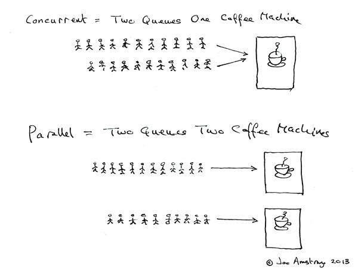](assets/linux-course/remote-77b6eff5219c-Concurrency-vs-Parallelism.png) 并发：第一幅图是并发。 并发的同时运行是一个假象，咖啡机也好CPU也好在某一个时间点只能为某一个个体来服务，因此不可能同时处理多任务，这是通过上图的咖啡机/计算机的CPU快速的时间片切换实现的。
- 并发是针对某一个硬件资源而言的，在某个时间段之内处理的任务的总量，量越大效率越高。
- 并发也可以理解为是一个屌丝通过不断努力自我升华的结果。
> 并行：第二幅图是并行。
- 并行的多进程同时运行是真实存在的，可以在同一时刻同时运行多个进程
- 并行需要依赖多个硬件资源，单个是无法实现的（图中有两台咖啡机）。
- 并行可以理解为是一个高富帅，出生就有天然的硬件优势，资源多自然办事效率就高。
##### 1.2 PCB
> **PCB - 进程控制块（Processing Control Block）**，Linux内核的进程控制块本质上是一个叫做 `task_struct`的结构体。在这个结构体中记录了进程运行相关的一些信息，下面介绍一些常用的信息：
- 进程id：每一个进程都一个唯一的进程ID，类型为 `pid_t`, 本质是一个整形数
- 进程的状态：进程有不同的状态, 状态是一直在变化的，有就绪、运行、挂起、停止等状态。
- 进程对应的虚拟地址空间的信息。
- 描述控制终端的信息，进程在哪个终端启动默认就和哪个终端绑定。
- 当前工作目录：默认情况下, 启动进程的目录就是当前的工作目录
- umask掩码：在创建新文件的时候，通过这个掩码屏蔽某些用于对文件的操作权限。
- 文件描述符表：每个被分配的文件描述符都对应一个已经打开的磁盘文件
- 和信号相关的信息：在Linux中 `调用函数`, `键盘快捷键`, `执行shell命令`等操作都会产生信号。 阻塞信号集：记录当前进程中阻塞哪些已产生的信号，使其不能被处理
- 未决信号集：记录在当前进程中产生的哪些信号还没有被处理掉。
- 用户id和组id：当前进程属于哪个用户, 属于哪个用户组
- 会话（Session）和进程组：多个进程的集合叫进程组，多个进程组的集合叫会话。
- 进程可以使用的资源上限：可以使用shell命令`ulimit -a`查看详细信息。
##### 1.4 进程状态
进程一共有五种状态分别为：`创建态`，`就绪态`，`运行态`，`阻塞态(挂起态)`，`退出态(终止态)`其中创建态和退出态维持的时间是非常短的，稍纵即逝。我们主要是需要将`就绪态`, `运行态`, `挂起态`，三者之间的状态切换搞明白。
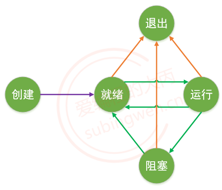
- 就绪态: 万事俱备，只欠东风（`CPU资源`） 进程被创建出来了，有运行的资格但是还没有运行，需要抢CPU时间片
- 得到CPU时间片，进程开始运行，从就绪态转换为运行态。
- 进程的CPU时间片用完了, 再次失去CPU, 从运行态转换为就绪态。
- 运行态：获取到CPU资源的进程，进程只有在这种状态下才能运行 运行态不会一直持续，进程的CPU时间片用完之后, 再次失去CPU，从运行态转换为就绪态
- 只要进程还没有退出，就会在就绪态和运行态之间不停的切换。
- 阻塞态：进程被强制放弃CPU，并且没有抢夺CPU时间片的资格 比如: 在程序中调用了某些函数（比如: sleep()），进程又运行态转换为阻塞态（挂起态）
- 当某些条件被满足了（比如：slee() 睡醒了），进程的阻塞状态也就被解除了，进程从阻塞态转换为就绪态。
- 退出态: 进程被销毁, 占用的系统资源被释放了 任何状态的进程都可以直接转换为退出态。
##### 1.5 进程命令
在研究如何创建进程之前，先来看一下如何在终端中通过命令完成进程相关的操作。
```bash
$ ps aux
	- a: 查看所有终端的信息
	- u: 查看用户相关的信息
	- x: 显示和终端无关的进程信息
```
- 查看进程 shell1234 [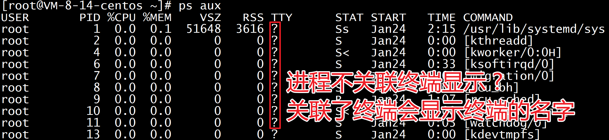](assets/linux-course/remote-a059c00caccd-image-20210203171636845.png) 如果特别想知道每个参数控制着哪些信息, 可以通过 `ps a`, `ps u`, `ps x`分别查看。
```bash
$ kill -l
 1) SIGHUP       2) SIGINT       3) SIGQUIT      4) SIGILL       5) SIGTRAP
 6) SIGABRT      7) SIGBUS       8) SIGFPE       9) SIGKILL     10) SIGUSR1
11) SIGSEGV     12) SIGUSR2     13) SIGPIPE     14) SIGALRM     15) SIGTERM
16) SIGSTKFLT   17) SIGCHLD     18) SIGCONT     19) SIGSTOP     20) SIGTSTP
21) SIGTTIN     22) SIGTTOU     23) SIGURG      24) SIGXCPU     25) SIGXFSZ
26) SIGVTALRM   27) SIGPROF     28) SIGWINCH    29) SIGIO       30) SIGPWR
31) SIGSYS      34) SIGRTMIN    35) SIGRTMIN+1  36) SIGRTMIN+2  37) SIGRTMIN+3
38) SIGRTMIN+4  39) SIGRTMIN+5  40) SIGRTMIN+6  41) SIGRTMIN+7  42) SIGRTMIN+8
43) SIGRTMIN+9  44) SIGRTMIN+10 45) SIGRTMIN+11 46) SIGRTMIN+12 47) SIGRTMIN+13
48) SIGRTMIN+14 49) SIGRTMIN+15 50) SIGRTMAX-14 51) SIGRTMAX-13 52) SIGRTMAX-12
53) SIGRTMAX-11 54) SIGRTMAX-10 55) SIGRTMAX-9  56) SIGRTMAX-8  57) SIGRTMAX-7
58) SIGRTMAX-6  59) SIGRTMAX-5  60) SIGRTMAX-4  61) SIGRTMAX-3  62) SIGRTMAX-2
63) SIGRTMAX-1  64) SIGRTMAX
```
```bash
# 无条件杀死进程, 进程ID通过 ps aux 可以查看
$ kill -9 进程ID
$ kill -SIGKILL 进程ID
```
- 杀死进程 `kill`命令可以发送某个信号到对应的进程，进程收到某些信号之后默认的处理动作就是退出进程，如果要给进程发送信号，可以先查看一下Linux给我们提供了哪些标准信号。 查看Linux中的标准信号: shell1234567891011121314 9号信号（SIGKILL）的行为是无条件杀死进程，想要杀死哪个进程就可以把这个信号发送给这个进程，操作如下： shell123 [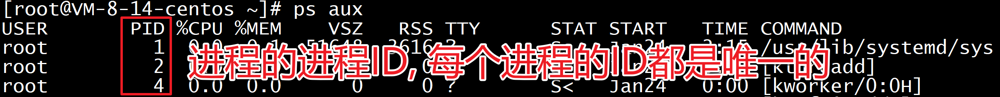](assets/linux-course/remote-8b660a62b25b-image-20210203172310788.png)
#### 2. 进程创建
##### 2.1 函数
> Linux中进程ID为 `pid_t` 类型，其本质是一个正整数，通过上边的`ps aux`命令已经得到了验证。PID为1的进程是Linux系统中创建的第一个进程。
```c
#include <sys/types.h>
#include <unistd.h>
pid_t getpid(void);
```
- 获取当前进程的进程ID（PID）
```c
#include <sys/types.h>
#include <unistd.h>
pid_t getppid(void);
```
- 获取当前进程的父进程 ID（PPID）
```c
#include <unistd.h>
pid_t fork(void);
```
- 创建一个新的进程 c12 **小贴士: Linux中看似创建一个新的进程非常简单，函数连参数都没有，实际上如果想要真正理解这个函数还是得死几个脑细胞。
##### 2.2 fork() 剖析
```c
pid_t fork(void);
```
启动磁盘上的应用程序, 得到一个进程, 如果在这个启动的进程中调用`fork()`函数，就会得到一个新的进程，我们习惯将其称之为子进程。前面说过每个进程都对应一个属于自己的虚拟地址空间，`子进程的地址空间是基于父进程的地址空间拷贝出来的`，虽然是拷贝但是两个地址空间中存储的信息不可能是完全相同的，下图是拷贝之后父子进程各自的虚拟地址空间：
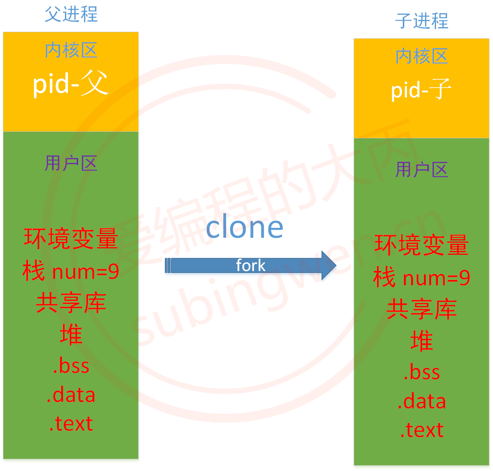
- 相同点： `拷贝完成之后（注意这个时间点），两个地址空间中的用户区数据是相同的。`用户区数据主要数据包括： 代码区：默认情况下父子进程地址空间中的源代码始终相同。
- 全局数据区：父进程中的全局变量和变量值全部被拷贝一份放到了子进程地址空间中
- 堆区：父进程中的堆区变量和变量值全部被拷贝一份放到了子进程地址空间中
- 动态库加载区（内存映射区）：父进程中数据信息被拷贝一份放到了子进程地址空间中
- 栈区：父进程中的栈区变量和变量值全部被拷贝一份放到了子进程地址空间中
- 环境变量：默认情况下，父子进程地址空间中的环境变量始终相同。
- 文件描述符表: `父进程中被分配的文件描述符都会拷贝到子进程中，在子进程中可以使用它们打开对应的文件。`
- 区别： 父子进程各自的虚拟地址空间是相互独立的，不会互相干扰和影响。
- 父子进程地址空间中代码区代码虽然相同，但是父子进程执行的代码逻辑可能是不同的。
- 由于父子进程可能执行不同的代码逻辑，因此地址空间拷贝完成之后，`全局数据区`, `栈区`, `堆区`, `动态库加载区(内存映射区)`数据会各自发生变化，由于地址空间是相互独立的，因此不会互相覆盖数据。
- 由于每个进都有自己的进程ID，因此内核区存储的父子进程ID是不同的。
- 进程启动之后进入就绪态，运行需要争抢CPU时间片而且可能执行不同的业务逻辑，所以父子进程的状态可能是不同的。
- fork() 调用成功之后，会返回两个值，父子进程的返回值是不同的。 `该函数调用成功之后，从一个虚拟地址空间变成了两个虚拟地址空间，每个地址空间中都会将 fork() 的返回值记录下来`，这就是为什么会得到两个返回值的原因。
- 父进程的虚拟地址空间中将该返回值标记为一个大于0的数（其实记录的是子进程的进程ID）
- 子进程的虚拟地址空间中将该返回值标记 0
```c
int main()
{
    // 在父进程中创建子进程
    pid_t pid = fork();
    printf("当前进程fork()的返回值: %d\n", pid);
    if(pid > 0)
    {
        // 父进程执行的逻辑
        printf("我是父进程, pid = %d\n", getpid());
    }
    else if(pid == 0)
    {
        // 子进程执行的逻辑
        printf("我是子进程, pid = %d, 我爹是: %d\n", getpid(), getppid());
    }
    else // pid == -1
    {
        // 创建子进程失败了
    }
    
    // 不加判断, 父子进程都会执行这个循环
    for(int i=0; i<5; ++i)
    {
        printf("%d\n", i);
    }
    
    return 0;
}
```
- 在程序中需要通过 fork() 的返回值来判断当前进程是子进程还是父进程。 c12345678910111213141516171819202122232425262728 ​
#### 3. 父子进程
##### 3.1 进程执行位置
在父进程中成功创建了子进程，子进程就拥有父进程代码区的所有代码，那么子进程中的代码是在什么位置开始运行的呢？父进程肯定是从main()函数开始运行的，子进程是在父进程中调用fork()函数之后被创建, 子进程就从fork()之后开始向下执行代码。
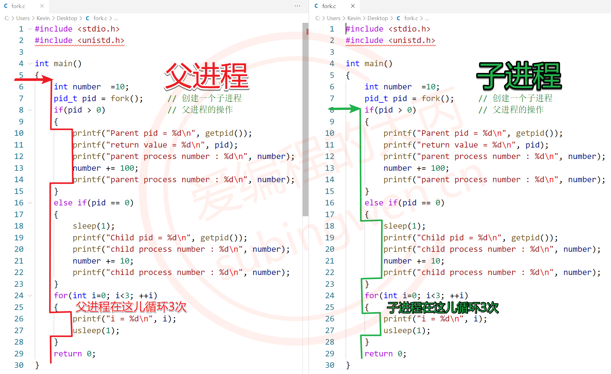
上图中演示了父子进程中代码的执行流程，可以看到如果在程序中对`fork()`的返回值做了判断，就可以控制父子进程的行为，如果没有做任何判断这个代码块父子进程都可以执行。在编写多进程程序的时候，一定要将代码想象成多份进行分析，因为直观上看代码就一份，但实际上数据都是多份，并且多份数据中变量名都相同，但是他们的值却不一定相同。
##### 3.2 循环创建子进程
掌握了进程创建函数之后，实现一个简单的功能，在一个父进程中循环创建3个子进程，也就是最后需要得到4个进程，1个父进程，3个子进程，为了方便验证程序的正确性，要求在程序中打印出每个进程的进程ID。
下面是编写的代码：
```c
// process_loop.c
#include <stdio.h>
#include <stdlib.h>
#include <unistd.h>
#include <string.h>

int main()
{
    for(int i=0; i<3; ++i)
    {
        pid_t pid = fork();
        printf("当前进程pid: %d\n", getpid());
    }

    return 0;
}
```
编译并执行上面的代码，得到了如下结果：
```bash
# 编译
$ gcc process_loop.c

# 执行
$ ./a.out
# 最终得到了 8个进程
当前进程pid: 18774     ------ 1
当前进程pid: 18774     ------ 1
当前进程pid: 18774     ------ 1
当前进程pid: 18777     ------ 2
当前进程pid: 18776     ------ 3
当前进程pid: 18776     ------ 3
当前进程pid: 18775     ------ 4
当前进程pid: 18775     ------ 4
当前进程pid: 18775     ------ 4
当前进程pid: 18778     ------ 5
当前进程pid: 18780     ------ 6
当前进程pid: 18779     ------ 7
当前进程pid: 18779     ------ 7
当前进程pid: 18781     ------ 8
```
通过程序打印的信息发现程序循环了三次，最终得到了8个进程，也就是创建出了7个子进程，还是上面跟大家讲的那句话，对应多进程的程序，一定要代码 分成很多份去分析，并且如果没有在程序中加条件控制，所有的代码父子进程都是有资格执行的。接下来分析上边的编写的代码，通过画图的方式分析为什么得到了 7个子进程：
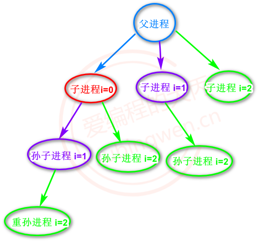
上图中的树状结构，蓝色节点代表父进程：
- 循环第一次 i = 0，创建出一个子进程，即红色节点，子进程变量值来自父进程拷贝，因此 i=0
- 循环第二次 i = 1，蓝色父进程和红色子进程都去创建子进程，得到两个紫色进程，子进程变量值来自父进程拷贝，因此 i=1
- 循环第三次 i = 2，蓝色父进程和红色、紫色子进程都去创建子进程，因此得到4个绿色子进程，子进程变量值来自父进程拷贝，因此 i=2
- 循环第三次 i = 3，所有进程都不满足条件` for(int i=0; i<3; ++i)`因此不进入循环，退出了。
通过上面的分析，最终得到解决方案，我们可以只让父进程创建子进程，如果是子进程不让其继续创建子进程，因此只需要在程序中添加关于父子进程的判断即可。
修改之后的代码如下：
```c
// 需要在上边的程序中控制不让子进程, 再创建子进程即可
// process_loop.c
#include <stdio.h>
#include <stdlib.h>
#include <unistd.h>
#include <string.h>

int main()
{
    pid_t pid;
    // 在循环中创建子进程
    for(int i=0; i<3; ++i)
    {
        pid = fork();
        if(pid == 0)
        {
            // 不让子进程执行循环, 直接跳出
            break;
        }
    }
    printf("当前进程pid: %d\n", getpid());

    return 0;
}
```
最后编译并执行程序，查看最终结果，可以看到最后确实得到了4个不同的进程，pid最小的为父进程，其余为子进程：
```bash
# 编译
$ gcc process_loop.c

# 执行
$ ./a.out
当前进程pid: 2727
当前进程pid: 2730
当前进程pid: 2729
当前进程pid: 2728
```
`在多进程序中，进程的执行顺序是没有规律的，因为所有的进程都需要在就绪态争抢CPU时间片，抢到了就执行，抢不到就不执行，但是不用担心，默认进程的优先级是相同的，操作系统不会让某一个进程一直抢不到CPU时间片。`
##### 3.3 终端显示问题
在执行多进程程序的时候，经常会遇到下图中的问题，看似进程还没有执行完成，貌似是因为什么原因被阻塞了，实际上终端是正常的，当我们通过键盘输入一些命令，终端也能接受输入并且输出相关信息，那么为什么终端会显示成这个样子呢？
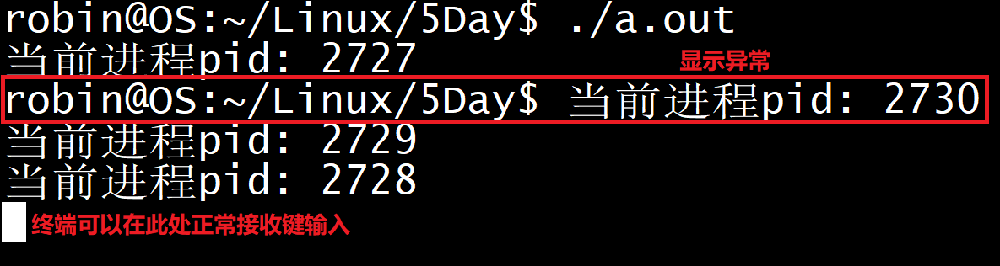
1. a.out 进程启动之后，共创建了3个子进程，其实 a.out 也是有父进程的就是当前的终端
1. 终端只能检测到 a.out 进程的状态，a.out执行期间终端切换到后台，a.out执行完毕之后终端切换回前台
1. 当终端切换到前之后，a.out的子进程还没有执行完毕，当子进程输出的信息就显示到终端命令提示符的后边了，导致终端显示有问题，但是此时终端是可以接收键盘输入的，只是看起来不美观而已。
```c
pid_t pid = fork();
if(pid > 0)
{
    sleep(3);	// 让父进程睡一会儿
}
else if(pid == 0)
{
    // 子进程
}
```
1. 想要解决这个问题，需要让所有子进程退出之后再退出父进程，比如：在父进程代码中调用 sleep()
##### 3.4 进程数数
思考一个问题，当父进程创建一个子进程，那么父子进程之间可以通过全局变量互动，实现交替数数的功能吗？不过不确定可以写一段测试代码：
```c
// number.c
#include <stdio.h>
#include <stdlib.h>
#include <unistd.h>
#include <string.h>

// 定义全局变量
int number = 10;

int main()
{
    printf("创建子进程之前 number = %d\n", number);

    pid_t pid = fork();
    // 父子进程都会执行这一行
    printf("当前进程fork()的返回值: %d\n", pid);

    //如果是父进程
    if(pid > 0)
    {
        printf("我是父进程, pid = %d, number = %d\n", getpid(), ++number);
        printf("父进程的父进程(终端进程), pid = %d\n", getppid());
        sleep(1);
    }
    else if(pid == 0)
    {
        // 子进程
        number += 100;
        printf("我是子进程, pid = %d, number = %d\n", getpid(), number);
        printf("子进程的父进程, pid = %d\n", getppid());
    }

    return 0;
}
```
编译程序并测试:
```bash
$ gcc number.c
$ ./a.out 
创建子进程之前 number = 10
当前进程fork()的返回值: 3513
当前进程fork()的返回值: 0
我是子进程, pid = 3513, number = 110
子进程的父进程, pid = 3512

我是父进程, pid = 3512, number = 11	# 没有接着子进程的110继续数,父子进程各玩各的,测试失败了
父进程的父进程(终端进程), pid = 2175
```
通过验证得到结论：两个进程中是不能通过全局变量实现数据交互的，因为每个进程都有自己的地址空间，两个同名全局变量存储在不同的虚拟地址空间中，二者没有任何关联性。如果要进行进程间通信需要使用：管道，共享内存，本地套接字，内存映射区，消息队列等方式。
#### 4. execl和execlp函数
在项目开发过程中，有时候有这种需求，需要通过现在运行的进程启动磁盘上的另一个可执行程序，也就是通过一个进程启动另一个进程，这种情况下我们可以使用 `exec族函数`，函数原型如下：
```c
#include <unistd.h>

extern char **environ;
int execl(const char *path, const char *arg, ...
          /* (char  *) NULL */);
int execlp(const char *file, const char *arg, ...
           /* (char  *) NULL */);
int execle(const char *path, const char *arg, ...
           /*, (char *) NULL, char * const envp[] */);
int execv(const char *path, char *const argv[]);
int execvp(const char *file, char *const argv[]);
int execvpe(const char *file, char *const argv[],
            char *const envp[]);
```
`这些函数执行成功后不会返回`，因为调用进程的实体，包括`代码段`，`数据段`和`堆栈`等都已经被新的内容取代（也就是说用户区数据基本全部被替换掉了），只留下进程ID等一些表面上的信息仍保持原样，颇有些神似”三十六计”中的”金蝉脱壳”。看上去还是旧的躯壳，却已经注入了新的灵魂。只有`调用失败了，它们才会返回一个 -1，从原程序的调用点接着往下执行。`
也就是说 `exec族`函数并没有创建新进程的能力，只是有大无畏的牺牲精神，让起启动的新进程寄生到自己虚拟地址空间之内，并挖空了自己的地址空间用户区，把新启动的进程数据填充进去。
`exec族`函数中最常用的有两个`execl()`和`execlp()`，这两个函数是对其他4个函数做了进一步的封装，下面介绍一下。
##### 4.1 execl()
该函数可用于执行任意一个可执行程序，`函数需要通过指定的文件路径才能找到这个可执行程序。`
```c
#include <unistd.h>
// 变参函数
int execl(const char *path, const char *arg, ...);
```
- 参数: `path`: 要启动的可执行程序的路径, 推荐使用绝对路径
- `arg`: ps aux 查看进程的时候, 启动的进程的名字, 可以随意指定, 一般和要启动的可执行程序名相同
- `...` : 要执行的命令需要的参数，可以写多个，最后以 NULL 结尾，表示参数指定完了。
- 返回值：如果这个函数执行成功, 没有返回值，如果执行失败, 返回 -1
##### 4.2 execlp()
该函数常用于执行已经设置了环境变量的可执行程序，函数中的 `p`就是`path`，也是说这个函数会自动搜索系统的环境变量`PATH`，因此使用这个函数执行可执行程序不需要指定路径，只需要指定出名字即可。
```c
// p == path
int execlp(const char *file, const char *arg, ...);
```
- 参数: `file`: 可执行程序的名字 在环境变量PATH中，可执行程序可以不加路径
- 没有在环境变量PATH中, 可执行程序需要指定绝对路径
- `arg`: ps aux 查看进程的时候, 启动的进程的名字, 可以随意指定, 一般和要启动的可执行程序名相同
- `...` : 要执行的命令需要的参数，可以写多个，最后以 NULL 结尾，表示参数指定完了。
- 返回值：如果这个函数执行成功, 没有返回值，如果执行失败, 返回 -1
##### 4.3 函数的使用
关于exec族函数，我们一般不会在进程中直接调用，如果直接调用这个进程的代码区代码被替换也就不能按照原来的流程工作了。我们一般在调用这些函数的时候都会先创建一个子进程，在子进程中调用 exec 族函数，子进程的用户区数据被替换掉开始执行新的程序中的代码逻辑，但是父进程不受任何影响仍然可以继续正常工作。
execl() 或者 execlp() 函数的使用方法如下:
```c
#include <stdio.h>
#include <stdlib.h>
#include <unistd.h>
#include <string.h>

int main()
{
    // 创建子进程
    pid_t pid = fork();
    // 在子进程中执行磁盘上的可执行程序
    if(pid == 0)
    {
        // 磁盘上的可执行程序 /bin/ps
#if 1
        execl("/bin/ps", "title", "aux", NULL);
        // 也可以这么写
        // execl("/bin/ps", "title", "a", "u", "x", NULL);  
#else
        execlp("ps", "title", "aux", NULL);
        // 也可以这么写
        // execl("ps", "title", "a", "u", "x", NULL);
#endif
        // 如果成功当前子进程的代码区别 ps中的代码区代码替换
        // 下面的所有代码都不会执行
        // 如果函数调用失败了,才会继续执行下面的代码
        perror("execl");
        printf("++++++++++++++++++++++++\n");
        printf("++++++++++++++++++++++++\n");
        printf("++++++++++++++++++++++++\n");
        printf("++++++++++++++++++++++++\n");
        printf("++++++++++++++++++++++++\n");
        printf("++++++++++++++++++++++++\n");
    }
    else if(pid > 0)
    {
        printf("我是父进程.....\n");
    }

    return 0;
}
```

#### 5. 进程控制
进程控制主要是指`进程的退出`, `进程的回收`和进程的特殊状态 `孤儿进程`和`僵尸进程`。
##### 5.1 结束进程
如果想要直接退出某个进程可以在程序的任何位置调用`exit()`或者`_exit()`函数。函数的参数相当于退出码, 如果参数值为 0 程序退出之后的状态码就是0, 如果是100退出的状态码就是100。
```c
// 专门退出进程的函数, 在任何位置调用都可以
// 标准C库函数
#include <stdlib.h>
void exit(int status);

// Linux的系统函数
// 可以这么理解, 在linux中 exit() 函数 封装了 _exit()
#include <unistd.h>
void _exit(int status);
```
在 main 函数中直接使用 `return`也可以退出进程, 假如是在一个普通函数中调用 return 只能返回到调用者的位置，而不能退出进程。
```c
// ***** return 必须要在main()函数中调用, 才能退出进程 *****
// 举例:
// 没有问题的例子
int main()
{
    return 0;	// 进程退出了
}

////////////////////////// 不能退出的例子 //////////////////////////

int func()
{
    return 666;	// 返回到调用者调用该函数的位置, 返回到 main() 函数的第19行
}

int main()
{
    // 调用这个函数, 当前进程能不能退出? ===> 不能
    int ret = func();
}
```
##### 5.2 孤儿进程
在一个启动的进程中创建子进程，这时候父子进程同时运行，但是父进程由于某种原因先退出了，子进程还在运行，这时候这个子进程就可以被称之为孤儿进程（跟现实是一样的）。
操作系统是非常关爱运行的每一个进程的，当检测到某一个进程变成了孤儿进程，这时候系统中就会有一个固定的进程领养这个孤儿进程（有干爹了）。如果 使用Linux没有桌面终端，这个领养孤儿进程的进程就是 init 进程（PID=1），如果有桌面终端，这个领养孤儿进程就是桌面进程。
那么问题来了，系统为什么要领养这个孤儿进程呢？`在子进程退出的时候, 进程中的用户区可以自己释放, 但是进程内核区的pcb资源自己无法释放，必须要由父进程来释放子进程的pcb资源，孤儿进程被领养之后，这件事儿干爹就可以代劳了，这样可以避免系统资源的浪费。`
下面这段代码就可以得到一个孤儿进程：
```c
int main()
{
    // 创建子进程
    pid_t pid = fork();

    // 父进程
    if(pid > 0)
    {
        printf("我是父进程, pid=%d\n", getpid());
    }
    else if(pid == 0)
    {
        sleep(1);	// 强迫子进程睡眠1s, 这个期间, 父进程退出, 当前进程变成了孤儿进程
        // 子进程
        printf("我是子进程, pid=%d, 父进程ID: %d\n", getpid(), getppid());
    }
    return 0;
}
```
```bash
# 程序输出的结果
$ ./a.out 
我是父进程, pid=22459
我是子进程, pid=22460, 父进程ID: 1		# 父进程向退出, 子进程变成孤儿进程, 子进程被1号进程回收
```
##### 5.3 僵尸进程
在一个启动的进程中创建子进程，这时候就有了父子两个进程，父进程正常运行, 子进程先与父进程结束, 子进程无法释放自己的PCB资源, 需要父进程来做这个件事儿, 但是如果父进程也不管, 这时候子进程就变成了僵尸进程。
`僵尸进程不能将它看成是一个正常的进程，这个进程已经死亡了，用户区资源已经被释放了，只是还占用着一些内核资源（PCB）`。 僵尸进程就相当于是一副已经腐烂只剩下骨头的尸体。
僵尸进程的出现是由于这个已死亡的进程的父进程不作为造成的。
运行下面的代码就可以得到一个僵尸进程了：
```c
int main()
{
    pid_t pid;
    // 创建子进程
    for(int i=0; i<5; ++i)
    {
        pid = fork();
        if(pid == 0)
        {
            break;
        }
    }

    // 父进程
    if(pid > 0)
    {
        // 需要保证父进程一直在运行
        // 一直运行不退出, 并且也做回收, 就会出现僵尸进程
        while(1)
        {
            printf("我是父进程, pid=%d\n", getpid());
            sleep(1);
        }
    }
    else if(pid == 0)
    {
        // 子进程, 执行这句代码之后, 子进程退出了
        printf("我是子进程, pid=%d, 父进程ID: %d\n", getpid(), getppid());
    }
    return 0;
}
```
```bash
# ps aux 查看进程信息
# Z+ --> 这个进程是僵尸进程, defunct, 表示进程已经死亡
robin     22598  0.0  0.0   4352   624 pts/2    S+   10:11   0:00 ./app
robin     22599  0.0  0.0      0     0 pts/2    Z+   10:11   0:00 [app] <defunct> # 子进程
robin     22600  0.0  0.0      0     0 pts/2    Z+   10:11   0:00 [app] <defunct> # 子进程
robin     22601  0.0  0.0      0     0 pts/2    Z+   10:11   0:00 [app] <defunct> # 子进程
robin     22602  0.0  0.0      0     0 pts/2    Z+   10:11   0:00 [app] <defunct> # 子进程
robin     22603  0.0  0.0      0     0 pts/2    Z+   10:11   0:00 [app] <defunct> # 子进程
```
消灭僵尸进程的方法是，杀死这个僵尸进程的父进程，这样僵尸进程的资源就被系统回收了。通过`kill -9 僵尸进程PID`的方式是不能消灭僵尸进程的，这个命令只对活着的进程有效，僵尸进程已经死了，鞭尸是不能解决问题的。
##### 5.4 进程回收
为了避免僵尸进程的产生，一般我们会在父进程中进行子进程的资源回收，回收方式有两种，一种是阻塞方式`wait()`，一种是非阻塞方式`waitpid()`。
###### 5.4.1 wait
这是个阻塞函数，如果没有子进程退出, 函数会一直阻塞等待, 当检测到子进程退出了, 该函数阻塞解除回收子进程资源。这个函数被调用一次, 只能回收一个子进程的资源，如果有多个子进程需要资源回收, 函数需要被调用多次。
函数原型如下：
```c
// man 2 wait
#include <sys/wait.h>

pid_t wait(int *status);
      
```
- 参数：传出参数，通过传递出的信息判断回收的进程是怎么退出的，如果不需要该信息可以指定为 NULL。取出整形变量中的数据需要使用一些宏函数，具体操作方式如下： `WIFEXITED(status)`: 返回1, 进程是正常退出的 `WEXITSTATUS(status)`：得到进程退出时候的状态码，相当于 return 后边的数值, 或者 exit()函数的参数
- `WIFSIGNALED(status)`: 返回1, 进程是被信号杀死了 `WTERMSIG(status)`: 获得进程是被哪个信号杀死的，会得到信号的编号
- 返回值: 成功：返回被回收的子进程的进程ID
- 失败: -1 没有子进程资源可以回收了, 函数的阻塞会自动解除, 返回-1
- 回收子进程资源的时候出现了异常
> 下面代码演示了如何通过 `wait()`回收多个子进程资源：
```c
// wait 函数回收子进程资源
#include <sys/wait.h>

int main()
{
    pid_t pid;
    // 创建子进程
    for(int i=0; i<5; ++i)
    {
        pid = fork();
        if(pid == 0)
        {
            break;
        }
    }

    // 父进程
    if(pid > 0)
    {
        // 需要保证父进程一直在运行
        while(1)
        {
            // 回收子进程的资源
            // 子进程由多个, 需要循环回收子进程资源
            pid_t ret = wait(NULL);
            if(ret > 0)
            {
                printf("成功回收了子进程资源, 子进程PID: %d\n", ret);
            }
            else
            {
                printf("回收失败, 或者是已经没有子进程了...\n");
                break;
            }
            printf("我是父进程, pid=%d\n", getpid());
        }
    }
    else if(pid == 0)
    {
        // 子进程, 执行这句代码之后, 子进程退出了
        printf("我是子进程, pid=%d, 父进程ID: %d\n", getpid(), getppid());
    }
    return 0;
}
```
###### 5.4.2 waitpid
waitpid() 函数可以看做是 wait() 函数的升级版，通过该函数可以控制回收子进程资源的方式是阻塞还是非阻塞，另外还可以通过该函数进行精准打击，可以精确指定回收某个或者某一类或者是全部子进程资源。
该函数函数原型如下：
```c
// man 2 waitpid
#include <sys/wait.h>
// 这个函数可以设置阻塞, 也可以设置为非阻塞
// 这个函数可以指定回收哪些子进程的资源
pid_t waitpid(pid_t pid, int *status, int options);
```
- 参数: pid: `-1`：回收所有的子进程资源, 和wait()是一样的, 无差别回收，并不是一次性就可以回收多个, 也是需要循环回收的
- `大于0`：指定回收某一个进程的资源 ，pid是要回收的子进程的进程ID
- `0`：回收当前进程组的所有子进程ID
- `小于 -1`：pid 的绝对值代表进程组ID，表示要回收这个进程组的所有子进程资源
- status: NULL, 和wait的参数是一样的
- options: 控制函数是阻塞还是非阻塞 `0`: 函数是行为是阻塞的 ==> 和wait一样
- `WNOHANG`: 函数是行为是非阻塞的
- 返回值: 如果函数是非阻塞的, 并且子进程还在运行, 返回0
- 成功: 得到子进程的进程ID
- 失败: -1 没有子进程资源可以回收了, 函数如果是阻塞的, 阻塞会解除, 直接返回-1
- 回收子进程资源的时候出现了异常
> 下面代码演示了如何通过 `waitpid()`阻塞回收多个子进程资源：
```c
// 和wait() 行为一样, 阻塞
#include <sys/wait.h>

int main()
{
    pid_t pid;
    // 创建子进程
    for(int i=0; i<5; ++i)
    {
        pid = fork();
        if(pid == 0)
        {
            break;
        }
    }

    // 父进程
    if(pid > 0)
    {
        // 需要保证父进程一直在运行
        while(1)
        {
            // 回收子进程的资源
            // 子进程由多个, 需要循环回收子进程资源
            int status;
            pid_t ret = waitpid(-1, &status, 0);  // == wait(NULL);
            if(ret > 0)
            {
                printf("成功回收了子进程资源, 子进程PID: %d\n", ret);
                                // 判断进程是不是正常退出
                if(WIFEXITED(status))
                {
                    printf("子进程退出时候的状态码: %d\n", WEXITSTATUS(status));
                }
                if(WIFSIGNALED(status))
                {
                    printf("子进程是被这个信号杀死的: %d\n", WTERMSIG(status));
                }
            }
            else
            {
                printf("回收失败, 或者是已经没有子进程了...\n");
                break;
            }
            printf("我是父进程, pid=%d\n", getpid());
        }
    }
    else if(pid == 0)
    {
        // 子进程, 执行这句代码之后, 子进程退出了
        printf("===我是子进程, pid=%d, 父进程ID: %d\n", getpid(), getppid());
    }
    return 0;
}
```
> 下面代码演示了如何通过 `waitpid()`非阻塞回收多个子进程资源：
```c
// 非阻塞处理
#include <sys/wait.h>

int main()
{
    pid_t pid;
    // 创建子进程
    for(int i=0; i<5; ++i)
    {
        pid = fork();
        if(pid == 0)
        {
            break;
        }
    }

    // 父进程
    if(pid > 0)
    {
        // 需要保证父进程一直在运行
        while(1)
        {
            // 回收子进程的资源
            // 子进程由多个, 需要循环回收子进程资源
            // 子进程退出了就回收, 
            // 没退出就不回收, 返回0
            int status;
            pid_t ret = waitpid(-1, &status, WNOHANG);  // 非阻塞
            if(ret > 0)
            {
                printf("成功回收了子进程资源, 子进程PID: %d\n", ret);
                // 判断进程是不是正常退出
                if(WIFEXITED(status))
                {
                    printf("子进程退出时候的状态码: %d\n", WEXITSTATUS(status));
                }
                if(WIFSIGNALED(status))
                {
                    printf("子进程是被这个信号杀死的: %d\n", WTERMSIG(status));
                }
            }
            else if(ret == 0)
            {
                printf("子进程还没有退出, 不做任何处理...\n");
            }
            else
            {
                printf("回收失败, 或者是已经没有子进程了...\n");
                break;
            }
            printf("我是父进程, pid=%d\n", getpid());
        }
    }
    else if(pid == 0)
    {
        // 子进程, 执行这句代码之后, 子进程退出了
        printf("===我是子进程, pid=%d, 父进程ID: %d\n", getpid(), getppid());
    }
    return 0;
}
```

### 3.2 管道

> 原文：[《管道》](https://subingwen.cn/linux/pipe/)　作者：苏丙榅　来源：爱编程的大丙

#### 1. 管道
管道的是进程间通信（IPC - InterProcess Communication）的一种方式，管道的本质其实就是内核中的一块内存(或者叫内核缓冲区)，这块缓冲区中的数据存储在一个环形队列中，因为管道在内核里边，因此我们不能直接对其进行任何操作。

因为管道数据是通过队列来维护的，我们先来分析一个管道中数据的特点：
- 管道对应的内核缓冲区大小是固定的，默认为4k（也就是队列最大能存储4k数据）
- 管道分为两部分：读端和写端（队列的两端），数据从写端进入管道，从读端流出管道。
- 管道中的数据只能读一次，做一次读操作之后数据也就没有了（读数据相当于出队列）。
- 管道是单工的：数据只能单向流动, 数据从写端流向读端。
- 对管道的操作（读、写）默认是阻塞的 读管道：管道中没有数据，读操作被阻塞，当管道中有数据之后阻塞才能解除
- 写管道：管道被写满了，写数据的操作被阻塞，当管道变为不满的状态，写阻塞解除
管道在内核中, 不能直接对其进行操作，我们通过什么方式去读写管道呢？其实管道操作就是文件IO操作，内核中管道的两端分别对应两个文件描述符，通过写端的文件描述符把 数据写入到管道中，通过读端的文件描述符将数据从管道中读出来。读写管道的函数就是Linux中的文件IO函数 [**read/write详解](https://subingwen.cn/linux/file-io/#2-read-write)
```c
// 读管道
ssize_t read(int fd, void *buf, size_t count);
// 写管道的函数
ssize_t write(int fd, const void *buf, size_t count);
```
最后分析一下为什么可以使用管道进行进程间通信，先看一下下面的图片：
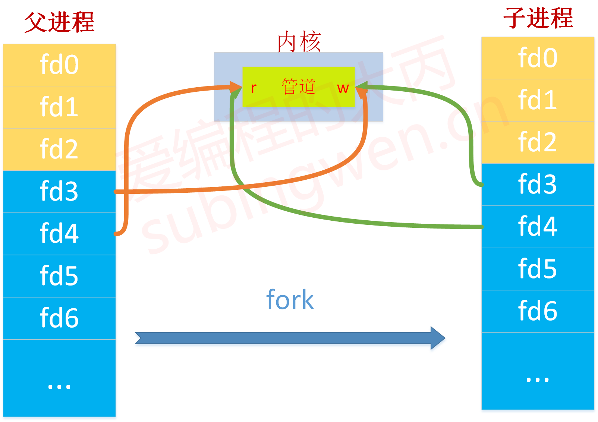
在上图中假设父进通过一系列操作可以通过文件描述符表中的文件描述符fd3写管道，通过fd4读管道，然后再`通过 fork() 创建出子进程，那么在父进程中被分配的文件描述符 fd3， fd4也就被拷贝到子进程中，子进程通过 fd3可以将数据写入到内核的管道中，通过fd4将数据从管道中读出来。`
也就是说管道是独立于任何进程的，并且充当了两个进程用于数据通信的载体，只要两个进程能够得到同一个管道的入口和出口（读端和写端的文件描述符），那么他们之间就可以通过管道进行数据的交互。
#### 2. 匿名管道
##### 2.1 创建匿名管道
匿名管道是管道的一种，既然是匿名也就是说这个管道没有名字，但其本质是不变的，就是位于内核中的一块内存，匿名管道拥有上面介绍的管道的所有特性，额外的我们需要知道，`匿名管道只能实现有血缘关系的进程间通信`，什么叫有血缘的进程关系呢，比如：父子进程，兄弟进程，爷孙进程，叔侄进程。最后说一下创建匿名管道的函数，函数原型如下：
```c
#include <unistd.h>
// 创建一个匿名的管道, 得到两个可用的文件描述符
int pipe(int pipefd[2]);
```
- 参数：传出参数，需要传递一个整形数组的地址，数组大小为 2，也就是说最终会传出两个元素 `pipefd[0]: 对应管道读端的文件描述符，通过它可以将数据从管道中读出`
- `pipefd[1]: 对应管道写端的文件描述符，通过它可以将数据写入到管道中`
- 返回值：成功返回 0，失败返回 -1
##### 2.2 进程间通信
使用匿名管道只能够实现有血缘关系的进程间通信，要求写一段程序完成下边的功能：
```text
需求描述:
   在父进程中创建一个子进程, 父子进程分别执行不同的操作:
     - 子进程: 执行一个shell命令 "ps aux", 将命令的结果传递给父进程
     - 父进程: 将子进程命令的结果输出到终端
```
需求分析:
- 子进程中执行shell命令相当于启动一个磁盘程序，因此需要使用 execl()/execlp()函数 execlp(“ps”, “ps”, “aux”, NULL)
- 子进程中执行完shell命令直接就可以在终端输出结果，如果将这些信息传递给父进程呢？ 数据传递需要使用管道，子进程需要将数据写入到管道中
- 将默认输出到终端的数据写入到管道就需要进行输出的重定向，需要使用 `dup2()`做这件事情 `dup2(fd[1], STDOUT_FILENO);`
- 父进程需要读管道，将从管道中读出的数据打印到终端
- 父进程最后需要释放子进程资源，防止出现僵尸进程
在使用管道进行进程间通信的注意事项：必须要保证数据在管道中的单向流动。这句话怎么理解呢，通过下面的图来分析一下：
> 第一步: 在父进程中创建了匿名管道，得到了两个分配的文件描述符，fd3操作管道的读端，fd4操作管道的写端。
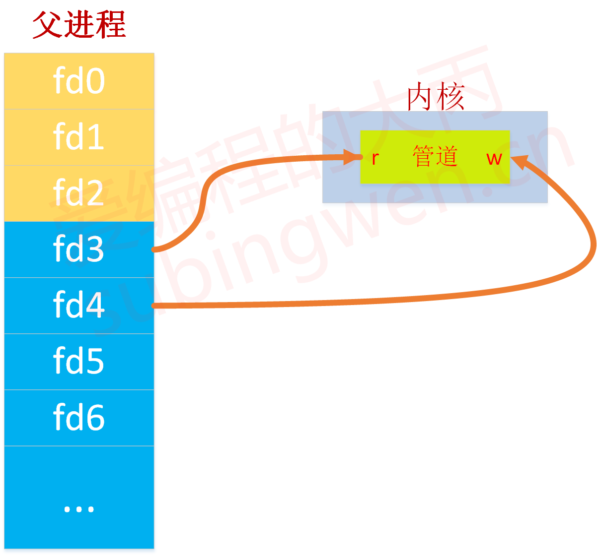
> 第二步：父进程创建子进程，父进程的文件描述符被拷贝，在子进程的文件描述符表中也得到了两个被分配的可以使用的文件描述符，通过fd3读管道，通过fd4写管道。通过下图可以看到管道中数据的流动不是单向的，有以下这么几种情况： 父进程通过fd4将数据写入管道，然后父进程再通过fd3将数据从管道中读出 父进程通过fd4将数据写入管道，然后子进程再通过fd3将数据从管道中读出 子进程通过fd4将数据写入管道，然后子进程再通过fd3将数据从管道中读出 子进程通过fd4将数据写入管道，然后父进程再通过fd3将数据从管道中读出 前边说到过，管道行为默认是阻塞的，`假设子进程通过写端将数据写入管道，父进程的读端将数据读出，这样子进程的读端就读不到数据，导致子进程阻塞在读管道的操作上`，这样就会给程序的执行造成一些不必要的影响。如果我们本来也没有打算让进程读或者写管道，那么就可以将进程操作的读端或者写端关闭。
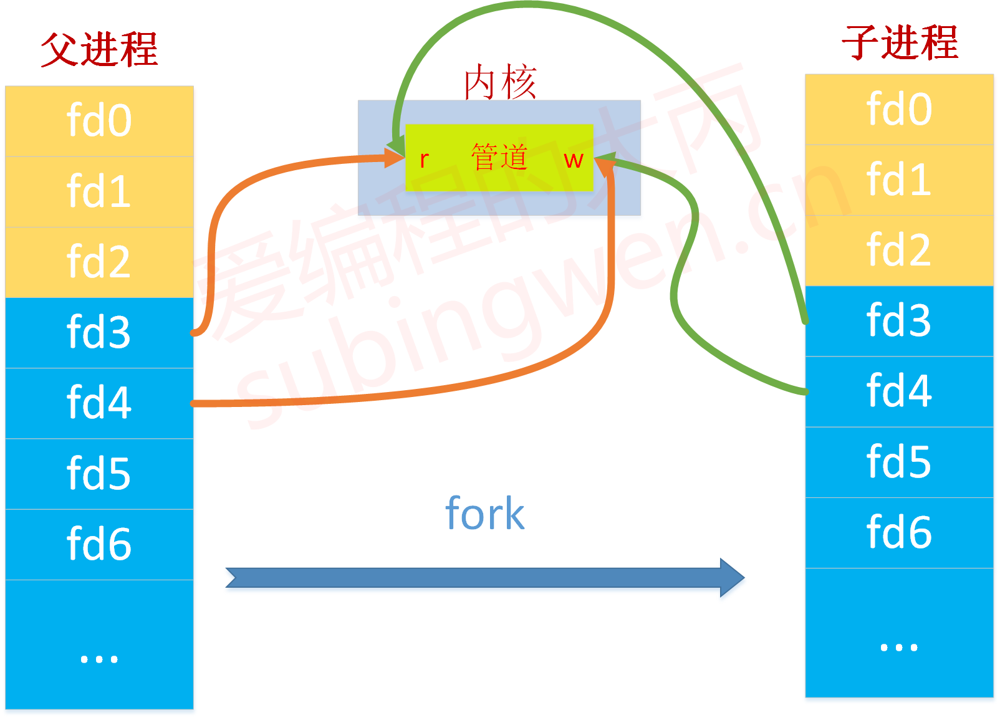
> 第三步：为了避免两个进程都读管道，但是可能其中某个进程由于读不到数据而阻塞的情况，我们可以关闭进程中用不到的那一端的文件描述符，这样数据就只能单向的从一端流向另外一端了，如下图，我们关闭了父进程的写端，关闭了子进程的读端：
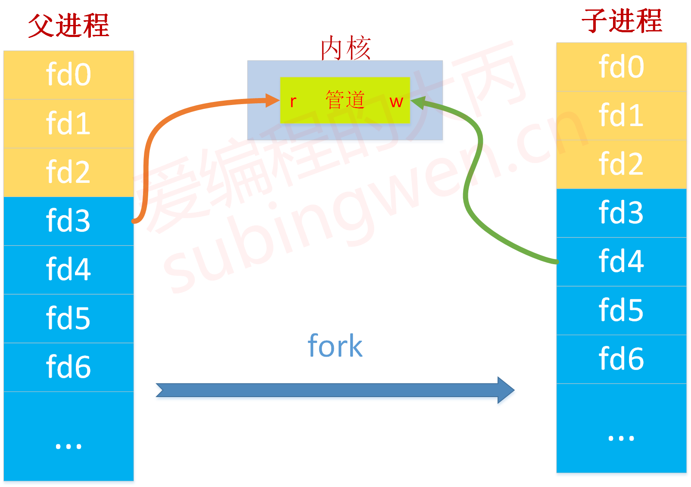
根据上面的分析，最终可以写出下面的代码：
```c
// 管道的数据是单向流动的:
// 操作管道的是两个进程, 进程A读管道, 需要关闭管道的写端, 进程B写管道, 需要关闭管道的读端
// 如果不做上述的操作, 会对程序的结果造成一些影响, 对管道的操作无法结束
#include <fcntl.h>
#include <sys/wait.h>

int main()
{
    // 1. 创建匿名管道, 得到两个文件描述符
    int fd[2];
    int ret = pipe(fd);
    if(ret == -1)
    {
        perror("pipe");
        exit(0);
    }
    // 2. 创建子进程 -> 能够操作管道的文件描述符被复制到子进程中
    pid_t pid = fork();
    if(pid == 0)
    {
        // 关闭读端
        close(fd[0]);
        // 3. 在子进程中执行 execlp("ps", "ps", "aux", NULL);
        // 在子进程中完成输出的重定向, 原来输出到终端现在要写管道
        // 进程打印数据默认输出到终端, 终端对应的文件描述符: stdout_fileno
        // 标准输出 重定向到 管道的写端
        dup2(fd[1], STDOUT_FILENO);
        execlp("ps", "ps", "aux", NULL);
        perror("execlp");
    }

    // 4. 父进程读管道
    else if(pid > 0)
    {
        // 关闭管道的写端
        close(fd[1]);
        // 5. 父进程打印读到的数据信息
        char buf[4096];
        // 读管道
        // 如果管道中没有数据, read会阻塞
        // 有数据之后, read解除阻塞, 直接读数据
        // 需要循环读数据, 管道是有容量的, 写满之后就不写了
        // 数据被读走之后, 继续写管道, 那么就需要再继续读数据
        while(1)
        {
            memset(buf, 0, sizeof(buf));
            int len = read(fd[0], buf, sizeof(buf));
            if(len == 0)
            {
                // 管道的写端关闭了, 如果管道中没有数据, 管道读端不会阻塞
                // 没数据直接返回0, 如果有数据, 将数据读出, 数据读完之后返回0
                break;
            }
            printf("%s, len = %d\n", buf, len);
        }
        close(fd[0]);

        // 回收子进程资源
        wait(NULL);
    }
    return 0;
}
```
#### 3. 有名管道
##### 3.1 创建有名管道
有名管道拥有管道的所有特性，之所以称之为有名是因为管道在磁盘上有实体文件, 文件类型为`p` ，有名管道文件大小永远为0，因为有名管道也是将数据存储到内存的缓冲区中，打开这个磁盘上的管道文件就可以得到操作有名管道的文件描述符，通过文件描述符读写管道存储在内核中的数据。
有名管道也可以称为 fifo (first in first out)，使用有名管道既可以进行有血缘关系的进程间通信，也可以进行没有血缘关系的进程间通信。创建有名管道的方式有两种，一种是通过命令，一种是通过函数。
```bash
$ mkfifo 有名管道的名字
```
- 通过命令
```c
#include <sys/types.h>
#include <sys/stat.h>
// int open(const char *pathname, int flags, mode_t mode);
int mkfifo(const char *pathname, mode_t mode);
```
- 通过函数 c1234 参数: pathname: 要创建的有名管道的名字
- mode: 文件的操作权限, 和open()的第三个参数一个作用，最终权限: (mode & ~umask)
- 返回值：创建成功返回 0，失败返回 -1
##### 32. 进程间通信
不管是有血缘关系还是没有血缘关系，使用有名管道实现进程间通信的方式是相同的，就是在两个进程中分别以读、写的方式打开磁盘上的管道文件，得到用于读管道、写管道的文件描述符，就可以调用对应的read()、write()函数进行读写操作了。
小贴士：
有名管道操作需要通过 open() 操作得到读写管道的文件描述符，如果只是读端打开了或者只是写端打开了，进程会阻塞在这里不会向下执行，直到在另一个进程中将管道的对端打开，当前进程的阻塞也就解除了。所以当发现进程阻塞在了open()函数上不要感到惊讶。·
```c
/*
	1. 创建有名管道文件 
		mkfifo()
	2. 打开有名管道文件, 打开方式是 o_wronly
		int wfd = open("xx", O_WRONLY);
	3. 调用write函数写文件 ==> 数据被写入管道中
		write(wfd, data, strlen(data));
	4. 写完之后关闭文件描述符
		close(wfd);
*/
```
```c
#include <fcntl.h>
#include <sys/stat.h>

int main()
{
    // 1. 创建有名管道文件
    int ret = mkfifo("./testfifo", 0664);
    if(ret == -1)
    {
        perror("mkfifo");
        exit(0);
    }
    printf("管道文件创建成功...\n");

    // 2. 打开管道文件
    // 因为要写管道, 所有打开方式, 应该指定为 O_WRONLY
    // 如果先打开写端, 读端还没有打开, open函数会阻塞, 当读端也打开之后, open解除阻塞
    int wfd = open("./testfifo", O_WRONLY);
    if(wfd == -1)
    {
        perror("open");
        exit(0);
    }
    printf("以只写的方式打开文件成功...\n");

    // 3. 循环写管道
    int i = 0;
    while(i<100)
    {
        char buf[1024];
        sprintf(buf, "hello, fifo, 我在写管道...%d\n", i);
        write(wfd, buf, strlen(buf));
        i++;
        sleep(1);
    }
    close(wfd);

    return 0;
}
```
- 写管道的进程 c12345678910
```c
/*
	1. 这两个进程需要操作相同的管道文件
	2. 打开有名管道文件, 打开方式是 o_rdonly
		int rfd = open("xx", O_RDONLY);
	3. 调用read函数读文件 ==> 读管道中的数据
		char buf[4096];
		read(rfd, buf, sizeof(buf));
	4. 读完之后关闭文件描述符
		close(rfd);
*/
```
```c
#include <fcntl.h>
#include <sys/stat.h>

int main()
{
    // 1. 打开管道文件
    // 因为要read管道, so打开方式, 应该指定为 O_RDONLY
    // 如果只打开了读端, 写端还没有打开, open阻塞, 当写端被打开, 阻塞就解除了
    int rfd = open("./testfifo", O_RDONLY);
    if(rfd == -1)
    {
        perror("open");
        exit(0);
    }
    printf("以只读的方式打开文件成功...\n");

    // 2. 循环读管道
    while(1)
    {
        char buf[1024];
        memset(buf, 0, sizeof(buf));
        // 读是阻塞的, 如果管道中没有数据, read自动阻塞
        // 有数据解除阻塞, 继续读数据
        int len = read(rfd, buf, sizeof(buf));
        printf("读出的数据: %s\n", buf);
        if(len == 0)
        {
            // 写端关闭了, read解除阻塞返回0
            printf("管道的写端已经关闭, 拜拜...\n");
            break;
        }

    }
    close(rfd);

    return 0;
}
```
- 读管道的进程 c12345678910
#### 4. 管道的读写行为
关于管道不管是有名的还是匿名的，在进行读写的时候，它们表现出的行为是一致的，下面是对其读写行为的总结:
- 读管道，需要根据写端的状态进行分析： 写端没有关闭 (操作管道写端的文件描述符没有被关闭) 如果管道中没有数据 ==> `读阻塞`, 如果管道中被写入了数据, 阻塞解除
- 如果管道中有数据 ==> 不阻塞，管道中的数据被读完了, 再继续读管道还会阻塞
- 写端已经关闭了 (没有可用的文件描述符可以写管道了) 管道中没有数据 ==> 读端解除阻塞, read函数返回0
- 管道中有数据 ==> read先将数据读出, 数据读完之后返回0, 不会阻塞了
- 写管道，需要根据读端的状态进行分析： 读端没有关闭 如果管道有存储的空间, 一直写数据
- 如果管道写满了, 写操作就阻塞, 当读端将管道数据读走了, 解除阻塞继续写
- 读端关闭了，管道破裂(异常), 进程直接退出
> 管道的两端默认是阻塞的，如何将管道设置为非阻塞呢？管道的读写两端的非阻塞操作是相同的，下面的代码中将匿名的读端设置为了非阻塞：
```c
// 通过fcntl 修改就可以, 一般情况下不建议修改
// 管道操作对应两个文件描述符, 分别是管道的读端 和 写端

// 1. 获取读端的文件描述符的flag属性
int flag = fcntl(fd[0], F_GETFL);
// 2. 添加非阻塞属性到 flag中
flag |= O_NONBLOCK;
// 3. 将新的flag属性设置给读端的文件描述符
fcntl(fd[0], F_SETFL, flag);
// 4. 非阻塞读管道
char buf[4096];
read(fd[0], buf, sizeof(buf));
```

### 3.3 内存映射区 mmap

> 原文：[《内存映射(mmap)》](https://subingwen.cn/linux/mmap/)　作者：苏丙榅　来源：爱编程的大丙

#### 1. 创建内存映射区
如果想要实现进程间通信，可以通过函数创建一块内存映射区，和管道不同的是管道对应的内存空间在内核中，而内存映射区对应的内存空间在进程的用户区（用于加载动态库的那个区域），也就是说`进程间通信使用的内存映射区不是一块，而是在每个进程内部都有一块`。
由于每个进程的地址空间是独立的，各个进程之间也不能直接访问对方的内存映射区，需要通信的进程需要将各自的内存映射区和同一个磁盘文件进行映射，这样进程之间就可以通过磁盘文件这个唯一的桥梁完成数据的交互了。
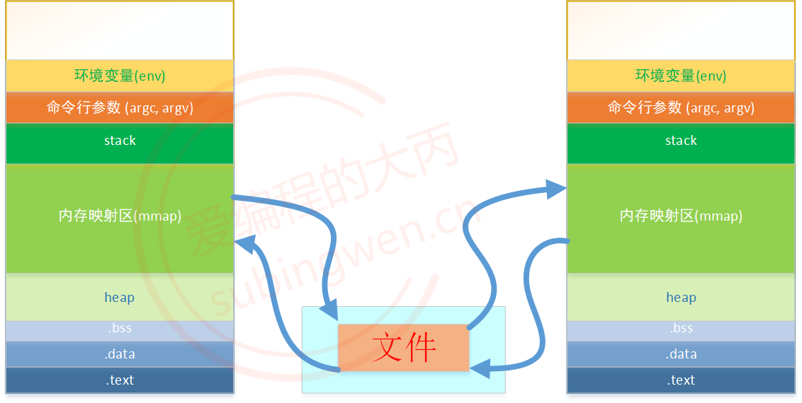
如上图所示：`磁盘文件数据可以完全加载到进程的内存映射区也可以部分加载到进程的内存映射区，当进程A中的内存映射区数据被修改了，数 据会被自动同步到磁盘文件，同时和磁盘文件建立映射关系的其他进程内存映射区中的数据也会和磁盘文件进行数据的实时同步，这个同步机制保障了各个进程之间 的数据共享。`
使用内存映射区既可以进程有血缘关系的进程间通信也可以进程没有血缘关系的进程间通信。创建内存映射区的函数原型如下：
```c
#include <sys/mman.h>
// 创建内存映射区
void *mmap(void *addr, size_t length, int prot, int flags, int fd, off_t offset);
```
- 参数: addr: 从动态库加载区的什么位置开始创建内存映射区，一般指定为NULL, 委托内核分配 length: 创建的内存映射区的大小（单位：字节），实际上这个大小是按照4k的整数倍去分配的
- prot: 对内存映射区的操作权限 PROT_READ: 读内存映射区
- PROT_WRITE: 写内存映射区
- 如果要对映射区有读写权限: PROT_READ | PROT_WRITE
- flags: MAP_SHARED: 多个进程可以共享数据，进行映射区数据同步
- MAP_PRIVATE: 映射区数据是私有的，不能同步给其他进程
- fd: 文件描述符, 对应一个打开的磁盘文件，内存映射区通过这个文件描述符和磁盘文件建立关联
- offset: 磁盘文件的偏移量，文件从偏移到的位置开始进行数据映射，使用这个参数需要注意两个问题： 偏移量必须是4k的整数倍, 写0代表不偏移
- 这个参数必须是大于 0 的
- 返回值: 成功: 返回一个内存映射区的起始地址
- 失败: `MAP_FAILED` (that is, (void *) -1)
> mmap() 函数的参数相对较多，在使用该函数创建用于进程间通信的内存映射区的时候，各参数的指定都有一些注意事项，具体如下：
```c
1. 第一个参数 addr 指定为 NULL 即可
2. 第二个参数 length 必须要 > 0
3. 第三个参数 prot，进程间通信需要对内存映射区有读写权限，因此需要指定为：PROT_READ | PROT_WRITE
4. 第四个参数 flags，如果要进行进程间通信, 需要指定 MAP_SHARED
5. 第五个参数 fd，打开的文件必须大于0，进程间通信需要文件操作权限和映射区操作权限相同
     - 内存映射区创建成功之后, 关闭这个文件描述符不会影响进程间通信
6. 第六个参数 offset，不偏移指定为0，如果偏移必须是4k的整数倍
```
内存映射区使用完之后也需要释放，释放函数原型如下：
```c
int munmap(void *addr, size_t length);
```
- 参数: addr: mmap()的返回值, 创建的内存映射区的起始地址
- length: 和mmap()第二个参数相同即可
- 返回值：函数调用成功返回 0，失败返回 -1
#### 2. 进程间通信
操 作内存映射区和操作管道是不一样的，得到内存映射区之后是直接对内存地址进行操作，管道是通过文件描述符读写队列中的数据，管道的读写是阻塞的，内存映射 区的读写是非阻塞的。内存映射区创建成功之后，得到了映射区内存的起始地址，使用相关的内存操作函数读写数据就可以了。
##### 2.1 有血缘关系
由于创建子进程会发生虚拟地址空间的复制，那么在父进程中创建的内存映射区也会被复制到子进程中，这样在子进程里边就可以直接使用这块内存映射区了，所以对于有血缘关系的进程，进行进程间通信是非常简单的，处理代码如下：
```c
/*
    1. 先创建内存映射区, 得到一个起始地址, 假设使用ptr指针保存这个地址
    2. 通过fork() 创建子进程 -> 子进程中也就有一个内存映射区, 子进程中也有一个ptr指针指向这个地址
    3. 父进程往自己的内存映射区写数据, 数据同步到了磁盘文件中, 磁盘文件数据又同步到子进程的映射区中
       子进程从自己的映射区往外读数据, 这个数据就是父进程写的
*/
```
```c
#include <sys/mman.h>
#include <fcntl.h>

int main()
{
    // 1. 打开一个磁盘文件
    int fd = open("./english.txt", O_RDWR);
    // 2. 创建内存映射区
    void* ptr = mmap(NULL, 4000, PROT_READ|PROT_WRITE,
                     MAP_SHARED, fd, 0);
    if(ptr == MAP_FAILED)
    {
        perror("mmap");
        exit(0);
    }

    // 3. 创建子进程
    pid_t pid = fork();
    if(pid > 0)
    {
        // 父进程, 写数据
        const char* pt = "我是你爹, 你是我儿子吗???";
        memcpy(ptr, pt, strlen(pt)+1);
    }
    else if(pid == 0)
    {
        // 子进程, 读数据
        usleep(1);	// 内存映射区不阻塞, 为了让子进程读出数据
        printf("从映射区读出的数据: %s\n", (char*)ptr);
    }

    // 释放内存映射区
    munmap(ptr, 4000);

    return 0;
}
```
##### 2.2 没有血缘关系
对于没有血缘关系的进程间通信，需要在每个进程中分别创建内存映射区，但是这些进程的内存映射区必须要关联相同的磁盘文件，这样才能实现进程间的数据同步。
> 进程A的测试代码:
```c
#include <stdio.h>
#include <stdlib.h>
#include <unistd.h>
#include <string.h>
#include <sys/mman.h>
#include <fcntl.h>

int main()
{
    // 1. 打开一个磁盘文件
    int fd = open("./english.txt", O_RDWR);
    // 2. 创建内存映射区
    void* ptr = mmap(NULL, 4000, PROT_READ|PROT_WRITE,
                     MAP_SHARED, fd, 0);
    if(ptr == MAP_FAILED)
    {
        perror("mmap");
        exit(0);
    }
    
    const char* pt = "==================我是你爹, 你是我儿子吗???****************";
    memcpy(ptr, pt, strlen(pt)+1);

    // 释放内存映射区
    munmap(ptr, 4000);

    return 0;
}
```
> 进程B的测试代码:
```c
#include <stdio.h>
#include <stdlib.h>
#include <unistd.h>
#include <string.h>
#include <sys/mman.h>
#include <fcntl.h>

int main()
{
    // 1. 打开一个磁盘文件
    int fd = open("./english.txt", O_RDWR);
    // 2. 创建内存映射区
    void* ptr = mmap(NULL, 4000, PROT_READ|PROT_WRITE,
                     MAP_SHARED, fd, 0);
    if(ptr == MAP_FAILED)
    {
        perror("mmap");
        exit(0);
    }

    // 读内存映射区
    printf("从映射区读出的数据: %s\n", (char*)ptr);

    // 释放内存映射区
    munmap(ptr, 4000);

    return 0;
}
```
#### 3. 拷贝文件
使用内存映射区除了可以实现进程间通信，也可以进行文件的拷贝，使用这种方式拷贝文件可以减少程序猿的工作量，我们只需要负责创建内存映射区和打开磁盘文件，关于文件中的数据读写就无需关心了。
使用内存映射区拷贝文件思路：
1. 打开被拷贝文件，得到文件描述符 fd1，并计算出这个文件的大小 size
1. 创建内存映射区A并且和被拷贝文件关联，也就是和fd1关联起来，得到映射区地址 ptrA
1. 创建新文件，得到文件描述符 fd2，用于存储被拷贝的数据，并且将这个文件大小拓展为 size
1. 创建内存映射区B并且和新创建的文件关联，也就是和fd2关联起来，得到映射区地址 ptrB
1. 进程地址空间之间的数据拷贝，memcpy（ptrB， ptrA，size），数据自动同步到新建文件中
1. 关闭内存映射区
文件拷贝示例代码如下：
```c
#include <stdio.h>
#include <stdlib.h>
#include <unistd.h>
#include <string.h>
#include <fcntl.h>
#include <sys/mman.h>

int main()
{
    // 1. 打开一个操盘文件english.txt得到文件描述符
    int fd = open("./english.txt", O_RDWR);
    // 计算文件大小
    int size = lseek(fd, 0, SEEK_END);

    // 2. 创建内存映射区和english.txt进行关联, 得到映射区起始地址
    void* ptrA = mmap(NULL, size, PROT_READ|PROT_WRITE, MAP_SHARED, fd, 0);
    if(ptrA == MAP_FAILED)
    {
        perror("mmap");
        exit(0);
    }

    // 3. 创建一个新文件, 存储拷贝的数据
    int fd1 = open("./copy.txt", O_RDWR|O_CREAT, 0664);
    // 拓展这个新文件
    ftruncate(fd1, size);

    // 4. 创建一个映射区和新文件进行关联, 得到映射区的起始地址second
    void* ptrB = mmap(NULL, size, PROT_READ|PROT_WRITE, MAP_SHARED, fd1, 0);
    if(ptrB == MAP_FAILED)
    {
        perror("mmap----");
        exit(0);
    }
    // 5. 使用memcpy拷贝映射区数据
    // 这两个指针指向两块内存, 都是内存映射区
    // 指针指向有效的内存, 拷贝的是内存中的数据
    memcpy(ptrB, ptrA, size);

    // 6. 释放内存映射区
    munmap(ptrA, size);
    munmap(ptrB, size);
    close(fd);
    close(fd1);

    return 0;
}
```

### 3.4 共享内存

> 原文：[《共享内存》](https://subingwen.cn/linux/shm/)　作者：苏丙榅　来源：爱编程的大丙

共 享内存不同于内存映射区，它不属于任何进程，并且不受进程生命周期的影响。通过调用Linux提供的系统函数就可得到这块共享内存。使用之前需要让进程和 共享内存进行关联，得到共享内存的起始地址之后就可以直接进行读写操作了，进程也可以和这块共享内存解除关联, 解除关联之后就不能操作这块共享内存了。在所有进程间通信的方式中共享内存的效率是最高的。
共享内存操作默认不阻塞，如果`多个进程同时读写共享内存`，可能出现数据混乱，共享内存需要借助其他机制来保证进程间的数据同步，比如：信号量，共享内存内部没有提供这种机制。
#### 1. 创建/打开共享内存
##### 1.1 shmget
在使用共享内存之前必须要先做一些准备工作，如果共享内存不存在就需要先创建出来，如果已经存在了就需要先打开这块共享内存。不管是创建还是打开共享内存使用的函数是同一个，函数原型如下:
```c
#include <sys/ipc.h>
#include <sys/shm.h>
int shmget(key_t key, size_t size, int shmflg);
```
- 参数: key: 类型 key_t 是个整形数, `通过这个key可以创建或者打开一块共享内存，该参数的值一定要大于0`
- size: 创建共享内存的时候, 指定共享内存的大小，如果是打开一块存在的共享内存, size是没有意义的
- shmflg：创建共享内存的时候指定的属性 IPC_CREAT: 创建新的共享内存，如果创建共享内存, 需要指定对共享内存的操作权限，比如：IPC_CREAT | 0664
- IPC_EXCL: 检测共享内存是否已经存在了，必须和 IPC_CREAT一起使用
- 返回值：共享内存创建或者打开成功返回标识共享内存的唯一的ID，失败返回-1
函数使用举例:
> 场景1：创建一块大小为4k的共享内存
```c
shmget(100, 4096, IPC_CREAT|0664);
```
> 场景2：创建一块大小为4k的共享内存, 并且检测是否存在
```c
// 	如果共享内存已经存在, 共享内存创建失败, 返回-1, 可以perror() 打印错误信息
shmget(100, 4096, IPC_CREAT|0664|IPC_EXCL);
```
> 场景3：打开一块已经存在的共享内存
```c
// 函数参数虽然指定了大小和IPC_CREAT, 但是都不起作用, 因为共享内存已经存在, 只能打开, 参数4096也没有意义
shmget(100, 4096, IPC_CREAT|0664);
shmget(100, 0, 0);
```
> 场景4：打开一块共享内存, 如果不存在就创建
```c
shmget(100, 4096, IPC_CREAT|0664);
```
##### 1.2 ftok
shmget() 函数的第一个参数是一个大于0的正整数，如果不想自己指定可以通过 ftok()函数直接生成这个key值。该函数的函数原型如下：
```c
// ftok函数原型
#include <sys/types.h>
#include <sys/ipc.h>

// 将两个参数作为种子, 生成一个 key_t 类型的数值
key_t ftok(const char *pathname, int proj_id);
```
- 参数: pathname: 当前操作系统中一个存在的路径
- proj_id: 这个参数只用到了int中的一个字节, 传参的时候要将其作为 char 进行操作，取值范围: 1-255
- 返回值：函数调用成功返回一个可用于创建、打开共享内存的key值，调用失败返回-1
使用举例：
```c
// 根据路径生成一个key_t
key_t key = ftok("/home/robin", 'a');
// 创建或打开共享内存
shmget(key, 4096, IPC_CREATE|0664);
```
#### 2. 关联和解除关联
##### 2.1 shmat
创建/打开共享内存之后还必须和共享内存进行关联，这样才能得到共享内存的起始地址，通过得到的内存地址进行数据的读写操作，关联函数的原型如下：
```c
void *shmat(int shmid, const void *shmaddr, int shmflg);
```
- 参数: shmid: 要操作的共享内存的ID, 是 shmget() 函数的返回值
- shmaddr: 共享内存的起始地址, 用户不知道, 需要让内核指定, 写NULL
- shmflg: 和共享内存关联的对共享内存的操作权限 SHM_RDONLY: 读权限, 只能读共享内存中的数据
- 0: 读写权限，可以读写共享内存数据
- 返回值：关联成功，返回值共享内存的起始地址，关联失败返回 (void *) -1
##### 2.2 shmdt
当进程不需要再操作共享内存，可以让进程和共享内存解除关联，另外如果没有执行该操作，进程退出之后，结束的进程和共享内存的关联也就自动解除了。
```c
int shmdt(const void *shmaddr);
```
- 参数：shmat() 函数的返回值, 共享内存的起始地址
- 返回值：关联解除成功返回0，失败返回-1
#### 3. 删除共享内存
##### 3.1 shmctl
shmctl() 函数是一个多功能函数，可以设置、获取共享内存的状态也可以将共享内存标记为删除状态。`当共享内存被标记为删除状态之后，并不会马上被删除，直到所有的进程全部和共享内存解除关联，共享内存才会被删除。`因为通过shmctl()函数只是能够标记删除共享内存，所以在程序中多次调用该操作是没有关系的。
```c
// 共享内存控制函数
int shmctl(int shmid, int cmd, struct shmid_ds *buf);

// 参数 struct shmid_ds 结构体原型          
struct shmid_ds {
	struct ipc_perm shm_perm;    /* Ownership and permissions */
	size_t          shm_segsz;   /* Size of segment (bytes) */
	time_t          shm_atime;   /* Last attach time */
	time_t          shm_dtime;   /* Last detach time */
	time_t          shm_ctime;   /* Last change time */
	pid_t           shm_cpid;    /* PID of creator */
	pid_t           shm_lpid;    /* PID of last shmat(2)/shmdt(2) */
    // 引用计数, 多少个进程和共享内存进行了关联
	shmatt_t        shm_nattch;  /* 记录了有多少个进程和当前共享内存进行了管联 */
	...
};
```
- 参数: shmid: 要操作的共享内存的ID, 是 shmget() 函数的返回值
- cmd: 要做的操作 IPC_STAT: 得到当前共享内存的状态
- IPC_SET: 设置共享内存的状态
- IPC_RMID: 标记共享内存要被删除了
- buf: cmd==IPC_STAT, 作为传出参数, 会得到共享内存的相关属性信息
- cmd==IPC_SET, 作为传入参, 将用户的自定义属性设置到共享内存中
- cmd==IPC_RMID, buf就没意义了, 这时候buf指定为NULL即可
- 返回值：函数调用成功返回值大于等于0，调用失败返回-1
##### 3.2 相关shell命令
使用`ipcs` 添加参数`-m`可以查看系统中共享内存的详细信息
```bash
$ ipcs -m

------------ 共享内存段 --------------
键        shmid      拥有者  权限     字节     nattch     状态      
0x00000000 425984     oracle     600        524288     2          目标       
0x00000000 327681     oracle     600        524288     2          目标       
0x00000000 458754     oracle     600        524288     2          目标 	
```
使用 `ipcrm` 命令可以标记删除某块共享内存
```bash
# key == shmget的第一个参数
$ ipcrm -M shmkey  

# id == shmget的返回值
$ ipcrm -m shmid	
```
##### 3.3 共享内存状态
```c
// 参数 struct shmid_ds 结构体原型          
struct shmid_ds {
	struct ipc_perm shm_perm;    /* Ownership and permissions */
	size_t          shm_segsz;   /* Size of segment (bytes) */
	time_t          shm_atime;   /* Last attach time */
	time_t          shm_dtime;   /* Last detach time */
	time_t          shm_ctime;   /* Last change time */
	pid_t           shm_cpid;    /* PID of creator */
	pid_t           shm_lpid;    /* PID of last shmat(2)/shmdt(2) */
    // 引用计数, 多少个进程和共享内存进行了关联
	shmatt_t        shm_nattch;  /* 记录了有多少个进程和当前共享内存进行了管联 */
	...
};
```
通过`shmctl()`我们可以得知，共享内存的信息是存储到一个叫做`struct shmid_ds`的结构体中，其中有一个非常重要的成员叫做`shm_nattch`，在这个成员变量里边记录着当前共享内存关联的进程的个数，一般将其称之为引用计数。当共享内存被标记为删除状态，并且这个引用计数变为0之后共享内存才会被真正的被删除掉。
当共享内存被标记为删除状态之后，共享内存的状态也会发生变化，共享内存内部维护的key从一个正整数变为0，其属性从公共的变为私有的。这里的私 有是指只有已经关联成功的进程才允许继续访问共享内存，不再允许新的进程和这块共享内存进行关联了。下图演示了共享内存的状态变化：
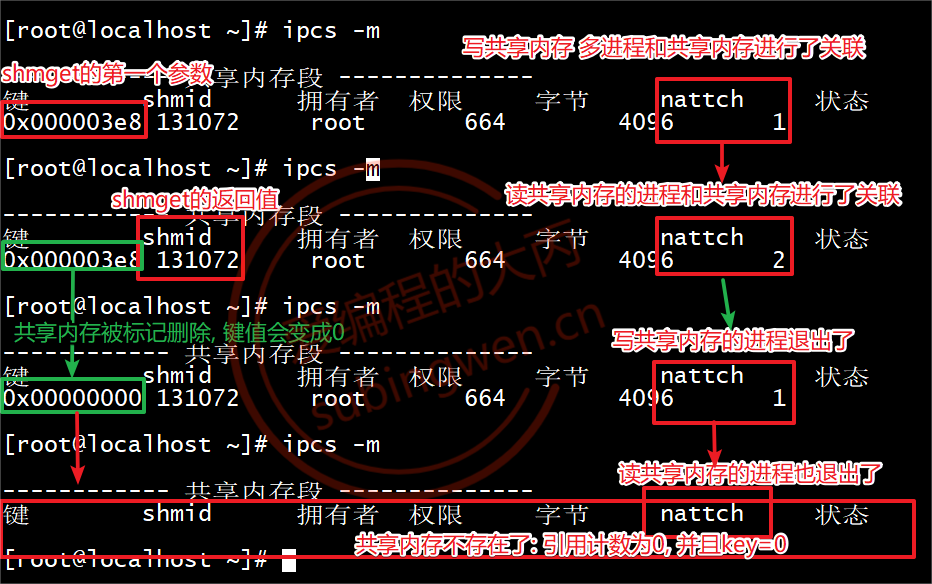
#### 4. 进程间通信
使用共享内存实现进程间通信的操作流程如下：
```c
1. 调用linux的系统API创建一块共享内存
    - 这块内存不属于任何进程, 默认进程不能对其进行操作
    
2. 准备好进程A, 和进程B, 这两个进程需要和创建的共享内存进行关联
    - 关联操作: 调用linux的 api
    - 关联成功之后, 得到了这块共享内存的起始地址
        
3. 在进程A或者进程B中对共享内存进行读写操作
    - 读内存: printf() 等;
	- 写内存: memcpy() 等;

4. 通信完成, 可以让进程A和B和共享内存解除关联
    - 解除成功, 进程A和B不能再操作共享内存了
    - 共享内存不受进程生命周期的影响的
    
5. 共享内存不在使用之后, 将其删除
    - 调用linux的api函数, 删除之后这块内存被内核回收了
```
> 写共享内存的进程代码:
```c
#include <stdio.h>
#include <sys/shm.h>
#include <string.h>

int main()
{
    // 1. 创建共享内存, 大小为4k
    int shmid = shmget(1000, 4096, IPC_CREAT|0664);
    if(shmid == -1)
    {
        perror("shmget error");
        return -1;
    }

    // 2. 当前进程和共享内存关联
    void* ptr = shmat(shmid, NULL, 0);
    if(ptr == (void *) -1)
    {
        perror("shmat error");
        return -1;
    }

    // 3. 写共享内存
    const char* p = "hello, world, 共享内存真香...";
    memcpy(ptr, p, strlen(p)+1);

    // 阻塞程序
    printf("按任意键继续, 删除共享内存\n");
    getchar();

    shmdt(ptr);

    // 删除共享内存
    shmctl(shmid, IPC_RMID, NULL);
    printf("共享内存已经被删除...\n");

    return 0;
}
```
> 读共享内存的进程代码:
```c
#include <stdio.h>
#include <sys/shm.h>
#include <string.h>

int main()
{
    // 1. 创建共享内存, 大小为4k
    int shmid = shmget(1000, 0, 0);
    if(shmid == -1)
    {
        perror("shmget error");
        return -1;
    }

    // 2. 当前进程和共享内存关联
    void* ptr = shmat(shmid, NULL, 0);
    if(ptr == (void *) -1)
    {
        perror("shmat error");
        return -1;
    }

    // 3. 读共享内存
    printf("共享内存数据: %s\n", (char*)ptr);

    // 阻塞程序
    printf("按任意键继续, 删除共享内存\n");
    getchar();

    shmdt(ptr);

    // 删除共享内存
    shmctl(shmid, IPC_RMID, NULL);
    printf("共享内存已经被删除...\n");

    return 0;
}
```
#### 5. shm和mmap的区别
`共享内存`和`内存映射区`都可以实现进程间通信，下面来分析一下二者的区别：
- 实现进程间通信的方式 shm: 多个进程只需要一块共享内存就够了，共享内存不属于进程，需要和进程关联才能使用
- 内存映射区: 位于每个进程的虚拟地址空间中, 并且需要关联同一个磁盘文件才能实现进程间数据通信
- 效率: shm: 直接对内存操作，效率高
- 内存映射区: 需要内存和文件之间的数据同步，效率低
- 生命周期 内存映射区：进程退出, 内存映射区也就没有了
- shm：进程退出对共享内存没有影响，调用相关函数/命令/ 关机才能删除共享内存
- 数据的完整性 -> 突发状态下数据能不能被保存下来（比如: 突然断电） 内存映射区：可以完整的保存数据, 内存映射区数据会同步到磁盘文件
- shm：数据存储在物理内存中, 断电之后系统关闭, 内存数据也就丢失了

### 3.5 信号

> 原文：[《信号》](https://subingwen.cn/linux/signal/)　作者：苏丙榅　来源：爱编程的大丙

#### 1. 信号概述
Linux中的信号是一种消息处理机制, 它本质上是一个整数，不同的信号对应不同的值，由于信号的结构简单所以天生不能携带很大的信息量，但是信号在系统中的优先级是非常高的。
在Linux中的很多常规操作中都会有相关的信号产生，先从我们最熟悉的场景说起：
- `通过键盘操作产生了信号`：用户按下Ctrl-C，这个键盘输入产生一个硬件中断，使用这个快捷键会产生信号, 这个信号会杀死对应的某个进程
- `通过shell命令产生了信号`：通过kill命令终止某一个进程，`kill -9 进程PID`
- `通过函数调用产生了信号`：如果CPU当前正在执行这个进程的代码调用，比如函数 `sleep()`，进程收到相关的信号，被迫挂起
- `通过对硬件进行非法访问产生了信号`：正在运行的程序访问了非法内存，发生段错误，进程退出。
信号也可以实现进程间通信，但是信号能传递的数据量很少，不能满足大部分需求，另外信号的优先级很高，并且它对应的处理动作是回调完成的，它会打乱程序原有的处理流程，影响到最终的处理结果。因此非常不建议使用信号进行进程间通信。
##### 1.1 信号编号
> 通过 `kill -l `命令可以察看系统定义的信号列表:
```bash
# 执行shell命令查看信号
$ kill -l
 1) SIGHUP       2) SIGINT       3) SIGQUIT      4) SIGILL       5) SIGTRAP
 6) SIGABRT      7) SIGBUS       8) SIGFPE       9) SIGKILL     10) SIGUSR1
11) SIGSEGV     12) SIGUSR2     13) SIGPIPE     14) SIGALRM     15) SIGTERM
16) SIGSTKFLT   17) SIGCHLD     18) SIGCONT     19) SIGSTOP     20) SIGTSTP
21) SIGTTIN     22) SIGTTOU     23) SIGURG      24) SIGXCPU     25) SIGXFSZ
26) SIGVTALRM   27) SIGPROF     28) SIGWINCH    29) SIGIO       30) SIGPWR
31) SIGSYS      34) SIGRTMIN    35) SIGRTMIN+1  36) SIGRTMIN+2  37) SIGRTMIN+3
38) SIGRTMIN+4  39) SIGRTMIN+5  40) SIGRTMIN+6  41) SIGRTMIN+7  42) SIGRTMIN+8
43) SIGRTMIN+9  44) SIGRTMIN+10 45) SIGRTMIN+11 46) SIGRTMIN+12 47) SIGRTMIN+13
48) SIGRTMIN+14 49) SIGRTMIN+15 50) SIGRTMAX-14 51) SIGRTMAX-13 52) SIGRTMAX-12
53) SIGRTMAX-11 54) SIGRTMAX-10 55) SIGRTMAX-9  56) SIGRTMAX-8  57) SIGRTMAX-7
58) SIGRTMAX-6  59) SIGRTMAX-5  60) SIGRTMAX-4  61) SIGRTMAX-3  62) SIGRTMAX-2
63) SIGRTMAX-1  64) SIGRTMAX
```
下表中详细阐述了信号产生的时机和对应的默认处理动作:
| 编号 | 信号 | 对应事件 | 默认动作 |
| --- | --- | --- | --- |
| 1 | SIGHUP | 用户退出shell时，由该shell启动的所有进程将收到这个信号 | 终止进程 |
| 2 | SIGINT | 当用户按下了<Ctrl+C>组合键时，用户终端向正在运行中的由该终端启动的程序发出此信号 | 终止进程 |
| 3 | SIGQUIT | 用户按下<ctrl+\>组合键时产生该信号，用户终端向正在运行中的由该终端启动的程序发出些信号 | 终止进程 |
| 4 | SIGILL | CPU检测到某进程执行了非法指令 | 终止进程并产生core文件 |
| 5 | SIGTRAP | 该信号由断点指令或其他 trap指令产生 | 终止进程并产生core文件 |
| 6 | SIGABRT | 调用abort函数时产生该信号 | 终止进程并产生core文件 |
| 7 | SIGBUS | 非法访问内存地址，包括内存对齐出错 | 终止进程并产生core文件 |
| 8 | SIGFPE | 在发生致命的运算错误时发出。不仅包括浮点运算错误，还包括溢出及除数为0等所有的算法错误 | 终止进程并产生core文件 |
| 9 | SIGKILL | 无条件终止进程。本信号不能被忽略，处理和阻塞 | 终止进程，可以杀死任何进程 |
| 10 | SIGUSE1 | 用户定义的信号。即程序员可以在程序中定义并使用该信号 | 终止进程 |
| 11 | SIGSEGV | 指示进程进行了无效内存访问(段错误) | 终止进程并产生core文件 |
| 12 | SIGUSR2 | 另外一个用户自定义信号，程序员可以在程序中定义并使用该信号 | 终止进程 |
| 13 | SIGPIPE | Broken pipe向一个没有读端的管道写数据 | 终止进程 |
| 14 | SIGALRM | 定时器超时，超时的时间 由系统调用alarm设置 | 终止进程 |
| 15 | SIGTERM | 程序结束信号，与SIGKILL不同的是，该信号可以被阻塞和终止。通常用来要示程序正常退出。执行shell命令Kill时，缺省产生这个信号 | 终止进程 |
| 16 | SIGSTKFLT | Linux早期版本出现的信号，现仍保留向后兼容 | 终止进程 |
| 17 | SIGCHLD | 子进程结束时，父进程会收到这个信号 | 忽略这个信号 |
| 18 | SIGCONT | 如果进程已停止，则使其继续运行 | 继续/忽略 |
| 19 | SIGSTOP | 停止进程的执行。信号不能被忽略，处理和阻塞 | 为终止进程 |
| 20 | SIGTSTP | 停止终端交互进程的运行。按下<ctrl+z>组合键时发出这个信号 | 暂停进程 |
| 21 | SIGTTIN | 后台进程读终端控制台 | 暂停进程 |
| 22 | SIGTTOU | 该信号类似于SIGTTIN，在后台进程要向终端输出数据时发生 | 暂停进程 |
| 23 | SIGURG | 套接字上有紧急数据时，向当前正在运行的进程发出些信号，报告有紧急数据到达。如网络带外数据到达 | 忽略该信号 |
| 24 | SIGXCPU | 进程执行时间超过了分配给该进程的CPU时间 ，系统产生该信号并发送给该进程 | 终止进程 |
| 25 | SIGXFSZ | 超过文件的最大长度设置 | 终止进程 |
| 26 | SIGVTALRM | 虚拟时钟超时时产生该信号。类似于SIGALRM，但是该信号只计算该进程占用CPU的使用时间 | 终止进程 |
| 27 | SGIPROF | 类似于SIGVTALRM，它不公包括该进程占用CPU时间还包括执行系统调用时间 | 终止进程 |
| 28 | SIGWINCH | 窗口变化大小时发出 | 忽略该信号 |
| 29 | SIGIO | 此信号向进程指示发出了一个异步IO事件 | 忽略该信号 |
| 30 | SIGPWR | 关机 | 终止进程 |
| 31 | SIGSYS | 无效的系统调用 | 终止进程并产生core文件 |
| 34~64 | SIGRTMIN ～ SIGRTMAX | LINUX的实时信号，它们没有固定的含义（可以由用户自定义） | 终止进程 |
##### 1.2 查看信号信息
通过Linux提供的 man 文档可以查询所有信号的详细信息:
```bash
# 查看man文档的信号描述
$ man 7 signal
```
在信号描述中介绍了对产生的信号的五种默认处理动作，分别是：
1. `Term`：信号将进程终止
1. `Ign`：信号产生之后默认被忽略了
1. `Core`：信号将进程终止, 并且生成一个core文件(一般用于gdb调试)
1. `Stop`：信号会暂停进程的运行
1. `Cont`：信号会让暂停的进程继续运行
关于对信号的介绍有一句非常重要的描述:
`The signals SIGKILL and SIGSTOP cannot be caught, blocked, or ignored.`
`9号信号和19号信号不能被 捕捉, 阻塞, 和 忽略`
- `9号信号: 无条件杀死进程`
- `19号信号: 无条件暂停进程`
有些信号在不同的平台对应的值是不一样的，对应我们使用PC机来说，需要看中间一列的值：
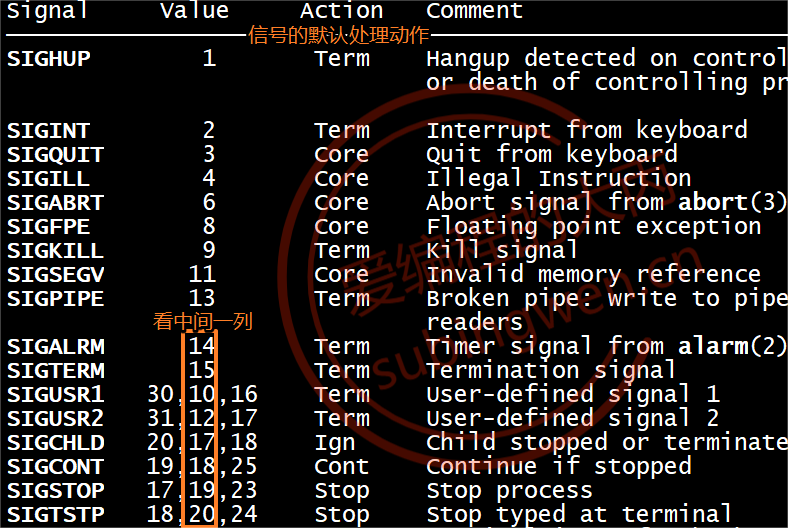
##### 1.3 信号的状态
Linux中的信号有三种状态，分别为：产生，未决，递达。
1. `产生`：键盘输入, 函数调用, 执行shell命令, 对硬件进行非法访问都会产生信号
1. `未决`：信号产生了, 但是这个信号还没有被处理掉, 这个期间信号的状态称之为未决状态
1. `递达`：信号被处理了(被某个进程处理掉)

#### 2. 信号相关函数
Linux中能够产生信号的函数有很多，下面介绍几个常用函数：
##### 2.1 kill/raise/abort
这三个函数的功能比较类似，可以发送相关的信号给到对应的进程。
```c
#include <signal.h>
// 给某一个进程发送一个信号
int kill(pid_t pid, int sig);
```
- kill 发送指定的信号到指定的进程，函数原型如下： c123 参数: pid: 进程ID（man 文档里边写的比较详细）
- sig: 要发送的信号
函数使用举例:
```c
// 自己杀死自己
kill(getpid(), 9);
// 子进程杀死自己的父进程
kill(getppid(), 10);
```
```c
// 给自己发送某一个信号
#include <signal.h>
int raise(int sig);	// 参数就是要给当前进程发送的信号
```
- raise：给当前进程发送指定的信号，函数原型如下：
```c
// 这是一个中断函数, 调用这个函数, 发送一个固定信号 (SIGABRT), 杀死当前进程
#include <stdlib.h>
void abort(void);
```
- abort：给当前进程发送一个固定信号 (SIGABRT)，函数原型如下：
##### 2.2 定时器
###### 2.2.1 alarm
alarm() 函数只能进行单次定时，定时完成发射出一个信号。
```c
#include <unistd.h>
unsigned int alarm(unsigned int seconds);
```
- 参数: 倒计时seconds秒, 倒计时完成发送一个信号 SIGALRM , 当前进程会收到这个信号，这个信号默认的处理动作是中断当前进程
- 返回值: 大于0表示倒计时还剩多少秒，返回值为0表示倒计时完成, 信号被发出
> 使用这个定时器函数, 检测一下当前计算机1s钟之内能数多少个数
```c
#include <stdio.h>
#include <stdlib.h>
#include <unistd.h>
#include <string.h>

int main()
{
    // 1. 设置一个定时器, 定时1s
    alarm(1);	// 1s之后会发出一个信号, 这个信号将中断当前进程
    int i = 0;
    while(1)
    {
        printf("%d\n", i++);
    }
    return 0;
}
```
执行上述程序的时候, 计算一下时间
```bash
# 直接通过终端输出
$ time ./a.out
real    0m1.013s		# 实际数数用的总时间
user    0m0.060s		# 用户区代码使用的时间
sys     0m0.324s		# 内核区使用的时间

real = user + sys + 消耗的时间(频率的从用户区到内核区进程切换)

# 不直接写终端, 将数据重定向到磁盘文件中
$ time ./a.out > a.txt
Alarm clock

real    0m1.002s    # 用户实际数数的时间变长了
user    0m0.740s
sys     0m0.236s
```
文件IO操作需要进行用户区到内核区的切换，处理方式不同，二者之间切换的频率也不同。也就是说对文件IO操作进行优化是可以提供程序的执行效率的。
###### 2.2.2 setitimer
setitimer () 函数可以进行周期性定时，每触发一次定时器就会发射出一个信号。
```c
// 这个函数可以实现周期性定时, 每个一段固定的时间, 发出一个特定的定时器信号
#include <sys/time.h>

struct itimerval {
	struct timeval it_interval; /* 时间间隔 */
	struct timeval it_value;    /* 第一次触发定时器的时长 */
};
// 举例: luffy有一个闹钟, 并且使用这个闹钟定时:
// 早晨7点中起床, 第一次闹钟响起时可能起不来, 之后每隔5分钟再响一次
//  - it_value: 当前设置闹钟的时间点 到 明天早晨7点 对应的总秒数
//  - it_interval: 闹钟第一次响过之后, 每隔5分钟响一次

// 这个结构体表示的是一个时间段: tv_sec + tv_usec
struct timeval {
	time_t      tv_sec;         /* 秒 */
	suseconds_t tv_usec;        /* 微妙 */
};

int setitimer(int which, const struct itimerval *new_value, 
              struct itimerval *old_value);
```
- 参数: which: 定时器使用什么样的计时法则, 不同的计时法则发出的信号不同 `ITIMER_REAL`: 自然计时法, 最常用, 发出的信号为`SIGALRM`, 一般使用这个宏值，自然计时法时间 = 用户区 + 内核 + 消耗的时间(从进程的用户区到内核区切换使用的总时间)
- `ITIMER_VIRTUAL`: 只计算程序在用户区运行使用的时间，发射的信号为 `SIGVTALRM`
- `ITIMER_PROF`: 只计算内核运行使用的时间, 发出的信号为`SIGPROF`
- new_value: 给定时器设置的定时信息, 传入参数
- old_value: 上一次给定时器设置的定时信息, 传出参数，如果不需要这个信息, 指定为NULL
#### 3. 信号集
##### 3.1 阻塞/未决信号集
在PCB中有两个非常重要的信号集。一个称之为“阻塞信号集”，另一个称之为“未决信号集”。这两个信号集体现在内核中就是两张表。但是操作系统不允许我们直接对这两个信号集进行任何操作，而是需要自定义另外一个集合，借助信号集操作函数来对PCB中的这两个信号集进行修改。
- 信号的 “未决” 是一种状态，指的是从信号的产生到信号被处理前的这一段时间。
- 信号的 “阻塞” 是一个开关动作，指的是阻止信号被处理，但不是阻止信号产生。
信号的阻塞就是让系统暂时保留信号留待以后发送。由于另外有办法让系统忽略信号，所以一般情况下信号的阻塞只是暂时的，只是为了 防止信号打断某些敏感的操作。
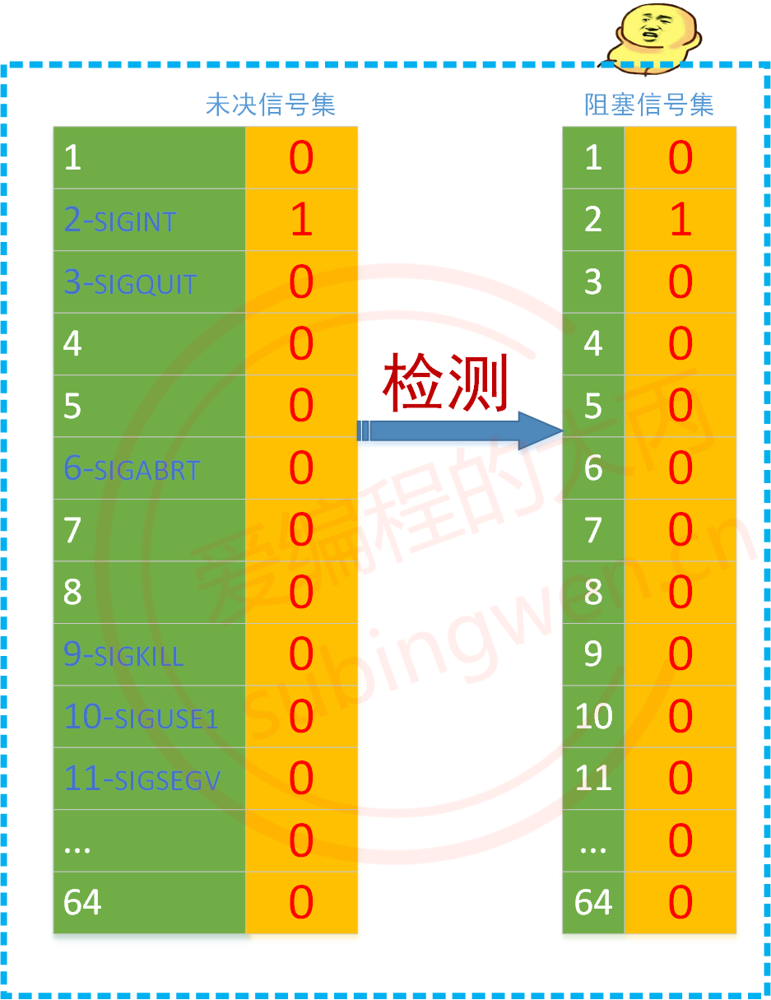
阻塞信号集和未决信号集在内核中的结构是相同的，它们都是一个整形数组(被封装过的), 一共 128 字节 （int [32] == 1024 bit），1024个标志位，其中前31个标志位，每一个都对应一个Linux中的标准信号，通过标志位的值来标记当前信号在信号集中的状态。
```bash
# 上图对信号集在内核中存储的状态的描述
# 前31个信号: 1-31 , 对应 1024个标志位的前31个标志位
			信号		标志位(从低地址位 到 高地址位)
		 	  1      ->  	0
			  2             1
			  3             2
			  4             3
			 31            30	
```
- 在阻塞信号集中，描述这个信号有没有被阻塞 默认情况下没有信号是被阻塞的, 因此信号对应的标志位的值为 0
- 如果某个信号被设置为了阻塞状态, 这个信号对应的标志位 被设置为 1
- 在未决信号集中, 描述信号是否处于未决状态 如果这个信号被阻塞了, 不能处理, 这个信号对应的标志位被设置为1
- 如果这个信号的阻塞被解除了, 未决信号集中的这个信号马上就被处理了, 这个信号对应的标志位值变为0
- 如果这个信号没有阻塞, 信号产生之后直接被处理, 因此不会在未决信号集中做任何记录
##### 3.2 信号集函数
因为用户是不能直接操作内核中的阻塞信号集和未决信号集的，必须要调用系统函数，关于阻塞信号集可以通过系统函数进行读写操作，未决信号集只能对其进行读操作。
先来看一下读/写阻塞信号集的函数：
```c
#include <signal.h>
// 使用这个函数修改内核中的阻塞信号集
// sigset_t 被封装之后得到的数据类型, 原型:int[32], 里边一共有1024给标志位, 每一个信号对应一个标志位
int sigprocmask(int how, const sigset_t *set, sigset_t *oldset);
```
- 参数: how: `SIG_BLOCK`: 将参数 set 集合中的数据追加到阻塞信号集中
- `SIG_UNBLOCK`: 将参数 set 集合中的信号在阻塞信号集中解除阻塞
- `SIG_SETMASK`: 使用参 set 结合中的数据覆盖内核的阻塞信号集数据
- oldset: 通过这个参数将设置之前的阻塞信号集数据传出，如果不需要可以指定为NULL
- 返回值：函数调用成功返回0，调用失败返回-1
sigprocmask() 函数有一个 sigset_t 类型的参数，对这种类型的数据进行初始化需要调用一些相关的操作函数：
```c
#include <signal.h>
// 如果在程序中读写 sigset_t 类型的变量
// 阻塞信号集和未决信号集都存储在 sigset_t 类型的变量中, 这个变量对应一块内存
// 阻塞信号集和未决信号集, 对应的内存中有1024bit = 128字节

// 将set集合中所有的标志位设置为0
int sigemptyset(sigset_t *set);
// 将set集合中所有的标志位设置为1
int sigfillset(sigset_t *set);
// 将set集合中某一个信号(signum)对应的标志位设置为1
int sigaddset(sigset_t *set, int signum);
// 将set集合中某一个信号(signum)对应的标志位设置为0
int sigdelset(sigset_t *set, int signum);
// 判断某个信号在集合中对应的标志位到底是0还是1, 如果是0返回0, 如果是1返回1
int sigismember(const sigset_t *set, int signum);
```
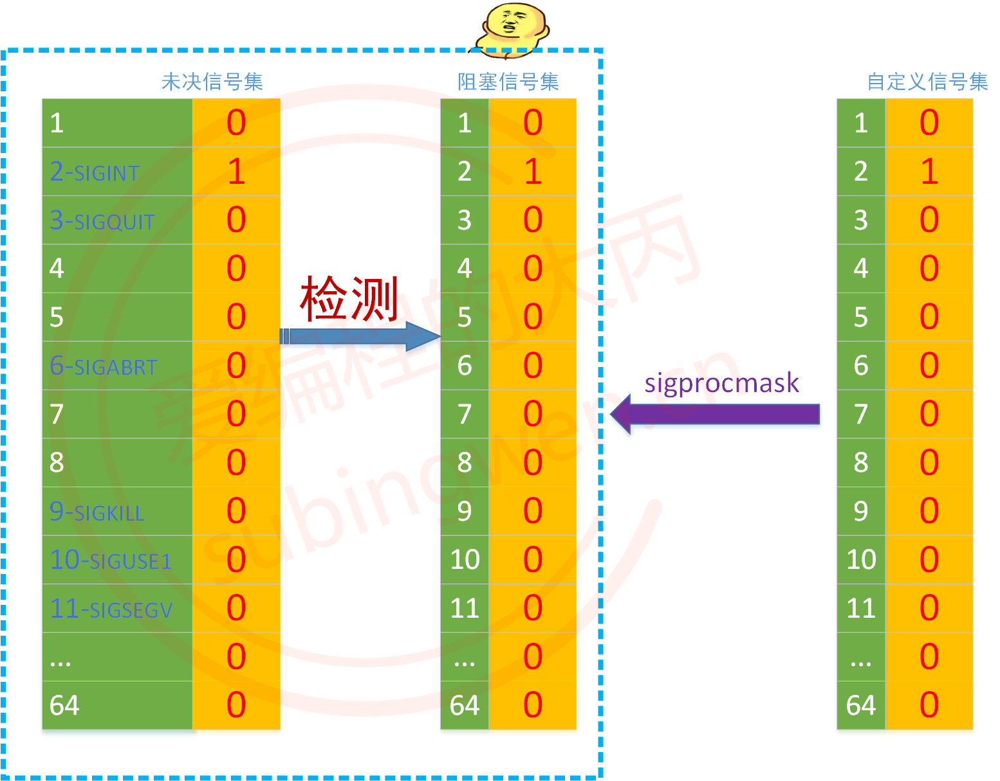
未决信号集不需要程序猿修改, 如果设置了某个信号阻塞, 当这个信号产生之后, 内核会将这个信号的未决状态记录到未决信号集中，当阻塞的信号被解除阻塞, 未决信号集中的信号随之被处理, 内核再次修改未决信号集将该信号的状态修改为递达状态（标志位置0）。因此，写未决信号集的动作都是内核做的，这是一个读未决信号集的操作函数：
```c
#include <signal.h>
// 这个函数的参数是传出参数, 传出的内核未决信号集的拷贝
// 读一下这个集合就指定哪个信号是未决状态
int sigpending(sigset_t *set);
```
下面举一个简单的例子，演示一下信号集操作函数的使用：
```text
需求: 
在阻塞信号集中设置某些信号阻塞, 通过一些操作产生这些信号, 然后读未决信号集, 最后再解除这些信号的阻塞
假设阻塞这些信号: 
  - 2号信号: SIGINT: ctrl+c
  - 3号信号: SIGQUIT: ctrl+\
  - 9号信号: SIGKILL: 通过shell命令给进程发送这个信号 kill -9 PID
```
```c
#include <stdio.h>
#include <stdlib.h>
#include <unistd.h>
#include <string.h>
#include <signal.h>

int main()
{
    // 1. 初始化信号集
    sigset_t myset;
    sigemptyset(&myset);
    // 设置阻塞的信号
    sigaddset(&myset, SIGINT);  // 2
    sigaddset(&myset, SIGQUIT); // 3
    sigaddset(&myset, SIGKILL); // 9 测试不能被阻塞

    // 2. 将初始化的信号集中的数据设置给内核
    sigset_t old;
    sigprocmask(SIG_BLOCK, &myset, &old);

    // 3. 让进程一直运行, 在当前进程中产生对应的信号
    int i = 0;
    while(1)
    {
        // 4. 读内核的未决信号集
        sigset_t curset;
        sigpending(&curset);
        // 遍历这个信号集
        for(int i=1; i<32; ++i)
        {
            int ret = sigismember(&curset, i);
            printf("%d", ret);
        }
        printf("\n");
        sleep(1);
        i++;
        if(i==10)
        {
            // 解除阻塞, 重新设置阻塞信号集
            //sigprocmask(SIG_UNBLOCK, &myset, NULL);
            sigprocmask(SIG_SETMASK, &old, NULL);
        }
    }
    return 0;
}
```
通过测试最终得到结论：程序中对 9 号信号的阻塞是无效的，因为它无法被阻塞。
最后通过一张图总结一下这些信号集操作函数之间的关系:
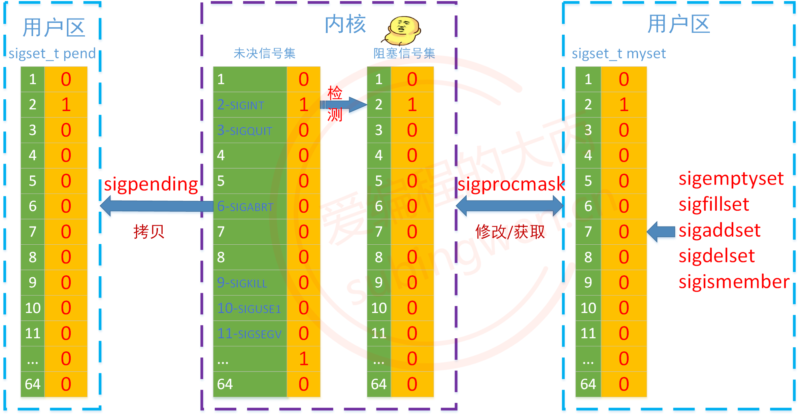
#### 4. 信号捕捉
Linux 中的每个信号产生之后都会有对应的默认处理行为，如果想要忽略这个信号或者修改某些信号的默认行为就需要在程序中捕捉该信号。程序中进行信号捕捉可以看做 是一个注册的动作，提前告诉应用程序信号产生之后做什么样的处理，当进程中对应的信号产生了，这个处理动作也就被调用了。
##### 4.1 signal
使用 signal() 函数可以捕捉进程中产生的信号，并且修改捕捉到的函数的行为，这个信号的自定义处理动作是一个回调函数，内核通过 signal() 得到这个回调函数的地址，在信号产生之后该函数会被内核调用。
```c
#include <signal.h>
// 在程序中什么时候产生信号, 程序猿是不知道的, 因此不能在信号产生之后再去处理
// 在信号产生之前, 提供一个注册函数, 用来捕捉信号
//	  - 假设在将来这个信号产生了, 就委托内核进行捕捉, 这个信号的默认动作就不能被执行
//	  - 执行什么样的处理动作 ==> 在signal函数中指定的处理动作
//	  - 如果这个信号不产生, 回调函数永远不会被调用
sighandler_t signal(int signum, sighandler_t handler);   
```
- 参数: signum: 需要捕捉的信号
```c
typedef void (*sighandler_t)(int);
```
- handler: 信号捕捉到之后的处理动作, 这是一个函数指针, 函数原型 c1 这个回调函数是需要程序猿写的, 但是程序猿不调用, 由内核调用，内核调用回调函数的时候, 会给它传递一个实参，这个实参的值就是捕捉的那个信号值。
下面的测试程序中使用 signal() 函数来捕捉定时器产生的信号 SIGALRM：
```c
#include <stdio.h>
#include <stdlib.h>
#include <unistd.h>
#include <string.h>
#include <sys/time.h>
#include <signal.h>

// 定时器信号的处理动作
void doing(int arg)
{
    printf("当前捕捉到的信号是: %d\n", arg);
    // 打印当前的时间
}

int main()
{
    // 注册要捕捉哪一个信号, 执行什么样的处理动作
    signal(SIGALRM, doing);
    // 1. 调用定时器函数设置定时器函数
    struct itimerval newact;
    // 3s之后发出第一个定时器信号, 之后每隔1s发出一个定时器信号
    newact.it_value.tv_sec = 3;
    newact.it_value.tv_usec = 0;
    newact.it_interval.tv_sec = 1;
    newact.it_interval.tv_usec = 0;
    // 这个函数也不是阻塞函数, 函数调用成功, 倒计时开始
    // 倒计时过程中程序是继续运行的
    setitimer(ITIMER_REAL, &newact, NULL);

    // 编写一个业务处理, 阻止当前进程自己结束, 让当前进程被发出的信号杀死
    while(1)
    {
        sleep(1000000);
    }

    return 0;
}
```
##### 4.2 sigaction
sigaction() 函数和 signal() 函数的功能是一样的，用于捕捉进程中产生的信号，并将用户自定义的信号行为函数（回调函数）注册给内核，内核在信号产生之后调用这个处理动作。 sigaction() 可以看做是 signal() 函数是加强版，函数参数更多更复杂，函数功能也更强一些。函数原型如下：
```c
#include <signal.h>
int sigaction(int signum, const struct sigaction *act, struct sigaction *oldact);
```
- 参数: signum: 要捕捉的信号
- act: 捕捉到信号之后的处理动作
- oldact: 上一次调用该函数进行信号捕捉设置的信号处理动作, 该参数一般指定为NULL
- 返回值：函数调用成功返回0，失败返回-1
该函数的参数是一个结构体类型，结构体原型如下：
```c
struct sigaction {
	void     (*sa_handler)(int);    // 指向一个函数(回调函数)
	void     (*sa_sigaction)(int, siginfo_t *, void *);
	sigset_t   sa_mask;             // 初始化为空即可, 处理函数执行期间不屏蔽任何信号
	int        sa_flags;	        // 0
	void     (*sa_restorer)(void);  //不用
};
```
结构体成员介绍：
- sa_handler: 函数指针，指向的函数就是捕捉到的信号的处理动作
- sa_sigaction: 函数指针，指向的函数就是捕捉到的信号的处理动作
- sa_mask: 在信号处理函数执行期间, 临时屏蔽某些信号, 将要屏蔽的信号设置到集合中即可 当前处理函数执行完毕, 临时屏蔽自动解除
- 假设在这个集合中不屏蔽任何信号, 默认也会屏蔽一个（捕捉的信号是谁, 就临时屏蔽谁）
- sa_flags：使用哪个函数指针指向的函数处理捕捉到的信号 `0`：使用 `sa_handler ` (一般情况下使用这个)
- `SA_SIGINFO`：使用 sa_sigaction (使用信号传递数据==进程间通信)
- sa_restorer: 被废弃的成员
示例代码，通过sigaction()捕捉阻塞信号集中解除阻塞的信号，如果捕捉多个信号，可以给不同的信号添加不同的处理动作，代码中的处理动作只有一个：
```c
#include <stdio.h>
#include <stdlib.h>
#include <unistd.h>
#include <string.h>
#include <signal.h>

// 信号的处理动作
void callback(int num)
{
    printf("当前捕捉的信号: %d\n", num);
}

int main()
{
    // 1. 初始化信号集
    sigset_t myset;
    sigemptyset(&myset);
    // 设置阻塞的信号
    sigaddset(&myset, SIGINT);  // 2
    sigaddset(&myset, SIGQUIT); // 3
    sigaddset(&myset, SIGKILL); // 9 测试不能被阻塞

    // 当阻塞的信号被解除阻塞, 该信号就可以被捕捉到了
    // 如果信号被捕捉到之后, 马上就被处理掉了 --> 递达状态
    struct sigaction act;
    act.sa_handler = callback;
    act.sa_flags = 0;
    sigemptyset(&act.sa_mask);
    sigaction(SIGINT, &act, NULL);
    // 和sigint的处理动作相同
    sigaction(SIGQUIT, &act, NULL);
    sigaction(SIGKILL, &act, NULL);

    // 2. 将初始化的信号集中的数据设置给内核
    sigset_t old;
    sigprocmask(SIG_BLOCK, &myset, &old);

    // 3. 让进程一直运行, 在当前进程中产生对应的信号
    int i = 0;
    while(1)
    {
        // 4. 读内核的未决信号集
        sigset_t curset;
        sigpending(&curset);
        // 遍历这个信号集
        for(int i=1; i<32; ++i)
        {
            int ret = sigismember(&curset, i);
            printf("%d", ret);
        }
        printf("\n");
        sleep(1);
        i++;
        if(i==10)
        {
            // 解除阻塞, 重新设置阻塞信号集
            //sigprocmask(SIG_UNBLOCK, &myset, NULL);
            sigprocmask(SIG_SETMASK, &old, NULL);
        }
    }
    return 0;
}
```
通过测试最终得到结论：程序中对 9 号信号的捕捉是无效的，因为它无法被捕捉。
#### 5. SIGCHLD 信号
当 子进程退出、暂停、从暂停回复运行的时候，在子进程中会产生一个SIGCHLD信号，并将其发送给父进程，但是父进程收到这个信号之后默认就忽略了。我们 可以在父进程中对这个信号加以利用，基于这个信号来回收子进程的资源，因此需要在父进程中捕捉子进程发送过来的这个信号。
下面是基于信号回收子进程资源的示例代码：
```c
#include <stdio.h>
#include <stdlib.h>
#include <unistd.h>
#include <string.h>
#include <sys/wait.h>
#include <signal.h>

// 回收子进程处理函数
void recycle(int num)
{
    printf("捕捉到的信号是: %d\n", num);
    // 子进程的资源回收, 非阻塞
    // SIGCHLD信号17号信号, 1-31号信号不支持排队
    // 如果这些信号同时产生多个, 最终处理的时候只处理一次
    // 假设多个子进程同时退出, 父进程同时收到了多个sigchld信号
    // 父进程只会处理一次这个信号, 因此当前函数被调用了一次, waitpid被调用一次
    // 相当于只回收了一个子进程, 但是是同时死了多个子进程, 因此就出现了僵尸进程
    // 解决方案: 循环回收即可
    while(1)
    {
        // 如果是阻塞回收, 就回不到另外一个处理逻辑上去了
        pid_t pid = waitpid(-1, NULL, WNOHANG);
        if(pid > 0)
        {
            printf("child died, pid = %d\n", pid);
        }
        else if(pid == 0)
        {
            // 没有死亡的子进程, 直接退出当前循环
            break;
        }
        else if(pid == -1)
        {
            printf("所有子进程都回收完毕了, 拜拜...\n");
            break;
        }
    }
}

int main()
{
    // 设置sigchld信号阻塞
    sigset_t myset;
    sigemptyset(&myset);
    sigaddset(&myset, SIGCHLD);
    sigprocmask(SIG_BLOCK, &myset, NULL);

    // 循环创建多个子进程 - 20
    pid_t pid;
    for(int i=0; i<20; ++i)
    {
        pid = fork();
        if(pid == 0)
        {
            break;
        }
    }

    if(pid == 0)
    {
        printf("我是子进程, pid = %d\n", getpid());
    }
    else if(pid > 0)
    {
        printf("我是父进程, pid = %d\n", getpid());
        // 注册信号捕捉, 捕捉sigchld
        struct sigaction act;
        act.sa_flags  =0;
        act.sa_handler = recycle;
        sigemptyset(&act.sa_mask);
        // 注册信号捕捉, 委托内核处理将来产生的信号
        // 当信号产生之后, 当前进程优先处理信号, 之前的处理动作会暂停
        // 信号处理完毕之后, 回到原来的暂停的位置继续运行
        sigaction(SIGCHLD, &act, NULL);

        // 解除sigcld信号的阻塞
        // 信号被阻塞之后,就捕捉不到了, 解除阻塞之后才能捕捉到这个信号
        sigprocmask(SIG_UNBLOCK, &myset, NULL);

        // 父进程执行其他业务逻辑就可以了
        // 默认父进程执行这个while循环, 但是信号产生了, 这个执行逻辑或强迫暂停
        // 	父进程去处理信号的处理函数
        while(1)
        {
            sleep(100);
        }
    }
    return 0;
}
```

### 3.6 守护进程

> 原文：[《守护进程》](https://subingwen.cn/linux/deamon/)　作者：苏丙榅　来源：爱编程的大丙

守护进程（Daemon Process），也就是通常说的 Daemon 进程（精灵进程），是 Linux 中的后台服务进程。它是一个生存期较长的进程，通常独立于控制终端并且周期性地执行某种任务或等待处理某些发生的事件。一般采用以d结尾的名字。
#### 1. 进程组
多个进程的集合就是进程组, 这个组中必须有一个组长, 组长就是进程组中的第一个进程，组长以外的都是普通的成员，每个进程组都有一个唯一的组ID，进程组的ID和组长的PID是一样的。
进程组中的成员是可以转移的，如果当前进程组中的成员被转移到了其他的组，或者进制中的所有进程都退出了，那么这个进程组也就不存在了。如果进程组中组长死了, 但是当前进程组中有其他进程，这个进程组还是继续存在的。下面介绍几个常用的进程组函数：
> 得到当前进程所在的进程组的组ID
```c
pid_t getpgrp(void);
```
> 获取指定的进程所在的进程组的组ID，参数 pid 就是指定的进程
```c
pid_t getpgid(pid_t pid);
```
> 将某个进程移动到其他进程组中或者创建新的进程组
```c
int setpgid(pid_t pid, pid_t pgid);
```
- 参数: pid: 某个进程的进程ID
- pgid: 某个进程组的组ID 如果pgid对应的进程组存在，pid对应的进程会移动到这个组中, pid != pgid
- 如果pgid对应的进程组不存在，会创建一个新的进程组, 因此要求 pid == pgid, 当前进程就是组长了
- 返回值：函数调用成功返回0，失败返回-1
#### 2. 会话
会话(session)是由一个或多个进程组组成的，一个会话可以对应一个控制终端, 也可以没有。一个普通的进程可以调用 `setsid()` 函数使自己成为新 session 的领头进程（会长），并且这个 session 领头进程还会被放入到一个新的进程组中。先来看一下`setsid()`函数的原型:
```c
#include <unistd.h>

// 获取某个进程所属的会话ID
pid_t getsid(pid_t pid);

// 将某个进程变成会话 =>> 得到一个守护进程
// 使用哪个进程调用这个函数, 这个进程就会变成一个会话
pid_t setsid(void);
```
使用这个函数的注意事项:
1. 调用这个函数的进程不能是组长进程, 如果是该函数调用失败，如果保证这个函数能调用成功呢? 先fork()创建子进程, 终止父进程, 让子进程调用这个函数
1. 如果调用这个函数的进程不是进程组长, 会话创建成功 这个进程会变成当前会话中的第一个进程，同时也会变成新的进程组的组长
- 该函数调用成功之后, 当前进程就脱离了控制终端，因此不会阻塞终端
#### 3. 创建守护进程
如果要创建一个守护进程，标准步骤如下，部分操作可以根据实际需求进行取舍：
1. 创建子进程, 让父进程退出 因为父进程有可能是组长进程，不符合条件，也没有什么利用价值，退出即可
- 子进程没有任何职务, 目的是让子进程最终变成一个会话, 最终就会得到守护进程
1. 通过子进程创建新的会话，调用函数 setsid()，脱离控制终端, 变成守护进程
1. 改变当前进程的工作目录 (可选项, 不是必须要做的) 某些文件系统可以被卸载, 比如: U盘, 移动硬盘，进程如果在这些目录中运行，运行期间这些设备被卸载了，运行的进程也就不能正常工作了。
```c
int chdir(const char *path);
```
- 修改当前进程的工作目录需要调用函数 `chdir()`
1. 重新设置文件的掩码 (可选项, 不是必须要做的) 掩码: umask, 在创建新文件的时候需要和这个掩码进行运算, 去掉文件的某些权限
```c
mode_t umask(mode_t mask);
```
- 设置掩码需要使用函数 `umask()`
1. 关闭/重定向文件描述符 (不做也可以, 但是建议做一下) 启动一个进程, 文件描述符表中默认有三个被打开了, 对应的都是当前的终端文件
```c
close(STDIN_FILENO);
close(STDOUT_FILENO);
close(STDERR_FILENO);
```
- 因为进程通过调用 setsid() 已经脱离了当前终端, 因此关联的文件描述符也就没用了, 可以关闭
```c
int fd = open("/dev/null", O_RDWR);
// 重定向之后, 这三个文件描述符就和当前终端没有任何关系了
dup2(fd, STDIN_FILENO);
dup2(fd, STDOUT_FILENO);
dup2(fd, STDERR_FILENO);
```
- 重定向文件描述符(和关闭二选一): 改变文件描述符关联的默认文件, 让他们指向一个特殊的文件`/dev/null`，只要把数据扔到这个特殊的设备文件中, 数据被被销毁了
1. 根据实际需求在守护进程中执行某些特定的操作
#### 4. 守护进程的应用
写一个守护进程, 每隔2s获取一次系统时间, 并将得到的时间写入到磁盘文件中。
```c
#include <stdio.h>
#include <stdlib.h>
#include <unistd.h>
#include <string.h>
#include <sys/stat.h>
#include <fcntl.h>
#include <signal.h>
#include <sys/time.h>
#include <time.h>

// 信号的处理动作
void writeFile(int num)
{
    // 得到系统时间
    time_t seconds = time(NULL);
    // 时间转换, 总秒数 -> 可以识别的时间字符串
    struct tm* loc = localtime(&seconds);
    // sprintf();
    char* curtime = asctime(loc); // 自带换行
    // 打开一个文件, 如果文件不存在, 就创建, 文件需要有追加属性
    // ./对应的是哪个目录? /home/robin
    // 0664 & ~022
    int fd = open("./time+++++++.log", O_WRONLY|O_CREAT|O_APPEND, 0664);
    write(fd, curtime, strlen(curtime));
    close(fd);
}

int main()
{
    // 1. 创建子进程, 杀死父进程
    pid_t pid = fork();
    if(pid > 0)
    {
        // 父进程
        exit(0); // kill(getpid(), 9); raise(9); abort();
    }

    // 2. 子进程, 将其变成会话, 脱离当前终端
    setsid();

    // 3. 修改进程的工作目录, 修改到一个不能被修改和删除的目录中 /home/robin
    chdir("/home/robin");

    // 4. 设置掩码, 在进程中创建文件的时候这个掩码就起作用了
    umask(022);

    // 5. 重定向和终端关联的文件描述符 -> /dev/null
    int fd = open("/dev/null", O_RDWR);
    dup2(fd, STDIN_FILENO);
    dup2(fd, STDOUT_FILENO);
    dup2(fd, STDERR_FILENO);

    // 5. 委托内核捕捉并处理将来发生的信号-SIGALRM(14)
    struct sigaction act;
    act.sa_flags = 0;
    act.sa_handler = writeFile;
    sigemptyset(&act.sa_mask);
    sigaction(SIGALRM, &act, NULL);

    // 6. 设置定时器
    struct itimerval val;
    val.it_value.tv_sec = 2;
    val.it_value.tv_usec = 0;
    val.it_interval.tv_sec = 2;
    val.it_interval.tv_usec = 0;
    setitimer(ITIMER_REAL, &val, NULL);

    while(1)
    {
        sleep(100);
    }

    return 0;
}
```

### 3.7 多线程

> 原文：[《线程》](https://subingwen.cn/linux/thread/)　作者：苏丙榅　来源：爱编程的大丙

#### 1. 线程概述
线程是轻量级的进程（LWP：light weight process），在Linux环境下线程的本质仍是进程。在计算机上运行的程序是一组指令及指令参数的组合，指令按照既定的逻辑控制计算机运行。操作系统会以进程为单位，分配系统资源，可以这样理解，`进程是资源分配的最小单位，线程是操作系统调度执行的最小单位。`
先从概念上了解一下线程和进程之间的区别：
- 进程有自己独立的地址空间, 多个线程共用同一个地址空间 线程更加节省系统资源, 效率不仅可以保持的, 而且能够更高
- 在一个地址空间中多个线程独享: 每个线程都有属于自己的栈区, 寄存器(内核中管理的)
- 在一个地址空间中多个线程共享: 代码段, 堆区, 全局数据区, 打开的文件(文件描述符表)都是线程共享的
- 线程是程序的最小执行单位, 进程是操作系统中最小的资源分配单位 每个进程对应一个虚拟地址空间，一个进程只能抢一个CPU时间片
- 一个地址空间中可以划分出多个线程, 在有效的资源基础上, 能够抢更多的CPU时间片
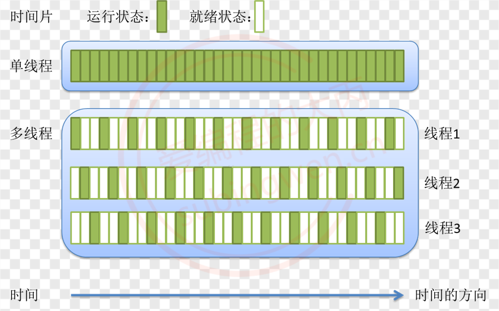
- CPU的调度和切换: 线程的上下文切换比进程要快的多 上下文切换：进程/线程分时复用CPU时间片，在切换之前会将上一个任务的状态进行保存, 下次切换回这个任务的时候, 加载这个状态继续运行，`任务从保存到再次加载这个过程就是一次上下文切换`。
- 线程更加廉价, 启动速度更快, 退出也快, 对系统资源的冲击小。
在处理多任务程序的时候使用多线程比使用多进程要更有优势，但是线程并不是越多越好，如何控制线程的个数呢？
1. 文件IO操作：文件IO对CPU是使用率不高, 因此可以分时复用CPU时间片, 线程的个数 = 2 * CPU核心数 (效率最高)
1. 处理复杂的算法(主要是CPU进行运算, 压力大)，线程的个数 = CPU的核心数 (效率最高)
#### 2. 创建线程
##### 2.1 线程函数
每一个线程都有一个唯一的线程ID，ID类型为`pthread_t`，这个ID是一个无符号长整形数，如果想要得到当前线程的线程ID，可以调用如下函数：
```c
pthread_t pthread_self(void);	// 返回当前线程的线程ID
```
在一个进程中调用线程创建函数，就可得到一个子线程，和进程不同，需要给每一个创建出的线程指定一个处理函数，否则这个线程无法工作。
```c
#include <pthread.h>
int pthread_create(pthread_t *thread, const pthread_attr_t *attr,
                   void *(*start_routine) (void *), void *arg);
// Compile and link with -pthread, 线程库的名字叫pthread, 全名: libpthread.so libptread.a
```
- 参数: thread: 传出参数，是无符号长整形数，线程创建成功, 会将线程ID写入到这个指针指向的内存中
- attr: 线程的属性, 一般情况下使用默认属性即可, 写NULL
- start_routine: 函数指针，创建出的子线程的处理动作，也就是该函数在子线程中执行。
- arg: 作为实参传递到 start_routine 指针指向的函数内部
- 返回值：线程创建成功返回0，创建失败返回对应的错误号
##### 2.2 创建线程
下面是创建线程的示例代码，在创建过程中一定要保证编写的线程函数与规定的函数指针类型一致：`void *(*start_routine) (void *)`:
```c
// pthread_create.c 
#include <stdio.h>
#include <stdlib.h>
#include <unistd.h>
#include <string.h>
#include <pthread.h>

// 子线程的处理代码
void* working(void* arg)
{
    printf("我是子线程, 线程ID: %ld\n", pthread_self());
    for(int i=0; i<9; ++i)
    {
        printf("child == i: = %d\n", i);
    }
    return NULL;
}

int main()
{
    // 1. 创建一个子线程
    pthread_t tid;
    pthread_create(&tid, NULL, working, NULL);

    printf("子线程创建成功, 线程ID: %ld\n", tid);
    // 2. 子线程不会执行下边的代码, 主线程执行
    printf("我是主线程, 线程ID: %ld\n", pthread_self());
    for(int i=0; i<3; ++i)
    {
        printf("i = %d\n", i);
    }
    
    // 休息, 休息一会儿...
    // sleep(1);
    
    return 0;
}
```
编译测试程序，会看到如下错误信息：
```bash
$ gcc pthread_create.c 
/tmp/cctkubA6.o: In function `main':
pthread_create.c:(.text+0x7f): undefined reference to `pthread_create'
collect2: error: ld returned 1 exit status
```
`错误原因是因为编译器链接不到线程库文件（动态库），需要在编译的时候通过参数指定出来`，动态库名为 `libpthread.so`需要使用的参数为 `-l`，根据规则掐头去尾最终形态应该写成：`-lpthread（参数和参数值中间可以有空格）`。正确的编译命令为：
```bash
# pthread_create 函数的定义在某一个库中, 编译的时候需要加库名 pthread
$ gcc pthread_create.c -lpthread
$ ./a.out 
子线程创建成功, 线程ID: 139712560109312
我是主线程, 线程ID: 139712568477440
i = 0
i = 1
i = 2
```
在打印的日志输出中为什么子线程处理函数没有执行完毕呢（只看到了子线程的部分日志输出）？ 主线程一直在运行, 执行期间创建出了子线程，说明主线程有CPU时间片, 在这个时间片内将代码执行完毕了, 主线程就退出了。`子线程被创建出来之后需要抢cpu时间片, 抢不到就不能运行，如果主线程退出了, 虚拟地址空间就被释放了, 子线程就一并被销毁了。但是如果某一个子线程退出了, 主线程仍在运行, 虚拟地址空间依旧存在。`
得到的结论：在没有人为干预的情况下，虚拟地址空间的生命周期和主线程是一样的，与子线程无关。
目前的解决方案: 让子线程执行完毕, 主线程再退出, 可以在主线程中添加挂起函数 `sleep();`
#### 3. 线程退出
在编写多线程程序的时候，如果想要让线程退出，但是不会导致虚拟地址空间的释放（针对于主线程），我们就可以调用线程库中的线程退出函数，`只要调用该函数当前线程就马上退出了，并且不会影响到其他线程的正常运行，不管是在子线程或者主线程中都可以使用。`
```c
#include <pthread.h>
void pthread_exit(void *retval);
```
- 参数: 线程退出的时候携带的数据，当前子线程的主线程会得到该数据。如果不需要使用，指定为NULL
> 下面是线程退出的示例代码，可以在任意线程的需要的位置调用该函数：
```c
#include <stdio.h>
#include <stdlib.h>
#include <unistd.h>
#include <string.h>
#include <pthread.h>

// 子线程的处理代码
void* working(void* arg)
{
    sleep(1);
    printf("我是子线程, 线程ID: %ld\n", pthread_self());
    for(int i=0; i<9; ++i)
    {
        if(i==6)
        {
            pthread_exit(NULL);	// 直接退出子线程
        } 
        printf("child == i: = %d\n", i);
    }
    return NULL;
}

int main()
{
    // 1. 创建一个子线程
    pthread_t tid;
    pthread_create(&tid, NULL, working, NULL);

    printf("子线程创建成功, 线程ID: %ld\n", tid);
    // 2. 子线程不会执行下边的代码, 主线程执行
    printf("我是主线程, 线程ID: %ld\n", pthread_self());
    for(int i=0; i<3; ++i)
    {
        printf("i = %d\n", i);
    }

    // 主线程调用退出函数退出, 地址空间不会被释放
    pthread_exit(NULL);
    
    return 0;
}
```
#### 4. 线程回收
##### 4.1 线程函数
线程和进程一样，子线程退出的时候其内核资源主要由主线程回收，线程库中提供的线程回收函叫做`pthread_join()`，这个函数是一个阻塞函数，`如果还有子线程在运行，调用该函数就会阻塞，子线程退出函数解除阻塞进行资源的回收，函数被调用一次，只能回收一个子线程，如果有多个子线程则需要循环进行回收。`
另外通过线程回收函数还可以获取到子线程退出时传递出来的数据，函数原型如下：
```c
#include <pthread.h>
// 这是一个阻塞函数, 子线程在运行这个函数就阻塞
// 子线程退出, 函数解除阻塞, 回收对应的子线程资源, 类似于回收进程使用的函数 wait()
int pthread_join(pthread_t thread, void **retval);
```
- 参数: thread: 要被回收的子线程的线程ID
- retval: 二级指针, 指向一级指针的地址, 是一个传出参数, 这个地址中存储了pthread_exit() 传递出的数据，如果不需要这个参数，可以指定为NULL
- 返回值：线程回收成功返回0，回收失败返回错误号。
##### 4.2 回收子线程数据
在子线程退出的时候可以使用`pthread_exit()`的参数将数据传出，在回收这个子线程的时候可以通过`phread_join()`的第二个参数来接收子线程传递出的数据。接收数据有很多种处理方式，下面来列举几种：
###### 4.2.1 使用子线程栈
通过函数`pthread_exit(void *retval);`可以得知，子线程退出的时候，需要将数据记录到一块内存中，通过参数传出的是存储数据的内存的地址，而不是具体数据，由因为参数是`void*`类型，所有这个万能指针可以指向任意类型的内存地址。先来看第一种方式，将子线程退出数据保存在子线程自己的栈区：
```c
// pthread_join.c
#include <stdio.h>
#include <stdlib.h>
#include <unistd.h>
#include <string.h>
#include <pthread.h>

// 定义结构
struct Persion
{
    int id;
    char name[36];
    int age;
};

// 子线程的处理代码
void* working(void* arg)
{
    printf("我是子线程, 线程ID: %ld\n", pthread_self());
    for(int i=0; i<9; ++i)
    {
        printf("child == i: = %d\n", i);
        if(i == 6)
        {
            struct Persion p;
            p.age  =12;
            strcpy(p.name, "tom");
            p.id = 100;
            // 该函数的参数将这个地址传递给了主线程的pthread_join()
            pthread_exit(&p);
        }
    }
    return NULL;	// 代码执行不到这个位置就退出了
}

int main()
{
    // 1. 创建一个子线程
    pthread_t tid;
    pthread_create(&tid, NULL, working, NULL);

    printf("子线程创建成功, 线程ID: %ld\n", tid);
    // 2. 子线程不会执行下边的代码, 主线程执行
    printf("我是主线程, 线程ID: %ld\n", pthread_self());
    for(int i=0; i<3; ++i)
    {
        printf("i = %d\n", i);
    }

    // 阻塞等待子线程退出
    void* ptr = NULL;
    // ptr是一个传出参数, 在函数内部让这个指针指向一块有效内存
    // 这个内存地址就是pthread_exit() 参数指向的内存
    pthread_join(tid, &ptr);
    // 打印信息
    struct Persion* pp = (struct Persion*)ptr;
    printf("子线程返回数据: name: %s, age: %d, id: %d\n", pp->name, pp->age, pp->id);
    printf("子线程资源被成功回收...\n");
    
    return 0;
}
```
编译并执行测试程序:
```bash
# 编译代码
$ gcc pthread_join.c -lpthread
# 执行程序
$ ./a.out 
子线程创建成功, 线程ID: 140652794640128
我是主线程, 线程ID: 140652803008256
i = 0
i = 1
i = 2
我是子线程, 线程ID: 140652794640128
child == i: = 0
child == i: = 1
child == i: = 2
child == i: = 3
child == i: = 4
child == i: = 5
child == i: = 6
子线程返回数据: name: , age: 0, id: 0
子线程资源被成功回收...
```
通过打印的日志可以发现，在主线程中没有没有得到子线程返回的数据信息，具体原因是这样的：
`如果多个线程共用同一个虚拟地址空间，每个线程在栈区都有一块属于自己的内存，相当于栈区被这几个线程平分了，当线程退出，线程在栈区的内存也就被回收了，因此随着子线程的退出，写入到栈区的数据也就被释放了。`
###### 4.2.2 使用全局变量
位于同一虚拟地址空间中的线程，虽然`不能共享栈区数据，但是可以共享全局数据区和堆区数据`，因此在子线程退出的时候可以将传出数据存储到全局变量、静态变量或者堆内存中。在下面的例子中将数据存储到了全局变量中：
```c
#include <stdio.h>
#include <stdlib.h>
#include <unistd.h>
#include <string.h>
#include <pthread.h>

// 定义结构
struct Persion
{
    int id;
    char name[36];
    int age;
};

struct Persion p;	// 定义全局变量

// 子线程的处理代码
void* working(void* arg)
{
    printf("我是子线程, 线程ID: %ld\n", pthread_self());
    for(int i=0; i<9; ++i)
    {
        printf("child == i: = %d\n", i);
        if(i == 6)
        {
            // 使用全局变量
            p.age  =12;
            strcpy(p.name, "tom");
            p.id = 100;
            // 该函数的参数将这个地址传递给了主线程的pthread_join()
            pthread_exit(&p);
        }
    }
    return NULL;
}

int main()
{
    // 1. 创建一个子线程
    pthread_t tid;
    pthread_create(&tid, NULL, working, NULL);

    printf("子线程创建成功, 线程ID: %ld\n", tid);
    // 2. 子线程不会执行下边的代码, 主线程执行
    printf("我是主线程, 线程ID: %ld\n", pthread_self());
    for(int i=0; i<3; ++i)
    {
        printf("i = %d\n", i);
    }

    // 阻塞等待子线程退出
    void* ptr = NULL;
    // ptr是一个传出参数, 在函数内部让这个指针指向一块有效内存
    // 这个内存地址就是pthread_exit() 参数指向的内存
    pthread_join(tid, &ptr);
    // 打印信息
    struct Persion* pp = (struct Persion*)ptr;
    printf("name: %s, age: %d, id: %d\n", pp->name, pp->age, pp->id);
    printf("子线程资源被成功回收...\n");
    
    return 0;
}
```
###### 4.2.3 使用主线程栈
虽然每个线程都有属于自己的栈区空间，但是`位于同一个地址空间的多个线程是可以相互访问对方的栈空间上的数据的`。由于很多情况下还需要在主线程中回收子线程资源，所以主线程一般都是最后退出，基于这个原因在下面的程序中将子线程返回的数据保存到了主线程的栈区内存中：
```c
#include <stdio.h>
#include <stdlib.h>
#include <unistd.h>
#include <string.h>
#include <pthread.h>

// 定义结构
struct Persion
{
    int id;
    char name[36];
    int age;
};

// 子线程的处理代码
void* working(void* arg)
{
    struct Persion* p = (struct Persion*)arg;
    printf("我是子线程, 线程ID: %ld\n", pthread_self());
    for(int i=0; i<9; ++i)
    {
        printf("child == i: = %d\n", i);
        if(i == 6)
        {
            // 使用主线程的栈内存
            p->age  =12;
            strcpy(p->name, "tom");
            p->id = 100;
            // 该函数的参数将这个地址传递给了主线程的pthread_join()
            pthread_exit(p);
        }
    }
    return NULL;
}

int main()
{
    // 1. 创建一个子线程
    pthread_t tid;

    struct Persion p;
    // 主线程的栈内存传递给子线程
    pthread_create(&tid, NULL, working, &p);

    printf("子线程创建成功, 线程ID: %ld\n", tid);
    // 2. 子线程不会执行下边的代码, 主线程执行
    printf("我是主线程, 线程ID: %ld\n", pthread_self());
    for(int i=0; i<3; ++i)
    {
        printf("i = %d\n", i);
    }

    // 阻塞等待子线程退出
    void* ptr = NULL;
    // ptr是一个传出参数, 在函数内部让这个指针指向一块有效内存
    // 这个内存地址就是pthread_exit() 参数指向的内存
    pthread_join(tid, &ptr);
    // 打印信息
    printf("name: %s, age: %d, id: %d\n", p.name, p.age, p.id);
    printf("子线程资源被成功回收...\n");
    
    return 0;
}
```
在上面的程序中，调用`pthread_create()`创建子线程，并将主线程中栈空间变量`p`的地址传递到了子线程中，在子线程中将要传递出的数据写入到了这块内存中。也就是说在程序的`main()`函数中，通过指针变量`ptr`或者通过结构体变量`p`都可以读出子线程传出的数据。
#### 5. 线程分离
在某些情况下，程序中的主线程有属于自己的业务处理流程，如果让主线程负责子线程的资源回收，调用`pthread_join()`只要子线程不退出主线程就会一直被阻塞，主要线程的任务也就不能被执行了。
在线程库函数中为我们提供了线程分离函数`pthread_detach()`，调用这个函数之后指定的`子线程就可以和主线程分离，当子线程退出的时候，其占用的内核资源就被系统的其他进程接管并回收了`。线程分离之后在主线程中使用`pthread_join()`就回收不到子线程资源了。
```c
#include <pthread.h>
// 参数就子线程的线程ID, 主线程就可以和这个子线程分离了
int pthread_detach(pthread_t thread);
```
下面的代码中，在主线程中创建子线程，并调用线程分离函数，实现了主线程和子线程的分离：
```c
#include <stdio.h>
#include <stdlib.h>
#include <unistd.h>
#include <string.h>
#include <pthread.h>

// 子线程的处理代码
void* working(void* arg)
{
    printf("我是子线程, 线程ID: %ld\n", pthread_self());
    for(int i=0; i<9; ++i)
    {
        printf("child == i: = %d\n", i);
    }
    return NULL;
}

int main()
{
    // 1. 创建一个子线程
    pthread_t tid;
    pthread_create(&tid, NULL, working, NULL);

    printf("子线程创建成功, 线程ID: %ld\n", tid);
    // 2. 子线程不会执行下边的代码, 主线程执行
    printf("我是主线程, 线程ID: %ld\n", pthread_self());
    for(int i=0; i<3; ++i)
    {
        printf("i = %d\n", i);
    }

    // 设置子线程和主线程分离
    pthread_detach(tid);

    // 让主线程自己退出即可
    pthread_exit(NULL);
    
    return 0;
}
```
#### 6. 其他线程函数
##### 6.1 线程取消
线程取消的意思就是在某些特定情况下在一个线程中杀死另一个线程。使用这个函数杀死一个线程需要分两步：
1. 在线程A中调用线程取消函数`pthread_cancel`，指定杀死线程B，这时候线程B是死不了的
1. 在线程B中进程一次系统调用（从用户区切换到内核区），否则线程B可以一直运行。
这其实和`七步断肠散`、`含笑半步癫`的功效是一样的，吃了毒药不动或者不笑也没啥事儿[](assets/linux-course/remote-989cf6b7bf14-015CBAA8.png)
```c
#include <pthread.h>
// 参数是子线程的线程ID
int pthread_cancel(pthread_t thread);
```
- 参数：要杀死的线程的线程ID
- 返回值：函数调用成功返回0，调用失败返回非0错误号。
在下面的示例代码中，主线程调用线程取消函数，只要在子线程中进行了系统调用，当子线程执行到这个位置就挂掉了。
```c
#include <stdio.h>
#include <stdlib.h>
#include <unistd.h>
#include <string.h>
#include <pthread.h>

// 子线程的处理代码
void* working(void* arg)
{
    int j=0;
    for(int i=0; i<9; ++i)
    {
        j++;
    }
    // 这个函数会调用系统函数, 因此这是个间接的系统调用
    printf("我是子线程, 线程ID: %ld\n", pthread_self());
    for(int i=0; i<9; ++i)
    {
        printf(" child i: %d\n", i);
    }

    return NULL;
}

int main()
{
    // 1. 创建一个子线程
    pthread_t tid;
    pthread_create(&tid, NULL, working, NULL);

    printf("子线程创建成功, 线程ID: %ld\n", tid);
    // 2. 子线程不会执行下边的代码, 主线程执行
    printf("我是主线程, 线程ID: %ld\n", pthread_self());
    for(int i=0; i<3; ++i)
    {
        printf("i = %d\n", i);
    }

    // 杀死子线程, 如果子线程中做系统调用, 子线程就结束了
    pthread_cancel(tid);

    // 让主线程自己退出即可
    pthread_exit(NULL);
    
    return 0;
}
```
关于系统调用有两种方式：
1. 直接调用Linux系统函数
1. 调用标准C库函数，为了实现某些功能，在Linux平台下标准C库函数会调用相关的系统函数
##### 6.2 线程ID比较
在Linux中线程ID本质就是一个无符号长整形，因此可以直接使用比较操作符比较两个线程的ID，但是线程库是可以跨平台使用的，在某些平台上 `pthread_t`可能不是一个单纯的整形，这中情况下比较两个线程的ID必须要使用比较函数，函数原型如下：
```c
#include <pthread.h>
int pthread_equal(pthread_t t1, pthread_t t2);
```
- 参数：t1 和 t2 是要比较的线程的线程ID
- 返回值：如果两个线程ID相等返回非0值，如果不相等返回0
#### 7. C++线程类
以上线程函数也可以用于C++编程，但是C++11中提供了线程类，感兴趣的可以看一下，链接奉上。

### 3.8 线程同步

> 原文：[《线程同步》](https://subingwen.cn/linux/thread-sync/)　作者：苏丙榅　来源：爱编程的大丙

#### 1. 线程同步概念
假设有4个线程A、B、C、D，当前一个线程A对内存中的`共享资源`进 行访问的时候，其他线程B, C, D都不可以对这块内存进行操作，直到线程A对这块内存访问完毕为止，B，C，D中的一个才能访问这块内存，剩余的两个需要继续阻塞等待，以此类推，直至所 有的线程都对这块内存操作完毕。 线程对内存的这种访问方式就称之为线程同步，通过对概念的介绍，我们可以了解到`所谓的同步并不是多个线程同时对内存进行访问，而是按照先后顺序依次进行的。`
##### 1.1 为什么要同步
> 在研究线程同步之前，先来看一个两个线程交替数数（每个线程数50个数，交替数到100）的例子：
```c
#include <stdio.h>
#include <unistd.h>
#include <stdlib.h>
#include <sys/types.h>
#include <sys/stat.h>
#include <string.h>
#include <pthread.h>

#define MAX 50
// 全局变量
int number;

// 线程处理函数
void* funcA_num(void* arg)
{
    for(int i=0; i<MAX; ++i)
    {
        int cur = number;
        cur++;
        usleep(10);
        number = cur;
        printf("Thread A, id = %lu, number = %d\n", pthread_self(), number);
    }

    return NULL;
}

void* funcB_num(void* arg)
{
    for(int i=0; i<MAX; ++i)
    {
        int cur = number;
        cur++;
        number = cur;
        printf("Thread B, id = %lu, number = %d\n", pthread_self(), number);
        usleep(5);
    }

    return NULL;
}

int main(int argc, const char* argv[])
{
    pthread_t p1, p2;

    // 创建两个子线程
    pthread_create(&p1, NULL, funcA_num, NULL);
    pthread_create(&p2, NULL, funcB_num, NULL);

    // 阻塞，资源回收
    pthread_join(p1, NULL);
    pthread_join(p2, NULL);

    return 0;
}
```
编译并执行上面的测试程序，得到如下结果：
```c++
$ ./a.out 
Thread B, id = 140504473724672, number = 1
Thread B, id = 140504473724672, number = 2
Thread A, id = 140504482117376, number = 2
Thread B, id = 140504473724672, number = 3
Thread A, id = 140504482117376, number = 4
Thread B, id = 140504473724672, number = 5
Thread A, id = 140504482117376, number = 6
Thread B, id = 140504473724672, number = 7
Thread B, id = 140504473724672, number = 8
Thread A, id = 140504482117376, number = 7
Thread B, id = 140504473724672, number = 8
Thread B, id = 140504473724672, number = 9
Thread A, id = 140504482117376, number = 8
Thread B, id = 140504473724672, number = 9
Thread A, id = 140504482117376, number = 9
Thread B, id = 140504473724672, number = 10
Thread B, id = 140504473724672, number = 11
Thread A, id = 140504482117376, number = 10
Thread B, id = 140504473724672, number = 11
Thread A, id = 140504482117376, number = 11
Thread B, id = 140504473724672, number = 12
Thread A, id = 140504482117376, number = 13
Thread B, id = 140504473724672, number = 14
Thread A, id = 140504482117376, number = 15
Thread B, id = 140504473724672, number = 16
Thread B, id = 140504473724672, number = 17
Thread B, id = 140504473724672, number = 18
Thread B, id = 140504473724672, number = 19
Thread A, id = 140504482117376, number = 17
Thread B, id = 140504473724672, number = 18
Thread B, id = 140504473724672, number = 19
Thread A, id = 140504482117376, number = 19
Thread B, id = 140504473724672, number = 20
Thread A, id = 140504482117376, number = 20
Thread B, id = 140504473724672, number = 21
Thread A, id = 140504482117376, number = 21
Thread B, id = 140504473724672, number = 22
Thread A, id = 140504482117376, number = 22
Thread B, id = 140504473724672, number = 23
Thread A, id = 140504482117376, number = 23
Thread B, id = 140504473724672, number = 24
Thread A, id = 140504482117376, number = 24
Thread B, id = 140504473724672, number = 25
Thread A, id = 140504482117376, number = 25
Thread B, id = 140504473724672, number = 26
Thread A, id = 140504482117376, number = 26
Thread B, id = 140504473724672, number = 27
Thread A, id = 140504482117376, number = 27
Thread B, id = 140504473724672, number = 28
Thread A, id = 140504482117376, number = 28
Thread B, id = 140504473724672, number = 29
Thread A, id = 140504482117376, number = 29
Thread B, id = 140504473724672, number = 30
Thread A, id = 140504482117376, number = 30
Thread B, id = 140504473724672, number = 31
Thread A, id = 140504482117376, number = 31
Thread B, id = 140504473724672, number = 32
Thread A, id = 140504482117376, number = 32
Thread B, id = 140504473724672, number = 33
Thread A, id = 140504482117376, number = 33
Thread B, id = 140504473724672, number = 34
Thread A, id = 140504482117376, number = 34
Thread B, id = 140504473724672, number = 35
Thread A, id = 140504482117376, number = 35
Thread B, id = 140504473724672, number = 36
Thread A, id = 140504482117376, number = 36
Thread B, id = 140504473724672, number = 37
Thread A, id = 140504482117376, number = 37
Thread B, id = 140504473724672, number = 38
Thread A, id = 140504482117376, number = 38
Thread B, id = 140504473724672, number = 39
Thread A, id = 140504482117376, number = 39
Thread A, id = 140504482117376, number = 40
Thread B, id = 140504473724672, number = 41
Thread B, id = 140504473724672, number = 42
Thread A, id = 140504482117376, number = 42
Thread A, id = 140504482117376, number = 43
Thread B, id = 140504473724672, number = 44
Thread B, id = 140504473724672, number = 45
Thread A, id = 140504482117376, number = 45
Thread B, id = 140504473724672, number = 46
Thread A, id = 140504482117376, number = 46
Thread B, id = 140504473724672, number = 47
Thread A, id = 140504482117376, number = 47
Thread B, id = 140504473724672, number = 48
Thread A, id = 140504482117376, number = 48
Thread B, id = 140504473724672, number = 49
Thread A, id = 140504482117376, number = 50
Thread B, id = 140504473724672, number = 51
Thread A, id = 140504482117376, number = 51
Thread B, id = 140504473724672, number = 52
Thread A, id = 140504482117376, number = 53
Thread A, id = 140504482117376, number = 54
Thread A, id = 140504482117376, number = 55
Thread A, id = 140504482117376, number = 56
Thread A, id = 140504482117376, number = 57
Thread A, id = 140504482117376, number = 58
Thread A, id = 140504482117376, number = 59
Thread A, id = 140504482117376, number = 60
Thread A, id = 140504482117376, number = 61
robin@OS:~/abc/b$ 
```
通过对上面例子的测试，可以看出虽然每个线程内部循环了50次每次数一个数，但是最终没有数到100，通过输出的结果可以看到，有些数字被重复数了多次，其原因就是没有对线程进行同步处理，造成了数据的混乱。
两个线程在数数的时候需要分时复用CPU时间片，并且测试程序中调用了`sleep()`导致线程的CPU时间片没用完就被迫挂起了，这样就能让CPU的上下文切换（保存当前状态, 下一次继续运行的时候需要加载保存的状态）更加频繁，更容易再现数据混乱的这个现象。
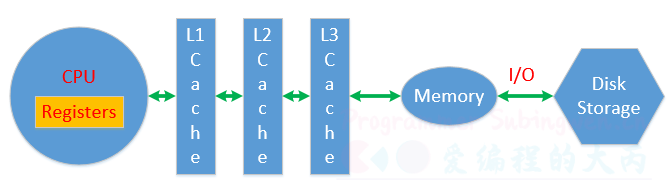
CPU对应寄存器、一级缓存、二级缓存、三级缓存是独占的，用于存储处理的数据和线程的状态信息，数据被CPU处理完成需要再次被写入到物理内存中，物理内存数据也可以通过文件IO操作写入到磁盘中。
在测试程序中两个线程共用全局变量`number`当线程变成运行态之后开始数数，从物理内存加载数据，让后将数据放到CPU进行运算，最后将结果更新到物理内存中。如果数数的两个线程都可以顺利完成这个流程，那么得到的结果肯定是正确的。
如果线程A执行这个过程期间就失去了CPU时间片，线程A被挂起了最新的数据没能更新到物理内存。线程B变成运行态之后从物理内存读数据，很显然它 没有拿到最新数据，只能基于旧的数据往后数，然后失去CPU时间片挂起。线程A得到CPU时间片变成运行态，第一件事儿就是将上次没更新到内存的数据更新 到内存，但是这样会导致线程B已经更新到内存的数据被覆盖，活儿白干了，最终导致有些数据会被重复数很多次。
##### 1.2 同步方式
对于多个线程访问共享资源出现数据混乱的问题，需要进行线程同步。常用的线程同步方式有四种：互斥锁、读写锁、条件变量、信号量。所谓的共享资源就是多个线程共同访问的变量，这些变量通常为全局数据区变量或者堆区变量，这些变量对应的共享资源也被称之为临界资源。
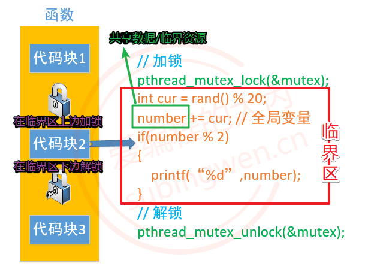
找到临界资源之后，再找和临界资源相关的上下文代码，这样就得到了一个代码块，这个代码块可以称之为临界区。确定好临界区（临界区越小越好）之后，就可以进行线程同步了，线程同步的大致处理思路是这样的：
- 在临界区代码的上边，添加加锁函数，对临界区加锁。 哪个线程调用这句代码，就会把这把锁锁上，其他线程就只能阻塞在锁上了。
- 在临界区代码的下边，添加解锁函数，对临界区解锁。 出临界区的线程会将锁定的那把锁打开，其他抢到锁的线程就可以进入到临界区了。
- 通过锁机制能保证临界区代码最多只能同时有一个线程访问，这样并行访问就变为串行访问了。
#### 2. 互斥锁
##### 2.1 互斥锁函数
互 斥锁是线程同步最常用的一种方式，通过互斥锁可以锁定一个代码块, 被锁定的这个代码块, 所有的线程只能顺序执行(不能并行处理)，这样多线程访问共享资源数据混乱的问题就可以被解决了，需要付出的代价就是执行效率的降低，因为默认临界区多个 线程是可以并行处理的，现在只能串行处理。
在Linux中互斥锁的类型为`pthread_mutex_t`，创建一个这种类型的变量就得到了一把互斥锁：
```c
pthread_mutex_t  mutex;
```
在创建的锁对象中保存了当前这把锁的状态信息：锁定还是打开，如果是锁定状态还记录了给这把锁加锁的线程信息（线程ID）。一个互斥锁变量只能被一个线程锁定，被锁定之后其他线程再对互斥锁变量加锁就会被阻塞，直到这把互斥锁被解锁，被阻塞的线程才能被解除阻塞。`一般情况下，每一个共享资源对应一个把互斥锁，锁的个数和线程的个数无关。`
> Linux 提供的互斥锁操作函数如下，如果函数调用成功会返回0，调用失败会返回相应的错误号：
```c++
// 初始化互斥锁
// restrict: 是一个关键字, 用来修饰指针, 只有这个关键字修饰的指针可以访问指向的内存地址, 其他指针是不行的
int pthread_mutex_init(pthread_mutex_t *restrict mutex,
           const pthread_mutexattr_t *restrict attr);
// 释放互斥锁资源            
int pthread_mutex_destroy(pthread_mutex_t *mutex);
```
- 参数: mutex: 互斥锁变量的地址
- attr: 互斥锁的属性, 一般使用默认属性即可, 这个参数指定为NULL
```c
// 修改互斥锁的状态, 将其设定为锁定状态, 这个状态被写入到参数 mutex 中
int pthread_mutex_lock(pthread_mutex_t *mutex);
```
这个函数被调用, 首先会判断参数 mutex 互斥锁中的状态是不是锁定状态:
- 没有被锁定, 是打开的, 这个线程可以加锁成功, 这个这个锁中会记录是哪个线程加锁成功了
- 如果被锁定了, 其他线程加锁就失败了, 这些线程都会阻塞在这把锁上
- 当这把锁被解开之后, 这些阻塞在锁上的线程就解除阻塞了，并且这些线程是通过竞争的方式对这把锁加锁，没抢到锁的线程继续阻塞
```c
// 尝试加锁
int pthread_mutex_trylock(pthread_mutex_t *mutex);
```
调用这个函数对互斥锁变量加锁还是有两种情况:
- 如果这把锁没有被锁定是打开的，线程加锁成功
- 如果锁变量被锁住了，调用这个函数加锁的线程，不会被阻塞，加锁失败直接返回错误号
```c
// 对互斥锁解锁
int pthread_mutex_unlock(pthread_mutex_t *mutex);
```
不是所有的线程都可以对互斥锁解锁，哪个线程加的锁, 哪个线程才能解锁成功。
##### 2.1 互斥锁使用
我们可以将上面多线程交替数数的例子修改一下，使用互斥锁进行线程同步。两个线程一共操作了同一个全局变量，因此需要添加一互斥锁，来控制这两个线程。
```c
#include <stdio.h>
#include <unistd.h>
#include <stdlib.h>
#include <sys/types.h>
#include <sys/stat.h>
#include <string.h>
#include <pthread.h>

#define MAX 100
// 全局变量
int number;

// 创建一把互斥锁
// 全局变量, 多个线程共享
pthread_mutex_t mutex;

// 线程处理函数
void* funcA_num(void* arg)
{
    for(int i=0; i<MAX; ++i)
    {
        // 如果线程A加锁成功, 不阻塞
        // 如果B加锁成功, 线程A阻塞
        pthread_mutex_lock(&mutex);
        int cur = number;
        cur++;
        usleep(10);
        number = cur;
        pthread_mutex_unlock(&mutex);
        printf("Thread A, id = %lu, number = %d\n", pthread_self(), number);
    }

    return NULL;
}

void* funcB_num(void* arg)
{
    for(int i=0; i<MAX; ++i)
    {
        // a加锁成功, b线程访问这把锁的时候是锁定的
        // 线程B先阻塞, a线程解锁之后阻塞解除
        // 线程B加锁成功了
        pthread_mutex_lock(&mutex);
        int cur = number;
        cur++;
        number = cur;
        pthread_mutex_unlock(&mutex);
        printf("Thread B, id = %lu, number = %d\n", pthread_self(), number);
        usleep(5);
    }

    return NULL;
}

int main(int argc, const char* argv[])
{
    pthread_t p1, p2;

    // 初始化互斥锁
    pthread_mutex_init(&mutex, NULL);

    // 创建两个子线程
    pthread_create(&p1, NULL, funcA_num, NULL);
    pthread_create(&p2, NULL, funcB_num, NULL);

    // 阻塞，资源回收
    pthread_join(p1, NULL);
    pthread_join(p2, NULL);

    // 销毁互斥锁
    // 线程销毁之后, 再去释放互斥锁
    pthread_mutex_destroy(&mutex);

    return 0;
}
```
#### 3. 死锁
当多个线程访问共享资源, 需要加锁, 如果锁使用不当, 就会造成死锁这种现象。如果线程死锁造成的后果是：所有的线程都被阻塞，并且线程的阻塞是无法解开的（因为可以解锁的线程也被阻塞了）。
造成死锁的场景有如下几种：
```c
// 场景1
void func()
{
    for(int i=0; i<6; ++i)
    {
        // 当前线程A加锁成功, 当前循环完毕没有解锁, 在下一轮循环的时候自己被阻塞了
        // 其余的线程也被阻塞
    	pthread_mutex_lock(&mutex);
    	....
    	.....
        // 忘记解锁
    }
}

// 场景2
void func()
{
    for(int i=0; i<6; ++i)
    {
        // 当前线程A加锁成功
        // 其余的线程被阻塞
    	pthread_mutex_lock(&mutex);
    	....
    	.....
        if(xxx)
        {
            // 函数退出, 没有解锁（解锁函数无法被执行了）
            return ;
        }
        
        pthread_mutex_lock(&mutex);
    }
}
```
- 加锁之后忘记解锁
```c
void func()
{
    for(int i=0; i<6; ++i)
    {
        // 当前线程A加锁成功
        // 其余的线程阻塞
    	pthread_mutex_lock(&mutex);
        // 锁被锁住了, A线程阻塞
        pthread_mutex_lock(&mutex);
    	....
    	.....
        pthread_mutex_unlock(&mutex);
    }
}

// 隐藏的比较深的情况
void funcA()
{
    for(int i=0; i<6; ++i)
    {
        // 当前线程A加锁成功
        // 其余的线程阻塞
    	pthread_mutex_lock(&mutex);
    	....
    	.....
        pthread_mutex_unlock(&mutex);
    }
}

void funcB()
{
    for(int i=0; i<6; ++i)
    {
        // 当前线程A加锁成功
        // 其余的线程阻塞
    	pthread_mutex_lock(&mutex);
        funcA();		// 重复加锁
    	....
    	.....
        pthread_mutex_unlock(&mutex);
    }
}
```
- 重复加锁, 造成死锁
```text
场景描述:
  1. 有两个共享资源:X, Y，X对应锁A, Y对应锁B
     - 线程A访问资源X, 加锁A
     - 线程B访问资源Y, 加锁B
  2. 线程A要访问资源Y, 线程B要访问资源X，因为资源X和Y已经被对应的锁锁住了，因此这个两个线程被阻塞
     - 线程A被锁B阻塞了, 无法打开A锁
     - 线程B被锁A阻塞了, 无法打开B锁
```
- 在程序中有多个共享资源, 因此有很多把锁，随意加锁，导致相互被阻塞 text1234567 [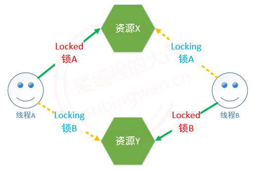](assets/linux-course/remote-e30e945f2095-1557806644326.png)
在使用多线程编程的时候，如何避免死锁呢？
- 避免多次锁定, 多检查
- 对共享资源访问完毕之后, 一定要解锁，或者在加锁的使用 trylock
- 如果程序中有多把锁, 可以控制对锁的访问顺序(顺序访问共享资源，但在有些情况下是做不到的)，另外也可以在对其他互斥锁做加锁操作之前，先释放当前线程拥有的互斥锁。
- 项目程序中可以引入一些专门用于死锁检测的模块
#### 4. 读写锁
##### 4.1 读写锁函数
读写锁是互斥锁的升级版, `在做读操作的时候可以提高程序的执行效率，如果所有的线程都是做读操作, 那么读是并行的`，但是使用互斥锁，读操作也是串行的。
读写锁是一把锁，锁的类型为`pthread_rwlock_t`，有了类型之后就可以创建一把互斥锁了：
```c
pthread_rwlock_t rwlock;
```
之所以称其为读写锁，是因为这把锁既可以锁定读操作，也可以锁定写操作。为了方便理解，可以大致认为在这把锁中记录了这些信息：
- 锁的状态: 锁定/打开
- 锁定的是什么操作: 读操作/写操作，`使用读写锁锁定了读操作，需要先解锁才能去锁定写操作，反之亦然。`
- 哪个线程将这把锁锁上了
读写锁的使用方式也互斥锁的使用方式是完全相同的：找共享资源, 确定临界区，在临界区的开始位置加锁（读锁/写锁），临界区的结束位置解锁。
因为通过一把读写锁可以锁定读或者写操作，下面介绍一下关于读写锁的特点：
1. 使用读写锁的读锁锁定了临界区，线程对临界区的访问是并行的，`读锁是共享的。`
1. 使用读写锁的写锁锁定了临界区，线程对临界区的访问是串行的，`写锁是独占的。`
1. 使用读写锁分别对两个临界区加了读锁和写锁，两个线程要同时访问者两个临界区，访问写锁临界区的线程继续运行，访问读锁临界区的线程阻塞，因为`写锁比读锁的优先级高。`
`如果说程序中所有的线程都对共享资源做写操作，使用读写锁没有优势，和互斥锁是一样的，如果说程序中所有的线程都对共享资源有写也有读操作，并且对共享资源读的操作越多，读写锁更有优势。`
> Linux提供的读写锁操作函数原型如下，如果函数调用成功返回0，失败返回对应的错误号：
```c
#include <pthread.h>
pthread_rwlock_t rwlock;
// 初始化读写锁
int pthread_rwlock_init(pthread_rwlock_t *restrict rwlock,
           const pthread_rwlockattr_t *restrict attr);
// 释放读写锁占用的系统资源
int pthread_rwlock_destroy(pthread_rwlock_t *rwlock);
```
- 参数: rwlock: 读写锁的地址，传出参数
- attr: 读写锁属性，一般使用默认属性，指定为NULL
```c
// 在程序中对读写锁加读锁, 锁定的是读操作
int pthread_rwlock_rdlock(pthread_rwlock_t *rwlock);
```
调用这个函数，如果读写锁是打开的，那么加锁成功；如果读写锁已经锁定了读操作，调用这个函数依然可以加锁成功，因为读锁是共享的；如果读写锁已经锁定了写操作，调用这个函数的线程会被阻塞。
```c
// 这个函数可以有效的避免死锁
// 如果加读锁失败, 不会阻塞当前线程, 直接返回错误号
int pthread_rwlock_tryrdlock(pthread_rwlock_t *rwlock);
```
调用这个函数，如果读写锁是打开的，那么加锁成功；如果读写锁已经锁定了读操作，调用这个函数依然可以加锁成功，因为读锁是共享的；如果读写锁已经 锁定了写操作，调用这个函数加锁失败，对应的线程不会被阻塞，可以在程序中对函数返回值进行判断，添加加锁失败之后的处理动作。
```c
// 在程序中对读写锁加写锁, 锁定的是写操作
int pthread_rwlock_wrlock(pthread_rwlock_t *rwlock);
```
调用这个函数，如果读写锁是打开的，那么加锁成功；如果读写锁已经锁定了读操作或者锁定了写操作，调用这个函数的线程会被阻塞。
```c
// 这个函数可以有效的避免死锁
// 如果加写锁失败, 不会阻塞当前线程, 直接返回错误号
int pthread_rwlock_trywrlock(pthread_rwlock_t *rwlock);
```
调用这个函数，如果读写锁是打开的，那么加锁成功；如果读写锁已经锁定了读操作或者锁定了写操作，调用这个函数加锁失败，但是线程不会阻塞，可以在程序中对函数返回值进行判断，添加加锁失败之后的处理动作。
```c
// 解锁, 不管锁定了读还是写都可用解锁
int pthread_rwlock_unlock(pthread_rwlock_t *rwlock);
```
##### 4.2 读写锁使用
题目要求：8个线程操作同一个全局变量，3个线程不定时写同一全局资源，5个线程不定时读同一全局资源。
```c
#include <stdio.h>
#include <stdlib.h>
#include <unistd.h>
#include <string.h>
#include <pthread.h>

// 全局变量
int number = 0;

// 定义读写锁
pthread_rwlock_t rwlock;

// 写的线程的处理函数
void* writeNum(void* arg)
{
    while(1)
    {
        pthread_rwlock_wrlock(&rwlock);
        int cur = number;
        cur ++;
        number = cur;
        printf("++写操作完毕, number : %d, tid = %ld\n", number, pthread_self());
        pthread_rwlock_unlock(&rwlock);
        // 添加sleep目的是要看到多个线程交替工作
        usleep(rand() % 100);
    }

    return NULL;
}

// 读线程的处理函数
// 多个线程可以如果处理动作相同, 可以使用相同的处理函数
// 每个线程中的栈资源是独享
void* readNum(void* arg)
{
    while(1)
    {
        pthread_rwlock_rdlock(&rwlock);
        printf("--全局变量number = %d, tid = %ld\n", number, pthread_self());
        pthread_rwlock_unlock(&rwlock);
        usleep(rand() % 100);
    }
    return NULL;
}

int main()
{
    // 初始化读写锁
    pthread_rwlock_init(&rwlock, NULL);

    // 3个写线程, 5个读的线程
    pthread_t wtid[3];
    pthread_t rtid[5];
    for(int i=0; i<3; ++i)
    {
        pthread_create(&wtid[i], NULL, writeNum, NULL);
    }

    for(int i=0; i<5; ++i)
    {
        pthread_create(&rtid[i], NULL, readNum, NULL);
    }

    // 释放资源
    for(int i=0; i<3; ++i)
    {
        pthread_join(wtid[i], NULL);
    }

    for(int i=0; i<5; ++i)
    {
        pthread_join(rtid[i], NULL);
    }

    // 销毁读写锁
    pthread_rwlock_destroy(&rwlock);

    return 0;
}
```
#### 5. 条件变量
##### 5.1 条件变量函数
严格意义上来说，条件变量的主要作用不是处理线程同步, `而是进行线程的阻塞。`如果在多线程程序中只使用条件变量无法实现线程的同步, 必须要配合互斥锁来使用。虽然条件变量和互斥锁都能阻塞线程，但是二者的效果是不一样的，二者的区别如下：
- 假设有A-Z 26个线程，这26个线程共同访问同一把互斥锁，如果线程A加锁成功，那么其余B-Z线程访问互斥锁都阻塞，所有的线程只能顺序访问临界区
- 条件变量只有在满足指定条件下才会阻塞线程，如果条件不满足，多个线程可以同时进入临界区，同时读写临界资源，这种情况下还是会出现共享资源中数据的混乱。
一般情况下条件变量用于处理生产者和消费者模型，并且和互斥锁配合使用。条件变量类型对应的类型为`pthread_cond_t`，这样就可以定义一个条件变量类型的变量了：
```c
pthread_cond_t cond;
```
被条件变量阻塞的线程的线程信息会被记录到这个变量中，以便在解除阻塞的时候使用。
> 条件变量操作函数函数原型如下：
```c
#include <pthread.h>
pthread_cond_t cond;
// 初始化
int pthread_cond_init(pthread_cond_t *restrict cond,
      const pthread_condattr_t *restrict attr);
// 销毁释放资源        
int pthread_cond_destroy(pthread_cond_t *cond);
```
- 参数: cond: 条件变量的地址
- attr: 条件变量属性, 一般使用默认属性, 指定为NULL
```c
// 线程阻塞函数, 哪个线程调用这个函数, 哪个线程就会被阻塞
int pthread_cond_wait(pthread_cond_t *restrict cond, pthread_mutex_t *restrict mutex);
```
通过函数原型可以看出，该函数在阻塞线程的时候，需要一个互斥锁参数，这个互斥锁主要功能是进行线程同步，让线程顺序进入临界区，避免出现数共享资源的数据混乱。该函数会对这个互斥锁做以下几件事情：
1. 在阻塞线程时候，如果线程已经对互斥锁`mutex`上锁，那么会将这把锁打开，这样做是为了避免死锁
1. 当线程解除阻塞的时候，函数内部会帮助这个线程再次将这个`mutex`互斥锁锁上，继续向下访问临界区
```c
// 表示的时间是从1971.1.1到某个时间点的时间, 总长度使用秒/纳秒表示
struct timespec {
	time_t tv_sec;      /* Seconds */
	long   tv_nsec;     /* Nanoseconds [0 .. 999999999] */
};
// 将线程阻塞一定的时间长度, 时间到达之后, 线程就解除阻塞了
int pthread_cond_timedwait(pthread_cond_t *restrict cond,
           pthread_mutex_t *restrict mutex, const struct timespec *restrict abstime);
```
这个函数的前两个参数和`pthread_cond_wait`函数是一样的，第三个参数表示线程阻塞的时长，但是需要额外注意一点：`struct timespec`这个结构体中记录的时间是`从1971.1.1到某个时间点的时间，总长度使用秒/纳秒表示。`因此赋值方式相对要麻烦一点：
```c
time_t mytim = time(NULL);	// 1970.1.1 0:0:0 到当前的总秒数
struct timespec tmsp;
tmsp.tv_nsec = 0;
tmsp.tv_sec = time(NULL) + 100;	// 线程阻塞100s
```
```c
// 唤醒阻塞在条件变量上的线程, 至少有一个被解除阻塞
int pthread_cond_signal(pthread_cond_t *cond);
// 唤醒阻塞在条件变量上的线程, 被阻塞的线程全部解除阻塞
int pthread_cond_broadcast(pthread_cond_t *cond);
```
调用上面两个函数中的任意一个，都可以换线被`pthread_cond_wait`或者`pthread_cond_timedwait`阻塞的线程，区别就在于`pthread_cond_signal`是唤醒至少一个被阻塞的线程（总个数不定），`pthread_cond_broadcast`是唤醒所有被阻塞的线程。
##### 5.2 生产者和消费者
生产者和消费者模型的组成：
1. 生产者线程 -> 若干个 生产商品或者任务放入到任务队列中
- 任务队列满了就阻塞, 不满的时候就工作
- 通过一个生产者的条件变量控制生产者线程阻塞和非阻塞
1. 消费者线程 -> 若干个 读任务队列, 将任务或者数据取出
- 任务队列中有数据就消费，没有数据就阻塞
- 通过一个消费者的条件变量控制消费者线程阻塞和非阻塞
1. 队列 -> 存储任务/数据，对应一块内存，为了读写访问可以通过一个数据结构维护这块内存 可以是数组、链表，也可以使用stl容器：queue / stack / list / vector

> 场景描述：使用条件变量实现生产者和消费者模型，生产者有5个，往链表头部添加节点，消费者也有5个，删除链表头部的节点。
```c
#include <stdio.h>
#include <stdlib.h>
#include <unistd.h>
#include <string.h>
#include <pthread.h>

// 链表的节点
struct Node
{
    int number;
    struct Node* next;
};

// 定义条件变量, 控制消费者线程
pthread_cond_t cond;
// 互斥锁变量
pthread_mutex_t mutex;
// 指向头结点的指针
struct Node * head = NULL;

// 生产者的回调函数
void* producer(void* arg)
{
    // 一直生产
    while(1)
    {
        pthread_mutex_lock(&mutex);
        // 创建一个链表的新节点
        struct Node* pnew = (struct Node*)malloc(sizeof(struct Node));
        // 节点初始化
        pnew->number = rand() % 1000;
        // 节点的连接, 添加到链表的头部, 新节点就新的头结点
        pnew->next = head;
        // head指针前移
        head = pnew;
        printf("+++producer, number = %d, tid = %ld\n", pnew->number, pthread_self());
        pthread_mutex_unlock(&mutex);

        // 生产了任务, 通知消费者消费
        pthread_cond_broadcast(&cond);

        // 生产慢一点
        sleep(rand() % 3);
    }
    return NULL;
}

// 消费者的回调函数
void* consumer(void* arg)
{
    while(1)
    {
        pthread_mutex_lock(&mutex);
        // 一直消费, 删除链表中的一个节点
//        if(head == NULL)   // 这样写有bug
        while(head == NULL)
        {
            // 任务队列, 也就是链表中已经没有节点可以消费了
            // 消费者线程需要阻塞
            // 线程加互斥锁成功, 但是线程阻塞在这行代码上, 锁还没解开
            // 其他线程在访问这把锁的时候也会阻塞, 生产者也会阻塞 ==> 死锁
            // 这函数会自动将线程拥有的锁解开
            pthread_cond_wait(&cond, &mutex);
            // 当消费者线程解除阻塞之后, 会自动将这把锁锁上
            // 这时候当前这个线程又重新拥有了这把互斥锁
        }
        // 取出链表的头结点, 将其删除
        struct Node* pnode = head;
        printf("--consumer: number: %d, tid = %ld\n", pnode->number, pthread_self());
        head  = pnode->next;
        free(pnode);
        pthread_mutex_unlock(&mutex);        

        sleep(rand() % 3);
    }
    return NULL;
}

int main()
{
    // 初始化条件变量
    pthread_cond_init(&cond, NULL);
    pthread_mutex_init(&mutex, NULL);

    // 创建5个生产者, 5个消费者
    pthread_t ptid[5];
    pthread_t ctid[5];
    for(int i=0; i<5; ++i)
    {
        pthread_create(&ptid[i], NULL, producer, NULL);
    }

    for(int i=0; i<5; ++i)
    {
        pthread_create(&ctid[i], NULL, consumer, NULL);
    }

    // 释放资源
    for(int i=0; i<5; ++i)
    {
        // 阻塞等待子线程退出
        pthread_join(ptid[i], NULL);
    }

    for(int i=0; i<5; ++i)
    {
        pthread_join(ctid[i], NULL);
    }

    // 销毁条件变量
    pthread_cond_destroy(&cond);
    pthread_mutex_destroy(&mutex);

    return 0;
}
```
代码分析
```c
void* consumer(void* arg)
{
    while(1)
    {
        pthread_mutex_lock(&mutex);
        // 一直消费, 删除链表中的一个节点
        if(head == NULL)   // 这样写有bug
        {
            pthread_cond_wait(&cond, &mutex);
        }
        // 取出链表的头结点, 将其删除
        struct Node* pnode = head;
        printf("--consumer: number: %d, tid = %ld\n", pnode->number, pthread_self());
        head  = pnode->next;
        free(pnode);
        pthread_mutex_unlock(&mutex);        

        sleep(rand() % 3);
    }
    return NULL;
}

/*
为什么在第7行使用if 有bug:
    当任务队列为空, 所有的消费者线程都会被这个函数阻塞 pthread_cond_wait(&cond, &mutex);
    也就是阻塞在代码的第9行
	
    当生产者生产了1个节点, 调用 pthread_cond_broadcast(&cond); 唤醒了所有阻塞的线程
      - 有一个消费者线程通过 pthread_cond_wait()加锁成功, 其余没有加锁成功的线程继续阻塞
      - 加锁成功的线程向下运行, 并成功删除一个节点, 然后解锁
      - 没有加锁成功的线程解除阻塞继续抢这把锁, 另外一个子线程加锁成功
      - 但是这个线程删除链表节点的时候链表已经为空了, 后边访问这个空节点的时候就会出现段错误
    解决方案:
      - 需要循环的对链表是否为空进行判断, 需要将if 该成 while
*/
```
#### 6. 信号量
##### 6.1 信号量函数
信 号量用在多线程多任务同步的，一个线程完成了某一个动作就通过信号量告诉别的线程，别的线程再进行某些动作。信号量不一定是锁定某一个资源，而是流程上的 概念，比如：有A，B两个线程，B线程要等A线程完成某一任务以后再进行自己下面的步骤，这个任务并不一定是锁定某一资源，还可以是进行一些计算或者数据 处理之类。
`信号量（信号灯）`与互斥锁和条件变量的主要不同在于”灯”的概念，灯亮则意味着资源可用，灯灭则意味着不可用。信号量主要阻塞线程, 不能完全保证线程安全，如果要保证线程安全, 需要信号量和互斥锁一起使用。
信号量和条件变量一样用于处理生产者和消费者模型，用于阻塞生产者线程或者消费者线程的运行。信号的类型为`sem_t`对应的头文件为`<semaphore.h>`：
```c
#include <semaphore.h>
sem_t sem;
```
> Linux提供的信号量操作函数原型如下：
```c
#include <semaphore.h>
// 初始化信号量/信号灯
int sem_init(sem_t *sem, int pshared, unsigned int value);
// 资源释放, 线程销毁之后调用这个函数即可
// 参数 sem 就是 sem_init() 的第一个参数            
int sem_destroy(sem_t *sem);
```
- 参数: sem：信号量变量地址
- pshared： 0：线程同步
- 非0：进程同步
- value：初始化当前信号量拥有的资源数（>=0），如果资源数为0，线程就会被阻塞了。
```c
// 参数 sem 就是 sem_init() 的第一个参数  
// 函数被调用sem中的资源就会被消耗1个, 资源数-1
int sem_wait(sem_t *sem);
```
当线程调用这个函数，并且`sem`中的资源数`>0`，线程不会阻塞，线程会占用`sem`中的一个资源，因此资源数-1，直到`sem`中的资源数减为`0`时，资源被耗尽，因此线程也就被阻塞了。
```c
// 参数 sem 就是 sem_init() 的第一个参数  
// 函数被调用sem中的资源就会被消耗1个, 资源数-1
int sem_trywait(sem_t *sem);
```
当线程调用这个函数，并且`sem`中的资源数`>0`，线程不会阻塞，线程会占用`sem`中的一个资源，因此资源数-1，直到`sem`中的资源数减为`0`时，资源被耗尽，但是线程不会被阻塞，直接返回错误号，因此可以在程序中添加判断分支，用于处理获取资源失败之后的情况。
```c
// 表示的时间是从1971.1.1到某个时间点的时间, 总长度使用秒/纳秒表示
struct timespec {
	time_t tv_sec;      /* Seconds */
	long   tv_nsec;     /* Nanoseconds [0 .. 999999999] */
};
// 调用该函数线程获取sem中的一个资源，当资源数为0时，线程阻塞，在阻塞abs_timeout对应的时长之后，解除阻塞。
// abs_timeout: 阻塞的时间长度, 单位是s, 是从1970.1.1开始计算的
int sem_timedwait(sem_t *sem, const struct timespec *abs_timeout);
```
该函数的参数`abs_timeout`和`pthread_cond_timedwait`的最后一个参数是一样的，使用方法不再过多赘述。当线程调用这个函数，并且`sem`中的资源数`>0`，线程不会阻塞，线程会占用`sem`中的一个资源，因此资源数-1，直到`sem`中的资源数减为`0`时，资源被耗尽，线程被阻塞，当阻塞指定的时长之后，线程解除阻塞。
```c
// 调用该函数给sem中的资源数+1
int sem_post(sem_t *sem);
```
调用该函数会将`sem`中的资源数`+1`，如果有线程在调用`sem_wait`、`sem_trywait`、`sem_timedwait`时因为`sem`中的资源数为`0`被阻塞了，这时这些线程会解除阻塞，获取到资源之后继续向下运行。
```c
// 查看信号量 sem 中的整形数的当前值, 这个值会被写入到sval指针对应的内存中
// sval是一个传出参数
int sem_getvalue(sem_t *sem, int *sval);
```
通过这个函数可以查看`sem`中现在拥有的资源个数，通过第二个参数`sval`将数据传出，也就是说第二个参数的作用和返回值是一样的。
##### 6.2 生产者和消费者
由于生产者和消费者是两类线程，并且在还没有生成之前是不能进行消费的，在使用信号量处理这类问题的时候可以定义两个信号量，分别用于记录生产者和消费者线程拥有的总资源数。
```c
// 生产者线程 
sem_t psem;
// 消费者线程
sem_t csem;

// 信号量初始化
sem_init(&psem, 0, 5);    // 5个生产者可以同时生产
sem_init(&csem, 0, 0);    // 消费者线程没有资源, 因此不能消费

// 生产者线程
// 在生产之前, 从信号量中取出一个资源
sem_wait(&psem);	
// 生产者商品代码, 有商品了, 放到任务队列
......	 
......
......
// 通知消费者消费，给消费者信号量添加资源，让消费者解除阻塞
sem_post(&csem);
	
////////////////////////////////////////////////////////
////////////////////////////////////////////////////////

// 消费者线程
// 消费者需要等待生产, 默认启动之后应该阻塞
sem_wait(&csem);
// 开始消费
......
......
......
// 消费完成, 通过生产者生产，给生产者信号量添加资源
sem_post(&psem);
```
通过上面的代码可以知道，初始化信号量的时候没有消费者分配资源，消费者线程启动之后由于没有资源自然就被阻塞了，等生产者生产出产品之后，再给消费者分配资源，这样二者就可以配合着完成生产和消费流程了。
##### 6.3 信号量使用
> 场景描述：使用信号量实现生产者和消费者模型，生产者有5个，往链表头部添加节点，消费者也有5个，删除链表头部的节点。
###### 6.3.1 总资源数为1
如果生产者和消费者线程使用的信号量对应的总资源数为1，那么不管线程有多少个，可以工作的线程只有一个，其余线程由于拿不到资源，都被迫阻塞了。
```c
#include <stdio.h>
#include <stdlib.h>
#include <unistd.h>
#include <string.h>
#include <semaphore.h>
#include <pthread.h>

// 链表的节点
struct Node
{
    int number;
    struct Node* next;
};

// 生产者线程信号量
sem_t psem;
// 消费者线程信号量
sem_t csem;

// 互斥锁变量
pthread_mutex_t mutex;
// 指向头结点的指针
struct Node * head = NULL;

// 生产者的回调函数
void* producer(void* arg)
{
    // 一直生产
    while(1)
    {
        // 生产者拿一个信号灯
        sem_wait(&psem);
        // 创建一个链表的新节点
        struct Node* pnew = (struct Node*)malloc(sizeof(struct Node));
        // 节点初始化
        pnew->number = rand() % 1000;
        // 节点的连接, 添加到链表的头部, 新节点就新的头结点
        pnew->next = head;
        // head指针前移
        head = pnew;
        printf("+++producer, number = %d, tid = %ld\n", pnew->number, pthread_self());

        // 通知消费者消费, 给消费者加信号灯
        sem_post(&csem);
        

        // 生产慢一点
        sleep(rand() % 3);
    }
    return NULL;
}

// 消费者的回调函数
void* consumer(void* arg)
{
    while(1)
    {
        sem_wait(&csem);
        // 取出链表的头结点, 将其删除
        struct Node* pnode = head;
        printf("--consumer: number: %d, tid = %ld\n", pnode->number, pthread_self());
        head  = pnode->next;
        free(pnode);
        // 通知生产者生成, 给生产者加信号灯
        sem_post(&psem);

        sleep(rand() % 3);
    }
    return NULL;
}

int main()
{
    // 初始化信号量
    // 生产者和消费者拥有的信号灯的总和为1
    sem_init(&psem, 0, 1);  // 生成者线程一共有1个信号灯
    sem_init(&csem, 0, 0);  // 消费者线程一共有0个信号灯

    // 创建5个生产者, 5个消费者
    pthread_t ptid[5];
    pthread_t ctid[5];
    for(int i=0; i<5; ++i)
    {
        pthread_create(&ptid[i], NULL, producer, NULL);
    }

    for(int i=0; i<5; ++i)
    {
        pthread_create(&ctid[i], NULL, consumer, NULL);
    }

    // 释放资源
    for(int i=0; i<5; ++i)
    {
        pthread_join(ptid[i], NULL);
    }

    for(int i=0; i<5; ++i)
    {
        pthread_join(ctid[i], NULL);
    }

    sem_destroy(&psem);
    sem_destroy(&csem);

    return 0;
}
```
通过测试代码可以得到如下结论：如果生产者和消费者使用的信号量总资源数为1，那么不会出现生产者线程和消费者线程同时访问共享资源的情况，不管生产者和消费者线程有多少个，它们都是顺序执行的。
###### 6.3.2 总资源数大于1
如果生产者和消费者线程使用的信号量对应的总资源数为大于1，这种场景下出现的情况就比较多了：
- 多个生产者线程同时生产
- 多个消费者同时消费
- 生产者线程和消费者线程同时生产和消费
以上不管哪一种情况都可能会出现多个线程访问共享资源的情况，如果想防止共享资源出现数据混乱，那么就需要使用互斥锁进行线程同步，处理代码如下：
```c
#include <stdio.h>
#include <stdlib.h>
#include <unistd.h>
#include <string.h>
#include <semaphore.h>
#include <pthread.h>

// 链表的节点
struct Node
{
    int number;
    struct Node* next;
};

// 生产者线程信号量
sem_t psem;
// 消费者线程信号量
sem_t csem;

// 互斥锁变量
pthread_mutex_t mutex;
// 指向头结点的指针
struct Node * head = NULL;

// 生产者的回调函数
void* producer(void* arg)
{
    // 一直生产
    while(1)
    {
        // 生产者拿一个信号灯
        sem_wait(&psem);
        // 加锁, 这句代码放到 sem_wait()上边, 有可能会造成死锁
        pthread_mutex_lock(&mutex);
        // 创建一个链表的新节点
        struct Node* pnew = (struct Node*)malloc(sizeof(struct Node));
        // 节点初始化
        pnew->number = rand() % 1000;
        // 节点的连接, 添加到链表的头部, 新节点就新的头结点
        pnew->next = head;
        // head指针前移
        head = pnew;
        printf("+++producer, number = %d, tid = %ld\n", pnew->number, pthread_self());
        pthread_mutex_unlock(&mutex);

        // 通知消费者消费
        sem_post(&csem);
        
        // 生产慢一点
        sleep(rand() % 3);
    }
    return NULL;
}

// 消费者的回调函数
void* consumer(void* arg)
{
    while(1)
    {
        sem_wait(&csem);
        pthread_mutex_lock(&mutex);
        struct Node* pnode = head;
        printf("--consumer: number: %d, tid = %ld\n", pnode->number, pthread_self());
        head  = pnode->next;
        // 取出链表的头结点, 将其删除
        free(pnode);
        pthread_mutex_unlock(&mutex);
        // 通知生产者生成, 给生产者加信号灯
        sem_post(&psem);

        sleep(rand() % 3);
    }
    return NULL;
}

int main()
{
    // 初始化信号量
    sem_init(&psem, 0, 5);  // 生成者线程一共有5个信号灯
    sem_init(&csem, 0, 0);  // 消费者线程一共有0个信号灯
    // 初始化互斥锁
    pthread_mutex_init(&mutex, NULL);

    // 创建5个生产者, 5个消费者
    pthread_t ptid[5];
    pthread_t ctid[5];
    for(int i=0; i<5; ++i)
    {
        pthread_create(&ptid[i], NULL, producer, NULL);
    }

    for(int i=0; i<5; ++i)
    {
        pthread_create(&ctid[i], NULL, consumer, NULL);
    }

    // 释放资源
    for(int i=0; i<5; ++i)
    {
        pthread_join(ptid[i], NULL);
    }

    for(int i=0; i<5; ++i)
    {
        pthread_join(ctid[i], NULL);
    }

    sem_destroy(&psem);
    sem_destroy(&csem);
    pthread_mutex_destroy(&mutex);

    return 0;
}
```
在编写上述代码的时候还有一个需要注意是事项，不管是消费者线程的处理函数还是生产者线程的处理函数内部有这么两行代码：
```c
// 消费者
sem_wait(&csem);
pthread_mutex_lock(&mutex);

// 生产者
sem_wait(&csem);
pthread_mutex_lock(&mutex);
```
这两行代码的调用顺序是不能颠倒的，如果颠倒过来就有可能会造成死锁，下面来分析一种死锁的场景：
```c
void* producer(void* arg)
{
    // 一直生产
    while(1)
    {
        pthread_mutex_lock(&mutex);
        // 生产者拿一个信号灯
        sem_wait(&psem);
		......
        ......
        // 通知消费者消费
        sem_post(&csem);
        pthread_mutex_unlock(&mutex);
        
        // 生产慢一点
        sleep(rand() % 3);
    }
    return NULL;
}

// 消费者的回调函数
void* consumer(void* arg)
{
    while(1)
    {
        pthread_mutex_lock(&mutex);
        sem_wait(&csem);
		......
        ......
        // 通知生产者生成, 给生产者加信号灯
        sem_post(&psem);
        pthread_mutex_unlock(&mutex);

        sleep(rand() % 3);
    }
    return NULL;
}

int main()
{
    // 初始化信号量
    sem_init(&psem, 0, 5);  // 生成者线程一共有5个信号灯
    sem_init(&csem, 0, 0);  // 消费者线程一共有0个信号灯
	......
	......
    return 0;
}
```
在上面的代码中，初始化状态下消费者线程没有任务信号量资源，假设某一个消费者线程先运行，调用`pthread_mutex_lock(&mutex);`对互斥锁加锁成功，然后调用`sem_wait(&csem);`由于没有资源，因此被阻塞了。其余的消费者线程由于没有抢到互斥锁，因此被阻塞在互斥锁上。对应生产者线程第一步操作也是调用`pthread_mutex_lock(&mutex);`，但是这时候互斥锁已经被消费者线程锁上了，所有生产者都被阻塞，到此为止，多余的线程都被阻塞了，程序产生了死锁。

### 3.9 线程池（C语言版）

> 原文：[《手写线程池 - C语言版》](https://subingwen.cn/linux/threadpool/)　作者：苏丙榅　来源：爱编程的大丙

本文中关于线程池实现和编写步骤相关细节，请观看视频
#### 1. 线程池原理
我们使用线程的时候就去创建一个线程，这样实现起来非常简便，但是就会有一个问题：如果并发的线程数量很多，并且每个线程都是执行一个时间很短的任务就结束了，这样频繁创建线程就会大大降低系统的效率，因为频繁创建线程和销毁线程需要时间。
那么有没有一种办法使得线程可以复用，就是执行完一个任务，并不被销毁，而是可以继续执行其他的任务呢？
线程池是一种多线程处理形式，处理过程中将任务添加到队列，然后在创建线程后自动启动这些任务。线程池线程都是后台线程。每个线程都使用默认的堆栈 大小，以默认的优先级运行，并处于多线程单元中。如果某个线程在托管代码中空闲（如正在等待某个事件）,则线程池将插入另一个辅助线程来使所有处理器保持 繁忙。如果所有线程池线程都始终保持繁忙，但队列中包含挂起的工作，则线程池将在一段时间后创建另一个辅助线程但线程的数目永远不会超过最大值。超过最大 值的线程可以排队，但他们要等到其他线程完成后才启动。
在各个编程语言的语种中都有线程池的概念，并且很多语言中直接提供了线程池，作为程序猿直接使用就可以了，下面给大家介绍一下线程池的实现原理：
- 线程池的组成主要分为3个部分，这三部分配合工作就可以得到一个完整的线程池： `任务队列，存储需要处理的任务，由工作的线程来处理这些任务` 通过线程池提供的API函数，将一个待处理的任务添加到任务队列，或者从任务队列中删除
- 已处理的任务会被从任务队列中删除
- 线程池的使用者，也就是调用线程池函数往任务队列中添加任务的线程就是生产者线程
1. `工作的线程（任务队列任务的消费者） ，N个` 线程池中维护了一定数量的工作线程, 他们的作用是是不停的读任务队列, 从里边取出任务并处理
- 工作的线程相当于是任务队列的消费者角色，
- 如果任务队列为空, 工作的线程将会被阻塞 (使用条件变量/信号量阻塞)
- 如果阻塞之后有了新的任务, 由生产者将阻塞解除, 工作线程开始工作
1. `管理者线程（不处理任务队列中的任务），1个` 它的任务是周期性的对任务队列中的任务数量以及处于忙状态的工作线程个数进行检测 当任务过多的时候, 可以适当的创建一些新的工作线程
- 当任务过少的时候, 可以适当的销毁一些工作的线程
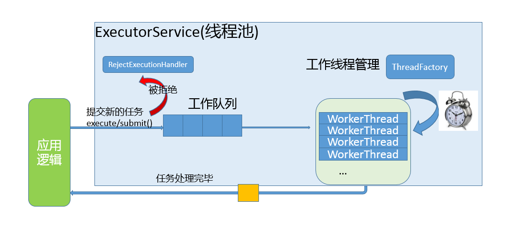
#### 2. 任务队列
```c
// 任务结构体
typedef struct Task
{
    void (*function)(void* arg);
    void* arg;
}Task;
```
#### 3. 线程池定义
```c++
// 线程池结构体
struct ThreadPool
{
    // 任务队列
    Task* taskQ;
    int queueCapacity;  // 容量
    int queueSize;      // 当前任务个数
    int queueFront;     // 队头 -> 取数据
    int queueRear;      // 队尾 -> 放数据

    pthread_t managerID;    // 管理者线程ID
    pthread_t *threadIDs;   // 工作的线程ID
    int minNum;             // 最小线程数量
    int maxNum;             // 最大线程数量
    int busyNum;            // 忙的线程的个数
    int liveNum;            // 存活的线程的个数
    int exitNum;            // 要销毁的线程个数
    pthread_mutex_t mutexPool;  // 锁整个的线程池
    pthread_mutex_t mutexBusy;  // 锁busyNum变量
    pthread_cond_t notFull;     // 任务队列是不是满了
    pthread_cond_t notEmpty;    // 任务队列是不是空了

    int shutdown;           // 是不是要销毁线程池, 销毁为1, 不销毁为0
};
```
#### 4. 头文件声明
```c
#ifndef _THREADPOOL_H
#define _THREADPOOL_H

typedef struct ThreadPool ThreadPool;
// 创建线程池并初始化
ThreadPool *threadPoolCreate(int min, int max, int queueSize);

// 销毁线程池
int threadPoolDestroy(ThreadPool* pool);

// 给线程池添加任务
void threadPoolAdd(ThreadPool* pool, void(*func)(void*), void* arg);

// 获取线程池中工作的线程的个数
int threadPoolBusyNum(ThreadPool* pool);

// 获取线程池中活着的线程的个数
int threadPoolAliveNum(ThreadPool* pool);

//////////////////////
// 工作的线程(消费者线程)任务函数
void* worker(void* arg);
// 管理者线程任务函数
void* manager(void* arg);
// 单个线程退出
void threadExit(ThreadPool* pool);
#endif  // _THREADPOOL_H
```
#### 5. 源文件定义
```c
ThreadPool* threadPoolCreate(int min, int max, int queueSize)
{
    ThreadPool* pool = (ThreadPool*)malloc(sizeof(ThreadPool));
    do 
    {
        if (pool == NULL)
        {
            printf("malloc threadpool fail...\n");
            break;
        }

        pool->threadIDs = (pthread_t*)malloc(sizeof(pthread_t) * max);
        if (pool->threadIDs == NULL)
        {
            printf("malloc threadIDs fail...\n");
            break;
        }
        memset(pool->threadIDs, 0, sizeof(pthread_t) * max);
        pool->minNum = min;
        pool->maxNum = max;
        pool->busyNum = 0;
        pool->liveNum = min;    // 和最小个数相等
        pool->exitNum = 0;

        if (pthread_mutex_init(&pool->mutexPool, NULL) != 0 ||
            pthread_mutex_init(&pool->mutexBusy, NULL) != 0 ||
            pthread_cond_init(&pool->notEmpty, NULL) != 0 ||
            pthread_cond_init(&pool->notFull, NULL) != 0)
        {
            printf("mutex or condition init fail...\n");
            break;
        }

        // 任务队列
        pool->taskQ = (Task*)malloc(sizeof(Task) * queueSize);
        pool->queueCapacity = queueSize;
        pool->queueSize = 0;
        pool->queueFront = 0;
        pool->queueRear = 0;

        pool->shutdown = 0;

        // 创建线程
        pthread_create(&pool->managerID, NULL, manager, pool);
        for (int i = 0; i < min; ++i)
        {
            pthread_create(&pool->threadIDs[i], NULL, worker, pool);
        }
        return pool;
    } while (0);

    // 释放资源
    if (pool && pool->threadIDs) free(pool->threadIDs);
    if (pool && pool->taskQ) free(pool->taskQ);
    if (pool) free(pool);

    return NULL;
}

int threadPoolDestroy(ThreadPool* pool)
{
    if (pool == NULL)
    {
        return -1;
    }

    // 关闭线程池
    pool->shutdown = 1;
    // 阻塞回收管理者线程
    pthread_join(pool->managerID, NULL);
    // 唤醒阻塞的消费者线程
    for (int i = 0; i < pool->liveNum; ++i)
    {
        pthread_cond_signal(&pool->notEmpty);
    }
    // 释放堆内存
    if (pool->taskQ)
    {
        free(pool->taskQ);
    }
    if (pool->threadIDs)
    {
        free(pool->threadIDs);
    }

    pthread_mutex_destroy(&pool->mutexPool);
    pthread_mutex_destroy(&pool->mutexBusy);
    pthread_cond_destroy(&pool->notEmpty);
    pthread_cond_destroy(&pool->notFull);

    free(pool);
    pool = NULL;

    return 0;
}

void threadPoolAdd(ThreadPool* pool, void(*func)(void*), void* arg)
{
    pthread_mutex_lock(&pool->mutexPool);
    while (pool->queueSize == pool->queueCapacity && !pool->shutdown)
    {
        // 阻塞生产者线程
        pthread_cond_wait(&pool->notFull, &pool->mutexPool);
    }
    if (pool->shutdown)
    {
        pthread_mutex_unlock(&pool->mutexPool);
        return;
    }
    // 添加任务
    pool->taskQ[pool->queueRear].function = func;
    pool->taskQ[pool->queueRear].arg = arg;
    pool->queueRear = (pool->queueRear + 1) % pool->queueCapacity;
    pool->queueSize++;

    pthread_cond_signal(&pool->notEmpty);
    pthread_mutex_unlock(&pool->mutexPool);
}

int threadPoolBusyNum(ThreadPool* pool)
{
    pthread_mutex_lock(&pool->mutexBusy);
    int busyNum = pool->busyNum;
    pthread_mutex_unlock(&pool->mutexBusy);
    return busyNum;
}

int threadPoolAliveNum(ThreadPool* pool)
{
    pthread_mutex_lock(&pool->mutexPool);
    int aliveNum = pool->liveNum;
    pthread_mutex_unlock(&pool->mutexPool);
    return aliveNum;
}

void* worker(void* arg)
{
    ThreadPool* pool = (ThreadPool*)arg;

    while (1)
    {
        pthread_mutex_lock(&pool->mutexPool);
        // 当前任务队列是否为空
        while (pool->queueSize == 0 && !pool->shutdown)
        {
            // 阻塞工作线程
            pthread_cond_wait(&pool->notEmpty, &pool->mutexPool);

            // 判断是不是要销毁线程
            if (pool->exitNum > 0)
            {
                pool->exitNum--;
                if (pool->liveNum > pool->minNum)
                {
                    pool->liveNum--;
                    pthread_mutex_unlock(&pool->mutexPool);
                    threadExit(pool);
                }
            }
        }

        // 判断线程池是否被关闭了
        if (pool->shutdown)
        {
            pthread_mutex_unlock(&pool->mutexPool);
            threadExit(pool);
        }

        // 从任务队列中取出一个任务
        Task task;
        task.function = pool->taskQ[pool->queueFront].function;
        task.arg = pool->taskQ[pool->queueFront].arg;
        // 移动头结点
        pool->queueFront = (pool->queueFront + 1) % pool->queueCapacity;
        pool->queueSize--;
        // 解锁
        pthread_cond_signal(&pool->notFull);
        pthread_mutex_unlock(&pool->mutexPool);

        printf("thread %ld start working...\n", pthread_self());
        pthread_mutex_lock(&pool->mutexBusy);
        pool->busyNum++;
        pthread_mutex_unlock(&pool->mutexBusy);
        task.function(task.arg);
        free(task.arg);
        task.arg = NULL;

        printf("thread %ld end working...\n", pthread_self());
        pthread_mutex_lock(&pool->mutexBusy);
        pool->busyNum--;
        pthread_mutex_unlock(&pool->mutexBusy);
    }
    return NULL;
}

void* manager(void* arg)
{
    ThreadPool* pool = (ThreadPool*)arg;
    while (!pool->shutdown)
    {
        // 每隔3s检测一次
        sleep(3);

        // 取出线程池中任务的数量和当前线程的数量
        pthread_mutex_lock(&pool->mutexPool);
        int queueSize = pool->queueSize;
        int liveNum = pool->liveNum;
        pthread_mutex_unlock(&pool->mutexPool);

        // 取出忙的线程的数量
        pthread_mutex_lock(&pool->mutexBusy);
        int busyNum = pool->busyNum;
        pthread_mutex_unlock(&pool->mutexBusy);

        // 添加线程
        // 任务的个数>存活的线程个数 && 存活的线程数<最大线程数
        if (queueSize > liveNum && liveNum < pool->maxNum)
        {
            pthread_mutex_lock(&pool->mutexPool);
            int counter = 0;
            for (int i = 0; i < pool->maxNum && counter < NUMBER
                && pool->liveNum < pool->maxNum; ++i)
            {
                if (pool->threadIDs[i] == 0)
                {
                    pthread_create(&pool->threadIDs[i], NULL, worker, pool);
                    counter++;
                    pool->liveNum++;
                }
            }
            pthread_mutex_unlock(&pool->mutexPool);
        }
        // 销毁线程
        // 忙的线程*2 < 存活的线程数 && 存活的线程>最小线程数
        if (busyNum * 2 < liveNum && liveNum > pool->minNum)
        {
            pthread_mutex_lock(&pool->mutexPool);
            pool->exitNum = NUMBER;
            pthread_mutex_unlock(&pool->mutexPool);
            // 让工作的线程自杀
            for (int i = 0; i < NUMBER; ++i)
            {
                pthread_cond_signal(&pool->notEmpty);
            }
        }
    }
    return NULL;
}

void threadExit(ThreadPool* pool)
{
    pthread_t tid = pthread_self();
    for (int i = 0; i < pool->maxNum; ++i)
    {
        if (pool->threadIDs[i] == tid)
        {
            pool->threadIDs[i] = 0;
            printf("threadExit() called, %ld exiting...\n", tid);
            break;
        }
    }
    pthread_exit(NULL);
}
```
#### 6. 测试代码
```c
void taskFunc(void* arg)
{
    int num = *(int*)arg;
    printf("thread %ld is working, number = %d\n",
        pthread_self(), num);
    sleep(1);
}

int main()
{
    // 创建线程池
    ThreadPool* pool = threadPoolCreate(3, 10, 100);
    for (int i = 0; i < 100; ++i)
    {
        int* num = (int*)malloc(sizeof(int));
        *num = i + 100;
        threadPoolAdd(pool, taskFunc, num);
    }

    sleep(30);

    threadPoolDestroy(pool);
    return 0;
}
```

### 3.10 线程池（C++版）

> 原文：[《手写线程池 - C改C++版》](https://subingwen.cn/linux/threadpool-cpp/)　作者：苏丙榅　来源：爱编程的大丙

在[**手把手教你写C语言线程池](https://subingwen.cn/linux/threadpool/)中，已经实现了C语言版的线程池，如果我们也学过C++的话，可以将其改为C++版本，这样代码不管是从使用还是从感观上都会更简洁一些。
对这些代码做从C到C++的迁移主要用到了C++三大特性中的封装，因此难度不大，对应C++初学者来说有助于提高编码水平和对面向对象的理解，对于熟练掌握了C++的人来说就是`张飞吃豆芽 -- 小菜一碟（so easy）`。
关于线程的在此就不再过多阐述，对于[前面文章](https://subingwen.cn/linux/threadpool/)中设计的线程池，按照面向对象的思想进行拆分可以分为两部分（纯属个人见解，有不同的想法也正常）：`任务队列类` 和`线程池类`。
本文中关于线程池实现和编写步骤相关细节，请观看视频
#### 1. 任务队列
##### 1.1 类声明
```c++
// 定义任务结构体
using callback = void(*)(void*);
struct Task
{
    Task()
    {
        function = nullptr;
        arg = nullptr;
    }
    Task(callback f, void* arg)
    {
        function = f;
        this->arg = arg;
    }
    callback function;
    void* arg;
};

// 任务队列
class TaskQueue
{
public:
    TaskQueue();
    ~TaskQueue();

    // 添加任务
    void addTask(Task& task);
    void addTask(callback func, void* arg);

    // 取出一个任务
    Task takeTask();

    // 获取当前队列中任务个数
    inline int taskNumber()
    {
        return m_queue.size();
    }

private:
    pthread_mutex_t m_mutex;    // 互斥锁
    std::queue<Task> m_queue;   // 任务队列
};
```
其中`Task`是任务类，里边有两个成员，分别是两个指针`void(*)(void*)`和`void*`
另外一个类`TaskQueue`是任务队列，提供了添加任务、取出任务、存储任务、获取任务个数、线程同步的功能。
##### 1.2 类定义
```c++
TaskQueue::TaskQueue()
{
    pthread_mutex_init(&m_mutex, NULL);
}

TaskQueue::~TaskQueue()
{
    pthread_mutex_destroy(&m_mutex);
}

void TaskQueue::addTask(Task& task)
{
    pthread_mutex_lock(&m_mutex);
    m_queue.push(task);
    pthread_mutex_unlock(&m_mutex);
}

void TaskQueue::addTask(callback func, void* arg)
{
    pthread_mutex_lock(&m_mutex);
    Task task;
    task.function = func;
    task.arg = arg;
    m_queue.push(task);
    pthread_mutex_unlock(&m_mutex);
}

Task TaskQueue::takeTask()
{
    Task t;
    pthread_mutex_lock(&m_mutex);
    if (m_queue.size() > 0)
    {
        t = m_queue.front();
        m_queue.pop();
    }
    pthread_mutex_unlock(&m_mutex);
    return t;
}
```
#### 2. 线程池
##### 2.1 类声明
```c++
class ThreadPool
{
public:
    ThreadPool(int min, int max);
    ~ThreadPool();

    // 添加任务
    void addTask(Task task);
    // 获取忙线程的个数
    int getBusyNumber();
    // 获取活着的线程个数
    int getAliveNumber();

private:
    // 工作的线程的任务函数
    static void* worker(void* arg);
    // 管理者线程的任务函数
    static void* manager(void* arg);
    void threadExit();

private:
    pthread_mutex_t m_lock;
    pthread_cond_t m_notEmpty;
    pthread_t* m_threadIDs;
    pthread_t m_managerID;
    TaskQueue* m_taskQ;
    int m_minNum;
    int m_maxNum;
    int m_busyNum;
    int m_aliveNum;
    int m_exitNum;
    bool m_shutdown = false;
};
```
##### 2.2 类定义
```c++
ThreadPool::ThreadPool(int minNum, int maxNum)
{
    // 实例化任务队列
    m_taskQ = new TaskQueue;
    do {
        // 初始化线程池
        m_minNum = minNum;
        m_maxNum = maxNum;
        m_busyNum = 0;
        m_aliveNum = minNum;

        // 根据线程的最大上限给线程数组分配内存
        m_threadIDs = new pthread_t[maxNum];
        if (m_threadIDs == nullptr)
        {
            cout << "malloc thread_t[] 失败...." << endl;;
            break;
        }
        // 初始化
        memset(m_threadIDs, 0, sizeof(pthread_t) * maxNum);
        // 初始化互斥锁,条件变量
        if (pthread_mutex_init(&m_lock, NULL) != 0 ||
            pthread_cond_init(&m_notEmpty, NULL) != 0)
        {
            cout << "init mutex or condition fail..." << endl;
            break;
        }

        /////////////////// 创建线程 //////////////////
        // 根据最小线程个数, 创建线程
        for (int i = 0; i < minNum; ++i)
        {
            pthread_create(&m_threadIDs[i], NULL, worker, this);
            cout << "创建子线程, ID: " << to_string(m_threadIDs[i]) << endl;
        }
        // 创建管理者线程, 1个
        pthread_create(&m_managerID, NULL, manager, this);
    } while (0);
}

ThreadPool::~ThreadPool()
{
    m_shutdown = 1;
    // 销毁管理者线程
    pthread_join(m_managerID, NULL);
    // 唤醒所有消费者线程
    for (int i = 0; i < m_aliveNum; ++i)
    {
        pthread_cond_signal(&m_notEmpty);
    }

    if (m_taskQ) delete m_taskQ;
    if (m_threadIDs) delete[]m_threadIDs;
    pthread_mutex_destroy(&m_lock);
    pthread_cond_destroy(&m_notEmpty);
}

void ThreadPool::addTask(Task task)
{
    if (m_shutdown)
    {
        return;
    }
    // 添加任务，不需要加锁，任务队列中有锁
    m_taskQ->addTask(task);
    // 唤醒工作的线程
    pthread_cond_signal(&m_notEmpty);
}

int ThreadPool::getAliveNumber()
{
    int threadNum = 0;
    pthread_mutex_lock(&m_lock);
    threadNum = m_aliveNum;
    pthread_mutex_unlock(&m_lock);
    return threadNum;
}

int ThreadPool::getBusyNumber()
{
    int busyNum = 0;
    pthread_mutex_lock(&m_lock);
    busyNum = m_busyNum;
    pthread_mutex_unlock(&m_lock);
    return busyNum;
}

// 工作线程任务函数
void* ThreadPool::worker(void* arg)
{
    ThreadPool* pool = static_cast<ThreadPool*>(arg);
    // 一直不停的工作
    while (true)
    {
        // 访问任务队列(共享资源)加锁
        pthread_mutex_lock(&pool->m_lock);
        // 判断任务队列是否为空, 如果为空工作线程阻塞
        while (pool->m_taskQ->taskNumber() == 0 && !pool->m_shutdown)
        {
            cout << "thread " << to_string(pthread_self()) << " waiting..." << endl;
            // 阻塞线程
            pthread_cond_wait(&pool->m_notEmpty, &pool->m_lock);

            // 解除阻塞之后, 判断是否要销毁线程
            if (pool->m_exitNum > 0)
            {
                pool->m_exitNum--;
                if (pool->m_aliveNum > pool->m_minNum)
                {
                    pool->m_aliveNum--;
                    pthread_mutex_unlock(&pool->m_lock);
                    pool->threadExit();
                }
            }
        }
        // 判断线程池是否被关闭了
        if (pool->m_shutdown)
        {
            pthread_mutex_unlock(&pool->m_lock);
            pool->threadExit();
        }

        // 从任务队列中取出一个任务
        Task task = pool->m_taskQ->takeTask();
        // 工作的线程+1
        pool->m_busyNum++;
        // 线程池解锁
        pthread_mutex_unlock(&pool->m_lock);
        // 执行任务
        cout << "thread " << to_string(pthread_self()) << " start working..." << endl;
        task.function(task.arg);
        delete task.arg;
        task.arg = nullptr;

        // 任务处理结束
        cout << "thread " << to_string(pthread_self()) << " end working...";
        pthread_mutex_lock(&pool->m_lock);
        pool->m_busyNum--;
        pthread_mutex_unlock(&pool->m_lock);
    }

    return nullptr;
}

// 管理者线程任务函数
void* ThreadPool::manager(void* arg)
{
    ThreadPool* pool = static_cast<ThreadPool*>(arg);
    // 如果线程池没有关闭, 就一直检测
    while (!pool->m_shutdown)
    {
        // 每隔5s检测一次
        sleep(5);
        // 取出线程池中的任务数和线程数量
        //  取出工作的线程池数量
        pthread_mutex_lock(&pool->m_lock);
        int queueSize = pool->m_taskQ->taskNumber();
        int liveNum = pool->m_aliveNum;
        int busyNum = pool->m_busyNum;
        pthread_mutex_unlock(&pool->m_lock);

        // 创建线程
        const int NUMBER = 2;
        // 当前任务个数>存活的线程数 && 存活的线程数<最大线程个数
        if (queueSize > liveNum && liveNum < pool->m_maxNum)
        {
            // 线程池加锁
            pthread_mutex_lock(&pool->m_lock);
            int num = 0;
            for (int i = 0; i < pool->m_maxNum && num < NUMBER
                && pool->m_aliveNum < pool->m_maxNum; ++i)
            {
                if (pool->m_threadIDs[i] == 0)
                {
                    pthread_create(&pool->m_threadIDs[i], NULL, worker, pool);
                    num++;
                    pool->m_aliveNum++;
                }
            }
            pthread_mutex_unlock(&pool->m_lock);
        }

        // 销毁多余的线程
        // 忙线程*2 < 存活的线程数目 && 存活的线程数 > 最小线程数量
        if (busyNum * 2 < liveNum && liveNum > pool->m_minNum)
        {
            pthread_mutex_lock(&pool->m_lock);
            pool->m_exitNum = NUMBER;
            pthread_mutex_unlock(&pool->m_lock);
            for (int i = 0; i < NUMBER; ++i)
            {
                pthread_cond_signal(&pool->m_notEmpty);
            }
        }
    }
    return nullptr;
}

// 线程退出
void ThreadPool::threadExit()
{
    pthread_t tid = pthread_self();
    for (int i = 0; i < m_maxNum; ++i)
    {
        if (m_threadIDs[i] == tid)
        {
            cout << "threadExit() function: thread " 
                << to_string(pthread_self()) << " exiting..." << endl;
            m_threadIDs[i] = 0;
            break;
        }
    }
    pthread_exit(NULL);
}
```

## 第4章 套接字通信

### 4.1 套接字 Socket

> 原文：[《套接字-Socket》](https://subingwen.cn/linux/socket/)　作者：苏丙榅　来源：爱编程的大丙

#### 1. 概念
- 局域网和广域网 局域网：局域网将一定区域内的各种计算机、外部设备和数据库连接起来形成计算机通信的私有网络。
- 广域网：又称**广域网**、**外网**、**公网**。是连接不同地区局域网或城域网计算机通信的远程公共网络。
- IP（Internet Protocol）：本质是一个整形数，用于表示计算机在网络中的地址。IP协议版本有两个：IPv4和IPv6 IPv4（Internet Protocol version4）： 使用一个32位的整形数描述一个IP地址，4个字节，int型
- 也可以使用一个点分十进制字符串描述这个IP地址： `192.168.247.135 `
- 分成了4份，每份1字节，8bit（char），最大值为 255 `0.0.0.0` 是最小的IP地址
- `255.255.255.255`是最大的IP地址
- 按照IPv4协议计算，可以使用的IP地址共有 232 个
- IPv6（Internet Protocol version6）： 使用一个128位的整形数描述一个IP地址，16个字节
- 也可以使用一个字符串描述这个IP地址：`2001:0db8:3c4d:0015:0000:0000:1a2f:1a2b`
- 分成了8份，每份2字节，每一部分以16进制的方式表示
- 按照IPv6协议计算，可以使用的IP地址共有 2128 个
```bash
# linux
$ ifconfig

# windows
$ ipconfig

# 测试网络是否畅通
# 主机a: 192.168.1.11
# 当前主机: 192.168.1.12
$ ping 192.168.1.11     # 测试是否可用连接局域网
$ ping www.baidu.com    # 测试是否可用连接外网

# 特殊的IP地址: 127.0.0.1  ==> 和本地的IP地址是等价的
# 假设当前电脑没有联网, 就没有IP地址, 又要做网络测试, 可用使用 127.0.0.1 进行本地测试
```
- 查看IP地址
- 端口 端口的作用是定位到主机上的某一个进程，通过这个端口进程就可以接受到对应的网络数据了。 比如: 在电脑上运行了微信和QQ, 小明通过客户端给我的的微信发消息, 电脑上的微信就收到了消息, 为什么? 运行在电脑上的微信和QQ都绑定了不同的端口
- 通过IP地址可以定位到某一台主机，通过端口就可以定位到主机上的某一个进程
- 通过指定的IP和端口，发送数据的时候对端就能接受到数据了
端口也是一个整形数` unsigned short` ，一个16位整形数，有效端口的取值范围是：`0 ~ 65535`(0 ~ 216-1)
提问：计算机中所有的进程都需要关联一个端口吗，一个端口可以被重复使用吗?
- 不需要，如果这个进程不需要网络通信，那么这个进程就不需要绑定端口的
- 一个端口只能给某一个进程使用，多个进程不能同时使用同一个端口
- OSI/ISO 网络分层模型 OSI（Open System Interconnect），即开放式系统互联。 一般都叫OSI参考模型，是ISO（国际标准化组织组织）在1985年研究的网络互联模型。 [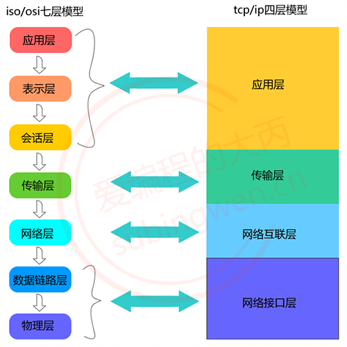](https://subingwen.cn/linux/socket/ip%E5%9B%9B%E5%B1%82%E5%8D%8F%E8%AE%AE%E6%A8%A1%E5%9E%8B.png) 物理层：负责最后将信息编码成电流脉冲或其它信号用于网上传输
- 数据链路层: 数据链路层通过物理网络链路供数据传输。
- 规定了0和1的分包形式，确定了网络数据包的形式；
- 网络层 网络层负责在源和终点之间建立连接;
- 此处需要确定计算机的位置，通过IPv4，IPv6格式的IP地址来找到对应的主机
- 传输层 传输层向高层提供可靠的端到端的网络数据流服务。
- 每一个应用程序都会在网卡注册一个端口号，该层就是端口与端口的通信
- 会话层 会话层建立、管理和终止表示层与实体之间的通信会话；
- 建立一个连接（自动的手机信息、自动的网络寻址）;
- 表示层: 对应用层数据编码和转化, 确保以一个系统应用层发送的信息 可以被另一个系统应用层识别;
#### 2. 网络协议
网络协议指的是计算机网络中互相通信的对等实体之间交换信息时所必须遵守的规则的集合。一般系统网络协议包括五个部分：通信环境，传输服务，词汇表，信息的编码格式，时序、规则和过程。先来通过下面几幅图了解一下常用的网络协议的格式：
- TCP协议 -> 传输层协议 [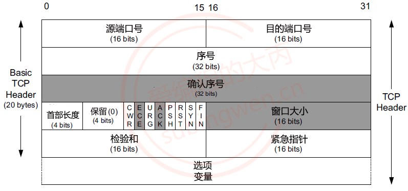](assets/linux-course/remote-f2d1d73419f6-tcp.png)
- UDP协议 -> 传输层协议 [](assets/linux-course/remote-4d6ccb55b34a-udp.png)
- IP协议 -> 网络层协议 [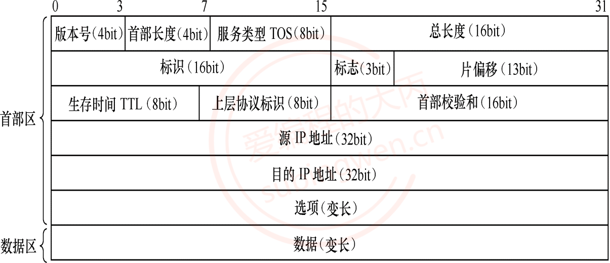](assets/linux-course/remote-b59169ae18c8-ip.png)
- 以太网帧协议 -> 网络接口层协议 [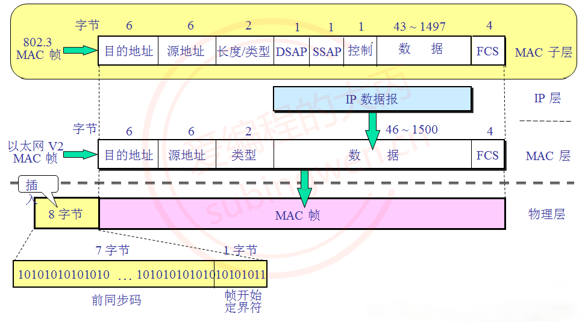](assets/linux-course/remote-4967b0a915a3-mac.png)
- 数据的封装 [](assets/linux-course/remote-11c3524ffe41-1558001080021.png) 在网络通信的时候, 程序猿需要负责的应用层数据的处理(最上层) 应用层的数据可以使用某些协议进行封装, 也可以不封装
- 程序猿需要调用发送数据的接口函数，将数据发送出去
- 程序猿调用的API做底层数据处理 传输层使用传输层协议打包数据
- 网络层使用网络层协议打包数据
- 网络接口层使用网络接口层协议打包数据
- 数据被发送到internet
- 接收端接收到发送端的数据 程序猿调用接收数据的函数接收数据
- 调用的API做相关的底层处理: 网络接口层拆包 ==> 网络层的包
- 网络层拆包 ==> 网络层的包
- 传输层拆包 ==> 传输层数据
- 如果应用层也使用了协议对数据进行了封装，数据的包的解析需要程序猿做
#### 3. socket编程
Socket 套接字由远景研究规划局（Advanced Research Projects Agency, ARPA）资助加里福尼亚大学伯克利分校的一个研究组研发。其目的是将TCP/IP协议相关软件移植到UNIX类系统中。设计者开发了一个接口，以便应用 程序能简单地调用该接口通信。这个接口不断完善，最终形成了Socket套接字。Linux系统采用了Socket套接字，因此，Socket接口就被广 泛使用，到现在已经成为事实上的标准。与套接字相关的函数被包含在头文件sys/socket.h中。

通过上面的描述可以得知，套接字对应程序猿来说就是一套网络通信的接口，使用这套接口就可以完成网络通信。网络通信的主体主要分为两部分：`客户端`和`服务器端`。在客户端和服务器通信的时候需要频繁提到三个概念：`IP`、`端口`、`通信数据`，下面介绍一下需要注意的一些细节问题。
##### 3.1 字节序
在各种计算机体系结构中，对于字节、字等的存储机制有所不同，因而引发了计算机通信领域中一个很重要的问题，即通信双方交流的信息单元（比特、字节、字、双字等等）应该以什么样的顺序进行传送。如果不达成一致的规则，通信双方将无法进行正确的编/译码从而导致通信失败。
**字节序，顾名思义字节的顺序，就是大于一个字节类型的数据在内存中的存放顺序，也就是说对于单字符来说是没有字节序问题的，字符串是单字符的集合，因此字符串也没有字节序问题。**
目前在各种体系的计算机中通常采用的字节存储机制主要有两种：Big-Endian 和 Little-Endian，下面先从字节序说起。
​ [](assets/linux-course/remote-67271160fc4b-bits-order.jpg)
> 大小端的这个名词最早出现在《格列佛游记》中，里边记载了两个征战的强国，你不会想到的是，他们打仗竟然和剥鸡蛋的顺序有关。很多人认为，剥鸡蛋时 应该打破鸡蛋较大的一端，这群人被称作“大端（Big endian）派”。可是那时皇帝儿子小时候吃鸡蛋的时候碰巧将一个手指弄破了。所以，当时的皇帝就下令剥鸡蛋必须打破鸡蛋较小的一端，违令者重罚，由此 产生了“小端（Little endian）派”。 老百姓们对这项命令极其反感，由此引发了6次叛乱，其中一个皇帝送了命，另一个丢了王位。据估计，先后几次有11000人情愿受死也不肯去打破鸡蛋较小的一端！
- Little-Endian -> 主机字节序 (小端) 数据的`低位字节`存储到内存的`低地址位`, 数据的`高位字节`存储到内存的`高地址位`
- 我们使用的PC机，数据的存储默认使用的是小端
- Big-Endian -> 网络字节序 (大端) 据的`低位字节`存储到内存的`高地址位`, 数据的`高位字节`存储到内存的`低地址位`
- `套接字通信过程中操作的数据都是大端存储的，包括：接收/发送的数据、IP地址、端口。`
```c
// 有一个16进制的数, 有32位 (int): 0xab5c01ff
// 字节序, 最小的单位: char 字节, int 有4个字节, 需要将其拆分为4份
// 一个字节 unsigned char, 最大值是 255(十进制) ==> ff(16进制) 
                 内存低地址位                内存的高地址位
--------------------------------------------------------------------------->
小端:         0xff        0x01        0x5c        0xab
大端:         0xab        0x5c        0x01        0xff
```
- 字节序举例 c1234567 [](assets/linux-course/remote-208c64825dfb-little.png) [](assets/linux-course/remote-927d495ba35f-big.png)
```c
#include <arpa/inet.h>
// u:unsigned
// 16: 16位, 32:32位
// h: host, 主机字节序
// n: net, 网络字节序
// s: short
// l: int

// 这套api主要用于 网络通信过程中 IP 和 端口 的 转换
// 将一个短整形从主机字节序 -> 网络字节序
uint16_t htons(uint16_t hostshort);	
// 将一个整形从主机字节序 -> 网络字节序
uint32_t htonl(uint32_t hostlong);	

// 将一个短整形从网络字节序 -> 主机字节序
uint16_t ntohs(uint16_t netshort)
// 将一个整形从网络字节序 -> 主机字节序
uint32_t ntohl(uint32_t netlong);
```
- 函数 BSD Socket提供了封装好的转换接口，方便程序员使用。包括从主机字节序到网络字节序的转换函数：htons、htonl；从网络字节序到主机字节序的转换函数：ntohs、ntohl。
##### 3.2 IP地址转换
虽然IP地址本质是一个整形数，但是在使用的过程中都是通过一个字符串来描述，下面的函数描述了如何将一个字符串类型的IP地址进行大小端转换：
```c
// 主机字节序的IP地址转换为网络字节序
// 主机字节序的IP地址是字符串, 网络字节序IP地址是整形
int inet_pton(int af, const char *src, void *dst); 
```
- 参数: af: 地址族(IP地址的家族包括ipv4和ipv6)协议 AF_INET: ipv4格式的ip地址
- AF_INET6: ipv6格式的ip地址
- src: 传入参数, 对应要转换的点分十进制的ip地址: 192.168.1.100
- dst: 传出参数, 函数调用完成, 转换得到的大端整形IP被写入到这块内存中
- 返回值：成功返回1，失败返回0或者-1
```c
#include <arpa/inet.h>
// 将大端的整形数, 转换为小端的点分十进制的IP地址        
const char *inet_ntop(int af, const void *src, char *dst, socklen_t size);
```
- 参数: af: 地址族协议 AF_INET: ipv4格式的ip地址
- AF_INET6: ipv6格式的ip地址
- src: 传入参数, 这个指针指向的内存中存储了大端的整形IP地址
- dst: 传出参数, 存储转换得到的小端的点分十进制的IP地址
- size: 修饰dst参数的, 标记dst指向的内存中最多可以存储多少个字节
- 返回值: 成功: 指针指向第三个参数对应的内存地址, 通过返回值也可以直接取出转换得到的IP字符串
- 失败: NULL
还有一组函数也能进程IP地址大小端的转换，但是只能处理ipv4的ip地址：
```c
// 点分十进制IP -> 大端整形
in_addr_t inet_addr (const char *cp);

// 大端整形 -> 点分十进制IP
char* inet_ntoa(struct in_addr in);
```
##### 3.3 sockaddr 数据结构

```c
// 在写数据的时候不好用
struct sockaddr {
	sa_family_t sa_family;       // 地址族协议, ipv4
	char        sa_data[14];     // 端口(2字节) + IP地址(4字节) + 填充(8字节)
}

typedef unsigned short  uint16_t;
typedef unsigned int    uint32_t;
typedef uint16_t in_port_t;
typedef uint32_t in_addr_t;
typedef unsigned short int sa_family_t;
#define __SOCKADDR_COMMON_SIZE (sizeof (unsigned short int))

struct in_addr
{
    in_addr_t s_addr;
};  

// sizeof(struct sockaddr) == sizeof(struct sockaddr_in)
struct sockaddr_in
{
    sa_family_t sin_family;		/* 地址族协议: AF_INET */
    in_port_t sin_port;         /* 端口, 2字节-> 大端  */
    struct in_addr sin_addr;    /* IP地址, 4字节 -> 大端  */
    /* 填充 8字节 */
    unsigned char sin_zero[sizeof (struct sockaddr) - sizeof(sin_family) -
               sizeof (in_port_t) - sizeof (struct in_addr)];
};  
```
##### 3.4 套接字函数
使用套接字通信函数需要包含头文件`<arpa/inet.h>`，包含了这个头文件`<sys/socket.h>`就不用在包含了。
```c
// 创建一个套接字
int socket(int domain, int type, int protocol);
```
- 参数: domain: 使用的地址族协议 AF_INET: 使用IPv4格式的ip地址
- AF_INET6: 使用IPv6格式的ip地址
- type: SOCK_STREAM: 使用流式的传输协议
- SOCK_DGRAM: 使用报式(报文)的传输协议
- protocol: 一般写0即可, 使用默认的协议 SOCK_STREAM: 流式传输默认使用的是tcp
- SOCK_DGRAM: 报式传输默认使用的udp
- 返回值: 成功: 可用于套接字通信的文件描述符
- 失败: -1
函数的返回值是一个文件描述符，通过这个文件描述符可以操作内核中的某一块内存，网络通信是基于这个文件描述符来完成的。
```c
// 将文件描述符和本地的IP与端口进行绑定   
int bind(int sockfd, const struct sockaddr *addr, socklen_t addrlen);
```
- 参数: sockfd: 监听的文件描述符, 通过socket()调用得到的返回值
- addr: 传入参数, 要绑定的IP和端口信息需要初始化到这个结构体中，`IP和端口要转换为网络字节序`
- addrlen: 参数addr指向的内存大小, sizeof(struct sockaddr)
- 返回值：成功返回0，失败返回-1
```c
// 给监听的套接字设置监听
int listen(int sockfd, int backlog);
```
- 参数: sockfd: 文件描述符, 可以通过调用socket()得到，在监听之前必须要绑定 bind()
- backlog: 同时能处理的最大连接要求，最大值为128
- 返回值：函数调用成功返回0，调用失败返回 -1
```c
// 等待并接受客户端的连接请求, 建立新的连接, 会得到一个新的文件描述符(通信的)		
int accept(int sockfd, struct sockaddr *addr, socklen_t *addrlen);
```
- 参数: sockfd: 监听的文件描述符
- addr: 传出参数, 里边存储了建立连接的客户端的地址信息
- addrlen: 传入传出参数，用于存储addr指向的内存大小
- 返回值：函数调用成功，得到一个文件描述符, 用于和建立连接的这个客户端通信，调用失败返回 -1
`这个函数是一个阻塞函数，当没有新的客户端连接请求的时候，该函数阻塞；当检测到有新的客户端连接请求时，阻塞解除，新连接就建立了，得到的返回值也是一个文件描述符，基于这个文件描述符就可以和客户端通信了。`
```c
// 接收数据
ssize_t read(int sockfd, void *buf, size_t size);
ssize_t recv(int sockfd, void *buf, size_t size, int flags);
```
- 参数: sockfd: 用于通信的文件描述符, accept() 函数的返回值
- buf: 指向一块有效内存, 用于存储接收是数据
- size: 参数buf指向的内存的容量
- flags: 特殊的属性, 一般不使用, 指定为 0
- 返回值: 大于0：实际接收的字节数
- 等于0：对方断开了连接
- -1：接收数据失败了
`如果连接没有断开，接收端接收不到数据，接收数据的函数会阻塞等待数据到达，数据到达后函数解除阻塞，开始接收数据，当发送端断开连接，接收端无法接收到任何数据，但是这时候就不会阻塞了，函数直接返回0。`
```c
// 发送数据的函数
ssize_t write(int fd, const void *buf, size_t len);
ssize_t send(int fd, const void *buf, size_t len, int flags);
```
- 参数: fd: 通信的文件描述符, accept() 函数的返回值
- buf: 传入参数, 要发送的字符串
- len: 要发送的字符串的长度
- flags: 特殊的属性, 一般不使用, 指定为 0
- 返回值： 大于0：实际发送的字节数，和参数len是相等的
- -1：发送数据失败了
```c
// 成功连接服务器之后, 客户端会自动随机绑定一个端口
// 服务器端调用accept()的函数, 第二个参数存储的就是客户端的IP和端口信息
int connect(int sockfd, const struct sockaddr *addr, socklen_t addrlen);
```
- 参数: sockfd: 通信的文件描述符, 通过调用socket()函数就得到了
- addr: 存储了要连接的服务器端的地址信息: iP 和 端口，这个IP和端口也需要转换为大端然后再赋值
- addrlen: addr指针指向的内存的大小 sizeof(struct sockaddr)
- 返回值：连接成功返回0，连接失败返回-1
#### 4. TCP通信流程
TCP是一个面向连接的，安全的，流式传输协议，这个协议是一个传输层协议。
- 面向连接：是一个双向连接，通过三次握手完成，断开连接需要通过四次挥手完成。
- 安全：tcp通信过程中，会对发送的每一数据包都会进行校验, 如果发现数据丢失, 会自动重传
- 流式传输：发送端和接收端处理数据的速度，数据的量都可以不一致

##### 4.1 服务器端通信流程
```c
int lfd = socket();
```
1. 创建用于监听的套接字, 这个套接字是一个文件描述符
```c
bind();
```
1. 将得到的监听的文件描述符和本地的IP 端口进行绑定
```c
listen();
```
1. 设置监听(成功之后开始监听, 监听的是客户端的连接)
```c
int cfd = accept();
```
1. 等待并接受客户端的连接请求, 建立新的连接, 会得到一个新的文件描述符(通信的)，`没有新连接请求就阻塞`
```c
// 接收数据
read(); / recv();
// 发送数据
write(); / send();
```
1. 通信，读写操作默认都是阻塞的
```c
close();
```
1. 断开连接, 关闭套接字
> 在tcp的服务器端, 有两类文件描述符 监听的文件描述符 只需要有一个 不负责和客户端通信, 负责检测客户端的连接请求, 检测到之后调用accept就可以建立新的连接 通信的文件描述符 负责和建立连接的客户端通信 如果有N个客户端和服务器建立了新的连接, 通信的文件描述符就有N个，每个客户端和服务器都对应一个通信的文件描述符

- 文件描述符对应的内存结构： `一个文件文件描述符对应两块内存, 一块内存是读缓冲区, 一块内存是写缓冲区`
- 读数据: `通过文件描述符将内存中的数据读出, 这块内存称之为读缓冲区`
- 写数据: `通过文件描述符将数据写入到某块内存中, 这块内存称之为写缓冲区`
- 监听的文件描述符: 客户端的连接请求会发送到服务器端监听的文件描述符的读缓冲区中
- 读缓冲区中有数据, 说明有新的客户端连接
- 调用accept()函数, 这个函数会检测监听文件描述符的读缓冲区 检测不到数据, 该函数阻塞
- 如果检测到数据, 解除阻塞, 新的连接建立
- 通信的文件描述符: 客户端和服务器端都有通信的文件描述符
- 发送数据：调用函数 write() / send()，数据进入到内核中 数据并没有被发送出去, 而是将数据写入到了通信的文件描述符对应的写缓冲区中
- 内核检测到通信的文件描述符写缓冲区中有数据, 内核会将数据发送到网络中
- 接收数据: 调用的函数 read() / recv(), 从内核读数据 数据如何进入到内核程序猿不需要处理, 数据进入到通信的文件描述符的读缓冲区中
- 数据进入到内核, 必须使用通信的文件描述符, 将数据从读缓冲区中读出即可
> 基于tcp的服务器端通信代码:
```c
// server.c
#include <stdio.h>
#include <stdlib.h>
#include <unistd.h>
#include <string.h>
#include <arpa/inet.h>

int main()
{
    // 1. 创建监听的套接字
    int lfd = socket(AF_INET, SOCK_STREAM, 0);
    if(lfd == -1)
    {
        perror("socket");
        exit(0);
    }

    // 2. 将socket()返回值和本地的IP端口绑定到一起
    struct sockaddr_in addr;
    addr.sin_family = AF_INET;
    addr.sin_port = htons(10000);   // 大端端口
    // INADDR_ANY代表本机的所有IP, 假设有三个网卡就有三个IP地址
    // 这个宏可以代表任意一个IP地址
    // 这个宏一般用于本地的绑定操作
    addr.sin_addr.s_addr = INADDR_ANY;  // 这个宏的值为0 == 0.0.0.0
//    inet_pton(AF_INET, "192.168.237.131", &addr.sin_addr.s_addr);
    int ret = bind(lfd, (struct sockaddr*)&addr, sizeof(addr));
    if(ret == -1)
    {
        perror("bind");
        exit(0);
    }

    // 3. 设置监听
    ret = listen(lfd, 128);
    if(ret == -1)
    {
        perror("listen");
        exit(0);
    }

    // 4. 阻塞等待并接受客户端连接
    struct sockaddr_in cliaddr;
    int clilen = sizeof(cliaddr);
    int cfd = accept(lfd, (struct sockaddr*)&cliaddr, &clilen);
    if(cfd == -1)
    {
        perror("accept");
        exit(0);
    }
    // 打印客户端的地址信息
    char ip[24] = {0};
    printf("客户端的IP地址: %s, 端口: %d\n",
           inet_ntop(AF_INET, &cliaddr.sin_addr.s_addr, ip, sizeof(ip)),
           ntohs(cliaddr.sin_port));

    // 5. 和客户端通信
    while(1)
    {
        // 接收数据
        char buf[1024];
        memset(buf, 0, sizeof(buf));
        int len = read(cfd, buf, sizeof(buf));
        if(len > 0)
        {
            printf("客户端say: %s\n", buf);
            write(cfd, buf, len);
        }
        else if(len  == 0)
        {
            printf("客户端断开了连接...\n");
            break;
        }
        else
        {
            perror("read");
            break;
        }
    }

    close(cfd);
    close(lfd);

    return 0;
}
```
##### 4.2 客户端的通信流程
> 在单线程的情况下客户端通信的文件描述符有一个, 没有监听的文件描述符
1. 创建一个通信的套接字
```c
int cfd = socket();
```
1. 连接服务器, 需要知道服务器绑定的IP和端口
```c
connect();
```
1. 通信
```c
// 接收数据
read(); / recv();
// 发送数据
write(); / send();
```
1. 断开连接, 关闭文件描述符(套接字)
```c
close();
```
> 基于tcp通信的客户端通信代码:
```c
// client.c
#include <stdio.h>
#include <stdlib.h>
#include <unistd.h>
#include <string.h>
#include <arpa/inet.h>

int main()
{
    // 1. 创建通信的套接字
    int fd = socket(AF_INET, SOCK_STREAM, 0);
    if(fd == -1)
    {
        perror("socket");
        exit(0);
    }

    // 2. 连接服务器
    struct sockaddr_in addr;
    addr.sin_family = AF_INET;
    addr.sin_port = htons(10000);   // 大端端口
    inet_pton(AF_INET, "192.168.237.131", &addr.sin_addr.s_addr);

    int ret = connect(fd, (struct sockaddr*)&addr, sizeof(addr));
    if(ret == -1)
    {
        perror("connect");
        exit(0);
    }

    // 3. 和服务器端通信
    int number = 0;
    while(1)
    {
        // 发送数据
        char buf[1024];
        sprintf(buf, "你好, 服务器...%d\n", number++);
        write(fd, buf, strlen(buf)+1);
        
        // 接收数据
        memset(buf, 0, sizeof(buf));
        int len = read(fd, buf, sizeof(buf));
        if(len > 0)
        {
            printf("服务器say: %s\n", buf);
        }
        else if(len  == 0)
        {
            printf("服务器断开了连接...\n");
            break;
        }
        else
        {
            perror("read");
            break;
        }
        sleep(1);   // 每隔1s发送一条数据
    }

    close(fd);

    return 0;
}
```
#### 5. 扩展阅读
在Window中也提供了套接字通信的API，这些API函数与Linux平台的API函数几乎相同，以至于很多人认为套接字通信的API函数库只有一套，下面来看一下这些Windows平台的套接字函数：
##### 5.1 初始化套接字环境
使用Windows中的套接字函数需要额外包含对应的头文件以及加载响应的动态库：
```c
// 使用包含的头文件 
include <winsock2.h>
// 使用的套接字库 
ws2_32.dll       
```
在Windows中使用套接字需要先加载套接字库（套接字环境），最后需要释放套接字资源。
```c++
// 初始化Winsock库
// 返回值: 成功返回0，失败返回SOCKET_ERROR。
WSAStartup(WORD wVersionRequested, LPWSADATA lpWSAData);
```
- 参数: wVersionRequested: 使用的Windows Socket的版本, 一般使用的版本是 2.2 初始化这个 `MAKEWORD(2, 2);`参数
- lpWSAData：一个WSADATA结构指针, 这是一个传入参数 创建一个 WSADATA 类型的变量, 将地址传递给该函数的第二个参数
注销Winsock相关库，函数调用成功返回0，失败返回 SOCKET_ERROR。
```c++
int WSACleanup (void);
```
使用举例：
```c++
WSAData wsa;
// 初始化套接字库
WSAStartup(MAKEWORD(2, 2), &wsa);

// .......

// 注销Winsock相关库
WSACleanup();
```
##### 5.2 套接字通信函数
> 基于Linux的套接字通信流程是最全面的一套通信流程，如果是在某个框架中进行套接字通信，通信流程只会更简单，直接使用window的套接字api进行套接字通信，和Linux平台上的通信流程完全相同。
###### 5.2.1 结构体
```c
///////////////////////////////////////////////////////////////////////
/////////////////////////////// Windows ///////////////////////////////
///////////////////////////////////////////////////////////////////////
typedef struct in_addr {
　　union {
　　	struct{ unsigned char s_b1,s_b2, s_b3,s_b4;} S_un_b;
　　	struct{ unsigned short s_w1, s_w2;} S_un_w;
　　	unsigned long S_addr;	// 存储IP地址
　　} S_un;
}IN_ADDR;

struct sockaddr_in {
　　short int sin_family; /* Address family */
　　unsigned short int sin_port; /* Port number */
　　struct in_addr sin_addr; /* Internet address */
　　unsigned char sin_zero[8]; /* Same size as struct sockaddr */
};

///////////////////////////////////////////////////////////////////////
//////////////////////////////// Linux ////////////////////////////////
///////////////////////////////////////////////////////////////////////
typedef unsigned short  uint16_t;
typedef unsigned int    uint32_t;
typedef uint16_t in_port_t;
typedef uint32_t in_addr_t;
typedef unsigned short int sa_family_t;

struct in_addr
{
    in_addr_t s_addr;
};  

// sizeof(struct sockaddr) == sizeof(struct sockaddr_in)
struct sockaddr_in
{
    sa_family_t sin_family;     /* 地址族协议: AF_INET */
    in_port_t sin_port;         /* 端口, 2字节-> 大端  */
    struct in_addr sin_addr;    /* IP地址, 4字节 -> 大端  */
    /* 填充 8字节 */
    unsigned char sin_zero[sizeof (struct sockaddr) - sizeof(sin_family) -
                      sizeof (in_port_t) - sizeof (struct in_addr)];
};  
```
###### **5.2.2 大小端转换函数**
```c
// 主机字节序 -> 网络字节序
u_short htons (u_short hostshort );
u_long htonl ( u_long hostlong);

// 网络字节序 -> 主机字节序
u_short ntohs (u_short netshort );
u_long ntohl ( u_long netlong);

// linux函数, window上没有这两个函数
inet_ntop(); 
inet_pton();

// windows 和 linux 都使用, 只能处理ipv4的ip地址
// 点分十进制IP -> 大端整形
unsigned long inet_addr (const char FAR * cp);	// windows
in_addr_t     inet_addr (const char *cp);			// linux

// 大端整形 -> 点分十进制IP
// window, linux相同
char* inet_ntoa(struct in_addr in);
```
###### **5.2.3 套接字函数**
> `window的api中套接字对应的类型是 SOCKET 类型, linux中是 int 类型, 本质是一样的`
```c
// 创建一个套接字
// 返回值: 成功返回套接字, 失败返回INVALID_SOCKET
SOCKET socket(int af,int type,int protocal);
参数:
    - af: 地址族协议
        - ipv4: AF_INET (windows/linux)
        - PF_INET (windows)
        - AF_INET == PF_INET
   - type: 和linux一样
       	- SOCK_STREAM
        - SOCK_DGRAM
   - protocal: 一般写0 即可
       - 在windows上的另一种写法
           - IPPROTO_TCP, 使用指定的流式协议中的tcp协议
           - IPPROTO_UDP, 使用指定的报式协议中的udp协议

 // 关键字: FAR NEAR, 这两个关键字在32/64位机上是没有意义的, 指定的内存的寻址方式
// 套接字绑定本地IP和端口
// 返回值: 成功返回0，失败返回SOCKET_ERROR
int bind(SOCKET s,const struct sockaddr FAR* name, int namelen);

// 设置监听
// 返回值: 成功返回0，失败返回SOCKET_ERROR
int listen(SOCKET s,int backlog);

// 等待并接受客户端连接
// 返回值: 成功返回用于的套接字，失败返回INVALID_SOCKET。
SOCKET accept ( SOCKET s, struct sockaddr FAR* addr, int FAR* addrlen );

// 连接服务器
// 返回值: 成功返回0，失败返回SOCKET_ERROR
int connect (SOCKET s,const struct sockaddr FAR* name,int namelen );

// 在Qt中connect用户信号槽的连接, 如果要使用windows api 中的 connect 需要在函数名前加::
::connect(sock, (struct sockaddr*)&addr, sizeof(addr));

// 接收数据
// 返回值: 成功时返回接收的字节数，收到EOF时为0，失败时返回SOCKET_ERROR。
//		==0 代表对方已经断开了连接
int recv (SOCKET s,char FAR* buf,int len,int flags);

// 发送数据
// 返回值: 成功返回传输字节数，失败返回SOCKET_ERROR。
int send (SOCKET s,const char FAR * buf, int len,int flags);

// 关闭套接字
// 返回值: 成功返回0，失败返回SOCKET_ERROR
int closesocket (SOCKET s);		// 在linux中使用的函数是: int close(int fd);

//----------------------- udp 通信函数 -------------------------
// 接收数据
int recvfrom(SOCKET s,char FAR *buf,int len,int flags,
         struct sockaddr FAR *from,int FAR *fromlen);
// 发送数据
int sendto(SOCKET s,const char FAR *buf,int len,int flags,
       const struct sockaddr FAR *to,int tolen);
```

### 4.2 三次握手、四次挥手

> 原文：[《三次握手、四次挥手》](https://subingwen.cn/linux/tcp-status/)　作者：苏丙榅　来源：爱编程的大丙

#### 1. TCP状态转换
在TCP进行三次握手，或者四次挥手的过程中，通信的服务器和客户端内部会发送状态上的变化，发生的状态变化在程序中是看不到的，这个状态的变化也不需要程序猿去维护，但是在某些情况下进行程序的调试会去查看相关的状态信息，先来看三次握手过程中的状态转换。

##### 1.1 三次握手
```c
在第一次握手之前，服务器端必须先启动，并且已经开始了监听
  - 服务器端先调用了 listen() 函数, 开始监听
  - 服务器启动监听前后的状态变化: 没有状态 ---> LISTEN
```
当服务器监听启动之后，由客户端发起的三次握手过程中状态转换如下：
第一次握手:
- 客户端：调用了`connect()` 函数，状态变化：`没有状态 -> SYN_SENT `
- 服务器：收到连接请求SYN，状态变化：`LISTEN -> SYN_RCVD`
第二次握手:
- 服务器：给客户端回复ACK，并且请求和客户端建立连接，状态无变化，依然是 SYN_RCVD
- 客户端：接收数据，收到了ACK，状态变化：`SYN_SENT -> ESTABLISHED`
第三次握手:
- 客户端：给服务器回复ACK，同意建立连接，状态没有变化，还是 ESTABLISHED
- 服务器：收到了ACK，状态变化：`SYN_RCVD -> ESTABLISHED`
三次握手完成之后，客户端和服务器都变成了同一种状态，这种状态叫：ESTABLISHED，表示双向连接已经建立， 可以通信了。在通过过程中，正常的通信状态就是 ESTABLISHED。
##### 1.2 四次挥手
关于四次挥手对于客户端和服务器哪段先断开连接没有要求，根据实际情况处理即可。下面根据上图中的实例描述一下四次挥手过程中TCP的状态转换（上图中主动断开连接的一方是客户端）：
第一次挥手:
- 客户端：调用`close()` 函数，将tcp协议中的FIN设置为1，请求和服务器断开连接， 状态变化:`ESTABLISHED -> FIN_WAIT_1`
- 服务器：收到断开连接请求，状态变化: `ESTABLISHED -> CLOSE_WAIT`
第二次挥手:
- 服务器：回复ACK，同意断开连接的请求，状态没有变化，还是 CLOSE_WAIT
- 客户端：收到ACK，状态变化：`FIN_WAIT_1 -> FIN_WAIT_2`
第三次挥手:
- 服务器端：调用close() 函数，发送FIN给客户端，请求断开连接，状态变化：`CLOSE_WAIT -> LAST_ACK`
- 客户端：收到FIN，状态变化：`FIN_WAIT_2 -> TIME_WAIT`
第四次挥手:
- 客户端：回复ACK给服务器，状态是没有变化的，状态变化：`TIME_WAIT -> 没有状态`
- 服务器端：收到ACK，双向连接断开，状态变化：`LAST_ACK -> 无状态(没有了)`
##### 1.3 状态转换
在下图中同样是描述TCP通信过程中的客户端和服务器端的状态转，看起来比较乱，其实只需要看两条主线：红色实线和绿色虚线。关于黑色的实线对应的是一些特殊情况下的状态切换，在此不做任何分析。
因为三次握手是由客户端发起的，据此分析红色的实线表示的客户端的状态，绿色虚线表示的是服务器端的状态。

- 客户端： 第一次握手：发送SYN，`没有状态 -> SYN_SENT`
- 第二次握手：收到回复的ACK，`SYN_SENT -> ESTABLISHED`
- 主动断开连接，第一次挥手发送FIN，状态`ESTABLISHED -> FIN_WAIT_1`
- 第二次挥手，收到ACK，状态`FIN_WAIT_1 -> FIN_WAIT_2`
- 第三次挥手，收到FIN，状态`FIN_WAIT_2 -> TIME_WAIT`
- 第四次挥手，回复ACK，等待2倍报文时长之后，状态`TIME_WAIT -> 没有状态`
- 服务器端： 启动监听，`没有状态 -> LISTEN`
- 第一次握手，收到SYN，状态`LISTEN -> SYN_RCVD`
- 第三次握手，收到ACK，状态`SYN_RCVD -> ESTABLISHED`
- 收到断开连接请求，第一次挥手状态 `ESTABLISHED -> CLOSE_WAIT`
- 第三次挥手，发送FIN请求和客户端断开连接，状态`CLOSE_WAIT -> LAST_ACK`
- 第四次挥手，收到ACK，状态`LAST_ACK -> 无状态(没有了)`
在TCP通信的时候，当主动断开连接的一方接收到被动断开连接的一方发送的FIN和最终的ACK后（第三次挥手完成），连接的主动关闭方必须处于`TIME_WAIT`状态并持续`2MSL（Maximum Segment Lifetime）`时间，这样就能够让TCP连接的主动关闭方在它发送的ACK丢失的情况下重新发送最终的ACK。
一倍报文寿命(MSL)大概时长为30s，因此两倍报文寿命一般在1分钟作用。
`主动关闭方重新发送的最终ACK，是因为被动关闭方重传了它的FIN。事实上，被动关闭方总是重传FIN直到它收到一个最终的ACK。`
##### 1.4 相关命令
```bash
$ netstat 参数
$ netstat -apn	| grep 关键字
```
- 参数: `-a` (all)显示所有选项
- `-p` 显示建立相关链接的程序名
- `-n` 拒绝显示别名，能显示数字的全部转化成数字。
- `-l` 仅列出有在 Listen (监听) 的服务状态
- `-t` (tcp)仅显示tcp相关选项
- `-u` (udp)仅显示udp相关选项
#### 2. 半关闭
TCP 连接只有一方发送了FIN，另一方没有发出FIN包，仍然可以在一个方向上正常发送数据，这中状态可以称之为半关闭或者半连接。当四次挥手完成两次的时 候，就相当于实现了半关闭，在程序中只需要在某一端直接调用 close() 函数即可。套接字通信默认是双工的，也就是双向通信，如果进行了半关闭就变成了单工，数据只能单向流动了。比如下面的这个例子：
- 服务器端: 调用了close() 函数，因此不能发数据，只能接收数据
- 关闭了服务器端的写操作，现在只能进行读操作 –> 变成了读端
- 客户端: 没有调用close()，客户端和服务器的连接还保持着
- 客户端可以给服务器发送数据，也可以接收服务器发送的数据 （但是，服务器已经丧失了发送数据的能力），因此客户端也只能发送数据，接收不到数据 –> 变成了写端
按照上述流程做了半关闭之后，从双工变成了单工，数据单向流动的方向: 客户端 —–> 服务器端。
```c
// 专门处理半关闭的函数
#include <sys/socket.h>
// 可以有选择的关闭读/写, close()函数只能关闭写操作
int shutdown(int sockfd, int how);
```
- 参数: sockfd: 要操作的文件描述符
- how: SHUT_RD: 关闭文件描述符对应的读操作
- SHUT_WR: 关闭文件描述符对应的写操作
- SHUT_RDWR: 关闭文件描述符对应的读写操作
- 返回值：函数调用成功返回0，失败返回-1
#### 3. 端口复用
在网络通信中，一个端口只能被一个进程使用，不能多个进程共用同一个端口。我们在进行套接字通信的时候，如果按顺序执行如下操作：先启动服务器程序，再启动客户端程序，然后关闭服务器进程，再退出客户端进程，最后再启动服务器进程，就会出如下的错误提示信息：`bind error: Address already in use`
```bash
# 第二次启动服务器进程
$ ./server 
bind error: Address already in use

$ netstat -apn|grep 9999
(Not all processes could be identified, non-owned process info
 will not be shown, you would have to be root to see it all.)
tcp        0      0 127.0.0.1:9999          127.0.0.1:50178         TIME_WAIT   -   
```
通过`netstat`查看TCP状态，发现上一个服务器进程其实还没有真正退出。因为服务器进程是主动断开连接的进程, 最后状态变成了` TIME_WAIT`状态，这个进程会等待`2msl(大约1分钟)`才会退出，如果该进程不退出，其绑定的端口就不会释放，再次启动新的进程还是使用这个未释放的端口，端口被重复使用，就是提示`bind error: Address already in use`这个错误信息。
如果想要解决上述问题，就必须要设置端口复用，使用的函数原型如下：
```c
// 这个函数是一个多功能函数, 可以设置套接字选项
int setsockopt(int sockfd, int level, int optname, const void *optval, socklen_t optlen);
```
- 参数: sockfd：用于监听的文件描述符
- level：设置端口复用需要使用 SOL_SOCKET 宏
- optname：要设置什么属性（下边的两个宏都可以设置端口复用） SO_REUSEADDR
- SO_REUSEPORT
- optval：设置是去除端口复用属性还是设置端口复用属性，实际应该使用 int 型变量 0：不设置
- 1：设置
- optlen：optval指针指向的内存大小 sizeof(int)
这个函数应该添加到服务器端代码中，具体应该放到什么位置呢？答：在绑定之前设置端口复用
1. 创建监听的套接字
1. 设置端口复用
1. 绑定
1. 设置监听
1. 等待并接受客户端连接
1. 通信
1. 断开连接
参考代码如下:
```c
#include <stdio.h>
#include <ctype.h>
#include <unistd.h>
#include <stdlib.h>
#include <sys/types.h>
#include <sys/stat.h>
#include <string.h>
#include <arpa/inet.h>
#include <sys/socket.h>
#include <sys/select.h>

// server
int main(int argc, const char* argv[])
{
    // 创建监听的套接字
    int lfd = socket(AF_INET, SOCK_STREAM, 0);
    if(lfd == -1)
    {
        perror("socket error");
        exit(1);
    }

    // 绑定
    struct sockaddr_in serv_addr;
    memset(&serv_addr, 0, sizeof(serv_addr));
    serv_addr.sin_family = AF_INET;
    serv_addr.sin_port = htons(9999);
    serv_addr.sin_addr.s_addr = htonl(INADDR_ANY);  // 本地多有的ＩＰ
    // 127.0.0.1
    // inet_pton(AF_INET, "127.0.0.1", &serv_addr.sin_addr.s_addr);
    
    // 设置端口复用
    int opt = 1;
    setsockopt(lfd, SOL_SOCKET, SO_REUSEADDR, &opt, sizeof(opt));

    // 绑定端口
    int ret = bind(lfd, (struct sockaddr*)&serv_addr, sizeof(serv_addr));
    if(ret == -1)
    {
        perror("bind error");
        exit(1);
    }

    // 监听
    ret = listen(lfd, 64);
    if(ret == -1)
    {
        perror("listen error");
        exit(1);
    }

    fd_set reads, tmp;
    FD_ZERO(&reads);
    FD_SET(lfd, &reads);

    int maxfd = lfd;

    while(1)
    {
        tmp = reads;
        int ret = select(maxfd+1, &tmp, NULL, NULL, NULL);
        if(ret == -1)
        {
            perror("select");
            exit(0);
        }

        if(FD_ISSET(lfd, &tmp))
        {
            int cfd = accept(lfd, NULL, NULL);
            FD_SET(cfd, &reads);
            maxfd = cfd > maxfd ? cfd : maxfd;
        }
        for(int i=lfd+1; i<=maxfd; ++i)
        {
            if(FD_ISSET(i, &tmp))
            {
                char buf[1024];
                int len = read(i, buf, sizeof(buf));
                if(len > 0)
                {
                    printf("client say: %s\n", buf);
                    write(i, buf, len);
                }
                else if(len == 0)
                {
                    printf("客户端断开了连接\n");
                    FD_CLR(i, &reads);
                    close(i);
                }
                else
                {
                    perror("read");
                    exit(0);
                }
            }
        }
    }

    return 0;
}
```

### 4.3 TCP 状态转换

> 原文：[《TCP状态转换》](https://subingwen.cn/linux/tcp-status/)　作者：苏丙榅　来源：爱编程的大丙

#### 1. TCP状态转换
在TCP进行三次握手，或者四次挥手的过程中，通信的服务器和客户端内部会发送状态上的变化，发生的状态变化在程序中是看不到的，这个状态的变化也不需要程序猿去维护，但是在某些情况下进行程序的调试会去查看相关的状态信息，先来看三次握手过程中的状态转换。

##### 1.1 三次握手
```c
在第一次握手之前，服务器端必须先启动，并且已经开始了监听
  - 服务器端先调用了 listen() 函数, 开始监听
  - 服务器启动监听前后的状态变化: 没有状态 ---> LISTEN
```
当服务器监听启动之后，由客户端发起的三次握手过程中状态转换如下：
第一次握手:
- 客户端：调用了`connect()` 函数，状态变化：`没有状态 -> SYN_SENT `
- 服务器：收到连接请求SYN，状态变化：`LISTEN -> SYN_RCVD`
第二次握手:
- 服务器：给客户端回复ACK，并且请求和客户端建立连接，状态无变化，依然是 SYN_RCVD
- 客户端：接收数据，收到了ACK，状态变化：`SYN_SENT -> ESTABLISHED`
第三次握手:
- 客户端：给服务器回复ACK，同意建立连接，状态没有变化，还是 ESTABLISHED
- 服务器：收到了ACK，状态变化：`SYN_RCVD -> ESTABLISHED`
三次握手完成之后，客户端和服务器都变成了同一种状态，这种状态叫：ESTABLISHED，表示双向连接已经建立， 可以通信了。在通过过程中，正常的通信状态就是 ESTABLISHED。
##### 1.2 四次挥手
关于四次挥手对于客户端和服务器哪段先断开连接没有要求，根据实际情况处理即可。下面根据上图中的实例描述一下四次挥手过程中TCP的状态转换（上图中主动断开连接的一方是客户端）：
第一次挥手:
- 客户端：调用`close()` 函数，将tcp协议中的FIN设置为1，请求和服务器断开连接， 状态变化:`ESTABLISHED -> FIN_WAIT_1`
- 服务器：收到断开连接请求，状态变化: `ESTABLISHED -> CLOSE_WAIT`
第二次挥手:
- 服务器：回复ACK，同意断开连接的请求，状态没有变化，还是 CLOSE_WAIT
- 客户端：收到ACK，状态变化：`FIN_WAIT_1 -> FIN_WAIT_2`
第三次挥手:
- 服务器端：调用close() 函数，发送FIN给客户端，请求断开连接，状态变化：`CLOSE_WAIT -> LAST_ACK`
- 客户端：收到FIN，状态变化：`FIN_WAIT_2 -> TIME_WAIT`
第四次挥手:
- 客户端：回复ACK给服务器，状态是没有变化的，状态变化：`TIME_WAIT -> 没有状态`
- 服务器端：收到ACK，双向连接断开，状态变化：`LAST_ACK -> 无状态(没有了)`
##### 1.3 状态转换
在下图中同样是描述TCP通信过程中的客户端和服务器端的状态转，看起来比较乱，其实只需要看两条主线：红色实线和绿色虚线。关于黑色的实线对应的是一些特殊情况下的状态切换，在此不做任何分析。
因为三次握手是由客户端发起的，据此分析红色的实线表示的客户端的状态，绿色虚线表示的是服务器端的状态。

- 客户端： 第一次握手：发送SYN，`没有状态 -> SYN_SENT`
- 第二次握手：收到回复的ACK，`SYN_SENT -> ESTABLISHED`
- 主动断开连接，第一次挥手发送FIN，状态`ESTABLISHED -> FIN_WAIT_1`
- 第二次挥手，收到ACK，状态`FIN_WAIT_1 -> FIN_WAIT_2`
- 第三次挥手，收到FIN，状态`FIN_WAIT_2 -> TIME_WAIT`
- 第四次挥手，回复ACK，等待2倍报文时长之后，状态`TIME_WAIT -> 没有状态`
- 服务器端： 启动监听，`没有状态 -> LISTEN`
- 第一次握手，收到SYN，状态`LISTEN -> SYN_RCVD`
- 第三次握手，收到ACK，状态`SYN_RCVD -> ESTABLISHED`
- 收到断开连接请求，第一次挥手状态 `ESTABLISHED -> CLOSE_WAIT`
- 第三次挥手，发送FIN请求和客户端断开连接，状态`CLOSE_WAIT -> LAST_ACK`
- 第四次挥手，收到ACK，状态`LAST_ACK -> 无状态(没有了)`
在TCP通信的时候，当主动断开连接的一方接收到被动断开连接的一方发送的FIN和最终的ACK后（第三次挥手完成），连接的主动关闭方必须处于`TIME_WAIT`状态并持续`2MSL（Maximum Segment Lifetime）`时间，这样就能够让TCP连接的主动关闭方在它发送的ACK丢失的情况下重新发送最终的ACK。
一倍报文寿命(MSL)大概时长为30s，因此两倍报文寿命一般在1分钟作用。
`主动关闭方重新发送的最终ACK，是因为被动关闭方重传了它的FIN。事实上，被动关闭方总是重传FIN直到它收到一个最终的ACK。`
##### 1.4 相关命令
```bash
$ netstat 参数
$ netstat -apn	| grep 关键字
```
- 参数: `-a` (all)显示所有选项
- `-p` 显示建立相关链接的程序名
- `-n` 拒绝显示别名，能显示数字的全部转化成数字。
- `-l` 仅列出有在 Listen (监听) 的服务状态
- `-t` (tcp)仅显示tcp相关选项
- `-u` (udp)仅显示udp相关选项
#### 2. 半关闭
TCP连接只有一方发送了FIN，另一方没有发出FIN包，仍然可以在一个方向上正常发送数据，这中状态可以称之为半关闭或者半连接。当四次挥手完成两次的时候，就相当于实现了半关闭，在程序中只需要在某一端直接调用 close() 函数即可。套接字通信默认是双工的，也就是双向通信，如果进行了半关闭就变成了单工，数据只能单向流动了。比如下面的这个例子：
- 服务器端: 调用了close() 函数，因此不能发数据，只能接收数据
- 关闭了服务器端的写操作，现在只能进行读操作 –> 变成了读端
- 客户端: 没有调用close()，客户端和服务器的连接还保持着
- 客户端可以给服务器发送数据，也可以接收服务器发送的数据 （但是，服务器已经丧失了发送数据的能力），因此客户端也只能发送数据，接收不到数据 –> 变成了写端
按照上述流程做了半关闭之后，从双工变成了单工，数据单向流动的方向: 客户端 —–> 服务器端。
```c
// 专门处理半关闭的函数
#include <sys/socket.h>
// 可以有选择的关闭读/写, close()函数只能关闭写操作
int shutdown(int sockfd, int how);
```
- 参数: sockfd: 要操作的文件描述符
- how: SHUT_RD: 关闭文件描述符对应的读操作
- SHUT_WR: 关闭文件描述符对应的写操作
- SHUT_RDWR: 关闭文件描述符对应的读写操作
- 返回值：函数调用成功返回0，失败返回-1
#### 3. 端口复用
在网络通信中，一个端口只能被一个进程使用，不能多个进程共用同一个端口。我们在进行套接字通信的时候，如果按顺序执行如下操作：先启动服务器程序，再启动客户端程序，然后关闭服务器进程，再退出客户端进程，最后再启动服务器进程，就会出如下的错误提示信息：`bind error: Address already in use`
```bash
# 第二次启动服务器进程
$ ./server 
bind error: Address already in use

$ netstat -apn|grep 9999
(Not all processes could be identified, non-owned process info
 will not be shown, you would have to be root to see it all.)
tcp        0      0 127.0.0.1:9999          127.0.0.1:50178         TIME_WAIT   -   
```
通过`netstat`查看TCP状态，发现上一个服务器进程其实还没有真正退出。因为服务器进程是主动断开连接的进程, 最后状态变成了` TIME_WAIT`状态，这个进程会等待`2msl(大约1分钟)`才会退出，如果该进程不退出，其绑定的端口就不会释放，再次启动新的进程还是使用这个未释放的端口，端口被重复使用，就是提示`bind error: Address already in use`这个错误信息。
如果想要解决上述问题，就必须要设置端口复用，使用的函数原型如下：
```c
// 这个函数是一个多功能函数, 可以设置套接字选项
int setsockopt(int sockfd, int level, int optname, const void *optval, socklen_t optlen);
```
- 参数: sockfd：用于监听的文件描述符
- level：设置端口复用需要使用 SOL_SOCKET 宏
- optname：要设置什么属性（下边的两个宏都可以设置端口复用） SO_REUSEADDR
- SO_REUSEPORT
- optval：设置是去除端口复用属性还是设置端口复用属性，实际应该使用 int 型变量 0：不设置
- 1：设置
- optlen：optval指针指向的内存大小 sizeof(int)
这个函数应该添加到服务器端代码中，具体应该放到什么位置呢？答：在绑定之前设置端口复用
1. 创建监听的套接字
1. 设置端口复用
1. 绑定
1. 设置监听
1. 等待并接受客户端连接
1. 通信
1. 断开连接
参考代码如下:
```c
#include <stdio.h>
#include <ctype.h>
#include <unistd.h>
#include <stdlib.h>
#include <sys/types.h>
#include <sys/stat.h>
#include <string.h>
#include <arpa/inet.h>
#include <sys/socket.h>
#include <sys/select.h>

// server
int main(int argc, const char* argv[])
{
    // 创建监听的套接字
    int lfd = socket(AF_INET, SOCK_STREAM, 0);
    if(lfd == -1)
    {
        perror("socket error");
        exit(1);
    }

    // 绑定
    struct sockaddr_in serv_addr;
    memset(&serv_addr, 0, sizeof(serv_addr));
    serv_addr.sin_family = AF_INET;
    serv_addr.sin_port = htons(9999);
    serv_addr.sin_addr.s_addr = htonl(INADDR_ANY);  // 本地多有的ＩＰ
    // 127.0.0.1
    // inet_pton(AF_INET, "127.0.0.1", &serv_addr.sin_addr.s_addr);
    
    // 设置端口复用
    int opt = 1;
    setsockopt(lfd, SOL_SOCKET, SO_REUSEADDR, &opt, sizeof(opt));

    // 绑定端口
    int ret = bind(lfd, (struct sockaddr*)&serv_addr, sizeof(serv_addr));
    if(ret == -1)
    {
        perror("bind error");
        exit(1);
    }

    // 监听
    ret = listen(lfd, 64);
    if(ret == -1)
    {
        perror("listen error");
        exit(1);
    }

    fd_set reads, tmp;
    FD_ZERO(&reads);
    FD_SET(lfd, &reads);

    int maxfd = lfd;

    while(1)
    {
        tmp = reads;
        int ret = select(maxfd+1, &tmp, NULL, NULL, NULL);
        if(ret == -1)
        {
            perror("select");
            exit(0);
        }

        if(FD_ISSET(lfd, &tmp))
        {
            int cfd = accept(lfd, NULL, NULL);
            FD_SET(cfd, &reads);
            maxfd = cfd > maxfd ? cfd : maxfd;
        }
        for(int i=lfd+1; i<=maxfd; ++i)
        {
            if(FD_ISSET(i, &tmp))
            {
                char buf[1024];
                int len = read(i, buf, sizeof(buf));
                if(len > 0)
                {
                    printf("client say: %s\n", buf);
                    write(i, buf, len);
                }
                else if(len == 0)
                {
                    printf("客户端断开了连接\n");
                    FD_CLR(i, &reads);
                    close(i);
                }
                else
                {
                    perror("read");
                    exit(0);
                }
            }
        }
    }

    return 0;
}
```

### 4.4 服务器并发

> 原文：[《服务器并发》](https://subingwen.cn/linux/concurrence/)　作者：苏丙榅　来源：爱编程的大丙

#### 1. 单线程/进程
在TCP通信过程中，服务器端启动之后可以同时和多个客户端建立连接，并进行网络通信，但是在介绍[TCP通信流程](https://subingwen.cn/linux/socket/#4-TCP%E9%80%9A%E4%BF%A1%E6%B5%81%E7%A8%8B)的时候，提供的服务器代码却不能完成这样的需求，先简单的看一下之前的服务器代码的处理思路，再来分析代码中的弊端：
```c
// server.c
#include <stdio.h>
#include <stdlib.h>
#include <unistd.h>
#include <string.h>
#include <arpa/inet.h>

int main()
{
    // 1. 创建监听的套接字
    int lfd = socket(AF_INET, SOCK_STREAM, 0);
    // 2. 将socket()返回值和本地的IP端口绑定到一起
    struct sockaddr_in addr;
    addr.sin_family = AF_INET;
    addr.sin_port = htons(10000);   // 大端端口
    // INADDR_ANY代表本机的所有IP, 假设有三个网卡就有三个IP地址
    // 这个宏可以代表任意一个IP地址
    addr.sin_addr.s_addr = INADDR_ANY;  // 这个宏的值为0 == 0.0.0.0
    int ret = bind(lfd, (struct sockaddr*)&addr, sizeof(addr));
    // 3. 设置监听
    ret = listen(lfd, 128);
    // 4. 阻塞等待并接受客户端连接
    struct sockaddr_in cliaddr;
    int clilen = sizeof(cliaddr);
    int cfd = accept(lfd, (struct sockaddr*)&cliaddr, &clilen);
    // 5. 和客户端通信
    while(1)
    {
        // 接收数据
        char buf[1024];
        memset(buf, 0, sizeof(buf));
        int len = read(cfd, buf, sizeof(buf));
        if(len > 0)
        {
            printf("客户端say: %s\n", buf);
            write(cfd, buf, len);
        }
        else if(len  == 0)
        {
            printf("客户端断开了连接...\n");
            break;
        }
        else
        {
            perror("read");
            break;
        }
    }
    close(cfd);
    close(lfd);
    return 0;
}
```
在上面的代码中用到了三个会引起程序阻塞的函数，分别是：
- `accept()`：如果服务器端没有新客户端连接，阻塞当前进程/线程，如果检测到新连接解除阻塞，建立连接
- `read()`：如果通信的套接字对应的读缓冲区没有数据，阻塞当前进程/线程，检测到数据解除阻塞，接收数据
- `write()`：如果通信的套接字写缓冲区被写满了，阻塞当前进程/线程（这种情况比较少见）
如果需要和发起新的连接请求的客户端建立连接，那么就必须在服务器端通过一个循环调用`accept()`函数，另外已经和服务器建立连接的客户端需要和服务器通信，发送数据时的阻塞可以忽略，当接收不到数据时程序也会被阻塞，这时候就会非常矛盾，被`accept()`阻塞就无法通信，被`read()`阻塞就无法和客户端建立新连接。因此得出一个结论，基于上述处理方式，在单线程/单进程场景下，服务器是无法处理多连接的，解决方案也有很多，常用的有三种：
1. 使用多线程实现
1. 使用多进程实现
1. 使用IO多路转接（复用）实现
1. 使用IO多路转接 + 多线程实现
#### 2. 多进程并发
如 果要编写多进程版的并发服务器程序，首先要考虑，创建出的多个进程都是什么角色，这样就可以在程序中对号入座了。在Tcp服务器端一共有两个角色，分别 是：监听和通信，监听是一个持续的动作，如果有新连接就建立连接，如果没有新连接就阻塞。关于通信是需要和多个客户端同时进行的，因此需要多个进程，这样 才能达到互不影响的效果。进程也有两大类：父进程和子进程，通过分析我们可以这样分配进程：
- 父进程： 负责监听，处理客户端的连接请求，也就是在父进程中循环调用`accept()`函数
- 创建子进程：建立一个新的连接，就创建一个新的子进程，让这个子进程和对应的客户端通信
- 回收子进程资源：子进程退出回收其内核PCB资源，防止出现僵尸进程
- 子进程：负责通信，基于父进程建立新连接之后得到的文件描述符，和对应的客户端完成数据的接收和发送。 发送数据：`send() / write()`
- 接收数据：`recv() / read()`
在多进程版的服务器端程序中，多个进程是有血缘关系，对应有血缘关系的进程来说，还需要想明白他们有哪些资源是可以被继承的，哪些资源是独占的，以及一些其他细节：
- 子进程是父进程的拷贝，在子进程的内核区PCB中，文件描述符也是可以被拷贝的，因此在父进程可以使用的文件描述符在子进程中也有一份，并且可以使用它们做和父进程一样的事情。
- 父子进程有用各自的独立的虚拟地址空间，因此所有的资源都是独占的
- 为了节省系统资源，对于只有在父进程才能用到的资源，可以在子进程中将其释放掉，父进程亦如此。
- 由于需要在父进程中做`accept()`操作，并且要释放子进程资源，如果想要更高效一下可以使用信号的方式处理

多进程版并发TCP服务器示例代码如下：
```c
#include <stdio.h>
#include <stdlib.h>
#include <unistd.h>
#include <string.h>
#include <arpa/inet.h>
#include <signal.h>
#include <sys/wait.h>
#include <errno.h>

// 信号处理函数
void callback(int num)
{
    while(1)
    {
        pid_t pid = waitpid(-1, NULL, WNOHANG);
        if(pid <= 0)
        {
            printf("子进程正在运行, 或者子进程被回收完毕了\n");
            break;
        }
        printf("child die, pid = %d\n", pid);
    }
}

int childWork(int cfd);
int main()
{
    // 1. 创建监听的套接字
    int lfd = socket(AF_INET, SOCK_STREAM, 0);
    if(lfd == -1)
    {
        perror("socket");
        exit(0);
    }

    // 2. 将socket()返回值和本地的IP端口绑定到一起
    struct sockaddr_in addr;
    addr.sin_family = AF_INET;
    addr.sin_port = htons(10000);   // 大端端口
    // INADDR_ANY代表本机的所有IP, 假设有三个网卡就有三个IP地址
    // 这个宏可以代表任意一个IP地址
    // 这个宏一般用于本地的绑定操作
    addr.sin_addr.s_addr = INADDR_ANY;  // 这个宏的值为0 == 0.0.0.0
    //    inet_pton(AF_INET, "192.168.237.131", &addr.sin_addr.s_addr);
    int ret = bind(lfd, (struct sockaddr*)&addr, sizeof(addr));
    if(ret == -1)
    {
        perror("bind");
        exit(0);
    }

    // 3. 设置监听
    ret = listen(lfd, 128);
    if(ret == -1)
    {
        perror("listen");
        exit(0);
    }

    // 注册信号的捕捉
    struct sigaction act;
    act.sa_flags = 0;
    act.sa_handler = callback;
    sigemptyset(&act.sa_mask);
    sigaction(SIGCHLD, &act, NULL);

    // 接受多个客户端连接, 对需要循环调用 accept
    while(1)
    {
        // 4. 阻塞等待并接受客户端连接
        struct sockaddr_in cliaddr;
        int clilen = sizeof(cliaddr);
        int cfd = accept(lfd, (struct sockaddr*)&cliaddr, &clilen);
        if(cfd == -1)
        {
            if(errno == EINTR)
            {
                // accept调用被信号中断了, 解除阻塞, 返回了-1
                // 重新调用一次accept
                continue;
            }
            perror("accept");
            exit(0);
 
        }
        // 打印客户端的地址信息
        char ip[24] = {0};
        printf("客户端的IP地址: %s, 端口: %d\n",
               inet_ntop(AF_INET, &cliaddr.sin_addr.s_addr, ip, sizeof(ip)),
               ntohs(cliaddr.sin_port));
        // 新的连接已经建立了, 创建子进程, 让子进程和这个客户端通信
        pid_t pid = fork();
        if(pid == 0)
        {
            // 子进程 -> 和客户端通信
            // 通信的文件描述符cfd被拷贝到子进程中
            // 子进程不负责监听
            close(lfd);
            while(1)
            {
                int ret = childWork(cfd);
                if(ret <=0)
                {
                    break;
                }
            }
            // 退出子进程
            close(cfd);
            exit(0);
        }
        else if(pid > 0)
        {
            // 父进程不和客户端通信
            close(cfd);
        }
    }
    return 0;
}

// 5. 和客户端通信
int childWork(int cfd)
{

    // 接收数据
    char buf[1024];
    memset(buf, 0, sizeof(buf));
    int len = read(cfd, buf, sizeof(buf));
    if(len > 0)
    {
        printf("客户端say: %s\n", buf);
        write(cfd, buf, len);
    }
    else if(len  == 0)
    {
        printf("客户端断开了连接...\n");
    }
    else
    {
        perror("read");
    }

    return len;
}
```
在上面的示例代码中，父子进程中分别关掉了用不到的文件描述符（父进程不需要通信，子进程也不需要监听）。如果客户端主动断开连接，那么服务器端负责和客户端通信的子进程也就退出了，子进程退出之后会给父进程发送一个叫做`SIGCHLD`的信号，在父进程中通过`sigaction()`函数捕捉了该信号，通过回调函数`callback()`中的`waitpid()`对退出的子进程进行了资源回收。
另外还有一个细节要说明一下，这是父进程的处理代码：
```c
int cfd = accept(lfd, (struct sockaddr*)&cliaddr, &clilen);
while(1)
{
        int cfd = accept(lfd, (struct sockaddr*)&cliaddr, &clilen);
        if(cfd == -1)
        {
            if(errno == EINTR)
            {
                // accept调用被信号中断了, 解除阻塞, 返回了-1
                // 重新调用一次accept
                continue;
            }
            perror("accept");
            exit(0);
 
        }
 }
```
如果父进程调用`accept()` 函数没有检测到新的客户端连接，父进程就阻塞在这儿了，这时候有子进程退出了，发送信号给父进程，父进程就捕捉到了这个信号`SIGCHLD`， 由于信号的优先级很高，会打断代码正常的执行流程，因此父进程的阻塞被中断，转而去处理这个信号对应的函数`callback()`，处理完毕，再次回到`accept()`位置，但是这是已经无法阻塞了，函数直接返回-1，此时函数调用失败，错误描述为`accept: Interrupted system call`，对应的错误号为`EINTR`，由于代码是被信号中断导致的错误，所以可以在程序中对这个错误号进行判断，让父进程重新调用`accept()`，继续阻塞或者接受客户端的新连接。
#### 3. 多线程并发
编写多线程版的并发服务器程序和多进程思路差不多，考虑明白了对号入座即可。多线程中的线程有两大类：主线程（父线程）和子线程，他们分别要在服务器端处理监听和通信流程。根据多进程的处理思路，就可以这样设计了：
- 主线程： 负责监听，处理客户端的连接请求，也就是在父进程中循环调用`accept()`函数
- 创建子线程：建立一个新的连接，就创建一个新的子进程，让这个子进程和对应的客户端通信
- 回收子线程资源：由于回收需要调用阻塞函数，这样就会影响`accept()`，直接做线程分离即可。
- 子线程：负责通信，基于主线程建立新连接之后得到的文件描述符，和对应的客户端完成数据的接收和发送。 发送数据：`send() / write()`
- 接收数据：`recv() / read()`
在多线程版的服务器端程序中，多个线程共用同一个地址空间，有些数据是共享的，有些数据的独占的，下面来分析一些其中的一些细节：
- 同一地址空间中的多个线程的栈空间是独占的
- 多个线程共享全局数据区，堆区，以及内核区的文件描述符等资源，因此`需要注意数据覆盖问题`，并且在多个线程访问共享资源的时候，还需要进行线程同步。

多线程版Tcp服务器示例代码如下：
```c
#include <stdio.h>
#include <stdlib.h>
#include <unistd.h>
#include <string.h>
#include <arpa/inet.h>
#include <pthread.h>

struct SockInfo
{
    int fd;                      // 通信
    pthread_t tid;               // 线程ID
    struct sockaddr_in addr;     // 地址信息
};

struct SockInfo infos[128];

void* working(void* arg)
{
    while(1)
    {
        struct SockInfo* info = (struct SockInfo*)arg;
        // 接收数据
        char buf[1024];
        int ret = read(info->fd, buf, sizeof(buf));
        if(ret == 0)
        {
            printf("客户端已经关闭连接...\n");
            info->fd = -1;
            break;
        }
        else if(ret == -1)
        {
            printf("接收数据失败...\n");
            info->fd = -1;
            break;
        }
        else
        {
            write(info->fd, buf, strlen(buf)+1);
        }
    }
    return NULL;
}

int main()
{
    // 1. 创建用于监听的套接字
    int fd = socket(AF_INET, SOCK_STREAM, 0);
    if(fd == -1)
    {
        perror("socket");
        exit(0);
    }

    // 2. 绑定
    struct sockaddr_in addr;
    addr.sin_family = AF_INET;          // ipv4
    addr.sin_port = htons(8989);        // 字节序应该是网络字节序
    addr.sin_addr.s_addr =  INADDR_ANY; // == 0, 获取IP的操作交给了内核
    int ret = bind(fd, (struct sockaddr*)&addr, sizeof(addr));
    if(ret == -1)
    {
        perror("bind");
        exit(0);
    }

    // 3.设置监听
    ret = listen(fd, 100);
    if(ret == -1)
    {
        perror("listen");
        exit(0);
    }

    // 4. 等待, 接受连接请求
    int len = sizeof(struct sockaddr);

    // 数据初始化
    int max = sizeof(infos) / sizeof(infos[0]);
    for(int i=0; i<max; ++i)
    {
        bzero(&infos[i], sizeof(infos[i]));
        infos[i].fd = -1;
        infos[i].tid = -1;
    }

    // 父进程监听, 子进程通信
    while(1)
    {
        // 创建子线程
        struct SockInfo* pinfo;
        for(int i=0; i<max; ++i)
        {
            if(infos[i].fd == -1)
            {
                pinfo = &infos[i];
                break;
            }
            if(i == max-1)
            {
                sleep(1);
                i--;
            }
        }

        int connfd = accept(fd, (struct sockaddr*)&pinfo->addr, &len);
        printf("parent thread, connfd: %d\n", connfd);
        if(connfd == -1)
        {
            perror("accept");
            exit(0);
        }
        pinfo->fd = connfd;
        pthread_create(&pinfo->tid, NULL, working, pinfo);
        pthread_detach(pinfo->tid);
    }

    // 释放资源
    close(fd);  // 监听

    return 0;
}
```
在编写多线程版并发服务器代码的时候，需要注意父子线程共用同一个地址空间中的文件描述符，因此每当在主线程中建立一个新的连接，都需要将得到文件描述符值保存起来，不能在同一变量上进行覆盖，这样做丢失了之前的文件描述符值也就不知道怎么和客户端通信了。
在上面示例代码中是将成功建立连接之后得到的用于通信的文件描述符值保存到了一个全局数组中，每个子线程需要和不同的客户端通信，需要的文件描述符 值也就不一样，只要保证存储每个有效文件描述符值的变量对应不同的内存地址，在使用的时候就不会发生数据覆盖的现象，造成通信数据的混乱了。

### 4.5 TCP 数据粘包的处理

> 原文：[《TCP数据粘包的处理》](https://subingwen.cn/linux/tcp-data-package/)　作者：苏丙榅　来源：爱编程的大丙

#### 1. 背锅侠TCP
在前面介绍套接字通信的时候说到了`TCP`是传输层协议，它是一个面向连接的、安全的、流式传输协议。因为数据的传输是基于流的所以发送端和接收端每次处理的数据的量，处理数据的频率可以不是对等的，可以按照自身需求来进行决策。
TCP协议是优势非常明显，但是有时也会给我们造成困扰，正所谓：成也萧何败萧何。假设我们有如下需求：
> 客户端和服务器之间要进行基于TCP的套接字通信 通信过程中客户端会每次会不定期给服务器发送一个不定长度的有特定含义的字符串。 通信的服务器端每次都需要接收到客户端这个不定长度的字符串，并对其进行解析
根据上面的描述，服务器在接收数据的时候有如下几种情况：
1. 一次接收到了客户端发送过来的一个完整的数据包
1. 一次接收到了客户端发送过来的N个数据包，由于每个包的长度不定，无法将各个数据包拆开
1. 一次接收到了一个或者N个数据包 + 下一个数据包的一部分，还是很悲剧，无法将数据包拆开
1. 一次收到了半个数据包，下一次接收数据的时候收到了剩下的一部分+下个数据包的一部分，更悲剧，头大了
1. 另外，还有一些不可抗拒的因素：比如客户端和服务器端的网速不一样，发送和接收的数据量也会不一致
对于以上描述的现象很多时候我们将其称之为`TCP的粘包问题`，但是这种叫法不太对的，本身TCP就是面向连接的流式传输协议，特性如此，我们却说是TCP这个协议出了问题，这只能说是使用者的无知。多个数据包粘连到一起无法拆分是我们的需求过于复杂造成的，是程序猿的问题而不是协议的问题，TCP协议表示这锅它不想背。
现在问题来了，服务器端如果想保证每次都能接收到客户端发送过来的这个不定长度的数据包，程序猿应该如何解决这个问题呢？下面给大家提供几种解决方案：
1. 使用标准的应用层协议（比如：http、https）来封装要传输的不定长的数据包
1. 在每条数据的尾部添加特殊字符, 如果遇到特殊字符, 代表当条数据接收完毕了 有缺陷: 效率低, 需要一个字节一个字节接收, 接收一个字节判断一次, 判断是不是那个特殊字符串
1. 在发送数据块之前, 在数据块最前边添加一个固定大小的数据头, 这时候数据由两部分组成：数据头+数据块 `数据头：存储当前数据包的总字节数，接收端先接收数据头，然后在根据数据头接收对应大小的字节`
- `数据块：当前数据包的内容`
#### 2. 解决方案
如果使用TCP进行套接字通信，如果发送的数据包粘连到一起导致接收端无法解析，我们通常使用添加包头的方式轻松地解决掉这个问题。`关于数据包的包头大小可以根据自己的实际需求进行设定，这里没有啥特殊需求，因此规定包头的固定大小为4个字节，用于存储当前数据块的总字节数。`

##### 2.1 发送端
对于发送端来说，数据的发送分为4步：
1. 根据待发送的数据长度N动态申请一块固定大小的内存：N+4（4是包头占用的字节数）
1. 将待发送数据的总长度写入申请的内存的前四个字节中，`此处需要将其转换为网络字节序（大端）`
1. 将待发送的数据拷贝到包头后边的地址空间中，将完整的数据包发送出去（`字符串没有字节序问题`）
1. 释放申请的堆内存。
由于发送端每次都需要将这个数据包完整的发送出去，因此可以设计一个发送函数，如果当前数据包中的数据没有发送完就让它一直发送，处理代码如下：
```c
/*
函数描述: 发送指定的字节数
函数参数:
    - fd: 通信的文件描述符(套接字)
    - msg: 待发送的原始数据
    - size: 待发送的原始数据的总字节数
函数返回值: 函数调用成功返回发送的字节数, 发送失败返回-1
*/
int writen(int fd, const char* msg, int size)
{
    const char* buf = msg;
    int count = size;
    while (count > 0)
    {
        int len = send(fd, buf, count, 0);
        if (len == -1)
        {
            close(fd);
            return -1;
        }
        else if (len == 0)
        {
            continue;
        }
        buf += len;
        count -= len;
    }
    return size;
}
```
有了这个功能函数之后就可以发送带有包头的数据块了，具体处理动作如下：
```c++
/*
函数描述: 发送带有数据头的数据包
函数参数:
    - cfd: 通信的文件描述符(套接字)
    - msg: 待发送的原始数据
    - len: 待发送的原始数据的总字节数
函数返回值: 函数调用成功返回发送的字节数, 发送失败返回-1
*/
int sendMsg(int cfd, char* msg, int len)
{
   if(msg == NULL || len <= 0 || cfd <=0)
   {
       return -1;
   }
   // 申请内存空间: 数据长度 + 包头4字节(存储数据长度)
   char* data = (char*)malloc(len+4);
   int bigLen = htonl(len);
   memcpy(data, &bigLen, 4);
   memcpy(data+4, msg, len);
   // 发送数据
   int ret = writen(cfd, data, len+4);
   // 释放内存
   free(data);
   return ret;
}
```
关于数据的发送最后再次强调：字符串没有字节序问题，但是数据头不是字符串是整形，因此需要从主机字节序转换为网络字节序再发送。
##### 2.2 接收端
了解了套接字的发送端如何发送数据，接收端的处理步骤也就清晰了，具体过程如下：
1. 首先接收4字节数据，`并将其从网络字节序转换为主机字节序`，这样就得到了即将要接收的数据的总长度
1. 根据得到的长度申请固定大小的堆内存，用于存储待接收的数据
1. 根据得到的数据块长度接收固定数目的数据保存到申请的堆内存中
1. 处理接收的数据
1. 释放存储数据的堆内存
从数据包头解析出要接收的数据长度之后，还需要将这个数据块完整的接收到本地才能进行后续的数据处理，因此需要编写一个接收数据的功能函数，保证能够得到一个完整的数据包数据，处理函数实现如下：
```c
/*
函数描述: 接收指定的字节数
函数参数:
    - fd: 通信的文件描述符(套接字)
    - buf: 存储待接收数据的内存的起始地址
    - size: 指定要接收的字节数
函数返回值: 函数调用成功返回发送的字节数, 发送失败返回-1
*/
int readn(int fd, char* buf, int size)
{
    char* pt = buf;
    int count = size;
    while (count > 0)
    {
        int len = recv(fd, pt, count, 0);
        if (len == -1)
        {
            return -1;
        }
        else if (len == 0)
        {
            return size - count;
        }
        pt += len;
        count -= len;
    }
    return size;
}
```
这个函数搞定之后，就可以轻松地接收带包头的数据块了，接收函数实现如下：
```c
/*
函数描述: 接收带数据头的数据包
函数参数:
    - cfd: 通信的文件描述符(套接字)
    - msg: 一级指针的地址，函数内部会给这个指针分配内存，用于存储待接收的数据，这块内存需要使用者释放
函数返回值: 函数调用成功返回接收的字节数, 发送失败返回-1
*/
int recvMsg(int cfd, char** msg)
{
    // 接收数据
    // 1. 读数据头
    int len = 0;
    readn(cfd, (char*)&len, 4);
    len = ntohl(len);
    printf("数据块大小: %d\n", len);

    // 根据读出的长度分配内存，+1 -> 这个字节存储\0
    char *buf = (char*)malloc(len+1);
    int ret = readn(cfd, buf, len);
    if(ret != len)
    {
        close(cfd);
        free(buf);
        return -1;
    }
    buf[len] = '\0';
    *msg = buf;

    return ret;
}
```
这样，在进行套接字通信的时候通过调用封装的`sendMsg()`和`recvMsg()`就可以发送和接收带数据头的数据包了，而且完美地解决了粘包的问题。

### 4.6 套接字通信类的封装

> 原文：[《套接字通信类的封装》](https://subingwen.cn/linux/socket-class/)　作者：苏丙榅　来源：爱编程的大丙

在掌握了基于TCP的套接字通信流程之后，为了方便使用，提高编码效率，可以对通信操作进行封装，本着有浅入深的原则，先基于C语言进行面向过程的函数封装，然后再基于C++进行面向对象的类封装。
#### 1. 基于C语言的封装
基于TCP的套接字通信分为两部分：服务器端通信和客户端通信。我们只要掌握了通信流程，封装出对应的功能函数也就不在话下了，先来回顾一下通信流程：
- 服务器端 创建用于监听的套接字
1. 将用于监听的套接字和本地的IP以及端口进行绑定
1. 启动监听
1. 等待并接受新的客户端连接，连接建立得到用于通信的套接字和客户端的IP、端口信息
1. 使用得到的通信的套接字和客户端通信（接收和发送数据）
1. 通信结束，关闭套接字（监听 + 通信）
- 客户端 创建用于通信的套接字
1. 使用服务器端绑定的IP和端口连接服务器
1. 使用通信的套接字和服务器通信（发送和接收数据）
1. 通信结束，关闭套接字（通信）
##### 1.1 函数声明
通过通信流程可以看出服务器和客户端有些操作步骤是相同的，因此封装的功能函数是可以共用的，相关的通信函数声明如下：
```c
/////////////////////////////////////////////////// 
//////////////////// 服务器 ///////////////////////
///////////////////////////////////////////////////
int bindSocket(int lfd, unsigned short port);
int setListen(int lfd);
int acceptConn(int lfd, struct sockaddr_in *addr);

/////////////////////////////////////////////////// 
//////////////////// 客户端 ///////////////////////
///////////////////////////////////////////////////
int connectToHost(int fd, const char* ip, unsigned short port);

/////////////////////////////////////////////////// 
///////////////////// 共用 ////////////////////////
///////////////////////////////////////////////////
int createSocket();
int sendMsg(int fd, const char* msg);
int recvMsg(int fd, char* msg, int size);
int closeSocket(int fd);
int readn(int fd, char* buf, int size);
int writen(int fd, const char* msg, int size);
```
关于函数`readn()`和`writen()`的作用请参考 [**TCP数据粘包处理](https://subingwen.cn/linux/tcp-data-package/)
##### 1.2 函数定义
```c
// 创建监套接字
int createSocket()
{
    int fd = socket(AF_INET, SOCK_STREAM, 0);
    if(fd == -1)
    {
        perror("socket");
        return -1;
    }
    printf("套接字创建成功, fd=%d\n", fd);
    return fd;
}

// 绑定本地的IP和端口
int bindSocket(int lfd, unsigned short port)
{
    struct sockaddr_in saddr;
    saddr.sin_family = AF_INET;
    saddr.sin_port = htons(port);
    saddr.sin_addr.s_addr = INADDR_ANY;  // 0 = 0.0.0.0
    int ret = bind(lfd, (struct sockaddr*)&saddr, sizeof(saddr));
    if(ret == -1)
    {
        perror("bind");
        return -1;
    }
    printf("套接字绑定成功, ip: %s, port: %d\n",
           inet_ntoa(saddr.sin_addr), port);
    return ret;
}

// 设置监听
int setListen(int lfd)
{
    int ret = listen(lfd, 128);
    if(ret == -1)
    {
        perror("listen");
        return -1;
    }
    printf("设置监听成功...\n");
    return ret;
}

// 阻塞并等待客户端的连接
int acceptConn(int lfd, struct sockaddr_in *addr)
{
    int cfd = -1;
    if(addr == NULL)
    {
        cfd = accept(lfd, NULL, NULL);
    }
    else
    {
        int addrlen = sizeof(struct sockaddr_in);
        cfd = accept(lfd, (struct sockaddr*)addr, &addrlen);
    }
    if(cfd == -1)
    {
        perror("accept");
        return -1;
    }       
    printf("成功和客户端建立连接...\n");
    return cfd; 
}

// 接收数据
int recvMsg(int cfd, char** msg)
{
    if(msg == NULL || cfd <= 0)
    {
        return -1;
    }
    // 接收数据
    // 1. 读数据头
    int len = 0;
    readn(cfd, (char*)&len, 4);
    len = ntohl(len);
    printf("数据块大小: %d\n", len);

    // 根据读出的长度分配内存
    char *buf = (char*)malloc(len+1);
    int ret = readn(cfd, buf, len);
    if(ret != len)
    {
        return -1;
    }
    buf[len] = '\0';
    *msg = buf;

    return ret;
}

// 发送数据
int sendMsg(int cfd, char* msg, int len)
{
   if(msg == NULL || len <= 0)
   {
       return -1;
   }
   // 申请内存空间: 数据长度 + 包头4字节(存储数据长度)
   char* data = (char*)malloc(len+4);
   int bigLen = htonl(len);
   memcpy(data, &bigLen, 4);
   memcpy(data+4, msg, len);
   // 发送数据
   int ret = writen(cfd, data, len+4);
   return ret;
}

// 连接服务器
int connectToHost(int fd, const char* ip, unsigned short port)
{
    // 2. 连接服务器IP port
    struct sockaddr_in saddr;
    saddr.sin_family = AF_INET;
    saddr.sin_port = htons(port);
    inet_pton(AF_INET, ip, &saddr.sin_addr.s_addr);
    int ret = connect(fd, (struct sockaddr*)&saddr, sizeof(saddr));
    if(ret == -1)
    {
        perror("connect");
        return -1;
    }
    printf("成功和服务器建立连接...\n");
    return ret;
}

// 关闭套接字
int closeSocket(int fd)
{
    int ret = close(fd);
    if(ret == -1)
    {
        perror("close");
    }
    return ret;
}

// 接收指定的字节数
// 函数调用成功返回 size
int readn(int fd, char* buf, int size)
{
    int nread = 0;
    int left = size;
    char* p = buf;

    while(left > 0)
    {
        if((nread = read(fd, p, left)) > 0)
        {
            p += nread;
            left -= nread;
        }
        else if(nread == -1)
        {
            return -1;
        }
    }
    return size;
}

// 发送指定的字节数
// 函数调用成功返回 size
int writen(int fd, const char* msg, int size)
{
    int left = size;
    int nwrite = 0;
    const char* p = msg;

    while(left > 0)
    {
        if((nwrite = write(fd, msg, left)) > 0)
        {
            p += nwrite;
            left -= nwrite;
        }
        else if(nwrite == -1)
        {
            return -1;
        }
    }
    return size;
}
```
#### 2. 基于C++的封装
编写C++程序应当遵循面向对象三要素：封装、继承、多态。简单地说就是封装之后的类可以隐藏掉某些属性使操作更简单并且类的功能要单一，如果要代码重用可以进行类之间的继承，如果要让函数的使用更加灵活可以使用多态。因此，我们需要封装两个类：客户端类和服务器端的类。
##### 2.1 版本1
根据面向对象的思想，整个通信过程不管是监听还是通信的套接字都是可以封装到类的内部并且将其隐藏掉，这样相关操作函数的参数也就随之减少了，使用者用起来也更简便。
###### 2.1.1 客户端
```c++
class TcpClient
{
public:
    TcpClient();
    ~TcpClient();
    // int connectToHost(int fd, const char* ip, unsigned short port);
    int connectToHost(string ip, unsigned short port);

    // int sendMsg(int fd, const char* msg);
    int sendMsg(string msg);
    // int recvMsg(int fd, char* msg, int size);
    string recvMsg();
    
    // int createSocket();
    // int closeSocket(int fd);

private:
    // int readn(int fd, char* buf, int size);
    int readn(char* buf, int size);
    // int writen(int fd, const char* msg, int size);
    int writen(const char* msg, int size);
    
private:
    int cfd;	// 通信的套接字
};
```
通过对客户端的操作进行封装，我们可以看到有如下的变化：
1. 文件描述被隐藏了，封装到了类的内部已经无法进行外部访问
1. 功能函数的参数变少了，因为类成员函数可以直接使用类内部的成员变量。
1. 创建和销毁套接字的函数去掉了，这两个操作可以分别放到构造和析构函数内部进行处理。
1. 在C++中可以适当的将`char*` 替换为 `string` 类，这样操作字符串就更简便一些。
###### 2.1.2 服务器端
```c++
class TcpServer
{
public:
    TcpServer();
    ~TcpServer();

    // int bindSocket(int lfd, unsigned short port) + int setListen(int lfd)
    int setListen(unsigned short port);
    // int acceptConn(int lfd, struct sockaddr_in *addr);
    int acceptConn(struct sockaddr_in *addr);

    // int sendMsg(int fd, const char* msg);
    int sendMsg(string msg);
    // int recvMsg(int fd, char* msg, int size);
    string recvMsg();
    
    // int createSocket();
    // int closeSocket(int fd);

private:
    // int readn(int fd, char* buf, int size);
    int readn(char* buf, int size);
    // int writen(int fd, const char* msg, int size);
    int writen(const char* msg, int size);
    
private:
    int lfd;	// 监听的套接字
    int cfd;	// 通信的套接字
};
```
通过对服务器端的操作进行封装，我们可以看到这个类和客户端的类结构以及封装思路是差不多的，并且两个类的内部有些操作的重叠的：接收和发送通信数据的函数`recvMsg()`、`sendMsg()`，以及内部函数`readn()`、`writen()`。不仅如此服务器端的类设计成这样样子是有缺陷的：服务器端一般需要和多个客户端建立连接，因此通信的套接字就需要有N个，但是在上面封装的类里边只有一个。
既然如此，我们如何解决服务器和客户端的代码冗余和服务器不能跟多客户端通信的问题呢？
答：瘦身、减负。可以将服务器的通信功能去掉，只留下监听并建立新连接一个功能。将客户端类变成一个专门用于套接字通信的类即可。服务器端整个流程使用服务器类+通信类来处理；客户端整个流程通过通信的类来处理。
##### 2.2 版本2
根据对第一个版本的分析，可以对以上代码做如下修改：
##### 2.2.1 通信类
套接字通信类既可以在客户端使用，也可以在服务器端使用，职责是接收和发送数据包。
**类声明**
```c++
class TcpSocket
{
public:
    TcpSocket();
    TcpSocket(int socket);
    ~TcpSocket();
    int connectToHost(string ip, unsigned short port);
    int sendMsg(string msg);
    string recvMsg();

private:
    int readn(char* buf, int size);
    int writen(const char* msg, int size);

private:
    int m_fd;	// 通信的套接字
};
```
**类定义**
```c++
TcpSocket::TcpSocket()
{
    m_fd = socket(AF_INET, SOCK_STREAM, 0);
}

TcpSocket::TcpSocket(int socket)
{
    m_fd = socket;
}

TcpSocket::~TcpSocket()
{
    if (m_fd > 0)
    {
        close(m_fd);
    }
}

int TcpSocket::connectToHost(string ip, unsigned short port)
{
    // 连接服务器IP port
    struct sockaddr_in saddr;
    saddr.sin_family = AF_INET;
    saddr.sin_port = htons(port);
    inet_pton(AF_INET, ip.data(), &saddr.sin_addr.s_addr);
    int ret = connect(m_fd, (struct sockaddr*)&saddr, sizeof(saddr));
    if (ret == -1)
    {
        perror("connect");
        return -1;
    }
    cout << "成功和服务器建立连接..." << endl;
    return ret;
}

int TcpSocket::sendMsg(string msg)
{
    // 申请内存空间: 数据长度 + 包头4字节(存储数据长度)
    char* data = new char[msg.size() + 4];
    int bigLen = htonl(msg.size());
    memcpy(data, &bigLen, 4);
    memcpy(data + 4, msg.data(), msg.size());
    // 发送数据
    int ret = writen(data, msg.size() + 4);
    delete[]data;
    return ret;
}

string TcpSocket::recvMsg()
{
    // 接收数据
    // 1. 读数据头
    int len = 0;
    readn((char*)&len, 4);
    len = ntohl(len);
    cout << "数据块大小: " << len << endl;

    // 根据读出的长度分配内存
    char* buf = new char[len + 1];
    int ret = readn(buf, len);
    if (ret != len)
    {
        return string();
    }
    buf[len] = '\0';
    string retStr(buf);
    delete[]buf;

    return retStr;
}

int TcpSocket::readn(char* buf, int size)
{
    int nread = 0;
    int left = size;
    char* p = buf;

    while (left > 0)
    {
        if ((nread = read(m_fd, p, left)) > 0)
        {
            p += nread;
            left -= nread;
        }
        else if (nread == -1)
        {
            return -1;
        }
    }
    return size;
}

int TcpSocket::writen(const char* msg, int size)
{
    int left = size;
    int nwrite = 0;
    const char* p = msg;

    while (left > 0)
    {
        if ((nwrite = write(m_fd, msg, left)) > 0)
        {
            p += nwrite;
            left -= nwrite;
        }
        else if (nwrite == -1)
        {
            return -1;
        }
    }
    return size;
}
```
在第二个版本的套接字通信类中一共有两个构造函数：
```c++
TcpSocket::TcpSocket()
{
    m_fd = socket(AF_INET, SOCK_STREAM, 0);
}

TcpSocket::TcpSocket(int socket)
{
    m_fd = socket;
}
```
- `其中无参构造一般在客户端使用，通过这个套接字对象再和服务器进行连接，之后就可以通信了`
- `有参构造主要在服务器端使用，当服务器端得到了一个用于通信的套接字对象之后，就可以基于这个套接字直接通信，因此不需要再次进行连接操作。`
##### 2.2.2 服务器类
服务器类主要用于套接字通信的服务器端，并且没有通信能力，当服务器和客户端的新连接建立之后，需要通过`TcpSocket`类的带参构造将通信的描述符包装成一个通信对象，这样就可以使用这个对象和客户端通信了。
**类声明**
```c++
class TcpServer
{
public:
    TcpServer();
    ~TcpServer();
    int setListen(unsigned short port);
    TcpSocket* acceptConn(struct sockaddr_in* addr = nullptr);

private:
    int m_fd;	// 监听的套接字
};
```
**类定义**
```c++
TcpServer::TcpServer()
{
    m_fd = socket(AF_INET, SOCK_STREAM, 0);
}

TcpServer::~TcpServer()
{
    close(m_fd);
}

int TcpServer::setListen(unsigned short port)
{
    struct sockaddr_in saddr;
    saddr.sin_family = AF_INET;
    saddr.sin_port = htons(port);
    saddr.sin_addr.s_addr = INADDR_ANY;  // 0 = 0.0.0.0
    int ret = bind(m_fd, (struct sockaddr*)&saddr, sizeof(saddr));
    if (ret == -1)
    {
        perror("bind");
        return -1;
    }
    cout << "套接字绑定成功, ip: "
        << inet_ntoa(saddr.sin_addr)
        << ", port: " << port << endl;

    ret = listen(m_fd, 128);
    if (ret == -1)
    {
        perror("listen");
        return -1;
    }
    cout << "设置监听成功..." << endl;

    return ret;
}

TcpSocket* TcpServer::acceptConn(sockaddr_in* addr)
{
    if (addr == NULL)
    {
        return nullptr;
    }

    socklen_t addrlen = sizeof(struct sockaddr_in);
    int cfd = accept(m_fd, (struct sockaddr*)addr, &addrlen);
    if (cfd == -1)
    {
        perror("accept");
        return nullptr;
    }
    printf("成功和客户端建立连接...\n");
    return new TcpSocket(cfd);
}
```
通过调整可以发现，套接字服务器类功能更加单一了，这样设计即解决了代码冗余问题，还能使这两个类更容易维护。
#### 3. 测试代码
##### 3.1 客户端
```c++
int main()
{
    // 1. 创建通信的套接字
    TcpSocket tcp;

    // 2. 连接服务器IP port
    int ret = tcp.connectToHost("192.168.237.131", 10000);
    if (ret == -1)
    {
        return -1;
    }

    // 3. 通信
    int fd1 = open("english.txt", O_RDONLY);
    int length = 0;
    char tmp[100];
    memset(tmp, 0, sizeof(tmp));
    while ((length = read(fd1, tmp, sizeof(tmp))) > 0)
    {
        // 发送数据
        tcp.sendMsg(string(tmp, length));

        cout << "send Msg: " << endl;
        cout << tmp << endl << endl << endl;
        memset(tmp, 0, sizeof(tmp));

        // 接收数据
        usleep(300);
    }

    sleep(10);

    return 0;
}
```
##### 3.2 服务器端
```c++
struct SockInfo
{
    TcpServer* s;
    TcpSocket* tcp;
    struct sockaddr_in addr;
};

void* working(void* arg)
{
    struct SockInfo* pinfo = static_cast<struct SockInfo*>(arg);
    // 连接建立成功, 打印客户端的IP和端口信息
    char ip[32];
    printf("客户端的IP: %s, 端口: %d\n",
        inet_ntop(AF_INET, &pinfo->addr.sin_addr.s_addr, ip, sizeof(ip)),
        ntohs(pinfo->addr.sin_port));

    // 5. 通信
    while (1)
    {
        printf("接收数据: .....\n");
        string msg = pinfo->tcp->recvMsg();
        if (!msg.empty())
        {
            cout << msg << endl << endl << endl;
        }
        else
        {
            break;
        }
    }
    delete pinfo->tcp;
    delete pinfo;
    return nullptr;
}

int main()
{
    // 1. 创建监听的套接字
    TcpServer s;
    // 2. 绑定本地的IP port并设置监听
    s.setListen(10000);
    // 3. 阻塞并等待客户端的连接
    while (1)
    {
        SockInfo* info = new SockInfo;
        TcpSocket* tcp = s.acceptConn(&info->addr);
        if (tcp == nullptr)
        {
            cout << "重试...." << endl;
            continue;
        }
        // 创建子线程
        pthread_t tid;
        info->s = &s;
        info->tcp = tcp;

        pthread_create(&tid, NULL, working, info);
        pthread_detach(tid);
    }

    return 0;
}
```

### 4.7 I/O 多路复用之 select

> 原文：[《IO多路转接（复用）之select》](https://subingwen.cn/linux/select/)　作者：苏丙榅　来源：爱编程的大丙

#### 1. IO多路转接(复用)
IO多路转接也称为IO多路复用，它是一种网络通信的手段（机制），通过`这种方式可以同时监测多个文件描述符并且这个过程是阻塞的，一旦检测到有文件描述符就绪（ 可以读数据或者可以写数据）程序的阻塞就会被解除，之后就可以基于这些（一个或多个）就绪的文件描述符进行通信了`。通过这种方式在单线程/进程的场景下也可以在服务器端实现并发。常见的IO多路转接方式有：`select`、`poll`、`epoll`。
下面先对多线程/多进程并发和IO多路转接的并发处理流程进行对比（服务器端）：
- 多线程/多进程并发 主线程/父进程：调用 `accept()`监测客户端连接请求 如果没有新的客户端的连接请求，当前线程/进程会阻塞
- 如果有新的客户端连接请求解除阻塞，建立连接
- 子线程/子进程：和建立连接的客户端通信 调用 `read() / recv() `接收客户端发送的通信数据，如果没有通信数据，当前线程/进程会阻塞，数据到达之后阻塞自动解除
- 调用 `write() / send() `给客户端发送数据，如果写缓冲区已满，当前线程/进程会阻塞，否则将待发送数据写入写缓冲区中
- IO多路转接并发 使用IO多路转接函数委托内核检测服务器端所有的文件描述符（通信和监听两类），这个检测过程会导致进程/线程的阻塞，如果检测到已就绪的文件描述符阻塞解除，并将这些已就绪的文件描述符传出
- 根据类型对传出的所有已就绪文件描述符进行判断，并做出不同的处理 监听的文件描述符：和客户端建立连接 此时调用`accept()`是不会导致程序阻塞的，因为监听的文件描述符是已就绪的（有新请求）
- 通信的文件描述符：调用通信函数和已建立连接的客户端通信 调用 `read() / recv() `不会阻塞程序，因为通信的文件描述符是就绪的，读缓冲区内已有数据
- 调用 `write() / send() `不会阻塞程序，因为通信的文件描述符是就绪的，写缓冲区不满，可以往里面写数据
- 对这些文件描述符继续进行下一轮的检测（循环往复。。。）
与多进程和多线程技术相比，I/O多路复用技术的最大优势是系统开销小，系统不必创建进程/线程，也不必维护这些进程/线程，从而大大减小了系统的开销。
#### 2. select
##### 2.1 函数原型
使用select这种IO多路转接方式需要调用一个同名函数`select`，这个函数是跨平台的，`Linux`、`Mac`、`Windows`都是支持的。程序猿通过调用这个函数可以委托内核帮助我们检测若干个文件描述符的状态，`其实就是检测这些文件描述符对应的读写缓冲区的状态`：
- 读缓冲区：检测里边有没有数据，如果有数据该缓冲区对应的文件描述符就绪
- 写缓冲区：检测写缓冲区是否可以写(有没有容量)，如果有容量可以写，缓冲区对应的文件描述符就绪
- 读写异常：检测读写缓冲区是否有异常，如果有该缓冲区对应的文件描述符就绪
委托检测的文件描述符被遍历检测完毕之后，已就绪的这些满足条件的文件描述符会通过`select()`的参数分3个集合传出，程序猿得到这几个集合之后就可以分情况依次处理了。
下面来看一下这个函数的函数原型：
```c
#include <sys/select.h>
struct timeval {
    time_t      tv_sec;         /* seconds */
    suseconds_t tv_usec;        /* microseconds */
};

int select(int nfds, fd_set *readfds, fd_set *writefds,
           fd_set *exceptfds, struct timeval * timeout);
```
- 函数参数： nfds：委托内核检测的这三个集合中最大的文件描述符 + 1 内核需要线性遍历这些集合中的文件描述符，这个值是循环结束的条件
- 在Window中这个参数是无效的，指定为-1即可
- readfds：文件描述符的集合, 内核只检测这个集合中文件描述符对应的读缓冲区 `传入传出参数`，读集合一般情况下都是需要检测的，这样才知道通过哪个文件描述符接收数据
- writefds：文件描述符的集合, 内核只检测这个集合中文件描述符对应的写缓冲区 `传入传出参数`，如果不需要使用这个参数可以指定为NULL
- exceptfds：文件描述符的集合, 内核检测集合中文件描述符是否有异常状态 `传入传出参数`，如果不需要使用这个参数可以指定为NULL
- timeout：超时时长，用来强制解除select()函数的阻塞的 NULL：函数检测不到就绪的文件描述符会一直阻塞。
- 等待固定时长（秒）：函数检测不到就绪的文件描述符，在指定时长之后强制解除阻塞，函数返回0
- 不等待：函数不会阻塞，直接将该参数对应的结构体初始化为0即可。
- 函数返回值： 大于0：成功，返回集合中已就绪的文件描述符的总个数
- 等于-1：函数调用失败
- 等于0：超时，没有检测到就绪的文件描述符
另外初始化`fd_set`类型的参数还需要使用相关的一些列操作函数，具体如下：
```c
// 将文件描述符fd从set集合中删除 == 将fd对应的标志位设置为0        
void FD_CLR(int fd, fd_set *set);
// 判断文件描述符fd是否在set集合中 == 读一下fd对应的标志位到底是0还是1
int  FD_ISSET(int fd, fd_set *set);
// 将文件描述符fd添加到set集合中 == 将fd对应的标志位设置为1
void FD_SET(int fd, fd_set *set);
// 将set集合中, 所有文件文件描述符对应的标志位设置为0, 集合中没有添加任何文件描述符
void FD_ZERO(fd_set *set);
```
##### 2.2 细节描述
在`select()`函数中第2、3、4个参数都是`fd_set`类型，它表示一个文件描述符的集合，类似于信号集 `sigset_t`，这个类型的数据有128个字节，也就是1024个标志位，和内核中文件描述符表中的文件描述符个数是一样的。
```c
sizeof(fd_set) = 128 字节 * 8 = 1024 bit      // int [32]
```
这并不是巧合，而是故意为之。这块内存中的每一个bit 和 文件描述符表中的每一个文件描述符是一一对应的关系，这样就可以使用最小的存储空间将要表达的意思描述出来了。
下图中的fd_set中存储了要委托内核检测读缓冲区的文件描述符集合。
- 如果集合中的标志位为`0`代表`不检测`这个文件描述符状态
- 如果集合中的标志位为`1`代表`检测`这个文件描述符状态

内核在遍历这个读集合的过程中，如果被检测的文件描述符对应的读缓冲区中没有数据，内核将修改这个文件描述符在读集合`fd_set`中对应的标志位，改为`0`，如果有数据那么这个标志位的值不变，还是`1`。

当`select()`函数解除阻塞之后，被内核修改过的读集合通过参数传出，此时集合中只要标志位的值为`1`，那么它对应的文件描述符肯定是就绪的，我们就可以基于这个文件描述符和客户端建立新连接或者通信了。
#### 3. 并发处理
##### 3.1 处理流程
如果在服务器基于select实现并发，其处理流程如下：
1. 创建监听的套接字 lfd = socket();
1. 将监听的套接字和本地的IP和端口绑定 bind()
1. 给监听的套接字设置监听 listen()
1. 创建一个文件描述符集合 fd_set，用于存储需要检测读事件的所有的文件描述符 通过 FD_ZERO() 初始化
- 通过 FD_SET() 将监听的文件描述符放入检测的读集合中
1. 循环调用select()，周期性的对所有的文件描述符进行检测
1. select() 解除阻塞返回，得到内核传出的满足条件的就绪的文件描述符集合 通过FD_ISSET() 判断集合中的标志位是否为 1 如果这个文件描述符是监听的文件描述符，调用 accept() 和客户端建立连接 将得到的新的通信的文件描述符，通过FD_SET() 放入到检测集合中
- 如果这个文件描述符是通信的文件描述符，调用通信函数和客户端通信 如果客户端和服务器断开了连接，使用FD_CLR()将这个文件描述符从检测集合中删除
- 如果没有断开连接，正常通信即可
1. 重复第6步

##### 3.2 通信代码
**服务器端代码如下：**
```c
#include <stdio.h>
#include <stdlib.h>
#include <unistd.h>
#include <string.h>
#include <arpa/inet.h>

int main()
{
    // 1. 创建监听的fd
    int lfd = socket(AF_INET, SOCK_STREAM, 0);

    // 2. 绑定
    struct sockaddr_in addr;
    addr.sin_family = AF_INET;
    addr.sin_port = htons(9999);
    addr.sin_addr.s_addr = INADDR_ANY;
    bind(lfd, (struct sockaddr*)&addr, sizeof(addr));

    // 3. 设置监听
    listen(lfd, 128);

    // 将监听的fd的状态检测委托给内核检测
    int maxfd = lfd;
    // 初始化检测的读集合
    fd_set rdset;
    fd_set rdtemp;
    // 清零
    FD_ZERO(&rdset);
    // 将监听的lfd设置到检测的读集合中
    FD_SET(lfd, &rdset);
    // 通过select委托内核检测读集合中的文件描述符状态, 检测read缓冲区有没有数据
    // 如果有数据, select解除阻塞返回
    // 应该让内核持续检测
    while(1)
    {
        // 默认阻塞
        // rdset 中是委托内核检测的所有的文件描述符
        rdtemp = rdset;
        int num = select(maxfd+1, &rdtemp, NULL, NULL, NULL);
        // rdset中的数据被内核改写了, 只保留了发生变化的文件描述的标志位上的1, 没变化的改为0
        // 只要rdset中的fd对应的标志位为1 -> 缓冲区有数据了
        // 判断
        // 有没有新连接
        if(FD_ISSET(lfd, &rdtemp))
        {
            // 接受连接请求, 这个调用不阻塞
            struct sockaddr_in cliaddr;
            int cliLen = sizeof(cliaddr);
            int cfd = accept(lfd, (struct sockaddr*)&cliaddr, &cliLen);

            // 得到了有效的文件描述符
            // 通信的文件描述符添加到读集合
            // 在下一轮select检测的时候, 就能得到缓冲区的状态
            FD_SET(cfd, &rdset);
            // 重置最大的文件描述符
            maxfd = cfd > maxfd ? cfd : maxfd;
        }

        // 没有新连接, 通信
        for(int i=0; i<maxfd+1; ++i)
        {
			// 判断从监听的文件描述符之后到maxfd这个范围内的文件描述符是否读缓冲区有数据
            if(i != lfd && FD_ISSET(i, &rdtemp))
            {
                // 接收数据
                char buf[10] = {0};
                // 一次只能接收10个字节, 客户端一次发送100个字节
                // 一次是接收不完的, 文件描述符对应的读缓冲区中还有数据
                // 下一轮select检测的时候, 内核还会标记这个文件描述符缓冲区有数据 -> 再读一次
                // 	循环会一直持续, 知道缓冲区数据被读完位置
                int len = read(i, buf, sizeof(buf));
                if(len == 0)
                {
                    printf("客户端关闭了连接...\n");
                    // 将检测的文件描述符从读集合中删除
                    FD_CLR(i, &rdset);
                    close(i);
                }
                else if(len > 0)
                {
                    // 收到了数据
                    // 发送数据
                    write(i, buf, strlen(buf)+1);
                }
                else
                {
                    // 异常
                    perror("read");
                }
            }
        }
    }

    return 0;
}
```
> 在上面的代码中，创建了两个`fd_set`变量，用于保存要检测的读集合：
```c
// 初始化检测的读集合
fd_set rdset;
fd_set rdtemp;
```
> `rdset`用于保存要检测的原始数据，这个变量不能作为参数传递给select函数，因为在函数内部这个变量中的值会被内核修改，函数调用完毕返回之后，里边就不是原始数据了，大部分情况下是值为1的标志位变少了，不可能每一轮检测，所有的文件描述符都是就行的状态。因此需要通过`rdtemp`变量将原始数据传递给内核，select() 调用完毕之后再将内核数据传出，这两个变量的功能是不一样的。
**客户端代码:**
```c
#include <stdio.h>
#include <stdlib.h>
#include <unistd.h>
#include <string.h>
#include <arpa/inet.h>

int main()
{
    // 1. 创建用于通信的套接字
    int fd = socket(AF_INET, SOCK_STREAM, 0);
    if(fd == -1)
    {
        perror("socket");
        exit(0);
    }

    // 2. 连接服务器
    struct sockaddr_in addr;
    addr.sin_family = AF_INET;     // ipv4
    addr.sin_port = htons(9999);   // 服务器监听的端口, 字节序应该是网络字节序
    inet_pton(AF_INET, "127.0.0.1", &addr.sin_addr.s_addr);
    int ret = connect(fd, (struct sockaddr*)&addr, sizeof(addr));
    if(ret == -1)
    {
        perror("connect");
        exit(0);
    }

    // 通信
    while(1)
    {
        // 读数据
        char recvBuf[1024];
        // 写数据
        // sprintf(recvBuf, "data: %d\n", i++);
        fgets(recvBuf, sizeof(recvBuf), stdin);
        write(fd, recvBuf, strlen(recvBuf)+1);
        // 如果客户端没有发送数据, 默认阻塞
        read(fd, recvBuf, sizeof(recvBuf));
        printf("recv buf: %s\n", recvBuf);
        sleep(1);
    }

    // 释放资源
    close(fd); 

    return 0;
}
```
客户端不需要使用IO多路转接进行处理，因为客户端和服务器的对应关系是 1：N，也就是说客户端是比较专一的，只能和一个连接成功的服务器通信。
虽然使用select这种IO多路转接技术可以降低系统开销，提高程序效率，但是它也有局限性：
1. 待检测集合（第2、3、4个参数）需要频繁的在用户区和内核区之间进行数据的拷贝，效率低
1. 内核对于select传递进来的待检测集合的检测方式是线性的 如果集合内待检测的文件描述符很多，检测效率会比较低
- 如果集合内待检测的文件描述符相对较少，检测效率会比较高
1. `使用select能够检测的最大文件描述符个数有上限，默认是1024，这是在内核中被写死了的。`

### 4.8 I/O 多路复用之 poll

> 原文：[《IO多路转接（复用）之poll》](https://subingwen.cn/linux/poll/)　作者：苏丙榅　来源：爱编程的大丙

#### 1. poll函数
poll的机制与select类似，与select在本质上没有多大差别，使用方法也类似，下面的是对于二者的对比：
- 内核对应文件描述符的检测也是以线性的方式进行轮询，根据描述符的状态进行处理
- poll和select检测的文件描述符集合会在检测过程中频繁的进行用户区和内核区的拷贝，它的开销随着文件描述符数量的增加而线性增大，从而效率也会越来越低。
- `select检测的文件描述符个数上限是1024，poll没有最大文件描述符数量的限制`
- `select可以跨平台使用，poll只能在Linux平台使用`
poll函数的函数原型如下：
```c
#include <poll.h>
// 每个委托poll检测的fd都对应这样一个结构体
struct pollfd {
    int   fd;         /* 委托内核检测的文件描述符 */
    short events;     /* 委托内核检测文件描述符的什么事件 */
    short revents;    /* 文件描述符实际发生的事件 -> 传出 */
};

struct pollfd myfd[100];
int poll(struct pollfd *fds, nfds_t nfds, int timeout);
```
- 函数参数： fds: 这是一个`struct pollfd`类型的数组, 里边存储了待检测的文件描述符的信息，这个数组中有三个成员： fd：委托内核检测的文件描述符
- events：委托内核检测的fd事件（输入、输出、错误），每一个事件有多个取值
- revents：这是一个传出参数，数据由内核写入，存储内核检测之后的结果

- nfds: 这是第一个参数数组中最后一个有效元素的下标 + 1（也可以指定参数1数组的元素总个数）
- timeout: 指定poll函数的阻塞时长 -1：一直阻塞，直到检测的集合中有就绪的文件描述符（有事件产生）解除阻塞
- 0：不阻塞，不管检测集合中有没有已就绪的文件描述符，函数马上返回
- 大于0：阻塞指定的毫秒（ms）数之后，解除阻塞
- 函数返回值： 失败： 返回-1
- 成功：返回一个大于0的整数，表示检测的集合中已就绪的文件描述符的总个数
#### 2. 测试代码
**服务器端**
```c
#include <stdio.h>
#include <stdlib.h>
#include <unistd.h>
#include <string.h>
#include <arpa/inet.h>
#include <sys/select.h>
#include <poll.h>

int main()
{
    // 1.创建套接字
    int lfd = socket(AF_INET, SOCK_STREAM, 0);
    if(lfd == -1)
    {
        perror("socket");
        exit(0);
    }
    // 2. 绑定 ip, port
    struct sockaddr_in addr;
    addr.sin_port = htons(9999);
    addr.sin_family = AF_INET;
    addr.sin_addr.s_addr = INADDR_ANY;
    int ret = bind(lfd, (struct sockaddr*)&addr, sizeof(addr));
    if(ret == -1)
    {
        perror("bind");
        exit(0);
    }
    // 3. 监听
    ret = listen(lfd, 100);
    if(ret == -1)
    {
        perror("listen");
        exit(0);
    }
    
    // 4. 等待连接 -> 循环
    // 检测 -> 读缓冲区, 委托内核去处理
    // 数据初始化, 创建自定义的文件描述符集
    struct pollfd fds[1024];
    // 初始化
    for(int i=0; i<1024; ++i)
    {
        fds[i].fd = -1;
        fds[i].events = POLLIN;
    }
    fds[0].fd = lfd;

    int maxfd = 0;
    while(1)
    {
        // 委托内核检测
        ret = poll(fds, maxfd+1, -1);
        if(ret == -1)
        {
            perror("select");
            exit(0);
        }

        // 检测的度缓冲区有变化
        // 有新连接
        if(fds[0].revents & POLLIN)
        {
            // 接收连接请求
            struct sockaddr_in sockcli;
            int len = sizeof(sockcli);
            // 这个accept是不会阻塞的
            int connfd = accept(lfd, (struct sockaddr*)&sockcli, &len);
            // 委托内核检测connfd的读缓冲区
            int i;
            for(i=0; i<1024; ++i)
            {
                if(fds[i].fd == -1)
                {
                    fds[i].fd = connfd;
                    break;
                }
            }
            maxfd = i > maxfd ? i : maxfd;
        }
        // 通信, 有客户端发送数据过来
        for(int i=1; i<=maxfd; ++i)
        {
            // 如果在集合中, 说明读缓冲区有数据
            if(fds[i].revents & POLLIN)
            {
                char buf[128];
                int ret = read(fds[i].fd, buf, sizeof(buf));
                if(ret == -1)
                {
                    perror("read");
                    exit(0);
                }
                else if(ret == 0)
                {
                    printf("对方已经关闭了连接...\n");
                    close(fds[i].fd);
                    fds[i].fd = -1;
                }
                else
                {
                    printf("客户端say: %s\n", buf);
                    write(fds[i].fd, buf, strlen(buf)+1);
                }
            }
        }
    }
    close(lfd);
    return 0;
}
```
从上面的测试代码可以得知，使用poll和select进行IO多路转接的处理思路是完全相同的，但是使用poll编写的代码看起来会更直观一些，select使用的位图的方式来标记要委托内核检测的文件描述符（每个比特位对应一个唯一的文件描述符），并且对这个`fd_set`类型的位图变量进行读写还需要借助一系列的宏函数，操作比较麻烦。而poll直接将要检测的文件描述符的相关信息封装到了一个结构体`struct pollfd`中，我们可以直接读写这个结构体变量。
另外poll的第二个参数有两种赋值方式，但是都和第一个参数的数组有关系：
- 使用参数1数组的元素个数
- 使用参数1数组中存储的最后一个有效元素对应的下标值 + 1
内核会根据第二个参数传递的值对参数1数组中的文件描述符进行线性遍历，这一点和select也是类似的。
**客户端**
```c
#include <stdio.h>
#include <stdlib.h>
#include <unistd.h>
#include <string.h>
#include <arpa/inet.h>

int main()
{
    // 1. 创建用于通信的套接字
    int fd = socket(AF_INET, SOCK_STREAM, 0);
    if(fd == -1)
    {
        perror("socket");
        exit(0);
    }

    // 2. 连接服务器
    struct sockaddr_in addr;
    addr.sin_family = AF_INET;  // ipv4
    addr.sin_port = htons(9999);   // 服务器监听的端口, 字节序应该是网络字节序
    inet_pton(AF_INET, "127.0.0.1", &addr.sin_addr.s_addr);
    int ret = connect(fd, (struct sockaddr*)&addr, sizeof(addr));
    if(ret == -1)
    {
        perror("connect");
        exit(0);
    }

    // 通信
    while(1)
    {
        // 读数据
        char recvBuf[1024];
        // 写数据
        // sprintf(recvBuf, "data: %d\n", i++);
        fgets(recvBuf, sizeof(recvBuf), stdin);
        write(fd, recvBuf, strlen(recvBuf)+1);
        // 如果客户端没有发送数据, 默认阻塞
        read(fd, recvBuf, sizeof(recvBuf));
        printf("recv buf: %s\n", recvBuf);
        sleep(1);
    }
    // 释放资源
    close(fd); 
    return 0;
}
```
客户端不需要使用IO多路转接进行处理，因为客户端和服务器的对应关系是 1：N，也就是说客户端是比较专一的，只能和一个连接成功的服务器通信。

### 4.9 I/O 多路复用之 epoll

> 原文：[《IO多路转接（复用）之epoll》](https://subingwen.cn/linux/epoll/)　作者：苏丙榅　来源：爱编程的大丙

#### 1. 概述
epoll 全称 eventpoll，是 linux 内核实现IO多路转接/复用（IO multiplexing）的一个实现。IO多路转接的意思是在一个操作里同时监听多个输入输出源，在其中一个或多个输入输出源可用的时候返回，然后对其 的进行读写操作。epoll是select和poll的升级版，相较于这两个前辈，epoll改进了工作方式，因此它更加高效。
- `对于待检测集合select和poll是基于线性方式处理的，epoll是基于红黑树来管理待检测集合的。`
- `select和poll每次都会线性扫描整个待检测集合，集合越大速度越慢，epoll使用的是回调机制，效率高，处理效率也不会随着检测集合的变大而下降`
- `select和poll工作过程中存在内核/用户空间数据的频繁拷贝问题，在epoll中内核和用户区使用的是共享内存（基于mmap内存映射区实现），省去了不必要的内存拷贝。`
- `程序猿需要对select和poll返回的集合进行判断才能知道哪些文件描述符是就绪的，通过epoll可以直接得到已就绪的文件描述符集合，无需再次检测`
- 使用epoll没有最大文件描述符的限制，仅受系统中进程能打开的最大文件数目限制
当多路复用的文件数量庞大、IO流量频繁的时候，一般不太适合使用select()和poll()，这种情况下select()和poll()表现较差，推荐使用epoll()。
#### 2. 操作函数
在epoll中一共提供是三个API函数，分别处理不同的操作，函数原型如下：
```c
#include <sys/epoll.h>
// 创建epoll实例，通过一棵红黑树管理待检测集合
int epoll_create(int size);
// 管理红黑树上的文件描述符(添加、修改、删除)
int epoll_ctl(int epfd, int op, int fd, struct epoll_event *event);
// 检测epoll树中是否有就绪的文件描述符
int epoll_wait(int epfd, struct epoll_event * events, int maxevents, int timeout);
```
select/poll低效的原因之一是将“添加/维护待检测任务”和“阻塞进程/线程”两个步骤合二为一。每次调用select都需要这两步操作，然而大多数应用场景中，需要监视的socket个数相对固定，并不需要每次都修改。epoll将这两个操作分开，先用`epoll_ctl()`维护等待队列，再调用`epoll_wait()`阻塞进程（解耦）。通过下图的对比显而易见，epoll的效率得到了提升。

`epoll_create()`函数的作用是创建一个红黑树模型的实例，用于管理待检测的文件描述符的集合。
```c
int epoll_create(int size);
```
- 函数参数 size：在Linux内核2.6.8版本以后，这个参数是被忽略的，只需要指定一个大于0的数值就可以了。
- 函数返回值： 失败：返回-1
- 成功：返回一个有效的文件描述符，通过这个文件描述符就可以访问创建的epoll实例了
`epoll_ctl()`函数的作用是管理红黑树实例上的节点，可以进行添加、删除、修改操作。
```c
// 联合体, 多个变量共用同一块内存        
typedef union epoll_data {
 	void        *ptr;
	int          fd;	// 通常情况下使用这个成员, 和epoll_ctl的第三个参数相同即可
	uint32_t     u32;
	uint64_t     u64;
} epoll_data_t;

struct epoll_event {
	uint32_t     events;      /* Epoll events */
	epoll_data_t data;        /* User data variable */
};
int epoll_ctl(int epfd, int op, int fd, struct epoll_event *event);
```
- 函数参数： epfd：epoll_create() 函数的返回值，通过这个参数找到epoll实例
- op：这是一个枚举值，控制通过该函数执行什么操作 `EPOLL_CTL_ADD`：往epoll模型中添加新的节点
- `EPOLL_CTL_MOD`：修改epoll模型中已经存在的节点
- `EPOLL_CTL_DEL`：删除epoll模型中的指定的节点
- fd：文件描述符，即要添加/修改/删除的文件描述符
- event：epoll事件，用来修饰第三个参数对应的文件描述符的，指定检测这个文件描述符的什么事件 events：委托epoll检测的事件 `EPOLLIN`：读事件, 接收数据, 检测读缓冲区，如果有数据该文件描述符就绪
- `EPOLLOUT`：写事件, 发送数据, 检测写缓冲区，如果可写该文件描述符就绪
- `EPOLLERR`：异常事件
- data：用户数据变量，这是一个联合体类型，通常情况下使用里边的`fd`成员，用于存储待检测的文件描述符的值，在调用`epoll_wait()`函数的时候这个值会被传出。
- 函数返回值： 失败：返回-1
- 成功：返回0
`epoll_wait()`函数的作用是检测创建的epoll实例中有没有就绪的文件描述符。
```c
int epoll_wait(int epfd, struct epoll_event * events, int maxevents, int timeout);
```
- 函数参数： epfd：epoll_create() 函数的返回值, 通过这个参数找到epoll实例
- events：传出参数, 这是一个结构体数组的地址, 里边存储了已就绪的文件描述符的信息
- maxevents：修饰第二个参数, 结构体数组的容量（元素个数）
- timeout：如果检测的epoll实例中没有已就绪的文件描述符，该函数阻塞的时长, 单位ms 毫秒 0：函数不阻塞，不管epoll实例中有没有就绪的文件描述符，函数被调用后都直接返回
- 大于0：如果epoll实例中没有已就绪的文件描述符，函数阻塞对应的毫秒数再返回
- -1：函数一直阻塞，直到epoll实例中有已就绪的文件描述符之后才解除阻塞
- 函数返回值： 成功： 等于0：函数是阻塞被强制解除了, 没有检测到满足条件的文件描述符
- 大于0：检测到的已就绪的文件描述符的总个数
- 失败：返回-1
#### 3. epoll的使用
##### 3.1 操作步骤
在服务器端使用epoll进行IO多路转接的操作步骤如下：
```c
int lfd = socket(AF_INET, SOCK_STREAM, 0);
```
1. `创建监听的套接字`
```c
int opt = 1;
setsockopt(lfd, SOL_SOCKET, SO_REUSEADDR, &opt, sizeof(opt));
```
1. `设置端口复用（可选）`
```c
int ret = bind(lfd, (struct sockaddr*)&serv_addr, sizeof(serv_addr));
```
1. `使用本地的IP与端口和监听的套接字进行绑定`
```c
listen(lfd, 128);
```
1. `给监听的套接字设置监听`
```c
int epfd = epoll_create(100);
```
1. `创建epoll实例对象`
```c
struct epoll_event ev;
ev.events = EPOLLIN;    // 检测lfd读读缓冲区是否有数据
ev.data.fd = lfd;
int ret = epoll_ctl(epfd, EPOLL_CTL_ADD, lfd, &ev);
```
1. `将用于监听的套接字添加到epoll实例中`
```c
int num = epoll_wait(epfd, evs, size, -1);
```
```c
int cfd = accept(curfd, NULL, NULL);
ev.events = EPOLLIN;
ev.data.fd = cfd;
// 新得到的文件描述符添加到epoll模型中, 下一轮循环的时候就可以被检测了
epoll_ctl(epfd, EPOLL_CTL_ADD, cfd, &ev);
```
1. `检测添加到epoll实例中的文件描述符是否已就绪，并将这些已就绪的文件描述符进行处理` `如果是监听的文件描述符，和新客户端建立连接，将得到的文件描述符添加到epoll实例中`
```c
int len = recv(curfd, buf, sizeof(buf), 0);
if(len == 0)
{
    // 将这个文件描述符从epoll模型中删除
    epoll_ctl(epfd, EPOLL_CTL_DEL, curfd, NULL);
    close(curfd);
}
else if(len > 0)
{
    send(curfd, buf, len, 0);
}
```
- `如果是通信的文件描述符，和对应的客户端通信，如果连接已断开，将该文件描述符从epoll实例中删除`
1. 重复第7步的操作
##### 3.2 示例代码
```c
#include <stdio.h>
#include <ctype.h>
#include <unistd.h>
#include <stdlib.h>
#include <sys/types.h>
#include <sys/stat.h>
#include <string.h>
#include <arpa/inet.h>
#include <sys/socket.h>
#include <sys/epoll.h>

// server
int main(int argc, const char* argv[])
{
    // 创建监听的套接字
    int lfd = socket(AF_INET, SOCK_STREAM, 0);
    if(lfd == -1)
    {
        perror("socket error");
        exit(1);
    }

    // 绑定
    struct sockaddr_in serv_addr;
    memset(&serv_addr, 0, sizeof(serv_addr));
    serv_addr.sin_family = AF_INET;
    serv_addr.sin_port = htons(9999);
    serv_addr.sin_addr.s_addr = htonl(INADDR_ANY);  // 本地多有的ＩＰ
    
    // 设置端口复用
    int opt = 1;
    setsockopt(lfd, SOL_SOCKET, SO_REUSEADDR, &opt, sizeof(opt));

    // 绑定端口
    int ret = bind(lfd, (struct sockaddr*)&serv_addr, sizeof(serv_addr));
    if(ret == -1)
    {
        perror("bind error");
        exit(1);
    }

    // 监听
    ret = listen(lfd, 64);
    if(ret == -1)
    {
        perror("listen error");
        exit(1);
    }

    // 现在只有监听的文件描述符
    // 所有的文件描述符对应读写缓冲区状态都是委托内核进行检测的epoll
    // 创建一个epoll模型
    int epfd = epoll_create(100);
    if(epfd == -1)
    {
        perror("epoll_create");
        exit(0);
    }

    // 往epoll实例中添加需要检测的节点, 现在只有监听的文件描述符
    struct epoll_event ev;
    ev.events = EPOLLIN;    // 检测lfd读读缓冲区是否有数据
    ev.data.fd = lfd;
    ret = epoll_ctl(epfd, EPOLL_CTL_ADD, lfd, &ev);
    if(ret == -1)
    {
        perror("epoll_ctl");
        exit(0);
    }

    struct epoll_event evs[1024];
    int size = sizeof(evs) / sizeof(struct epoll_event);
    // 持续检测
    while(1)
    {
        // 调用一次, 检测一次
        int num = epoll_wait(epfd, evs, size, -1);
        for(int i=0; i<num; ++i)
        {
            // 取出当前的文件描述符
            int curfd = evs[i].data.fd;
            // 判断这个文件描述符是不是用于监听的
            if(curfd == lfd)
            {
                // 建立新的连接
                int cfd = accept(curfd, NULL, NULL);
                // 新得到的文件描述符添加到epoll模型中, 下一轮循环的时候就可以被检测了
                ev.events = EPOLLIN;    // 读缓冲区是否有数据
                ev.data.fd = cfd;
                ret = epoll_ctl(epfd, EPOLL_CTL_ADD, cfd, &ev);
                if(ret == -1)
                {
                    perror("epoll_ctl-accept");
                    exit(0);
                }
            }
            else
            {
                // 处理通信的文件描述符
                // 接收数据
                char buf[1024];
                memset(buf, 0, sizeof(buf));
                int len = recv(curfd, buf, sizeof(buf), 0);
                if(len == 0)
                {
                    printf("客户端已经断开了连接\n");
                    // 将这个文件描述符从epoll模型中删除
                    epoll_ctl(epfd, EPOLL_CTL_DEL, curfd, NULL);
                    close(curfd);
                }
                else if(len > 0)
                {
                    printf("客户端say: %s\n", buf);
                    send(curfd, buf, len, 0);
                }
                else
                {
                    perror("recv");
                    exit(0);
                } 
            }
        }
    }

    return 0;
}
```
当在服务器端循环调用`epoll_wait()`的时候，就会得到一个就绪列表，并通过该函数的第二个参数传出：
```c
struct epoll_event evs[1024];
int num = epoll_wait(epfd, evs, size, -1);
```
每当`epoll_wait()`函数返回一次，在`evs`中最多可以存储`size`个已就绪的文件描述符信息，但是在这个数组中实际存储的有效元素个数为`num`个，如果在这个epoll实例的红黑树中已就绪的文件描述符很多，并且`evs`数组无法将这些信息全部传出，那么这些信息会在下一次`epoll_wait()`函数返回的时候被传出。
通过`evs`数组被传递出的每一个有效元素里边都包含了已就绪的文件描述符的相关信息，这些信息并不是凭空得来的，这取决于我们在往epoll实例中添加节点的时候，往节点中初始化了哪些数据：
```c
struct epoll_event ev;
// 节点初始化
ev.events = EPOLLIN;    
ev.data.fd = lfd;	// 使用了联合体中 fd 成员
// 添加待检测节点到epoll实例中
int ret = epoll_ctl(epfd, EPOLL_CTL_ADD, lfd, &ev);
```
在添加节点的时候，需要对这个`struct epoll_event`类型的节点进行初始化，当这个节点对应的文件描述符变为已就绪状态，这些被传入的初始化信息就会被原样传出，这个对应关系必须要搞清楚。
#### 4. epoll的工作模式
##### 4.1 水平模式
水平模式可以简称为LT模式，`LT（level triggered）是缺省的工作方式，并且同时支持block和no-block socket`。在这种做法中，内核通知使用者哪些文件描述符已经就绪，之后就可以对这些已就绪的文件描述符进行IO操作了。`如果我们不作任何操作，内核还是会继续通知使用者`。
**水平模式的特点：**
- 读事件：如果文件描述符对应的读缓冲区还有数据，读事件就会被触发，epoll_wait()解除阻塞 当读事件被触发，epoll_wait()解除阻塞，之后就可以接收数据了
- 如果接收数据的buf很小，不能全部将缓冲区数据读出，那么读事件会继续被触发，直到数据被全部读出，如果接收数据的内存相对较大，读数据的效率也会相对较高（减少了读数据的次数）
- `因为读数据是被动的，必须要通过读事件才能知道有数据到达了，因此对于读事件的检测是必须的`
- 写事件：如果文件描述符对应的写缓冲区可写，写事件就会被触发，epoll_wait()解除阻塞 当写事件被触发，epoll_wait()解除阻塞，之后就可以将数据写入到写缓冲区了
- `写事件的触发发生在写数据之前而不是之后`，被写入到写缓冲区中的数据是由内核自动发送出去的
- 如果写缓冲区没有被写满，写事件会一直被触发
- `因为写数据是主动的，并且写缓冲区一般情况下都是可写的（缓冲区不满），因此对于写事件的检测不是必须的`
##### 4.2 边沿模式
边沿模式可以简称为ET模式，`ET（edge-triggered）是高速工作方式，只支持no-block socket`。在这种模式下，`当文件描述符从未就绪变为就绪时，内核会通过epoll通知使用者。然后它会假设使用者知道文件描述符已经就绪，并且不会再为那个文件描述符发送更多的就绪通知（only once）`。如果我们对这个文件描述符做IO操作，从而导致它再次变成未就绪，当这个未就绪的文件描述符再次变成就绪状态，内核会再次进行通知，并且还是只通知一次。`ET模式在很大程度上减少了epoll事件被重复触发的次数，因此效率要比LT模式高`。
**边沿模式的特点:**
- 读事件：当读缓冲区有新的数据进入，读事件被触发一次，没有新数据不会触发该事件 如果有新数据进入到读缓冲区，读事件被触发，epoll_wait()解除阻塞
- 读事件被触发，可以通过调用read()/recv()函数将缓冲区数据读出 `如果数据没有被全部读走，并且没有新数据进入，读事件不会再次触发，只通知一次`
- `如果数据被全部读走或者只读走一部分，此时有新数据进入，读事件被触发，并且只通知一次`
- 写事件：当写缓冲区状态可写，写事件只会触发一次 如果写缓冲区被检测到可写，写事件被触发，epoll_wait()解除阻塞
- 写事件被触发，就可以通过调用write()/send()函数，将数据写入到写缓冲区中 写缓冲区从不满到被写满，期间写事件只会被触发一次
- 写缓冲区从满到不满，状态变为可写，写事件只会被触发一次
综上所述：epoll的边沿模式下 epoll_wait()检测到文件描述符有新事件才会通知，如果不是新的事件就不通知，通知的次数比水平模式少，效率比水平模式要高。
###### 4.2.1 ET模式的设置
边沿模式不是默认的epoll模式，需要额外进行设置。epoll设置边沿模式是非常简单的，epoll管理的红黑树示例中每个节点都是`struct epoll_event`类型，只需要将`EPOLLET`添加到结构体的`events`成员中即可：
```c
struct epoll_event ev;
ev.events = EPOLLIN | EPOLLET;	// 设置边沿模式
```
示例代码如下：
```c
int num = epoll_wait(epfd, evs, size, -1);
for(int i=0; i<num; ++i)
{
    // 取出当前的文件描述符
    int curfd = evs[i].data.fd;
    // 判断这个文件描述符是不是用于监听的
    if(curfd == lfd)
    {
        // 建立新的连接
        int cfd = accept(curfd, NULL, NULL);
        // 新得到的文件描述符添加到epoll模型中, 下一轮循环的时候就可以被检测了
        // 读缓冲区是否有数据, 并且将文件描述符设置为边沿模式
        struct epoll_event ev;
        ev.events = EPOLLIN | EPOLLET;   
        ev.data.fd = cfd;
        ret = epoll_ctl(epfd, EPOLL_CTL_ADD, cfd, &ev);
        if(ret == -1)
        {
            perror("epoll_ctl-accept");
            exit(0);
        }
    }
}
```
###### 4.2.2 设置非阻塞
对 于写事件的触发一般情况下是不需要进行检测的，因为写缓冲区大部分情况下都是有足够的空间可以进行数据的写入。对于读事件的触发就必须要检测了，因为服务 器也不知道客户端什么时候发送数据，如果使用epoll的边沿模式进行读事件的检测，有新数据达到只会通知一次，那么必须要保证得到通知后将数据全部从读 缓冲区中读出。那么，应该如何读这些数据呢？
- 方式1：准备一块特别大的内存，用于存储从读缓冲区中读出的数据，但是这种方式有很大的弊端： 内存的大小没有办法界定，太大浪费内存，太小又不够用
- 系统能够分配的最大堆内存也是有上限的，栈内存就更不必多言了
```c
int len = 0;
while((len = recv(curfd, buf, sizeof(buf), 0)) > 0)
{
    // 数据处理...
}
```
```c
// 设置完成之后, 读写都变成了非阻塞模式
int flag = fcntl(cfd, F_GETFL);
flag |= O_NONBLOCK;                                                        
fcntl(cfd, F_SETFL, flag);
```
- 方式2：循环接收数据 c12345 这样做也是有弊端的，因为套接字操作默认是阻塞的，当读缓冲区数据被读完之后，读操作就阻塞了也就是调用的`read()/recv()`函数被阻塞了，当前进程/线程被阻塞之后就无法处理其他操作了。 要解决阻塞问题，就需要将套接字默认的阻塞行为修改为非阻塞，需要使用`fcntl()`函数进行处理： c1234 [**fcntl函数的使用详解](https://subingwen.cn/linux/fcntl-dup2/#3-fcntl)
通过上述分析就可以得出一个结论：epoll在边沿模式下，必须要将套接字设置为非阻塞模式，但是，这样就会引发另外的一个bug，在非阻塞模式下，循环地将读缓冲区数据读到本地内存中，当缓冲区数据被读完了，调用的`read()/recv()`函数还会继续从缓冲区中读数据，此时函数调用就失败了，返回-1，对应的全局变量 errno 值为 `EAGAIN` 或者 `EWOULDBLOCK`如果打印错误信息会得到如下的信息：`Resource temporarily unavailable`
```c
// 非阻塞模式下recv() / read()函数返回值 len == -1
int len = recv(curfd, buf, sizeof(buf), 0);
if(len == -1)
{
    if(errno == EAGAIN)
    {
        printf("数据读完了...\n");
    }
    else
    {
        perror("recv");
        exit(0);
    }
}
```
###### 4.2.3 示例代码
```c
#include <stdio.h>
#include <ctype.h>
#include <unistd.h>
#include <stdlib.h>
#include <sys/types.h>
#include <sys/stat.h>
#include <string.h>
#include <arpa/inet.h>
#include <sys/socket.h>
#include <sys/epoll.h>
#include <fcntl.h>
#include <errno.h>

// server
int main(int argc, const char* argv[])
{
    // 创建监听的套接字
    int lfd = socket(AF_INET, SOCK_STREAM, 0);
    if(lfd == -1)
    {
        perror("socket error");
        exit(1);
    }

    // 绑定
    struct sockaddr_in serv_addr;
    memset(&serv_addr, 0, sizeof(serv_addr));
    serv_addr.sin_family = AF_INET;
    serv_addr.sin_port = htons(9999);
    serv_addr.sin_addr.s_addr = htonl(INADDR_ANY);  // 本地多有的ＩＰ
    // 127.0.0.1
    // inet_pton(AF_INET, "127.0.0.1", &serv_addr.sin_addr.s_addr);
    
    // 设置端口复用
    int opt = 1;
    setsockopt(lfd, SOL_SOCKET, SO_REUSEADDR, &opt, sizeof(opt));

    // 绑定端口
    int ret = bind(lfd, (struct sockaddr*)&serv_addr, sizeof(serv_addr));
    if(ret == -1)
    {
        perror("bind error");
        exit(1);
    }

    // 监听
    ret = listen(lfd, 64);
    if(ret == -1)
    {
        perror("listen error");
        exit(1);
    }

    // 现在只有监听的文件描述符
    // 所有的文件描述符对应读写缓冲区状态都是委托内核进行检测的epoll
    // 创建一个epoll模型
    int epfd = epoll_create(100);
    if(epfd == -1)
    {
        perror("epoll_create");
        exit(0);
    }

    // 往epoll实例中添加需要检测的节点, 现在只有监听的文件描述符
    struct epoll_event ev;
    ev.events = EPOLLIN;    // 检测lfd读读缓冲区是否有数据
    ev.data.fd = lfd;
    ret = epoll_ctl(epfd, EPOLL_CTL_ADD, lfd, &ev);
    if(ret == -1)
    {
        perror("epoll_ctl");
        exit(0);
    }

    struct epoll_event evs[1024];
    int size = sizeof(evs) / sizeof(struct epoll_event);
    // 持续检测
    while(1)
    {
        // 调用一次, 检测一次
        int num = epoll_wait(epfd, evs, size, -1);
        printf("==== num: %d\n", num);

        for(int i=0; i<num; ++i)
        {
            // 取出当前的文件描述符
            int curfd = evs[i].data.fd;
            // 判断这个文件描述符是不是用于监听的
            if(curfd == lfd)
            {
                // 建立新的连接
                int cfd = accept(curfd, NULL, NULL);
                // 将文件描述符设置为非阻塞
                // 得到文件描述符的属性
                int flag = fcntl(cfd, F_GETFL);
                flag |= O_NONBLOCK;
                fcntl(cfd, F_SETFL, flag);
                // 新得到的文件描述符添加到epoll模型中, 下一轮循环的时候就可以被检测了
                // 通信的文件描述符检测读缓冲区数据的时候设置为边沿模式
                ev.events = EPOLLIN | EPOLLET;    // 读缓冲区是否有数据
                ev.data.fd = cfd;
                ret = epoll_ctl(epfd, EPOLL_CTL_ADD, cfd, &ev);
                if(ret == -1)
                {
                    perror("epoll_ctl-accept");
                    exit(0);
                }
            }
            else
            {
                // 处理通信的文件描述符
                // 接收数据
                char buf[5];
                memset(buf, 0, sizeof(buf));
                // 循环读数据
                while(1)
                {
                    int len = recv(curfd, buf, sizeof(buf), 0);
                    if(len == 0)
                    {
                        // 非阻塞模式下和阻塞模式是一样的 => 判断对方是否断开连接
                        printf("客户端断开了连接...\n");
                        // 将这个文件描述符从epoll模型中删除
                        epoll_ctl(epfd, EPOLL_CTL_DEL, curfd, NULL);
                        close(curfd);
                        break;
                    }
                    else if(len > 0)
                    {
                        // 通信
                        // 接收的数据打印到终端
                        write(STDOUT_FILENO, buf, len);
                        // 发送数据
                        send(curfd, buf, len, 0);
                    }
                    else
                    {
                        // len == -1
                        if(errno == EAGAIN)
                        {
                            printf("数据读完了...\n");
                            break;
                        }
                        else
                        {
                            perror("recv");
                            exit(0);
                        }
                    }
                }
            }
        }
    }

    return 0;
}
```

### 4.10 基于 UDP 的套接字通信

> 原文：[《基于UDP的套接字通信》](https://subingwen.cn/linux/udp/)　作者：苏丙榅　来源：爱编程的大丙

udp是一个面向无连接的，不安全的，报式传输层协议，udp的通信过程默认也是阻塞的。
- `UDP通信不需要建立连接` ，因此不需要进行connect()操作
- `UDP通信过程中，每次都需要指定数据接收端的IP和端口`，和发快递差不多
- `UDP不对收到的数据进行排序，在UDP报文的首部中并没有关于数据顺序的信息`
- `UDP对接收到的数据报不回复确认信息，发送端不知道数据是否被正确接收，也不会重发数据。`
- `如果发生了数据丢失，不存在丢一半的情况，如果丢当前这个数据包就全部丢失了`
#### 1. 通信流程
使用UDP进行通信，服务器和客户端的处理步骤比TCP要简单很多，并且两端是对等的 （通信的处理流程几乎是一样的），也就是说并没有严格意义上的客户端和服务器端。UDP的通信流程如下：

##### 1.1 服务器端
**假设服务器端是接收数据的角色：**
```c
// 第二个参数是 SOCK_DGRAM, 第三个参数0表示使用报式协议中的udp
int fd = socket(AF_INET, SOCK_DGRAM, 0);
```
1. 创建通信的套接字
```c
bind();
```
1. 使用通信的套接字和本地的IP和端口绑定，IP和端口需要转换为大端(可选)
```c
// 接收数据
recvfrom();
// 发送数据
sendto();
```
1. 通信
```c
close(fd);
```
1. 关闭套接字（文件描述符）
##### 1.2 客户端
**假设客户端是发送数据的角色：**
```c
// 第二个参数是 SOCK_DGRAM, 第三个参数0表示使用报式协议中的udp
int fd = socket(AF_INET, SOCK_DGRAM, 0);
```
1. 创建通信的套接字
```c
// 接收数据
recvfrom();
// 发送数据
sendto();
```
1. 通信
```c
close(fd);
```
1. 关闭套接字（文件描述符）
在UDP通信过程中，`哪一端是接收数据的角色，那么这个接收端就必须绑定一个固定的端口`，如果某一端不需要接收数据，这个绑定操作就可以省略不写了，通信的套接字会自动绑定一个随机端口。
#### 2. 通信函数
基于UDP进行套接字通信，创建套接字的函数还是`socket()`但是第二个参数的值需要指定为`SOCK_DGRAM`，通过该参数指定要创建一个基于报式传输协议的套接字，最后一个参数指定为0表示使用报式协议中的UDP协议。
```c
int socket(int domain, int type, int protocol);
```
- 参数: domain：地址族协议，AF_INET -> IPv4，AF_INET6-> IPv6
- type：使用的传输协议类型，报式传输协议需要指定为 SOCK_DGRAM
- protocol：指定为0，表示使用的默认报式传输协议为 UDP
- 返回值：函数调用成功返回一个可用的文件描述符（大于0），调用失败返回-1
另外进行UDP通信，通信过程虽然默认还是阻塞的，但是通信函数和TCP不同，操作函数原型如下：
```c
// 接收数据, 如果没有数据,该函数阻塞
ssize_t recvfrom(int sockfd, void *buf, size_t len, int flags,
                 struct sockaddr *src_addr, socklen_t *addrlen);
```
- 参数: sockfd: 基于udp的通信的文件描述符
- buf: 指针指向的地址用来存储接收的数据
- len: buf指针指向的内存的容量, 最多能存储多少字节
- flags: 设置套接字属性，一般使用默认属性，指定为0即可
- src_addr: 发送数据的一端的地址信息，IP和端口都存储在这里边, 是大端存储的 如果这个参数中的信息对当前业务处理没有用处, 可以指定为NULL, 不保存这些信息
- addrlen: 类似于accept() 函数的最后一个参数, 是一个传入传出参数 传入的是src_addr参数指向的内存的大小, 传出的也是这块内存的大小
- 如果src_addr参数指定为NULL, 这个参数也指定为NULL即可
- 返回值：成功返回接收的字节数，失败返回-1
```c
// 发送数据函数
ssize_t sendto(int sockfd, const void *buf, size_t len, int flags,
               const struct sockaddr *dest_addr, socklen_t addrlen);
```
- 参数: sockfd: 基于udp的通信的文件描述符
- buf: 这个指针指向的内存中存储了要发送的数据
- len: 要发送的数据的实际长度
- flags: 设置套接字属性，一般使用默认属性，指定为0即可
- dest_addr: 接收数据的一端对应的地址信息, 大端的IP和端口
- addrlen: 参数 dest_addr 指向的内存大小
- 返回值：函数调用成功返回实际发送的字节数，调用失败返回-1
#### 3. 通信代码
在UDP通信过程中，服务器和客户端都可以作为数据的发送端和数据接收端，假设服务器端是被动接收数据，客户端是主动发送数据，那么在服务器端就必须绑定固定的端口了。
##### 3.1 服务器端
```c
#include <stdio.h>
#include <stdlib.h>
#include <unistd.h>
#include <string.h>
#include <arpa/inet.h>

int main()
{
    // 1. 创建通信的套接字
    int fd = socket(AF_INET, SOCK_DGRAM, 0);
    if(fd == -1)
    {
        perror("socket");
        exit(0);
    }

    // 2. 通信的套接字和本地的IP与端口绑定
    struct sockaddr_in addr;
    addr.sin_family = AF_INET;
    addr.sin_port = htons(9999);    // 大端
    addr.sin_addr.s_addr = INADDR_ANY;  // 0.0.0.0
    int ret = bind(fd, (struct sockaddr*)&addr, sizeof(addr));
    if(ret == -1)
    {
        perror("bind");
        exit(0);
    }

    char buf[1024];
    char ipbuf[64];
    struct sockaddr_in cliaddr;
    int len = sizeof(cliaddr);
    // 3. 通信
    while(1)
    {
        // 接收数据
        memset(buf, 0, sizeof(buf));
        int rlen = recvfrom(fd, buf, sizeof(buf), 0, (struct sockaddr*)&cliaddr, &len);
        printf("客户端的IP地址: %s, 端口: %d\n",
               inet_ntop(AF_INET, &cliaddr.sin_addr.s_addr, ipbuf, sizeof(ipbuf)),
               ntohs(cliaddr.sin_port));
        printf("客户端say: %s\n", buf);

        // 回复数据
        // 数据回复给了发送数据的客户端
        sendto(fd, buf, rlen, 0, (struct sockaddr*)&cliaddr, sizeof(cliaddr));
    }

    close(fd);

    return 0;
}
```
作为数据接收端，服务器端通过`bind()`函数绑定了固定的端口，然后基于这个固定的端口通过`recvfrom()`函数接收客户端发送的数据，同时通过这个函数也得到了数据发送端的地址信息（recvfrom的第三个参数），这样就可以通过得到的地址信息通过`sendto()`函数给客户端回复数据了。
##### 3.2 客户端
```c
#include <stdio.h>
#include <stdlib.h>
#include <unistd.h>
#include <string.h>
#include <arpa/inet.h>

int main()
{
    // 1. 创建通信的套接字
    int fd = socket(AF_INET, SOCK_DGRAM, 0);
    if(fd == -1)
    {
        perror("socket");
        exit(0);
    }
    
    // 初始化服务器地址信息
    struct sockaddr_in seraddr;
    seraddr.sin_family = AF_INET;
    seraddr.sin_port = htons(9999);    // 大端
    inet_pton(AF_INET, "192.168.1.100", &seraddr.sin_addr.s_addr);

    char buf[1024];
    char ipbuf[64];
    struct sockaddr_in cliaddr;
    int len = sizeof(cliaddr);
    int num = 0;
    // 2. 通信
    while(1)
    {
        sprintf(buf, "hello, udp %d....\n", num++);
        // 发送数据, 数据发送给了服务器
        sendto(fd, buf, strlen(buf)+1, 0, (struct sockaddr*)&seraddr, sizeof(seraddr));

        // 接收数据
        memset(buf, 0, sizeof(buf));
        recvfrom(fd, buf, sizeof(buf), 0, NULL, NULL);
        printf("服务器say: %s\n", buf);
        sleep(1);
    }

    close(fd);

    return 0;
}
```
作为数据发送端，客户端不需要绑定固定端口，客户端使用的端口是随机绑定的（也可以调用bind()函数手动进行绑定）。客户端在接收服务器端回复的数据的时候需要调用`recvfrom()`函数，因为客户端在发送数据之前就已经知道服务器绑定的固定的IP和端口信息了，所以接收服务器数据的时候就可以不保存服务器端的地址信息，直接将函数的最后两个参数指定为NULL即可。

### 4.11 UDP 广播

> 原文：[《UDP特性之广播》](https://subingwen.cn/linux/broadcast/)　作者：苏丙榅　来源：爱编程的大丙

#### 1. 广播的特点
广播的UDP的特性之一，`通过广播可以向子网中多台计算机发送消息，并且子网中所有的计算机都可以接收到发送方发送的消息`，每个广播消息都包含一个特殊的IP地址，这个IP中子网内主机标志部分的二进制全部为1 （即点分十进制IP的最后一部分是255）。点分十进制的IP地址每一部分是1字节，最大值为255，比如：`192.168.1.100`
- 前两部分`192.168`表示当前网络是局域网
- 第三部分`1`表示局域网中的某一个网段，最大值为 255
- 第四部分`100`用于标记当前网段中的某一台主机，最大值为255
- 每个网段都有一个特殊的广播地址，即：`192.168.xxx.255`
广播分为两端，即数据发送端和数据接收端，通过广播的方式发送数据，发送端和接收端的关系是 1:N
- `发送广播消息的一端，通过广播地址，可以将消息同时发送到局域网的多台主机上（数据接收端）`
- `在发送广播消息的时候，必须要把数据发送到广播地址上`
- `广播只能在局域网内使用，广域网是无法使用UDP进行广播的`
- 只要发送端在发送广播消息，数据接收端就能收到广播消息，消息的接收是无法拒绝的，除非将接收端的进程关闭，就接收不到了。
UDP的广播和日常生活中的广播是一样的，都是一种快速传播消息的方式，因此`广播的开销很小`，发送端使用一个广播地址，就可以将数据发送到多个接收数据的终端上，如果不使用广播，就需要进行多次发送才能将数据分别发送到不同的主机上。
#### 2. 设置广播属性
基于UDP虽然可以进行数据的广播，但是这个属性默认是关闭的，如果需要对数据进行广播，那么需要在广播端代码中开启广播属性，需要通过套接字选项函数进行设置，该函数原型为：
```c
int setsockopt(int sockfd, int level, int optname, 	const void *optval, socklen_t optlen);
```
- 参数: sockfd：进行UDP通信的文件描述符
- level: 套接字级别，需要设置为 `SOL_SOCKET`
- optname：选项名，此处要设置udp的广播属性，该参数需要指定为：`SO_BROADCAST`
- optval：如果是设置广播属性，该指针实际指向一块`int`类型的内存 该整型值为0：关闭广播属性
- 该整形值为1：打开广播属性
- optlen：optval指针指向的内存大小，即：`sizeof(int)`
- 返回值：函数调用成功返回0，失败返回-1
#### 3. 广播通信流程
如果使用UDP在局域网范围内进行消息的广播，一般情况下广播端只发送数据，接收端只接受广播消息。因此在数据接收端需要绑定固定的端口，广播端则不需要手动绑定固定端口，自动随机绑定即可。

```c
// 第二个参数是 SOCK_DGRAM, 第三个参数0表示使用报式协议中的udp
int fd = socket(AF_INET, SOCK_DGRAM, 0);
```
- **数据发送端** `创建通信的套接字`
```c
int opt  = 1;
setsockopt(fd, SOL_SOCKET, SO_BROADCAST, &opt, sizeof(opt));
```
1. `主动发送数据不需要手动绑定固定端口（自动随机分配就可以了），因此直接设置广播属性`
```c
sendto();
```
1. `使用广播地址发送广播数据到接收端绑定的固定端口上`
```c
close(fd);
```
1. `关闭套接字（文件描述符）`
```c
// 第二个参数是 SOCK_DGRAM, 第三个参数0表示使用报式协议中的udp
int fd = socket(AF_INET, SOCK_DGRAM, 0);
```
- **数据接收端** `创建通信的套接字`
```c
bind();
```
1. `因为是被动接收数据的一端，所以必须要绑定固定的端口和本地IP地址`
```c
recvfrom();
```
1. `接收广播消息`
```c
close(fd);
```
1. `关闭套接字（文件描述符）`
#### 4. 通信代码
**广播端**
```c
#include <stdio.h>
#include <stdlib.h>
#include <unistd.h>
#include <string.h>
#include <arpa/inet.h>

int main()
{
    // 1. 创建通信的套接字
    int fd = socket(AF_INET, SOCK_DGRAM, 0);
    if(fd == -1)
    {
        perror("socket");
        exit(0);
    }

    // 2. 设置广播属性
    int opt  = 1;
    setsockopt(fd, SOL_SOCKET, SO_BROADCAST, &opt, sizeof(opt));

    char buf[1024];
    struct sockaddr_in cliaddr;
    int len = sizeof(cliaddr);
    cliaddr.sin_family = AF_INET;
    cliaddr.sin_port = htons(9999); // 接收端需要绑定9999端口
    // 只要主机在237网段, 并且绑定了9999端口, 这个接收端就能收到广播消息
    inet_pton(AF_INET, "192.168.237.255", &cliaddr.sin_addr.s_addr);
    // 3. 通信
    int num = 0;
    while(1)
    {
        sprintf(buf, "hello, client...%d\n", num++);
        // 数据广播
        sendto(fd, buf, strlen(buf)+1, 0, (struct sockaddr*)&cliaddr, len);
        printf("发送的广播的数据: %s\n", buf);
        sleep(1);
    }

    close(fd);

    return 0;
}
```
注意事项：发送广播消息一端必须要开启UDP的广播属性，并且发送消息的地址必须是当前发送端所在网段的广播地址，这样才能通过调用一个消息发送函数将消息同时发送N台接收端主机上。
**接收端**
```c
#include <stdio.h>
#include <stdlib.h>
#include <unistd.h>
#include <string.h>
#include <arpa/inet.h>

int main()
{
    // 1. 创建通信的套接字
    int fd = socket(AF_INET, SOCK_DGRAM, 0);
    if(fd == -1)
    {
        perror("socket");
        exit(0);
    }

    // 2. 通信的套接字和本地的IP与端口绑定
    struct sockaddr_in addr;
    addr.sin_family = AF_INET;
    addr.sin_port = htons(9999);    // 大端
    addr.sin_addr.s_addr = INADDR_ANY;  // 0.0.0.0
    int ret = bind(fd, (struct sockaddr*)&addr, sizeof(addr));
    if(ret == -1)
    {
        perror("bind");
        exit(0);
    }

    char buf[1024];
    // 3. 通信
    while(1)
    {
        // 接收广播消息
        memset(buf, 0, sizeof(buf));
        // 阻塞等待数据达到
        recvfrom(fd, buf, sizeof(buf), 0, NULL, NULL);
        printf("接收到的广播消息: %s\n", buf);
    }

    close(fd);

    return 0;
}
```
对于接收广播消息的一端，必须要绑定固定的端口，并由广播端将广播消息发送到这个端口上，因此所有接收端都应绑定相同的端口，这样才能同时收到广播数据。

### 4.12 UDP 组播（多播）

> 原文：[《UDP特性之组播（多播）》](https://subingwen.cn/linux/multicast/)　作者：苏丙榅　来源：爱编程的大丙

#### 1. 组播的特点
组播也可以称之为多播这也是UDP的特性之一。`组播是主机间一对多的通讯模式，是一种允许一个或多个组播源发送同一报文到多个接收者的技术。`组播源将一份报文发送到特定的组播地址，组播地址不同于单播地址，它并不属于特定某个主机，而是属于一组主机。一个组播地址表示一个群组，需要接收组播报文的接收者都加入这个群组。
- 广播只能在局域网访问内使用，组播既可以在局域网中使用，也可以用于广域网
- 在发送广播消息的时候，连接到局域网的客户端不管想不想都会接收到广播数据，组播可以控制发送端的消息能够被哪些接收端接收，更灵活和人性化。
- 广播使用的是广播地址，组播需要使用组播地址。
- 广播和组播属性默认都是关闭的，如果使用需要通过setsockopt()函数进行设置。
组播需要使用组播地址，在 IPv4 中它的范围从 `224.0.0.0` 到 `239.255.255.255`，并被划分为局部链接多播地址、预留多播地址和管理权限多播地址三类:
| IP地址 | 说明 |
| --- | --- |
| 224.0.0.0~224.0.0.255 | 局部链接多播地址：是为路由协议和其它用途保留的地址， 只能用于局域网中，路由器是不会转发的地址 224.0.0.0不能用，是保留地址 |
| 224.0.1.0~224.0.1.255 | 为用户可用的组播地址（临时组地址），可以用于 Internet 上的。 |
| 224.0.2.0~238.255.255.255 | 用户可用的组播地址（临时组地址），全网范围内有效 |
| 239.0.0.0~239.255.255.255 | 为本地管理组播地址，仅在特定的本地范围内有效 |
组播地址不属于任何服务器或个人，它有点类似一个微信群号，任何成员（**组播源**）往微信群（**组播IP**）发送消息（**组播数据**），这个群里的成员（**组播接收者**）都会接收到此消息。
#### 2. 设置组播属性
如果使用组播进行数据的传输，不管是消息发送端还是接收端，都需要进行相关的属性设置，设置函数使用的是同一个，即：`setsockopt()`。
##### 2.1 发送端
发送组播消息的一端需要设置组播属性，具体的设置方式如下：
```c
int setsockopt(int sockfd, int level, int optname, const void *optval, socklen_t optlen);
```
- 参数: sockfd：用于UDP通信的套接字
- level：套接字级别，设置组播属性需要将该参数指定为：`IPPTOTO_IP`
- optname: 套接字选项名，设置组播属性需要将该参数指定为：`IP_MULTICAST_IF`
```c
struct in_addr
{
    in_addr_t s_addr;	// unsigned int
}; 
```
- optval：设置组播属性，这个指针需要指向一个`struct in_addr{}` 类型的结构体地址，这个结构体地址用于存储组播地址，并且组播IP地址的存储方式是大端的。
- optlen：optval指针指向的内存大小，即：`sizeof(struct in_addr)`
- 返回值：函数调用成功返回0，调用失败返回-1
##### 2.2 接收端
因为一个组播地址表示一个群组，所以需要接收组播报文的接收者都加入这个群组，和想要接收群消息就必须要先入群是一个道理。加入到这个组播群组的方式如下：
```c
int setsockopt(int sockfd, int level, int optname, const void *optval, socklen_t optlen);
```
- 参数: sockfd：基于udp的通信的套接字
- level：套接字级别，加入到多播组该参数需要指定为：`IPPTOTO_IP`
- optname：套接字选项名，加入到多播组该参数需要指定为：`IP_ADD_MEMBERSHIP`
```c
typedef unsigned int  uint32_t;
typedef uint32_t in_addr_t;
struct sockaddr_in addr;

struct in_addr
{
    in_addr_t s_addr;	// unsigned int
};

struct ip_mreqn
{
    struct in_addr imr_multiaddr;   // 组播地址/多播地址
    struct in_addr imr_address;     // 本地地址
    int   imr_ifindex;              // 网卡的编号, 每个网卡都有一个编号
};
// 必须通过网卡名字才能得到网卡的编号: 可以通过 ifconfig 命令查看网卡名字
#include <net/if.h>
// 将网卡名转换为网卡的编号, 参数是网卡的名字, 比如: "ens33"
// 返回值就是网卡的编号
unsigned int if_nametoindex(const char *ifname);
```
- optval：加入到多播组，这个指针应该指向一个`struct ip_mreqn{}`类型的结构体地址
- optlen：optval指向的内存大小，即：`sizeof(struct ip_mreqn)`
#### 3. 组播通信流程
发送组播消息的一端需要将数据发送到组播地址和固定的端口上，想要接收组播消息的终端需要绑定对应的固定端口然后加入到组播的群组，最终就可以实现数据的共享。

##### 3.1 发送端
```c
// 第二个参数是 SOCK_DGRAM, 第三个参数0表示使用报式协议中的udp
int fd = socket(AF_INET, SOCK_DGRAM, 0);
```
1. `创建通信的套接字`
```c
// 设置组播属性
struct in_addr opt;
// 将组播地址初始化到这个结构体成员中
inet_pton(AF_INET, "239.0.1.10", &opt.s_addr);
setsockopt(fd, IPPROTO_IP, IP_MULTICAST_IF, &opt, sizeof(opt));
```
1. `主动发送数据的一端不需要手动绑定端口（自动随机分配就可以了），设置UDP组播属性`
```c
sendto();
```
1. `使用组播地址发送组播消息到固定的端口（接收端需要绑定这个端口）`
```c
close(fd);
```
1. `关闭套接字（文件描述符）`
##### 3.2 接收端
```c
// 第二个参数是 SOCK_DGRAM, 第三个参数0表示使用报式协议中的udp
int fd = socket(AF_INET, SOCK_DGRAM, 0);
```
1. `创建通信的套接字`
```c
bind();
```
1. `绑定固定的端口，发送端应该将数据发送到接收端绑定的端口上`
```c
// 加入到多播组
struct ip_mreqn opt;
// 要加入到哪个多播组, 通过组播地址来区分
inet_pton(AF_INET, "239.0.1.10", &opt.imr_multiaddr.s_addr);
opt.imr_address.s_addr = INADDR_ANY;
opt.imr_ifindex = if_nametoindex("ens33");
setsockopt(fd, IPPROTO_IP, IP_ADD_MEMBERSHIP, &opt, sizeof(opt));
```
1. `加入到组播的群组中，入群之后就可以接受组播消息了。`
```c
recvfrom();
```
1. `接收组播数据`
```c
close(fd);
```
1. `关闭套接字（文件描述符）`
#### 4. 通信代码
##### 4.1 发送端
```c
#include <stdio.h>
#include <stdlib.h>
#include <unistd.h>
#include <string.h>
#include <arpa/inet.h>

int main()
{
    // 1. 创建通信的套接字
    int fd = socket(AF_INET, SOCK_DGRAM, 0);
    if(fd == -1)
    {
        perror("socket");
        exit(0);
    }

    // 2. 设置组播属性
    struct in_addr opt;
    // 将组播地址初始化到这个结构体成员中即可
    inet_pton(AF_INET, "239.0.1.10", &opt.s_addr);
    setsockopt(fd, IPPROTO_IP, IP_MULTICAST_IF, &opt, sizeof(opt));

    char buf[1024];
    struct sockaddr_in cliaddr;
    int len = sizeof(cliaddr);
    cliaddr.sin_family = AF_INET;
    cliaddr.sin_port = htons(9999); // 接收端需要绑定9999端口
    // 发送组播消息, 需要使用组播地址, 和设置组播属性使用的组播地址一致就可以
    inet_pton(AF_INET, "239.0.1.10", &cliaddr.sin_addr.s_addr);
    // 3. 通信
    int num = 0;
    while(1)
    {
        sprintf(buf, "hello, client...%d\n", num++);
        // 数据广播
        sendto(fd, buf, strlen(buf)+1, 0, (struct sockaddr*)&cliaddr, len);
        printf("发送的组播的数据: %s\n", buf);
        sleep(1);
    }

    close(fd);

    return 0;
}
```
注意事项：在组播数据的发送端，需要先设置组播属性，发送的数据是通过sendto()函数发送到某一个组播地址上，并且在程序中数据发送到了接收端的9999端口，因此接收端程序必须要绑定这个端口才能收到组播消息。
##### 4.2 接收端
```c
#include <stdio.h>
#include <stdlib.h>
#include <unistd.h>
#include <string.h>
#include <arpa/inet.h>
#include <net/if.h>

int main()
{
    // 1. 创建通信的套接字
    int fd = socket(AF_INET, SOCK_DGRAM, 0);
    if(fd == -1)
    {
        perror("socket");
        exit(0);
    }

    // 2. 通信的套接字和本地的IP与端口绑定
    struct sockaddr_in addr;
    addr.sin_family = AF_INET;
    addr.sin_port = htons(9999);    // 大端
    addr.sin_addr.s_addr = INADDR_ANY;  // 0.0.0.0
    int ret = bind(fd, (struct sockaddr*)&addr, sizeof(addr));
    if(ret == -1)
    {
        perror("bind");
        exit(0);
    }

    // 3. 加入到多播组
    struct ip_mreqn opt;
    // 要加入到哪个多播组, 通过组播地址来区分
    inet_pton(AF_INET, "239.0.1.10", &opt.imr_multiaddr.s_addr);
    opt.imr_address.s_addr = INADDR_ANY;
    opt.imr_ifindex = if_nametoindex("ens33");
    setsockopt(fd, IPPROTO_IP, IP_ADD_MEMBERSHIP, &opt, sizeof(opt));

    char buf[1024];
    // 3. 通信
    while(1)
    {
        // 接收广播消息
        memset(buf, 0, sizeof(buf));
        // 阻塞等待数据达到
        recvfrom(fd, buf, sizeof(buf), 0, NULL, NULL);
        printf("接收到的组播消息: %s\n", buf);
    }

    close(fd);

    return 0;
}
```
注意事项：作为组播消息的接收端，必须要先绑定一个固定端口（发送端就可以把数据发送到这个固定的端口上了），然后加入到组播的群组中（一个组播地址可以看做是一个群组），这样就可以接收到组播消息了。
