# 现代 C++

> **资料来源：**[Effective Modern C++ 中文翻译](https://github.com/kelthuzadx/EffectiveModernCppChinese)　｜　内容来自本地保存的项目资料。
>
> 本课程按本地项目目录整理：每章先展示章节说明，再展示基础代码、条款代码与配套图解；具体条款正文不再收录，图片路径均已适配为本地离线资源。

## 第1章 类型推导

### 章节说明

**CHAPTER 1 Deducing Types**

C++98有一套类型推导的规则：用于函数模板的规则。C++11修改了其中的一些规则并增加了两套规则，一套用于`auto`，一套用于`decltype`。C++14扩展了`auto`和`decltype`可能使用的范围。类型推导的广泛应用，让你从拼写那些或明显或冗杂的类型名的暴行中脱离出来。它让C++程序更具适应性，因为在源代码某处修改类型会通过类型推导自动传播到其它地方。但是类型推导也会让代码更复杂，因为由编译器进行的类型推导并不总是如我们期望的那样进行。

如果对于类型推导操作没有一个扎实的理解，要想写出有现代感的C++程序是不可能的。类型推导随处可见：在函数模板调用中，在大多数`auto`出现的地方，在`decltype`表达式出现的地方，以及C++14中令人费解的应用`decltype(auto)`的地方。

这一章是每个C++程序员都应该掌握的知识。它解释了模板类型推导是如何工作的，`auto`是如何依赖类型推导的，以及`decltype`是如何按照它自己那套独特的规则工作的。它甚至解释了你该如何强制编译器使类型推导的结果可视，这能让你确认编译器的类型推导是否按照你期望的那样进行。

### 基础代码与图解

#### 图解：`base1.png`
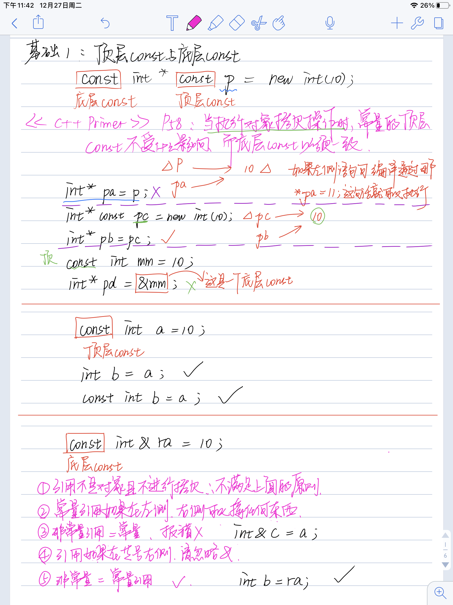

#### `base1.cpp`
```cpp
#include <iostream>

int main()
{
    const int a = 10;
    int b = a;

    const int *const p = new int(10);
    // int *p1 = p;
    // int *const p2 = p;
    const int *p3 = p;

    const int *p4 = &a;

    const int &r1 = a;
    // int &r2 = a;
    // int &r3 = r1;
    // int &r4 = a;
    int c = a;
}
```

#### 图解：`base2.png`
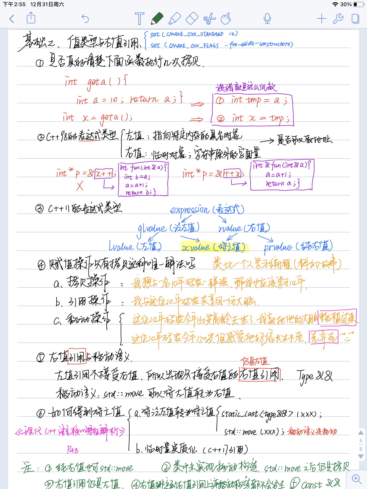

#### `base2.cpp`
```cpp
#include <iostream>
#include <string.h>
#include <string>

// copy from 【现代 C++ 语言核心特性解析】
class BigMemoryPool
{
public:
    static const int PoolSize = 4096;
    BigMemoryPool() : pool_(new char[PoolSize]) {}
    ~BigMemoryPool()
    {
        if (pool_ != nullptr)
        {
            delete[] pool_;
        }
    }
    BigMemoryPool(BigMemoryPool &&other)
    {
        std::cout << "move" << std::endl;
        pool_ = other.pool_;
        other.pool_ = nullptr;
    }
    BigMemoryPool(const BigMemoryPool &other) : pool_(new char[PoolSize])
    {
        std::cout << "copy" << std::endl;
        memcpy(pool_, other.pool_, PoolSize);
    }

private:
    char *pool_;
};

BigMemoryPool getPool()
{
    BigMemoryPool memoryPool;
    return memoryPool;
}

BigMemoryPool getPool(const BigMemoryPool aa)
{
    return aa;
}

int gx = 10;
int get_gx()
{
    return gx;
}

int get_x()
{
    int x = 20;
    return x;
}
BigMemoryPool get_pool(const BigMemoryPool &pool)
{
    return pool;
}
// BigMemoryPool tmp = pool;

BigMemoryPool make_pool()
{
    BigMemoryPool pool;
    return get_pool(pool);
}
//  BigMemoryPool tmp2 = tmp;

int main()
{

    const int x = 10;
    // int y = std::move(x);
    const int &z = x;
    const int &&y = std::move(x);
    &z;
    // x++;
    const int cx = 100;
    const int &&cy = std::move(cx);
    // int &y = get_x();

    // int &&y = x;

    // int *p1 = &x++;
    // int *p2 = &++x;
    auto p3 = &"hello world";
    int &&m = get_x();

    // BigMemoryPool aaa;
    BigMemoryPool ccc = make_pool();
    // BigMemoryPool ccc = tmp2
    // BigMemoryPool &&ddd = std::move(aaa);
    // BigMemoryPool &ccc = aaa;
    int mmm = 10;
    // BigMemoryPool bbb = getPool();
    // BigMemoryPool ccc = std::move(bbb);

    // BigMemoryPool aaa = getPool();
    // BigMemoryPool ccc = getPool(bbb);
}
```

#### 图解：`base3.png`
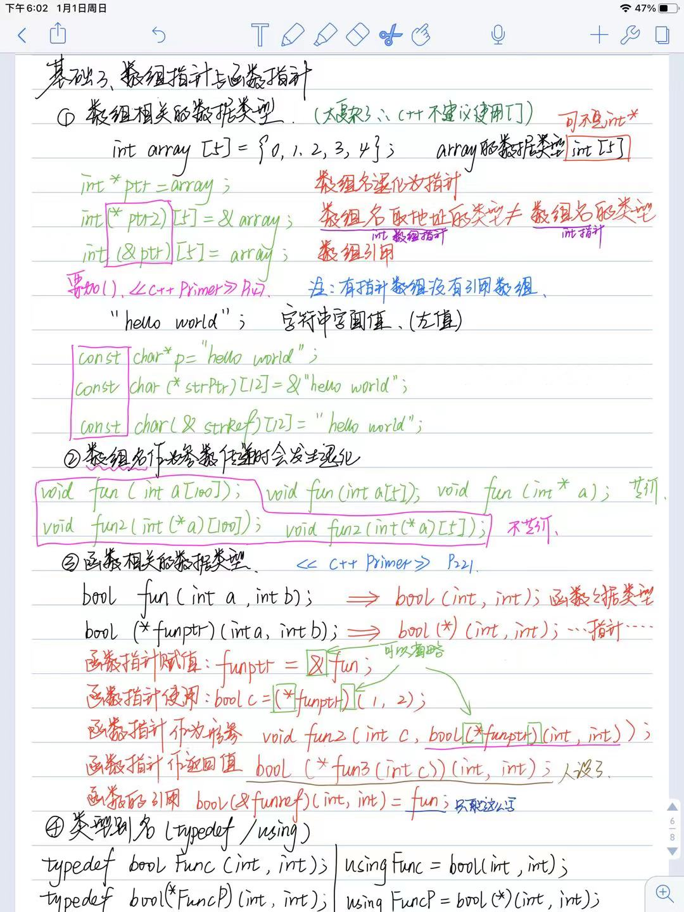

#### `base3.cpp`
```cpp
#include <iostream>
#include <vector>
#include <string>
void fun(int a[])
{
}

void fun2(int (*ptr2)[5])
{
}

bool fun3(int a, int b)
{
    return true;
}

typedef bool (*PF)(int, int);
typedef bool P(int, int);
void fun4(int c, bool (*fun3Ptr)(int, int)) {}
void fun5(int c, bool fun3Ptr(int, int)) {}
void fun6(int c, PF fun3Ptr) {}
void fun7(int c, P fun3) {}
void fun8(int c, P *fun3Ptr) {}

typedef int int_name;
int_name ooo = 10;
using int_name = int;

// typedef bool (*fun3Ptr)(int, int); // fun3Ptr ==  bool (*)(int, int)
// typedef bool fun(int, int);        // fun ==  bool (int, int)
using fun3Ptr = bool (*)(int, int);
using fun3xxx = bool(int, int);
// fun3xxx == fun3Ptr*

void func2(int c, fun3xxx fun)
{
    fun(5, 8);
}
// bool(int, int) fun6(int c) { return nullptr; }  //报错
// bool (*fun9(int c))(int, int) { return nullptr; }
fun3Ptr fun3(int c);

// using PF = bool (*)(int, int);
// typedef bool (*PF)(int, int);
// PF fun9(int c);

int main()
{
    int a = 10;
    int *const(&b) = &a;

    int array[5] = {0, 0, 0, 0, 0};

    std::vector<int> aaaaaa;
    int *ptr = array; // 将数组名直接赋值给一个指针会发生【退化】
    // int(*ptr2)[5] = array;
    // int *ptr3[5] = {&a, &a, &a, &a, &a};
    int(*ptr3)[5] = &array; // int (*) [5]  但是对数 组名取地址那么就没有退化这一说了 c++ primer P147
    // int(&ref)[5] = array;   // int (&) [5]

    &"hello world"; // const char [12]
    char str[12] = "hello world";
    // char str1[12] = "hello world";
    const char *strrrr = "hello world";

    // &"hello world";
    // char *strPtr = &"hello world";
    // const char *strPtr = &"hello world";
    // const char *strPtr[12] = &"hello world";
    const char(*strPtr)[12] = &"hello world"; // strPtr 的数据类型是const char(*)[12]
    const char *strPtrArray[2] = {str, str};  // strPtrArray 的数据类型是const char*[2]

    const char(&strRef)[12] = "hello world"; // strPtr 的数据类型是const char(&)[12]

    // const char &strPtrArray[2] = {str, str}; //引用的数组是不被允许滴

    // 函数部分
    bool (*fun3Ptr)(int, int) = fun3; // 函数退化成函数指针
    fun3Ptr = fun3;                   // 函数退化成函数指针
    fun3Ptr = &fun3;
    bool xx = fun3Ptr(1, 2);
    bool yy = (*fun3Ptr)(1, 2);

    bool (&funRef)(int, int) = fun3;
    return 0;
}
```

#### 图解：`base4.png`
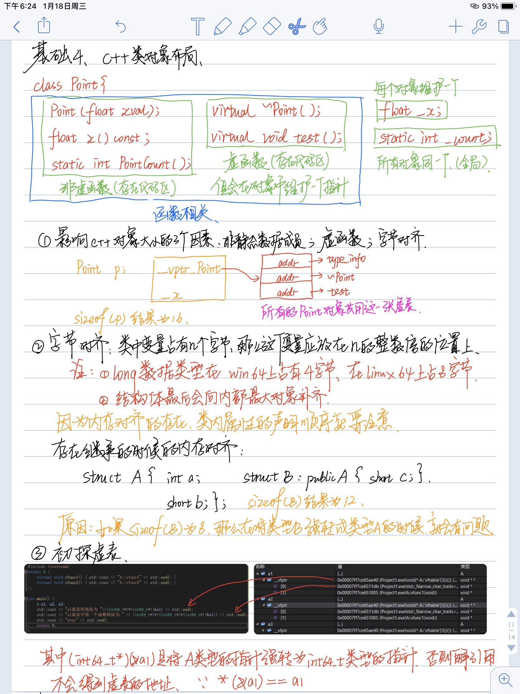

#### `base4.cpp`
```cpp
#include <iostream>
using namespace std;
struct Test1
{
    int a;   // 4
    short b; // 2 + 2
    int c;   // 4
    short d; // 2  +  2
};

struct Test2
{
    int a;   // 4
    int c;   // 4
    short b; // 2
    short d; // 2
};

struct Test3
{
    int a;
    short b;
};

struct Test4 : public Test3
{
    short c;
};

class A
{
public:
    virtual void vAfunc1() { cout << "A::vAfunc1()" << endl; };
    virtual void vAfunc2() { cout << "A::vAfunc2()" << endl; };
    //     void func1() { cout << "A::func1()" << endl; };
    //     void func2() { cout << "A::func2()" << endl; };

    // private:
    //     int data1_;
    //     int data2_;
};

class B : public A
{
public:
    virtual void vBfunc1() { cout << "B::vBfunc1()" << endl; };
    virtual void vBfunc2() { cout << "B::vBfunc2()" << endl; };

    virtual void vAfunc1() override { cout << "B::vAfunc1()" << endl; };
    void func2() { cout << "B::func2()" << endl; };

private:
    int data3_;
};

using Fun = void();
int main()
{
    auto count1 = sizeof(Test3);
    auto count2 = sizeof(Test4);

    A a;
    Fun *pFun = nullptr;
    auto mm = &a;
    auto t1 = (int64_t *)(&a);
    auto t2 = (int64_t *)*t1;
    auto t3 = (Fun *)*(t2);
    t3();

    A a1;
    std::cout << "a1虚表的地址为 " << (int64_t *)*(int64_t *)(&a1) << std::endl;
    std::cout << "a1虚表中第一个函数地址为 " << (int64_t *)*((int64_t *)*(int64_t *)(&a1)) << std::endl;
    std::cout << "a1虚表中第二个函数地址为 " << (int64_t *)*((int64_t *)*(int64_t *)(&a1) + 1) << std::endl;
    std::cout << "over" << std::endl;

    return 0;
}
```

#### 图解：`base5.png`
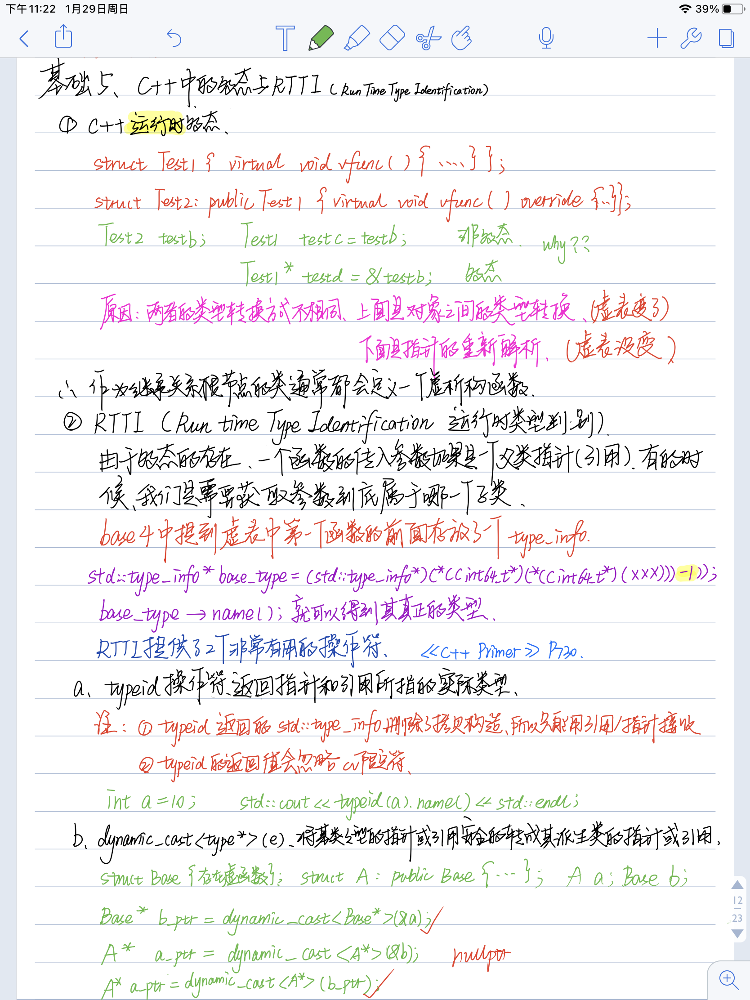

#### 图解：`base5_1.png`
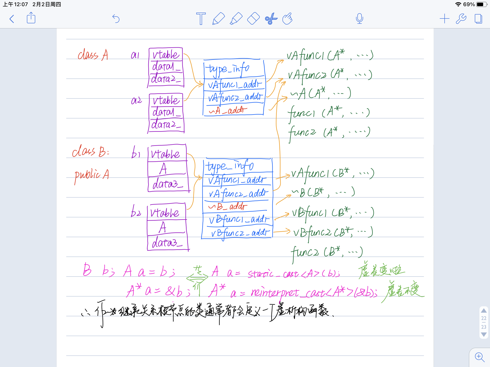

#### `base5.cpp`
```cpp
#include <iostream>
#include <typeinfo>

class A
{
public:
    A()
    {
        data1_ = new int();
        data2_ = new int();
    }
    virtual void vAfunc1() { std::cout << "A::vAfunc1()" << std::endl; };
    virtual void vAfunc2() { std::cout << "A::vAfunc2()" << std::endl; };

    void func1() { std::cout << "A::func1()" << std::endl; };
    void func2() { std::cout << "A::func2()" << std::endl; };

    virtual ~A()
    {
        std::cout << "A::~A" << std::endl;
        delete data1_;
        delete data2_;
    }

private:
    int *data1_{};
    int *data2_{};
};

class B : public A
{
public:
    B()
    {
        data3_ = new int();
    }
    virtual void vAfunc1() override { std::cout << "B::vAfunc1()" << std::endl; };
    virtual void vBfunc1() { std::cout << "B::vBfunc1()" << std::endl; };
    virtual void vBfunc2() { std::cout << "B::vBfunc2()" << std::endl; };

    void func2() { std::cout << "B::func2()" << std::endl; };

    virtual ~B()
    {
        std::cout << "B::~B" << std::endl;
        delete data3_;
    }

private:
    int *data3_{};
};

class C : public A
{
public:
    C()
    {
        data4_ = new int();
    }
    virtual void vAfunc1() override { std::cout << "C::vAfunc1()" << std::endl; };
    void func3() { std::cout << "C::func3()" << std::endl; };

    virtual ~C()
    {
        std::cout << "C::~C" << std::endl;
        delete data4_;
    }

private:
    int *data4_{};
};

void test(A *a)
{
    if (typeid(*a) == typeid(A))
    {
        A *pa = reinterpret_cast<A *>(a);
        pa->func1();
    }
    if (typeid(*a) == typeid(B))
    {
        B *pb = reinterpret_cast<B *>(a);
        pb->func2();
    }
    if (typeid(*a) == typeid(C))
    {
        C *pc = reinterpret_cast<C *>(a);
        pc->func3();
    }
}

using Fun = void();
int main()
{
    B b;
    Fun *pFun = nullptr;
    std::cout << "虚函数表地址 " << (int64_t *)*(int64_t *)(&b) << std::endl;
    std::cout << "虚函数表第1个函数地址 " << (int64_t *)*((int64_t *)*(int64_t *)(&b)) << std::endl;
    pFun = (Fun *)*((int64_t *)*(int64_t *)(&b));
    pFun();
    std::cout << "虚函数表第2个函数地址 " << (int64_t *)*((int64_t *)*(int64_t *)(&b) + 1) << std::endl;
    pFun = (Fun *)*((int64_t *)*(int64_t *)(&b) + 1);
    pFun();
    // std::cout << "虚函数表第3个函数地址 " << (int64_t *)*((int64_t *)*(int64_t *)(&b) + 2) << std::endl;
    // pFun = (Fun *)*((int64_t *)*(int64_t *)(&b) + 2);
    // pFun();
    // std::cout << "虚函数表第4个函数地址 " << (int64_t *)*((int64_t *)*(int64_t *)(&b) + 3) << std::endl;
    // pFun = (Fun *)*((int64_t *)*(int64_t *)(&b) + 3);
    // pFun();
    std::cout << "虚函数表第5个函数地址 " << (int64_t *)*((int64_t *)*(int64_t *)(&b) + 4) << std::endl;
    pFun = (Fun *)*((int64_t *)*(int64_t *)(&b) + 4);
    pFun();
    std::cout << "虚函数表第6个函数地址 " << (int64_t *)*((int64_t *)*(int64_t *)(&b) + 5) << std::endl;
    pFun = (Fun *)*((int64_t *)*(int64_t *)(&b) + 5);
    pFun();

    A a;
    a.vAfunc1();
    a.func1();

    b.vAfunc1();
    b.func1();
    b.func2();

    A aa = b;
    std::cout << "aa虚函数表地址 " << (int64_t *)*(int64_t *)(&aa) << std::endl;
    aa.vAfunc1(); // B::vfunc1
    aa.func1();
    aa.func2();
    std::cout << " =================== " << std::endl;

    A *aaptr = &b;
    std::cout << "aaptr虚函数表地址 " << (int64_t *)*(int64_t *)(aaptr) << std::endl;
    aaptr->vAfunc1();
    aaptr->func1();
    aaptr->func2();

    std::type_info *base_type = (std::type_info *)*((int64_t *)*(int64_t *)(&a) - 1);
    std::cout << "typeinfo is:" << base_type->name() << std::endl;
    std::cout << "the result of typeid(Base).name():" << typeid(A).name() << std::endl;
    std::cout << "====== " << typeid(a).name() << std::endl;
    std::cout << "====== " << typeid(&a).name() << std::endl;

    A *base = &b;
    test(base);
    C c;
    base = &c;
    test(base);

    A *mm = dynamic_cast<A *>(&b);
    B *nn = dynamic_cast<B *>(mm);

    A qqq;
    B *ppp = dynamic_cast<B *>(&qqq);

    return 0;
}
```

#### 图解：`base6.png`
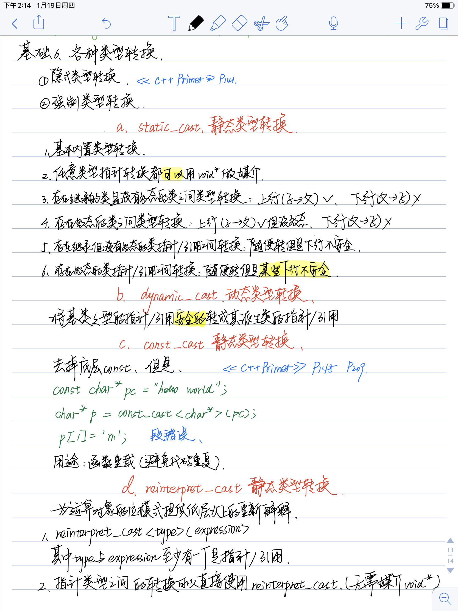

#### `base6.cpp`
```cpp
#include <iostream>
#include <string>

struct A
{
    int a{20};
    void funcA() { std::cout << "A::funA" << std::endl; }
};

struct B
{
    int b{};
    void funcB() { std::cout << "B::funB" << std::endl; }
};

struct CA : public A
{
    int c{25};
    void funcCA()
    {
        std::cout << "c is: " << c << std::endl;
        std::cout << "CA::funcCA" << std::endl;
    }
};

struct Base
{
    virtual void func()
    {
        std::cout << "Base::func()" << std::endl;
    }
};

struct Derived : public Base
{
    virtual void func() override
    {
        std::cout << "Derived::func()" << std::endl;
    }
};

const std::string &shorterString(const std::string &s1,
                                 const std::string &s2)
{
    return s1.size() <= s2.size() ? s1 : s2;
}

std::string &shorterString(std::string &s1,
                           std::string &s2)
{
    auto &r = shorterString(const_cast<const std::string &>(s1),
                            const_cast<const std::string &>(s2));
    // return r;
    return const_cast<std::string &>(r);
}
int main()
{
    // static_cast 1.
    float f = 10.f;
    int i = static_cast<int>(f);

    // static_cast 2.
    A a;
    void *vap = static_cast<void *>(&a);
    int *ip = static_cast<int *>(vap);
    std::cout << "*ip: " << *ip << std::endl;

    // static_cast 3.
    CA ca;
    A a_ = static_cast<A>(ca); // 上行ok
    a_.funcA();
    // CA ca_ = static_cast<CA>(a); // 下行报错

    // static_cast 4.
    Base base;
    Derived derived;

    Base _base = static_cast<Base>(derived); // 上行ok，但是没有多态
    _base.func();
    // Derived _derived = static_cast<Derived>(base);// 下行报错

    // static_cast 5.
    CA *ca_ = static_cast<CA *>(&a);
    ca_->funcCA(); // 下行不安全
    CA &car_ = static_cast<CA &>(a);
    car_.funcCA(); // 下行不安全

    // static_cast 6.
    Base *_baseptr = static_cast<Base *>(&derived); // 上行ok，多态
    _baseptr->func();
    Derived *_derivedptr = static_cast<Derived *>(&base); // 下行不安全
    _derivedptr->func();
    Derived *_derivedptr_ = static_cast<Derived *>(_baseptr); // 下行安全
    _derivedptr_->func();

    // dynamic_cast
    Base *_baseptr_d = dynamic_cast<Base *>(&derived); // 上行ok，多态
    _baseptr_d->func();
    Derived *_derivedptr_d = dynamic_cast<Derived *>(&base); // 下行不安全
    if (_derivedptr_d)
    {
        _derivedptr_d->func();
    }
    Derived *_derivedptr__d = dynamic_cast<Derived *>(_baseptr); // 下行安全
    _derivedptr__d->func();

    // const_cast
    const char *pc = "hello world";
    // char *p = pc;
    char *p = const_cast<char *>(pc);
    // p[2] = 'a'; // 段错误
    std::string aas = "hello";
    std::string bbs = "ll";
    shorterString(aas, bbs);

    // reinterpred_cast 1.
    int *i_ = reinterpret_cast<int *>(i);
    int64_t cpi = reinterpret_cast<int64_t>(pc);

    // reinterpred_cast 2.
    int *vap_ = reinterpret_cast<int *>(&a);

    return 0;
}
```

### 条款代码与图解

#### Item 1 示例

##### 图解：`item1.png`
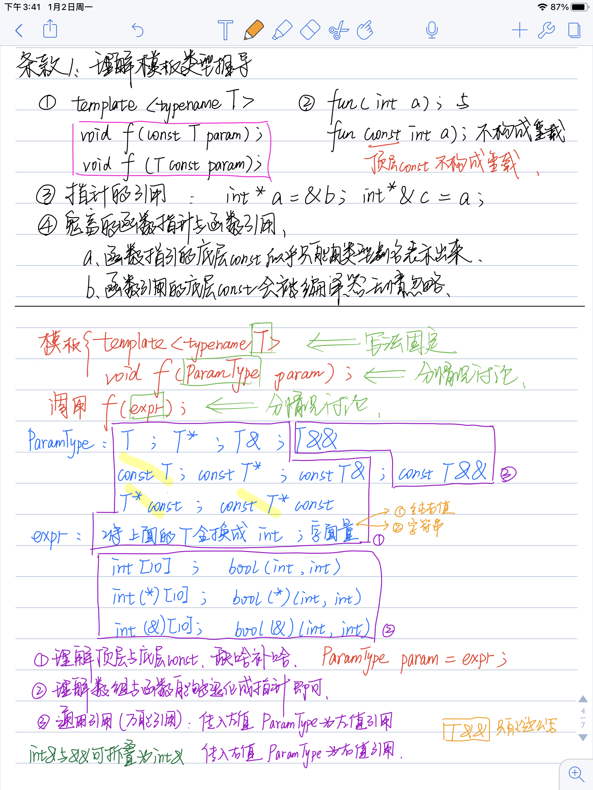

##### `item1.cpp`
```cpp
#include <iostream>
// void fun(int a) {}
// void fun(const int a) {}

template <typename T>
void f(T param)
{
    std::cout << param << std::endl;
}
void func(int, int) {}
int func2(int) { return 10; }
// int (*func2ptr)(int) = func2;

using F = int(int);
// typedef int F(int);

int main()
{
    // const F *aaa = func2;
    // F *const bbb = func2;
    // int (*const func2p)(int) = func2;
    // int (&func2r)(int) = func2;
    // const F &ccc = func2;

    int a = 10;
    int *aptr = &a;
    int &aref = a;
    int &&arref = std::move(a);

    const int ca = 20;
    const int *captr = &ca;
    const int &caref = ca;
    const int &&carref = std::move(ca);
    int *const acptr = &a;
    const int *const cacptr = &a;
    10;

    char mmm = 'a';
    f(&mmm);
    int array[2] = {0, 1};
    "hello world";
    int(*arrayptr)[2] = &array;
    int(&arrayref)[2] = array;

    func;
    void (*funcptr)(int, int) = func;
    void (&funcref)(int, int) = func;

    return 0;
}
```

#### Item 2 示例

##### 图解：`item2.png`
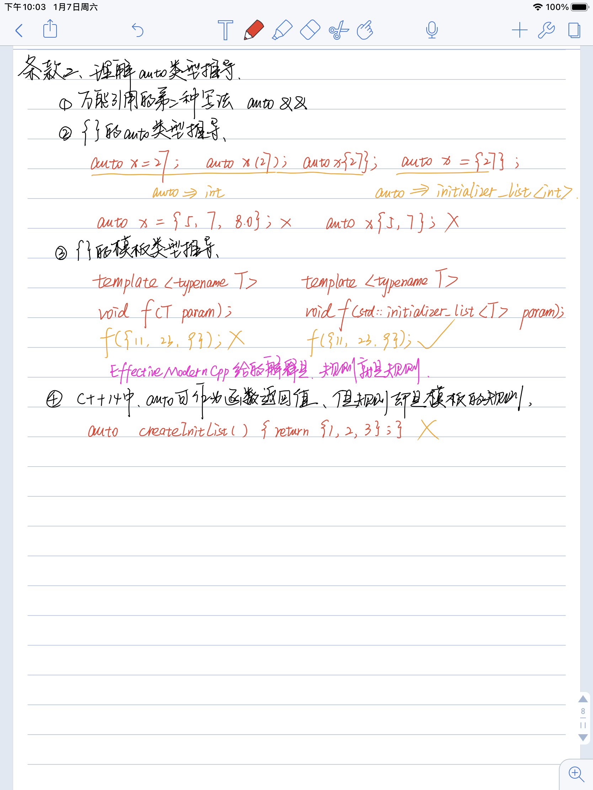

##### `item2.cpp`
```cpp
#include <iostream>

template <typename T>
void f(T param)
{
}

template <typename T>
void g(std::initializer_list<T> param)
{
}

// auto createInitList()
// {
//     return {1, 2, 3};
// }

int main()
{
    auto x1 = 27;
    auto x2(27);
    auto x3{27};    // int
    auto x4 = {27}; // initializer_list<int>

    // auto x5{10, 27};
    // auto x6 = {10, 27, 7};
    // f({1, 2, 3});
    g({1, 2, 3});
    return 0;
}
```

#### Item 3 示例

##### 图解：`item3.png`
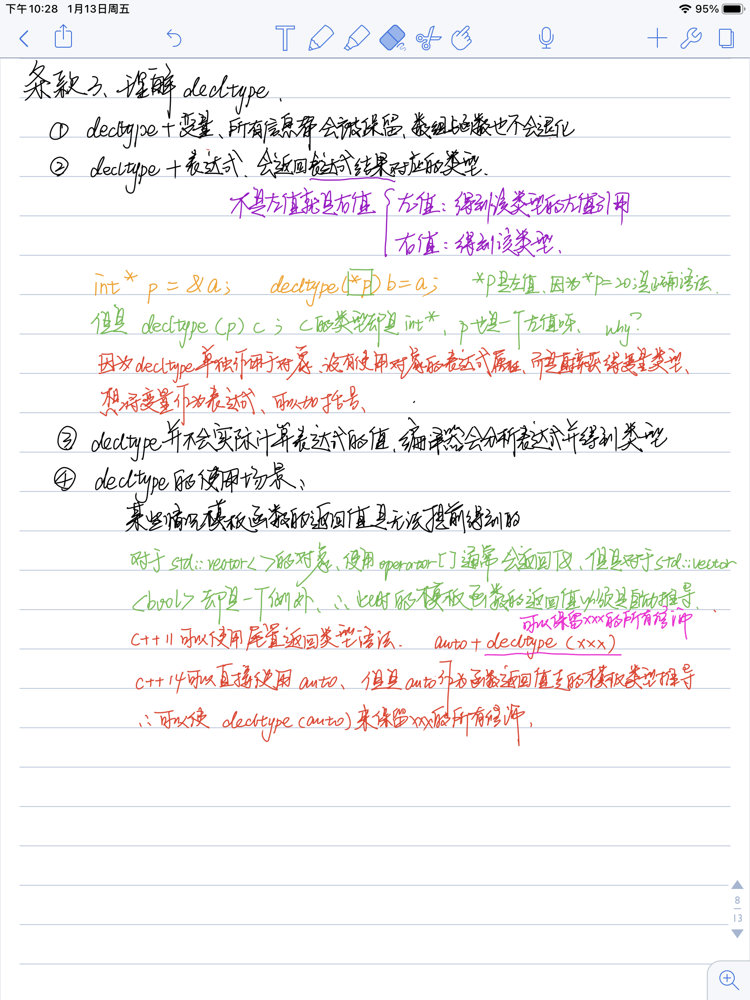

##### `item3.cpp`
```cpp
#include <iostream>
#include <vector>

struct Point
{
    int x, y;
    Point &operator=(Point p)
    {
        std::cout << "operator=" << std::endl;
        return *this;
    }
};

int fun(int x)
{
    std::cout << "fun" << std::endl;
    return x;
}

void func(int, int) {}

template <typename Container, typename Index> // 可以工作，
auto testFun(Container &c, Index i)           // 但是需要改良
    -> decltype(c[i])                         // c++11的写法 尾置返回类型语法
{
    // do someing...
    return c[i];
}

template <typename Container, typename Index> // C++14版本，
auto testFun_error(Container &c, Index i)     // 不那么正确 因为auto作为函数返回值的时候走的是模板推导的套路
{
    // do someing...
    return c[i]; // 从c[i]中推导返回类型
}

template <typename Container, typename Index>       // C++14版本，
decltype(auto) testFun_right(Container &c, Index i) // 可以工作，但是还需要改良
{
    // do someing...
    return c[i];
}

template <typename Container, typename Index>
decltype(auto) testFun_better(Container &&c, Index i)
{
    // do someing...
    // return c[i];
    return std::forward<Container>(c)[i];
}

std::vector<int> getIntVector()
{
    return {1, 2, 3};
}

int main()
{
    int a = 10;
    int *aptr = &a;

    int &aref = a;
    int &&arref = std::move(a);
    // decltype(arref) ref__;
    const int ca = 20;
    const int *captr = &ca;

    const int &caref = ca;
    const int &&carref = std::move(ca);

    int *const acptr = &a;
    const int *const cacptr = &a;
    10;

    int array[2] = {0, 1};
    "hello world";
    int(*arrayptr)[2] = &array;
    int(&arrayref)[2] = array;

    func;
    void (*funcptr)(int, int) = func;
    void (&funcref)(int, int) = func;

    // https: // blog.csdn.net/u014609638/article/details/106987131?spm=1001.2101.3001.6661.1&utm_medium=distribute.pc_relevant_t0.none-task-blog-2~default~CTRLIST~Rate-1-106987131-blog-123871931.pc_relevant_multi_platform_whitelistv4&depth_1-utm_source=distribute.pc_relevant_t0.none-task-blog-2~default~CTRLIST~Rate-1-106987131-blog-123871931.pc_relevant_multi_platform_whitelistv4&utm_relevant_index=1
    int value = 10;
    int *ptr = &value;
    decltype(*ptr) ref = value;
    decltype((value)) ref2 = value;
    decltype((((value)))) ref3 = value;
    decltype(value + 10) value2 = value;

    const int cvalue = 20;
    const int *cptr = &cvalue;
    int *const ptrc = &value;
    decltype(*cptr) cref = cvalue;
    decltype(*ptrc) refc = value;
    decltype((cvalue + 10)) value3 = value;

    Point point{1, 2};
    decltype(point) point2{5, 8};
    decltype(fun(value)) value4;
    // decltype((fun(value))) value5;

    std::vector<bool> vec = {true, false, true};
    decltype(vec[1]) value6;
    std::vector<int> vec2 = {1, 2, 3};
    decltype(vec2[1]) value7 = value;
    std::vector<Point> vec3 = {{1, 2}, {3, 4}, {2, 3}};
    decltype(vec3[1]) value8 = point;

    // testFun(vec, 1) = true;
    // testFun(vec2, 1) = 10;
    // testFun(vec3, 1) = {4, 8};

    // testFun_error(vec, 1) = true;
    // testFun_error(vec2, 1) = 10;
    // testFun_error(vec3, 1) = point;

    // testFun_right(vec, 1) = true;
    // testFun_right(vec2, 1) = 20;
    // testFun_right(vec3, 1) = {5, 15};
    decltype(auto) aa = testFun_right(vec2, 1);

    // auto mm = testFun_right(getIntVector(), 1);
    decltype(auto) nn = testFun_better(getIntVector(), 1);
    decltype(auto) mm = testFun_better(vec2, 1);
    nn = 1587;
    // testFun_better(getIntVector(), 1) = 152;
    std::cout << "over" << std::endl;
}
```

#### Item 4 示例

##### `item4.cpp`
```cpp
#include <iostream>

int mian()
{
    const int theAnswer = 42;

    auto x = theAnswer;
    auto y = &theAnswer;
    return 0;
}
```

## 第2章 auto

### 章节说明

**CHAPTER 2 `auto`**

从概念上来说，`auto`要多简单有多简单，但是它比看起来要微妙一些。使用它可以存储类型，当然，它也会犯一些错误，而且比之手动声明一些复杂类型也会存在一些性能问题。此外，从程序员的角度来说，如果按照符合规定的流程走，那`auto`类型推导的一些结果是错误的。当这些情况发生时，对我们来说引导`auto`产生正确的结果是很重要的，因为严格按照说明书上面的类型写声明虽然可行但是最好避免。

本章简单的覆盖了`auto`的里里外外。

### 基础代码与图解

#### 图解：`base7.png`
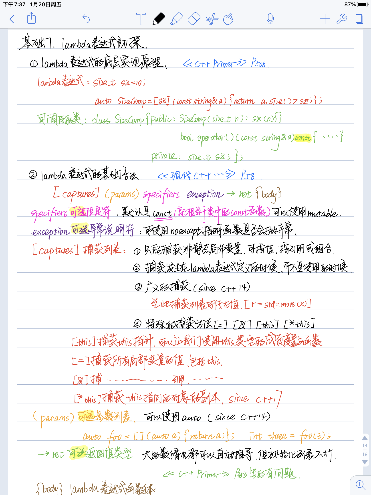

#### `base7.cpp`
```cpp
#include <iostream>
#include <string>
#include <memory>

int a = 0;
class SizeComp
{
public:
    SizeComp(size_t n) : sz(n) {}
    bool operator()(const std::string &s) const { return s.size() >= sz; }

private:
    size_t sz;
};

class A
{
public:
    void print() { std::cout << "Class A" << std::endl; }
    void test()
    {
        auto foo = [this]
        {
            print();
            x = 5;
        };
        foo();
    }

private:
    int x;
};

int main()
{
    size_t sz = 10, ss = 50;

    auto SizeCompLambda = [=](const std::string &a)
    {
        return a.size() >= sz;
    };
    auto size = sizeof(SizeCompLambda);

    int b = 0;
    static int c = 0;

    // auto fun1 = [a, b, c] {};
    auto fun1 = [b] // a c不需要被捕获 可以直接使用
    {
        std::cout << "b is : " << b << std::endl;
        a = 10;
        c = 12;
    };

    auto func_test = [&sz]()
    { std::cout << "sz is : " << sz << std::endl; };

    sz = 50;
    func_test();

    auto fun2 = [](int mm)
    {
        mm = 20;
        return mm;
    };
    auto ssize = sizeof(fun2);
    auto important = std::make_unique<int>(1);
    auto add = [v1 = 1, v2 = std::move(important)](int x, int y) -> int
    {
        return x + y + v1 + (*v2);
    };

    auto fun3 = [b = b + 2] // a c无法被捕获 但是可以直接使用
    {
        std::cout << "b is : " << b << std::endl;
    };

    auto fun4 = [](int i)
    {if(i>0) return i; 
    else return -i; };

    // auto x2 = []()
    // { return {1, 2}; };

    auto mm = fun4(-10);

    return 0;
}
```

#### 图解：`base8.png`
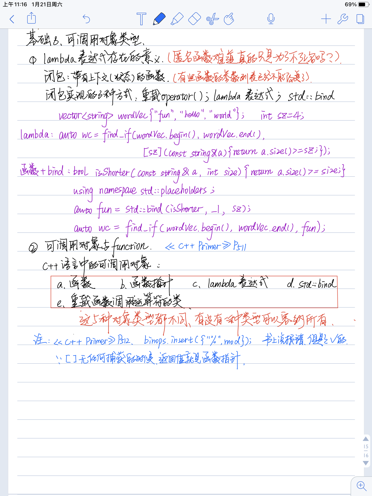

#### `base8.cpp`
```cpp
#include <iostream>
#include <algorithm>
#include <functional>
#include <string>
#include <vector>
#include <map>

int add(int i, int j)
{
    return i + j;
}

int modfunc(int i, int j, int m)
{
    m = 20;
    return i % j;
}

struct divide
{
    int operator()(int denominator, int divisor)
    {
        return denominator / divisor;
    }
};

using Fun = int(int, int);

bool isShorter(const std::string &a, int sz)
{
    return a.size() >= sz;
}

int main()
{
    std::vector<std::string> wordVec{"fun", "hello", "world"};

    int sz = 4;
    auto wc = find_if(wordVec.begin(), wordVec.end(), [sz](const std::string &a)
                      { return a.size() >= sz; });

    using namespace std::placeholders;
    auto fun = std::bind(isShorter, _1, sz);
    auto wc2 = find_if(wordVec.begin(), wordVec.end(), fun);

    int mm = 0;
    // auto mod_ = [mm](int i, int j)
    // { return i % j; };

    Fun *mod = [](int i, int j)
    { return i % j; };

    std::map<std::string, int (*)(int, int)> funcMap;

    funcMap.insert({"+", add});
    funcMap.insert({"%", mod});
    // funcMap.insert({"%", mod_});

    std::map<std::string, std::function<int(int, int)>> funcMap2;
    funcMap2.insert({"+", add});
    funcMap2.insert({"%", mod});
    auto modaaa = std::bind(modfunc, _1, _2, 20);

    std::map<std::string, std::function<int(int, int)>> binops = {
        {"+", add},
        {"++", &add},
        {"/", divide()},
        {"*", [](int i, int j)
         { return i * j; }},
        {"%", mod}};

    return 0;
}
```

#### 图解：`base9.png`
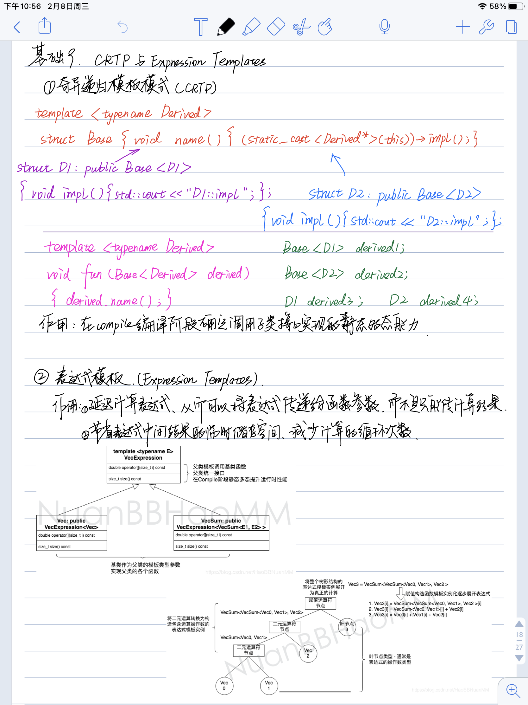

#### `base9.cpp`
```cpp
#include <cassert>
#include <iostream>
#include <vector>

template <typename Derived>
struct Base
{
    void name() { (static_cast<Derived *>(this))->impl(); }
};
struct D1 : public Base<D1>
{
    void impl() { std::cout << "D1::impl" << std::endl; }
};
struct D2 : public Base<D2>
{
    void impl() { std::cout << "D2::impl" << std::endl; }
};

template <typename Derived>
void func(Base<Derived> derived)
{
    derived.name();
}

// https://blog.csdn.net/HaoBBNuanMM/article/details/109740504
// CRTP中的基类模板
template <typename E>
class VecExpression
{
public:
    // 通过将自己static_cast成为子类，调用子类的对应函数实现实现静态多态
    double operator[](size_t i) const { return static_cast<E const &>(*this)[i]; }
    size_t size() const { return static_cast<E const &>(*this).size(); }
};

// 将自己作为基类模板参数的子类 - 对应表达式编译树中的叶节点
class Vec : public VecExpression<Vec>
{
    std::vector<double> elems;

public:
    double operator[](size_t i) const { return elems[i]; }
    double &operator[](size_t i) { return elems[i]; }
    size_t size() const { return elems.size(); }

    Vec(size_t n) : elems(n) {}

    Vec(std::initializer_list<double> init)
    {
        for (auto i : init)
            elems.push_back(i);
    }

    // 赋值构造函数可以接受任意父类VecExpression的实例，并且进行表达式的展开
    // （对应表达式编译树中的赋值运算符节点）
    template <typename E>
    Vec(VecExpression<E> const &vec) : elems(vec.size())
    {
        for (size_t i = 0; i != vec.size(); ++i)
        {
            elems[i] = vec[i];
        }
    }
};

// 将自己作为基类模板参数的子类 - 对应表达式编译树中的二元运算符输出的内部节点
// 该结构的巧妙之处在于模板参数E1 E2可以是VecSum，从而形成VecSum<VecSum<VecSum ... > > >的嵌套结构，体现了表达式模板的精髓：将表达式计算改造成为了构造嵌套结构
template <typename E1, typename E2>
class VecSum : public VecExpression<VecSum<E1, E2>>
{
    E1 const &_u;
    E2 const &_v;

public:
    VecSum(E1 const &u, E2 const &v) : _u(u), _v(v)
    {
        assert(u.size() == v.size());
    }

    double operator[](size_t i) const { return _u[i] + _v[i]; }
    size_t size() const { return _v.size(); }
};

// 对应编译树上的二元运算符，将加法表达式构造为VecSum<VecSum... > >的嵌套结构
template <typename E1, typename E2>
VecSum<E1, E2> const operator+(E1 const &u, E2 const &v)
{
    return VecSum<E1, E2>(u, v);
}

// 主函数入口
int main()
{
    Base<D1> derived1;
    Base<D2> derived2;
    D1 derived3;
    D2 derived4;
    func(derived1);
    func(derived2);
    func(derived3);
    func(derived4);

    // 创建3个叶子节点
    Vec v0 = {1.0, 1.0, 1.0}; // 1000
    Vec v1 = {2.0, 2.0, 2.0}; // 1000
    Vec v2 = {3.0, 3.0, 3.0}; // 1000
    auto v4 = v0 + v1;
    auto v5 = v4 + v2;
    auto v8 = v0 + v1 + v2; // 20
    // 构建表达式 v0 + v1 + v2，赋值给v3，编译阶段形成表达式树
    Vec v3 = v0 + v1 + v2;

    // v_result = v0 + ... + v19
    float aa = v5[1];

    // 输出结算结果
    for (int i = 0; i < v4.size(); i++)
    {
        std::cout << " " << v4[i];
    }
    std::cout << std::endl;
}
```

### 条款代码与图解

#### Item 5 示例

##### 图解：`item5.png`
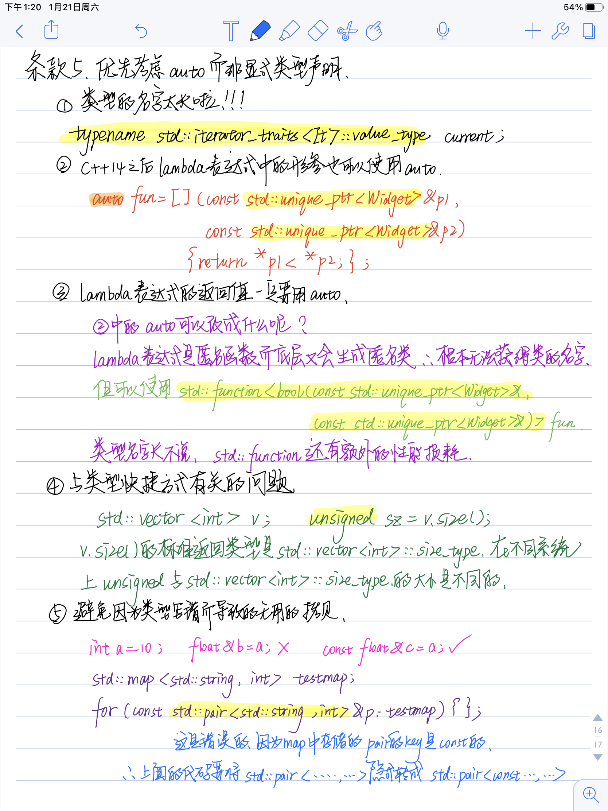

##### `item5.cpp`
```cpp
#include <iostream>
#include <vector>
#include <string>
#include <unordered_map>

template <typename It> // 对从b到e的所有元素使用
void dwim(It b, It e)  // dwim（“do what I mean”）算法
{
    while (b != e)
    {
        // typename std::iterator_traits<It>::value_type currValue = *b;
        auto currValue = *b;
        std::cout << currValue << std::endl;
        b++;
    }
}

int main()
{
    int a = 10;
    const float &b = a;
    // float tmp = a;
    // const float&b = tmp;

    std::vector<int> vec = {1, 2, 3, 4};
    dwim(vec.cbegin(), vec.cend());

    std::unordered_map<std::string, int> m{{"hello", 10}, {"world", 5}, {"heihei", 20}};
    for (const std::pair<std::string, int> &p : m)
    {
    }
    for (const auto &p : m)
    {
    }

    std::pair<const std::string, int> const_testMap = {"hello", 5};
    const std::pair<std::string, int> &testMapRef = const_testMap;
    return 0;
}
```

#### Item 6 示例

##### `item6.cpp`
```cpp
#include <vector>
#include <iostream>

class A
{
public:
    A() { std::cout << "A::A()" << std::endl; }
    A(int data) : _data(data) { std::cout << "A::A(int data)" << std::endl; }
    A(const A &a) : _data(a._data)
    {
        std::cout << "A::A(const A &a)" << std::endl;
    }
    A(A &&a) : _data(a._data)
    {
        std::cout << "A::A(A &&a)" << std::endl;
    }
    ~A() { std::cout << "A::~A()" << std::endl; }

    int _data{100};
};

std::vector<A> func()
{
    return {A(1), A(2), A(3), A(4), A(5)};
}

std::vector<bool> features()
{
    return {true, true, true, false, false};
}

class MyArray
{
public:
    class MyArraySize
    {
    public:
        MyArraySize(int size) : theSize(size) {}
        int size() const { return theSize; }
        operator int() const { return theSize; }

    private:
        int theSize;
    };

    MyArray(MyArraySize size) : size_(size), data_(new int[size.size()]) {}
    int operator[](int index)
    {
        return data_[index];
    }
    bool operator==(const MyArray &temp)
    {
        return data_ == temp.data_;
    }
    MyArraySize size() { return size_; }

private:
    int *data_;
    MyArraySize size_;
};

class MyArray_
{
public:
    MyArray_(int size) : size_(size), data_(new int[size]) {}

private:
    int *data_;
    int size_;
};

void func1(MyArray arr)
{
}

int main()
{
    // func1(MyArray(10));
    bool highPriority = features()[4];
    auto highPriority_ = static_cast<bool>(features()[4]);

    // A aaa = func()[2];
    A &bbb = func()[3];

    MyArray arr(10);
    auto size = arr.size();
    int size_ = arr.size();
    return 0;
}
```

## 第3章 移步现代 C++

### 章节说明

**CHAPTER 3 Moving to Modern C++**

说起知名的特性，C++11/14有一大堆可以吹的东西，`auto`，智能指针（*smart pointer*），移动语义（*move semantics*），*lambda*，并发（*concurrency*）——每个都是如此的重要，这章将覆盖这些内容。精通这些特性是必要的，但是成为高效率的现代C++程序员也要求一系列小步骤。从C++98移步现代C++遇到的每个细节问题都会在本章得到答复。你什么时候应该用{}而不是()创建对象？为什么别名（*alias*）声明比`typedef`好？`constexpr`和`const`有什么不同？常量（`const`）成员函数和线程安全有什么关系？这个列表越列越多。这章将会逐个回答这些问题。

### 基础代码与图解

#### 图解：`base10.png`
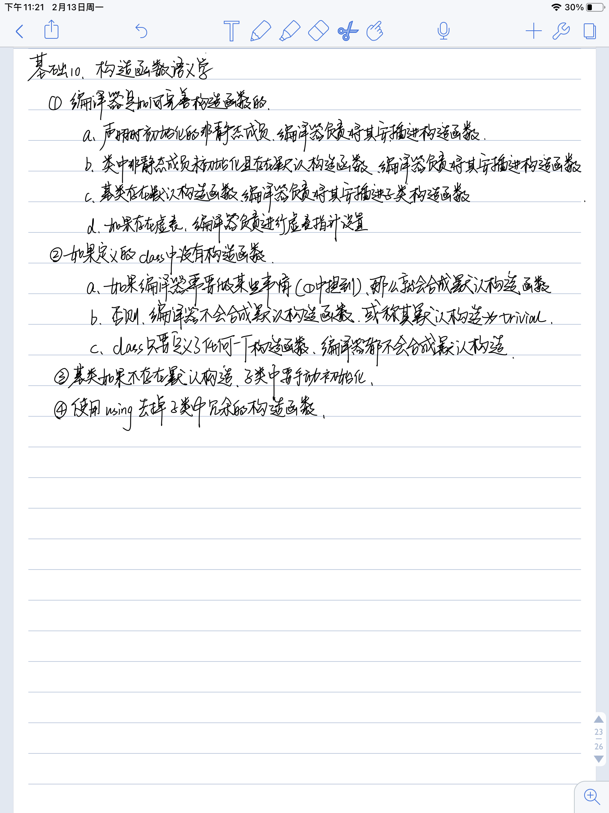

#### `base10.cpp`
```cpp
#include <iostream>
#include <string>
#include <vector>

struct A
{
    A(int param) : a(param), b(50.f)
    {
    }

    int a = 10;
    float b = 20.f;
    std::string c{"hhh"};
};

struct B
{
    B() { std::cout << "B()" << std::endl; }
    B(int data) : data1(data) { std::cout << "B(int data)" << std::endl; }
    virtual void vfunc() { std::cout << "B::vfunc" << std::endl; }
    int data1;
};

struct C
{
    C(int data) : data2(data) { std::cout << "C(int data)" << std::endl; }

    B b;
    int data2;
};

struct BB : public B
{
    BB(int param) : data3(param) { std::cout << "BB(int param)" << std::endl; }
    int data3;
};

struct D
{
    D(int param) : data4(param) {}
    int data4;
};

struct E : public D
{
    E(int param, int d) : D(d), data5(param) {}

    int data5;
};

struct F
{
    F() = default;
    F(int a) : data6(a) {}
    F(int a, int b) : data6(a), data7(b) {}
    F(int a, int b, int c) : data6(a), data7(b), data8(c) {}
    F(int a, int b, int c, int d) : data6(a), data7(b), data8(c), data9(d) {}
    void func() { std::cout << "F::func" << std::endl; }
    int data6;
    int data7;
    int data8;
    int data9;
};

struct G : public F
{
    using F::F;
    void func() { std::cout << "G::func" << std::endl; }
};

int main()
{
    // A a(1);
    // B b;
    C c(5);
    BB bb(10);
    F f(5);
    G g(5, 0);
    return 0;
}
```

#### 图解：`base11.png`
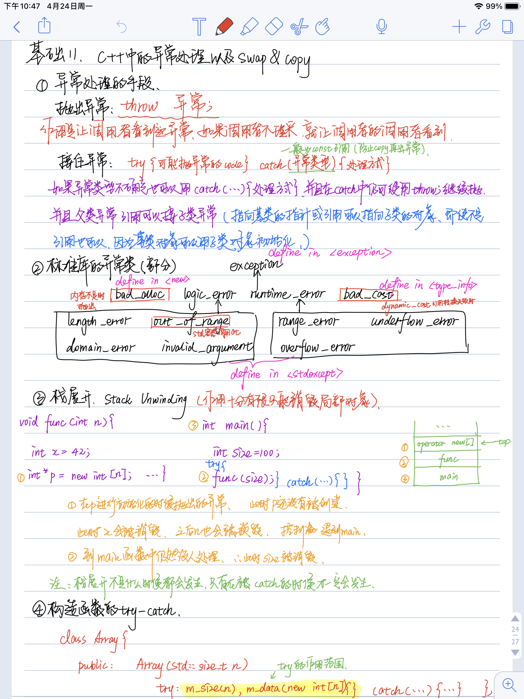

#### `base11.cpp`
```cpp
#include <iostream>
#include <vector>

void strcpy(char *dest, const char *source)
{
    if (!dest || !source)
        throw std::invalid_argument("Null Pointers pass to strcpy.");
    while (*source)
        *dest++ = *source;
    *dest = '\0';
}

template <typename T>
class Array
{
public:
    Array(std::size_t n)
    try : m_size(n), m_data(new T[n])
    {
    }
    catch (const std::bad_alloc &ba)
    {
        std::cout << "No enough memory." << std::endl;
        throw;
    }

private:
    size_t m_size;
    int *m_data;
};

int main()
{
    char *dest = nullptr;
    const char *source = "hello";
    try
    {
        strcpy(dest, source);
    }
    catch (const std::invalid_argument &e)
    {
        std::cout << "invalid_argument" << std::endl;
        std::cout << e.what() << std::endl;
    }
    catch (...)
    {
        std::cout << "catch" << std::endl;
    }
    return 0;
}
```

#### `base11_2.cpp`
```cpp
#include <vector>
#include <string>
#include <iostream>

// class Buffer
// {
// private:
//     unsigned char *_buf;
//     int _capacity;
//     int _length;

// public:
//     explicit Buffer(int capacity) : _capacity(capacity), _length(0)
//     {
//         std::cout << "Buffer(int capacity)" << std::endl;
//         // throw std::invalid_argument("=====");
//         _buf = capacity == 0 ? nullptr : new unsigned char[capacity]{};
//     }

//     ~Buffer()
//     {
//         std::cout << "~Buffer()" << std::endl;
//         delete[] _buf;
//     }

//     Buffer(const Buffer &buffer)
//     {
//         std::cout << "Buffer(const Buffer &buffer)" << std::endl;
//         this->_capacity = buffer._capacity;
//         this->_length = buffer._length;
//         // throw std::invalid_argument("=====");
//         this->_buf = new unsigned char[buffer._capacity];
//         std::copy(buffer._buf, buffer._buf + buffer._capacity, this->_buf);
//     }

//     Buffer(Buffer &&buffer) noexcept
//     {
//         std::cout << "Buffer(Buffer &&buffer)" << std::endl;
//         this->_capacity = buffer._capacity;
//         this->_length = buffer._length;
//         this->_buf = buffer._buf;

//         buffer._buf = nullptr;
//         buffer._capacity = 0;
//         buffer._length = 0;
//     }

//     Buffer &operator=(const Buffer &buffer)
//     {
//         std::cout << "Buffer &operator=(const Buffer &buffer)" << std::endl;
//         if (this != &buffer)
//         {
//             this->_capacity = buffer._capacity;
//             this->_length = buffer._length;
//             delete[] this->_buf;
//             throw std::invalid_argument("....");
//             this->_buf = new unsigned char[buffer._capacity];
//             std::copy(buffer._buf, buffer._buf + buffer._capacity, this->_buf);
//         }
//         return *this;
//     }

//     Buffer &operator=(Buffer &&buffer) noexcept
//     {
//         std::cout << "Buffer &operator=(Buffer &&buffer)" << std::endl;
//         if (this != &buffer)
//         {
//             this->_capacity = buffer._capacity;
//             this->_length = buffer._length;
//             delete[] this->_buf;
//             this->_buf = buffer._buf;

//             buffer._buf = nullptr;
//             buffer._capacity = 0;
//             buffer._length = 0;
//         }
//         return *this;
//     }

//     bool write(unsigned char value) noexcept
//     {
//         if (_length == _capacity)
//             return false;
//         _buf[_length++] = value;
//         return true;
//     }
// };

class Buffer
{
private:
    unsigned char *_buf;
    int _capacity;
    int _length;

public:
    explicit Buffer(int capacity) : _capacity(capacity), _length(0)
    {
        _buf = capacity == 0 ? nullptr : new unsigned char[capacity];
    }

    ~Buffer()
    {
        delete[] _buf;
    }

    friend void swap(Buffer &lhs, Buffer &rhs);

    Buffer(const Buffer &buffer) : _capacity(buffer._capacity),
                                   _length(buffer._length),
                                   _buf(_capacity == 0 ? nullptr : new unsigned char[_capacity])
    {
        std::copy(buffer._buf, buffer._buf + buffer._capacity, this->_buf);
    }

    Buffer(Buffer &&buffer) noexcept : Buffer(0)
    {
        swap(buffer, *this);
    }

    Buffer &operator=(Buffer buffer)
    {
        swap(buffer, *this);
        return *this;
    }

    bool write(unsigned char value) noexcept
    {
        if (_length == _capacity)
            return false;
        _buf[_length++] = value;
        return true;
    }
};

void swap(Buffer &lhs, Buffer &rhs)
{
    using std::swap;
    swap(lhs._buf, rhs._buf);
    swap(lhs._capacity, rhs._capacity);
    swap(lhs._length, rhs._length);
}

class BitMap
{
public:
    explicit BitMap(size_t size) : _buffer(size) {}
    static void Swap(BitMap &lhs, BitMap &rhs)
    {
        using std::swap;
        swap(lhs._buffer, rhs._buffer);
    }

private:
    Buffer _buffer;
};

int main()
{
    int *a = nullptr;
    Buffer buffer(10);
    buffer.write(52);
    buffer.write(37);
    Buffer buffer1(20);
    buffer1.write(20);
    buffer1.write(111);

    swap(buffer, buffer1);
    // try
    // {
    //     buffer1 = buffer;
    // }
    // catch (...)
    // {
    //     std::cout << "error" << std::endl;
    // }

    // buffer.write(52);
    // buffer.write(37);
    // Buffer buffer1(20);
    // buffer1.write(20);
    // buffer1.write(111);
    // try
    // {
    //     buffer1 = buffer;
    // }
    // catch (...)
    // {
    //     std::cout << "error" << std::endl;
    // }
    // std::cout << "over" << std::endl;
}

// Buffer buffer = Buffer(10);
// buffer = Buffer(16);
```

#### `base12.cpp`
```cpp
#include <iostream>
#include <string>
#include <vector>
// https://blog.csdn.net/weixin_46098577/article/details/116596183
// ============全局函数做友元============
namespace space1
{
    class Building
    {
    public:
        Building(std::string sittingRoom, std::string bedRoom) : m_SittingRoom(sittingRoom), m_BedRoom(bedRoom) {}
        std::string m_SittingRoom;
        friend void laoWang(Building &building);

    private:
        std::string m_BedRoom;
    };

    void laoWang(Building &building)
    {
        std::cout << "global function ======" << building.m_SittingRoom << std::endl;
        std::cout << "global function ======" << building.m_BedRoom << std::endl;
    }
}

// =============类做友元==============
namespace space2
{
    class Building
    {
        friend class LaoWang;

    public:
        Building(std::string sittingRoom, std::string bedRoom) : m_SittingRoom(sittingRoom), m_BedRoom(bedRoom){};
        std::string m_SittingRoom;

    private:
        std::string m_BedRoom;
    };

    class LaoWang
    {
    public:
        LaoWang()
        {
            std::cout << "class ======" << m_building.m_SittingRoom << std::endl;
            std::cout << "class ======" << m_building.m_BedRoom << std::endl;
        }

    private:
        Building m_building{"sr", "br"};
    };

}

// =============成员函数做友元==============
namespace space3
{
    class Building;
    class LaoWang
    {
    public:
        LaoWang();
        void visit();

    private:
        Building *m_building;
    };

    class Building
    {
    public:
        Building(std::string sittingRoom, std::string bedRoom) : m_SittingRoom(sittingRoom), m_BedRoom(bedRoom){};
        std::string m_SittingRoom;

    private:
        friend void LaoWang::visit();
        std::string m_BedRoom;
    };

    LaoWang::LaoWang()
    {
        m_building = new Building("sr", "br");
        std::cout << "class function ======" << m_building->m_SittingRoom << std::endl;
        // std::cout << "class function ======" << m_building->m_BedRoom << std::endl;
    }
    void LaoWang::visit()
    {
        std::cout << "class function ======" << m_building->m_SittingRoom << std::endl;
        std::cout << "class function ======" << m_building->m_BedRoom << std::endl;
    }
}

int main()
{
    space1::Building building("sr", "br");
    space1::laoWang(building);

    // space2::LaoWang();

    // space3::LaoWang laowang;
    // laowang.visit();
    return 0;
}
```

### 条款代码与图解

#### Item 7 示例

##### 图解：`item7_1.png`
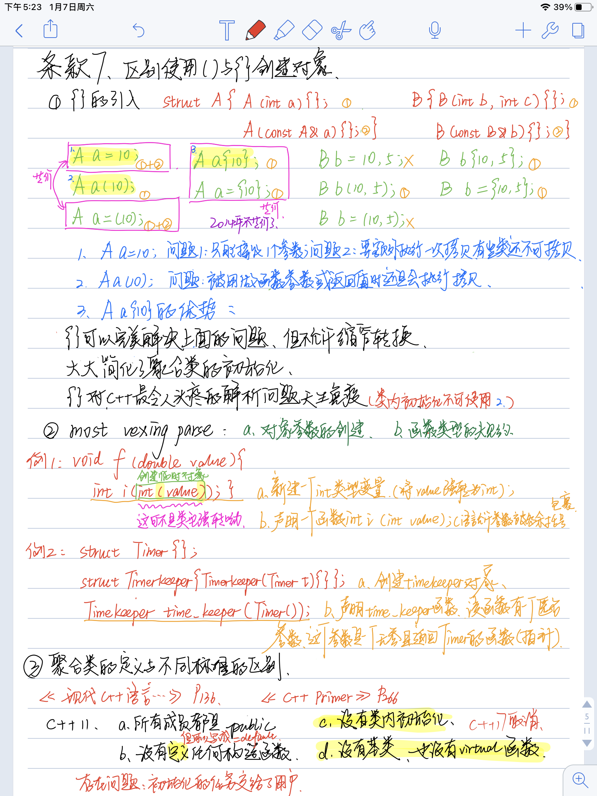

##### 图解：`item7_2.png`
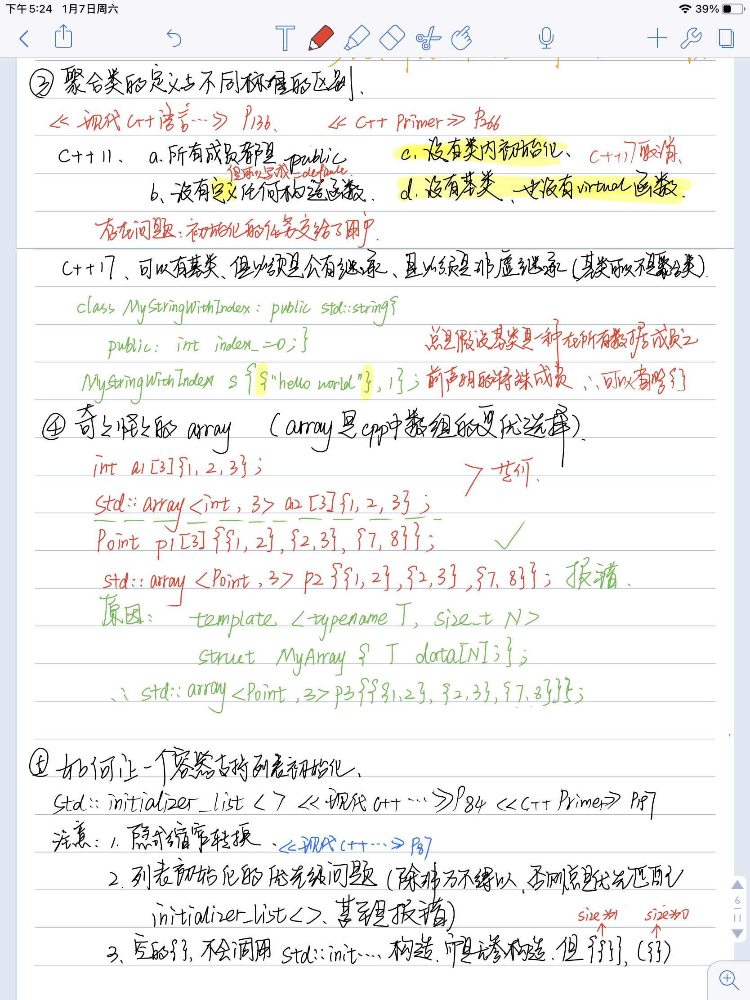

##### `item7.cpp`
```cpp
#include <vector>
#include <string>
#include <array>
#include <iostream>

struct people
{
    // people() = default;
    int age;
    std::string name;
    float height;
};

struct A
{
    // A()
    // {
    //     std::cout << "A()" << std::endl;
    // }
    A(int a)
    {
        std::cout << "A(int a)" << std::endl;
    }
    // A(int a, std::string b)
    // {
    //     std::cout << "A(int a, std::string b)" << std::endl;
    // }
    // A(int a, std::string name)
    // {
    //     std::cout << "A(int a, std::string name)" << std::endl;
    // }
    A(const A &a)
    {
        std::cout << "A(const A& a)" << std::endl;
    }
    A(std::initializer_list<int> a)
    {
        std::cout << "C(std::initializer_list<int> a)" << std::endl;
        for (const int *item = a.begin(); item != a.end(); ++item)
        {
        }
    }
};

void fun1(A arg)
{
}

A fun2()
{
    return {10, 5};
}

// most vexing parse
// TYPE b = (TYPE)a

void f(double value)
{
    int i(int(value));
}

struct Timer
{
};

struct TimerKeeper
{
    TimerKeeper(Timer t) {}
};

struct S
{
    int x;
    int y;
};

template <typename T, size_t N>
struct MyArray
{
    T data[N];
};

class MyStringWithIndex : public std::string
{
public:
    int index = 0;
};

int main()
{
    A a = 10;
    // A b(10);
    // A c = (10);
    // A d{10};
    // A e = {10};

    // A f = 10, 5;
    // A g(10, 5.);
    // A i = {10, 5};
    // A j = {10, 5};
    // fun1({10, 5});
    // A MM = fun2();

    // fun1(g);
    // fun1({10, 5});
    // people aaa{10, "jif", 18.f};
    // people aaa{.name = "people"};
    // TimerKeeper time_keeper{Timer()};
    // std::vector<int> aaa{1, 2, 3, 4, 5};

    // A k{};
    // A l({});
    // A m{{}};

    // https://blog.csdn.net/devcloud/article/details/114523118
    int a1[3]{1, 2, 3}; // 简单类型，原生数组
    int a2[3] = {1, 2, 3};
    std::array<int, 3> a3{1, 2, 3};     // 简单类型，std::array
    std::array<int, 3> a4 = {1, 2, 3};  // 简单类型，std::array
    S a5[3] = {{1, 2}, {3, 4}, {5, 6}}; // 复合类型，原生数组
    S a6[3] = {1, 2, 3, 4, 5, 6};       // 大括号的省略

    std::array<S, 3>
        a7{{{1, 2}, {3, 4}, {5, 6}}};      // 复合类型，std::array，编译失败！
    MyStringWithIndex s{"hello world", 1}; // c++17之前都会报错

    // std::vector<int> vec{1, 2, 3., 5, 6};

    // A aaaa{1, "gdh"};
    // A aaaaaaa{{}};
    // A bbbbbbb({});
}
```

#### Item 8 示例

##### 图解：`item8.png`
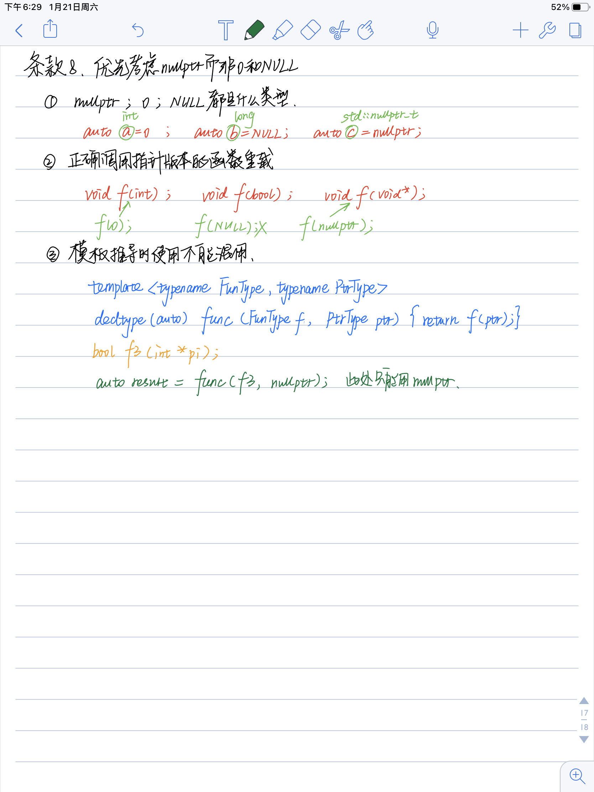

##### `item8.cpp`
```cpp
#include <iostream>
#include <memory>

void f(int)
{
    std::cout << "f(int)" << std::endl;
}
void f(bool)
{
    std::cout << "f(bool)" << std::endl;
}
void f(void *)
{
    std::cout << "f(void *)" << std::endl;
}
void f(long)
{
}

int f1(std::shared_ptr<int> spi)
{
    return 5;
}

double f2(std::unique_ptr<int> upi)
{
    return 5.;
}

bool f3(int *pi)
{
    return true;
}

template <typename FuncType, typename PtrType>
decltype(auto) func(FuncType f, // C++14
                    PtrType ptr)
{
    return f(ptr);
}
// bool func_(bool (*f)(int *), // C++14
//            int ptr)
// {
//     return f(ptr);
// }

int main()
{
    int *aa = 0;
    int *bb = NULL;
    int *cc = nullptr;

    auto a = 0;
    // auto b = NULL;
    auto c = nullptr;

    f(0);
    // f(NULL); // 编译不过
    f(nullptr);

    // auto result1 = func(f3, 0); // 错误！
    // f3(0);
    // auto result2 = func(f2, NULL);    // 错误！
    auto result3 = func(f3, nullptr); // 没问题

    int aaa = 0;
    // int *m = aaa;
    // std::shared_ptr<int> spi = aaa;
    return 0;
}
```

#### Item 9 示例

##### 图解：`item9.png`
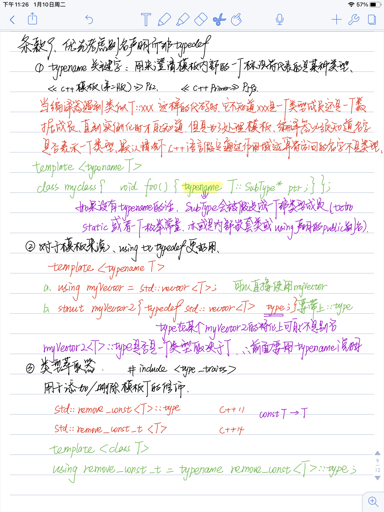

##### `item9.cpp`
```cpp
#include <string>
#include <vector>
#include <memory>
#include <iostream>
#include <type_traits>

struct test1
{
    static int SubType;
};

struct test2
{
    typedef int SubType;
};

template <typename T>
class MyClass
{
public:
    void foo()
    {
        typename T::SubType *ptr;
    }
};

template <class T>
using myVector = std::vector<T>;

template <typename T>
struct myVector2
{
    typedef std::vector<T> type;
};

template <>
class myVector2<float>
{
    enum class WineType
    {
        White,
        Red,
        Rose
    };
    WineType type;
};

template <typename T>
class Widget
{
public:
    myVector<T> list;
};

template <typename T>
class Widget2
{
public:
    typename myVector2<T>::type list;
};

template <typename T>
struct Trait1
{
    void foo()
    {
        int mm = 10;
        // typename std::remove_const<T>::type temp1 = mm;
        std::remove_const_t<T> temp1 = mm;
        // typename std::remove_reference<T>::type temp2 = mm;
        std::remove_reference_t<T> temp2 = mm;
    }
};

class MMM
{
public:
    static int aa;
};
int main()
{

    // MyClass<test1> class1;
    // class1.foo();
    MyClass<test2> class2;
    class2.foo();
    myVector<int> myvec = {1, 2, 3};
    myVector2<int>::type myvec2 = {4, 5, 6}; // 此处不用加typename是因为T已经确定啦

    Widget<int> weight;
    Trait1<const int &> trait1;
    trait1.foo();

    return 0;
}
```

#### Item 10 示例

##### 图解：`item10.png`
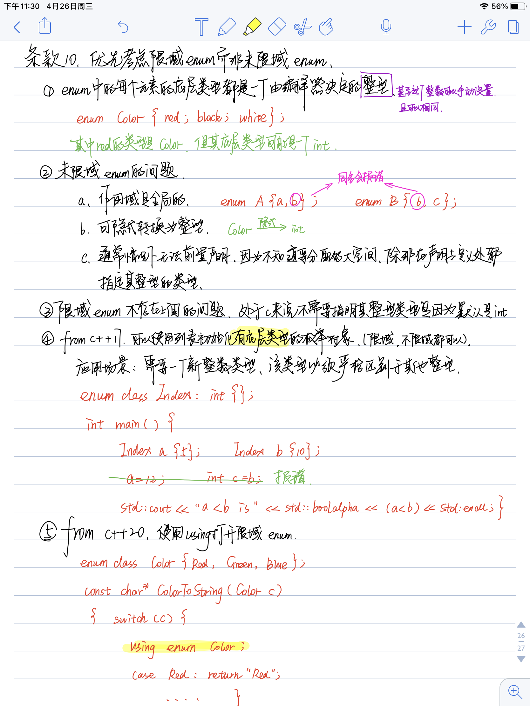

##### `item10.cpp`
```cpp
#include <iostream>
#include <string>
#include <tuple>

enum Color
{
    black = 5,
    white = 5,
    red
};

enum School : int;
enum class EnumInt : short;
class A
{
private:
    School _enumSchool;
    EnumInt e_int;
};

enum School : int
{
    teacher,
    student
};

enum Company
{
    manager,
    employee
};

enum class EnumInt : short
{
    e1 = 1,
    e2 = 2,
    e3
};

using UserInfo =             // 类型别名，参见Item9
    std::tuple<std::string,  // 名字
               std::string,  // email地址
               std::size_t>; // 声望

enum UserInfoFields
{
    uiName,
    uiEmail,
    uiReputation
};

enum class UserInfoFieldsScoped
{
    uiName,
    uiEmail,
    uiReputation
};

// c++11
template <typename E>
constexpr typename std::underlying_type<E>::type
toUType(E enumerator) noexcept
{
    return static_cast<typename std::underlying_type<E>::type>(enumerator);
}

// C++14
template <typename E>
constexpr std::underlying_type_t<E>
toUType_(E enumerator) noexcept
{
    return static_cast<std::underlying_type_t<E>>(enumerator);
}

// C++14
template <typename E>
constexpr auto
toUType__(E enumerator) noexcept
{
    return static_cast<std::underlying_type_t<E>>(enumerator);
}

int main()
{
    School a = student;
    int b = student;

    School e = static_cast<School>(10);
    // School c = 10;
    // Company d = student;
    EnumInt aa = EnumInt::e1;
    float bb = static_cast<float>(aa);
    // auto size = sizeof(EnumInt);
    // EnumInt e_i{10};
    // // E e_i_2 = {8};
    // // E e_i_3(10);
    // // E e_i_4 = 10;

    // bool a = EnumInt::e1 > EnumInt::e2;

    // // =========
    UserInfo uInfo{"hkl", "7xxx@email.com", 10};
    auto val = std::get<1>(uInfo); // 获取第一个字段
    auto val_ = std::get<uiEmail>(uInfo);
    auto val__ =
        std::get<static_cast<int>(UserInfoFieldsScoped::uiEmail)>(uInfo);
    auto val___ = std::get<toUType(UserInfoFieldsScoped::uiEmail)>(uInfo);
    UserInfoFieldsScoped aaa = UserInfoFieldsScoped::uiEmail;
    UserInfoFieldsScoped bbb{0};
    return 0;
}
```

#### Item 11 示例

##### 图解：`item11.png`
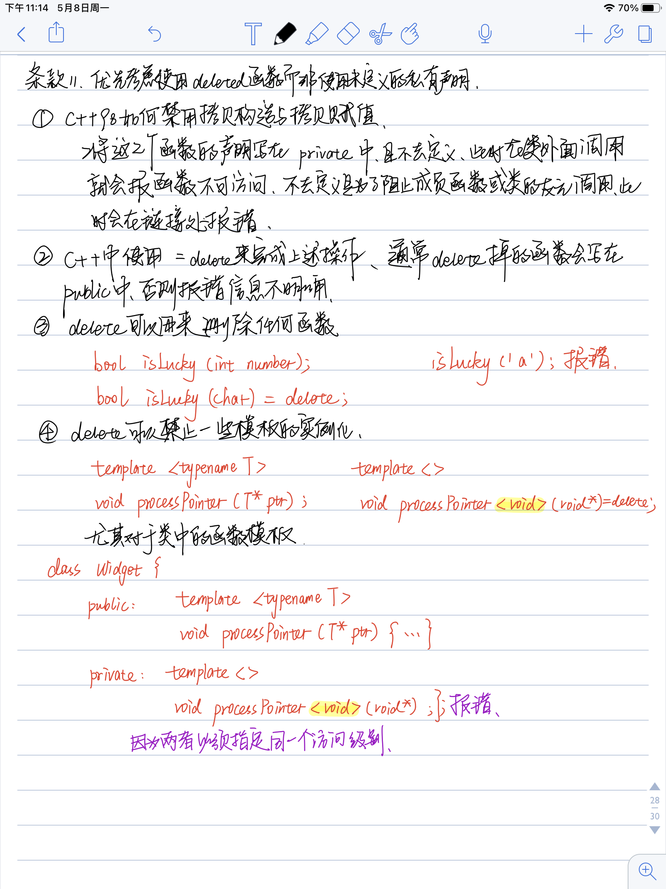

##### `item11.cpp`
```cpp
#include <iostream>
#include <string>
#include <vector>

struct B;

struct A
{
    A(int data) : _data(_data){};
    A(const A &a) = delete;
    A &operator=(const A &) = delete;

private:
    friend B;
    int _data;
};

struct B
{
    B()
    {
        A a(10);
        // A b = a;
    }
};

bool isLucky(int a)
{
    return a == 7;
}

bool isLucky(char) = delete;

template <typename T>
void processPointer(T *ptr)
{
}

template <>
void processPointer<void>(void *ptr) = delete;

int main()
{
    A a(10);
    // A aaa = a;

    B b;

    isLucky(32);
    // isLucky('a');

    int aa = 10;
    void *aaptr = reinterpret_cast<void *>(&aa);
    // processPointer(aaptr);
    return 0;
}
```

#### Item 12 示例

##### 图解：`item12&item13.png`
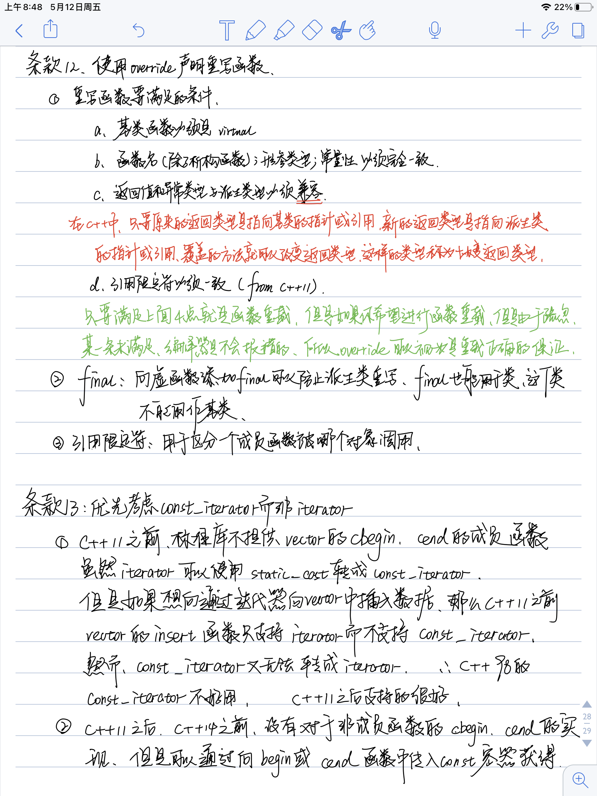

##### `item12.cpp`
```cpp
#include <iostream>
#include <string>
#include <vector>

class Base
{
public:
    virtual void mf1() const &
    {
        std::cout << "Base:: virtual mf1" << std::endl;
    };
    void mf2()
    {
        std::cout << "Base:: mf2" << std::endl;
    }
    virtual void mf3()
    {
        std::cout << "Base:: virtual mf3" << std::endl;
    }

    virtual void mf4() final
    {
        std::cout << "Base:: virtual mf4" << std::endl;
    }
};

class Derived : public Base
{
public:
    void mf1() const & override
    {
        std::cout << "Derived:: virtual mf1" << std::endl;
    };
    void mf2()
    {
        std::cout << "Derived:: mf2" << std::endl;
    }
    void mf3() override
    {
        std::cout << "Derived:: virtual mf3" << std::endl;
    }

    // void mf4() override
    // {
    //     std::cout << "Derived:: virtual mf4" << std::endl;
    // }
};

class Widget
{
public:
    using DataType = std::vector<double>;
    DataType &data() & // 对于左值Widgets,
    {
        return values;
    } // 返回左值

    DataType data() && // 对于右值Widgets,
    {
        return std::move(values);
    } // 返回右值

private:
    DataType values;
};

Widget makeWidget()
{
    return Widget();
}

int main()
{
    // Base b1;
    // b1.mf1();
    // b1.mf2();

    Derived d1;
    // d1.mf1();
    // d1.mf2();

    Base *b2 = &d1;
    b2->mf1();
    b2->mf2();
    b2->mf3();

    Widget w;
    auto vals1 = w.data(); // 拷贝w.values到vals1
    auto vals2 = makeWidget().data();
}
```

#### Item 13 示例

##### `item13.cpp`
```cpp
#include <vector>
#include <iostream>
#include <string>
#include <algorithm>

typedef std::vector<int>::iterator IterT; // typedef
typedef std::vector<int>::const_iterator ConstIterT;

template <class C>
auto cbegin(const C &container) -> decltype(std::begin(container))
{
    return std::begin(container);
}

template <class C>
auto cend(const C &container) -> decltype(std::end(container))
{
    return std::end(container);
}

template <typename C, typename V>
void findAndInsert(C &container,       // 在容器中查找第一次
                   const V &targetVal, // 出现targetVal的位置，
                   const V &insertVal) // 然后在那插入insertVal
{
    // using std::cbegin;
    // using std::cend;

    auto it = std::find(cbegin(container), // 非成员函数cbegin
                        cend(container),   // 非成员函数cend
                        targetVal);
    container.insert(it, insertVal);
}

int main()
{
    std::vector<int> avec = {1, 2, 3, 4, 5};
    // ========= 使用iterator
    // std::vector<int>::iterator it =
    //     std::find(avec.begin(), avec.end(), 2);
    // avec.insert(it, 22);

    // ========= 使用const_iterator after C++11
    std::vector<int>::const_iterator cit = std::find(avec.cbegin(), avec.cend(), 2);
    std::cout << *cit << std::endl;
    avec.insert(cit, 22);

    // ========= 使用const_iterator before C++11
    // ConstIterT ci =
    //     std::find(static_cast<ConstIterT>(avec.begin()), // cast
    //               static_cast<ConstIterT>(avec.end()),   // cast
    //               2);
    // avec.insert(static_cast<IterT>(ci), 22); // 这句话报错 因为iterator与const_iterator无法转换
    const std::vector<int> caVec = {1, 2, 3, 4};
    auto cit = std::begin(caVec);

    return 0;
}
```

#### Item 14 示例

##### 图解：`item14.png`
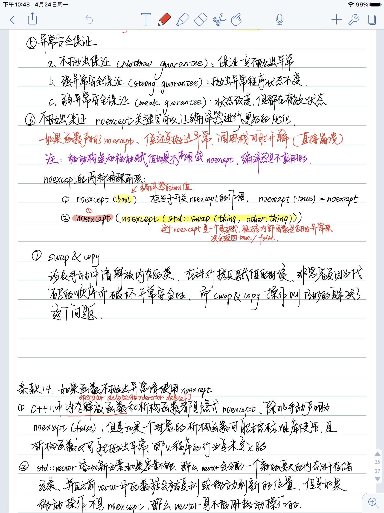

##### `item14.cpp`
```cpp
#include <vector>
#include <string>
#include <array>
#include <iostream>

struct A
{
    A(std::string param)
    {
        std::cout << "A(std::string param)" << std::endl;
        _data = param;
    }
    A(const A &a)
    {
        std::cout << "A(const A& a)" << std::endl;
        _data = a._data;
    }
    A(A &&a) noexcept
    {
        std::cout << "A(A&& a)" << std::endl;
        _data = std::move(a._data);
    }

public:
    std::string _data;
};

int main()
{
    std::vector<A> a_vec;
    a_vec.reserve(2);
    a_vec.push_back(A("nihao"));
    a_vec.push_back(A("nihao"));
    a_vec.push_back(A("nihao"));
    a_vec.push_back(A("nihao"));

    int a[10] = {0};
    int b[10] = {1};
    std::swap(a, b);

    return 0;
}
```

#### Item 15 示例

##### 图解：`item15.png`
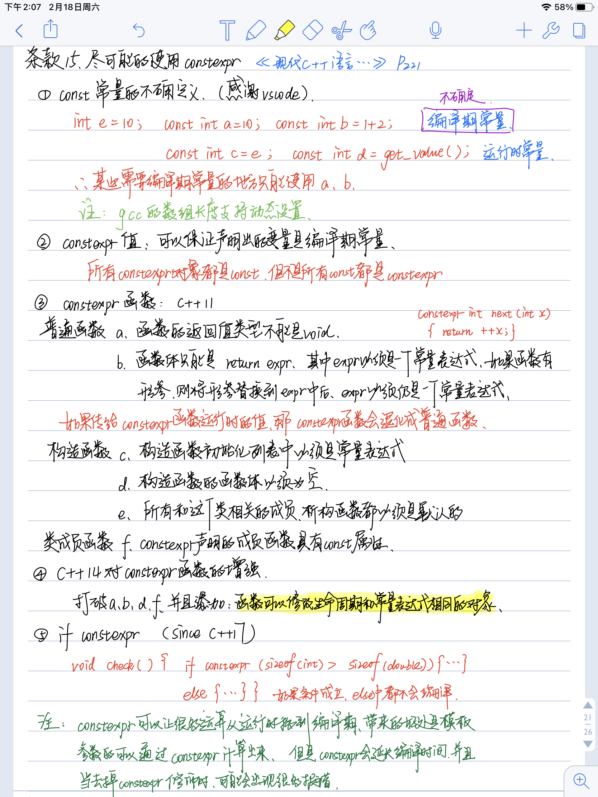

##### `item15.cpp`
```cpp
#include <iostream>
#include <string>
#include <vector>
#include <array>

int get_value()
{
    return 1;
}

constexpr int get_value_c()
{
    return 1;
}

constexpr int abs_(int x)
{

    if (x > 0)
        return x;
    else
        return -x;

    // return x > 0 ? x : -x;
}

// constexpr int next(int param)
// {
//     return ++param;
// }
constexpr void func()
{
    // int a = 50;
    // a = 60;
}

class A
{
public:
    constexpr A() : x1(5)
    {
        int a = 10;
        a = 50;
    }
    constexpr A(int i) : x1(i) {}
    constexpr int get()
    {
        return x1;
    }

    ~A() = default;

    int x1;
};

class Point
{
public:
    constexpr Point(double xVal = 0, double yVal = 0) noexcept
        : x(xVal), y(yVal)
    {
    }

    constexpr double xValue() const noexcept { return x; }
    constexpr double yValue() const noexcept { return y; }

    // constexpr Point(Point &&p) : x(p.x), y(p.y)
    // {
    // }

    // ~Point() = delete;
    constexpr void setX(double newX) noexcept { x = newX; }
    constexpr void setY(double newY) noexcept { y = newY; }

private:
    double x, y;
};

// 返回p相对于原点的镜像
constexpr Point reflection(const Point &p) noexcept
{
    Point result;             // 创建non-const Point
    result.setX(-p.xValue()); // 设定它的x和y值
    result.setY(-p.yValue());
    return result; // 返回它的副本
}

constexpr Point midpoint(const Point &p1, const Point &p2) noexcept
{
    return {(p1.xValue() + p2.xValue()) / 2,  // 调用constexpr
            (p1.yValue() + p2.yValue()) / 2}; // 成员函数
}

int main()
{

    // 1.常量的不确定性
    int e = 10;
    const int a = 10;
    const int b = 1 + 2;
    const int c = e;
    const int d = get_value();

    constexpr int f = get_value_c();
    // constexpr int g = abs_(e);

    constexpr int h = abs_(a);

    char array_a[a];
    char array_b[b];
    char array_c[c];
    char array_d[d];

    char array_e[e];

    std::array<int, a> array_aa{};
    std::array<int, b> array_bb{};
    // std::array<int, c> array_cc{};
    // std::array<int, d> array_dd{}; //这里报错的原因是模板参数要求是编译期常量

    constexpr int value = abs_(-100);
    const int value_1 = abs_(-1000);
    auto value_2 = abs_(-1000);
    const int value_3 = abs_(e);
    // constexpr int value_4 = abs_(e);

    constexpr A a1;

    constexpr A a2(10);
    constexpr A a3(5);
    // constexpr int mmm = a3.get();

    // a3.func(50);
    Point p0(5.6, 8.6);
    Point p5(0.0, 0.0);
    // constexpr Point p1(9.4, 27.7); // 和之前一样
    // constexpr Point p2(28.8, 5.3);
    // constexpr auto mid = midpoint(p1, p2);
    // constexpr auto reflectedMid = reflection(mid);
    // auto mid2 = midpoint(p0, p5);
}
```

#### Item 17 示例

##### 图解：`item17.png`
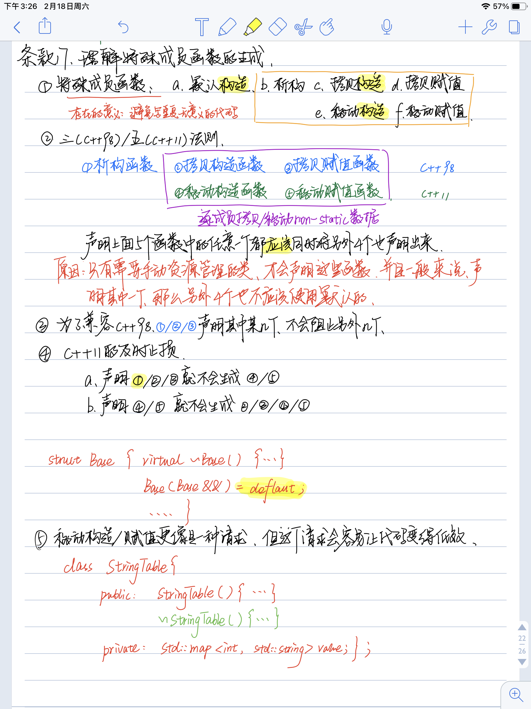

##### `item17.cpp`
```cpp
#include <iostream>
#include <string>
#include <vector>
class A
{
public:
    A(int param) : mm(param) {}
    A(const A &a)
    {
        std::cout << "A (const A&a)" << std::endl;
        mm = a.mm;
    }
    A(A &&a)
    {
        std::cout << "A (&&a)" << std::endl;
        mm = a.mm;
        a.mm = 0;
    }
    // A &operator=(const A &a)
    // {
    //     std::cout << "A &operator=(const A &a)" << std::endl;
    //     mm = a.mm;
    //     return *this;
    // }
    // A &operator=(A &&a)
    // {
    //     std::cout << "A &operator=(A &&a)" << std::endl;
    //     mm = a.mm;
    //     a.mm = 0;
    //     return *this;
    // }
    ~A()
    {
        std::cout << "~A()" << std::endl;
    }

private:
    int mm{};
    int *nn = nullptr;
};

int main()
{
    // A a{1};
    // A aa{2};
    A b{5};
    // b = aa;

    // A c{20};
    // c = a;
    A mm = std::move(b);
    A c{10};
    // mm = std::move(c);
    // A d = std::move(a);
    // d = std::move(a);
    return 0;
}
```

## 第4章 智能指针

### 章节说明

**CHAPTER 4 Smart Pointers**

诗人和歌曲作家喜欢爱。有时候喜欢计数。很少情况下两者兼有。受伊丽莎白·巴雷特·勃朗宁（Elizabeth Barrett Browning）对爱和数的不同看法的启发（“我怎么爱你？让我数一数。”）和保罗·西蒙（Paul Simon）（“离开你的爱人必须有50种方法。”），我们可以试着枚举一些为什么原始指针很难被爱的原因：

1. 它的声明不能指示所指到底是单个对象还是数组。
2. 它的声明没有告诉你用完后是否应该销毁它，即指针是否拥有所指之物。
3. 如果你决定你应该销毁指针所指对象，没人告诉你该用`delete`还是其他析构机制（比如将指针传给专门的销毁函数）。
4. 如果你发现该用`delete`。 原因1说了可能不知道该用单个对象形式（“`delete`”）还是数组形式（“`delete[]`”）。如果用错了结果是未定义的。
5. 假设你确定了指针所指，知道销毁机制，也很难确定你在所有执行路径上都执行了**恰为一次**销毁操作（包括异常产生后的路径）。少一条路径就会产生资源泄漏，销毁多次还会导致未定义行为。
6. 一般来说没有办法告诉你指针是否变成了悬空指针（dangling pointers），即内存中不再存在指针所指之物。在对象销毁后指针仍指向它们就会产生悬空指针。

原始指针是强大的工具，当然，另一方面几十年的经验证明，只要注意力稍有疏忽，这个强大的工具就会攻击它的主人。

**智能指针**（*smart pointers*）是解决这些问题的一种办法。智能指针包裹原始指针，它们的行为看起来像被包裹的原始指针，但避免了原始指针的很多陷阱。你应该更倾向于智能指针而不是原始指针。几乎原始指针能做的所有事情智能指针都能做，而且出错的机会更少。

在C++11中存在四种智能指针：`std::auto_ptr`，`std::unique_ptr`，`std::shared_ptr`，` std::weak_ptr`。都是被设计用来帮助管理动态对象的生命周期，在适当的时间通过适当的方式来销毁对象，以避免出现资源泄露或者异常行为。

`std::auto_ptr`是来自C++98的已废弃遗留物，它是一次标准化的尝试，后来变成了C++11的`std::unique_ptr`。要正确的模拟原生指针需要移动语义，但是C++98没有这个东西。取而代之，`std::auto_ptr`拉拢拷贝操作来达到自己的移动意图。这导致了令人奇怪的代码（拷贝一个`std::auto_ptr`会将它本身设置为null！）和令人沮丧的使用限制（比如不能将`std::auto_ptr`放入容器）。

`std::unique_ptr`能做`std::auto_ptr`可以做的所有事情以及更多。它能高效完成任务，而且不会扭曲自己的原本含义而变成拷贝对象。在所有方面它都比`std::auto_ptr`好。现在`std::auto_ptr`唯一合法的使用场景就是代码使用C++98编译器编译。除非你有上述限制，否则你就该把`std::auto_ptr`替换为`std::unique_ptr`而且绝不回头。

各种智能指针的API有极大的不同。唯一功能性相似的可能就是默认构造函数。因为有很多关于这些API的详细手册，所以我将只关注那些API概览没有提及的内容，比如值得注意的使用场景，运行时性能分析等，掌握这些信息可以更高效的使用智能指针。

### 基础代码与图解

#### 图解：`base13.png`
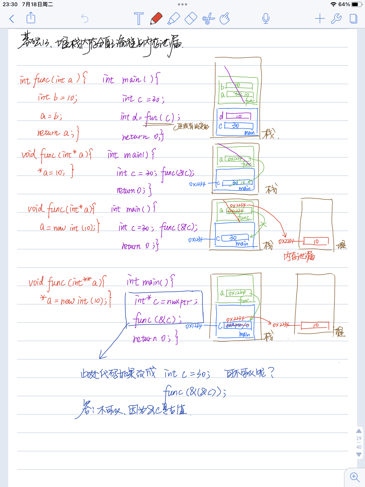

#### `base13.cpp`
```cpp
#include <iostream>
#include <memory>

int func(int a)
{
    int b = 10;
    a = b;
    return a;
}

void func2(int *a)
{
    *a = 10;
}

void func3(int *a)
{
    a = new int(10);
}

void fun4(int **a)
{
    *a = new int(10);
}

int main()
{
    int c = 30;
    // int d = func(c);
    // func2(&c);
    // func3(&c);

    int *d = nullptr;
    fun4(&d);
    return 0;
}
```

#### 图解：`base14.png`
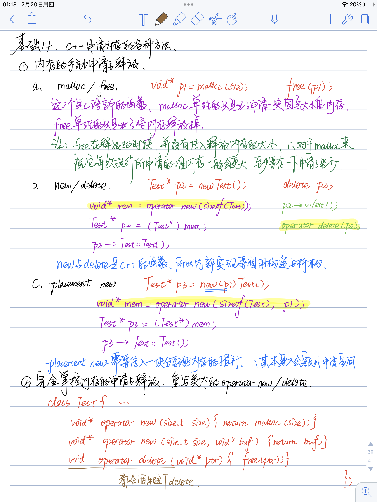

#### `base14.cpp`
```cpp
#include <iostream>
#include <vector>
#include <string>

class Test
{
public:
    Test() { std::cout << "Test() addr is: " << this << std::endl; }
    Test(int a) : _a(a)
    {
        std::cout << "Test(int a) addr is: " << this << std::endl;
    }
    Test(int a, int b) { std::cout << "Test(int a, int b) addr is: " << this << std::endl; }
    ~Test() { std::cout << "~Test() addr is: " << this << std::endl; }

    void *operator new(size_t size)
    {
        std::cout << "operator new(size_t size)" << std::endl;
        return malloc(size);
    }

    void *operator new(size_t size, void *buf)
    {
        std::cout << "operator new(size_t size, void* buf)" << std::endl;
        return buf;
    }

    void operator delete(void *ptr, size_t size)
    {
        std::cout << "operator delete(void* ptr, size_t size)" << std::endl;
        free(ptr);
    }

    void operator delete(void *ptr, void *buf)
    {
        std::cout << "operator delete(void* ptr, void* buf)" << std::endl;
        free(ptr);
    }

private:
    int _a;
};

int main()
{
    // void *p1 = malloc(sizeof(Test) * 10);
    // free(p1);
    // int *p2 = (int *)malloc(sizeof(Test) * 10);
    // free((++p2)); // 会崩溃，因为p2指向别处，他就不知道应该释放多少堆内存啦

    // Test *p3 = new Test();
    // delete p3;

    void *buf = malloc(sizeof(Test));
    Test *p4 = new (buf) Test(500);
    delete p4; // 会调用operator delete(void* ptr)
    return 0;
}
```

#### 图解：`base15.png`
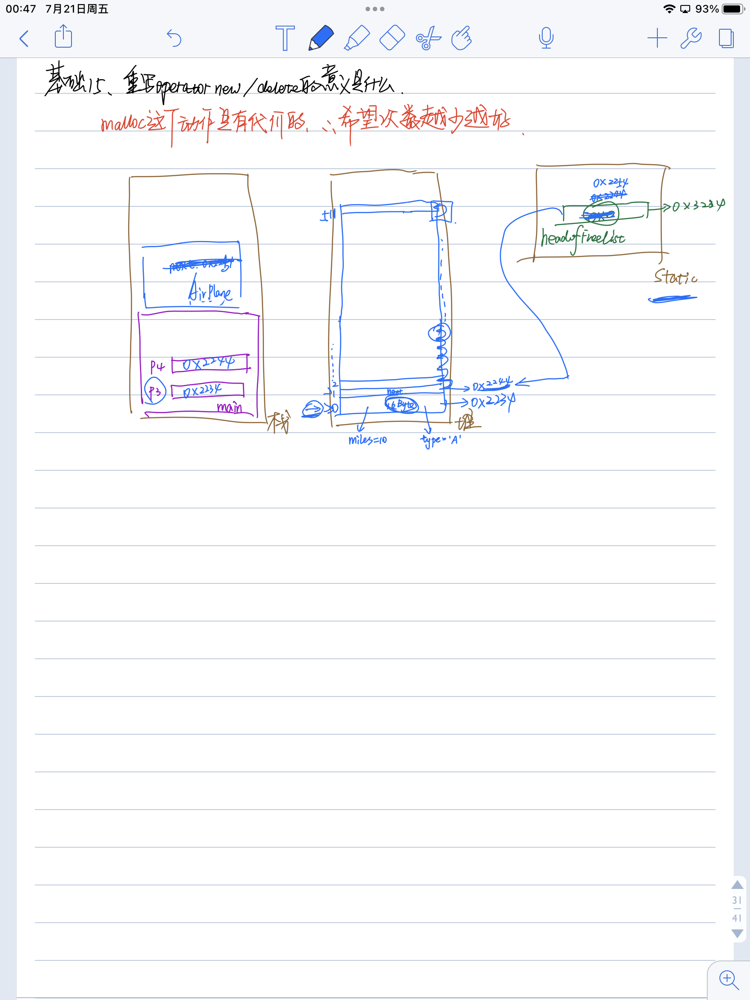

#### `base15.cpp`
```cpp
#include <iostream>
#include <string>
#include <vector>

class Airplane
{
private:
    struct AirplaneRep
    {
        unsigned long miles{10}; // 8
        char type{'A'};          // 1       16
    };
    union
    {
        AirplaneRep rep{}; // 16
        Airplane *next;    // 8
    };                     // 16

public:
    unsigned long
    getMiles()
    {
        return rep.miles;
    }
    char getType() { return rep.type; }
    void set(unsigned long m, char t)
    {
        rep.miles = m;
        rep.type = t;
    }
    static void *operator new(size_t size);
    static void operator delete(void *ptr);
    ~Airplane() { std::cout << "Airplane::~Airplane()" << std::endl; }

private:
    static const int BLOCK_SIZE;
    static Airplane *headOfFreeList;
};

Airplane *Airplane::headOfFreeList;
const int Airplane::BLOCK_SIZE = 512;

void *Airplane::operator new(size_t size)
{
    // if (size != sizeof(Airplane))
    // {
    //     return ::operator new(size);
    // }
    Airplane *p = headOfFreeList;
    if (p)
    {
        headOfFreeList = p->next;
    }
    else
    {
        Airplane *newBlock = static_cast<Airplane *>(::operator new(BLOCK_SIZE * sizeof(Airplane)));
        for (int i = 1; i < BLOCK_SIZE - 1; ++i)
        {
            newBlock[i].next = &newBlock[i + 1];
        }
        newBlock[BLOCK_SIZE - 1].next = 0;
        p = newBlock;
        headOfFreeList = &newBlock[1];
    }
    return p;
}

void Airplane::operator delete(void *ptr)
{
    if (ptr == 0)
    {
        return;
    }
    // if (size != sizeof(Airplane))
    // {
    //     ::operator delete(ptr);
    //     return;
    // }
    Airplane *deleteMe = static_cast<Airplane *>(ptr);
    deleteMe->next = headOfFreeList;
    headOfFreeList = deleteMe;
}

int main()
{
    Airplane *p3 = new Airplane();
    auto size = sizeof(Airplane);
    std::cout << p3 << std::endl;
    // p3->set(1000, 'A');
    Airplane *p4 = new Airplane();
    std::cout << p4 << std::endl;
    // p4->set(5000, 'A');
    Airplane *p5 = new Airplane();
    std::cout << p5 << std::endl;

    delete p3;
    delete p5;
    delete p4;
    free(p3);
    // std::allocator<int> alloc;
    // alloc.allocate(10);
    return 0;
}
```

#### 图解：`base16.png`
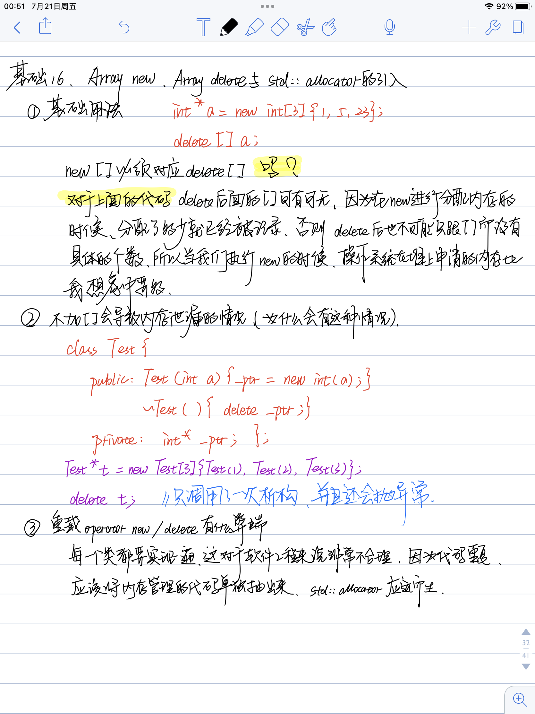

#### `base16.cpp`
```cpp
#include <string>
#include <iostream>
#include <vector>

class Test
{
public:
    Test() { std::cout << "Test() addr is: " << this << std::endl; }
    Test(int a) : _a(a) { std::cout << "Test(int a) addr is: " << this << std::endl; }
    Test(int a, int b) { std::cout << "Test(int a, int b) addr is: " << this << std::endl; }
    ~Test() { std::cout << "~Test() addr is: " << this << std::endl; }

private:
    int _a;
};

int main()
{
    // for (int i = 0; i < 3; i++)
    // {
    //     int *a = new int(10);
    //     std::cout << a << std::endl;
    // }

    // int *a = new int[3]{1, 23, 5};
    // std::cout << a << std::endl;
    // std::cout << a + 1 << std::endl;
    // std::cout << a + 2 << std::endl;
    // delete[] a;
    Test *t = new Test[3]{Test(1), Test(2), Test(3)};
    delete t;
    return 0;
}
```

#### `Gadget.h`
```cpp
#pragma once

struct Gadget
{
    int data;
};
```

#### `Widget.cpp`
```cpp
#include <iostream>
// #include "Widget.h"

// Widget::Widget() { std::cout << "Widget()" << std::endl; }

// ==========================

#include "Widget.h"
#include "Gadget.h"

struct Widget::Impl
{
    // std::string name;
    // std::vector<double> data;
    Gadget g1, g2, g3;
};

Widget::Widget()
    : pImpl(std::make_unique<Impl>())
{
}

Widget::~Widget() = default;
Widget::Widget(Widget &&rhs) = default;
Widget &Widget::operator=(Widget &&rhs) = default;
```

#### `Widget.h`
```cpp
#pragma once

// #include <vector>
// #include <string>
// #include <iostream>
// #include "Gadget.h"

// class Widget
// {
// public:
//     Widget();

// private:
//     std::string name;
//     std::vector<double> data;
//     Gadget g1, g2, g3; // Gadget是用户自定义的类型
// };

// ==========================

// #include <vector>
// #include <string>
// #include <iostream>

// class Widget
// {
// public:
//     Widget();
//     ~Widget();

// private:
//     struct Impl;
//     Impl *pImpl;
// };

// ========================

#include <vector>
#include <string>
#include <memory>
#include <iostream>

class Widget
{
public:
    Widget();
    ~Widget();
    Widget(Widget &&rhs);
    Widget &operator=(Widget &&rhs);

private:
    struct Impl;
    std::unique_ptr<Impl> pImpl;
};
```

### 条款代码与图解

#### Item 18 示例

##### 图解：`item18.png`
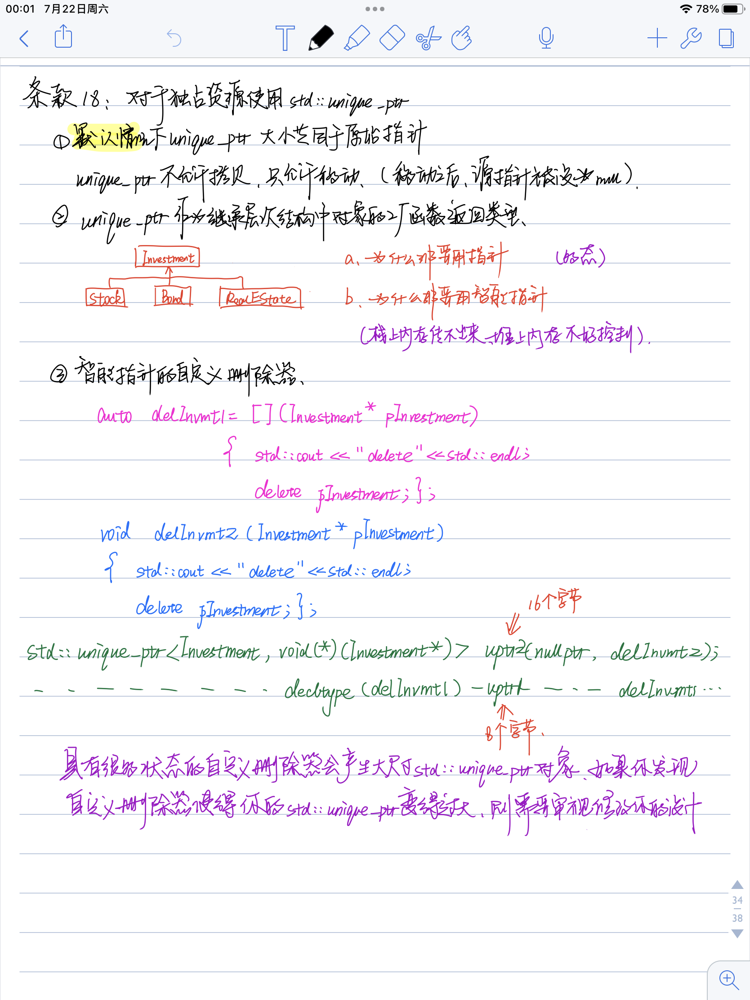

##### 图解：`item18_fig1.png`
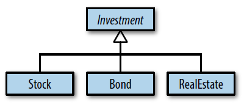

##### `item18.cpp`
```cpp
#include <memory>
#include <iostream>

class Test
{
public:
    Test(int a) : _data(a) { std::cout << "Test(int a)" << std::endl; }
    ~Test() { std::cout << "~Test()" << std::endl; }

private:
    int _data;
};

class Investment
{
public:
    virtual ~Investment() {}
};

class Stock : public Investment
{
public:
    Stock(int a) { std::cout << "Stock(int a)" << std::endl; }
    ~Stock() override { std::cout << "~Stock()" << std::endl; }
};
class Bond : public Investment
{
public:
    Bond(int a, int b) { std::cout << "Bond(int a, int b)" << std::endl; }
    ~Bond() override { std::cout << "~Bond()" << std::endl; }
};
class RealEstate : public Investment
{
public:
    RealEstate(int a, int b, int c) { std::cout << "RealEstate(int a, int b, int c)" << std::endl; }
    ~RealEstate() override { std::cout << "~RealEstate()" << std::endl; }
};

template <typename... Ts>
Investment *makeInvestment_test(Ts &&...params)
{
    Investment *ptr;
    constexpr int numArgs = sizeof...(params);
    if constexpr (numArgs == 1)
    {
        Stock stock(std::forward<Ts>(params)...);
        ptr = &stock;
    }
    if constexpr (numArgs == 2)
    {
        Bond bond(std::forward<Ts>(params)...);
        ptr = &bond;
    }
    if constexpr (numArgs == 3)
    {

        RealEstate realEstate(std::forward<Ts>(params)...);
        ptr = &realEstate;
    }
    return ptr;
}

template <typename... Ts>
Investment *makeInvestment_test2(Ts &&...params)
{
    Investment *ptr;
    constexpr int numArgs = sizeof...(params);
    if constexpr (numArgs == 1)
    {
        Stock *stock = new Stock(std::forward<Ts>(params)...);
        ptr = stock;
    }
    if constexpr (numArgs == 2)
    {
        Bond *bond = new Bond(std::forward<Ts>(params)...);
        ptr = bond;
    }
    if constexpr (numArgs == 3)
    {

        RealEstate *realEstate = new RealEstate(std::forward<Ts>(params)...);
        ptr = &realEstate;
    }
    return ptr;
}

template <typename... Ts>   // 返回指向对象的std::unique_ptr，
std::unique_ptr<Investment> // 对象使用给定实参创建
makeInvestment(Ts &&...params)
{
    std::unique_ptr<Investment> uptr{nullptr};
    constexpr int numArgs = sizeof...(params);
    if constexpr (numArgs == 1)
    {
        uptr.reset(new Stock(std::forward<Ts>(params)...));
    }
    if constexpr (numArgs == 2)
    {
        uptr.reset(new Bond(std::forward<Ts>(params)...));
    }
    if constexpr (numArgs == 3)
    {
        uptr.reset(new RealEstate(std::forward<Ts>(params)...));
    }
    return uptr;
}

auto delInvmt = [](Investment *pInvestment) // 自定义删除器
{                                           // （lambda表达式）
    std::cout << "delete" << std::endl;
    delete pInvestment;
};

template <typename... Ts>
std::unique_ptr<Investment, decltype(delInvmt)> // 更改后的返回类型
makeInvestment2(Ts &&...params)
{
    std::unique_ptr<Investment, decltype(delInvmt)> // 应返回的指针
        uptr(nullptr, delInvmt);
    constexpr int numArgs = sizeof...(params);
    if constexpr (numArgs == 1)
    {
        uptr.reset(new Stock(std::forward<Ts>(params)...));
    }
    if constexpr (numArgs == 2)
    {
        uptr.reset(new Bond(std::forward<Ts>(params)...));
    }
    if constexpr (numArgs == 3)
    {
        uptr.reset(new RealEstate(std::forward<Ts>(params)...));
    }
    return uptr;
}

template <typename... Ts>
auto makeInvestment3(Ts &&...params) // C++14
{
    auto delInvmt2 = [](Investment *pInvestment) // 现在在
    {                                            // makeInvestment里
        std::cout << "delete" << std::endl;
        delete pInvestment;
    };

    std::unique_ptr<Investment, decltype(delInvmt2)> // 应返回的指针
        uptr(nullptr, delInvmt2);
    constexpr int numArgs = sizeof...(params);
    if constexpr (numArgs == 1)
    {
        uptr.reset(new Stock(std::forward<Ts>(params)...));
    }
    if constexpr (numArgs == 2)
    {
        uptr.reset(new Bond(std::forward<Ts>(params)...));
    }
    if constexpr (numArgs == 3)
    {
        uptr.reset(new RealEstate(std::forward<Ts>(params)...));
    }
    return uptr;
}

void delInvmt3(Investment *pInvestment) // 函数形式的
{                                       // 自定义删除器
    std::cout << "delete" << std::endl;
    delete pInvestment;
}

int main()
{
    {
        std::unique_ptr<Test> uptr = std::unique_ptr<Test>(new Test(10));
        auto size = sizeof(uptr);
        std::unique_ptr<Test> uptr1 = std::move(uptr);
        std::shared_ptr<Test> sptr2 = std::move(uptr1);
        //     std::cout << "over" << std::endl;
    }
    {
        Investment *ptr = makeInvestment_test(1);
        Investment *ptr2 = makeInvestment_test2(1);
        std::cout << "over";
    }
    {
        std::unique_ptr<Investment> uptrS = makeInvestment(1);
        //     auto size = sizeof(uptrS);
        //     std::unique_ptr<Investment> uptrB = makeInvestment(1, 2);
        //     std::unique_ptr<Investment> uptrR = makeInvestment(1, 2, 3);
    }
    {
        auto uptrS = makeInvestment2(1);
        //     auto size = sizeof(uptrS);
        //     std::unique_ptr<Investment, decltype(delInvmt)> uptrB = makeInvestment2(1, 2);
        //     std::unique_ptr<Investment, decltype(delInvmt)> uptrR = makeInvestment2(1, 2, 3);
    }

    // {
    //     auto uptrS = makeInvestment3(1);
    //     auto size = sizeof(uptrS);
    //     auto uptrB = makeInvestment3(1, 2);
    //     auto uptrR = makeInvestment3(1, 2, 3);
    // }

    // {
    //     std::unique_ptr<Investment, void (*)(Investment *)> uptr(nullptr, delInvmt3);
    //     std::unique_ptr<Investment, decltype(delInvmt)> uptr2(nullptr, delInvmt);
    //     auto size = sizeof(uptr);
    //     size = sizeof(uptr2);
    //     std::cout << "over";
    // }
    std::cout << "over" << std::endl;
    return 0;
}
```

#### Item 19 示例

##### 图解：`item19_1.png`
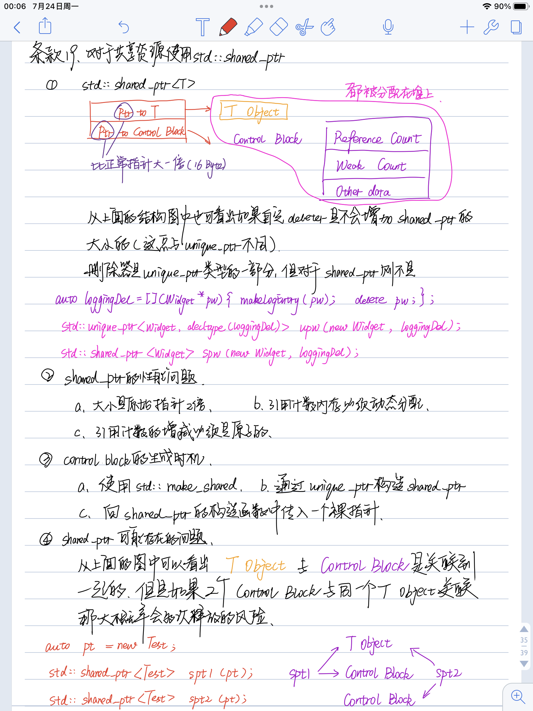

##### 图解：`item19_2.png`
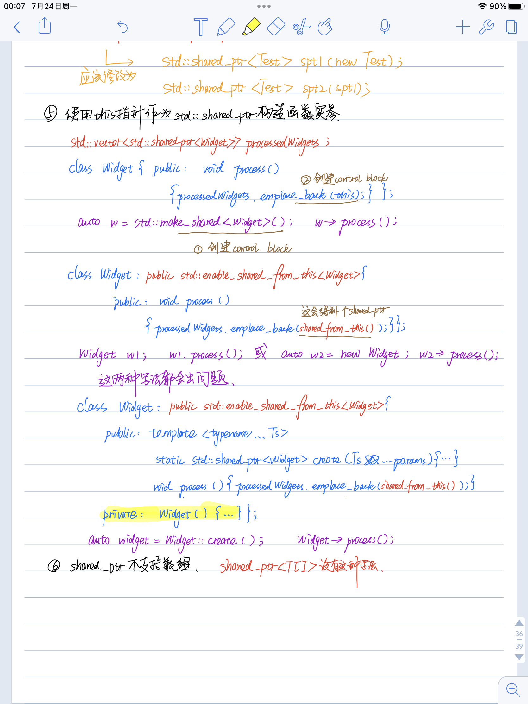

##### 图解：`item19_fig1.png`
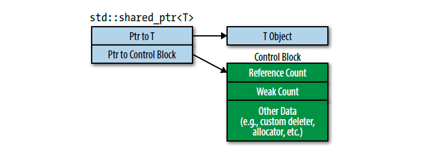

##### `item19.cpp`
```cpp
#include <memory>
#include <vector>
#include <iostream>

class Test
{
public:
    Test()
    {
        std::cout << "Test()" << std::endl;
    }
    Test(int data) : _data(data)
    {
        std::cout << "Test(int data)" << std::endl;
    }
    Test(int data, int data2) : _data(data), _data2(data2)
    {
        std::cout << "Test(int data, int data2)" << std::endl;
    }
    Test(const Test &t)
    {
        std::cout << "Test(const Test& t)" << std::endl;
        _data = t._data;
        _data2 = t._data2;
    }
    Test(Test &&t) noexcept
    {
        std::cout << "Test(Test &&t)" << std::endl;
        _data = t._data;
        _data2 = t._data2;
    }
    ~Test() { std::cout << "~Test()" << std::endl; }
    int _data{10};
    int _data2{100};
};

class Widget;
std::vector<std::shared_ptr<Widget>> processedWidgets;

// class Widget
// {
// public:
//     void process()
//     {
//         processedWidgets.emplace_back(this);
//     }
// };

// class Widget : public std::enable_shared_from_this<Widget>
// {
// public:
//     void process()
//     {
//         processedWidgets.emplace_back(shared_from_this());
//     }
// };

class Widget : public std::enable_shared_from_this<Widget>
{
public:
    template <typename... Ts>
    static std::shared_ptr<Widget> create(Ts &&...params)
    {
        return std::shared_ptr<Widget>(new Widget(std::forward<Ts>(params)...));
    }
    void process()
    {
        processedWidgets.emplace_back(shared_from_this());
    }

private:
    Widget(int data) : _data(data){};

    int _data;
};

int main()
{
    {
        auto w = Widget::create(1);
        // Widget w;
        w->process();
    }
    std::cout << "over" << std::endl;
    return 0;
}
```

#### Item 20 示例

##### 图解：`item20.png`
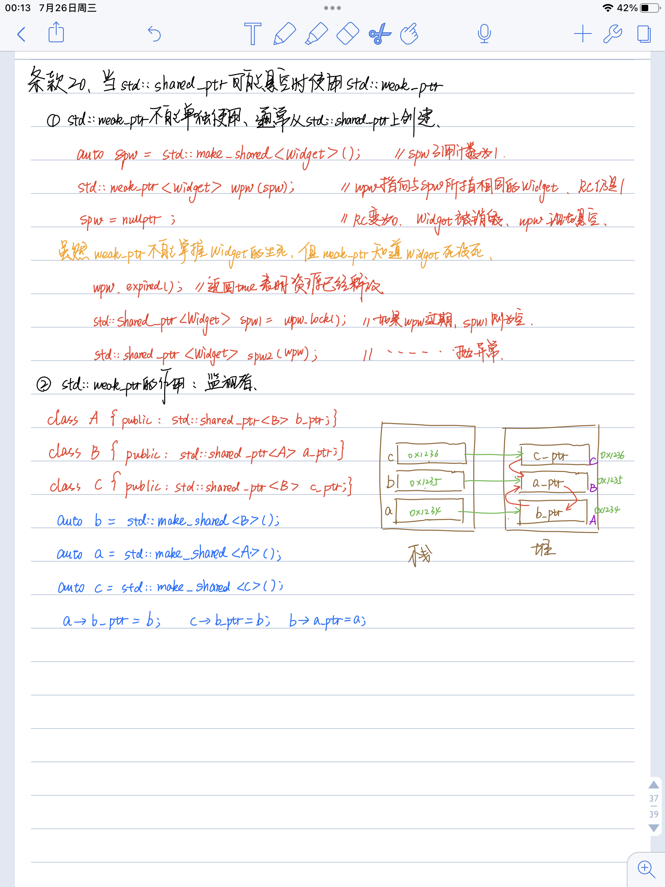

##### 图解：`item20_fig1.png`


##### 图解：`item20_fig2.png`
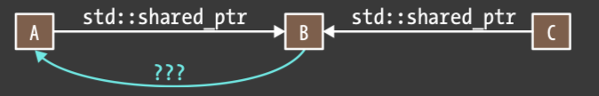

##### `item20.cpp`
```cpp
#include <memory>
#include <iostream>
#include <unordered_map>

class Widget
{
public:
    Widget(int id) : _id(id) { std::cout << "Widget(int id)" << std::endl; }
    ~Widget() { std::cout << "~Widget()" << std::endl; }

private:
    int _id{-1};
};

std::unique_ptr<const Widget> loadWidget(int id)
{
    // 耗时操作
    std::unique_ptr<const Widget> uptr{new Widget(id)};
    return uptr;
}

std::shared_ptr<const Widget> fastLoadWidget(int id)
{
    static std::unordered_map<int, std::weak_ptr<const Widget>> cache;
    auto objPtr = cache[id].lock();
    if (!objPtr)
    {
        objPtr = loadWidget(id);
        cache[id] = objPtr;
    }
    return objPtr;
}

class B;
class A
{
public:
    A() { std::cout << "A()" << std::endl; }
    ~A() { std::cout << "~A()" << std::endl; }

    std::shared_ptr<B> b_ptr;
};

class C
{
public:
    C() { std::cout << "C()" << std::endl; }
    ~C() { std::cout << "~C()" << std::endl; }

    std::shared_ptr<B> b_ptr;
};

class B
{
public:
    B() { std::cout << "B()" << std::endl; }
    ~B() { std::cout << "~B()" << std::endl; }

    std::shared_ptr<A> a_ptr;
    // A *a_ptr;
};

int main()
{
    {
        auto spw = std::make_shared<Widget>(10);
        std::weak_ptr<Widget> wpw(spw);
        spw = nullptr;
        std::cout << "over" << std::endl;
    }

    // {
    //     auto widgetSPtr = fastLoadWidget(0);
    //     widgetSPtr = fastLoadWidget(1);
    //     std::cout << "over" << std::endl;

    //     auto widgetSPtr1 = fastLoadWidget(1);
    //     widgetSPtr = fastLoadWidget(3);
    // }

    // {
    //     std::shared_ptr<B> b = std::make_shared<B>();

    //     std::shared_ptr<A> a = std::make_shared<A>();
    //     std::shared_ptr<C> c = std::make_shared<C>();
    //     a->b_ptr = b;
    //     c->b_ptr = b;
    //     b->a_ptr = a;
    // }
    return 0;
}
```

#### Item 21 示例

##### 图解：`item21_1.png`
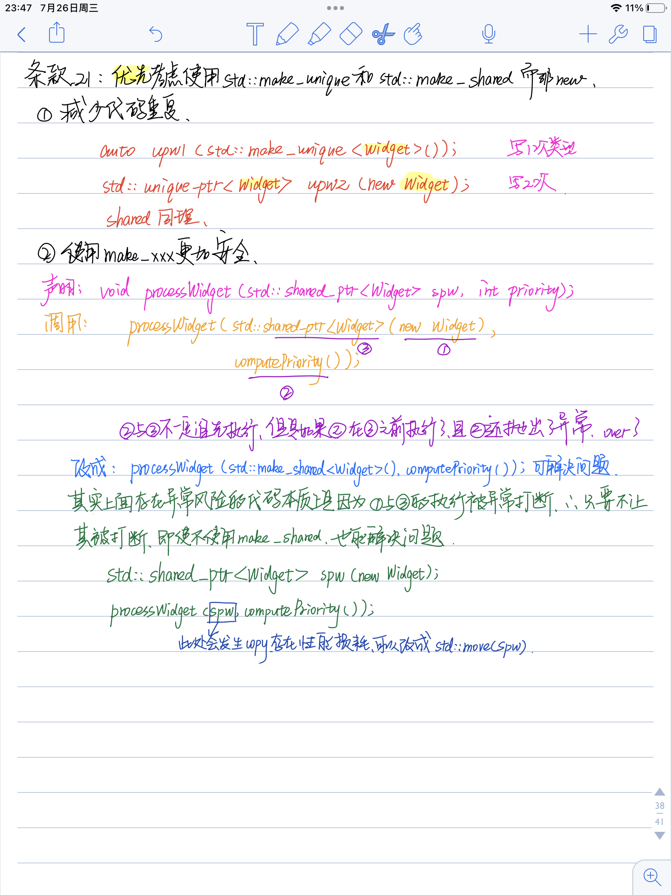

##### 图解：`item21_2.png`
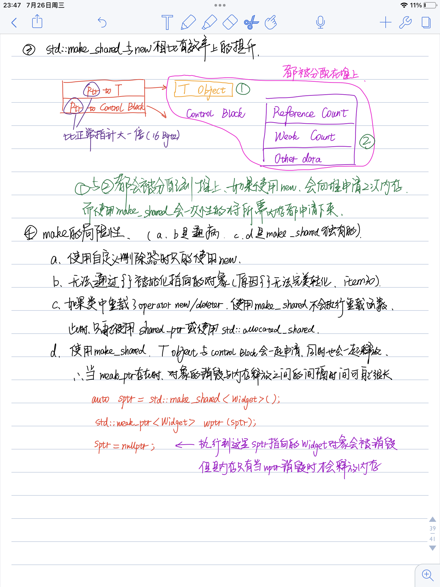

##### `item21.cpp`
```cpp
#include <iostream>
#include <memory>
#include <vector>

class Airplane
{
private:
    struct AirplaneRep
    {
        unsigned long miles{10}; // 8
        char type{'A'};          // 1       16
    };
    union
    {
        AirplaneRep rep{}; // 16
        Airplane *next;    // 8
    };                     // 16

public:
    unsigned long
    getMiles()
    {
        return rep.miles;
    }
    char getType() { return rep.type; }
    void set(unsigned long m, char t)
    {
        rep.miles = m;
        rep.type = t;
    }
    static void *operator new(size_t size);
    static void operator delete(void *ptr);
    ~Airplane() { std::cout << "Airplane::~Airplane()" << std::endl; }

private:
    static const int BLOCK_SIZE;
    static Airplane *headOfFreeList;
};

Airplane *Airplane::headOfFreeList;
const int Airplane::BLOCK_SIZE = 512;

void *Airplane::operator new(size_t size)
{
    // if (size != sizeof(Airplane))
    // {
    //     return ::operator new(size);
    // }
    Airplane *p = headOfFreeList;
    if (p)
    {
        headOfFreeList = p->next;
    }
    else
    {
        Airplane *newBlock = static_cast<Airplane *>(::operator new(BLOCK_SIZE * sizeof(Airplane)));
        for (int i = 1; i < BLOCK_SIZE - 1; ++i)
        {
            newBlock[i].next = &newBlock[i + 1];
        }
        newBlock[BLOCK_SIZE - 1].next = 0;
        p = newBlock;
        headOfFreeList = &newBlock[1];
    }
    return p;
}

void Airplane::operator delete(void *ptr)
{
    if (ptr == 0)
    {
        return;
    }
    // if (size != sizeof(Airplane))
    // {
    //     ::operator delete(ptr);
    //     return;
    // }
    Airplane *deleteMe = static_cast<Airplane *>(ptr);
    deleteMe->next = headOfFreeList;
    headOfFreeList = deleteMe;
}

int main()
{

    auto upv = std::make_unique<std::vector<int>>(10, 20);
    auto spv = std::make_shared<std::vector<int>>(10, 20);
    // auto spv_ = std::make_shared<std::vector<int>>({10, 20});

    // 创建std::initializer_list
    auto initList = {10, 20};
    // 使用std::initializer_list为形参的构造函数创建std::vector
    auto spv_ = std::make_shared<std::vector<int>>(initList);

    auto aspv = std::make_shared<Airplane>();
    auto aspv_ = std::shared_ptr<Airplane>(new Airplane());

    auto pBigType = std::make_shared<Airplane>();
    std::weak_ptr<Airplane> pBigTypeWeak(pBigType);
    pBigType = nullptr;
    std::cout << "over" << std::endl;
    return 0;
}
```

#### Item 22 示例

##### 图解：`item22.png`
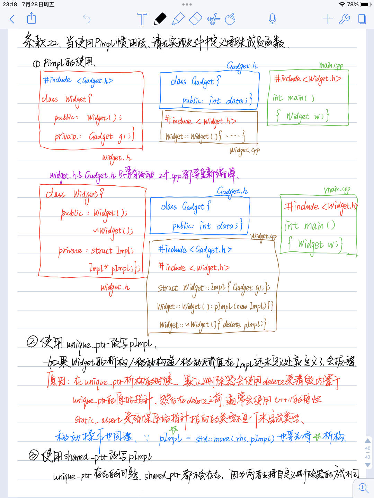

##### `item22.cpp`
```cpp
#include "Widget.h"

int main()
{
    {
        Widget w;
        Widget w2(std::move(w));
    }
    return 0;
}
```

## 第5章 右值引用、移动语义与完美转发

### 章节说明

**CHAPTER 5 RValue References, Move Semantics and Perfect Forwarding**

当你第一次了解到移动语义（*move semantics*）和完美转发（*perfect forwarding*）的时候，它们看起来非常直观：

- **移动语义**使编译器有可能用廉价的移动操作来代替昂贵的拷贝操作。正如拷贝构造函数和拷贝赋值操作符给了你控制拷贝语义的权力，移动构造函数和移动赋值操作符也给了你控制移动语义的权力。移动语义也允许创建只可移动（*move-only*）的类型，例如`std::unique_ptr`，`std::future`和`std::thread`。

- **完美转发**使接收任意数量实参的函数模板成为可能，它可以将实参转发到其他的函数，使目标函数接收到的实参与被传递给转发函数的实参保持一致。

**右值引用**是连接这两个截然不同的概念的胶合剂。它是使移动语义和完美转发变得可能的基础语言机制。

你对这些特点越熟悉，你就越会发现，你的初印象只不过是冰山一角。移动语义、完美转发和右值引用的世界比它所呈现的更加微妙。举个例子，`std::move`并不移动任何东西，完美转发也并不完美。移动操作并不永远比复制操作更廉价；即便如此，它也并不总是像你期望的那么廉价。而且，它也并不总是被调用，即使在当移动操作可用的时候。构造“`type&&`”也并非总是代表一个右值引用。

无论你挖掘这些特性有多深，它们看起来总是还有更多隐藏起来的部分。幸运的是，它们的深度总是有限的。本章将会带你到最基础的部分。一旦到达，C++11的这部分特性将会具有非常大的意义。比如，你会掌握`std::move`和`std::forward`的惯用法。你能够适应“`type&&`”的歧义性质。你会理解移动操作的令人惊奇的不同表现的背后真相。这些片段都会豁然开朗。在这一点上，你会重新回到一开始的状态，因为移动语义、完美转发和右值引用都会又一次显得直截了当。但是这一次，它们不再使人困惑。

在本章的这些小节中，非常重要的一点是要牢记形参永远是**左值**，即使它的类型是一个右值引用。比如，假设
```c++
void f(Widget&& w);
```
形参`w`是一个左值，即使它的类型是一个rvalue-reference-to-`Widget`。（如果这里震惊到你了，请重新回顾从本书[简介](https://github.com/kelthuzadx/EffectiveModernCppChinese/blob/master/Introduction.md)开始的关于左值和右值的总览。）

### 基础代码与图解

#### 图解：`base17_1.png`
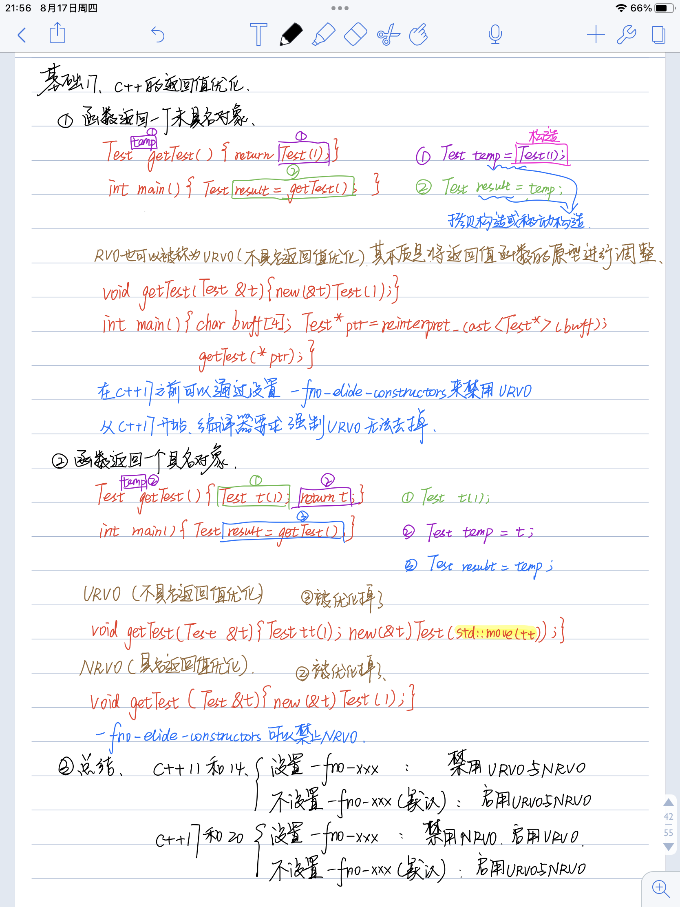

#### 图解：`base17_2.png`
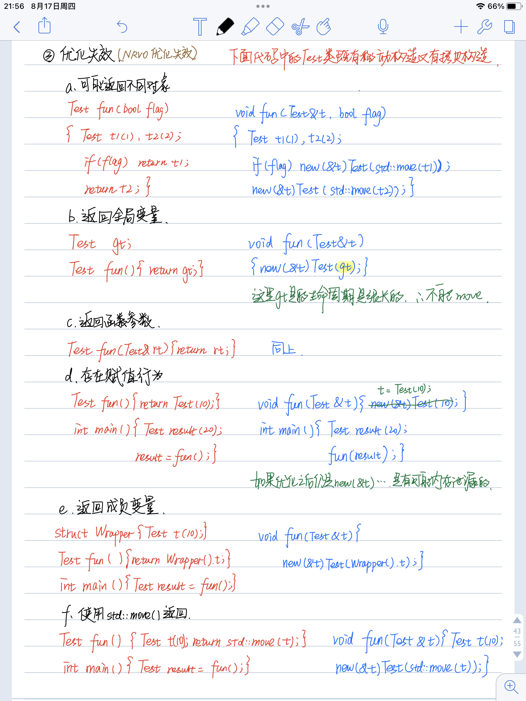

#### `base17.cpp`
```cpp
#include <iostream>

class Test
{
public:
    Test(int data) : _data(data)
    {
        _ptr = new int(50);
        std::cout << "Test()" << std::endl;
    }
    Test(const Test &rhs) : _data(rhs._data) { std::cout << "Test(const Test &rhs)" << std::endl; }
    Test(Test &&rhs) : _data(rhs._data) { std::cout << "Test(Test &&rhs)" << std::endl; }
    Test &operator=(const Test &rhs)
    {
        _data = rhs._data;
        std::cout << "Test &operator=(const Test &rhs)" << std::endl;
        return *this;
    }
    Test &operator=(Test &&rhs)
    {
        _data = rhs._data;
        _ptr = rhs._ptr;
        rhs._ptr = nullptr;
        std::cout << "Test &operator=(Test &&rhs)" << std::endl;
        return *this;
    }
    ~Test()
    {
        // std::cout << "~Test()" << std::endl;
        delete _ptr;
    }

    void setData(int data) { _data = data; }

private:
    int _data{10};
    int *_ptr = nullptr;
};

Test GetTest1()
{
    Test a(1);
    a.setData(2);
    return a;
}

void GetTest1(Test &_test)
{
    // Test a(1);
    new (&_test) Test(1);
    _test.setData(2);
}

// Test temp = a;
Test GetTest2()
{
    return Test(2);
}

void GetTest2(Test &_test)
{
    new (&_test) Test(2);
}

Test optiFailed1(bool flag)
{
    Test a{1}, b{2};
    a.setData(20);
    b.setData(50);
    if (flag)
        return a;
    return b;
}

// URVO  -NRVO
void optiFailed1(Test &_test, bool flag)
{
    Test a{1}, b{2};
    if (flag)
    {
        new (&_test) Test(std::move(a));
        // new (&_test) Test(1);
        _test.setData(20);
        b.setData(50);
    }

    else
    {
        new (&_test) Test(std::move(b));
        // new (&_test) Test(2);
        a.setData(20);
        _test.setData(50);
    }
}

/*
    Test optiFailed1(Test &_test)
    {
        Test a{1}, b{2};
        if (true)
            return _test.Test::Test(b);
        else
            return _test.Test::Test(a);
    }
    Test result;(不构造)  optiFailed1(result);
*/

Test optiSuccess()
{
    Test a{1};
    if (true)
        return a;
    a.setData(50);
    return a;
}

// Test ttt(1);
// Test optiFailed2()
// {
//     return ttt;
// }
// Test temp = ttt;  copy
// URVO -NRVO
// void optiFailed2(Test &_test)
// {
//     new (&_test) Test(ttt);
// }

Test optiFailed3(Test &t)
{
    return t;
}

struct Wrapper
{
    Test t{5};
};

Test optiFailed4()
{
    return Wrapper().t;
}

Test optiFailed5()
{
    Test t{10};
    return std::move(t);
}

// URVO NRVO
void optiFailed5(Test &_test)
{
    Test t{10};
    new (&_test) Test(std::move(t));
}

Test optiFailed6()
{
    return Test{10};
}
// URVO -NRVO
void optiFailed6(Test &t)
{
    // new (&t) Test(10);
    t = Test{10};
}

int main()
{
    // Test result = GetTest2();

    // char buff[sizeof(Test)];
    // Test *ptr = reinterpret_cast<Test *>(buff);
    // optiFailed1(*ptr, true);
    // optiFailed2(*ptr);
    // Test aaa(10);
    // aaa = optiFailed6();
    // std::cout << "=======" << std::endl;
    // Test cc = optiFailed6();

    // Test bbb(10);
    // optiFailed6(bbb);
    // std::cout
    //     << "========" << std::endl;
    // Test result1 = GetTest1();
    // Test t = Test(3);
    // auto t = GetTest1();
    // std::cout << "----------------" << std::endl;
    // auto t2 = GetTest2();
    // auto t = optiFailed1(true);
    // auto t = optiSuccess();
    // auto t = GetTest2();
    // auto t = optiFailed2();
    // Test tt(1);
    auto result = optiFailed5();
    // Test t{10};
    // t = GetTest2();
    // auto t = optiFailed5();
    return 0;
}
```

#### 图解：`base18.png`
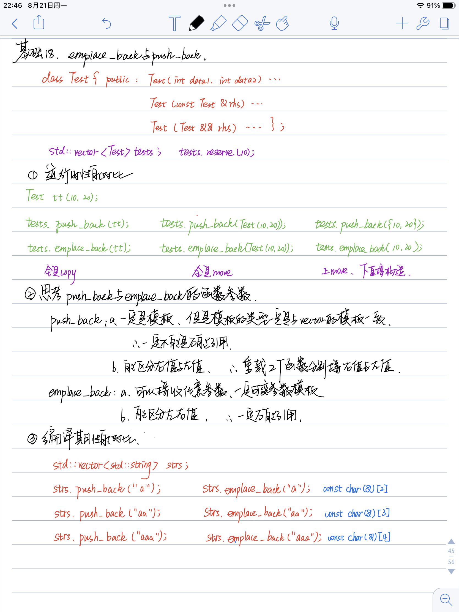

#### `base18.cpp`
```cpp
#include <iostream>
#include <string>
#include <vector>

class Test
{

public:
    Test(int data1, int data2) { std::cout << "Test(int data1, int data2)" << std::endl; }
    Test(const Test &rhs) { std::cout << "Test(const Test &rhs)" << std::endl; }
    Test(Test &&rhs) { std::cout << "Test(Test &&rhs)" << std::endl; }
    // ~Test() { std::cout << "~Test()" << std::endl; }
};

int main()
{
    std::vector<Test> tests;
    tests.reserve(6);
    // Test tt(10, 20);
    std::cout << "=============" << std::endl;
    // tests.emplace_back(tt);
    // tests.emplace_back(Test(20, 50));
    tests.emplace_back(50, 60);
    std::cout << "=============" << std::endl;
    // tests.push_back(tt);
    // tests.push_back(Test(20, 50));
    tests.push_back({50, 60});

    std::vector<std::string> strs;
    strs.push_back("a");
    strs.push_back("aa");
    strs.push_back("aaa");

    strs.emplace_back("b");
    strs.emplace_back("bb");
    strs.emplace_back("bbb");
    return 0;
}
```

#### 图解：`base19.png`
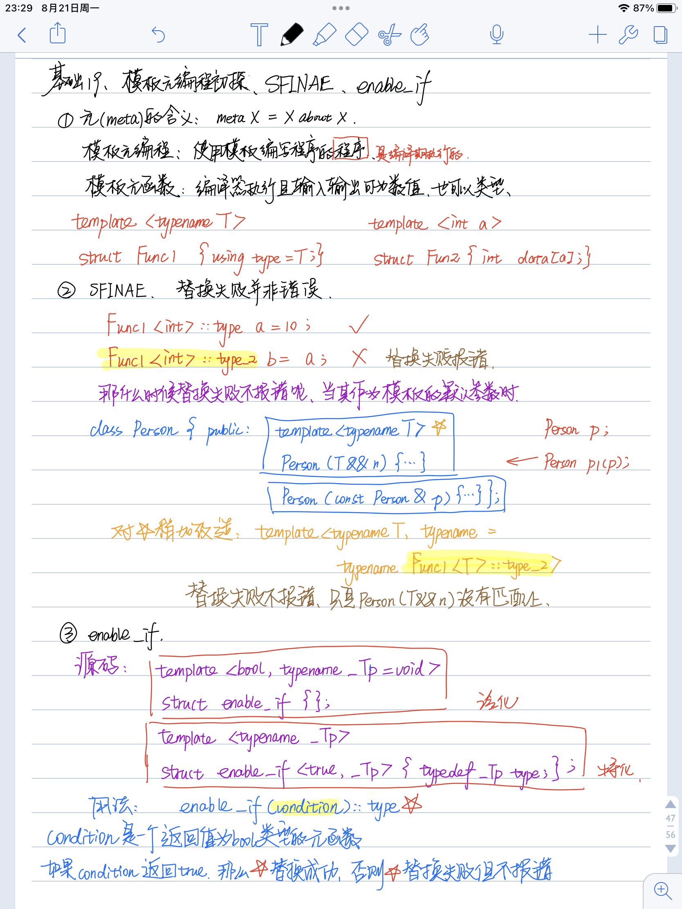

#### `base19.cpp`
```cpp
#include <iostream>
#include <vector>
#include <type_traits>

template <typename T>
struct Func1
{
    using type = T;
};

template <int a>
struct Func2
{
    int data[a];
};

// template <>
// struct Func1<int>
// {
//     using type = int;
//     using b_type = float;
// };

class Person
{
public:
    Person() = default;

    template <typename T, typename = typename Func1<T>::b_type>
    Person(T &&n) : _name(std::forward<T>(n))
    {
        std::cout << "Person(T &&n)" << std::endl;
    }

    Person(const Person &p)
    {
        std::cout << "Person(const Person &p)" << std::endl;
    }

private:
    std::string _name;
};

namespace
{
    template <bool, typename _Tp = void>
    struct enable_if
    {
    };

    // Partial specialization for true.
    template <typename _Tp>
    struct enable_if<true, _Tp>
    {
        typedef _Tp type;
    };
}

// class Person
// {
// public:
//     template <
//         typename T,
//         typename = typename std::enable_if<
//             !std::is_same<Person,
//                           typename std::decay<T>::type>::value>::type>
//     explicit Person(T &&n);
// };

int main()
{

    // template <typename T>
    // struct Func1
    // {
    //     using type = T;
    // };

    // template <int a>
    // struct Func2
    // {
    //     int data[a];
    // };

    Func1<int>::type value = 10;
    // Func1<int>::type_b value1 = 10;
    // int value = 10;
    Func2<1> f;

    Person p;
    Person p1(p);
    return 0;
}
```

#### 图解：`base20_1.png`
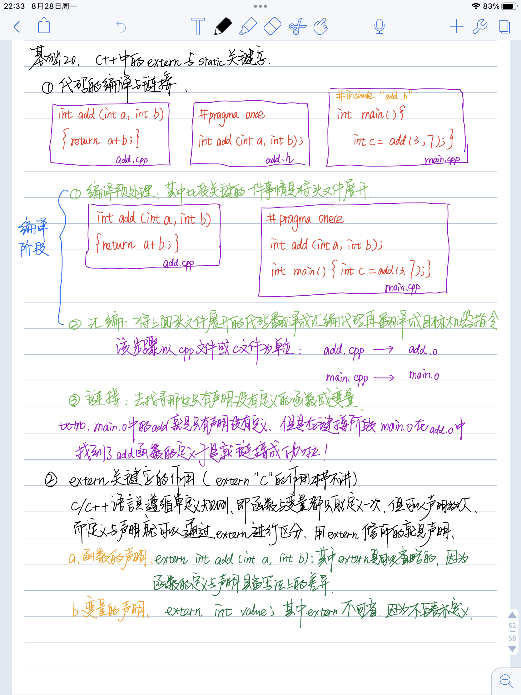

#### 图解：`base20_2.png`
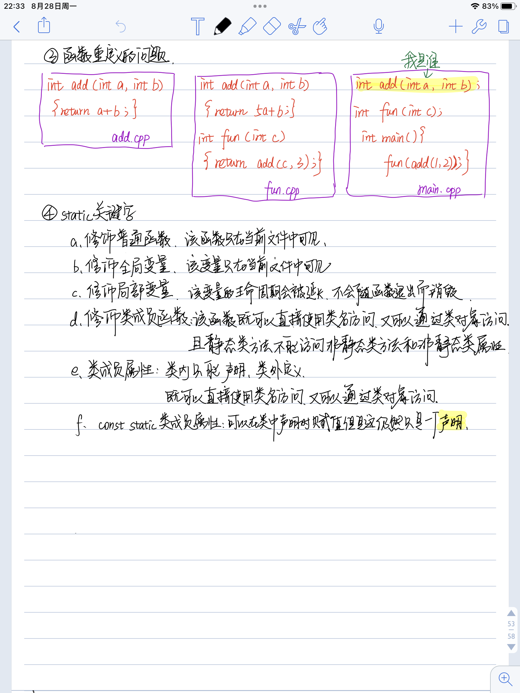

### 条款代码与图解

#### Item 23 示例

##### 图解：`item23.png`
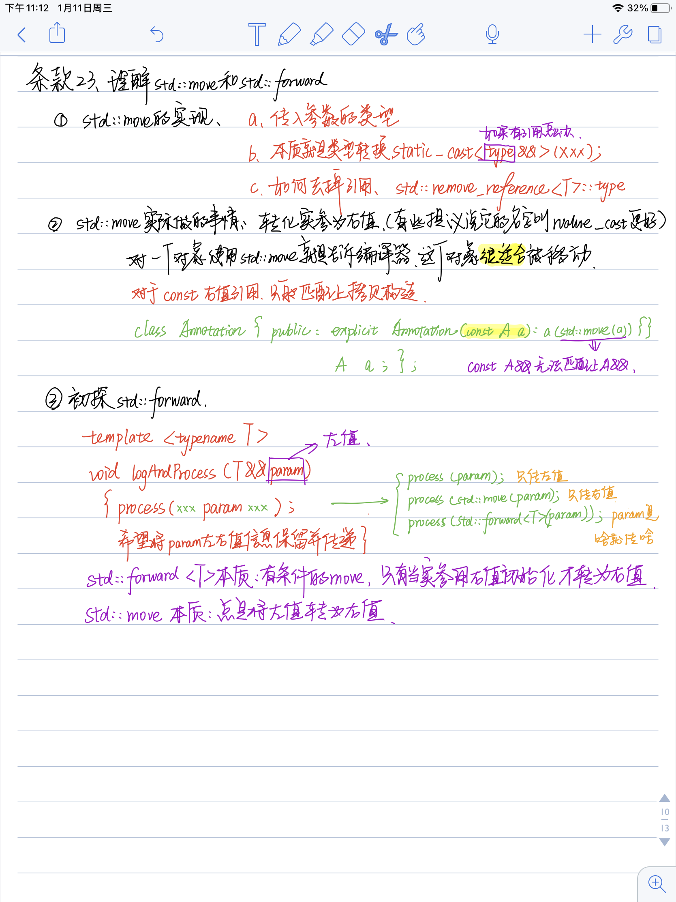

##### `item23.cpp`
```cpp
#include <iostream>
#include <memory>
#include <type_traits>
namespace
{
    template <typename T>
    typename std::remove_reference<T>::type &&move(T &&param) // c++11
    {
        using ReturnType = typename std::remove_reference<T>::type &&;
        return static_cast<ReturnType>(param);
    }

    template <typename T>
    decltype(auto) move2(T &&param) // C++14
    {
        using ReturnType = std::remove_reference_t<T> &&;
        return static_cast<ReturnType>(param);
    }
} // namespace

struct A
{
    A(int value) : b(value) { std::cout << "create" << std::endl; }
    A(const A &value)
    {
        std::cout << "copy" << std::endl;
        b = value.b;
    }
    A(A &&value)
    {
        std::cout << "move" << std::endl;
        b = value.b;
        value.b = 0;
    }

    int b;
};

class Annotation
{
public:
    explicit Annotation(const A a) : a_param(std::move(a)) {}

private:
    A a_param;
};

void process(const A &lvalArg)
{
    std::cout << "deal lvalArg" << std::endl;
}
void process(A &&rvalArg)
{
    std::cout << "deal rvalArg" << std::endl;
}

template <typename T>
void logAndProcess(T &&param)
{
    // process(param);
    // process(std::move(param));
    process(std::forward<T>(param)); // 实参用右值初始化时，转换为一个右值
}

template <typename T>
typename std::remove_reference<T>::type &&mymove(T &&param)
{
    using ReturnType = typename std::remove_reference<T>::type &&;
    return static_cast<ReturnType>(param);
}

int main()
{
    // int mmm = 10;
    // int &&nnn = mymove(10);
    // Annotation aa{10};

    // const A cc{12};
    // const A &mm = std::move(cc);

    A mm{10};
    logAndProcess(mm);
    logAndProcess(std::move(mm));
}
```

#### Item 24 示例

##### 图解：`item24.png`
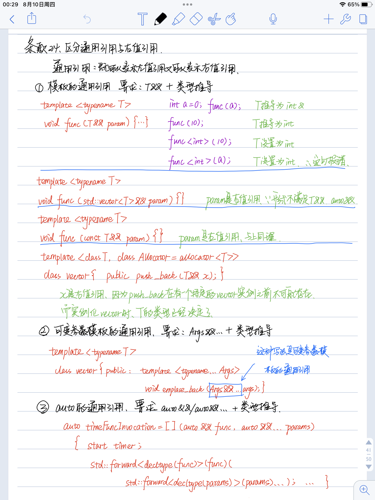

##### `item24.cpp`
```cpp
#include <vector>
#include <iostream>

template <typename T>
void func(T &&param)
{
    // param是左值     T -> int&     int& && -> int&
    std::cout << "T&&" << std::endl;
}

template <typename T>
void func2(const T &&param)
{
    std::cout << "const T&&" << std::endl;
}

int main()
{
    int a = 10;
    func(10);
    func(a);
    func<int>(10);

    // func2(a);
    std::vector<int> vec{1, 2, 3};
    vec.push_back(4);

    return 0;
}
```

#### Item 25 示例

##### 图解：`item25.png`
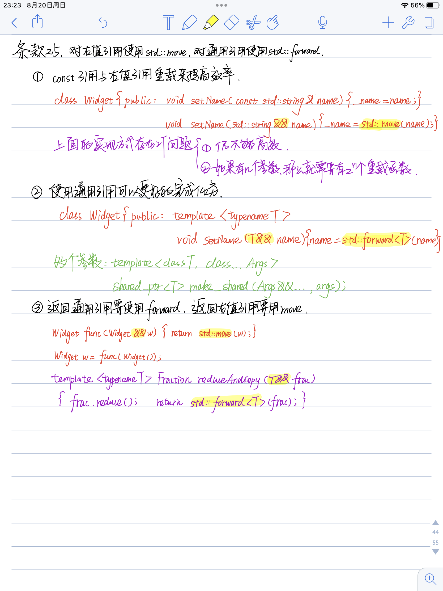

##### `item25.cpp`
```cpp
#include <iostream>
#include <memory>

class Widget
{
public:
    Widget() { std::cout << "default ctor" << std::endl; }
    // Widget(Widget &&rhs) // rhs是右值引用
    //     : name(std::move(rhs.name))
    // {
    //     std::cout << "move ctor" << std::endl;
    // }
    // Widget(const Widget &rhs) // rhs是const左值引用
    //     : name(rhs.name)
    // {
    //     std::cout << "copy ctor" << std::endl;
    // }

    template <typename T>
    void setName(T &&newName) // newName是通用引用
    {
        name = std::forward<T>(newName);
        // name = std::move(newName);
    }

    void setName(std::string &&newName) // newName是右值引用
    {
        std::cout << "move setName" << std::endl;
        name = std::move(newName);
        // name = newName;
    }
    void setName(const std::string &newName)
    {
        std::cout << "copy setName" << std::endl;
        name = newName;
    }

private:
    std::string name;
};

Widget func(Widget &&w)
{
    // return std::move(w);
    return w;
}

//  void func(Widget &&w, Widget &_w)
//  { return _w.Widget::Widget(w);}
//

int main()
{
    std::string name = "hkl";
    // Widget w = func(Widget());
    Widget w;
    w.setName(name);
    w.setName(std::move(name));
    w.setName("XiaoMing");
    // std::string temp("XiaoMing");
    // std::string name = temp;

    // "XiaoMing"
    auto a = &"XiaoMing";
    return 0;
}
```

#### Item 26 示例

##### 图解：`item26.png`
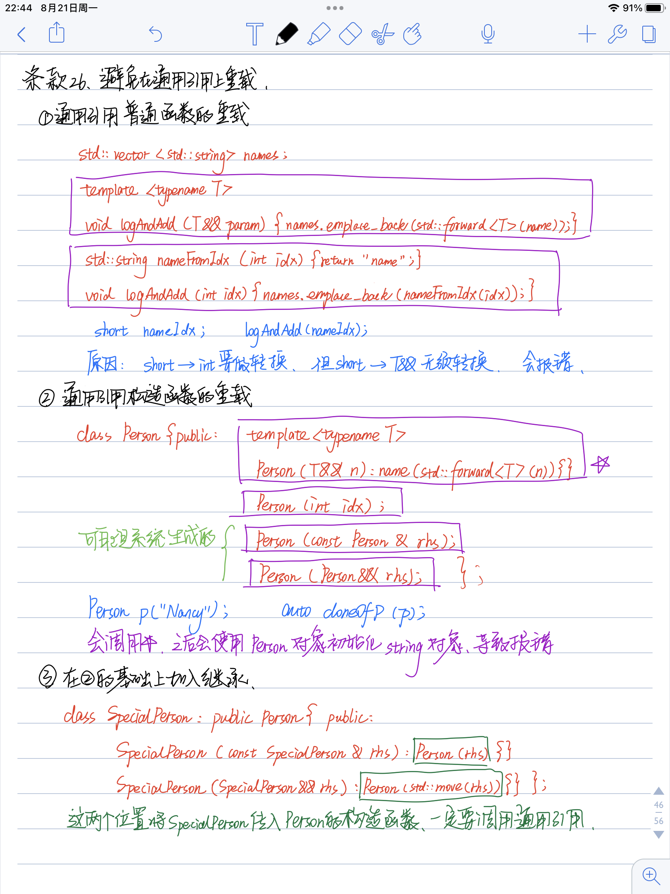

##### `item26.cpp`
```cpp
#include <iostream>
#include <string>
#include <vector>

std::vector<std::string> names;

template <typename T>
void logAndAdd(T &&name)
{
    // ...
    names.emplace_back(std::forward<T>(name));
}

std::string nameFromIdx(int idx)
{
    return "name";
}

void logAndAdd(int idx) // 新的重载
{
    names.emplace_back(nameFromIdx(idx));
}

class Person
{
public:
    template <typename T> // 完美转发的构造函数
    explicit Person(T &&n)
        : name(std::forward<T>(n))
    {
    }

    explicit Person(int idx)
    {
    }

    Person(const Person &rhs) {}
    Person(Person &&rhs) {}

    std::string name;
};

// class SpecialPerson : public Person
// {
// public:
//     SpecialPerson(const SpecialPerson &rhs) // 拷贝构造函数，调用基类的
//         : Person(rhs)                       // 完美转发构造函数！
//     {
//     }

//     SpecialPerson(SpecialPerson &&rhs) // 移动构造函数，调用基类的
//         : Person(std::move(rhs))       // 完美转发构造函数！
//     {
//     }
// };

int main()
{
    std::string petName("Darla");
    logAndAdd(petName);                   // 传递左值std::string
    logAndAdd(std::string("Persephone")); // 传递右值std::string
    logAndAdd("Patty Dog");               // 传递字符串字面值

    // short nameIdx = 10;
    // logAndAdd(nameIdx); // 传递左值short

    Person p("Nancy");
    // auto cloneOfP(p); // 拷贝p
    return 0;
}
```

#### Item 27 示例

##### 图解：`item27_1.png`


##### 图解：`item27_2.png`


##### `item27.cpp`
```cpp
#include <iostream>
#include <vector>
#include <type_traits>

// 1.
class Person
{
public:
    // template <typename T> // 完美转发的构造函数
    // explicit Person(T &&n)
    //     : name(std::forward<T>(n))
    // {
    // }
    explicit Person(std::string name) : _name(std::move(name)) {}

    explicit Person(int idx)
    {
    }

    Person(const Person &rhs) {}
    Person(Person &&rhs) {}

    std::string _name;
};

// 2.
std::vector<std::string> names;

// template <typename T>
// void logAndAdd(T &&name)
// {
//     // ...
//     names.emplace_back(std::forward<T>(name));
// }

// std::string nameFromIdx(int idx)
// {
//     return "name";
// }

// void logAndAdd(int idx) // 新的重载
// {
//     names.emplace_back(nameFromIdx(idx));
// }

template <typename T>
void logAndAddImpl(T &&name, std::false_type)
{
    //    ...
    names.emplace_back(std::forward<T>(name));
}

std::string nameFromIdx(int idx) { return "name"; }
void logAndAddImpl(int idx, std::true_type)
{
    names.emplace_back(nameFromIdx(idx));
}

template <typename T>
void logAndAdd(T &&name)
{
    logAndAddImpl(std::forward<T>(name),
                  std::is_integral<typename std::remove_reference<T>::type>());
}

// 3.
class Person1
{
public:
    template <
        typename T,
        typename = std::enable_if_t<
            !std::is_base_of<Person1, std::decay_t<T>>::value &&
            !std::is_integral<std::remove_reference_t<T>>::value>>
    explicit Person1(T &&n)        // 对于std::strings和可转化为
        : name(std::forward<T>(n)) // std::strings的实参的构造函数
    {
        static_assert(
            std::is_constructible<std::string, T>::value,
            "Parameter n can't be used to construct a std::string");
    }

    explicit Person1(int idx) // 对于整型实参的构造函数
        : name(nameFromIdx(idx))
    {
    }

private:
    std::string name;
};

int main()
{
    // logAndAdd("hkl");
    // logAndAdd(5);
    // short mm = 10;
    // logAndAdd(mm);
    // Person p;
    // Person p1(p);
    // Person1 pp(u"sss"); // char char16_t
    return 0;
}
```

#### Item 28 示例

##### 图解：`item28.png`


##### `item28.cpp`
```cpp
#include <iostream>
#include <string>

template <typename T>
void fun(T &&t)
{
    int b = 20;
    T &a = b;
}

int main()
{
    int a = 10;
    // auto &&b = a;

    fun(a);
}
```

#### Item 29 示例

##### 图解：`item29.png`


##### 图解：`item29_fig1.png`


##### 图解：`item29_fig2.png`


#### Item 30 示例

##### 图解：`item30_1.png`


##### 图解：`item30_2.png`


##### `item30.cpp`
```cpp
#include <vector>

// {}
// void f(const std::vector<int> &v) {}

// NULL / 0
// void f(void *ptr) {}

// static const
// class widget
// {
// public:
//     static const std::size_t MindVal = 28;
// };

// void f(std::size_t value)
// {
// }

// overload / template
void f(int (*pf)(int)) {}
int processVal(int value) { return 0; }
int processVal(int value, int priority) { return 0; }

template <typename T>
T workonVal(T param) { return param; }

template <typename T>
void fwd(T &&param)
{
    f(std::forward<T>(param));
}

int main()
{
    // fwd({1, 2, 3});
    // auto il = {1, 2, 3};
    // fwd(il);
    // fwd(0);
    // f(processVal);
    // fwd(processVal);
    // fwd(workonVal);
    return 0;
}
```

## 第6章 Lambda 表达式

### 章节说明

**CHAPTER 6 Lambda Expressions**

*lambda*表达式是C++编程中的游戏规则改变者。这有点令人惊讶，因为它没有给语言带来新的表达能力。*lambda*可以做的所有事情都可以通过其他方式完成。但是*lambda*是创建函数对象相当便捷的一种方法，对于日常的C++开发影响是巨大的。没有*lambda*时，STL中的“`_if`”算法（比如，`std::find_if`，`std::remove_if`，`std::count_if`等）通常需要繁琐的谓词，但是当有*lambda*可用时，这些算法使用起来就变得相当方便。用比较函数（比如，`std::sort`，`std::nth_element`，`std::lower_bound`等）来自定义算法也是同样方便的。在STL外，*lambda*可以快速创建`std::unique_ptr`和`std::shared_ptr`的自定义删除器（见[Item18](https://github.com/kelthuzadx/EffectiveModernCppChinese/blob/master/4.SmartPointers/item18.md)和[19](https://github.com/kelthuzadx/EffectiveModernCppChinese/blob/master/4.SmartPointers/item19.md)），并且使线程API中条件变量的谓词指定变得同样简单（参见[Item39](https://github.com/kelthuzadx/EffectiveModernCppChinese/blob/master/7.TheConcurrencyAPI/item39.md)）。除了标准库，*lambda*有利于即时的回调函数，接口适配函数和特定上下文中的一次性函数。*lambda*确实使C++成为更令人愉快的编程语言。

与*lambda*相关的词汇可能会令人疑惑，这里做一下简单的回顾：

- ***lambda*表达式**（*lambda expression*）就是一个表达式。下面是部分源代码。在

  ```cpp
  std::find_if(container.begin(), container.end(),
               [](int val){ return 0 < val && val < 10; });   //译者注：本行高亮
  ```

  中，代码的高亮部分就是*lambda*。

- **闭包**（*enclosure*）是*lambda*创建的运行时对象。依赖捕获模式，闭包持有被捕获数据的副本或者引用。在上面的`std::find_if`调用中，闭包是作为第三个实参在运行时传递给`std::find_if`的对象。

- **闭包类**（*closure class*）是从中实例化闭包的类。每个*lambda*都会使编译器生成唯一的闭包类。*lambda*中的语句成为其闭包类的成员函数中的可执行指令。

*lambda*通常被用来创建闭包，该闭包仅用作函数的实参。上面对`std::find_if`的调用就是这种情况。然而，闭包通常可以拷贝，所以可能有多个闭包对应于一个*lambda*。比如下面的代码：

```cpp
{
    int x;                                  //x是局部对象
    …

    auto c1 =                               //c1是lambda产生的闭包的副本
        [x](int y) { return x * y > 55; };

    auto c2 = c1;                           //c2是c1的拷贝

    auto c3 = c2;                           //c3是c2的拷贝
    …
}
```

`c1`，`c2`，`c3`都是*lambda*产生的闭包的副本。

非正式的讲，模糊*lambda*，闭包和闭包类之间的界限是可以接受的。但是，在随后的Item中，区分什么存在于编译期（*lambdas* 和闭包类），什么存在于运行时（闭包）以及它们之间的相互关系是重要的。

### 基础代码与图解

#### 图解：`base21.png`


#### `base21.cpp`
```cpp
#include <iostream>
#include <functional>
#include <memory>
#include <string>
#include <functional>
#include <vector>

struct Test
{
    Test() {}
    Test(int data) : _data(data)
    {
        std::cout << "Test()" << std::endl;
    }
    Test(const Test &rhs) : _data(rhs._data) { std::cout << "Test(const Test &rhs)" << std::endl; }
    Test(Test &&rhs) : _data(rhs._data) { std::cout << "Test(Test &&rhs)" << std::endl; }
    int func(int a, int b)
    {
        std::cout << "a is: " << a << std::endl;
        std::cout << "b is: " << b << std::endl;
        return a - b;
    }

private:
    int _data{10};
};

int add(int a, int b)
{
    std::cout << "a is: " << a << std::endl;
    std::cout << "b is: " << b << std::endl;
    return a + b;
}

void fun(int &a, int &b)
{
    a = 100;
    b = 500;
}

void fun1(Test &a)
{
}

void fun2(Test a)
{
}

void fun3(Test &&a)
{
}

int main()
{
    // int a = 5;
    // auto add5 = std::bind(add, std::placeholders::_2, std::placeholders::_1);
    // int result = add5(10, 5);

    // int b = 10;
    // Widget w;
    // auto add10 = std::bind(&Widget::add, &w, b, std::placeholders::_1);

    // int m = 10;
    // int n = 20;
    // auto funBind = std::bind(fun, m, std::placeholders::_1);
    // funBind(n);

    // auto addFunc = my_bind(add, 2);
    // std::cout << addFunc(3) << std::endl; // 输出 5

    // // =================
    Test t(50);
    auto funBind1 = std::bind(fun1, std::ref(t));
    auto funBind2 = std::bind(fun2, t);
    auto funBind3 = std::bind(fun3, t);

    Test t1(50), t2(50), t3(50);
    auto funBind4 = std::bind(fun1, std::move(t1));
    auto funBind5 = std::bind(fun2, std::move(t2));
    auto funBind6 = std::bind(fun3, std::move(t3));

    return 0;
}
```

### 条款代码与图解

#### Item 31 示例

##### 图解：`item31.png`


##### `item31.cpp`
```cpp
#include <vector>
#include <functional>

using FilterContainer =
    std::vector<std::function<bool(int)>>;

FilterContainer filters;

void addDivisorFilter()
{
    int divisor = 5;
    filters.emplace_back(
        [&](int value)
        { return value % divisor == 0; });
}

class Widget
{
public:
    void addFilter()
    {
        filters.emplace_back([=](int value)
                             { return value % divisor == 0; });
    }

private:
    int divisor = 10;
};

int main()
{
    addDivisorFilter();
    {
        Widget w;
        w.addFilter();
    }
    return 0;
}
```

#### Item 32 示例

##### 图解：`item32.png`


##### `item32.cpp`
```cpp
#include <iostream>
#include <vector>
#include <string>
#include <memory>

class Widget
{
public:
    bool isValidated() const { return true; }
    bool isProcessed() const { return true; }
    bool isArchived() const { return true; }

private:
};

class IsValAndArch
{
public:
    using DataType = std::unique_ptr<Widget>;

    explicit IsValAndArch(DataType &&ptr)
        : pw(std::move(ptr)) {}

    bool operator()() const
    {
        return pw->isValidated() && pw->isArchived();
    }

private:
    DataType pw;
};

int main()
{
    // auto pw = std::make_unique<Widget>();
    // auto func = [pw = std::move(pw)]
    // { return pw->isValidated() && pw->isArchived(); };

    auto func = [pw = std::make_unique<Widget>()]
    { return pw->isValidated() && pw->isArchived(); };

    auto func1 = IsValAndArch(std::make_unique<Widget>());
    return 0;
}
```

#### Item 33 示例

##### 图解：`item33.png`


#### Item 34 示例

##### 图解：`item34.png`


##### `item34.cpp`
```cpp
#include <thread>
#include <iostream>
#include <vector>
#include <functional>

using Time = std::chrono::steady_clock::time_point;
enum class Sound
{
    Beep,
    Siren,
    Whistle
};

using Duration = std::chrono::steady_clock::duration;
void setAlarm(Time t, Sound s, Duration d)
{
}

void func(int a, int b, int c)
{
    std::cout << "void func(int a, int b ,int c=10)" << std::endl;
}

void func(int a, int b)
{
    std::cout << "void func(int a, int b)" << std::endl;
}

int main()
{
    auto setSoundL =
        [](Sound s)
    {
        using namespace std::chrono;
        using namespace std::literals; // 对于C++14后缀

        setAlarm(steady_clock::now() + 1h, // C++14写法，但是含义同上
                 s,
                 30s);
    };
    // 调用setSoundL函数之后一小时会响铃30s

    using namespace std::chrono;
    using namespace std::literals;
    using namespace std::placeholders;

    auto setSoundB =
        std::bind(setAlarm,
                  steady_clock::now() + 1h,
                  _1,
                  30s);
    // 构造setSoundB函数之后一小时会响铃30s

    auto setSoundBB =
        std::bind(setAlarm,
                  std::bind(std::plus<>(), std::bind(steady_clock::now), 1h),
                  _1,
                  30s);
    // 调用setSoundBB函数之后一小时会响铃30s
    using func3ParamType = void (*)(int a, int b, int c);
    // auto funB = std::bind(func, 5, std::placeholders::_1, 10);
    auto funB = std::bind(static_cast<func3ParamType>(func), 5, std::placeholders::_1, 10);
    return 0;
}
```

## 第8章 微调

### 章节说明

**CHAPTER 8 Tweaks**

对于C++中的通用技术和特性，总是存在适用和不适用的场景。除了本章覆盖的两个例外，描述什么场景使用哪种通用技术通常来说很容易。这两个例外是传值（pass by value）和安置（emplacement）。决定何时使用这两种技术受到多种因素的影响，本书提供的最佳建议是在使用它们的同时仔细考虑清楚，尽管它们都是高效的现代C++编程的重要角色。接下来的条款提供了使用它们来编写软件是否合适的所需信息。

### 条款代码与图解

#### Item 41 示例

##### 图解：`item41.png`


##### `item41.cpp`
```cpp
#include <iostream>
#include <vector>

class Test
{
public:
    Test(int data1)
    {
        // std::cout << "Test(int data1)" << std::endl;
    }
    Test(const Test &rhs) { std::cout << "Test(const Test &rhs)" << std::endl; }
    Test(Test &&rhs) { std::cout << "Test(Test &&rhs)" << std::endl; }
    // ~Test() { std::cout << "~Test()" << std::endl; }
};

// 方法1：对左值和右值重载
class Widget1
{
public:
    Widget1()
    {
        _tests.reserve(10);
    }
    void addTest(const Test &newTest)

    {
        _tests.push_back(newTest);

    } // rvalues
    void addTest(Test &&newTest)

    {
        _tests.push_back(std::move(newTest));
    }

private:
    std::vector<Test> _tests;
};

// 方法2：使用通用引用
class Widget2
{
public:
    Widget2()
    {
        _tests.reserve(10);
    }
    template <typename T>
    void addTest(T &&newTest)

    {
        _tests.push_back(std::forward<T>(newTest));
    }

private:
    std::vector<Test> _tests;
};

// 方法3：传值
class Widget3
{
public:
    Widget3()
    {
        _tests.reserve(10);
    }
    void addTest(Test newTest)
    {
        _tests.push_back(std::move(newTest));
    }

private:
    std::vector<Test> _tests;
};

// 不可拷贝的对象
class Test1
{

public:
    Test1(int data1)
    {
        // std::cout << "Test1(int data1)" << std::endl;
    }
    Test1(const Test1 &rhs) = delete;
    Test1(Test1 &&rhs) { std::cout << "Test1(Test1 &&rhs)" << std::endl; }

    Test1 &operator=(const Test1 &rhs) = delete;
    Test1 &operator=(Test1 &&rhs)
    {
        std::cout << "Test1 &operator=(Test1 &&rhs)" << std::endl;
        return *this;
    }
    // ~Test1() { std::cout << "~Test1()" << std::endl; }
};

class Widget4
{
public:
    // void setTest1(Test1 &&t)
    // {
    //     _t1 = std::move(t);
    // }

    void setTest1(Test1 t)
    {
        _t1 = std::move(t);
    }

private:
    Test1 _t1{10};
};

// 通过赋值的形式进行拷贝
class Test2
{
public:
    Test2(int data1)
    {
        // std::cout << "Test2(int data1)" << std::endl;
    }
    Test2(const Test2 &rhs) { std::cout << "Test2(const Test2 &rhs)" << std::endl; }
    Test2(Test2 &&rhs) { std::cout << "Test2(Test2 &&rhs)" << std::endl; }
    Test2 &operator=(const Test2 &rhs)
    {
        std::cout << "Test2 &operator=(const Test2 &rhs)" << std::endl;
        return *this;
    }
    Test2 &operator=(Test2 &&rhs)
    {
        std::cout << "Test2 &operator=(Test2 &&rhs)" << std::endl;
        return *this;
    }
    // ~Test2() { std::cout << "~Test2()" << std::endl; }
};

class Password
{
public:
    explicit Password(std::string pwd) // 传值
        : text(std::move(pwd))
    {
    }                                 // 构造text
    void changeTo(std::string newPwd) // 传值
    {
        text = std::move(newPwd);
    } // 赋值text

private:
    std::string text; // 密码的text
};

int main()
{
    // Widget3 w1;
    // Test t1(10);
    // std::cout << "========" << std::endl;
    // w1.addTest(t1);
    // std::cout << "========" << std::endl;
    // w1.addTest(Test(20));
    // //  void addTest(Test newTest)  Test newTest = Test(20);
    // std::cout << "==========================" << std::endl;
    // // Test aa = Test(20);

    Widget4 w4;
    w4.setTest1(Test1(10));

    // std::cout << "================================" << std::endl;

    // std::string initPwd("Supercalifragilisticexpialidocious");
    // Password p(initPwd);
    // std::string newPassword = "Beware the Jabberwock";
    // p.changeTo(newPassword);

    return 0;
}
```

#### Item 42 示例

##### 图解：`item42.png`


##### `item42.cpp`
```cpp
#include <iostream>
#include <vector>

class Test
{
public:
    Test(int data1)
    {
        std::cout << "Test(int data1)" << std::endl;
    }
    Test(const Test &rhs) { std::cout << "Test(const Test &rhs)" << std::endl; }
    Test(Test &&rhs) { std::cout << "Test(Test &&rhs)" << std::endl; }
    Test &operator=(const Test &rhs)
    {
        std::cout << "Test &operator=(const Test &rhs)" << std::endl;
        return *this;
    }
    Test &operator=(Test &&rhs)
    {
        std::cout << "Test &operator=(Test &&rhs)" << std::endl;
        return *this;
    }
    ~Test() { std::cout << "~Test()" << std::endl; }
};

class Test1
{
public:
    explicit Test1(int data) {}
};

int main()
{
    std::vector<Test> tVec;
    tVec.reserve(10);
    std::cout << "===========" << std::endl;
    tVec.push_back(Test(10));
    std::cout << "===========" << std::endl;
    tVec.emplace_back(Test(10));
    std::cout << "======***=====" << std::endl;
    // tVec.insert(tVec.begin(), 10);
    // std::cout << "======***=====" << std::endl;
    // tVec.emplace(tVec.begin(), 10);
    // std::cout << "=======***====" << std::endl;
    std::vector<Test1> tVec1;
    // tVec1.push_back(10);
    tVec1.emplace_back(10);
}
```
