# C++基础编程

## 1 C++初识

### 1.1  第一个C++程序

编写一个C++程序总共分为4个步骤

* 创建项目
* 创建文件
* 编写代码
* 运行程序

#### 1.1.1 创建项目

​	Visual Studio是我们用来编写C++程序的主要工具，我们先将它打开


#### 1.1.2 创建文件

右键源文件，选择添加->新建项


给C++文件起个名称，然后点击添加即可。


#### 1.1.3 编写代码

```c++
#include<iostream>
using namespace std;

int main() {

	cout << "Hello world" << endl;

	system("pause");

	return 0;
}
```

#### 1.1.4 运行程序


### 1.2 注释

**作用**：在代码中加一些说明和解释，方便自己或其他程序员程序员阅读代码

**两种格式**

1. **单行注释**：`// 描述信息` 
   - 通常放在一行代码的上方，或者一条语句的末尾，==对该行代码说明==
2. **多行注释**： `/* 描述信息 */`
   - 通常放在一段代码的上方，==对该段代码做整体说明==

> 提示：编译器在编译代码时，会忽略注释的内容


### 1.3 变量

**作用**：给一段指定的内存空间起名，方便操作这段内存

**语法**：`数据类型 变量名 = 初始值;`

**示例：**

```C++
#include<iostream>
using namespace std;

int main() {

	//变量的定义
	//语法：数据类型  变量名 = 初始值

	int a = 10;

	cout << "a = " << a << endl;
	
	system("pause");

	return 0;
}
```


> 注意：C++在创建变量时，必须给变量一个初始值，否则会报错


### 1.4  常量

**作用**：用于记录程序中不可更改的数据

C++定义常量两种方式

1. **\#define** 宏常量： `#define 常量名 常量值`
   * ==通常在文件上方定义==，表示一个常量


2. **const**修饰的变量 `const 数据类型 常量名 = 常量值`
   * ==通常在变量定义前加关键字const==，修饰该变量为常量，不可修改


**示例：**

```C++
//1、宏常量
#define day 7

int main() {

	cout << "一周里总共有 " << day << " 天" << endl;
	//day = 8;  //报错，宏常量不可以修改

	//2、const修饰变量
	const int month = 12;
	cout << "一年里总共有 " << month << " 个月份" << endl;
	//month = 24; //报错，常量是不可以修改的
	
	
	system("pause");

	return 0;
}
```


### 1.5 关键字

**作用：**关键字是C++中预先保留的单词（标识符）

* **在定义变量或者常量时候，不要用关键字**


C++关键字如下：

| asm        | do           | if               | return      | typedef  |
| ---------- | ------------ | ---------------- | ----------- | -------- |
| auto       | double       | inline           | short       | typeid   |
| bool       | dynamic_cast | int              | signed      | typename |
| break      | else         | long             | sizeof      | union    |
| case       | enum         | mutable          | static      | unsigned |
| catch      | explicit     | namespace        | static_cast | using    |
| char       | export       | new              | struct      | virtual  |
| class      | extern       | operator         | switch      | void     |
| const      | false        | private          | template    | volatile |
| const_cast | float        | protected        | this        | wchar_t  |
| continue   | for          | public           | throw       | while    |
| default    | friend       | register         | true        |          |
| delete     | goto         | reinterpret_cast | try         |          |

`提示：在给变量或者常量起名称时候，不要用C++得关键字，否则会产生歧义。`


### 1.6 标识符命名规则

**作用**：C++规定给标识符（变量、常量）命名时，有一套自己的规则

* 标识符不能是关键字
* 标识符只能由字母、数字、下划线组成
* 第一个字符必须为字母或下划线
* 标识符中字母区分大小写

> 建议：给标识符命名时，争取做到见名知意的效果，方便自己和他人的阅读


## 2 数据类型

C++规定在创建一个变量或者常量时，必须要指定出相应的数据类型，否则无法给变量分配内存

### 2.1 整型

**作用**：整型变量表示的是==整数类型==的数据

C++中能够表示整型的类型有以下几种方式，**区别在于所占内存空间不同**：

| **数据类型**        | **占用空间**                                    | 取值范围         |
| ------------------- | ----------------------------------------------- | ---------------- |
| short(短整型)       | 2字节                                           | (-2^15 ~ 2^15-1) |
| int(整型)           | 4字节                                           | (-2^31 ~ 2^31-1) |
| long(长整形)        | Windows为4字节，Linux为4字节(32位)，8字节(64位) | (-2^31 ~ 2^31-1) |
| long long(长长整形) | 8字节                                           | (-2^63 ~ 2^63-1) |


### 2.2 sizeof关键字

**作用：**利用sizeof关键字可以==统计数据类型所占内存大小==

**语法：** `sizeof( 数据类型 / 变量)`

**示例：**

```C++
int main() {

	cout << "short 类型所占内存空间为： " << sizeof(short) << endl;

	cout << "int 类型所占内存空间为： " << sizeof(int) << endl;

	cout << "long 类型所占内存空间为： " << sizeof(long) << endl;

	cout << "long long 类型所占内存空间为： " << sizeof(long long) << endl;

	system("pause");

	return 0;
}
```


> **整型结论**：==short < int <= long <= long long==


### 2.3 实型（浮点型）

**作用**：用于==表示小数==

浮点型变量分为两种：

1. 单精度float 
2. 双精度double

两者的**区别**在于表示的有效数字范围不同。

| **数据类型** | **占用空间** | **有效数字范围** |
| ------------ | ------------ | ---------------- |
| float        | 4字节        | 7位有效数字      |
| double       | 8字节        | 15～16位有效数字 |

**示例：**

```C++
int main() {

	float f1 = 3.14f;
	double d1 = 3.14;

	cout << f1 << endl;
	cout << d1<< endl;

	cout << "float  sizeof = " << sizeof(f1) << endl;
	cout << "double sizeof = " << sizeof(d1) << endl;

	//科学计数法
	float f2 = 3e2; // 3 * 10 ^ 2 
	cout << "f2 = " << f2 << endl;

	float f3 = 3e-2;  // 3 * 0.1 ^ 2
	cout << "f3 = " << f3 << endl;

	system("pause");

	return 0;
}
```


### 2.4 字符型

**作用：**字符型变量用于显示单个字符

**语法：**`char ch = 'a';`


> 注意1：在显示字符型变量时，用单引号将字符括起来，不要用双引号

> 注意2：单引号内只能有一个字符，不可以是字符串


- C和C++中字符型变量只占用==1个字节==。
- 字符型变量并不是把字符本身放到内存中存储，而是将对应的ASCII编码放入到存储单元


示例：

```C++
int main() {
	
	char ch = 'a';
	cout << ch << endl;
	cout << sizeof(char) << endl;

	//ch = "abcde"; //错误，不可以用双引号
	//ch = 'abcde'; //错误，单引号内只能引用一个字符

	cout << (int)ch << endl;  //查看字符a对应的ASCII码
	ch = 97; //可以直接用ASCII给字符型变量赋值
	cout << ch << endl;

	system("pause");

	return 0;
}
```

ASCII码表格：

| **ASCII**值 | **控制字符** | **ASCII**值 | **字符** | **ASCII**值 | **字符** | **ASCII**值 | **字符** |
| ----------- | ------------ | ----------- | -------- | ----------- | -------- | ----------- | -------- |
| 0           | NUT          | 32          | (space)  | 64          | @        | 96          | 、       |
| 1           | SOH          | 33          | !        | 65          | A        | 97          | a        |
| 2           | STX          | 34          | "        | 66          | B        | 98          | b        |
| 3           | ETX          | 35          | #        | 67          | C        | 99          | c        |
| 4           | EOT          | 36          | $        | 68          | D        | 100         | d        |
| 5           | ENQ          | 37          | %        | 69          | E        | 101         | e        |
| 6           | ACK          | 38          | &        | 70          | F        | 102         | f        |
| 7           | BEL          | 39          | ,        | 71          | G        | 103         | g        |
| 8           | BS           | 40          | (        | 72          | H        | 104         | h        |
| 9           | HT           | 41          | )        | 73          | I        | 105         | i        |
| 10          | LF           | 42          | *        | 74          | J        | 106         | j        |
| 11          | VT           | 43          | +        | 75          | K        | 107         | k        |
| 12          | FF           | 44          | ,        | 76          | L        | 108         | l        |
| 13          | CR           | 45          | -        | 77          | M        | 109         | m        |
| 14          | SO           | 46          | .        | 78          | N        | 110         | n        |
| 15          | SI           | 47          | /        | 79          | O        | 111         | o        |
| 16          | DLE          | 48          | 0        | 80          | P        | 112         | p        |
| 17          | DCI          | 49          | 1        | 81          | Q        | 113         | q        |
| 18          | DC2          | 50          | 2        | 82          | R        | 114         | r        |
| 19          | DC3          | 51          | 3        | 83          | S        | 115         | s        |
| 20          | DC4          | 52          | 4        | 84          | T        | 116         | t        |
| 21          | NAK          | 53          | 5        | 85          | U        | 117         | u        |
| 22          | SYN          | 54          | 6        | 86          | V        | 118         | v        |
| 23          | TB           | 55          | 7        | 87          | W        | 119         | w        |
| 24          | CAN          | 56          | 8        | 88          | X        | 120         | x        |
| 25          | EM           | 57          | 9        | 89          | Y        | 121         | y        |
| 26          | SUB          | 58          | :        | 90          | Z        | 122         | z        |
| 27          | ESC          | 59          | ;        | 91          | [        | 123         | {        |
| 28          | FS           | 60          | <        | 92          | /        | 124         | \|       |
| 29          | GS           | 61          | =        | 93          | ]        | 125         | }        |
| 30          | RS           | 62          | >        | 94          | ^        | 126         | `        |
| 31          | US           | 63          | ?        | 95          | _        | 127         | DEL      |

ASCII 码大致由以下**两部分组**成：

* ASCII 非打印控制字符： ASCII 表上的数字 **0-31** 分配给了控制字符，用于控制像打印机等一些外围设备。
* ASCII 打印字符：数字 **32-126** 分配给了能在键盘上找到的字符，当查看或打印文档时就会出现。


### 2.5 转义字符

**作用：**用于表示一些==不能显示出来的ASCII字符==

现阶段我们常用的转义字符有：` \n  \\  \t`

| **转义字符** | **含义**                                | **ASCII**码值（十进制） |
| ------------ | --------------------------------------- | ----------------------- |
| \a           | 警报                                    | 007                     |
| \b           | 退格(BS) ，将当前位置移到前一列         | 008                     |
| \f           | 换页(FF)，将当前位置移到下页开头        | 012                     |
| **\n**       | **换行(LF) ，将当前位置移到下一行开头** | **010**                 |
| \r           | 回车(CR) ，将当前位置移到本行开头       | 013                     |
| **\t**       | **水平制表(HT)  （跳到下一个TAB位置）** | **009**                 |
| \v           | 垂直制表(VT)                            | 011                     |
| **\\\\**     | **代表一个反斜线字符"\"**               | **092**                 |
| \'           | 代表一个单引号（撇号）字符              | 039                     |
| \"           | 代表一个双引号字符                      | 034                     |
| \?           | 代表一个问号                            | 063                     |
| \0           | 数字0                                   | 000                     |
| \ddd         | 8进制转义字符，d范围0~7                 | 3位8进制                |
| \xhh         | 16进制转义字符，h范围0~9，a~f，A~F      | 3位16进制               |

示例：

```C++
int main() {
	
	
	cout << "\\" << endl;
	cout << "\tHello" << endl;
	cout << "\n" << endl;

	system("pause");

	return 0;
}
```


### 2.6 字符串型

**作用**：用于表示一串字符

**两种风格**

1. **C风格字符串**： `char 变量名[] = "字符串值"`

   示例：

   ```C++
   int main() {
   
   	char str1[] = "hello world";
   	cout << str1 << endl;
       
   	system("pause");
   
   	return 0;
   }
   ```

> 注意：C风格的字符串要用双引号括起来

1. **C++风格字符串**：  `string  变量名 = "字符串值"`

   示例：

   ```C++
   int main() {
   
   	string str = "hello world";
   	cout << str << endl;
   	
   	system("pause");
   
   	return 0;
   }
   ```

   

> 注意：C++风格字符串，需要加入头文件==#include\<string>==


### 2.7 布尔类型 bool

**作用：**布尔数据类型代表真或假的值 

bool类型只有两个值：

* true  --- 真（本质是1）
* false --- 假（本质是0）

**bool类型占==1个字节==大小**

示例：

```C++
int main() {

	bool flag = true;
	cout << flag << endl; // 1

	flag = false;
	cout << flag << endl; // 0

	cout << "size of bool = " << sizeof(bool) << endl; //1
	
	system("pause");

	return 0;
}
```


### 2.8 数据的输入

**作用：用于从键盘获取数据**

**关键字：**cin

**语法：** `cin >> 变量 `

示例：

```C++
int main(){

	//整型输入
	int a = 0;
	cout << "请输入整型变量：" << endl;
	cin >> a;
	cout << a << endl;

	//浮点型输入
	double d = 0;
	cout << "请输入浮点型变量：" << endl;
	cin >> d;
	cout << d << endl;

	//字符型输入
	char ch = 0;
	cout << "请输入字符型变量：" << endl;
	cin >> ch;
	cout << ch << endl;

	//字符串型输入
	string str;
	cout << "请输入字符串型变量：" << endl;
	cin >> str;
	cout << str << endl;

	//布尔类型输入
	bool flag = true;
	cout << "请输入布尔型变量：" << endl;
	cin >> flag;
	cout << flag << endl;
	system("pause");
	return EXIT_SUCCESS;
}
```


## 3 运算符

**作用：**用于执行代码的运算

本章我们主要讲解以下几类运算符：

| **运算符类型** | **作用**                               |
| -------------- | -------------------------------------- |
| 算术运算符     | 用于处理四则运算                       |
| 赋值运算符     | 用于将表达式的值赋给变量               |
| 比较运算符     | 用于表达式的比较，并返回一个真值或假值 |
| 逻辑运算符     | 用于根据表达式的值返回真值或假值       |

### 3.1 算术运算符

**作用**：用于处理四则运算 

算术运算符包括以下符号：

| **运算符** | **术语**   | **示例**    | **结果**  |
| ---------- | ---------- | ----------- | --------- |
| +          | 正号       | +3          | 3         |
| -          | 负号       | -3          | -3        |
| +          | 加         | 10 + 5      | 15        |
| -          | 减         | 10 - 5      | 5         |
| *          | 乘         | 10 * 5      | 50        |
| /          | 除         | 10 / 5      | 2         |
| %          | 取模(取余) | 10 % 3      | 1         |
| ++         | 前置递增   | a=2; b=++a; | a=3; b=3; |
| ++         | 后置递增   | a=2; b=a++; | a=3; b=2; |
| --         | 前置递减   | a=2; b=--a; | a=1; b=1; |
| --         | 后置递减   | a=2; b=a--; | a=1; b=2; |

**示例1：**

```C++
//加减乘除
int main() {

	int a1 = 10;
	int b1 = 3;

	cout << a1 + b1 << endl;
	cout << a1 - b1 << endl;
	cout << a1 * b1 << endl;
	cout << a1 / b1 << endl;  //两个整数相除结果依然是整数

	int a2 = 10;
	int b2 = 20;
	cout << a2 / b2 << endl; 

	int a3 = 10;
	int b3 = 0;
	//cout << a3 / b3 << endl; //报错，除数不可以为0


	//两个小数可以相除
	double d1 = 0.5;
	double d2 = 0.25;
	cout << d1 / d2 << endl;

	system("pause");

	return 0;
}
```

> 总结：在除法运算中，除数不能为0


**示例2：**

```C++
//取模
int main() {

	int a1 = 10;
	int b1 = 3;

	cout << 10 % 3 << endl;

	int a2 = 10;
	int b2 = 20;

	cout << a2 % b2 << endl;

	int a3 = 10;
	int b3 = 0;

	//cout << a3 % b3 << endl; //取模运算时，除数也不能为0

	//两个小数不可以取模
	double d1 = 3.14;
	double d2 = 1.1;

	//cout << d1 % d2 << endl;

	system("pause");

	return 0;
}

```

> 总结：只有整型变量可以进行取模运算


**示例3：**

```C++
//递增
int main() {

	//后置递增
	int a = 10;
	a++; //等价于a = a + 1
	cout << a << endl; // 11

	//前置递增
	int b = 10;
	++b;
	cout << b << endl; // 11

	//区别
	//前置递增先对变量进行++，再计算表达式
	int a2 = 10;
	int b2 = ++a2 * 10;
	cout << b2 << endl;

	//后置递增先计算表达式，后对变量进行++
	int a3 = 10;
	int b3 = a3++ * 10;
	cout << b3 << endl;

	system("pause");

	return 0;
}

```


> 总结：前置递增先对变量进行++，再计算表达式，后置递增相反


### 3.2 赋值运算符

**作用：**用于将表达式的值赋给变量

赋值运算符包括以下几个符号：

| **运算符** | **术语** | **示例**   | **结果**  |
| ---------- | -------- | ---------- | --------- |
| =          | 赋值     | a=2; b=3;  | a=2; b=3; |
| +=         | 加等于   | a=0; a+=2; | a=2;      |
| -=         | 减等于   | a=5; a-=3; | a=2;      |
| *=         | 乘等于   | a=2; a*=2; | a=4;      |
| /=         | 除等于   | a=4; a/=2; | a=2;      |
| %=         | 模等于   | a=3; a%2;  | a=1;      |


**示例：**

```C++
int main() {

	//赋值运算符

	// =
	int a = 10;
	a = 100;
	cout << "a = " << a << endl;

	// +=
	a = 10;
	a += 2; // a = a + 2;
	cout << "a = " << a << endl;

	// -=
	a = 10;
	a -= 2; // a = a - 2
	cout << "a = " << a << endl;

	// *=
	a = 10;
	a *= 2; // a = a * 2
	cout << "a = " << a << endl;

	// /=
	a = 10;
	a /= 2;  // a = a / 2;
	cout << "a = " << a << endl;

	// %=
	a = 10;
	a %= 2;  // a = a % 2;
	cout << "a = " << a << endl;

	system("pause");

	return 0;
}
```


### 3.3 比较运算符

**作用：**用于表达式的比较，并返回一个真值或假值

比较运算符有以下符号：

| **运算符** | **术语** | **示例** | **结果** |
| ---------- | -------- | -------- | -------- |
| ==         | 相等于   | 4 == 3   | 0        |
| !=         | 不等于   | 4 != 3   | 1        |
| <          | 小于     | 4 < 3    | 0        |
| \>         | 大于     | 4 > 3    | 1        |
| <=         | 小于等于 | 4 <= 3   | 0        |
| \>=        | 大于等于 | 4 >= 1   | 1        |

示例：

```C++
int main() {

	int a = 10;
	int b = 20;

	cout << (a == b) << endl; // 0 

	cout << (a != b) << endl; // 1

	cout << (a > b) << endl; // 0

	cout << (a < b) << endl; // 1

	cout << (a >= b) << endl; // 0

	cout << (a <= b) << endl; // 1
	
	system("pause");

	return 0;
}
```


> 注意：C和C++ 语言的比较运算中， ==“真”用数字“1”来表示， “假”用数字“0”来表示。== 


### 3.4 逻辑运算符

**作用：**用于根据表达式的值返回真值或假值

逻辑运算符有以下符号：

| **运算符** | **术语** | **示例** | **结果**                                                 |
| ---------- | -------- | -------- | -------------------------------------------------------- |
| !          | 非       | !a       | 如果a为假，则!a为真；  如果a为真，则!a为假。             |
| &&         | 与       | a && b   | 如果a和b都为真，则结果为真，否则为假。                   |
| \|\|       | 或       | a \|\| b | 如果a和b有一个为真，则结果为真，二者都为假时，结果为假。 |

**示例1：**逻辑非

```C++
//逻辑运算符  --- 非
int main() {

	int a = 10;

	cout << !a << endl; // 0

	cout << !!a << endl; // 1

	system("pause");

	return 0;
}
```

> 总结： 真变假，假变真


**示例2：**逻辑与

```C++
//逻辑运算符  --- 与
int main() {

	int a = 10;
	int b = 10;

	cout << (a && b) << endl;// 1

	a = 10;
	b = 0;

	cout << (a && b) << endl;// 0 

	a = 0;
	b = 0;

	cout << (a && b) << endl;// 0

	system("pause");

	return 0;
}

```

> 总结：逻辑==与==运算符总结： ==同真为真，其余为假==


**示例3：**逻辑或

```c++
//逻辑运算符  --- 或
int main() {

	int a = 10;
	int b = 10;

	cout << (a || b) << endl;// 1

	a = 10;
	b = 0;

	cout << (a || b) << endl;// 1 

	a = 0;
	b = 0;

	cout << (a || b) << endl;// 0

	system("pause");

	return 0;
}
```

> 逻辑==或==运算符总结： ==同假为假，其余为真==


## 4 程序流程结构

C/C++支持最基本的三种程序运行结构：==顺序结构、选择结构、循环结构==

* 顺序结构：程序按顺序执行，不发生跳转
* 选择结构：依据条件是否满足，有选择的执行相应功能
* 循环结构：依据条件是否满足，循环多次执行某段代码


### 4.1 选择结构

#### 4.1.1 if语句

**作用：**执行满足条件的语句

if语句的三种形式

* 单行格式if语句

* 多行格式if语句

* 多条件的if语句

  

1. 单行格式if语句：`if(条件){ 条件满足执行的语句 }`

   

   示例：

   ```C++
   int main() {
   
   	//选择结构-单行if语句
   	//输入一个分数，如果分数大于600分，视为考上一本大学，并在屏幕上打印
   
   	int score = 0;
   	cout << "请输入一个分数：" << endl;
   	cin >> score;
   
   	cout << "您输入的分数为： " << score << endl;
   
   	//if语句
   	//注意事项，在if判断语句后面，不要加分号
   	if (score > 600)
   	{
   		cout << "我考上了一本大学！！！" << endl;
   	}
   
   	system("pause");
   
   	return 0;
   }
   ```

   


> 注意：if条件表达式后不要加分号


2. 多行格式if语句：`if(条件){ 条件满足执行的语句 }else{ 条件不满足执行的语句 };`


示例：

```C++
int main() {

	int score = 0;

	cout << "请输入考试分数：" << endl;

	cin >> score;

	if (score > 600)
	{
		cout << "我考上了一本大学" << endl;
	}
	else
	{
		cout << "我未考上一本大学" << endl;
	}

	system("pause");

	return 0;
}
```


3. 多条件的if语句：`if(条件1){ 条件1满足执行的语句 }else if(条件2){条件2满足执行的语句}... else{ 都不满足执行的语句}`


示例：

```C++
	int main() {

	int score = 0;

	cout << "请输入考试分数：" << endl;

	cin >> score;

	if (score > 600)
	{
		cout << "我考上了一本大学" << endl;
	}
	else if (score > 500)
	{
		cout << "我考上了二本大学" << endl;
	}
	else if (score > 400)
	{
		cout << "我考上了三本大学" << endl;
	}
	else
	{
		cout << "我未考上本科" << endl;
	}

	system("pause");

	return 0;
}
```


**嵌套if语句**：在if语句中，可以嵌套使用if语句，达到更精确的条件判断


案例需求：

* 提示用户输入一个高考考试分数，根据分数做如下判断
* 分数如果大于600分视为考上一本，大于500分考上二本，大于400考上三本，其余视为未考上本科；
* 在一本分数中，如果大于700分，考入北大，大于650分，考入清华，大于600考入人大。


**示例：**

```c++
int main() {

	int score = 0;

	cout << "请输入考试分数：" << endl;

	cin >> score;

	if (score > 600)
	{
		cout << "我考上了一本大学" << endl;
		if (score > 700)
		{
			cout << "我考上了北大" << endl;
		}
		else if (score > 650)
		{
			cout << "我考上了清华" << endl;
		}
		else
		{
			cout << "我考上了人大" << endl;
		}
		
	}
	else if (score > 500)
	{
		cout << "我考上了二本大学" << endl;
	}
	else if (score > 400)
	{
		cout << "我考上了三本大学" << endl;
	}
	else
	{
		cout << "我未考上本科" << endl;
	}

	system("pause");

	return 0;
}
```


**练习案例：** 三只小猪称体重

有三只小猪ABC，请分别输入三只小猪的体重，并且判断哪只小猪最重？


#### 4.1.2 三目运算符

**作用：** 通过三目运算符实现简单的判断

**语法：**`表达式1 ? 表达式2 ：表达式3`

**解释：**

如果表达式1的值为真，执行表达式2，并返回表达式2的结果；

如果表达式1的值为假，执行表达式3，并返回表达式3的结果。

**示例：**

```C++
int main() {

	int a = 10;
	int b = 20;
	int c = 0;

	c = a > b ? a : b;
	cout << "c = " << c << endl;

	//C++中三目运算符返回的是变量,可以继续赋值

	(a > b ? a : b) = 100;

	cout << "a = " << a << endl;
	cout << "b = " << b << endl;
	cout << "c = " << c << endl;

	system("pause");

	return 0;
}
```

> 总结：和if语句比较，三目运算符优点是短小整洁，缺点是如果用嵌套，结构不清晰


#### 4.1.3 switch语句

**作用：**执行多条件分支语句

**语法：**

```C++
switch(表达式)

{

	case 结果1：执行语句;break;

	case 结果2：执行语句;break;

	...

	default:执行语句;break;

}

```


**示例：**

```C++
int main() {

	//请给电影评分 
	//10 ~ 9   经典   
	// 8 ~ 7   非常好
	// 6 ~ 5   一般
	// 5分以下 烂片

	int score = 0;
	cout << "请给电影打分" << endl;
	cin >> score;

	switch (score)
	{
	case 10:
	case 9:
		cout << "经典" << endl;
		break;
	case 8:
		cout << "非常好" << endl;
		break;
	case 7:
	case 6:
		cout << "一般" << endl;
		break;
	default:
		cout << "烂片" << endl;
		break;
	}

	system("pause");

	return 0;
}
```


> 注意1：switch语句中表达式类型只能是整型或者字符型

> 注意2：case里如果没有break，那么程序会一直向下执行

> 总结：与if语句比，对于多条件判断时，switch的结构清晰，执行效率高，缺点是switch不可以判断区间


### 4.2 循环结构

#### 4.2.1 while循环语句

**作用：**满足循环条件，执行循环语句

**语法：**` while(循环条件){ 循环语句 }`

**解释：**==只要循环条件的结果为真，就执行循环语句==


**示例：**

```C++
int main() {

	int num = 0;
	while (num < 10)
	{
		cout << "num = " << num << endl;
		num++;
	}
	
	system("pause");

	return 0;
}
```


> 注意：在执行循环语句时候，程序必须提供跳出循环的出口，否则出现死循环


**while循环练习案例：**==猜数字==

**案例描述：**系统随机生成一个1到100之间的数字，玩家进行猜测，如果猜错，提示玩家数字过大或过小，如果猜对恭喜玩家胜利，并且退出游戏。


#### 4.2.2 do...while循环语句

**作用：** 满足循环条件，执行循环语句

**语法：** `do{ 循环语句 } while(循环条件);`

**注意：**与while的区别在于==do...while会先执行一次循环语句==，再判断循环条件


**示例：**

```C++
int main() {

	int num = 0;

	do
	{
		cout << num << endl;
		num++;

	} while (num < 10);
	
	
	system("pause");

	return 0;
}
```


> 总结：与while循环区别在于，do...while先执行一次循环语句，再判断循环条件


**练习案例：水仙花数**

**案例描述：**水仙花数是指一个 3 位数，它的每个位上的数字的 3次幂之和等于它本身

例如：1^3 + 5^3+ 3^3 = 153

请利用do...while语句，求出所有3位数中的水仙花数


#### 4.2.3 for循环语句

**作用：** 满足循环条件，执行循环语句

**语法：**` for(起始表达式;条件表达式;末尾循环体) { 循环语句; }`


**示例：**

```C++
int main() {

	for (int i = 0; i < 10; i++)
	{
		cout << i << endl;
	}
	
	system("pause");

	return 0;
}
```


**详解：**


> 注意：for循环中的表达式，要用分号进行分隔

> 总结：while , do...while, for都是开发中常用的循环语句，for循环结构比较清晰，比较常用


**练习案例：敲桌子**

案例描述：从1开始数到数字100， 如果数字个位含有7，或者数字十位含有7，或者该数字是7的倍数，我们打印敲桌子，其余数字直接打印输出。


#### 4.2.4 嵌套循环

**作用：** 在循环体中再嵌套一层循环，解决一些实际问题

例如我们想在屏幕中打印如下图片，就需要利用嵌套循环


**示例：**

```C++
int main() {

	//外层循环执行1次，内层循环执行1轮
	for (int i = 0; i < 10; i++)
	{
		for (int j = 0; j < 10; j++)
		{
			cout << "*" << " ";
		}
		cout << endl;
	}

	system("pause");

	return 0;
}
```


**练习案例：**乘法口诀表

案例描述：利用嵌套循环，实现九九乘法表


### 4.3 跳转语句

#### 4.3.1 break语句

**作用:** 用于跳出==选择结构==或者==循环结构==

break使用的时机：

* 出现在switch条件语句中，作用是终止case并跳出switch
* 出现在循环语句中，作用是跳出当前的循环语句
* 出现在嵌套循环中，跳出最近的内层循环语句


**示例1：**

```C++
int main() {
	//1、在switch 语句中使用break
	cout << "请选择您挑战副本的难度：" << endl;
	cout << "1、普通" << endl;
	cout << "2、中等" << endl;
	cout << "3、困难" << endl;

	int num = 0;

	cin >> num;

	switch (num)
	{
	case 1:
		cout << "您选择的是普通难度" << endl;
		break;
	case 2:
		cout << "您选择的是中等难度" << endl;
		break;
	case 3:
		cout << "您选择的是困难难度" << endl;
		break;
	}

	system("pause");

	return 0;
}
```


**示例2：**

```C++
int main() {
	//2、在循环语句中用break
	for (int i = 0; i < 10; i++)
	{
		if (i == 5)
		{
			break; //跳出循环语句
		}
		cout << i << endl;
	}

	system("pause");

	return 0;
}
```


**示例3：**

```C++
int main() {
	//在嵌套循环语句中使用break，退出内层循环
	for (int i = 0; i < 10; i++)
	{
		for (int j = 0; j < 10; j++)
		{
			if (j == 5)
			{
				break;
			}
			cout << "*" << " ";
		}
		cout << endl;
	}
	
	system("pause");

	return 0;
}
```


#### 4.3.2 continue语句

**作用：**在==循环语句==中，跳过本次循环中余下尚未执行的语句，继续执行下一次循环

**示例：**

```C++
int main() {

	for (int i = 0; i < 100; i++)
	{
		if (i % 2 == 0)
		{
			continue;
		}
		cout << i << endl;
	}
	
	system("pause");

	return 0;
}
```


> 注意：continue并没有使整个循环终止，而break会跳出循环


#### 4.3.3 goto语句

**作用：**可以无条件跳转语句


**语法：** `goto 标记;`

**解释：**如果标记的名称存在，执行到goto语句时，会跳转到标记的位置


**示例：**

```C++
int main() {

	cout << "1" << endl;

	goto FLAG;

	cout << "2" << endl;
	cout << "3" << endl;
	cout << "4" << endl;

	FLAG:

	cout << "5" << endl;
	
	system("pause");

	return 0;
}
```


> 注意：在程序中不建议使用goto语句，以免造成程序流程混乱


## 5 数组

### 5.1 概述

所谓数组，就是一个集合，里面存放了相同类型的数据元素


**特点1：**数组中的每个==数据元素都是相同的数据类型==

**特点2：**数组是由==连续的内存==位置组成的


### 5.2 一维数组

#### 5.2.1 一维数组定义方式

一维数组定义的三种方式：

1. ` 数据类型  数组名[ 数组长度 ]; `
2. `数据类型  数组名[ 数组长度 ] = { 值1，值2 ...};`
3. `数据类型  数组名[ ] = { 值1，值2 ...};`


示例

```C++
int main() {

	//定义方式1
	//数据类型 数组名[元素个数];
	int score[10];

	//利用下标赋值
	score[0] = 100;
	score[1] = 99;
	score[2] = 85;

	//利用下标输出
	cout << score[0] << endl;
	cout << score[1] << endl;
	cout << score[2] << endl;


	//第二种定义方式
	//数据类型 数组名[元素个数] =  {值1，值2 ，值3 ...};
	//如果{}内不足10个数据，剩余数据用0补全
	int score2[10] = { 100, 90,80,70,60,50,40,30,20,10 };
	
	//逐个输出
	//cout << score2[0] << endl;
	//cout << score2[1] << endl;

	//一个一个输出太麻烦，因此可以利用循环进行输出
	for (int i = 0; i < 10; i++)
	{
		cout << score2[i] << endl;
	}

	//定义方式3
	//数据类型 数组名[] =  {值1，值2 ，值3 ...};
	int score3[] = { 100,90,80,70,60,50,40,30,20,10 };

	for (int i = 0; i < 10; i++)
	{
		cout << score3[i] << endl;
	}

	system("pause");

	return 0;
}
```


> 总结1：数组名的命名规范与变量名命名规范一致，不要和变量重名

> 总结2：数组中下标是从0开始索引


#### 5.2.2 一维数组数组名

一维数组名称的**用途**：

1. 可以统计整个数组在内存中的长度
2. 可以获取数组在内存中的首地址


**示例：**

```C++
int main() {

	//数组名用途
	//1、可以获取整个数组占用内存空间大小
	int arr[10] = { 1,2,3,4,5,6,7,8,9,10 };

	cout << "整个数组所占内存空间为： " << sizeof(arr) << endl;
	cout << "每个元素所占内存空间为： " << sizeof(arr[0]) << endl;
	cout << "数组的元素个数为： " << sizeof(arr) / sizeof(arr[0]) << endl;

	//2、可以通过数组名获取到数组首地址
	cout << "数组首地址为： " << (int)arr << endl;
	cout << "数组中第一个元素地址为： " << (int)&arr[0] << endl;
	cout << "数组中第二个元素地址为： " << (int)&arr[1] << endl;

	//arr = 100; 错误，数组名是常量，因此不可以赋值


	system("pause");

	return 0;
}
```


> 注意：数组名是常量，不可以赋值

> 总结1：直接打印数组名，可以查看数组所占内存的首地址

>总结2：对数组名进行sizeof，可以获取整个数组占内存空间的大小


**练习案例1**：五只小猪称体重

**案例描述：**

在一个数组中记录了五只小猪的体重，如：int arr[5] = {300,350,200,400,250};

找出并打印最重的小猪体重。


**练习案例2：**数组元素逆置

**案例描述：**请声明一个5个元素的数组，并且将元素逆置.

(如原数组元素为：1,3,2,5,4;逆置后输出结果为:4,5,2,3,1);


#### 5.2.3 冒泡排序

**作用：** 最常用的排序算法，对数组内元素进行排序

1. 比较相邻的元素。如果第一个比第二个大，就交换他们两个。
2. 对每一对相邻元素做同样的工作，执行完毕后，找到第一个最大值。
3. 重复以上的步骤，每次比较次数-1，直到不需要比较


**示例：** 将数组 { 4,2,8,0,5,7,1,3,9 } 进行升序排序

```C++
int main() {

	int arr[9] = { 4,2,8,0,5,7,1,3,9 };

	for (int i = 0; i < 9 - 1; i++)
	{
		for (int j = 0; j < 9 - 1 - i; j++)
		{
			if (arr[j] > arr[j + 1])
			{
				int temp = arr[j];
				arr[j] = arr[j + 1];
				arr[j + 1] = temp;
			}
		}
	}

	for (int i = 0; i < 9; i++)
	{
		cout << arr[i] << endl;
	}
    
	system("pause");

	return 0;
}
```


### 5.3 二维数组

二维数组就是在一维数组上，多加一个维度。


#### 5.3.1 二维数组定义方式

二维数组定义的四种方式：

1. ` 数据类型  数组名[ 行数 ][ 列数 ]; `
2. `数据类型  数组名[ 行数 ][ 列数 ] = { {数据1，数据2 } ，{数据3，数据4 } };`
3. `数据类型  数组名[ 行数 ][ 列数 ] = { 数据1，数据2，数据3，数据4};`
4. ` 数据类型  数组名[  ][ 列数 ] = { 数据1，数据2，数据3，数据4};`


> 建议：以上4种定义方式，利用==第二种更加直观，提高代码的可读性==

示例：

```C++
int main() {

	//方式1  
	//数组类型 数组名 [行数][列数]
	int arr[2][3];
	arr[0][0] = 1;
	arr[0][1] = 2;
	arr[0][2] = 3;
	arr[1][0] = 4;
	arr[1][1] = 5;
	arr[1][2] = 6;

	for (int i = 0; i < 2; i++)
	{
		for (int j = 0; j < 3; j++)
		{
			cout << arr[i][j] << " ";
		}
		cout << endl;
	}

	//方式2 
	//数据类型 数组名[行数][列数] = { {数据1，数据2 } ，{数据3，数据4 } };
	int arr2[2][3] =
	{
		{1,2,3},
		{4,5,6}
	};

	//方式3
	//数据类型 数组名[行数][列数] = { 数据1，数据2 ,数据3，数据4  };
	int arr3[2][3] = { 1,2,3,4,5,6 }; 

	//方式4 
	//数据类型 数组名[][列数] = { 数据1，数据2 ,数据3，数据4  };
	int arr4[][3] = { 1,2,3,4,5,6 };
	
	system("pause");

	return 0;
}
```


> 总结：在定义二维数组时，如果初始化了数据，可以省略行数


#### 5.3.2 二维数组数组名


* 查看二维数组所占内存空间
* 获取二维数组首地址


**示例：**

```C++
int main() {

	//二维数组数组名
	int arr[2][3] =
	{
		{1,2,3},
		{4,5,6}
	};

	cout << "二维数组大小： " << sizeof(arr) << endl;
	cout << "二维数组一行大小： " << sizeof(arr[0]) << endl;
	cout << "二维数组元素大小： " << sizeof(arr[0][0]) << endl;

	cout << "二维数组行数： " << sizeof(arr) / sizeof(arr[0]) << endl;
	cout << "二维数组列数： " << sizeof(arr[0]) / sizeof(arr[0][0]) << endl;

	//地址
	cout << "二维数组首地址：" << arr << endl;
	cout << "二维数组第一行地址：" << arr[0] << endl;
	cout << "二维数组第二行地址：" << arr[1] << endl;

	cout << "二维数组第一个元素地址：" << &arr[0][0] << endl;
	cout << "二维数组第二个元素地址：" << &arr[0][1] << endl;

	system("pause");

	return 0;
}
```


> 总结1：二维数组名就是这个数组的首地址

> 总结2：对二维数组名进行sizeof时，可以获取整个二维数组占用的内存空间大小


#### **5.3.3 二维数组应用案例**

**考试成绩统计：**

案例描述：有三名同学（张三，李四，王五），在一次考试中的成绩分别如下表，**请分别输出三名同学的总成绩**

|      | 语文 | 数学 | 英语 |
| ---- | ---- | ---- | ---- |
| 张三 | 100  | 100  | 100  |
| 李四 | 90   | 50   | 100  |
| 王五 | 60   | 70   | 80   |


**参考答案：**

```C++
int main() {

	int scores[3][3] =
	{
		{100,100,100},
		{90,50,100},
		{60,70,80},
	};

	string names[3] = { "张三","李四","王五" };

	for (int i = 0; i < 3; i++)
	{
		int sum = 0;
		for (int j = 0; j < 3; j++)
		{
			sum += scores[i][j];
		}
		cout << names[i] << "同学总成绩为： " << sum << endl;
	}

	system("pause");

	return 0;
}
```


## 6 函数

### 6.1 概述

**作用：**将一段经常使用的代码封装起来，减少重复代码

一个较大的程序，一般分为若干个程序块，每个模块实现特定的功能。

### 6.2 函数的定义

函数的定义一般主要有5个步骤：

1、返回值类型 

2、函数名

3、参数表列

4、函数体语句 

5、return 表达式

**语法：** 

```C++
返回值类型 函数名 （参数列表）
{

       函数体语句

       return表达式

}
```


* 返回值类型 ：一个函数可以返回一个值。在函数定义中
* 函数名：给函数起个名称
* 参数列表：使用该函数时，传入的数据
* 函数体语句：花括号内的代码，函数内需要执行的语句
* return表达式： 和返回值类型挂钩，函数执行完后，返回相应的数据


**示例：**定义一个加法函数，实现两个数相加

```C++
//函数定义
int add(int num1, int num2)
{
	int sum = num1 + num2;
	return sum;
}
```


### 6.3 函数的调用

**功能：**使用定义好的函数

**语法：**` 函数名（参数）`

**示例：**

```C++
//函数定义
int add(int num1, int num2) //定义中的num1,num2称为形式参数，简称形参
{
	int sum = num1 + num2;
	return sum;
}

int main() {

	int a = 10;
	int b = 10;
	//调用add函数
	int sum = add(a, b);//调用时的a，b称为实际参数，简称实参
	cout << "sum = " << sum << endl;

	a = 100;
	b = 100;

	sum = add(a, b);
	cout << "sum = " << sum << endl;

	system("pause");

	return 0;
}
```

> 总结：函数定义里小括号内称为形参，函数调用时传入的参数称为实参


### 6.4 值传递

* 所谓值传递，就是函数调用时实参将数值传入给形参
* 值传递时，==如果形参发生，并不会影响实参==


**示例：**

```C++
void swap(int num1, int num2)
{
	cout << "交换前：" << endl;
	cout << "num1 = " << num1 << endl;
	cout << "num2 = " << num2 << endl;

	int temp = num1;
	num1 = num2;
	num2 = temp;

	cout << "交换后：" << endl;
	cout << "num1 = " << num1 << endl;
	cout << "num2 = " << num2 << endl;

	//return ; 当函数声明时候，不需要返回值，可以不写return
}

int main() {

	int a = 10;
	int b = 20;

	swap(a, b);

	cout << "mian中的 a = " << a << endl;
	cout << "mian中的 b = " << b << endl;

	system("pause");

	return 0;
}
```


> 总结： 值传递时，形参是修饰不了实参的


### **6.5 函数的常见样式**

常见的函数样式有4种

1. 无参无返
2. 有参无返
3. 无参有返
4. 有参有返

**示例：**

```C++
//函数常见样式
//1、 无参无返
void test01()
{
	//void a = 10; //无类型不可以创建变量,原因无法分配内存
	cout << "this is test01" << endl;
	//test01(); 函数调用
}

//2、 有参无返
void test02(int a)
{
	cout << "this is test02" << endl;
	cout << "a = " << a << endl;
}

//3、无参有返
int test03()
{
	cout << "this is test03 " << endl;
	return 10;
}

//4、有参有返
int test04(int a, int b)
{
	cout << "this is test04 " << endl;
	int sum = a + b;
	return sum;
}
```


### 6.6 函数的声明

**作用：** 告诉编译器函数名称及如何调用函数。函数的实际主体可以单独定义。


*  函数的**声明可以多次**，但是函数的**定义只能有一次**


**示例：**

```C++
//声明可以多次，定义只能一次
//声明
int max(int a, int b);
int max(int a, int b);
//定义
int max(int a, int b)
{
	return a > b ? a : b;
}

int main() {

	int a = 100;
	int b = 200;

	cout << max(a, b) << endl;

	system("pause");

	return 0;
}
```


### 6.7 函数的分文件编写

**作用：**让代码结构更加清晰

函数分文件编写一般有4个步骤

1. 创建后缀名为.h的头文件  
2. 创建后缀名为.cpp的源文件
3. 在头文件中写函数的声明
4. 在源文件中写函数的定义

**示例：**

```C++
//swap.h文件
#include<iostream>
using namespace std;

//实现两个数字交换的函数声明
void swap(int a, int b);

```

```C++
//swap.cpp文件
#include "swap.h"

void swap(int a, int b)
{
	int temp = a;
	a = b;
	b = temp;

	cout << "a = " << a << endl;
	cout << "b = " << b << endl;
}
```

```C++
//main函数文件
#include "swap.h"
int main() {

	int a = 100;
	int b = 200;
	swap(a, b);

	system("pause");

	return 0;
}

```


## 7 指针

### 7.1 指针的基本概念

**指针的作用：** 可以通过指针间接访问内存


* 内存编号是从0开始记录的，一般用十六进制数字表示

* 可以利用指针变量保存地址

  

### 7.2 指针变量的定义和使用

指针变量定义语法： `数据类型 * 变量名；`

**示例：**

```C++
int main() {

	//1、指针的定义
	int a = 10; //定义整型变量a
	
	//指针定义语法： 数据类型 * 变量名 ;
	int * p;

	//指针变量赋值
	p = &a; //指针指向变量a的地址
	cout << &a << endl; //打印数据a的地址
	cout << p << endl;  //打印指针变量p

	//2、指针的使用
	//通过*操作指针变量指向的内存
	cout << "*p = " << *p << endl;

	system("pause");

	return 0;
}
```


指针变量和普通变量的区别

* 普通变量存放的是数据,指针变量存放的是地址
* 指针变量可以通过" * "操作符，操作指针变量指向的内存空间，这个过程称为解引用


> 总结1： 我们可以通过 & 符号 获取变量的地址

> 总结2：利用指针可以记录地址

> 总结3：对指针变量解引用，可以操作指针指向的内存


### 7.3 指针所占内存空间


提问：指针也是种数据类型，那么这种数据类型占用多少内存空间？


**示例：**

```C++
int main() {

	int a = 10;

	int * p;
	p = &a; //指针指向数据a的地址

	cout << *p << endl; //* 解引用
	cout << sizeof(p) << endl;
	cout << sizeof(char *) << endl;
	cout << sizeof(float *) << endl;
	cout << sizeof(double *) << endl;

	system("pause");

	return 0;
}
```


> 总结：所有指针类型在32位操作系统下是4个字节


### 7.4 空指针和野指针

**空指针**：指针变量指向内存中编号为0的空间

**用途：**初始化指针变量

**注意：**空指针指向的内存是不可以访问的


**示例1：空指针**

```C++
int main() {

	//指针变量p指向内存地址编号为0的空间
	int * p = NULL;

	//访问空指针报错 
	//内存编号0 ~255为系统占用内存，不允许用户访问
	cout << *p << endl;

	system("pause");

	return 0;
}
```


**野指针**：指针变量指向非法的内存空间

**示例2：野指针**

```C++
int main() {

	//指针变量p指向内存地址编号为0x1100的空间
	int * p = (int *)0x1100;

	//访问野指针报错 
	cout << *p << endl;

	system("pause");

	return 0;
}
```


> 总结：空指针和野指针都不是我们申请的空间，因此不要访问。


### 7.5 const修饰指针

const修饰指针有三种情况

1. const修饰指针   --- 常量指针
2. const修饰常量   --- 指针常量
3. const即修饰指针，又修饰常量


**示例：**


```c++
int main() {

	int a = 10;
	int b = 10;

	//const修饰的是指针，指针指向可以改，指针指向的值不可以更改
	const int * p1 = &a; 
	p1 = &b; //正确
	//*p1 = 100;  报错
	

	//const修饰的是常量，指针指向不可以改，指针指向的值可以更改
	int * const p2 = &a;
	//p2 = &b; //错误
	*p2 = 100; //正确

    //const既修饰指针又修饰常量
	const int * const p3 = &a;
	//p3 = &b; //错误
	//*p3 = 100; //错误

	system("pause");

	return 0;
}
```


> 技巧：看const右侧紧跟着的是指针还是常量, 是指针就是常量指针，是常量就是指针常量


### 7.6 指针和数组

**作用：**利用指针访问数组中元素

**示例：**

```C++
int main() {

	int arr[] = { 1,2,3,4,5,6,7,8,9,10 };

	int * p = arr;  //指向数组的指针

	cout << "第一个元素： " << arr[0] << endl;
	cout << "指针访问第一个元素： " << *p << endl;

	for (int i = 0; i < 10; i++)
	{
		//利用指针遍历数组
		cout << *p << endl;
		p++;
	}

	system("pause");

	return 0;
}
```


### 7.7 指针和函数

**作用：**利用指针作函数参数，可以修改实参的值


**示例：**

```C++
//值传递
void swap1(int a ,int b)
{
	int temp = a;
	a = b; 
	b = temp;
}
//地址传递
void swap2(int * p1, int *p2)
{
	int temp = *p1;
	*p1 = *p2;
	*p2 = temp;
}

int main() {

	int a = 10;
	int b = 20;
	swap1(a, b); // 值传递不会改变实参

	swap2(&a, &b); //地址传递会改变实参

	cout << "a = " << a << endl;

	cout << "b = " << b << endl;

	system("pause");

	return 0;
}
```


> 总结：如果不想修改实参，就用值传递，如果想修改实参，就用地址传递


### 7.8 指针、数组、函数

**案例描述：**封装一个函数，利用冒泡排序，实现对整型数组的升序排序

例如数组：int arr[10] = { 4,3,6,9,1,2,10,8,7,5 };


**示例：**

```c++
//冒泡排序函数
void bubbleSort(int * arr, int len)  //int * arr 也可以写为int arr[]
{
	for (int i = 0; i < len - 1; i++)
	{
		for (int j = 0; j < len - 1 - i; j++)
		{
			if (arr[j] > arr[j + 1])
			{
				int temp = arr[j];
				arr[j] = arr[j + 1];
				arr[j + 1] = temp;
			}
		}
	}
}

//打印数组函数
void printArray(int arr[], int len)
{
	for (int i = 0; i < len; i++)
	{
		cout << arr[i] << endl;
	}
}

int main() {

	int arr[10] = { 4,3,6,9,1,2,10,8,7,5 };
	int len = sizeof(arr) / sizeof(int);

	bubbleSort(arr, len);

	printArray(arr, len);

	system("pause");

	return 0;
}
```


> 总结：当数组名传入到函数作为参数时，被退化为指向首元素的指针


## 8 结构体

### 8.1 结构体基本概念

结构体属于用户==自定义的数据类型==，允许用户存储不同的数据类型


### 8.2 结构体定义和使用

**语法：**`struct 结构体名 { 结构体成员列表 }；`

通过结构体创建变量的方式有三种：

* struct 结构体名 变量名
* struct 结构体名 变量名 = { 成员1值 ， 成员2值...}
* 定义结构体时顺便创建变量

**示例：**

```C++
//结构体定义
struct student
{
	//成员列表
	string name;  //姓名
	int age;      //年龄
	int score;    //分数
}stu3; //结构体变量创建方式3 


int main() {

	//结构体变量创建方式1
	struct student stu1; //struct 关键字可以省略

	stu1.name = "张三";
	stu1.age = 18;
	stu1.score = 100;
	
	cout << "姓名：" << stu1.name << " 年龄：" << stu1.age  << " 分数：" << stu1.score << endl;

	//结构体变量创建方式2
	struct student stu2 = { "李四",19,60 };

	cout << "姓名：" << stu2.name << " 年龄：" << stu2.age  << " 分数：" << stu2.score << endl;


	stu3.name = "王五";
	stu3.age = 18;
	stu3.score = 80;
	

	cout << "姓名：" << stu3.name << " 年龄：" << stu3.age  << " 分数：" << stu3.score << endl;

	system("pause");

	return 0;
}
```


> 总结1：定义结构体时的关键字是struct，不可省略

> 总结2：创建结构体变量时，关键字struct可以省略

> 总结3：结构体变量利用操作符 ''.''  访问成员


### 8.3 结构体数组

**作用：**将自定义的结构体放入到数组中方便维护

**语法：**` struct  结构体名 数组名[元素个数] = {  {} , {} , ... {} }`

**示例：**

```C++
//结构体定义
struct student
{
	//成员列表
	string name;  //姓名
	int age;      //年龄
	int score;    //分数
}

int main() {
	
	//结构体数组
	struct student arr[3]=
	{
		{"张三",18,80 },
		{"李四",19,60 },
		{"王五",20,70 }
	};

	for (int i = 0; i < 3; i++)
	{
		cout << "姓名：" << arr[i].name << " 年龄：" << arr[i].age << " 分数：" << arr[i].score << endl;
	}

	system("pause");

	return 0;
}
```


### 8.4 结构体指针

**作用：**通过指针访问结构体中的成员


* 利用操作符 `-> `可以通过结构体指针访问结构体属性


**示例：**

```C++
//结构体定义
struct student
{
	//成员列表
	string name;  //姓名
	int age;      //年龄
	int score;    //分数
};


int main() {
	
	struct student stu = { "张三",18,100, };
	
	struct student * p = &stu;
	
	p->score = 80; //指针通过 -> 操作符可以访问成员

	cout << "姓名：" << p->name << " 年龄：" << p->age << " 分数：" << p->score << endl;
	
	system("pause");

	return 0;
}
```


> 总结：结构体指针可以通过 -> 操作符 来访问结构体中的成员


### 8.5 结构体嵌套结构体

**作用：** 结构体中的成员可以是另一个结构体

**例如：**每个老师辅导一个学员，一个老师的结构体中，记录一个学生的结构体

**示例：**

```C++
//学生结构体定义
struct student
{
	//成员列表
	string name;  //姓名
	int age;      //年龄
	int score;    //分数
};

//教师结构体定义
struct teacher
{
    //成员列表
	int id; //职工编号
	string name;  //教师姓名
	int age;   //教师年龄
	struct student stu; //子结构体 学生
};


int main() {

	struct teacher t1;
	t1.id = 10000;
	t1.name = "老王";
	t1.age = 40;

	t1.stu.name = "张三";
	t1.stu.age = 18;
	t1.stu.score = 100;

	cout << "教师 职工编号： " << t1.id << " 姓名： " << t1.name << " 年龄： " << t1.age << endl;
	
	cout << "辅导学员 姓名： " << t1.stu.name << " 年龄：" << t1.stu.age << " 考试分数： " << t1.stu.score << endl;

	system("pause");

	return 0;
}
```


**总结：**在结构体中可以定义另一个结构体作为成员，用来解决实际问题


### 8.6 结构体做函数参数 

**作用：**将结构体作为参数向函数中传递

传递方式有两种：

* 值传递
* 地址传递

**示例：**

```C++
//学生结构体定义
struct student
{
	//成员列表
	string name;  //姓名
	int age;      //年龄
	int score;    //分数
};

//值传递
void printStudent(student stu )
{
	stu.age = 28;
	cout << "子函数中 姓名：" << stu.name << " 年龄： " << stu.age  << " 分数：" << stu.score << endl;
}

//地址传递
void printStudent2(student *stu)
{
	stu->age = 28;
	cout << "子函数中 姓名：" << stu->name << " 年龄： " << stu->age  << " 分数：" << stu->score << endl;
}

int main() {

	student stu = { "张三",18,100};
	//值传递
	printStudent(stu);
	cout << "主函数中 姓名：" << stu.name << " 年龄： " << stu.age << " 分数：" << stu.score << endl;

	cout << endl;

	//地址传递
	printStudent2(&stu);
	cout << "主函数中 姓名：" << stu.name << " 年龄： " << stu.age  << " 分数：" << stu.score << endl;

	system("pause");

	return 0;
}
```

> 总结：如果不想修改主函数中的数据，用值传递，反之用地址传递


### 8.7 结构体中 const使用场景

**作用：**用const来防止误操作

**示例：**

```C++
//学生结构体定义
struct student
{
	//成员列表
	string name;  //姓名
	int age;      //年龄
	int score;    //分数
};

//const使用场景
void printStudent(const student *stu) //加const防止函数体中的误操作
{
	//stu->age = 100; //操作失败，因为加了const修饰
	cout << "姓名：" << stu->name << " 年龄：" << stu->age << " 分数：" << stu->score << endl;

}

int main() {

	student stu = { "张三",18,100 };

	printStudent(&stu);

	system("pause");

	return 0;
}
```


### 8.8 结构体案例

#### 8.8.1 案例1

**案例描述：**

学校正在做毕设项目，每名老师带领5个学生，总共有3名老师，需求如下

设计学生和老师的结构体，其中在老师的结构体中，有老师姓名和一个存放5名学生的数组作为成员

学生的成员有姓名、考试分数，创建数组存放3名老师，通过函数给每个老师及所带的学生赋值

最终打印出老师数据以及老师所带的学生数据。


**示例：**

```C++
struct Student
{
	string name;
	int score;
};
struct Teacher
{
	string name;
	Student sArray[5];
};

void allocateSpace(Teacher tArray[] , int len)
{
	string tName = "教师";
	string sName = "学生";
	string nameSeed = "ABCDE";
	for (int i = 0; i < len; i++)
	{
		tArray[i].name = tName + nameSeed[i];
		
		for (int j = 0; j < 5; j++)
		{
			tArray[i].sArray[j].name = sName + nameSeed[j];
			tArray[i].sArray[j].score = rand() % 61 + 40;
		}
	}
}

void printTeachers(Teacher tArray[], int len)
{
	for (int i = 0; i < len; i++)
	{
		cout << tArray[i].name << endl;
		for (int j = 0; j < 5; j++)
		{
			cout << "\t姓名：" << tArray[i].sArray[j].name << " 分数：" << tArray[i].sArray[j].score << endl;
		}
	}
}

int main() {

	srand((unsigned int)time(NULL)); //随机数种子 头文件 #include <ctime>

	Teacher tArray[3]; //老师数组

	int len = sizeof(tArray) / sizeof(Teacher);

	allocateSpace(tArray, len); //创建数据

	printTeachers(tArray, len); //打印数据
	
	system("pause");

	return 0;
}
```


#### 8.8.2 案例2

**案例描述：**

设计一个英雄的结构体，包括成员姓名，年龄，性别;创建结构体数组，数组中存放5名英雄。

通过冒泡排序的算法，将数组中的英雄按照年龄进行升序排序，最终打印排序后的结果。


五名英雄信息如下：

```C++
		{"刘备",23,"男"},
		{"关羽",22,"男"},
		{"张飞",20,"男"},
		{"赵云",21,"男"},
		{"貂蝉",19,"女"},
```


**示例：**

```C++
//英雄结构体
struct hero
{
	string name;
	int age;
	string sex;
};
//冒泡排序
void bubbleSort(hero arr[] , int len)
{
	for (int i = 0; i < len - 1; i++)
	{
		for (int j = 0; j < len - 1 - i; j++)
		{
			if (arr[j].age > arr[j + 1].age)
			{
				hero temp = arr[j];
				arr[j] = arr[j + 1];
				arr[j + 1] = temp;
			}
		}
	}
}
//打印数组
void printHeros(hero arr[], int len)
{
	for (int i = 0; i < len; i++)
	{
		cout << "姓名： " << arr[i].name << " 性别： " << arr[i].sex << " 年龄： " << arr[i].age << endl;
	}
}

int main() {

	struct hero arr[5] =
	{
		{"刘备",23,"男"},
		{"关羽",22,"男"},
		{"张飞",20,"男"},
		{"赵云",21,"男"},
		{"貂蝉",19,"女"},
	};

	int len = sizeof(arr) / sizeof(hero); //获取数组元素个数

	bubbleSort(arr, len); //排序

	printHeros(arr, len); //打印

	system("pause");

	return 0;
}
```


# C++核心编程

本阶段主要针对C++==面向对象==编程技术做详细讲解，探讨C++中的核心和精髓。


## 1 内存分区模型

C++程序在执行时，将内存大方向划分为**4个区域**

- 代码区：存放函数体的二进制代码，由操作系统进行管理的
- 全局区：存放全局变量和静态变量以及常量
- 栈区：由编译器自动分配释放, 存放函数的参数值,局部变量等
- 堆区：由程序员分配和释放,若程序员不释放,程序结束时由操作系统回收


**内存四区意义：**

不同区域存放的数据，赋予不同的生命周期, 给我们更大的灵活编程


### 1.1 程序运行前

​	在程序编译后，生成了exe可执行程序，**未执行该程序前**分为两个区域

​	**代码区：**

​		存放 CPU 执行的机器指令

​		代码区是**共享**的，共享的目的是对于频繁被执行的程序，只需要在内存中有一份代码即可

​		代码区是**只读**的，使其只读的原因是防止程序意外地修改了它的指令

​	**全局区：**

​		全局变量和静态变量存放在此.

​		全局区还包含了常量区, 字符串常量和其他常量也存放在此.

​		==该区域的数据在程序结束后由操作系统释放==.


**示例：**

```c++
//全局变量
int g_a = 10;
int g_b = 10;

//全局常量
const int c_g_a = 10;
const int c_g_b = 10;

int main() {

	//局部变量
	int a = 10;
	int b = 10;

	//打印地址
	cout << "局部变量a地址为： " << (int)&a << endl;
	cout << "局部变量b地址为： " << (int)&b << endl;

	cout << "全局变量g_a地址为： " <<  (int)&g_a << endl;
	cout << "全局变量g_b地址为： " <<  (int)&g_b << endl;

	//静态变量
	static int s_a = 10;
	static int s_b = 10;

	cout << "静态变量s_a地址为： " << (int)&s_a << endl;
	cout << "静态变量s_b地址为： " << (int)&s_b << endl;

	cout << "字符串常量地址为： " << (int)&"hello world" << endl;
	cout << "字符串常量地址为： " << (int)&"hello world1" << endl;

	cout << "全局常量c_g_a地址为： " << (int)&c_g_a << endl;
	cout << "全局常量c_g_b地址为： " << (int)&c_g_b << endl;

	const int c_l_a = 10;
	const int c_l_b = 10;
	cout << "局部常量c_l_a地址为： " << (int)&c_l_a << endl;
	cout << "局部常量c_l_b地址为： " << (int)&c_l_b << endl;

	system("pause");

	return 0;
}
```

打印结果：


总结：

* C++中在程序运行前分为全局区和代码区
* 代码区特点是共享和只读
* 全局区中存放全局变量、静态变量、常量
* 常量区中存放 const修饰的全局常量  和 字符串常量


### 1.2 程序运行后


​	**栈区：**

​		由编译器自动分配释放, 存放函数的参数值,局部变量等

​		注意事项：不要返回局部变量的地址，栈区开辟的数据由编译器自动释放


**示例：**

```c++
int * func()
{
	int a = 10;
	return &a;
}

int main() {

	int *p = func();

	cout << *p << endl;
	cout << *p << endl;

	system("pause");

	return 0;
}
```


​	**堆区：**

​		由程序员分配释放,若程序员不释放,程序结束时由操作系统回收

​		在C++中主要利用new在堆区开辟内存

**示例：**

```c++
int* func()
{
	int* a = new int(10);
	return a;
}

int main() {

	int *p = func();

	cout << *p << endl;
	cout << *p << endl;
    
	system("pause");

	return 0;
}
```


**总结：**

堆区数据由程序员管理开辟和释放

堆区数据利用new关键字进行开辟内存


### 1.3 new操作符


​	C++中利用==new==操作符在堆区开辟数据

​	堆区开辟的数据，由程序员手动开辟，手动释放，释放利用操作符 ==delete==

​	语法：` new 数据类型`

​	利用new创建的数据，会返回该数据对应的类型的指针


**示例1： 基本语法**

```c++
int* func()
{
	int* a = new int(10);
	return a;
}

int main() {

	int *p = func();

	cout << *p << endl;
	cout << *p << endl;

	//利用delete释放堆区数据
	delete p;

	//cout << *p << endl; //报错，释放的空间不可访问

	system("pause");

	return 0;
}
```


**示例2：开辟数组**

```c++
//堆区开辟数组
int main() {

	int* arr = new int[10];

	for (int i = 0; i < 10; i++)
	{
		arr[i] = i + 100;
	}

	for (int i = 0; i < 10; i++)
	{
		cout << arr[i] << endl;
	}
	//释放数组 delete 后加 []
	delete[] arr;

	system("pause");

	return 0;
}

```


## 2 引用

### 2.1 引用的基本使用

**作用： **给变量起别名

**语法：** `数据类型 &别名 = 原名`


**示例：**

```C++
int main() {

	int a = 10;
	int &b = a;

	cout << "a = " << a << endl;
	cout << "b = " << b << endl;

	b = 100;

	cout << "a = " << a << endl;
	cout << "b = " << b << endl;

	system("pause");

	return 0;
}
```


### 2.2 引用注意事项

* 引用必须初始化
* 引用在初始化后，不可以改变

示例：

```C++
int main() {

	int a = 10;
	int b = 20;
	//int &c; //错误，引用必须初始化
	int &c = a; //一旦初始化后，就不可以更改
	c = b; //这是赋值操作，不是更改引用

	cout << "a = " << a << endl;
	cout << "b = " << b << endl;
	cout << "c = " << c << endl;

	system("pause");

	return 0;
}
```


### 2.3 引用做函数参数

**作用：**函数传参时，可以利用引用的技术让形参修饰实参

**优点：**可以简化指针修改实参


**示例：**

```C++
//1. 值传递
void mySwap01(int a, int b) {
	int temp = a;
	a = b;
	b = temp;
}

//2. 地址传递
void mySwap02(int* a, int* b) {
	int temp = *a;
	*a = *b;
	*b = temp;
}

//3. 引用传递
void mySwap03(int& a, int& b) {
	int temp = a;
	a = b;
	b = temp;
}

int main() {

	int a = 10;
	int b = 20;

	mySwap01(a, b);
	cout << "a:" << a << " b:" << b << endl;

	mySwap02(&a, &b);
	cout << "a:" << a << " b:" << b << endl;

	mySwap03(a, b);
	cout << "a:" << a << " b:" << b << endl;

	system("pause");

	return 0;
}

```


> 总结：通过引用参数产生的效果同按地址传递是一样的。引用的语法更清楚简单


### 2.4 引用做函数返回值


作用：引用是可以作为函数的返回值存在的


注意：**不要返回局部变量引用**

用法：函数调用作为左值


**示例：**

```C++
//返回局部变量引用
int& test01() {
	int a = 10; //局部变量
	return a;
}

//返回静态变量引用
int& test02() {
	static int a = 20;
	return a;
}

int main() {

	//不能返回局部变量的引用
	int& ref = test01();
	cout << "ref = " << ref << endl;
	cout << "ref = " << ref << endl;

	//如果函数做左值，那么必须返回引用
	int& ref2 = test02();
	cout << "ref2 = " << ref2 << endl;
	cout << "ref2 = " << ref2 << endl;

	test02() = 1000;

	cout << "ref2 = " << ref2 << endl;
	cout << "ref2 = " << ref2 << endl;

	system("pause");

	return 0;
}
```


​	


### 2.5 引用的本质

本质：**引用的本质在c++内部实现是一个指针常量.**

讲解示例：

```C++
//发现是引用，转换为 int* const ref = &a;
void func(int& ref){
	ref = 100; // ref是引用，转换为*ref = 100
}
int main(){
	int a = 10;
    
    //自动转换为 int* const ref = &a; 指针常量是指针指向不可改，也说明为什么引用不可更改
	int& ref = a; 
	ref = 20; //内部发现ref是引用，自动帮我们转换为: *ref = 20;
    
	cout << "a:" << a << endl;
	cout << "ref:" << ref << endl;
    
	func(a);
	return 0;
}
```

结论：C++推荐用引用技术，因为语法方便，引用本质是指针常量，但是所有的指针操作编译器都帮我们做了


### 2.6 常量引用


**作用：**常量引用主要用来修饰形参，防止误操作


在函数形参列表中，可以加==const修饰形参==，防止形参改变实参


**示例：**


```C++
//引用使用的场景，通常用来修饰形参
void showValue(const int& v) {
	//v += 10;
	cout << v << endl;
}

int main() {

	//int& ref = 10;  引用本身需要一个合法的内存空间，因此这行错误
	//加入const就可以了，编译器优化代码，int temp = 10; const int& ref = temp;
	const int& ref = 10;

	//ref = 100;  //加入const后不可以修改变量
	cout << ref << endl;

	//函数中利用常量引用防止误操作修改实参
	int a = 10;
	showValue(a);

	system("pause");

	return 0;
}
```


## 3 函数提高

### 3.1 函数默认参数


在C++中，函数的形参列表中的形参是可以有默认值的。

语法：` 返回值类型  函数名 （参数= 默认值）{}`


**示例：**

```C++
int func(int a, int b = 10, int c = 10) {
	return a + b + c;
}

//1. 如果某个位置参数有默认值，那么从这个位置往后，从左向右，必须都要有默认值
//2. 如果函数声明有默认值，函数实现的时候就不能有默认参数
int func2(int a = 10, int b = 10);
int func2(int a, int b) {
	return a + b;
}

int main() {

	cout << "ret = " << func(20, 20) << endl;
	cout << "ret = " << func(100) << endl;

	system("pause");

	return 0;
}
```


### 3.2 函数占位参数


C++中函数的形参列表里可以有占位参数，用来做占位，调用函数时必须填补该位置


**语法：** `返回值类型 函数名 (数据类型){}`


在现阶段函数的占位参数存在意义不大，但是后面的课程中会用到该技术


**示例：**

```C++
//函数占位参数 ，占位参数也可以有默认参数
void func(int a, int) {
	cout << "this is func" << endl;
}

int main() {

	func(10,10); //占位参数必须填补

	system("pause");

	return 0;
}
```


### 3.3 函数重载

#### 3.3.1 函数重载概述


**作用：**函数名可以相同，提高复用性


**函数重载满足条件：**

* 同一个作用域下
* 函数名称相同
* 函数参数**类型不同**  或者 **个数不同** 或者 **顺序不同**


**注意:**  函数的返回值不可以作为函数重载的条件


**示例：**

```C++
//函数重载需要函数都在同一个作用域下
void func()
{
	cout << "func 的调用！" << endl;
}
void func(int a)
{
	cout << "func (int a) 的调用！" << endl;
}
void func(double a)
{
	cout << "func (double a)的调用！" << endl;
}
void func(int a ,double b)
{
	cout << "func (int a ,double b) 的调用！" << endl;
}
void func(double a ,int b)
{
	cout << "func (double a ,int b)的调用！" << endl;
}

//函数返回值不可以作为函数重载条件
//int func(double a, int b)
//{
//	cout << "func (double a ,int b)的调用！" << endl;
//}


int main() {

	func();
	func(10);
	func(3.14);
	func(10,3.14);
	func(3.14 , 10);
	
	system("pause");

	return 0;
}
```


#### 3.3.2 函数重载注意事项


* 引用作为重载条件
* 函数重载碰到函数默认参数


**示例：**

```C++
//函数重载注意事项
//1、引用作为重载条件

void func(int &a)
{
	cout << "func (int &a) 调用 " << endl;
}

void func(const int &a)
{
	cout << "func (const int &a) 调用 " << endl;
}


//2、函数重载碰到函数默认参数

void func2(int a, int b = 10)
{
	cout << "func2(int a, int b = 10) 调用" << endl;
}

void func2(int a)
{
	cout << "func2(int a) 调用" << endl;
}

int main() {
	
	int a = 10;
	func(a); //调用无const
	func(10);//调用有const


	//func2(10); //碰到默认参数产生歧义，需要避免

	system("pause");

	return 0;
}
```


## **4** 类和对象


C++面向对象的三大特性为：==封装、继承、多态==


C++认为==万事万物都皆为对象==，对象上有其属性和行为


**例如：**

​	人可以作为对象，属性有姓名、年龄、身高、体重...，行为有走、跑、跳、吃饭、唱歌...

​	车也可以作为对象，属性有轮胎、方向盘、车灯...,行为有载人、放音乐、放空调...

​	具有相同性质的==对象==，我们可以抽象称为==类==，人属于人类，车属于车类

### 4.1 封装

#### 4.1.1  封装的意义

封装是C++面向对象三大特性之一

封装的意义：

* 将属性和行为作为一个整体，表现生活中的事物
* 将属性和行为加以权限控制


**封装意义一：**

​	在设计类的时候，属性和行为写在一起，表现事物

**语法：** `class 类名{   访问权限： 属性  / 行为  };`


**示例1：**设计一个圆类，求圆的周长

**示例代码：**

```C++
//圆周率
const double PI = 3.14;

//1、封装的意义
//将属性和行为作为一个整体，用来表现生活中的事物

//封装一个圆类，求圆的周长
//class代表设计一个类，后面跟着的是类名
class Circle
{
public:  //访问权限  公共的权限

	//属性
	int m_r;//半径

	//行为
	//获取到圆的周长
	double calculateZC()
	{
		//2 * pi  * r
		//获取圆的周长
		return  2 * PI * m_r;
	}
};

int main() {

	//通过圆类，创建圆的对象
	// c1就是一个具体的圆
	Circle c1;
	c1.m_r = 10; //给圆对象的半径 进行赋值操作

	//2 * pi * 10 = = 62.8
	cout << "圆的周长为： " << c1.calculateZC() << endl;

	system("pause");

	return 0;
}
```


**示例2：**设计一个学生类，属性有姓名和学号，可以给姓名和学号赋值，可以显示学生的姓名和学号


**示例2代码：**

```C++
//学生类
class Student {
public:
	void setName(string name) {
		m_name = name;
	}
	void setID(int id) {
		m_id = id;
	}

	void showStudent() {
		cout << "name:" << m_name << " ID:" << m_id << endl;
	}
public:
	string m_name;
	int m_id;
};

int main() {

	Student stu;
	stu.setName("德玛西亚");
	stu.setID(250);
	stu.showStudent();

	system("pause");

	return 0;
}

```


**封装意义二：**

类在设计时，可以把属性和行为放在不同的权限下，加以控制

访问权限有三种：


1. public        公共权限  
2. protected 保护权限
3. private      私有权限


**示例：**

```C++
//三种权限
//公共权限  public     类内可以访问  类外可以访问
//保护权限  protected  类内可以访问  类外不可以访问
//私有权限  private    类内可以访问  类外不可以访问

class Person
{
	//姓名  公共权限
public:
	string m_Name;

	//汽车  保护权限
protected:
	string m_Car;

	//银行卡密码  私有权限
private:
	int m_Password;

public:
	void func()
	{
		m_Name = "张三";
		m_Car = "拖拉机";
		m_Password = 123456;
	}
};

int main() {

	Person p;
	p.m_Name = "李四";
	//p.m_Car = "奔驰";  //保护权限类外访问不到
	//p.m_Password = 123; //私有权限类外访问不到

	system("pause");

	return 0;
}
```


#### 4.1.2 struct和class区别


在C++中 struct和class唯一的**区别**就在于 **默认的访问权限不同**

区别：

* struct 默认权限为公共
* class   默认权限为私有


```C++
class C1
{
	int  m_A; //默认是私有权限
};

struct C2
{
	int m_A;  //默认是公共权限
};

int main() {

	C1 c1;
	c1.m_A = 10; //错误，访问权限是私有

	C2 c2;
	c2.m_A = 10; //正确，访问权限是公共

	system("pause");

	return 0;
}
```


#### 4.1.3 成员属性设置为私有


**优点1：**将所有成员属性设置为私有，可以自己控制读写权限

**优点2：**对于写权限，我们可以检测数据的有效性


**示例：**

```C++
class Person {
public:

	//姓名设置可读可写
	void setName(string name) {
		m_Name = name;
	}
	string getName()
	{
		return m_Name;
	}


	//获取年龄 
	int getAge() {
		return m_Age;
	}
	//设置年龄
	void setAge(int age) {
		if (age < 0 || age > 150) {
			cout << "你个老妖精!" << endl;
			return;
		}
		m_Age = age;
	}

	//情人设置为只写
	void setLover(string lover) {
		m_Lover = lover;
	}

private:
	string m_Name; //可读可写  姓名
	
	int m_Age; //只读  年龄

	string m_Lover; //只写  情人
};


int main() {

	Person p;
	//姓名设置
	p.setName("张三");
	cout << "姓名： " << p.getName() << endl;

	//年龄设置
	p.setAge(50);
	cout << "年龄： " << p.getAge() << endl;

	//情人设置
	p.setLover("苍井");
	//cout << "情人： " << p.m_Lover << endl;  //只写属性，不可以读取

	system("pause");

	return 0;
}
```


**练习案例1：设计立方体类**

设计立方体类(Cube)

求出立方体的面积和体积

分别用全局函数和成员函数判断两个立方体是否相等。


**练习案例2：点和圆的关系**

设计一个圆形类（Circle），和一个点类（Point），计算点和圆的关系。


### 4.2 对象的初始化和清理


*  生活中我们买的电子产品都基本会有出厂设置，在某一天我们不用时候也会删除一些自己信息数据保证安全
*  C++中的面向对象来源于生活，每个对象也都会有初始设置以及 对象销毁前的清理数据的设置。


#### 4.2.1 构造函数和析构函数

对象的**初始化和清理**也是两个非常重要的安全问题

​	一个对象或者变量没有初始状态，对其使用后果是未知

​	同样的使用完一个对象或变量，没有及时清理，也会造成一定的安全问题


c++利用了**构造函数**和**析构函数**解决上述问题，这两个函数将会被编译器自动调用，完成对象初始化和清理工作。

对象的初始化和清理工作是编译器强制要我们做的事情，因此如果**我们不提供构造和析构，编译器会提供**

**编译器提供的构造函数和析构函数是空实现。**


* 构造函数：主要作用在于创建对象时为对象的成员属性赋值，构造函数由编译器自动调用，无须手动调用。
* 析构函数：主要作用在于对象**销毁前**系统自动调用，执行一些清理工作。


**构造函数语法：**`类名(){}`

1. 构造函数，没有返回值也不写void
2. 函数名称与类名相同
3. 构造函数可以有参数，因此可以发生重载
4. 程序在调用对象时候会自动调用构造，无须手动调用,而且只会调用一次


**析构函数语法：** `~类名(){}`

1. 析构函数，没有返回值也不写void
2. 函数名称与类名相同,在名称前加上符号  ~
3. 析构函数不可以有参数，因此不可以发生重载
4. 程序在对象销毁前会自动调用析构，无须手动调用,而且只会调用一次


```C++
class Person
{
public:
	//构造函数
	Person()
	{
		cout << "Person的构造函数调用" << endl;
	}
	//析构函数
	~Person()
	{
		cout << "Person的析构函数调用" << endl;
	}

};

void test01()
{
	Person p;
}

int main() {
	
	test01();

	system("pause");

	return 0;
}
```


#### 4.2.2 构造函数的分类及调用

两种分类方式：

​	按参数分为： 有参构造和无参构造

​	按类型分为： 普通构造和拷贝构造

三种调用方式：

​	括号法

​	显示法

​	隐式转换法


**示例：**

```C++
//1、构造函数分类
// 按照参数分类分为 有参和无参构造   无参又称为默认构造函数
// 按照类型分类分为 普通构造和拷贝构造

class Person {
public:
	//无参（默认）构造函数
	Person() {
		cout << "无参构造函数!" << endl;
	}
	//有参构造函数
	Person(int a) {
		age = a;
		cout << "有参构造函数!" << endl;
	}
	//拷贝构造函数
	Person(const Person& p) {
		age = p.age;
		cout << "拷贝构造函数!" << endl;
	}
	//析构函数
	~Person() {
		cout << "析构函数!" << endl;
	}
public:
	int age;
};

//2、构造函数的调用
//调用无参构造函数
void test01() {
	Person p; //调用无参构造函数
}

//调用有参的构造函数
void test02() {

	//2.1  括号法，常用
	Person p1(10);
	//注意1：调用无参构造函数不能加括号，如果加了编译器认为这是一个函数声明
	//Person p2();

	//2.2 显式法
	Person p2 = Person(10); 
	Person p3 = Person(p2);
	//Person(10)单独写就是匿名对象  当前行结束之后，马上析构

	//2.3 隐式转换法
	Person p4 = 10; // Person p4 = Person(10); 
	Person p5 = p4; // Person p5 = Person(p4); 

	//注意2：不能利用 拷贝构造函数 初始化匿名对象 编译器认为是对象声明
	//Person p5(p4);
}

int main() {

	test01();
	//test02();

	system("pause");

	return 0;
}
```


#### 4.2.3 拷贝构造函数调用时机


C++中拷贝构造函数调用时机通常有三种情况

* 使用一个已经创建完毕的对象来初始化一个新对象
* 值传递的方式给函数参数传值
* 以值方式返回局部对象


**示例：**

```C++
class Person {
public:
	Person() {
		cout << "无参构造函数!" << endl;
		mAge = 0;
	}
	Person(int age) {
		cout << "有参构造函数!" << endl;
		mAge = age;
	}
	Person(const Person& p) {
		cout << "拷贝构造函数!" << endl;
		mAge = p.mAge;
	}
	//析构函数在释放内存之前调用
	~Person() {
		cout << "析构函数!" << endl;
	}
public:
	int mAge;
};

//1. 使用一个已经创建完毕的对象来初始化一个新对象
void test01() {

	Person man(100); //p对象已经创建完毕
	Person newman(man); //调用拷贝构造函数
	Person newman2 = man; //拷贝构造

	//Person newman3;
	//newman3 = man; //不是调用拷贝构造函数，赋值操作
}

//2. 值传递的方式给函数参数传值
//相当于Person p1 = p;
void doWork(Person p1) {}
void test02() {
	Person p; //无参构造函数
	doWork(p);
}

//3. 以值方式返回局部对象
Person doWork2()
{
	Person p1;
	cout << (int *)&p1 << endl;
	return p1;
}

void test03()
{
	Person p = doWork2();
	cout << (int *)&p << endl;
}


int main() {

	//test01();
	//test02();
	test03();

	system("pause");

	return 0;
}
```


#### 4.2.4 构造函数调用规则

默认情况下，c++编译器至少给一个类添加3个函数

1．默认构造函数(无参，函数体为空)

2．默认析构函数(无参，函数体为空)

3．默认拷贝构造函数，对属性进行值拷贝


构造函数调用规则如下：

* 如果用户定义有参构造函数，c++不在提供默认无参构造，但是会提供默认拷贝构造


* 如果用户定义拷贝构造函数，c++不会再提供其他构造函数


示例：

```C++
class Person {
public:
	//无参（默认）构造函数
	Person() {
		cout << "无参构造函数!" << endl;
	}
	//有参构造函数
	Person(int a) {
		age = a;
		cout << "有参构造函数!" << endl;
	}
	//拷贝构造函数
	Person(const Person& p) {
		age = p.age;
		cout << "拷贝构造函数!" << endl;
	}
	//析构函数
	~Person() {
		cout << "析构函数!" << endl;
	}
public:
	int age;
};

void test01()
{
	Person p1(18);
	//如果不写拷贝构造，编译器会自动添加拷贝构造，并且做浅拷贝操作
	Person p2(p1);

	cout << "p2的年龄为： " << p2.age << endl;
}

void test02()
{
	//如果用户提供有参构造，编译器不会提供默认构造，会提供拷贝构造
	Person p1; //此时如果用户自己没有提供默认构造，会出错
	Person p2(10); //用户提供的有参
	Person p3(p2); //此时如果用户没有提供拷贝构造，编译器会提供

	//如果用户提供拷贝构造，编译器不会提供其他构造函数
	Person p4; //此时如果用户自己没有提供默认构造，会出错
	Person p5(10); //此时如果用户自己没有提供有参，会出错
	Person p6(p5); //用户自己提供拷贝构造
}

int main() {

	test01();

	system("pause");

	return 0;
}
```


#### 4.2.5 深拷贝与浅拷贝


深浅拷贝是面试经典问题，也是常见的一个坑


浅拷贝：简单的赋值拷贝操作


深拷贝：在堆区重新申请空间，进行拷贝操作


**示例：**

```C++
class Person {
public:
	//无参（默认）构造函数
	Person() {
		cout << "无参构造函数!" << endl;
	}
	//有参构造函数
	Person(int age ,int height) {
		
		cout << "有参构造函数!" << endl;

		m_age = age;
		m_height = new int(height);
		
	}
	//拷贝构造函数  
	Person(const Person& p) {
		cout << "拷贝构造函数!" << endl;
		//如果不利用深拷贝在堆区创建新内存，会导致浅拷贝带来的重复释放堆区问题
		m_age = p.m_age;
		m_height = new int(*p.m_height);
		
	}

	//析构函数
	~Person() {
		cout << "析构函数!" << endl;
		if (m_height != NULL)
		{
			delete m_height;
		}
	}
public:
	int m_age;
	int* m_height;
};

void test01()
{
	Person p1(18, 180);

	Person p2(p1);

	cout << "p1的年龄： " << p1.m_age << " 身高： " << *p1.m_height << endl;

	cout << "p2的年龄： " << p2.m_age << " 身高： " << *p2.m_height << endl;
}

int main() {

	test01();

	system("pause");

	return 0;
}
```

> 总结：如果属性有在堆区开辟的，一定要自己提供拷贝构造函数，防止浅拷贝带来的问题


#### 4.2.6 初始化列表


**作用：**

C++提供了初始化列表语法，用来初始化属性


**语法：**`构造函数()：属性1(值1),属性2（值2）... {}`


**示例：**

```C++
class Person {
public:

	////传统方式初始化
	//Person(int a, int b, int c) {
	//	m_A = a;
	//	m_B = b;
	//	m_C = c;
	//}

	//初始化列表方式初始化
	Person(int a, int b, int c) :m_A(a), m_B(b), m_C(c) {}
	void PrintPerson() {
		cout << "mA:" << m_A << endl;
		cout << "mB:" << m_B << endl;
		cout << "mC:" << m_C << endl;
	}
private:
	int m_A;
	int m_B;
	int m_C;
};

int main() {

	Person p(1, 2, 3);
	p.PrintPerson();


	system("pause");

	return 0;
}
```


#### 4.2.7 类对象作为类成员


C++类中的成员可以是另一个类的对象，我们称该成员为 对象成员


例如：

```C++
class A {}
class B
{
    A a；
}
```


B类中有对象A作为成员，A为对象成员


那么当创建B对象时，A与B的构造和析构的顺序是谁先谁后？


**示例：**

```C++
class Phone
{
public:
	Phone(string name)
	{
		m_PhoneName = name;
		cout << "Phone构造" << endl;
	}

	~Phone()
	{
		cout << "Phone析构" << endl;
	}

	string m_PhoneName;

};


class Person
{
public:

	//初始化列表可以告诉编译器调用哪一个构造函数
	Person(string name, string pName) :m_Name(name), m_Phone(pName)
	{
		cout << "Person构造" << endl;
	}

	~Person()
	{
		cout << "Person析构" << endl;
	}

	void playGame()
	{
		cout << m_Name << " 使用" << m_Phone.m_PhoneName << " 牌手机! " << endl;
	}

	string m_Name;
	Phone m_Phone;

};
void test01()
{
	//当类中成员是其他类对象时，我们称该成员为 对象成员
	//构造的顺序是 ：先调用对象成员的构造，再调用本类构造
	//析构顺序与构造相反
	Person p("张三" , "苹果X");
	p.playGame();

}


int main() {

	test01();

	system("pause");

	return 0;
}
```


#### 4.2.8 静态成员

静态成员就是在成员变量和成员函数前加上关键字static，称为静态成员

静态成员分为：


*  静态成员变量
   *  所有对象共享同一份数据
   *  在编译阶段分配内存
   *  类内声明，类外初始化
*  静态成员函数
   *  所有对象共享同一个函数
   *  静态成员函数只能访问静态成员变量


**示例1 ：**静态成员变量

```C++
class Person
{
	
public:

	static int m_A; //静态成员变量

	//静态成员变量特点：
	//1 在编译阶段分配内存
	//2 类内声明，类外初始化
	//3 所有对象共享同一份数据

private:
	static int m_B; //静态成员变量也是有访问权限的
};
int Person::m_A = 10;
int Person::m_B = 10;

void test01()
{
	//静态成员变量两种访问方式

	//1、通过对象
	Person p1;
	p1.m_A = 100;
	cout << "p1.m_A = " << p1.m_A << endl;

	Person p2;
	p2.m_A = 200;
	cout << "p1.m_A = " << p1.m_A << endl; //共享同一份数据
	cout << "p2.m_A = " << p2.m_A << endl;

	//2、通过类名
	cout << "m_A = " << Person::m_A << endl;


	//cout << "m_B = " << Person::m_B << endl; //私有权限访问不到
}

int main() {

	test01();

	system("pause");

	return 0;
}
```


**示例2：**静态成员函数

```C++
class Person
{

public:

	//静态成员函数特点：
	//1 程序共享一个函数
	//2 静态成员函数只能访问静态成员变量
	
	static void func()
	{
		cout << "func调用" << endl;
		m_A = 100;
		//m_B = 100; //错误，不可以访问非静态成员变量
	}

	static int m_A; //静态成员变量
	int m_B; // 
private:

	//静态成员函数也是有访问权限的
	static void func2()
	{
		cout << "func2调用" << endl;
	}
};
int Person::m_A = 10;


void test01()
{
	//静态成员变量两种访问方式

	//1、通过对象
	Person p1;
	p1.func();

	//2、通过类名
	Person::func();


	//Person::func2(); //私有权限访问不到
}

int main() {

	test01();

	system("pause");

	return 0;
}
```


### 4.3 C++对象模型和this指针


#### 4.3.1 成员变量和成员函数分开存储


在C++中，类内的成员变量和成员函数分开存储

只有非静态成员变量才属于类的对象上


```C++
class Person {
public:
	Person() {
		mA = 0;
	}
	//非静态成员变量占对象空间
	int mA;
	//静态成员变量不占对象空间
	static int mB; 
	//函数也不占对象空间，所有函数共享一个函数实例
	void func() {
		cout << "mA:" << this->mA << endl;
	}
	//静态成员函数也不占对象空间
	static void sfunc() {
	}
};

int main() {

	cout << sizeof(Person) << endl;

	system("pause");

	return 0;
}
```


#### 4.3.2 this指针概念

通过4.3.1我们知道在C++中成员变量和成员函数是分开存储的

每一个非静态成员函数只会诞生一份函数实例，也就是说多个同类型的对象会共用一块代码

那么问题是：这一块代码是如何区分那个对象调用自己的呢？


c++通过提供特殊的对象指针，this指针，解决上述问题。**this指针指向被调用的成员函数所属的对象**


this指针是隐含每一个非静态成员函数内的一种指针

this指针不需要定义，直接使用即可


this指针的用途：

*  当形参和成员变量同名时，可用this指针来区分
*  在类的非静态成员函数中返回对象本身，可使用return *this

```C++
class Person
{
public:

	Person(int age)
	{
		//1、当形参和成员变量同名时，可用this指针来区分
		this->age = age;
	}

	Person& PersonAddPerson(Person p)
	{
		this->age += p.age;
		//返回对象本身
		return *this;
	}

	int age;
};

void test01()
{
	Person p1(10);
	cout << "p1.age = " << p1.age << endl;

	Person p2(10);
	p2.PersonAddPerson(p1).PersonAddPerson(p1).PersonAddPerson(p1);
	cout << "p2.age = " << p2.age << endl;
}

int main() {

	test01();

	system("pause");

	return 0;
}
```


#### 4.3.3 空指针访问成员函数


C++中空指针也是可以调用成员函数的，但是也要注意有没有用到this指针


如果用到this指针，需要加以判断保证代码的健壮性


**示例：**

```C++
//空指针访问成员函数
class Person {
public:

	void ShowClassName() {
		cout << "我是Person类!" << endl;
	}

	void ShowPerson() {
		if (this == NULL) {
			return;
		}
		cout << mAge << endl;
	}

public:
	int mAge;
};

void test01()
{
	Person * p = NULL;
	p->ShowClassName(); //空指针，可以调用成员函数
	p->ShowPerson();  //但是如果成员函数中用到了this指针，就不可以了
}

int main() {

	test01();

	system("pause");

	return 0;
}
```


#### 4.3.4 const修饰成员函数


**常函数：**

* 成员函数后加const后我们称为这个函数为**常函数**
* 常函数内不可以修改成员属性
* 成员属性声明时加关键字mutable后，在常函数中依然可以修改


**常对象：**

* 声明对象前加const称该对象为常对象
* 常对象只能调用常函数


**示例：**

```C++
class Person {
public:
	Person() {
		m_A = 0;
		m_B = 0;
	}

	//this指针的本质是一个指针常量，指针的指向不可修改
	//如果想让指针指向的值也不可以修改，需要声明常函数
	void ShowPerson() const {
		//const Type* const pointer;
		//this = NULL; //不能修改指针的指向 Person* const this;
		//this->mA = 100; //但是this指针指向的对象的数据是可以修改的

		//const修饰成员函数，表示指针指向的内存空间的数据不能修改，除了mutable修饰的变量
		this->m_B = 100;
	}

	void MyFunc() const {
		//mA = 10000;
	}

public:
	int m_A;
	mutable int m_B; //可修改 可变的
};


//const修饰对象  常对象
void test01() {

	const Person person; //常量对象  
	cout << person.m_A << endl;
	//person.mA = 100; //常对象不能修改成员变量的值,但是可以访问
	person.m_B = 100; //但是常对象可以修改mutable修饰成员变量

	//常对象访问成员函数
	person.MyFunc(); //常对象不能调用const的函数

}

int main() {

	test01();

	system("pause");

	return 0;
}
```


### 4.4 友元


生活中你的家有客厅(Public)，有你的卧室(Private)

客厅所有来的客人都可以进去，但是你的卧室是私有的，也就是说只有你能进去

但是呢，你也可以允许你的好闺蜜好基友进去。


在程序里，有些私有属性 也想让类外特殊的一些函数或者类进行访问，就需要用到友元的技术


友元的目的就是让一个函数或者类 访问另一个类中私有成员


友元的关键字为  ==friend==


友元的三种实现

* 全局函数做友元
* 类做友元
* 成员函数做友元


#### 4.4.1 全局函数做友元

```C++
class Building
{
	//告诉编译器 goodGay全局函数 是 Building类的好朋友，可以访问类中的私有内容
	friend void goodGay(Building * building);

public:

	Building()
	{
		this->m_SittingRoom = "客厅";
		this->m_BedRoom = "卧室";
	}


public:
	string m_SittingRoom; //客厅

private:
	string m_BedRoom; //卧室
};


void goodGay(Building * building)
{
	cout << "好基友正在访问： " << building->m_SittingRoom << endl;
	cout << "好基友正在访问： " << building->m_BedRoom << endl;
}


void test01()
{
	Building b;
	goodGay(&b);
}

int main(){

	test01();

	system("pause");
	return 0;
}
```


#### 4.4.2 类做友元


```C++
class Building;
class goodGay
{
public:

	goodGay();
	void visit();

private:
	Building *building;
};


class Building
{
	//告诉编译器 goodGay类是Building类的好朋友，可以访问到Building类中私有内容
	friend class goodGay;

public:
	Building();

public:
	string m_SittingRoom; //客厅
private:
	string m_BedRoom;//卧室
};

Building::Building()
{
	this->m_SittingRoom = "客厅";
	this->m_BedRoom = "卧室";
}

goodGay::goodGay()
{
	building = new Building;
}

void goodGay::visit()
{
	cout << "好基友正在访问" << building->m_SittingRoom << endl;
	cout << "好基友正在访问" << building->m_BedRoom << endl;
}

void test01()
{
	goodGay gg;
	gg.visit();

}

int main(){

	test01();

	system("pause");
	return 0;
}
```


#### 4.4.3 成员函数做友元


```C++
class Building;
class goodGay
{
public:

	goodGay();
	void visit(); //只让visit函数作为Building的好朋友，可以发访问Building中私有内容
	void visit2(); 

private:
	Building *building;
};


class Building
{
	//告诉编译器  goodGay类中的visit成员函数 是Building好朋友，可以访问私有内容
	friend void goodGay::visit();

public:
	Building();

public:
	string m_SittingRoom; //客厅
private:
	string m_BedRoom;//卧室
};

Building::Building()
{
	this->m_SittingRoom = "客厅";
	this->m_BedRoom = "卧室";
}

goodGay::goodGay()
{
	building = new Building;
}

void goodGay::visit()
{
	cout << "好基友正在访问" << building->m_SittingRoom << endl;
	cout << "好基友正在访问" << building->m_BedRoom << endl;
}

void goodGay::visit2()
{
	cout << "好基友正在访问" << building->m_SittingRoom << endl;
	//cout << "好基友正在访问" << building->m_BedRoom << endl;
}

void test01()
{
	goodGay  gg;
	gg.visit();

}

int main(){
    
	test01();

	system("pause");
	return 0;
}
```


### 4.5 运算符重载


运算符重载概念：对已有的运算符重新进行定义，赋予其另一种功能，以适应不同的数据类型


#### 4.5.1 加号运算符重载


作用：实现两个自定义数据类型相加的运算


```C++
class Person {
public:
	Person() {};
	Person(int a, int b)
	{
		this->m_A = a;
		this->m_B = b;
	}
	//成员函数实现 + 号运算符重载
	Person operator+(const Person& p) {
		Person temp;
		temp.m_A = this->m_A + p.m_A;
		temp.m_B = this->m_B + p.m_B;
		return temp;
	}


public:
	int m_A;
	int m_B;
};

//全局函数实现 + 号运算符重载
//Person operator+(const Person& p1, const Person& p2) {
//	Person temp(0, 0);
//	temp.m_A = p1.m_A + p2.m_A;
//	temp.m_B = p1.m_B + p2.m_B;
//	return temp;
//}

//运算符重载 可以发生函数重载 
Person operator+(const Person& p2, int val)  
{
	Person temp;
	temp.m_A = p2.m_A + val;
	temp.m_B = p2.m_B + val;
	return temp;
}

void test() {

	Person p1(10, 10);
	Person p2(20, 20);

	//成员函数方式
	Person p3 = p2 + p1;  //相当于 p2.operaor+(p1)
	cout << "mA:" << p3.m_A << " mB:" << p3.m_B << endl;


	Person p4 = p3 + 10; //相当于 operator+(p3,10)
	cout << "mA:" << p4.m_A << " mB:" << p4.m_B << endl;

}

int main() {

	test();

	system("pause");

	return 0;
}
```


> 总结1：对于内置的数据类型的表达式的的运算符是不可能改变的

> 总结2：不要滥用运算符重载


#### 4.5.2 左移运算符重载


作用：可以输出自定义数据类型


```C++
class Person {
	friend ostream& operator<<(ostream& out, Person& p);

public:

	Person(int a, int b)
	{
		this->m_A = a;
		this->m_B = b;
	}

	//成员函数 实现不了  p << cout 不是我们想要的效果
	//void operator<<(Person& p){
	//}

private:
	int m_A;
	int m_B;
};

//全局函数实现左移重载
//ostream对象只能有一个
ostream& operator<<(ostream& out, Person& p) {
	out << "a:" << p.m_A << " b:" << p.m_B;
	return out;
}

void test() {

	Person p1(10, 20);

	cout << p1 << "hello world" << endl; //链式编程
}

int main() {

	test();

	system("pause");

	return 0;
}
```


> 总结：重载左移运算符配合友元可以实现输出自定义数据类型


#### 4.5.3 递增运算符重载


作用： 通过重载递增运算符，实现自己的整型数据


```C++
class MyInteger {

	friend ostream& operator<<(ostream& out, MyInteger myint);

public:
	MyInteger() {
		m_Num = 0;
	}
	//前置++
	MyInteger& operator++() {
		//先++
		m_Num++;
		//再返回
		return *this;
	}

	//后置++
	MyInteger operator++(int) {
		//先返回
		MyInteger temp = *this; //记录当前本身的值，然后让本身的值加1，但是返回的是以前的值，达到先返回后++；
		m_Num++;
		return temp;
	}

private:
	int m_Num;
};


ostream& operator<<(ostream& out, MyInteger myint) {
	out << myint.m_Num;
	return out;
}


//前置++ 先++ 再返回
void test01() {
	MyInteger myInt;
	cout << ++myInt << endl;
	cout << myInt << endl;
}

//后置++ 先返回 再++
void test02() {

	MyInteger myInt;
	cout << myInt++ << endl;
	cout << myInt << endl;
}

int main() {

	test01();
	//test02();

	system("pause");

	return 0;
}
```


> 总结： 前置递增返回引用，后置递增返回值


#### 4.5.4 赋值运算符重载


c++编译器至少给一个类添加4个函数

1. 默认构造函数(无参，函数体为空)
2. 默认析构函数(无参，函数体为空)
3. 默认拷贝构造函数，对属性进行值拷贝
4. 赋值运算符 operator=, 对属性进行值拷贝


如果类中有属性指向堆区，做赋值操作时也会出现深浅拷贝问题


**示例：**

```C++
class Person
{
public:

	Person(int age)
	{
		//将年龄数据开辟到堆区
		m_Age = new int(age);
	}

	//重载赋值运算符 
	Person& operator=(Person &p)
	{
		if (m_Age != NULL)
		{
			delete m_Age;
			m_Age = NULL;
		}
		//编译器提供的代码是浅拷贝
		//m_Age = p.m_Age;

		//提供深拷贝 解决浅拷贝的问题
		m_Age = new int(*p.m_Age);

		//返回自身
		return *this;
	}


	~Person()
	{
		if (m_Age != NULL)
		{
			delete m_Age;
			m_Age = NULL;
		}
	}

	//年龄的指针
	int *m_Age;

};


void test01()
{
	Person p1(18);

	Person p2(20);

	Person p3(30);

	p3 = p2 = p1; //赋值操作

	cout << "p1的年龄为：" << *p1.m_Age << endl;

	cout << "p2的年龄为：" << *p2.m_Age << endl;

	cout << "p3的年龄为：" << *p3.m_Age << endl;
}

int main() {

	test01();

	//int a = 10;
	//int b = 20;
	//int c = 30;

	//c = b = a;
	//cout << "a = " << a << endl;
	//cout << "b = " << b << endl;
	//cout << "c = " << c << endl;

	system("pause");

	return 0;
}
```


#### 4.5.5 关系运算符重载


**作用：**重载关系运算符，可以让两个自定义类型对象进行对比操作


**示例：**

```C++
class Person
{
public:
	Person(string name, int age)
	{
		this->m_Name = name;
		this->m_Age = age;
	};

	bool operator==(Person & p)
	{
		if (this->m_Name == p.m_Name && this->m_Age == p.m_Age)
		{
			return true;
		}
		else
		{
			return false;
		}
	}

	bool operator!=(Person & p)
	{
		if (this->m_Name == p.m_Name && this->m_Age == p.m_Age)
		{
			return false;
		}
		else
		{
			return true;
		}
	}

	string m_Name;
	int m_Age;
};

void test01()
{
	//int a = 0;
	//int b = 0;

	Person a("孙悟空", 18);
	Person b("孙悟空", 18);

	if (a == b)
	{
		cout << "a和b相等" << endl;
	}
	else
	{
		cout << "a和b不相等" << endl;
	}

	if (a != b)
	{
		cout << "a和b不相等" << endl;
	}
	else
	{
		cout << "a和b相等" << endl;
	}
}


int main() {

	test01();

	system("pause");

	return 0;
}
```


#### 4.5.6 函数调用运算符重载


* 函数调用运算符 ()  也可以重载
* 由于重载后使用的方式非常像函数的调用，因此称为仿函数
* 仿函数没有固定写法，非常灵活


**示例：**

```C++
class MyPrint
{
public:
	void operator()(string text)
	{
		cout << text << endl;
	}

};
void test01()
{
	//重载的（）操作符 也称为仿函数
	MyPrint myFunc;
	myFunc("hello world");
}


class MyAdd
{
public:
	int operator()(int v1, int v2)
	{
		return v1 + v2;
	}
};

void test02()
{
	MyAdd add;
	int ret = add(10, 10);
	cout << "ret = " << ret << endl;

	//匿名对象调用  
	cout << "MyAdd()(100,100) = " << MyAdd()(100, 100) << endl;
}

int main() {

	test01();
	test02();

	system("pause");

	return 0;
}
```


### 4.6  继承

**继承是面向对象三大特性之一**

有些类与类之间存在特殊的关系，例如下图中：


我们发现，定义这些类时，下级别的成员除了拥有上一级的共性，还有自己的特性。

这个时候我们就可以考虑利用继承的技术，减少重复代码


#### 4.6.1 继承的基本语法


例如我们看到很多网站中，都有公共的头部，公共的底部，甚至公共的左侧列表，只有中心内容不同

接下来我们分别利用普通写法和继承的写法来实现网页中的内容，看一下继承存在的意义以及好处


**普通实现：**

```C++
//Java页面
class Java 
{
public:
	void header()
	{
		cout << "首页、公开课、登录、注册...（公共头部）" << endl;
	}
	void footer()
	{
		cout << "帮助中心、交流合作、站内地图...(公共底部)" << endl;
	}
	void left()
	{
		cout << "Java,Python,C++...(公共分类列表)" << endl;
	}
	void content()
	{
		cout << "JAVA学科视频" << endl;
	}
};
//Python页面
class Python
{
public:
	void header()
	{
		cout << "首页、公开课、登录、注册...（公共头部）" << endl;
	}
	void footer()
	{
		cout << "帮助中心、交流合作、站内地图...(公共底部)" << endl;
	}
	void left()
	{
		cout << "Java,Python,C++...(公共分类列表)" << endl;
	}
	void content()
	{
		cout << "Python学科视频" << endl;
	}
};
//C++页面
class CPP 
{
public:
	void header()
	{
		cout << "首页、公开课、登录、注册...（公共头部）" << endl;
	}
	void footer()
	{
		cout << "帮助中心、交流合作、站内地图...(公共底部)" << endl;
	}
	void left()
	{
		cout << "Java,Python,C++...(公共分类列表)" << endl;
	}
	void content()
	{
		cout << "C++学科视频" << endl;
	}
};

void test01()
{
	//Java页面
	cout << "Java下载视频页面如下： " << endl;
	Java ja;
	ja.header();
	ja.footer();
	ja.left();
	ja.content();
	cout << "--------------------" << endl;

	//Python页面
	cout << "Python下载视频页面如下： " << endl;
	Python py;
	py.header();
	py.footer();
	py.left();
	py.content();
	cout << "--------------------" << endl;

	//C++页面
	cout << "C++下载视频页面如下： " << endl;
	CPP cp;
	cp.header();
	cp.footer();
	cp.left();
	cp.content();

}

int main() {

	test01();

	system("pause");

	return 0;
}
```


**继承实现：**

```C++
//公共页面
class BasePage
{
public:
	void header()
	{
		cout << "首页、公开课、登录、注册...（公共头部）" << endl;
	}

	void footer()
	{
		cout << "帮助中心、交流合作、站内地图...(公共底部)" << endl;
	}
	void left()
	{
		cout << "Java,Python,C++...(公共分类列表)" << endl;
	}

};

//Java页面
class Java : public BasePage
{
public:
	void content()
	{
		cout << "JAVA学科视频" << endl;
	}
};
//Python页面
class Python : public BasePage
{
public:
	void content()
	{
		cout << "Python学科视频" << endl;
	}
};
//C++页面
class CPP : public BasePage
{
public:
	void content()
	{
		cout << "C++学科视频" << endl;
	}
};

void test01()
{
	//Java页面
	cout << "Java下载视频页面如下： " << endl;
	Java ja;
	ja.header();
	ja.footer();
	ja.left();
	ja.content();
	cout << "--------------------" << endl;

	//Python页面
	cout << "Python下载视频页面如下： " << endl;
	Python py;
	py.header();
	py.footer();
	py.left();
	py.content();
	cout << "--------------------" << endl;

	//C++页面
	cout << "C++下载视频页面如下： " << endl;
	CPP cp;
	cp.header();
	cp.footer();
	cp.left();
	cp.content();


}

int main() {

	test01();

	system("pause");

	return 0;
}
```


**总结：**

继承的好处：==可以减少重复的代码==

class A : public B; 

A 类称为子类 或 派生类

B 类称为父类 或 基类


**派生类中的成员，包含两大部分**：

一类是从基类继承过来的，一类是自己增加的成员。

从基类继承过过来的表现其共性，而新增的成员体现了其个性。


#### 4.6.2 继承方式


继承的语法：`class 子类 : 继承方式  父类`


**继承方式一共有三种：**

* 公共继承
* 保护继承
* 私有继承


**示例：**

```C++
class Base1
{
public: 
	int m_A;
protected:
	int m_B;
private:
	int m_C;
};

//公共继承
class Son1 :public Base1
{
public:
	void func()
	{
		m_A; //可访问 public权限
		m_B; //可访问 protected权限
		//m_C; //不可访问
	}
};

void myClass()
{
	Son1 s1;
	s1.m_A; //其他类只能访问到公共权限
}

//保护继承
class Base2
{
public:
	int m_A;
protected:
	int m_B;
private:
	int m_C;
};
class Son2:protected Base2
{
public:
	void func()
	{
		m_A; //可访问 protected权限
		m_B; //可访问 protected权限
		//m_C; //不可访问
	}
};
void myClass2()
{
	Son2 s;
	//s.m_A; //不可访问
}

//私有继承
class Base3
{
public:
	int m_A;
protected:
	int m_B;
private:
	int m_C;
};
class Son3:private Base3
{
public:
	void func()
	{
		m_A; //可访问 private权限
		m_B; //可访问 private权限
		//m_C; //不可访问
	}
};
class GrandSon3 :public Son3
{
public:
	void func()
	{
		//Son3是私有继承，所以继承Son3的属性在GrandSon3中都无法访问到
		//m_A;
		//m_B;
		//m_C;
	}
};
```


#### 4.6.3 继承中的对象模型


**问题：**从父类继承过来的成员，哪些属于子类对象中？


**示例：**

```C++
class Base
{
public:
	int m_A;
protected:
	int m_B;
private:
	int m_C; //私有成员只是被隐藏了，但是还是会继承下去
};

//公共继承
class Son :public Base
{
public:
	int m_D;
};

void test01()
{
	cout << "sizeof Son = " << sizeof(Son) << endl;
}

int main() {

	test01();

	system("pause");

	return 0;
}
```


利用工具查看：


打开工具窗口后，定位到当前CPP文件的盘符

然后输入： cl /d1 reportSingleClassLayout查看的类名   所属文件名


效果如下图：


> 结论： 父类中私有成员也是被子类继承下去了，只是由编译器给隐藏后访问不到


#### 4.6.4 继承中构造和析构顺序


子类继承父类后，当创建子类对象，也会调用父类的构造函数


问题：父类和子类的构造和析构顺序是谁先谁后？


**示例：**

```C++
class Base 
{
public:
	Base()
	{
		cout << "Base构造函数!" << endl;
	}
	~Base()
	{
		cout << "Base析构函数!" << endl;
	}
};

class Son : public Base
{
public:
	Son()
	{
		cout << "Son构造函数!" << endl;
	}
	~Son()
	{
		cout << "Son析构函数!" << endl;
	}

};


void test01()
{
	//继承中 先调用父类构造函数，再调用子类构造函数，析构顺序与构造相反
	Son s;
}

int main() {

	test01();

	system("pause");

	return 0;
}
```


> 总结：继承中 先调用父类构造函数，再调用子类构造函数，析构顺序与构造相反


#### 4.6.5 继承同名成员处理方式


问题：当子类与父类出现同名的成员，如何通过子类对象，访问到子类或父类中同名的数据呢？


* 访问子类同名成员   直接访问即可
* 访问父类同名成员   需要加作用域


**示例：**

```C++
class Base {
public:
	Base()
	{
		m_A = 100;
	}

	void func()
	{
		cout << "Base - func()调用" << endl;
	}

	void func(int a)
	{
		cout << "Base - func(int a)调用" << endl;
	}

public:
	int m_A;
};


class Son : public Base {
public:
	Son()
	{
		m_A = 200;
	}

	//当子类与父类拥有同名的成员函数，子类会隐藏父类中所有版本的同名成员函数
	//如果想访问父类中被隐藏的同名成员函数，需要加父类的作用域
	void func()
	{
		cout << "Son - func()调用" << endl;
	}
public:
	int m_A;
};

void test01()
{
	Son s;

	cout << "Son下的m_A = " << s.m_A << endl;
	cout << "Base下的m_A = " << s.Base::m_A << endl;

	s.func();
	s.Base::func();
	s.Base::func(10);

}
int main() {

	test01();

	system("pause");
	return EXIT_SUCCESS;
}
```

总结：

1. 子类对象可以直接访问到子类中同名成员
2. 子类对象加作用域可以访问到父类同名成员
3. 当子类与父类拥有同名的成员函数，子类会隐藏父类中同名成员函数，加作用域可以访问到父类中同名函数


#### 4.6.6 继承同名静态成员处理方式


问题：继承中同名的静态成员在子类对象上如何进行访问？


静态成员和非静态成员出现同名，处理方式一致


- 访问子类同名成员   直接访问即可
- 访问父类同名成员   需要加作用域


**示例：**

```C++
class Base {
public:
	static void func()
	{
		cout << "Base - static void func()" << endl;
	}
	static void func(int a)
	{
		cout << "Base - static void func(int a)" << endl;
	}

	static int m_A;
};

int Base::m_A = 100;

class Son : public Base {
public:
	static void func()
	{
		cout << "Son - static void func()" << endl;
	}
	static int m_A;
};

int Son::m_A = 200;

//同名成员属性
void test01()
{
	//通过对象访问
	cout << "通过对象访问： " << endl;
	Son s;
	cout << "Son  下 m_A = " << s.m_A << endl;
	cout << "Base 下 m_A = " << s.Base::m_A << endl;

	//通过类名访问
	cout << "通过类名访问： " << endl;
	cout << "Son  下 m_A = " << Son::m_A << endl;
	cout << "Base 下 m_A = " << Son::Base::m_A << endl;
}

//同名成员函数
void test02()
{
	//通过对象访问
	cout << "通过对象访问： " << endl;
	Son s;
	s.func();
	s.Base::func();

	cout << "通过类名访问： " << endl;
	Son::func();
	Son::Base::func();
	//出现同名，子类会隐藏掉父类中所有同名成员函数，需要加作作用域访问
	Son::Base::func(100);
}
int main() {

	//test01();
	test02();

	system("pause");

	return 0;
}
```

> 总结：同名静态成员处理方式和非静态处理方式一样，只不过有两种访问的方式（通过对象 和 通过类名）


#### 4.6.7 多继承语法


C++允许**一个类继承多个类**


语法：` class 子类 ：继承方式 父类1 ， 继承方式 父类2...`


多继承可能会引发父类中有同名成员出现，需要加作用域区分


**C++实际开发中不建议用多继承**


**示例：**

```C++
class Base1 {
public:
	Base1()
	{
		m_A = 100;
	}
public:
	int m_A;
};

class Base2 {
public:
	Base2()
	{
		m_A = 200;  //开始是m_B 不会出问题，但是改为mA就会出现不明确
	}
public:
	int m_A;
};

//语法：class 子类：继承方式 父类1 ，继承方式 父类2 
class Son : public Base2, public Base1 
{
public:
	Son()
	{
		m_C = 300;
		m_D = 400;
	}
public:
	int m_C;
	int m_D;
};


//多继承容易产生成员同名的情况
//通过使用类名作用域可以区分调用哪一个基类的成员
void test01()
{
	Son s;
	cout << "sizeof Son = " << sizeof(s) << endl;
	cout << s.Base1::m_A << endl;
	cout << s.Base2::m_A << endl;
}

int main() {

	test01();

	system("pause");

	return 0;
}
```


> 总结： 多继承中如果父类中出现了同名情况，子类使用时候要加作用域


#### 4.6.8 菱形继承


**菱形继承概念：**

​	两个派生类继承同一个基类

​	又有某个类同时继承者两个派生类

​	这种继承被称为菱形继承，或者钻石继承


**典型的菱形继承案例：**


**菱形继承问题：**


1.     羊继承了动物的数据，驼同样继承了动物的数据，当草泥马使用数据时，就会产生二义性。

2.     草泥马继承自动物的数据继承了两份，其实我们应该清楚，这份数据我们只需要一份就可以。


**示例：**

```C++
class Animal
{
public:
	int m_Age;
};

//继承前加virtual关键字后，变为虚继承
//此时公共的父类Animal称为虚基类
class Sheep : virtual public Animal {};
class Tuo   : virtual public Animal {};
class SheepTuo : public Sheep, public Tuo {};

void test01()
{
	SheepTuo st;
	st.Sheep::m_Age = 100;
	st.Tuo::m_Age = 200;

	cout << "st.Sheep::m_Age = " << st.Sheep::m_Age << endl;
	cout << "st.Tuo::m_Age = " <<  st.Tuo::m_Age << endl;
	cout << "st.m_Age = " << st.m_Age << endl;
}


int main() {

	test01();

	system("pause");

	return 0;
}
```


总结：

* 菱形继承带来的主要问题是子类继承两份相同的数据，导致资源浪费以及毫无意义
* 利用虚继承可以解决菱形继承问题


### 4.7  多态

#### 4.7.1 多态的基本概念


**多态是C++面向对象三大特性之一**

多态分为两类

* 静态多态: 函数重载 和 运算符重载属于静态多态，复用函数名
* 动态多态: 派生类和虚函数实现运行时多态


静态多态和动态多态区别：

* 静态多态的函数地址早绑定  -  编译阶段确定函数地址
* 动态多态的函数地址晚绑定  -  运行阶段确定函数地址


下面通过案例进行讲解多态


```C++
class Animal
{
public:
	//Speak函数就是虚函数
	//函数前面加上virtual关键字，变成虚函数，那么编译器在编译的时候就不能确定函数调用了。
	virtual void speak()
	{
		cout << "动物在说话" << endl;
	}
};

class Cat :public Animal
{
public:
	void speak()
	{
		cout << "小猫在说话" << endl;
	}
};

class Dog :public Animal
{
public:

	void speak()
	{
		cout << "小狗在说话" << endl;
	}

};
//我们希望传入什么对象，那么就调用什么对象的函数
//如果函数地址在编译阶段就能确定，那么静态联编
//如果函数地址在运行阶段才能确定，就是动态联编

void DoSpeak(Animal & animal)
{
	animal.speak();
}
//
//多态满足条件： 
//1、有继承关系
//2、子类重写父类中的虚函数
//多态使用：
//父类指针或引用指向子类对象

void test01()
{
	Cat cat;
	DoSpeak(cat);


	Dog dog;
	DoSpeak(dog);
}


int main() {

	test01();

	system("pause");

	return 0;
}
```

总结：

多态满足条件

* 有继承关系
* 子类重写父类中的虚函数

多态使用条件

* 父类指针或引用指向子类对象

重写：函数返回值类型  函数名 参数列表 完全一致称为重写


#### 4.7.2 多态案例一-计算器类


案例描述：

分别利用普通写法和多态技术，设计实现两个操作数进行运算的计算器类


多态的优点：

* 代码组织结构清晰
* 可读性强
* 利于前期和后期的扩展以及维护


**示例：**

```C++
//普通实现
class Calculator {
public:
	int getResult(string oper)
	{
		if (oper == "+") {
			return m_Num1 + m_Num2;
		}
		else if (oper == "-") {
			return m_Num1 - m_Num2;
		}
		else if (oper == "*") {
			return m_Num1 * m_Num2;
		}
		//如果要提供新的运算，需要修改源码
	}
public:
	int m_Num1;
	int m_Num2;
};

void test01()
{
	//普通实现测试
	Calculator c;
	c.m_Num1 = 10;
	c.m_Num2 = 10;
	cout << c.m_Num1 << " + " << c.m_Num2 << " = " << c.getResult("+") << endl;

	cout << c.m_Num1 << " - " << c.m_Num2 << " = " << c.getResult("-") << endl;

	cout << c.m_Num1 << " * " << c.m_Num2 << " = " << c.getResult("*") << endl;
}


//多态实现
//抽象计算器类
//多态优点：代码组织结构清晰，可读性强，利于前期和后期的扩展以及维护
class AbstractCalculator
{
public :

	virtual int getResult()
	{
		return 0;
	}

	int m_Num1;
	int m_Num2;
};

//加法计算器
class AddCalculator :public AbstractCalculator
{
public:
	int getResult()
	{
		return m_Num1 + m_Num2;
	}
};

//减法计算器
class SubCalculator :public AbstractCalculator
{
public:
	int getResult()
	{
		return m_Num1 - m_Num2;
	}
};

//乘法计算器
class MulCalculator :public AbstractCalculator
{
public:
	int getResult()
	{
		return m_Num1 * m_Num2;
	}
};


void test02()
{
	//创建加法计算器
	AbstractCalculator *abc = new AddCalculator;
	abc->m_Num1 = 10;
	abc->m_Num2 = 10;
	cout << abc->m_Num1 << " + " << abc->m_Num2 << " = " << abc->getResult() << endl;
	delete abc;  //用完了记得销毁

	//创建减法计算器
	abc = new SubCalculator;
	abc->m_Num1 = 10;
	abc->m_Num2 = 10;
	cout << abc->m_Num1 << " - " << abc->m_Num2 << " = " << abc->getResult() << endl;
	delete abc;  

	//创建乘法计算器
	abc = new MulCalculator;
	abc->m_Num1 = 10;
	abc->m_Num2 = 10;
	cout << abc->m_Num1 << " * " << abc->m_Num2 << " = " << abc->getResult() << endl;
	delete abc;
}

int main() {

	//test01();

	test02();

	system("pause");

	return 0;
}
```

> 总结：C++开发提倡利用多态设计程序架构，因为多态优点很多


#### 4.7.3 纯虚函数和抽象类


在多态中，通常父类中虚函数的实现是毫无意义的，主要都是调用子类重写的内容


因此可以将虚函数改为**纯虚函数**


纯虚函数语法：`virtual 返回值类型 函数名 （参数列表）= 0 ;`


当类中有了纯虚函数，这个类也称为==抽象类==


**抽象类特点**：

 * 无法实例化对象
 * 子类必须重写抽象类中的纯虚函数，否则也属于抽象类


**示例：**

```C++
class Base
{
public:
	//纯虚函数
	//类中只要有一个纯虚函数就称为抽象类
	//抽象类无法实例化对象
	//子类必须重写父类中的纯虚函数，否则也属于抽象类
	virtual void func() = 0;
};

class Son :public Base
{
public:
	virtual void func() 
	{
		cout << "func调用" << endl;
	};
};

void test01()
{
	Base * base = NULL;
	//base = new Base; // 错误，抽象类无法实例化对象
	base = new Son;
	base->func();
	delete base;//记得销毁
}

int main() {

	test01();

	system("pause");

	return 0;
}
```


#### 4.7.4 多态案例二-制作饮品

**案例描述：**

制作饮品的大致流程为：煮水 -  冲泡 - 倒入杯中 - 加入辅料


利用多态技术实现本案例，提供抽象制作饮品基类，提供子类制作咖啡和茶叶


**示例：**

```C++
//抽象制作饮品
class AbstractDrinking {
public:
	//烧水
	virtual void Boil() = 0;
	//冲泡
	virtual void Brew() = 0;
	//倒入杯中
	virtual void PourInCup() = 0;
	//加入辅料
	virtual void PutSomething() = 0;
	//规定流程
	void MakeDrink() {
		Boil();
		Brew();
		PourInCup();
		PutSomething();
	}
};

//制作咖啡
class Coffee : public AbstractDrinking {
public:
	//烧水
	virtual void Boil() {
		cout << "煮农夫山泉!" << endl;
	}
	//冲泡
	virtual void Brew() {
		cout << "冲泡咖啡!" << endl;
	}
	//倒入杯中
	virtual void PourInCup() {
		cout << "将咖啡倒入杯中!" << endl;
	}
	//加入辅料
	virtual void PutSomething() {
		cout << "加入牛奶!" << endl;
	}
};

//制作茶水
class Tea : public AbstractDrinking {
public:
	//烧水
	virtual void Boil() {
		cout << "煮自来水!" << endl;
	}
	//冲泡
	virtual void Brew() {
		cout << "冲泡茶叶!" << endl;
	}
	//倒入杯中
	virtual void PourInCup() {
		cout << "将茶水倒入杯中!" << endl;
	}
	//加入辅料
	virtual void PutSomething() {
		cout << "加入枸杞!" << endl;
	}
};

//业务函数
void DoWork(AbstractDrinking* drink) {
	drink->MakeDrink();
	delete drink;
}

void test01() {
	DoWork(new Coffee);
	cout << "--------------" << endl;
	DoWork(new Tea);
}


int main() {

	test01();

	system("pause");

	return 0;
}
```


#### 4.7.5 虚析构和纯虚析构


多态使用时，如果子类中有属性开辟到堆区，那么父类指针在释放时无法调用到子类的析构代码


解决方式：将父类中的析构函数改为**虚析构**或者**纯虚析构**


虚析构和纯虚析构共性：

* 可以解决父类指针释放子类对象
* 都需要有具体的函数实现

虚析构和纯虚析构区别：

* 如果是纯虚析构，该类属于抽象类，无法实例化对象


虚析构语法：

`virtual ~类名(){}`

纯虚析构语法：

` virtual ~类名() = 0;`

`类名::~类名(){}`


**示例：**

```C++
class Animal {
public:

	Animal()
	{
		cout << "Animal 构造函数调用！" << endl;
	}
	virtual void Speak() = 0;

	//析构函数加上virtual关键字，变成虚析构函数
	//virtual ~Animal()
	//{
	//	cout << "Animal虚析构函数调用！" << endl;
	//}


	virtual ~Animal() = 0;
};

Animal::~Animal()
{
	cout << "Animal 纯虚析构函数调用！" << endl;
}

//和包含普通纯虚函数的类一样，包含了纯虚析构函数的类也是一个抽象类。不能够被实例化。

class Cat : public Animal {
public:
	Cat(string name)
	{
		cout << "Cat构造函数调用！" << endl;
		m_Name = new string(name);
	}
	virtual void Speak()
	{
		cout << *m_Name <<  "小猫在说话!" << endl;
	}
	~Cat()
	{
		cout << "Cat析构函数调用!" << endl;
		if (this->m_Name != NULL) {
			delete m_Name;
			m_Name = NULL;
		}
	}

public:
	string *m_Name;
};

void test01()
{
	Animal *animal = new Cat("Tom");
	animal->Speak();

	//通过父类指针去释放，会导致子类对象可能清理不干净，造成内存泄漏
	//怎么解决？给基类增加一个虚析构函数
	//虚析构函数就是用来解决通过父类指针释放子类对象
	delete animal;
}

int main() {

	test01();

	system("pause");

	return 0;
}
```


总结：

​	1. 虚析构或纯虚析构就是用来解决通过父类指针释放子类对象

​	2. 如果子类中没有堆区数据，可以不写为虚析构或纯虚析构

​	3. 拥有纯虚析构函数的类也属于抽象类


#### 4.7.6 多态案例三-电脑组装


**案例描述：**


电脑主要组成部件为 CPU（用于计算），显卡（用于显示），内存条（用于存储）

将每个零件封装出抽象基类，并且提供不同的厂商生产不同的零件，例如Intel厂商和Lenovo厂商

创建电脑类提供让电脑工作的函数，并且调用每个零件工作的接口

测试时组装三台不同的电脑进行工作


**示例：**

```C++
#include<iostream>
using namespace std;

//抽象CPU类
class CPU
{
public:
	//抽象的计算函数
	virtual void calculate() = 0;
};

//抽象显卡类
class VideoCard
{
public:
	//抽象的显示函数
	virtual void display() = 0;
};

//抽象内存条类
class Memory
{
public:
	//抽象的存储函数
	virtual void storage() = 0;
};

//电脑类
class Computer
{
public:
	Computer(CPU * cpu, VideoCard * vc, Memory * mem)
	{
		m_cpu = cpu;
		m_vc = vc;
		m_mem = mem;
	}

	//提供工作的函数
	void work()
	{
		//让零件工作起来，调用接口
		m_cpu->calculate();

		m_vc->display();

		m_mem->storage();
	}

	//提供析构函数 释放3个电脑零件
	~Computer()
	{

		//释放CPU零件
		if (m_cpu != NULL)
		{
			delete m_cpu;
			m_cpu = NULL;
		}

		//释放显卡零件
		if (m_vc != NULL)
		{
			delete m_vc;
			m_vc = NULL;
		}

		//释放内存条零件
		if (m_mem != NULL)
		{
			delete m_mem;
			m_mem = NULL;
		}
	}

private:

	CPU * m_cpu; //CPU的零件指针
	VideoCard * m_vc; //显卡零件指针
	Memory * m_mem; //内存条零件指针
};

//具体厂商
//Intel厂商
class IntelCPU :public CPU
{
public:
	virtual void calculate()
	{
		cout << "Intel的CPU开始计算了！" << endl;
	}
};

class IntelVideoCard :public VideoCard
{
public:
	virtual void display()
	{
		cout << "Intel的显卡开始显示了！" << endl;
	}
};

class IntelMemory :public Memory
{
public:
	virtual void storage()
	{
		cout << "Intel的内存条开始存储了！" << endl;
	}
};

//Lenovo厂商
class LenovoCPU :public CPU
{
public:
	virtual void calculate()
	{
		cout << "Lenovo的CPU开始计算了！" << endl;
	}
};

class LenovoVideoCard :public VideoCard
{
public:
	virtual void display()
	{
		cout << "Lenovo的显卡开始显示了！" << endl;
	}
};

class LenovoMemory :public Memory
{
public:
	virtual void storage()
	{
		cout << "Lenovo的内存条开始存储了！" << endl;
	}
};


void test01()
{
	//第一台电脑零件
	CPU * intelCpu = new IntelCPU;
	VideoCard * intelCard = new IntelVideoCard;
	Memory * intelMem = new IntelMemory;

	cout << "第一台电脑开始工作：" << endl;
	//创建第一台电脑
	Computer * computer1 = new Computer(intelCpu, intelCard, intelMem);
	computer1->work();
	delete computer1;

	cout << "-----------------------" << endl;
	cout << "第二台电脑开始工作：" << endl;
	//第二台电脑组装
	Computer * computer2 = new Computer(new LenovoCPU, new LenovoVideoCard, new LenovoMemory);;
	computer2->work();
	delete computer2;

	cout << "-----------------------" << endl;
	cout << "第三台电脑开始工作：" << endl;
	//第三台电脑组装
	Computer * computer3 = new Computer(new LenovoCPU, new IntelVideoCard, new LenovoMemory);;
	computer3->work();
	delete computer3;

}
```


## 5 文件操作


程序运行时产生的数据都属于临时数据，程序一旦运行结束都会被释放

通过**文件可以将数据持久化**

C++中对文件操作需要包含头文件 ==&lt; fstream &gt;==


文件类型分为两种：

1. **文本文件**     -  文件以文本的**ASCII码**形式存储在计算机中
2. **二进制文件** -  文件以文本的**二进制**形式存储在计算机中，用户一般不能直接读懂它们


操作文件的三大类:

1. ofstream：写操作
2. ifstream： 读操作
3. fstream ： 读写操作


### 5.1文本文件

#### 5.1.1写文件

   写文件步骤如下：

1. 包含头文件   

   \#include <fstream\>

2. 创建流对象  

   ofstream ofs;

3. 打开文件

   ofs.open("文件路径",打开方式);

4. 写数据

   ofs << "写入的数据";

5. 关闭文件

   ofs.close();

   

文件打开方式：

| 打开方式    | 解释                       |
| ----------- | -------------------------- |
| ios::in     | 为读文件而打开文件         |
| ios::out    | 为写文件而打开文件         |
| ios::ate    | 初始位置：文件尾           |
| ios::app    | 追加方式写文件             |
| ios::trunc  | 如果文件存在先删除，再创建 |
| ios::binary | 二进制方式                 |

**注意：** 文件打开方式可以配合使用，利用|操作符

**例如：**用二进制方式写文件 `ios::binary |  ios:: out`


**示例：**

```C++
#include <fstream>

void test01()
{
	ofstream ofs;
	ofs.open("test.txt", ios::out);

	ofs << "姓名：张三" << endl;
	ofs << "性别：男" << endl;
	ofs << "年龄：18" << endl;

	ofs.close();
}

int main() {

	test01();

	system("pause");

	return 0;
}
```

总结：

* 文件操作必须包含头文件 fstream
* 读文件可以利用 ofstream  ，或者fstream类
* 打开文件时候需要指定操作文件的路径，以及打开方式
* 利用<<可以向文件中写数据
* 操作完毕，要关闭文件


#### 5.1.2读文件


读文件与写文件步骤相似，但是读取方式相对于比较多


读文件步骤如下：

1. 包含头文件   

   \#include <fstream\>

2. 创建流对象  

   ifstream ifs;

3. 打开文件并判断文件是否打开成功

   ifs.open("文件路径",打开方式);

4. 读数据

   四种方式读取

5. 关闭文件

   ifs.close();


**示例：**

```C++
#include <fstream>
#include <string>
void test01()
{
	ifstream ifs;
	ifs.open("test.txt", ios::in);

	if (!ifs.is_open())
	{
		cout << "文件打开失败" << endl;
		return;
	}

	//第一种方式
	//char buf[1024] = { 0 };
	//while (ifs >> buf)
	//{
	//	cout << buf << endl;
	//}

	//第二种
	//char buf[1024] = { 0 };
	//while (ifs.getline(buf,sizeof(buf)))
	//{
	//	cout << buf << endl;
	//}

	//第三种
	//string buf;
	//while (getline(ifs, buf))
	//{
	//	cout << buf << endl;
	//}

	char c;
	while ((c = ifs.get()) != EOF)
	{
		cout << c;
	}

	ifs.close();


}

int main() {

	test01();

	system("pause");

	return 0;
}
```

总结：

- 读文件可以利用 ifstream  ，或者fstream类
- 利用is_open函数可以判断文件是否打开成功
- close 关闭文件 


### 5.2 二进制文件

以二进制的方式对文件进行读写操作

打开方式要指定为 ==ios::binary==


#### 5.2.1 写文件

二进制方式写文件主要利用流对象调用成员函数write

函数原型 ：`ostream& write(const char * buffer,int len);`

参数解释：字符指针buffer指向内存中一段存储空间。len是读写的字节数


**示例：**

```C++
#include <fstream>
#include <string>

class Person
{
public:
	char m_Name[64];
	int m_Age;
};

//二进制文件  写文件
void test01()
{
	//1、包含头文件

	//2、创建输出流对象
	ofstream ofs("person.txt", ios::out | ios::binary);
	
	//3、打开文件
	//ofs.open("person.txt", ios::out | ios::binary);

	Person p = {"张三"  , 18};

	//4、写文件
	ofs.write((const char *)&p, sizeof(p));

	//5、关闭文件
	ofs.close();
}

int main() {

	test01();

	system("pause");

	return 0;
}
```

总结：

* 文件输出流对象 可以通过write函数，以二进制方式写数据


#### 5.2.2 读文件

二进制方式读文件主要利用流对象调用成员函数read

函数原型：`istream& read(char *buffer,int len);`

参数解释：字符指针buffer指向内存中一段存储空间。len是读写的字节数

示例：

```C++
#include <fstream>
#include <string>

class Person
{
public:
	char m_Name[64];
	int m_Age;
};

void test01()
{
	ifstream ifs("person.txt", ios::in | ios::binary);
	if (!ifs.is_open())
	{
		cout << "文件打开失败" << endl;
	}

	Person p;
	ifs.read((char *)&p, sizeof(p));

	cout << "姓名： " << p.m_Name << " 年龄： " << p.m_Age << endl;
}

int main() {

	test01();

	system("pause");

	return 0;
}
```


- 文件输入流对象 可以通过read函数，以二进制方式读数据


# C++提高编程


* 本阶段主要针对C++==泛型编程==和==STL==技术做详细讲解，探讨C++更深层的使用


## 1 模板

### 1.1 模板的概念


模板就是建立**通用的模具**，大大**提高复用性**


例如生活中的模板


一寸照片模板：


PPT模板：


模板的特点：

* 模板不可以直接使用，它只是一个框架
* 模板的通用并不是万能的


### 1.2 函数模板


* C++另一种编程思想称为 ==泛型编程== ，主要利用的技术就是模板


* C++提供两种模板机制:**函数模板**和**类模板** 


#### 1.2.1 函数模板语法

函数模板作用：

建立一个通用函数，其函数返回值类型和形参类型可以不具体制定，用一个**虚拟的类型**来代表。


**语法：** 

```C++
template<typename T>
函数声明或定义
```

**解释：**

template  ---  声明创建模板

typename  --- 表面其后面的符号是一种数据类型，可以用class代替

T    ---   通用的数据类型，名称可以替换，通常为大写字母


**示例：**

```C++
//交换整型函数
void swapInt(int& a, int& b) {
	int temp = a;
	a = b;
	b = temp;
}

//交换浮点型函数
void swapDouble(double& a, double& b) {
	double temp = a;
	a = b;
	b = temp;
}

//利用模板提供通用的交换函数
template<typename T>
void mySwap(T& a, T& b)
{
	T temp = a;
	a = b;
	b = temp;
}

void test01()
{
	int a = 10;
	int b = 20;
	
	//swapInt(a, b);

	//利用模板实现交换
	//1、自动类型推导
	mySwap(a, b);

	//2、显示指定类型
	mySwap<int>(a, b);

	cout << "a = " << a << endl;
	cout << "b = " << b << endl;

}

int main() {

	test01();

	system("pause");

	return 0;
}
```

总结：

* 函数模板利用关键字 template
* 使用函数模板有两种方式：自动类型推导、显示指定类型
* 模板的目的是为了提高复用性，将类型参数化


#### 1.2.2 函数模板注意事项

注意事项：

* 自动类型推导，必须推导出一致的数据类型T,才可以使用


* 模板必须要确定出T的数据类型，才可以使用


**示例：**

```C++
//利用模板提供通用的交换函数
template<class T>
void mySwap(T& a, T& b)
{
	T temp = a;
	a = b;
	b = temp;
}


// 1、自动类型推导，必须推导出一致的数据类型T,才可以使用
void test01()
{
	int a = 10;
	int b = 20;
	char c = 'c';

	mySwap(a, b); // 正确，可以推导出一致的T
	//mySwap(a, c); // 错误，推导不出一致的T类型
}


// 2、模板必须要确定出T的数据类型，才可以使用
template<class T>
void func()
{
	cout << "func 调用" << endl;
}

void test02()
{
	//func(); //错误，模板不能独立使用，必须确定出T的类型
	func<int>(); //利用显示指定类型的方式，给T一个类型，才可以使用该模板
}

int main() {

	test01();
	test02();

	system("pause");

	return 0;
}
```

总结：

* 使用模板时必须确定出通用数据类型T，并且能够推导出一致的类型


#### 1.2.3 函数模板案例

案例描述：

* 利用函数模板封装一个排序的函数，可以对**不同数据类型数组**进行排序
* 排序规则从大到小，排序算法为**选择排序**
* 分别利用**char数组**和**int数组**进行测试


示例：

```C++
//交换的函数模板
template<typename T>
void mySwap(T &a, T&b)
{
	T temp = a;
	a = b;
	b = temp;
}


template<class T> // 也可以替换成typename
//利用选择排序，进行对数组从大到小的排序
void mySort(T arr[], int len)
{
	for (int i = 0; i < len; i++)
	{
		int max = i; //最大数的下标
		for (int j = i + 1; j < len; j++)
		{
			if (arr[max] < arr[j])
			{
				max = j;
			}
		}
		if (max != i) //如果最大数的下标不是i，交换两者
		{
			mySwap(arr[max], arr[i]);
		}
	}
}
template<typename T>
void printArray(T arr[], int len) {

	for (int i = 0; i < len; i++) {
		cout << arr[i] << " ";
	}
	cout << endl;
}
void test01()
{
	//测试char数组
	char charArr[] = "bdcfeagh";
	int num = sizeof(charArr) / sizeof(char);
	mySort(charArr, num);
	printArray(charArr, num);
}

void test02()
{
	//测试int数组
	int intArr[] = { 7, 5, 8, 1, 3, 9, 2, 4, 6 };
	int num = sizeof(intArr) / sizeof(int);
	mySort(intArr, num);
	printArray(intArr, num);
}

int main() {

	test01();
	test02();

	system("pause");

	return 0;
}
```

总结：模板可以提高代码复用，需要熟练掌握


#### 1.2.4 普通函数与函数模板的区别


**普通函数与函数模板区别：**

* 普通函数调用时可以发生自动类型转换（隐式类型转换）
* 函数模板调用时，如果利用自动类型推导，不会发生隐式类型转换
* 如果利用显示指定类型的方式，可以发生隐式类型转换


**示例：**

```C++
//普通函数
int myAdd01(int a, int b)
{
	return a + b;
}

//函数模板
template<class T>
T myAdd02(T a, T b)  
{
	return a + b;
}

//使用函数模板时，如果用自动类型推导，不会发生自动类型转换,即隐式类型转换
void test01()
{
	int a = 10;
	int b = 20;
	char c = 'c';
	
	cout << myAdd01(a, c) << endl; //正确，将char类型的'c'隐式转换为int类型  'c' 对应 ASCII码 99

	//myAdd02(a, c); // 报错，使用自动类型推导时，不会发生隐式类型转换

	myAdd02<int>(a, c); //正确，如果用显示指定类型，可以发生隐式类型转换
}

int main() {

	test01();

	system("pause");

	return 0;
}
```

总结：建议使用显示指定类型的方式，调用函数模板，因为可以自己确定通用类型T


#### 1.2.5 普通函数与函数模板的调用规则


调用规则如下：

1. 如果函数模板和普通函数都可以实现，优先调用普通函数
2. 可以通过空模板参数列表来强制调用函数模板
3. 函数模板也可以发生重载
4. 如果函数模板可以产生更好的匹配,优先调用函数模板


**示例：**

```C++
//普通函数与函数模板调用规则
void myPrint(int a, int b)
{
	cout << "调用的普通函数" << endl;
}

template<typename T>
void myPrint(T a, T b) 
{ 
	cout << "调用的模板" << endl;
}

template<typename T>
void myPrint(T a, T b, T c) 
{ 
	cout << "调用重载的模板" << endl; 
}

void test01()
{
	//1、如果函数模板和普通函数都可以实现，优先调用普通函数
	// 注意 如果告诉编译器  普通函数是有的，但只是声明没有实现，或者不在当前文件内实现，就会报错找不到
	int a = 10;
	int b = 20;
	myPrint(a, b); //调用普通函数

	//2、可以通过空模板参数列表来强制调用函数模板
	myPrint<>(a, b); //调用函数模板

	//3、函数模板也可以发生重载
	int c = 30;
	myPrint(a, b, c); //调用重载的函数模板

	//4、 如果函数模板可以产生更好的匹配,优先调用函数模板
	char c1 = 'a';
	char c2 = 'b';
	myPrint(c1, c2); //调用函数模板
}

int main() {

	test01();

	system("pause");

	return 0;
}
```

总结：既然提供了函数模板，最好就不要提供普通函数，否则容易出现二义性


#### 1.2.6 模板的局限性

**局限性：**

* 模板的通用性并不是万能的


**例如：**

```C++
	template<class T>
	void f(T a, T b)
	{ 
    	a = b;
    }
```

在上述代码中提供的赋值操作，如果传入的a和b是一个数组，就无法实现了


再例如：

```C++
	template<class T>
	void f(T a, T b)
	{ 
    	if(a > b) { ... }
    }
```

在上述代码中，如果T的数据类型传入的是像Person这样的自定义数据类型，也无法正常运行


因此C++为了解决这种问题，提供模板的重载，可以为这些**特定的类型**提供**具体化的模板**


**示例：**

```C++
#include<iostream>
using namespace std;

#include <string>

class Person
{
public:
	Person(string name, int age)
	{
		this->m_Name = name;
		this->m_Age = age;
	}
	string m_Name;
	int m_Age;
};

//普通函数模板
template<class T>
bool myCompare(T& a, T& b)
{
	if (a == b)
	{
		return true;
	}
	else
	{
		return false;
	}
}


//具体化，显示具体化的原型和定意思以template<>开头，并通过名称来指出类型
//具体化优先于常规模板
template<> bool myCompare(Person &p1, Person &p2)
{
	if ( p1.m_Name  == p2.m_Name && p1.m_Age == p2.m_Age)
	{
		return true;
	}
	else
	{
		return false;
	}
}

void test01()
{
	int a = 10;
	int b = 20;
	//内置数据类型可以直接使用通用的函数模板
	bool ret = myCompare(a, b);
	if (ret)
	{
		cout << "a == b " << endl;
	}
	else
	{
		cout << "a != b " << endl;
	}
}

void test02()
{
	Person p1("Tom", 10);
	Person p2("Tom", 10);
	//自定义数据类型，不会调用普通的函数模板
	//可以创建具体化的Person数据类型的模板，用于特殊处理这个类型
	bool ret = myCompare(p1, p2);
	if (ret)
	{
		cout << "p1 == p2 " << endl;
	}
	else
	{
		cout << "p1 != p2 " << endl;
	}
}

int main() {

	test01();

	test02();

	system("pause");

	return 0;
}
```

总结：

* 利用具体化的模板，可以解决自定义类型的通用化
* 学习模板并不是为了写模板，而是在STL能够运用系统提供的模板


### 1.3 类模板

#### 1.3.1 类模板语法

类模板作用：

* 建立一个通用类，类中的成员 数据类型可以不具体制定，用一个**虚拟的类型**来代表。


**语法：** 

```c++
template<typename T>
类
```

**解释：**

template  ---  声明创建模板

typename  --- 表面其后面的符号是一种数据类型，可以用class代替

T    ---   通用的数据类型，名称可以替换，通常为大写字母


**示例：**

```C++
#include <string>
//类模板
template<class NameType, class AgeType> 
class Person
{
public:
	Person(NameType name, AgeType age)
	{
		this->mName = name;
		this->mAge = age;
	}
	void showPerson()
	{
		cout << "name: " << this->mName << " age: " << this->mAge << endl;
	}
public:
	NameType mName;
	AgeType mAge;
};

void test01()
{
	// 指定NameType 为string类型，AgeType 为 int类型
	Person<string, int>P1("孙悟空", 999);
	P1.showPerson();
}

int main() {

	test01();

	system("pause");

	return 0;
}
```

总结：类模板和函数模板语法相似，在声明模板template后面加类，此类称为类模板


#### 1.3.2 类模板与函数模板区别


类模板与函数模板区别主要有两点：

1. 类模板没有自动类型推导的使用方式
2. 类模板在模板参数列表中可以有默认参数


**示例：**

```C++
#include <string>
//类模板
template<class NameType, class AgeType = int> 
class Person
{
public:
	Person(NameType name, AgeType age)
	{
		this->mName = name;
		this->mAge = age;
	}
	void showPerson()
	{
		cout << "name: " << this->mName << " age: " << this->mAge << endl;
	}
public:
	NameType mName;
	AgeType mAge;
};

//1、类模板没有自动类型推导的使用方式
void test01()
{
	// Person p("孙悟空", 1000); // 错误 类模板使用时候，不可以用自动类型推导
	Person <string ,int>p("孙悟空", 1000); //必须使用显示指定类型的方式，使用类模板
	p.showPerson();
}

//2、类模板在模板参数列表中可以有默认参数
void test02()
{
	Person <string> p("猪八戒", 999); //类模板中的模板参数列表 可以指定默认参数
	p.showPerson();
}

int main() {

	test01();

	test02();

	system("pause");

	return 0;
}
```

总结：

* 类模板使用只能用显示指定类型方式
* 类模板中的模板参数列表可以有默认参数


#### 1.3.3 类模板中成员函数创建时机


类模板中成员函数和普通类中成员函数创建时机是有区别的：

* 普通类中的成员函数一开始就可以创建
* 类模板中的成员函数在调用时才创建


**示例：**

```C++
class Person1
{
public:
	void showPerson1()
	{
		cout << "Person1 show" << endl;
	}
};

class Person2
{
public:
	void showPerson2()
	{
		cout << "Person2 show" << endl;
	}
};

template<class T>
class MyClass
{
public:
	T obj;

	//类模板中的成员函数，并不是一开始就创建的，而是在模板调用时再生成

	void fun1() { obj.showPerson1(); }
	void fun2() { obj.showPerson2(); }

};

void test01()
{
	MyClass<Person1> m;
	
	m.fun1();

	//m.fun2();//编译会出错，说明函数调用才会去创建成员函数
}

int main() {

	test01();

	system("pause");

	return 0;
}
```

总结：类模板中的成员函数并不是一开始就创建的，在调用时才去创建


#### 1.3.4 类模板对象做函数参数

学习目标：

* 类模板实例化出的对象，向函数传参的方式


一共有三种传入方式：

1. 指定传入的类型   --- 直接显示对象的数据类型
2. 参数模板化           --- 将对象中的参数变为模板进行传递
3. 整个类模板化       --- 将这个对象类型 模板化进行传递


**示例：**

```C++
#include <string>
//类模板
template<class NameType, class AgeType = int> 
class Person
{
public:
	Person(NameType name, AgeType age)
	{
		this->mName = name;
		this->mAge = age;
	}
	void showPerson()
	{
		cout << "name: " << this->mName << " age: " << this->mAge << endl;
	}
public:
	NameType mName;
	AgeType mAge;
};

//1、指定传入的类型
void printPerson1(Person<string, int> &p) 
{
	p.showPerson();
}
void test01()
{
	Person <string, int >p("孙悟空", 100);
	printPerson1(p);
}

//2、参数模板化
template <class T1, class T2>
void printPerson2(Person<T1, T2>&p)
{
	p.showPerson();
	cout << "T1的类型为： " << typeid(T1).name() << endl;
	cout << "T2的类型为： " << typeid(T2).name() << endl;
}
void test02()
{
	Person <string, int >p("猪八戒", 90);
	printPerson2(p);
}

//3、整个类模板化
template<class T>
void printPerson3(T & p)
{
	cout << "T的类型为： " << typeid(T).name() << endl;
	p.showPerson();

}
void test03()
{
	Person <string, int >p("唐僧", 30);
	printPerson3(p);
}

int main() {

	test01();
	test02();
	test03();

	system("pause");

	return 0;
}
```

总结：

* 通过类模板创建的对象，可以有三种方式向函数中进行传参
* 使用比较广泛是第一种：指定传入的类型


#### 1.3.5 类模板与继承


当类模板碰到继承时，需要注意一下几点：

* 当子类继承的父类是一个类模板时，子类在声明的时候，要指定出父类中T的类型
* 如果不指定，编译器无法给子类分配内存
* 如果想灵活指定出父类中T的类型，子类也需变为类模板


**示例：**

```C++
template<class T>
class Base
{
	T m;
};

//class Son:public Base  //错误，c++编译需要给子类分配内存，必须知道父类中T的类型才可以向下继承
class Son :public Base<int> //必须指定一个类型
{
};
void test01()
{
	Son c;
}

//类模板继承类模板 ,可以用T2指定父类中的T类型
template<class T1, class T2>
class Son2 :public Base<T2>
{
public:
	Son2()
	{
		cout << typeid(T1).name() << endl;
		cout << typeid(T2).name() << endl;
	}
};

void test02()
{
	Son2<int, char> child1;
}


int main() {

	test01();

	test02();

	system("pause");

	return 0;
}
```

总结：如果父类是类模板，子类需要指定出父类中T的数据类型


#### 1.3.6 类模板成员函数类外实现


学习目标：能够掌握类模板中的成员函数类外实现


**示例：**

```C++
#include <string>

//类模板中成员函数类外实现
template<class T1, class T2>
class Person {
public:
	//成员函数类内声明
	Person(T1 name, T2 age);
	void showPerson();

public:
	T1 m_Name;
	T2 m_Age;
};

//构造函数 类外实现
template<class T1, class T2>
Person<T1, T2>::Person(T1 name, T2 age) {
	this->m_Name = name;
	this->m_Age = age;
}

//成员函数 类外实现
template<class T1, class T2>
void Person<T1, T2>::showPerson() {
	cout << "姓名: " << this->m_Name << " 年龄:" << this->m_Age << endl;
}

void test01()
{
	Person<string, int> p("Tom", 20);
	p.showPerson();
}

int main() {

	test01();

	system("pause");

	return 0;
}
```

总结：类模板中成员函数类外实现时，需要加上模板参数列表


#### 1.3.7 类模板分文件编写

学习目标：

* 掌握类模板成员函数分文件编写产生的问题以及解决方式


问题：

* 类模板中成员函数创建时机是在调用阶段，导致分文件编写时链接不到


解决：

* 解决方式1：直接包含.cpp源文件
* 解决方式2：将声明和实现写到同一个文件中，并更改后缀名为.hpp，hpp是约定的名称，并不是强制


**示例：**

person.hpp中代码：

```C++
#pragma once
#include <iostream>
using namespace std;
#include <string>

template<class T1, class T2>
class Person {
public:
	Person(T1 name, T2 age);
	void showPerson();
public:
	T1 m_Name;
	T2 m_Age;
};

//构造函数 类外实现
template<class T1, class T2>
Person<T1, T2>::Person(T1 name, T2 age) {
	this->m_Name = name;
	this->m_Age = age;
}

//成员函数 类外实现
template<class T1, class T2>
void Person<T1, T2>::showPerson() {
	cout << "姓名: " << this->m_Name << " 年龄:" << this->m_Age << endl;
}
```


类模板分文件编写.cpp中代码

```C++
#include<iostream>
using namespace std;

//#include "person.h"
#include "person.cpp" //解决方式1，包含cpp源文件

//解决方式2，将声明和实现写到一起，文件后缀名改为.hpp
#include "person.hpp"
void test01()
{
	Person<string, int> p("Tom", 10);
	p.showPerson();
}

int main() {

	test01();

	system("pause");

	return 0;
}
```

总结：主流的解决方式是第二种，将类模板成员函数写到一起，并将后缀名改为.hpp


#### 1.3.8 类模板与友元


学习目标：

* 掌握类模板配合友元函数的类内和类外实现


全局函数类内实现 - 直接在类内声明友元即可

全局函数类外实现 - 需要提前让编译器知道全局函数的存在


**示例：**

```C++
#include <string>

//2、全局函数配合友元  类外实现 - 先做函数模板声明，下方在做函数模板定义，在做友元
template<class T1, class T2> class Person;

//如果声明了函数模板，可以将实现写到后面，否则需要将实现体写到类的前面让编译器提前看到
//template<class T1, class T2> void printPerson2(Person<T1, T2> & p); 

template<class T1, class T2>
void printPerson2(Person<T1, T2> & p)
{
	cout << "类外实现 ---- 姓名： " << p.m_Name << " 年龄：" << p.m_Age << endl;
}

template<class T1, class T2>
class Person
{
	//1、全局函数配合友元   类内实现
	friend void printPerson(Person<T1, T2> & p)
	{
		cout << "姓名： " << p.m_Name << " 年龄：" << p.m_Age << endl;
	}


	//全局函数配合友元  类外实现
	friend void printPerson2<>(Person<T1, T2> & p);

public:

	Person(T1 name, T2 age)
	{
		this->m_Name = name;
		this->m_Age = age;
	}


private:
	T1 m_Name;
	T2 m_Age;

};

//1、全局函数在类内实现
void test01()
{
	Person <string, int >p("Tom", 20);
	printPerson(p);
}


//2、全局函数在类外实现
void test02()
{
	Person <string, int >p("Jerry", 30);
	printPerson2(p);
}

int main() {

	//test01();

	test02();

	system("pause");

	return 0;
}
```

总结：建议全局函数做类内实现，用法简单，而且编译器可以直接识别


#### 1.3.9 类模板案例

案例描述:  实现一个通用的数组类，要求如下：


* 可以对内置数据类型以及自定义数据类型的数据进行存储
* 将数组中的数据存储到堆区
* 构造函数中可以传入数组的容量
* 提供对应的拷贝构造函数以及operator=防止浅拷贝问题
* 提供尾插法和尾删法对数组中的数据进行增加和删除
* 可以通过下标的方式访问数组中的元素
* 可以获取数组中当前元素个数和数组的容量


**示例：**

myArray.hpp中代码

```C++
#pragma once
#include <iostream>
using namespace std;

template<class T>
class MyArray
{
public:
    
	//构造函数
	MyArray(int capacity)
	{
		this->m_Capacity = capacity;
		this->m_Size = 0;
		pAddress = new T[this->m_Capacity];
	}

	//拷贝构造
	MyArray(const MyArray & arr)
	{
		this->m_Capacity = arr.m_Capacity;
		this->m_Size = arr.m_Size;
		this->pAddress = new T[this->m_Capacity];
		for (int i = 0; i < this->m_Size; i++)
		{
			//如果T为对象，而且还包含指针，必须需要重载 = 操作符，因为这个等号不是 构造 而是赋值，
			// 普通类型可以直接= 但是指针类型需要深拷贝
			this->pAddress[i] = arr.pAddress[i];
		}
	}

	//重载= 操作符  防止浅拷贝问题
	MyArray& operator=(const MyArray& myarray) {

		if (this->pAddress != NULL) {
			delete[] this->pAddress;
			this->m_Capacity = 0;
			this->m_Size = 0;
		}

		this->m_Capacity = myarray.m_Capacity;
		this->m_Size = myarray.m_Size;
		this->pAddress = new T[this->m_Capacity];
		for (int i = 0; i < this->m_Size; i++) {
			this->pAddress[i] = myarray[i];
		}
		return *this;
	}

	//重载[] 操作符  arr[0]
	T& operator [](int index)
	{
		return this->pAddress[index]; //不考虑越界，用户自己去处理
	}

	//尾插法
	void Push_back(const T & val)
	{
		if (this->m_Capacity == this->m_Size)
		{
			return;
		}
		this->pAddress[this->m_Size] = val;
		this->m_Size++;
	}

	//尾删法
	void Pop_back()
	{
		if (this->m_Size == 0)
		{
			return;
		}
		this->m_Size--;
	}

	//获取数组容量
	int getCapacity()
	{
		return this->m_Capacity;
	}

	//获取数组大小
	int	getSize()
	{
		return this->m_Size;
	}


	//析构
	~MyArray()
	{
		if (this->pAddress != NULL)
		{
			delete[] this->pAddress;
			this->pAddress = NULL;
			this->m_Capacity = 0;
			this->m_Size = 0;
		}
	}

private:
	T * pAddress;  //指向一个堆空间，这个空间存储真正的数据
	int m_Capacity; //容量
	int m_Size;   // 大小
};
```


类模板案例—数组类封装.cpp中

```C++
#include "myArray.hpp"
#include <string>

void printIntArray(MyArray<int>& arr) {
	for (int i = 0; i < arr.getSize(); i++) {
		cout << arr[i] << " ";
	}
	cout << endl;
}

//测试内置数据类型
void test01()
{
	MyArray<int> array1(10);
	for (int i = 0; i < 10; i++)
	{
		array1.Push_back(i);
	}
	cout << "array1打印输出：" << endl;
	printIntArray(array1);
	cout << "array1的大小：" << array1.getSize() << endl;
	cout << "array1的容量：" << array1.getCapacity() << endl;

	cout << "--------------------------" << endl;

	MyArray<int> array2(array1);
	array2.Pop_back();
	cout << "array2打印输出：" << endl;
	printIntArray(array2);
	cout << "array2的大小：" << array2.getSize() << endl;
	cout << "array2的容量：" << array2.getCapacity() << endl;
}

//测试自定义数据类型
class Person {
public:
	Person() {} 
		Person(string name, int age) {
		this->m_Name = name;
		this->m_Age = age;
	}
public:
	string m_Name;
	int m_Age;
};

void printPersonArray(MyArray<Person>& personArr)
{
	for (int i = 0; i < personArr.getSize(); i++) {
		cout << "姓名：" << personArr[i].m_Name << " 年龄： " << personArr[i].m_Age << endl;
	}

}

void test02()
{
	//创建数组
	MyArray<Person> pArray(10);
	Person p1("孙悟空", 30);
	Person p2("韩信", 20);
	Person p3("妲己", 18);
	Person p4("王昭君", 15);
	Person p5("赵云", 24);

	//插入数据
	pArray.Push_back(p1);
	pArray.Push_back(p2);
	pArray.Push_back(p3);
	pArray.Push_back(p4);
	pArray.Push_back(p5);

	printPersonArray(pArray);

	cout << "pArray的大小：" << pArray.getSize() << endl;
	cout << "pArray的容量：" << pArray.getCapacity() << endl;

}

int main() {

	//test01();

	test02();

	system("pause");

	return 0;
}
```

总结：

能够利用所学知识点实现通用的数组


## 2 STL初识

### 2.1 STL的诞生


* 长久以来，软件界一直希望建立一种可重复利用的东西

* C++的**面向对象**和**泛型编程**思想，目的就是**复用性的提升**

* 大多情况下，数据结构和算法都未能有一套标准,导致被迫从事大量重复工作

* 为了建立数据结构和算法的一套标准,诞生了**STL**

  


### 2.2 STL基本概念


* STL(Standard Template Library,**标准模板库**)
* STL 从广义上分为: **容器(container) 算法(algorithm) 迭代器(iterator)**
* **容器**和**算法**之间通过**迭代器**进行无缝连接。
* STL 几乎所有的代码都采用了模板类或者模板函数


### 2.3 STL六大组件

STL大体分为六大组件，分别是:**容器、算法、迭代器、仿函数、适配器（配接器）、空间配置器**


1. 容器：各种数据结构，如vector、list、deque、set、map等,用来存放数据。
2. 算法：各种常用的算法，如sort、find、copy、for_each等
3. 迭代器：扮演了容器与算法之间的胶合剂。
4. 仿函数：行为类似函数，可作为算法的某种策略。
5. 适配器：一种用来修饰容器或者仿函数或迭代器接口的东西。
6. 空间配置器：负责空间的配置与管理。


### 2.4  STL中容器、算法、迭代器


**容器：**置物之所也

STL**容器**就是将运用**最广泛的一些数据结构**实现出来

常用的数据结构：数组, 链表,树, 栈, 队列, 集合, 映射表 等

这些容器分为**序列式容器**和**关联式容器**两种:

​	**序列式容器**:强调值的排序，序列式容器中的每个元素均有固定的位置。
​	**关联式容器**:二叉树结构，各元素之间没有严格的物理上的顺序关系


**算法：**问题之解法也

有限的步骤，解决逻辑或数学上的问题，这一门学科我们叫做算法(Algorithms)

算法分为:**质变算法**和**非质变算法**。

质变算法：是指运算过程中会更改区间内的元素的内容。例如拷贝，替换，删除等等

非质变算法：是指运算过程中不会更改区间内的元素内容，例如查找、计数、遍历、寻找极值等等


**迭代器：**容器和算法之间粘合剂

提供一种方法，使之能够依序寻访某个容器所含的各个元素，而又无需暴露该容器的内部表示方式。

每个容器都有自己专属的迭代器

迭代器使用非常类似于指针，初学阶段我们可以先理解迭代器为指针


迭代器种类：

| 种类           | 功能                                                     | 支持运算                                |
| -------------- | -------------------------------------------------------- | --------------------------------------- |
| 输入迭代器     | 对数据的只读访问                                         | 只读，支持++、==、！=                   |
| 输出迭代器     | 对数据的只写访问                                         | 只写，支持++                            |
| 前向迭代器     | 读写操作，并能向前推进迭代器                             | 读写，支持++、==、！=                   |
| 双向迭代器     | 读写操作，并能向前和向后操作                             | 读写，支持++、--，                      |
| 随机访问迭代器 | 读写操作，可以以跳跃的方式访问任意数据，功能最强的迭代器 | 读写，支持++、--、[n]、-n、<、<=、>、>= |

常用的容器中迭代器种类为双向迭代器，和随机访问迭代器


### 2.5 容器算法迭代器初识


了解STL中容器、算法、迭代器概念之后，我们利用代码感受STL的魅力

STL中最常用的容器为Vector，可以理解为数组，下面我们将学习如何向这个容器中插入数据、并遍历这个容器


#### 2.5.1 vector存放内置数据类型


容器：     `vector`

算法：     `for_each`

迭代器： `vector<int>::iterator`


**示例：**

```C++
#include <vector>
#include <algorithm>

void MyPrint(int val)
{
	cout << val << endl;
}

void test01() {

	//创建vector容器对象，并且通过模板参数指定容器中存放的数据的类型
	vector<int> v;
	//向容器中放数据
	v.push_back(10);
	v.push_back(20);
	v.push_back(30);
	v.push_back(40);

	//每一个容器都有自己的迭代器，迭代器是用来遍历容器中的元素
	//v.begin()返回迭代器，这个迭代器指向容器中第一个数据
	//v.end()返回迭代器，这个迭代器指向容器元素的最后一个元素的下一个位置
	//vector<int>::iterator 拿到vector<int>这种容器的迭代器类型

	vector<int>::iterator pBegin = v.begin();
	vector<int>::iterator pEnd = v.end();

	//第一种遍历方式：
	while (pBegin != pEnd) {
		cout << *pBegin << endl;
		pBegin++;
	}

	
	//第二种遍历方式：
	for (vector<int>::iterator it = v.begin(); it != v.end(); it++) {
		cout << *it << endl;
	}
	cout << endl;

	//第三种遍历方式：
	//使用STL提供标准遍历算法  头文件 algorithm
	for_each(v.begin(), v.end(), MyPrint);
}

int main() {

	test01();

	system("pause");

	return 0;
}
```


#### 2.5.2 Vector存放自定义数据类型


学习目标：vector中存放自定义数据类型，并打印输出


**示例：**

```c++
#include <vector>
#include <string>

//自定义数据类型
class Person {
public:
	Person(string name, int age) {
		mName = name;
		mAge = age;
	}
public:
	string mName;
	int mAge;
};
//存放对象
void test01() {

	vector<Person> v;

	//创建数据
	Person p1("aaa", 10);
	Person p2("bbb", 20);
	Person p3("ccc", 30);
	Person p4("ddd", 40);
	Person p5("eee", 50);

	v.push_back(p1);
	v.push_back(p2);
	v.push_back(p3);
	v.push_back(p4);
	v.push_back(p5);

	for (vector<Person>::iterator it = v.begin(); it != v.end(); it++) {
		cout << "Name:" << (*it).mName << " Age:" << (*it).mAge << endl;

	}
}


//放对象指针
void test02() {

	vector<Person*> v;

	//创建数据
	Person p1("aaa", 10);
	Person p2("bbb", 20);
	Person p3("ccc", 30);
	Person p4("ddd", 40);
	Person p5("eee", 50);

	v.push_back(&p1);
	v.push_back(&p2);
	v.push_back(&p3);
	v.push_back(&p4);
	v.push_back(&p5);

	for (vector<Person*>::iterator it = v.begin(); it != v.end(); it++) {
		Person * p = (*it);
		cout << "Name:" << p->mName << " Age:" << (*it)->mAge << endl;
	}
}


int main() {

	test01();
    
	test02();

	system("pause");

	return 0;
}
```


#### 2.5.3 Vector容器嵌套容器


学习目标：容器中嵌套容器，我们将所有数据进行遍历输出


**示例：**

```C++
#include <vector>

//容器嵌套容器
void test01() {

	vector< vector<int> >  v;

	vector<int> v1;
	vector<int> v2;
	vector<int> v3;
	vector<int> v4;

	for (int i = 0; i < 4; i++) {
		v1.push_back(i + 1);
		v2.push_back(i + 2);
		v3.push_back(i + 3);
		v4.push_back(i + 4);
	}

	//将容器元素插入到vector v中
	v.push_back(v1);
	v.push_back(v2);
	v.push_back(v3);
	v.push_back(v4);


	for (vector<vector<int>>::iterator it = v.begin(); it != v.end(); it++) {

		for (vector<int>::iterator vit = (*it).begin(); vit != (*it).end(); vit++) {
			cout << *vit << " ";
		}
		cout << endl;
	}

}

int main() {

	test01();

	system("pause");

	return 0;
}
```


## 3 STL- 常用容器

### 3.1 string容器


#### 3.1.1 string基本概念

**本质：**

* string是C++风格的字符串，而string本质上是一个类


**string和char * 区别：**

* char * 是一个指针
* string是一个类，类内部封装了char\*，管理这个字符串，是一个char*型的容器。


**特点：**

string 类内部封装了很多成员方法

例如：查找find，拷贝copy，删除delete 替换replace，插入insert

string管理char*所分配的内存，不用担心复制越界和取值越界等，由类内部进行负责


#### 3.1.2 string构造函数

构造函数原型：

* `string();`          				//创建一个空的字符串 例如: string str;
  `string(const char* s);`	        //使用字符串s初始化
* `string(const string& str);`    //使用一个string对象初始化另一个string对象
* `string(int n, char c);`           //使用n个字符c初始化 


**示例：**

```C++
#include <string>
//string构造
void test01()
{
	string s1; //创建空字符串，调用无参构造函数
	cout << "str1 = " << s1 << endl;

	const char* str = "hello world";
	string s2(str); //把c_string转换成了string

	cout << "str2 = " << s2 << endl;

	string s3(s2); //调用拷贝构造函数
	cout << "str3 = " << s3 << endl;

	string s4(10, 'a');
	cout << "str3 = " << s3 << endl;
}

int main() {

	test01();

	system("pause");

	return 0;
}
```

总结：string的多种构造方式没有可比性，灵活使用即可


#### 3.1.3 string赋值操作

功能描述：

* 给string字符串进行赋值


赋值的函数原型：

* `string& operator=(const char* s);`             //char*类型字符串 赋值给当前的字符串
* `string& operator=(const string &s);`         //把字符串s赋给当前的字符串
* `string& operator=(char c);`                          //字符赋值给当前的字符串
* `string& assign(const char *s);`                  //把字符串s赋给当前的字符串
* `string& assign(const char *s, int n);`     //把字符串s的前n个字符赋给当前的字符串
* `string& assign(const string &s);`              //把字符串s赋给当前字符串
* `string& assign(int n, char c);`                  //用n个字符c赋给当前字符串


**示例：**

```C++
//赋值
void test01()
{
	string str1;
	str1 = "hello world";
	cout << "str1 = " << str1 << endl;

	string str2;
	str2 = str1;
	cout << "str2 = " << str2 << endl;

	string str3;
	str3 = 'a';
	cout << "str3 = " << str3 << endl;

	string str4;
	str4.assign("hello c++");
	cout << "str4 = " << str4 << endl;

	string str5;
	str5.assign("hello c++",5);
	cout << "str5 = " << str5 << endl;


	string str6;
	str6.assign(str5);
	cout << "str6 = " << str6 << endl;

	string str7;
	str7.assign(5, 'x');
	cout << "str7 = " << str7 << endl;
}

int main() {

	test01();

	system("pause");

	return 0;
}
```

总结：

​	string的赋值方式很多，`operator=`  这种方式是比较实用的


#### 3.1.4 string字符串拼接

**功能描述：**

* 实现在字符串末尾拼接字符串


**函数原型：**

* `string& operator+=(const char* str);`                   //重载+=操作符
* `string& operator+=(const char c);`                         //重载+=操作符
* `string& operator+=(const string& str);`                //重载+=操作符
* `string& append(const char *s); `                               //把字符串s连接到当前字符串结尾
* `string& append(const char *s, int n);`                 //把字符串s的前n个字符连接到当前字符串结尾
* `string& append(const string &s);`                           //同operator+=(const string& str)
* `string& append(const string &s, int pos, int n);`//字符串s中从pos开始的n个字符连接到字符串结尾


**示例：**


```C++
//字符串拼接
void test01()
{
	string str1 = "我";

	str1 += "爱玩游戏";

	cout << "str1 = " << str1 << endl;
	
	str1 += ':';

	cout << "str1 = " << str1 << endl;

	string str2 = "LOL DNF";

	str1 += str2;

	cout << "str1 = " << str1 << endl;

	string str3 = "I";
	str3.append(" love ");
	str3.append("game abcde", 4);
	//str3.append(str2);
	str3.append(str2, 4, 3); // 从下标4位置开始 ，截取3个字符，拼接到字符串末尾
	cout << "str3 = " << str3 << endl;
}
int main() {

	test01();

	system("pause");

	return 0;
}
```

总结：字符串拼接的重载版本很多，初学阶段记住几种即可


#### 3.1.5 string查找和替换

**功能描述：**

* 查找：查找指定字符串是否存在
* 替换：在指定的位置替换字符串


**函数原型：**

* `int find(const string& str, int pos = 0) const;`              //查找str第一次出现位置,从pos开始查找
* `int find(const char* s, int pos = 0) const; `                     //查找s第一次出现位置,从pos开始查找
* `int find(const char* s, int pos, int n) const; `               //从pos位置查找s的前n个字符第一次位置
* `int find(const char c, int pos = 0) const; `                       //查找字符c第一次出现位置
* `int rfind(const string& str, int pos = npos) const;`      //查找str最后一次位置,从pos开始查找
* `int rfind(const char* s, int pos = npos) const;`              //查找s最后一次出现位置,从pos开始查找
* `int rfind(const char* s, int pos, int n) const;`              //从pos查找s的前n个字符最后一次位置
* `int rfind(const char c, int pos = 0) const;  `                      //查找字符c最后一次出现位置
* `string& replace(int pos, int n, const string& str); `       //替换从pos开始n个字符为字符串str
* `string& replace(int pos, int n,const char* s); `                 //替换从pos开始的n个字符为字符串s


**示例：**

```C++
//查找和替换
void test01()
{
	//查找
	string str1 = "abcdefgde";

	int pos = str1.find("de");

	if (pos == -1)
	{
		cout << "未找到" << endl;
	}
	else
	{
		cout << "pos = " << pos << endl;
	}
	

	pos = str1.rfind("de");

	cout << "pos = " << pos << endl;

}

void test02()
{
	//替换
	string str1 = "abcdefgde";
	str1.replace(1, 3, "1111");

	cout << "str1 = " << str1 << endl;
}

int main() {

	//test01();
	//test02();

	system("pause");

	return 0;
}
```

总结：

* find查找是从左往后，rfind从右往左
* find找到字符串后返回查找的第一个字符位置，找不到返回-1
* replace在替换时，要指定从哪个位置起，多少个字符，替换成什么样的字符串


####    3.1.6 string字符串比较

**功能描述：**

* 字符串之间的比较

**比较方式：**

* 字符串比较是按字符的ASCII码进行对比

= 返回   0

\> 返回   1 

< 返回  -1


**函数原型：**

* `int compare(const string &s) const; `  //与字符串s比较
* `int compare(const char *s) const;`      //与字符串s比较


**示例：**

```C++
//字符串比较
void test01()
{

	string s1 = "hello";
	string s2 = "aello";

	int ret = s1.compare(s2);

	if (ret == 0) {
		cout << "s1 等于 s2" << endl;
	}
	else if (ret > 0)
	{
		cout << "s1 大于 s2" << endl;
	}
	else
	{
		cout << "s1 小于 s2" << endl;
	}

}

int main() {

	test01();

	system("pause");

	return 0;
}
```

总结：字符串对比主要是用于比较两个字符串是否相等，判断谁大谁小的意义并不是很大


#### 3.1.7 string字符存取


string中单个字符存取方式有两种


* `char& operator[](int n); `     //通过[]方式取字符
* `char& at(int n);   `                    //通过at方法获取字符


**示例：**

```C++
void test01()
{
	string str = "hello world";

	for (int i = 0; i < str.size(); i++)
	{
		cout << str[i] << " ";
	}
	cout << endl;

	for (int i = 0; i < str.size(); i++)
	{
		cout << str.at(i) << " ";
	}
	cout << endl;


	//字符修改
	str[0] = 'x';
	str.at(1) = 'x';
	cout << str << endl;
	
}

int main() {

	test01();

	system("pause");

	return 0;
}
```

总结：string字符串中单个字符存取有两种方式，利用 [ ] 或 at


#### 3.1.8 string插入和删除

**功能描述：**

* 对string字符串进行插入和删除字符操作

**函数原型：**

* `string& insert(int pos, const char* s);  `                //插入字符串
* `string& insert(int pos, const string& str); `        //插入字符串
* `string& insert(int pos, int n, char c);`                //在指定位置插入n个字符c
* `string& erase(int pos, int n = npos);`                    //删除从Pos开始的n个字符 


**示例：**

```C++
//字符串插入和删除
void test01()
{
	string str = "hello";
	str.insert(1, "111");
	cout << str << endl;

	str.erase(1, 3);  //从1号位置开始3个字符
	cout << str << endl;
}

int main() {

	test01();

	system("pause");

	return 0;
}
```

**总结：**插入和删除的起始下标都是从0开始


#### 3.1.9 string子串

**功能描述：**

* 从字符串中获取想要的子串


**函数原型：**

* `string substr(int pos = 0, int n = npos) const;`   //返回由pos开始的n个字符组成的字符串


**示例：**

```C++
//子串
void test01()
{

	string str = "abcdefg";
	string subStr = str.substr(1, 3);
	cout << "subStr = " << subStr << endl;

	string email = "hello@sina.com";
	int pos = email.find("@");
	string username = email.substr(0, pos);
	cout << "username: " << username << endl;

}

int main() {

	test01();

	system("pause");

	return 0;
}
```

**总结：**灵活的运用求子串功能，可以在实际开发中获取有效的信息


### 3.2 vector容器


#### 3.2.1 vector基本概念

**功能：**

* vector数据结构和**数组非常相似**，也称为**单端数组**


**vector与普通数组区别：**

* 不同之处在于数组是静态空间，而vector可以**动态扩展**


**动态扩展：**

* 并不是在原空间之后续接新空间，而是找更大的内存空间，然后将原数据拷贝新空间，释放原空间


* vector容器的迭代器是支持随机访问的迭代器


#### 3.2.2 vector构造函数


**功能描述：**

* 创建vector容器


**函数原型：**

* `vector<T> v; `               		     //采用模板实现类实现，默认构造函数
* `vector(v.begin(), v.end());   `       //将v[begin(), end())区间中的元素拷贝给本身。
* `vector(n, elem);`                            //构造函数将n个elem拷贝给本身。
* `vector(const vector &vec);`         //拷贝构造函数。


**示例：**


```C++
#include <vector>

void printVector(vector<int>& v) {

	for (vector<int>::iterator it = v.begin(); it != v.end(); it++) {
		cout << *it << " ";
	}
	cout << endl;
}

void test01()
{
	vector<int> v1; //无参构造
	for (int i = 0; i < 10; i++)
	{
		v1.push_back(i);
	}
	printVector(v1);

	vector<int> v2(v1.begin(), v1.end());
	printVector(v2);

	vector<int> v3(10, 100);
	printVector(v3);
	
	vector<int> v4(v3);
	printVector(v4);
}

int main() {

	test01();

	system("pause");

	return 0;
}
```

**总结：**vector的多种构造方式没有可比性，灵活使用即可


#### 3.2.3 vector赋值操作


**功能描述：**

* 给vector容器进行赋值


**函数原型：**

* `vector& operator=(const vector &vec);`//重载等号操作符


* `assign(beg, end);`       //将[beg, end)区间中的数据拷贝赋值给本身。
* `assign(n, elem);`        //将n个elem拷贝赋值给本身。


**示例：**

```C++
#include <vector>

void printVector(vector<int>& v) {

	for (vector<int>::iterator it = v.begin(); it != v.end(); it++) {
		cout << *it << " ";
	}
	cout << endl;
}

//赋值操作
void test01()
{
	vector<int> v1; //无参构造
	for (int i = 0; i < 10; i++)
	{
		v1.push_back(i);
	}
	printVector(v1);

	vector<int>v2;
	v2 = v1;
	printVector(v2);

	vector<int>v3;
	v3.assign(v1.begin(), v1.end());
	printVector(v3);

	vector<int>v4;
	v4.assign(10, 100);
	printVector(v4);
}

int main() {

	test01();

	system("pause");

	return 0;
}

```

总结： vector赋值方式比较简单，使用operator=，或者assign都可以


#### 3.2.4  vector容量和大小

**功能描述：**

* 对vector容器的容量和大小操作


**函数原型：**

* `empty(); `                            //判断容器是否为空

* `capacity();`                      //容器的容量

* `size();`                              //返回容器中元素的个数

* `resize(int num);`             //重新指定容器的长度为num，若容器变长，则以默认值填充新位置。

  ​					      //如果容器变短，则末尾超出容器长度的元素被删除。

* `resize(int num, elem);`  //重新指定容器的长度为num，若容器变长，则以elem值填充新位置。

  ​				              //如果容器变短，则末尾超出容器长度的元素被删除


**示例：**


```C++
#include <vector>

void printVector(vector<int>& v) {

	for (vector<int>::iterator it = v.begin(); it != v.end(); it++) {
		cout << *it << " ";
	}
	cout << endl;
}

void test01()
{
	vector<int> v1;
	for (int i = 0; i < 10; i++)
	{
		v1.push_back(i);
	}
	printVector(v1);
	if (v1.empty())
	{
		cout << "v1为空" << endl;
	}
	else
	{
		cout << "v1不为空" << endl;
		cout << "v1的容量 = " << v1.capacity() << endl;
		cout << "v1的大小 = " << v1.size() << endl;
	}

	//resize 重新指定大小 ，若指定的更大，默认用0填充新位置，可以利用重载版本替换默认填充
	v1.resize(15,10);
	printVector(v1);

	//resize 重新指定大小 ，若指定的更小，超出部分元素被删除
	v1.resize(5);
	printVector(v1);
}

int main() {

	test01();

	system("pause");

	return 0;
}

```

总结：

* 判断是否为空  --- empty
* 返回元素个数  --- size
* 返回容器容量  --- capacity
* 重新指定大小  ---  resize


#### 3.2.5 vector插入和删除

**功能描述：**

* 对vector容器进行插入、删除操作


**函数原型：**

* `push_back(ele);`                                         //尾部插入元素ele
* `pop_back();`                                                //删除最后一个元素
* `insert(const_iterator pos, ele);`        //迭代器指向位置pos插入元素ele
* `insert(const_iterator pos, int count,ele);`//迭代器指向位置pos插入count个元素ele
* `erase(const_iterator pos);`                     //删除迭代器指向的元素
* `erase(const_iterator start, const_iterator end);`//删除迭代器从start到end之间的元素
* `clear();`                                                        //删除容器中所有元素


**示例：**

```C++
#include <vector>

void printVector(vector<int>& v) {

	for (vector<int>::iterator it = v.begin(); it != v.end(); it++) {
		cout << *it << " ";
	}
	cout << endl;
}

//插入和删除
void test01()
{
	vector<int> v1;
	//尾插
	v1.push_back(10);
	v1.push_back(20);
	v1.push_back(30);
	v1.push_back(40);
	v1.push_back(50);
	printVector(v1);
	//尾删
	v1.pop_back();
	printVector(v1);
	//插入
	v1.insert(v1.begin(), 100);
	printVector(v1);

	v1.insert(v1.begin(), 2, 1000);
	printVector(v1);

	//删除
	v1.erase(v1.begin());
	printVector(v1);

	//清空
	v1.erase(v1.begin(), v1.end());
	v1.clear();
	printVector(v1);
}

int main() {

	test01();

	system("pause");

	return 0;
}
```

总结：

* 尾插  --- push_back
* 尾删  --- pop_back
* 插入  --- insert    (位置迭代器)
* 删除  --- erase  （位置迭代器）
* 清空  ---  clear  


#### 3.2.6 vector数据存取


**功能描述：**

* 对vector中的数据的存取操作


**函数原型：**

* `at(int idx); `     //返回索引idx所指的数据
* `operator[]; `       //返回索引idx所指的数据
* `front(); `            //返回容器中第一个数据元素
* `back();`              //返回容器中最后一个数据元素


**示例：**

```C++
#include <vector>

void test01()
{
	vector<int>v1;
	for (int i = 0; i < 10; i++)
	{
		v1.push_back(i);
	}

	for (int i = 0; i < v1.size(); i++)
	{
		cout << v1[i] << " ";
	}
	cout << endl;

	for (int i = 0; i < v1.size(); i++)
	{
		cout << v1.at(i) << " ";
	}
	cout << endl;

	cout << "v1的第一个元素为： " << v1.front() << endl;
	cout << "v1的最后一个元素为： " << v1.back() << endl;
}

int main() {

	test01();

	system("pause");

	return 0;
}
```

总结：

* 除了用迭代器获取vector容器中元素，[ ]和at也可以
* front返回容器第一个元素
* back返回容器最后一个元素


#### 3.2.7 vector互换容器

**功能描述：**

* 实现两个容器内元素进行互换


**函数原型：**

* `swap(vec);`  // 将vec与本身的元素互换


**示例：**

```C++
#include <vector>

void printVector(vector<int>& v) {

	for (vector<int>::iterator it = v.begin(); it != v.end(); it++) {
		cout << *it << " ";
	}
	cout << endl;
}

void test01()
{
	vector<int>v1;
	for (int i = 0; i < 10; i++)
	{
		v1.push_back(i);
	}
	printVector(v1);

	vector<int>v2;
	for (int i = 10; i > 0; i--)
	{
		v2.push_back(i);
	}
	printVector(v2);

	//互换容器
	cout << "互换后" << endl;
	v1.swap(v2);
	printVector(v1);
	printVector(v2);
}

void test02()
{
	vector<int> v;
	for (int i = 0; i < 100000; i++) {
		v.push_back(i);
	}

	cout << "v的容量为：" << v.capacity() << endl;
	cout << "v的大小为：" << v.size() << endl;

	v.resize(3);

	cout << "v的容量为：" << v.capacity() << endl;
	cout << "v的大小为：" << v.size() << endl;

	//收缩内存
	vector<int>(v).swap(v); //匿名对象

	cout << "v的容量为：" << v.capacity() << endl;
	cout << "v的大小为：" << v.size() << endl;
}

int main() {

	test01();

	test02();

	system("pause");

	return 0;
}

```

总结：swap可以使两个容器互换，可以达到实用的收缩内存效果


#### 3.2.8 vector预留空间

**功能描述：**

* 减少vector在动态扩展容量时的扩展次数


**函数原型：**

* `reserve(int len);`//容器预留len个元素长度，预留位置不初始化，元素不可访问。

  

**示例：**

```C++
#include <vector>

void test01()
{
	vector<int> v;

	//预留空间
	v.reserve(100000);

	int num = 0;
	int* p = NULL;
	for (int i = 0; i < 100000; i++) {
		v.push_back(i);
		if (p != &v[0]) {
			p = &v[0];
			num++;
		}
	}

	cout << "num:" << num << endl;
}

int main() {

	test01();
    
	system("pause");

	return 0;
}
```

总结：如果数据量较大，可以一开始利用reserve预留空间


### 3.3 deque容器

#### 3.3.1 deque容器基本概念


**功能：**

* 双端数组，可以对头端进行插入删除操作


**deque与vector区别：**

* vector对于头部的插入删除效率低，数据量越大，效率越低
* deque相对而言，对头部的插入删除速度回比vector快
* vector访问元素时的速度会比deque快,这和两者内部实现有关


deque内部工作原理:

deque内部有个**中控器**，维护每段缓冲区中的内容，缓冲区中存放真实数据

中控器维护的是每个缓冲区的地址，使得使用deque时像一片连续的内存空间


* deque容器的迭代器也是支持随机访问的


#### 3.3.2 deque构造函数

**功能描述：**

* deque容器构造


**函数原型：**

* `deque<T>` deqT;                      //默认构造形式
* `deque(beg, end);`                  //构造函数将[beg, end)区间中的元素拷贝给本身。
* `deque(n, elem);`                    //构造函数将n个elem拷贝给本身。
* `deque(const deque &deq);`   //拷贝构造函数


**示例：**

```C++
#include <deque>

void printDeque(const deque<int>& d) 
{
	for (deque<int>::const_iterator it = d.begin(); it != d.end(); it++) {
		cout << *it << " ";

	}
	cout << endl;
}
//deque构造
void test01() {

	deque<int> d1; //无参构造函数
	for (int i = 0; i < 10; i++)
	{
		d1.push_back(i);
	}
	printDeque(d1);
	deque<int> d2(d1.begin(),d1.end());
	printDeque(d2);

	deque<int>d3(10,100);
	printDeque(d3);

	deque<int>d4 = d3;
	printDeque(d4);
}

int main() {

	test01();

	system("pause");

	return 0;
}
```

**总结：**deque容器和vector容器的构造方式几乎一致，灵活使用即可


#### 3.3.3 deque赋值操作


**功能描述：**

* 给deque容器进行赋值


**函数原型：**

* `deque& operator=(const deque &deq); `         //重载等号操作符


* `assign(beg, end);`                                           //将[beg, end)区间中的数据拷贝赋值给本身。
* `assign(n, elem);`                                             //将n个elem拷贝赋值给本身。


**示例：**

```C++
#include <deque>

void printDeque(const deque<int>& d) 
{
	for (deque<int>::const_iterator it = d.begin(); it != d.end(); it++) {
		cout << *it << " ";

	}
	cout << endl;
}
//赋值操作
void test01()
{
	deque<int> d1;
	for (int i = 0; i < 10; i++)
	{
		d1.push_back(i);
	}
	printDeque(d1);

	deque<int>d2;
	d2 = d1;
	printDeque(d2);

	deque<int>d3;
	d3.assign(d1.begin(), d1.end());
	printDeque(d3);

	deque<int>d4;
	d4.assign(10, 100);
	printDeque(d4);

}

int main() {

	test01();

	system("pause");

	return 0;
}
```

总结：deque赋值操作也与vector相同，需熟练掌握


#### 3.3.4 deque大小操作

**功能描述：**

* 对deque容器的大小进行操作


**函数原型：**

* `deque.empty();`                       //判断容器是否为空

* `deque.size();`                         //返回容器中元素的个数

* `deque.resize(num);`                //重新指定容器的长度为num,若容器变长，则以默认值填充新位置。

  ​			                             //如果容器变短，则末尾超出容器长度的元素被删除。

* `deque.resize(num, elem);`     //重新指定容器的长度为num,若容器变长，则以elem值填充新位置。

  ​                                                     //如果容器变短，则末尾超出容器长度的元素被删除。

  


**示例：**

```C++
#include <deque>

void printDeque(const deque<int>& d) 
{
	for (deque<int>::const_iterator it = d.begin(); it != d.end(); it++) {
		cout << *it << " ";

	}
	cout << endl;
}

//大小操作
void test01()
{
	deque<int> d1;
	for (int i = 0; i < 10; i++)
	{
		d1.push_back(i);
	}
	printDeque(d1);

	//判断容器是否为空
	if (d1.empty()) {
		cout << "d1为空!" << endl;
	}
	else {
		cout << "d1不为空!" << endl;
		//统计大小
		cout << "d1的大小为：" << d1.size() << endl;
	}

	//重新指定大小
	d1.resize(15, 1);
	printDeque(d1);

	d1.resize(5);
	printDeque(d1);
}

int main() {

	test01();

	system("pause");

	return 0;
}
```

总结：

* deque没有容量的概念
* 判断是否为空   --- empty
* 返回元素个数   --- size
* 重新指定个数   --- resize


#### 3.3.5 deque 插入和删除

**功能描述：**

* 向deque容器中插入和删除数据


**函数原型：**

两端插入操作：

- `push_back(elem);`          //在容器尾部添加一个数据
- `push_front(elem);`        //在容器头部插入一个数据
- `pop_back();`                   //删除容器最后一个数据
- `pop_front();`                 //删除容器第一个数据

指定位置操作：

* `insert(pos,elem);`         //在pos位置插入一个elem元素的拷贝，返回新数据的位置。

* `insert(pos,n,elem);`     //在pos位置插入n个elem数据，无返回值。

* `insert(pos,beg,end);`    //在pos位置插入[beg,end)区间的数据，无返回值。

* `clear();`                           //清空容器的所有数据

* `erase(beg,end);`             //删除[beg,end)区间的数据，返回下一个数据的位置。

* `erase(pos);`                    //删除pos位置的数据，返回下一个数据的位置。

  

  


**示例：**

```C++
#include <deque>

void printDeque(const deque<int>& d) 
{
	for (deque<int>::const_iterator it = d.begin(); it != d.end(); it++) {
		cout << *it << " ";

	}
	cout << endl;
}
//两端操作
void test01()
{
	deque<int> d;
	//尾插
	d.push_back(10);
	d.push_back(20);
	//头插
	d.push_front(100);
	d.push_front(200);

	printDeque(d);

	//尾删
	d.pop_back();
	//头删
	d.pop_front();
	printDeque(d);
}

//插入
void test02()
{
	deque<int> d;
	d.push_back(10);
	d.push_back(20);
	d.push_front(100);
	d.push_front(200);
	printDeque(d);

	d.insert(d.begin(), 1000);
	printDeque(d);

	d.insert(d.begin(), 2,10000);
	printDeque(d);

	deque<int>d2;
	d2.push_back(1);
	d2.push_back(2);
	d2.push_back(3);

	d.insert(d.begin(), d2.begin(), d2.end());
	printDeque(d);

}

//删除
void test03()
{
	deque<int> d;
	d.push_back(10);
	d.push_back(20);
	d.push_front(100);
	d.push_front(200);
	printDeque(d);

	d.erase(d.begin());
	printDeque(d);

	d.erase(d.begin(), d.end());
	d.clear();
	printDeque(d);
}

int main() {

	//test01();

	//test02();

    test03();
    
	system("pause");

	return 0;
}

```

总结：

* 插入和删除提供的位置是迭代器！
* 尾插   ---  push_back
* 尾删   ---  pop_back
* 头插   ---  push_front
* 头删   ---  pop_front


#### 3.3.6 deque 数据存取


**功能描述：**

* 对deque 中的数据的存取操作


**函数原型：**

- `at(int idx); `     //返回索引idx所指的数据
- `operator[]; `      //返回索引idx所指的数据
- `front(); `            //返回容器中第一个数据元素
- `back();`              //返回容器中最后一个数据元素


**示例：**

```C++
#include <deque>

void printDeque(const deque<int>& d) 
{
	for (deque<int>::const_iterator it = d.begin(); it != d.end(); it++) {
		cout << *it << " ";

	}
	cout << endl;
}

//数据存取
void test01()
{

	deque<int> d;
	d.push_back(10);
	d.push_back(20);
	d.push_front(100);
	d.push_front(200);

	for (int i = 0; i < d.size(); i++) {
		cout << d[i] << " ";
	}
	cout << endl;


	for (int i = 0; i < d.size(); i++) {
		cout << d.at(i) << " ";
	}
	cout << endl;

	cout << "front:" << d.front() << endl;

	cout << "back:" << d.back() << endl;

}

int main() {

	test01();

	system("pause");

	return 0;
}
```

总结：

- 除了用迭代器获取deque容器中元素，[ ]和at也可以
- front返回容器第一个元素
- back返回容器最后一个元素


#### 3.3.7  deque 排序

**功能描述：**

* 利用算法实现对deque容器进行排序


**算法：**

* `sort(iterator beg, iterator end)`  //对beg和end区间内元素进行排序


**示例：**

```C++
#include <deque>
#include <algorithm>

void printDeque(const deque<int>& d) 
{
	for (deque<int>::const_iterator it = d.begin(); it != d.end(); it++) {
		cout << *it << " ";

	}
	cout << endl;
}

void test01()
{

	deque<int> d;
	d.push_back(10);
	d.push_back(20);
	d.push_front(100);
	d.push_front(200);

	printDeque(d);
	sort(d.begin(), d.end());
	printDeque(d);

}

int main() {

	test01();

	system("pause");

	return 0;
}
```

总结：sort算法非常实用，使用时包含头文件 algorithm即可


### 3.4 案例-评委打分


#### 3.4.1 案例描述

有5名选手：选手ABCDE，10个评委分别对每一名选手打分，去除最高分，去除评委中最低分，取平均分。


#### 3.4.2 实现步骤

1. 创建五名选手，放到vector中
2. 遍历vector容器，取出来每一个选手，执行for循环，可以把10个评分打分存到deque容器中
3. sort算法对deque容器中分数排序，去除最高和最低分
4. deque容器遍历一遍，累加总分
5. 获取平均分


**示例代码：**

```C++
//选手类
class Person
{
public:
	Person(string name, int score)
	{
		this->m_Name = name;
		this->m_Score = score;
	}

	string m_Name; //姓名
	int m_Score;  //平均分
};

void createPerson(vector<Person>&v)
{
	string nameSeed = "ABCDE";
	for (int i = 0; i < 5; i++)
	{
		string name = "选手";
		name += nameSeed[i];

		int score = 0;

		Person p(name, score);

		//将创建的person对象 放入到容器中
		v.push_back(p);
	}
}

//打分
void setScore(vector<Person>&v)
{
	for (vector<Person>::iterator it = v.begin(); it != v.end(); it++)
	{
		//将评委的分数 放入到deque容器中
		deque<int>d;
		for (int i = 0; i < 10; i++)
		{
			int score = rand() % 41 + 60;  // 60 ~ 100
			d.push_back(score);
		}

		//cout << "选手： " << it->m_Name << " 打分： " << endl;
		//for (deque<int>::iterator dit = d.begin(); dit != d.end(); dit++)
		//{
		//	cout << *dit << " ";
		//}
		//cout << endl;

		//排序
		sort(d.begin(), d.end());

		//去除最高和最低分
		d.pop_back();
		d.pop_front();

		//取平均分
		int sum = 0;
		for (deque<int>::iterator dit = d.begin(); dit != d.end(); dit++)
		{
			sum += *dit; //累加每个评委的分数
		}

		int avg = sum / d.size();

		//将平均分 赋值给选手身上
		it->m_Score = avg;
	}

}

void showScore(vector<Person>&v)
{
	for (vector<Person>::iterator it = v.begin(); it != v.end(); it++)
	{
		cout << "姓名： " << it->m_Name << " 平均分： " << it->m_Score << endl;
	}
}

int main() {

	//随机数种子
	srand((unsigned int)time(NULL));

	//1、创建5名选手
	vector<Person>v;  //存放选手容器
	createPerson(v);

	//测试
	//for (vector<Person>::iterator it = v.begin(); it != v.end(); it++)
	//{
	//	cout << "姓名： " << (*it).m_Name << " 分数： " << (*it).m_Score << endl;
	//}

	//2、给5名选手打分
	setScore(v);

	//3、显示最后得分
	showScore(v);

	system("pause");

	return 0;
}
```

**总结：** 选取不同的容器操作数据，可以提升代码的效率


### 3.5 stack容器

#### 3.5.1 stack 基本概念


**概念：**stack是一种**先进后出**(First In Last Out,FILO)的数据结构，它只有一个出口


栈中只有顶端的元素才可以被外界使用，因此栈不允许有遍历行为

栈中进入数据称为  --- **入栈**  `push`

栈中弹出数据称为  --- **出栈**  `pop`


生活中的栈：


#### 3.5.2 stack 常用接口

功能描述：栈容器常用的对外接口


构造函数：

* `stack<T> stk;`                                 //stack采用模板类实现， stack对象的默认构造形式
* `stack(const stack &stk);`            //拷贝构造函数

赋值操作：

* `stack& operator=(const stack &stk);`           //重载等号操作符

数据存取：

* `push(elem);`      //向栈顶添加元素
* `pop();`                //从栈顶移除第一个元素
* `top(); `                //返回栈顶元素

大小操作：

* `empty();`            //判断堆栈是否为空
* `size(); `              //返回栈的大小


**示例：**

```C++
#include <stack>

//栈容器常用接口
void test01()
{
	//创建栈容器 栈容器必须符合先进后出
	stack<int> s;

	//向栈中添加元素，叫做 压栈 入栈
	s.push(10);
	s.push(20);
	s.push(30);

	while (!s.empty()) {
		//输出栈顶元素
		cout << "栈顶元素为： " << s.top() << endl;
		//弹出栈顶元素
		s.pop();
	}
	cout << "栈的大小为：" << s.size() << endl;

}

int main() {

	test01();

	system("pause");

	return 0;
}
```

总结：

* 入栈   --- push
* 出栈   --- pop
* 返回栈顶   --- top
* 判断栈是否为空   --- empty
* 返回栈大小   --- size


### 3.6 queue 容器

#### 3.6.1 queue 基本概念


**概念：**Queue是一种**先进先出**(First In First Out,FIFO)的数据结构，它有两个出口


队列容器允许从一端新增元素，从另一端移除元素

队列中只有队头和队尾才可以被外界使用，因此队列不允许有遍历行为

队列中进数据称为 --- **入队**    `push`

队列中出数据称为 --- **出队**    `pop`


生活中的队列：


#### 3.6.2 queue 常用接口


功能描述：队列容器常用的对外接口


构造函数：

- `queue<T> que;`                                 //queue采用模板类实现，queue对象的默认构造形式
- `queue(const queue &que);`            //拷贝构造函数

赋值操作：

- `queue& operator=(const queue &que);`           //重载等号操作符

数据存取：

- `push(elem);`                             //往队尾添加元素
- `pop();`                                      //从队头移除第一个元素
- `back();`                                    //返回最后一个元素
- `front(); `                                  //返回第一个元素

大小操作：

- `empty();`            //判断堆栈是否为空
- `size(); `              //返回栈的大小


**示例：**

```C++
#include <queue>
#include <string>
class Person
{
public:
	Person(string name, int age)
	{
		this->m_Name = name;
		this->m_Age = age;
	}

	string m_Name;
	int m_Age;
};

void test01() {

	//创建队列
	queue<Person> q;

	//准备数据
	Person p1("唐僧", 30);
	Person p2("孙悟空", 1000);
	Person p3("猪八戒", 900);
	Person p4("沙僧", 800);

	//向队列中添加元素  入队操作
	q.push(p1);
	q.push(p2);
	q.push(p3);
	q.push(p4);

	//队列不提供迭代器，更不支持随机访问	
	while (!q.empty()) {
		//输出队头元素
		cout << "队头元素-- 姓名： " << q.front().m_Name 
              << " 年龄： "<< q.front().m_Age << endl;
        
		cout << "队尾元素-- 姓名： " << q.back().m_Name  
              << " 年龄： " << q.back().m_Age << endl;
        
		cout << endl;
		//弹出队头元素
		q.pop();
	}

	cout << "队列大小为：" << q.size() << endl;
}

int main() {

	test01();

	system("pause");

	return 0;
}
```

总结：

- 入队   --- push
- 出队   --- pop
- 返回队头元素   --- front
- 返回队尾元素   --- back
- 判断队是否为空   --- empty
- 返回队列大小   --- size


### 3.7 list容器

#### 3.7.1 list基本概念


**功能：**将数据进行链式存储

**链表**（list）是一种物理存储单元上非连续的存储结构，数据元素的逻辑顺序是通过链表中的指针链接实现的


链表的组成：链表由一系列**结点**组成


结点的组成：一个是存储数据元素的**数据域**，另一个是存储下一个结点地址的**指针域**


STL中的链表是一个双向链表


由于链表的存储方式并不是连续的内存空间，因此链表list中的迭代器只支持前移和后移，属于**双向迭代器**


list的优点：

* 采用动态存储分配，不会造成内存浪费和溢出
* 链表执行插入和删除操作十分方便，修改指针即可，不需要移动大量元素

list的缺点：

* 链表灵活，但是空间(指针域) 和 时间（遍历）额外耗费较大


List有一个重要的性质，插入操作和删除操作都不会造成原有list迭代器的失效，这在vector是不成立的。


总结：STL中**List和vector是两个最常被使用的容器**，各有优缺点


#### 3.7.2  list构造函数

**功能描述：**

* 创建list容器


**函数原型：**

* `list<T> lst;`                               //list采用采用模板类实现,对象的默认构造形式：
* `list(beg,end);`                           //构造函数将[beg, end)区间中的元素拷贝给本身。
* `list(n,elem);`                             //构造函数将n个elem拷贝给本身。
* `list(const list &lst);`            //拷贝构造函数。


**示例：**

```C++
#include <list>

void printList(const list<int>& L) {

	for (list<int>::const_iterator it = L.begin(); it != L.end(); it++) {
		cout << *it << " ";
	}
	cout << endl;
}

void test01()
{
	list<int>L1;
	L1.push_back(10);
	L1.push_back(20);
	L1.push_back(30);
	L1.push_back(40);

	printList(L1);

	list<int>L2(L1.begin(),L1.end());
	printList(L2);

	list<int>L3(L2);
	printList(L3);

	list<int>L4(10, 1000);
	printList(L4);
}

int main() {

	test01();

	system("pause");

	return 0;
}
```

总结：list构造方式同其他几个STL常用容器，熟练掌握即可


#### 3.7.3 list 赋值和交换

**功能描述：**

* 给list容器进行赋值，以及交换list容器

**函数原型：**

* `assign(beg, end);`            //将[beg, end)区间中的数据拷贝赋值给本身。
* `assign(n, elem);`              //将n个elem拷贝赋值给本身。
* `list& operator=(const list &lst);`         //重载等号操作符
* `swap(lst);`                         //将lst与本身的元素互换。


**示例：**

```C++
#include <list>

void printList(const list<int>& L) {

	for (list<int>::const_iterator it = L.begin(); it != L.end(); it++) {
		cout << *it << " ";
	}
	cout << endl;
}

//赋值和交换
void test01()
{
	list<int>L1;
	L1.push_back(10);
	L1.push_back(20);
	L1.push_back(30);
	L1.push_back(40);
	printList(L1);

	//赋值
	list<int>L2;
	L2 = L1;
	printList(L2);

	list<int>L3;
	L3.assign(L2.begin(), L2.end());
	printList(L3);

	list<int>L4;
	L4.assign(10, 100);
	printList(L4);

}

//交换
void test02()
{

	list<int>L1;
	L1.push_back(10);
	L1.push_back(20);
	L1.push_back(30);
	L1.push_back(40);

	list<int>L2;
	L2.assign(10, 100);

	cout << "交换前： " << endl;
	printList(L1);
	printList(L2);

	cout << endl;

	L1.swap(L2);

	cout << "交换后： " << endl;
	printList(L1);
	printList(L2);

}

int main() {

	//test01();

	test02();

	system("pause");

	return 0;
}
```

总结：list赋值和交换操作能够灵活运用即可


#### 3.7.4 list 大小操作

**功能描述：**

* 对list容器的大小进行操作


**函数原型：**

* `size(); `                             //返回容器中元素的个数

* `empty(); `                           //判断容器是否为空

* `resize(num);`                   //重新指定容器的长度为num，若容器变长，则以默认值填充新位置。

  ​					    //如果容器变短，则末尾超出容器长度的元素被删除。

* `resize(num, elem); `       //重新指定容器的长度为num，若容器变长，则以elem值填充新位置。

   //如果容器变短，则末尾超出容器长度的元素被删除。


**示例：**

```C++
#include <list>

void printList(const list<int>& L) {

	for (list<int>::const_iterator it = L.begin(); it != L.end(); it++) {
		cout << *it << " ";
	}
	cout << endl;
}

//大小操作
void test01()
{
	list<int>L1;
	L1.push_back(10);
	L1.push_back(20);
	L1.push_back(30);
	L1.push_back(40);

	if (L1.empty())
	{
		cout << "L1为空" << endl;
	}
	else
	{
		cout << "L1不为空" << endl;
		cout << "L1的大小为： " << L1.size() << endl;
	}

	//重新指定大小
	L1.resize(10);
	printList(L1);

	L1.resize(2);
	printList(L1);
}

int main() {

	test01();

	system("pause");

	return 0;
}
```

总结：

- 判断是否为空   --- empty
- 返回元素个数   --- size
- 重新指定个数   --- resize


#### 3.7.5 list 插入和删除

**功能描述：**

* 对list容器进行数据的插入和删除


**函数原型：**

* push_back(elem);//在容器尾部加入一个元素
* pop_back();//删除容器中最后一个元素
* push_front(elem);//在容器开头插入一个元素
* pop_front();//从容器开头移除第一个元素
* insert(pos,elem);//在pos位置插elem元素的拷贝，返回新数据的位置。
* insert(pos,n,elem);//在pos位置插入n个elem数据，无返回值。
* insert(pos,beg,end);//在pos位置插入[beg,end)区间的数据，无返回值。
* clear();//移除容器的所有数据
* erase(beg,end);//删除[beg,end)区间的数据，返回下一个数据的位置。
* erase(pos);//删除pos位置的数据，返回下一个数据的位置。
* remove(elem);//删除容器中所有与elem值匹配的元素。


**示例：**

```C++
#include <list>

void printList(const list<int>& L) {

	for (list<int>::const_iterator it = L.begin(); it != L.end(); it++) {
		cout << *it << " ";
	}
	cout << endl;
}

//插入和删除
void test01()
{
	list<int> L;
	//尾插
	L.push_back(10);
	L.push_back(20);
	L.push_back(30);
	//头插
	L.push_front(100);
	L.push_front(200);
	L.push_front(300);

	printList(L);

	//尾删
	L.pop_back();
	printList(L);

	//头删
	L.pop_front();
	printList(L);

	//插入
	list<int>::iterator it = L.begin();
	L.insert(++it, 1000);
	printList(L);

	//删除
	it = L.begin();
	L.erase(++it);
	printList(L);

	//移除
	L.push_back(10000);
	L.push_back(10000);
	L.push_back(10000);
	printList(L);
	L.remove(10000);
	printList(L);
    
    //清空
	L.clear();
	printList(L);
}

int main() {

	test01();

	system("pause");

	return 0;
}
```

总结：

* 尾插   --- push_back
* 尾删   --- pop_back
* 头插   --- push_front
* 头删   --- pop_front
* 插入   --- insert
* 删除   --- erase
* 移除   --- remove
* 清空   --- clear


#### 3.7.6 list 数据存取

**功能描述：**

* 对list容器中数据进行存取


**函数原型：**

* `front();`        //返回第一个元素。
* `back();`         //返回最后一个元素。


**示例：**

```C++
#include <list>

//数据存取
void test01()
{
	list<int>L1;
	L1.push_back(10);
	L1.push_back(20);
	L1.push_back(30);
	L1.push_back(40);

	
	//cout << L1.at(0) << endl;//错误 不支持at访问数据
	//cout << L1[0] << endl; //错误  不支持[]方式访问数据
	cout << "第一个元素为： " << L1.front() << endl;
	cout << "最后一个元素为： " << L1.back() << endl;

	//list容器的迭代器是双向迭代器，不支持随机访问
	list<int>::iterator it = L1.begin();
	//it = it + 1;//错误，不可以跳跃访问，即使是+1
}

int main() {

	test01();

	system("pause");

	return 0;
}

```

总结：

* list容器中不可以通过[]或者at方式访问数据
* 返回第一个元素   --- front
* 返回最后一个元素   --- back


#### 3.7.7 list 反转和排序

**功能描述：**

* 将容器中的元素反转，以及将容器中的数据进行排序


**函数原型：**

* `reverse();`   //反转链表
* `sort();`        //链表排序


**示例：**

```C++
void printList(const list<int>& L) {

	for (list<int>::const_iterator it = L.begin(); it != L.end(); it++) {
		cout << *it << " ";
	}
	cout << endl;
}

bool myCompare(int val1 , int val2)
{
	return val1 > val2;
}

//反转和排序
void test01()
{
	list<int> L;
	L.push_back(90);
	L.push_back(30);
	L.push_back(20);
	L.push_back(70);
	printList(L);

	//反转容器的元素
	L.reverse();
	printList(L);

	//排序
	L.sort(); //默认的排序规则 从小到大
	printList(L);

	L.sort(myCompare); //指定规则，从大到小
	printList(L);
}

int main() {

	test01();

	system("pause");

	return 0;
}
```

总结：

* 反转   --- reverse
* 排序   --- sort （成员函数）


#### 3.7.8 排序案例

案例描述：将Person自定义数据类型进行排序，Person中属性有姓名、年龄、身高

排序规则：按照年龄进行升序，如果年龄相同按照身高进行降序


**示例：**

```C++
#include <list>
#include <string>
class Person {
public:
	Person(string name, int age , int height) {
		m_Name = name;
		m_Age = age;
		m_Height = height;
	}

public:
	string m_Name;  //姓名
	int m_Age;      //年龄
	int m_Height;   //身高
};


bool ComparePerson(Person& p1, Person& p2) {

	if (p1.m_Age == p2.m_Age) {
		return p1.m_Height  > p2.m_Height;
	}
	else
	{
		return  p1.m_Age < p2.m_Age;
	}

}

void test01() {

	list<Person> L;

	Person p1("刘备", 35 , 175);
	Person p2("曹操", 45 , 180);
	Person p3("孙权", 40 , 170);
	Person p4("赵云", 25 , 190);
	Person p5("张飞", 35 , 160);
	Person p6("关羽", 35 , 200);

	L.push_back(p1);
	L.push_back(p2);
	L.push_back(p3);
	L.push_back(p4);
	L.push_back(p5);
	L.push_back(p6);

	for (list<Person>::iterator it = L.begin(); it != L.end(); it++) {
		cout << "姓名： " << it->m_Name << " 年龄： " << it->m_Age 
              << " 身高： " << it->m_Height << endl;
	}

	cout << "---------------------------------" << endl;
	L.sort(ComparePerson); //排序

	for (list<Person>::iterator it = L.begin(); it != L.end(); it++) {
		cout << "姓名： " << it->m_Name << " 年龄： " << it->m_Age 
              << " 身高： " << it->m_Height << endl;
	}
}

int main() {

	test01();

	system("pause");

	return 0;
}
```


总结：

* 对于自定义数据类型，必须要指定排序规则，否则编译器不知道如何进行排序


* 高级排序只是在排序规则上再进行一次逻辑规则制定，并不复杂


### 3.8 set/ multiset 容器

#### 3.8.1 set基本概念

**简介：**

* 所有元素都会在插入时自动被排序


**本质：**

* set/multiset属于**关联式容器**，底层结构是用**二叉树**实现。


**set和multiset区别**：

* set不允许容器中有重复的元素
* multiset允许容器中有重复的元素


#### 3.8.2 set构造和赋值

功能描述：创建set容器以及赋值


构造：

* `set<T> st;`                        //默认构造函数：
* `set(const set &st);`       //拷贝构造函数

赋值：

* `set& operator=(const set &st);`    //重载等号操作符


**示例：**

```C++
#include <set>

void printSet(set<int> & s)
{
	for (set<int>::iterator it = s.begin(); it != s.end(); it++)
	{
		cout << *it << " ";
	}
	cout << endl;
}

//构造和赋值
void test01()
{
	set<int> s1;

	s1.insert(10);
	s1.insert(30);
	s1.insert(20);
	s1.insert(40);
	printSet(s1);

	//拷贝构造
	set<int>s2(s1);
	printSet(s2);

	//赋值
	set<int>s3;
	s3 = s2;
	printSet(s3);
}

int main() {

	test01();

	system("pause");

	return 0;
}
```

总结：

* set容器插入数据时用insert
* set容器插入数据的数据会自动排序


#### 3.8.3 set大小和交换

**功能描述：**

* 统计set容器大小以及交换set容器


**函数原型：**

* `size();`          //返回容器中元素的数目
* `empty();`        //判断容器是否为空
* `swap(st);`      //交换两个集合容器


**示例：**

```C++
#include <set>

void printSet(set<int> & s)
{
	for (set<int>::iterator it = s.begin(); it != s.end(); it++)
	{
		cout << *it << " ";
	}
	cout << endl;
}

//大小
void test01()
{

	set<int> s1;
	
	s1.insert(10);
	s1.insert(30);
	s1.insert(20);
	s1.insert(40);

	if (s1.empty())
	{
		cout << "s1为空" << endl;
	}
	else
	{
		cout << "s1不为空" << endl;
		cout << "s1的大小为： " << s1.size() << endl;
	}

}

//交换
void test02()
{
	set<int> s1;

	s1.insert(10);
	s1.insert(30);
	s1.insert(20);
	s1.insert(40);

	set<int> s2;

	s2.insert(100);
	s2.insert(300);
	s2.insert(200);
	s2.insert(400);

	cout << "交换前" << endl;
	printSet(s1);
	printSet(s2);
	cout << endl;

	cout << "交换后" << endl;
	s1.swap(s2);
	printSet(s1);
	printSet(s2);
}

int main() {

	//test01();

	test02();

	system("pause");

	return 0;
}
```

总结：

* 统计大小   --- size
* 判断是否为空   --- empty
* 交换容器   --- swap


#### 3.8.4 set插入和删除

**功能描述：**

* set容器进行插入数据和删除数据


**函数原型：**

* `insert(elem);`           //在容器中插入元素。
* `clear();`                    //清除所有元素
* `erase(pos);`              //删除pos迭代器所指的元素，返回下一个元素的迭代器。
* `erase(beg, end);`    //删除区间[beg,end)的所有元素 ，返回下一个元素的迭代器。
* `erase(elem);`            //删除容器中值为elem的元素。


**示例：**

```C++
#include <set>

void printSet(set<int> & s)
{
	for (set<int>::iterator it = s.begin(); it != s.end(); it++)
	{
		cout << *it << " ";
	}
	cout << endl;
}

//插入和删除
void test01()
{
	set<int> s1;
	//插入
	s1.insert(10);
	s1.insert(30);
	s1.insert(20);
	s1.insert(40);
	printSet(s1);

	//删除
	s1.erase(s1.begin());
	printSet(s1);

	s1.erase(30);
	printSet(s1);

	//清空
	//s1.erase(s1.begin(), s1.end());
	s1.clear();
	printSet(s1);
}

int main() {

	test01();

	system("pause");

	return 0;
}
```

总结：

* 插入   --- insert
* 删除   --- erase
* 清空   --- clear


#### 3.8.5 set查找和统计

**功能描述：**

* 对set容器进行查找数据以及统计数据


**函数原型：**

* `find(key);`                  //查找key是否存在,若存在，返回该键的元素的迭代器；若不存在，返回set.end();
* `count(key);`                //统计key的元素个数


**示例：**

```C++
#include <set>

//查找和统计
void test01()
{
	set<int> s1;
	//插入
	s1.insert(10);
	s1.insert(30);
	s1.insert(20);
	s1.insert(40);
	
	//查找
	set<int>::iterator pos = s1.find(30);

	if (pos != s1.end())
	{
		cout << "找到了元素 ： " << *pos << endl;
	}
	else
	{
		cout << "未找到元素" << endl;
	}

	//统计
	int num = s1.count(30);
	cout << "num = " << num << endl;
}

int main() {

	test01();

	system("pause");

	return 0;
}
```

总结：

* 查找   ---  find    （返回的是迭代器）
* 统计   ---  count  （对于set，结果为0或者1）


#### 3.8.6 set和multiset区别

**学习目标：**

* 掌握set和multiset的区别


**区别：**

* set不可以插入重复数据，而multiset可以
* set插入数据的同时会返回插入结果，表示插入是否成功
* multiset不会检测数据，因此可以插入重复数据


**示例：**

```C++
#include <set>

//set和multiset区别
void test01()
{
	set<int> s;
	pair<set<int>::iterator, bool>  ret = s.insert(10);
	if (ret.second) {
		cout << "第一次插入成功!" << endl;
	}
	else {
		cout << "第一次插入失败!" << endl;
	}

	ret = s.insert(10);
	if (ret.second) {
		cout << "第二次插入成功!" << endl;
	}
	else {
		cout << "第二次插入失败!" << endl;
	}
    
	//multiset
	multiset<int> ms;
	ms.insert(10);
	ms.insert(10);

	for (multiset<int>::iterator it = ms.begin(); it != ms.end(); it++) {
		cout << *it << " ";
	}
	cout << endl;
}

int main() {

	test01();

	system("pause");

	return 0;
}
```

总结：

* 如果不允许插入重复数据可以利用set
* 如果需要插入重复数据利用multiset


#### 3.8.7 pair对组创建

**功能描述：**

* 成对出现的数据，利用对组可以返回两个数据


**两种创建方式：**

* `pair<type, type> p ( value1, value2 );`
* `pair<type, type> p = make_pair( value1, value2 );`


**示例：**

```C++
#include <string>

//对组创建
void test01()
{
	pair<string, int> p(string("Tom"), 20);
	cout << "姓名： " <<  p.first << " 年龄： " << p.second << endl;

	pair<string, int> p2 = make_pair("Jerry", 10);
	cout << "姓名： " << p2.first << " 年龄： " << p2.second << endl;
}

int main() {

	test01();

	system("pause");

	return 0;
}
```

总结：

两种方式都可以创建对组，记住一种即可


#### 3.8.8 set容器排序

学习目标：

* set容器默认排序规则为从小到大，掌握如何改变排序规则


主要技术点：

* 利用仿函数，可以改变排序规则


**示例一**   set存放内置数据类型

```C++
#include <set>

class MyCompare 
{
public:
	bool operator()(int v1, int v2) {
		return v1 > v2;
	}
};
void test01() 
{    
	set<int> s1;
	s1.insert(10);
	s1.insert(40);
	s1.insert(20);
	s1.insert(30);
	s1.insert(50);

	//默认从小到大
	for (set<int>::iterator it = s1.begin(); it != s1.end(); it++) {
		cout << *it << " ";
	}
	cout << endl;

	//指定排序规则
	set<int,MyCompare> s2;
	s2.insert(10);
	s2.insert(40);
	s2.insert(20);
	s2.insert(30);
	s2.insert(50);

	for (set<int, MyCompare>::iterator it = s2.begin(); it != s2.end(); it++) {
		cout << *it << " ";
	}
	cout << endl;
}

int main() {

	test01();

	system("pause");

	return 0;
}
```

总结：利用仿函数可以指定set容器的排序规则


**示例二** set存放自定义数据类型

```C++
#include <set>
#include <string>

class Person
{
public:
	Person(string name, int age)
	{
		this->m_Name = name;
		this->m_Age = age;
	}

	string m_Name;
	int m_Age;

};
class comparePerson
{
public:
	bool operator()(const Person& p1, const Person &p2)
	{
		//按照年龄进行排序  降序
		return p1.m_Age > p2.m_Age;
	}
};

void test01()
{
	set<Person, comparePerson> s;

	Person p1("刘备", 23);
	Person p2("关羽", 27);
	Person p3("张飞", 25);
	Person p4("赵云", 21);

	s.insert(p1);
	s.insert(p2);
	s.insert(p3);
	s.insert(p4);

	for (set<Person, comparePerson>::iterator it = s.begin(); it != s.end(); it++)
	{
		cout << "姓名： " << it->m_Name << " 年龄： " << it->m_Age << endl;
	}
}
int main() {

	test01();

	system("pause");

	return 0;
}
```

总结：

对于自定义数据类型，set必须指定排序规则才可以插入数据


### 3.9 map/ multimap容器

#### 3.9.1 map基本概念

**简介：**

* map中所有元素都是pair
* pair中第一个元素为key（键值），起到索引作用，第二个元素为value（实值）
* 所有元素都会根据元素的键值自动排序


**本质：**

* map/multimap属于**关联式容器**，底层结构是用二叉树实现。


**优点：**

* 可以根据key值快速找到value值


map和multimap**区别**：

- map不允许容器中有重复key值元素
- multimap允许容器中有重复key值元素


#### 3.9.2  map构造和赋值

**功能描述：**

* 对map容器进行构造和赋值操作

**函数原型：**

**构造：**

* `map<T1, T2> mp;`                     //map默认构造函数: 
* `map(const map &mp);`             //拷贝构造函数


**赋值：**

* `map& operator=(const map &mp);`    //重载等号操作符


**示例：**

```C++
#include <map>

void printMap(map<int,int>&m)
{
	for (map<int, int>::iterator it = m.begin(); it != m.end(); it++)
	{
		cout << "key = " << it->first << " value = " << it->second << endl;
	}
	cout << endl;
}

void test01()
{
	map<int,int>m; //默认构造
	m.insert(pair<int, int>(1, 10));
	m.insert(pair<int, int>(2, 20));
	m.insert(pair<int, int>(3, 30));
	printMap(m);

	map<int, int>m2(m); //拷贝构造
	printMap(m2);

	map<int, int>m3;
	m3 = m2; //赋值
	printMap(m3);
}

int main() {

	test01();

	system("pause");

	return 0;
}
```

总结：map中所有元素都是成对出现，插入数据时候要使用对组


#### 3.9.3 map大小和交换

**功能描述：**

* 统计map容器大小以及交换map容器


函数原型：

- `size();`          //返回容器中元素的数目
- `empty();`        //判断容器是否为空
- `swap(st);`      //交换两个集合容器


**示例：**

```C++
#include <map>

void printMap(map<int,int>&m)
{
	for (map<int, int>::iterator it = m.begin(); it != m.end(); it++)
	{
		cout << "key = " << it->first << " value = " << it->second << endl;
	}
	cout << endl;
}

void test01()
{
	map<int, int>m;
	m.insert(pair<int, int>(1, 10));
	m.insert(pair<int, int>(2, 20));
	m.insert(pair<int, int>(3, 30));

	if (m.empty())
	{
		cout << "m为空" << endl;
	}
	else
	{
		cout << "m不为空" << endl;
		cout << "m的大小为： " << m.size() << endl;
	}
}


//交换
void test02()
{
	map<int, int>m;
	m.insert(pair<int, int>(1, 10));
	m.insert(pair<int, int>(2, 20));
	m.insert(pair<int, int>(3, 30));

	map<int, int>m2;
	m2.insert(pair<int, int>(4, 100));
	m2.insert(pair<int, int>(5, 200));
	m2.insert(pair<int, int>(6, 300));

	cout << "交换前" << endl;
	printMap(m);
	printMap(m2);

	cout << "交换后" << endl;
	m.swap(m2);
	printMap(m);
	printMap(m2);
}

int main() {

	test01();

	test02();

	system("pause");

	return 0;
}
```

总结：

- 统计大小   --- size
- 判断是否为空   --- empty
- 交换容器   --- swap


#### 3.9.4 map插入和删除

**功能描述：**

- map容器进行插入数据和删除数据


**函数原型：**

- `insert(elem);`           //在容器中插入元素。
- `clear();`                    //清除所有元素
- `erase(pos);`              //删除pos迭代器所指的元素，返回下一个元素的迭代器。
- `erase(beg, end);`    //删除区间[beg,end)的所有元素 ，返回下一个元素的迭代器。
- `erase(key);`            //删除容器中值为key的元素。


**示例：**

```C++
#include <map>

void printMap(map<int,int>&m)
{
	for (map<int, int>::iterator it = m.begin(); it != m.end(); it++)
	{
		cout << "key = " << it->first << " value = " << it->second << endl;
	}
	cout << endl;
}

void test01()
{
	//插入
	map<int, int> m;
	//第一种插入方式
	m.insert(pair<int, int>(1, 10));
	//第二种插入方式
	m.insert(make_pair(2, 20));
	//第三种插入方式
	m.insert(map<int, int>::value_type(3, 30));
	//第四种插入方式
	m[4] = 40; 
	printMap(m);

	//删除
	m.erase(m.begin());
	printMap(m);

	m.erase(3);
	printMap(m);

	//清空
	m.erase(m.begin(),m.end());
	m.clear();
	printMap(m);
}

int main() {

	test01();

	system("pause");

	return 0;
}
```

总结：

* map插入方式很多，记住其一即可

- 插入   --- insert 
- 删除   --- erase
- 清空   --- clear


#### 3.9.5 map查找和统计

**功能描述：**

- 对map容器进行查找数据以及统计数据


**函数原型：**

- `find(key);`                  //查找key是否存在,若存在，返回该键的元素的迭代器；若不存在，返回set.end();
- `count(key);`                //统计key的元素个数


**示例：**

```C++
#include <map>

//查找和统计
void test01()
{
	map<int, int>m; 
	m.insert(pair<int, int>(1, 10));
	m.insert(pair<int, int>(2, 20));
	m.insert(pair<int, int>(3, 30));

	//查找
	map<int, int>::iterator pos = m.find(3);

	if (pos != m.end())
	{
		cout << "找到了元素 key = " << (*pos).first << " value = " << (*pos).second << endl;
	}
	else
	{
		cout << "未找到元素" << endl;
	}

	//统计
	int num = m.count(3);
	cout << "num = " << num << endl;
}

int main() {

	test01();

	system("pause");

	return 0;
}
```

总结：

- 查找   ---  find    （返回的是迭代器）
- 统计   ---  count  （对于map，结果为0或者1）


#### 3.9.6 map容器排序

**学习目标：**

- map容器默认排序规则为 按照key值进行 从小到大排序，掌握如何改变排序规则


**主要技术点:**

- 利用仿函数，可以改变排序规则


**示例：**

```C++
#include <map>

class MyCompare {
public:
	bool operator()(int v1, int v2) {
		return v1 > v2;
	}
};

void test01() 
{
	//默认从小到大排序
	//利用仿函数实现从大到小排序
	map<int, int, MyCompare> m;

	m.insert(make_pair(1, 10));
	m.insert(make_pair(2, 20));
	m.insert(make_pair(3, 30));
	m.insert(make_pair(4, 40));
	m.insert(make_pair(5, 50));

	for (map<int, int, MyCompare>::iterator it = m.begin(); it != m.end(); it++) {
		cout << "key:" << it->first << " value:" << it->second << endl;
	}
}
int main() {

	test01();

	system("pause");

	return 0;
}
```

总结：

* 利用仿函数可以指定map容器的排序规则
* 对于自定义数据类型，map必须要指定排序规则,同set容器


### 3.10 案例-员工分组

#### 3.10.1 案例描述

* 公司今天招聘了10个员工（ABCDEFGHIJ），10名员工进入公司之后，需要指派员工在那个部门工作
* 员工信息有: 姓名  工资组成；部门分为：策划、美术、研发
* 随机给10名员工分配部门和工资
* 通过multimap进行信息的插入  key(部门编号) value(员工)
* 分部门显示员工信息


#### 3.10.2 实现步骤

1. 创建10名员工，放到vector中
2. 遍历vector容器，取出每个员工，进行随机分组
3. 分组后，将员工部门编号作为key，具体员工作为value，放入到multimap容器中
4. 分部门显示员工信息


**案例代码：**

```C++
#include<iostream>
using namespace std;
#include <vector>
#include <string>
#include <map>
#include <ctime>

/*
- 公司今天招聘了10个员工（ABCDEFGHIJ），10名员工进入公司之后，需要指派员工在那个部门工作
- 员工信息有: 姓名  工资组成；部门分为：策划、美术、研发
- 随机给10名员工分配部门和工资
- 通过multimap进行信息的插入  key(部门编号) value(员工)
- 分部门显示员工信息
*/

#define CEHUA  0
#define MEISHU 1
#define YANFA  2

class Worker
{
public:
	string m_Name;
	int m_Salary;
};

void createWorker(vector<Worker>&v)
{
	string nameSeed = "ABCDEFGHIJ";
	for (int i = 0; i < 10; i++)
	{
		Worker worker;
		worker.m_Name = "员工";
		worker.m_Name += nameSeed[i];

		worker.m_Salary = rand() % 10000 + 10000; // 10000 ~ 19999
		//将员工放入到容器中
		v.push_back(worker);
	}
}

//员工分组
void setGroup(vector<Worker>&v,multimap<int,Worker>&m)
{
	for (vector<Worker>::iterator it = v.begin(); it != v.end(); it++)
	{
		//产生随机部门编号
		int deptId = rand() % 3; // 0 1 2 

		//将员工插入到分组中
		//key部门编号，value具体员工
		m.insert(make_pair(deptId, *it));
	}
}

void showWorkerByGourp(multimap<int,Worker>&m)
{
	// 0  A  B  C   1  D  E   2  F G ...
	cout << "策划部门：" << endl;

	multimap<int,Worker>::iterator pos = m.find(CEHUA);
	int count = m.count(CEHUA); // 统计具体人数
	int index = 0;
	for (; pos != m.end() && index < count; pos++ , index++)
	{
		cout << "姓名： " << pos->second.m_Name << " 工资： " << pos->second.m_Salary << endl;
	}

	cout << "----------------------" << endl;
	cout << "美术部门： " << endl;
	pos = m.find(MEISHU);
	count = m.count(MEISHU); // 统计具体人数
	index = 0;
	for (; pos != m.end() && index < count; pos++, index++)
	{
		cout << "姓名： " << pos->second.m_Name << " 工资： " << pos->second.m_Salary << endl;
	}

	cout << "----------------------" << endl;
	cout << "研发部门： " << endl;
	pos = m.find(YANFA);
	count = m.count(YANFA); // 统计具体人数
	index = 0;
	for (; pos != m.end() && index < count; pos++, index++)
	{
		cout << "姓名： " << pos->second.m_Name << " 工资： " << pos->second.m_Salary << endl;
	}

}

int main() {

	srand((unsigned int)time(NULL));

	//1、创建员工
	vector<Worker>vWorker;
	createWorker(vWorker);

	//2、员工分组
	multimap<int, Worker>mWorker;
	setGroup(vWorker, mWorker);


	//3、分组显示员工
	showWorkerByGourp(mWorker);

	////测试
	//for (vector<Worker>::iterator it = vWorker.begin(); it != vWorker.end(); it++)
	//{
	//	cout << "姓名： " << it->m_Name << " 工资： " << it->m_Salary << endl;
	//}

	system("pause");

	return 0;
}
```

总结：

* 当数据以键值对形式存在，可以考虑用map 或 multimap


## 4 STL- 函数对象

### 4.1 函数对象

#### 4.1.1 函数对象概念

**概念：**

* 重载**函数调用操作符**的类，其对象常称为**函数对象**
* **函数对象**使用重载的()时，行为类似函数调用，也叫**仿函数**


**本质：**

函数对象(仿函数)是一个**类**，不是一个函数


#### 4.1.2  函数对象使用

**特点：**

* 函数对象在使用时，可以像普通函数那样调用, 可以有参数，可以有返回值
* 函数对象超出普通函数的概念，函数对象可以有自己的状态
* 函数对象可以作为参数传递


**示例:**

```C++
#include <string>

//1、函数对象在使用时，可以像普通函数那样调用, 可以有参数，可以有返回值
class MyAdd
{
public :
	int operator()(int v1,int v2)
	{
		return v1 + v2;
	}
};

void test01()
{
	MyAdd myAdd;
	cout << myAdd(10, 10) << endl;
}

//2、函数对象可以有自己的状态
class MyPrint
{
public:
	MyPrint()
	{
		count = 0;
	}
	void operator()(string test)
	{
		cout << test << endl;
		count++; //统计使用次数
	}

	int count; //内部自己的状态
};
void test02()
{
	MyPrint myPrint;
	myPrint("hello world");
	myPrint("hello world");
	myPrint("hello world");
	cout << "myPrint调用次数为： " << myPrint.count << endl;
}

//3、函数对象可以作为参数传递
void doPrint(MyPrint &mp , string test)
{
	mp(test);
}

void test03()
{
	MyPrint myPrint;
	doPrint(myPrint, "Hello C++");
}

int main() {

	//test01();
	//test02();
	test03();

	system("pause");

	return 0;
}
```

总结：

* 仿函数写法非常灵活，可以作为参数进行传递。


### 4.2  谓词

#### 4.2.1 谓词概念


**概念：**

* 返回bool类型的仿函数称为**谓词**
* 如果operator()接受一个参数，那么叫做一元谓词
* 如果operator()接受两个参数，那么叫做二元谓词


#### 4.2.2 一元谓词

**示例：**

```C++
#include <vector>
#include <algorithm>

//1.一元谓词
struct GreaterFive{
	bool operator()(int val) {
		return val > 5;
	}
};

void test01() {

	vector<int> v;
	for (int i = 0; i < 10; i++)
	{
		v.push_back(i);
	}

	vector<int>::iterator it = find_if(v.begin(), v.end(), GreaterFive());
	if (it == v.end()) {
		cout << "没找到!" << endl;
	}
	else {
		cout << "找到:" << *it << endl;
	}

}

int main() {

	test01();

	system("pause");

	return 0;
}
```

总结：参数只有一个的谓词，称为一元谓词


#### 4.2.3 二元谓词

**示例：**

```C++
#include <vector>
#include <algorithm>
//二元谓词
class MyCompare
{
public:
	bool operator()(int num1, int num2)
	{
		return num1 > num2;
	}
};

void test01()
{
	vector<int> v;
	v.push_back(10);
	v.push_back(40);
	v.push_back(20);
	v.push_back(30);
	v.push_back(50);

	//默认从小到大
	sort(v.begin(), v.end());
	for (vector<int>::iterator it = v.begin(); it != v.end(); it++)
	{
		cout << *it << " ";
	}
	cout << endl;
	cout << "----------------------------" << endl;

	//使用函数对象改变算法策略，排序从大到小
	sort(v.begin(), v.end(), MyCompare());
	for (vector<int>::iterator it = v.begin(); it != v.end(); it++)
	{
		cout << *it << " ";
	}
	cout << endl;
}

int main() {

	test01();

	system("pause");

	return 0;
}
```

总结：参数只有两个的谓词，称为二元谓词


### 4.3 内建函数对象

#### 4.3.1 内建函数对象意义

**概念：**

* STL内建了一些函数对象


**分类:**

* 算术仿函数

* 关系仿函数

* 逻辑仿函数

**用法：**

* 这些仿函数所产生的对象，用法和一般函数完全相同
* 使用内建函数对象，需要引入头文件 `#include<functional>`


#### 4.3.2 算术仿函数

**功能描述：**

* 实现四则运算
* 其中negate是一元运算，其他都是二元运算


**仿函数原型：**

* `template<class T> T plus<T>`                //加法仿函数
* `template<class T> T minus<T>`              //减法仿函数
* `template<class T> T multiplies<T>`    //乘法仿函数
* `template<class T> T divides<T>`         //除法仿函数
* `template<class T> T modulus<T>`         //取模仿函数
* `template<class T> T negate<T>`           //取反仿函数


**示例：**

```C++
#include <functional>
//negate
void test01()
{
	negate<int> n;
	cout << n(50) << endl;
}

//plus
void test02()
{
	plus<int> p;
	cout << p(10, 20) << endl;
}

int main() {

	test01();
	test02();

	system("pause");

	return 0;
}
```

总结：使用内建函数对象时，需要引入头文件 `#include <functional>`


#### 4.3.3 关系仿函数

**功能描述：**

- 实现关系对比


**仿函数原型：**

* `template<class T> bool equal_to<T>`                    //等于
* `template<class T> bool not_equal_to<T>`            //不等于
* `template<class T> bool greater<T>`                      //大于
* `template<class T> bool greater_equal<T>`          //大于等于
* `template<class T> bool less<T>`                           //小于
* `template<class T> bool less_equal<T>`               //小于等于


**示例：**

```C++
#include <functional>
#include <vector>
#include <algorithm>

class MyCompare
{
public:
	bool operator()(int v1,int v2)
	{
		return v1 > v2;
	}
};
void test01()
{
	vector<int> v;

	v.push_back(10);
	v.push_back(30);
	v.push_back(50);
	v.push_back(40);
	v.push_back(20);

	for (vector<int>::iterator it = v.begin(); it != v.end(); it++) {
		cout << *it << " ";
	}
	cout << endl;

	//自己实现仿函数
	//sort(v.begin(), v.end(), MyCompare());
	//STL内建仿函数  大于仿函数
	sort(v.begin(), v.end(), greater<int>());

	for (vector<int>::iterator it = v.begin(); it != v.end(); it++) {
		cout << *it << " ";
	}
	cout << endl;
}

int main() {

	test01();

	system("pause");

	return 0;
}
```

总结：关系仿函数中最常用的就是greater<>大于


#### 4.3.4 逻辑仿函数

**功能描述：**

- 实现逻辑运算


**函数原型：**

* `template<class T> bool logical_and<T>`              //逻辑与
* `template<class T> bool logical_or<T>`                //逻辑或
* `template<class T> bool logical_not<T>`              //逻辑非


**示例：**

```C++
#include <vector>
#include <functional>
#include <algorithm>
void test01()
{
	vector<bool> v;
	v.push_back(true);
	v.push_back(false);
	v.push_back(true);
	v.push_back(false);

	for (vector<bool>::iterator it = v.begin();it!= v.end();it++)
	{
		cout << *it << " ";
	}
	cout << endl;

	//逻辑非  将v容器搬运到v2中，并执行逻辑非运算
	vector<bool> v2;
	v2.resize(v.size());
	transform(v.begin(), v.end(),  v2.begin(), logical_not<bool>());
	for (vector<bool>::iterator it = v2.begin(); it != v2.end(); it++)
	{
		cout << *it << " ";
	}
	cout << endl;
}

int main() {

	test01();

	system("pause");

	return 0;
}
```

总结：逻辑仿函数实际应用较少，了解即可


## 5 STL- 常用算法


**概述**:

* 算法主要是由头文件`<algorithm>` `<functional>` `<numeric>`组成。


* `<algorithm>`是所有STL头文件中最大的一个，范围涉及到比较、 交换、查找、遍历操作、复制、修改等等
* `<numeric>`体积很小，只包括几个在序列上面进行简单数学运算的模板函数
* `<functional>`定义了一些模板类,用以声明函数对象。


### 5.1 常用遍历算法

**学习目标：**

* 掌握常用的遍历算法


**算法简介：**

* `for_each`     //遍历容器
* `transform`   //搬运容器到另一个容器中


#### 5.1.1 for_each

**功能描述：**

* 实现遍历容器

**函数原型：**

* `for_each(iterator beg, iterator end, _func);  `

  // 遍历算法 遍历容器元素

  // beg 开始迭代器

  // end 结束迭代器

  // _func 函数或者函数对象


**示例：**

```C++
#include <algorithm>
#include <vector>

//普通函数
void print01(int val) 
{
	cout << val << " ";
}
//函数对象
class print02 
{
 public:
	void operator()(int val) 
	{
		cout << val << " ";
	}
};

//for_each算法基本用法
void test01() {

	vector<int> v;
	for (int i = 0; i < 10; i++) 
	{
		v.push_back(i);
	}

	//遍历算法
	for_each(v.begin(), v.end(), print01);
	cout << endl;

	for_each(v.begin(), v.end(), print02());
	cout << endl;
}

int main() {

	test01();

	system("pause");

	return 0;
}
```

**总结：**for_each在实际开发中是最常用遍历算法，需要熟练掌握


#### 5.1.2 transform

**功能描述：**

* 搬运容器到另一个容器中

**函数原型：**

* `transform(iterator beg1, iterator end1, iterator beg2, _func);`

//beg1 源容器开始迭代器

//end1 源容器结束迭代器

//beg2 目标容器开始迭代器

//_func 函数或者函数对象


**示例：**

```C++
#include<vector>
#include<algorithm>

//常用遍历算法  搬运 transform

class TransForm
{
public:
	int operator()(int val)
	{
		return val;
	}

};

class MyPrint
{
public:
	void operator()(int val)
	{
		cout << val << " ";
	}
};

void test01()
{
	vector<int>v;
	for (int i = 0; i < 10; i++)
	{
		v.push_back(i);
	}

	vector<int>vTarget; //目标容器

	vTarget.resize(v.size()); // 目标容器需要提前开辟空间

	transform(v.begin(), v.end(), vTarget.begin(), TransForm());

	for_each(vTarget.begin(), vTarget.end(), MyPrint());
}

int main() {

	test01();

	system("pause");

	return 0;
}
```

**总结：** 搬运的目标容器必须要提前开辟空间，否则无法正常搬运


### 5.2 常用查找算法

学习目标：

- 掌握常用的查找算法


**算法简介：**

- `find`                     //查找元素
- `find_if`               //按条件查找元素
- `adjacent_find`    //查找相邻重复元素
- `binary_search`    //二分查找法
- `count`                   //统计元素个数
- `count_if`             //按条件统计元素个数


#### 5.2.1 find

**功能描述：**

* 查找指定元素，找到返回指定元素的迭代器，找不到返回结束迭代器end()


**函数原型：**

- `find(iterator beg, iterator end, value);  `

  // 按值查找元素，找到返回指定位置迭代器，找不到返回结束迭代器位置

  // beg 开始迭代器

  // end 结束迭代器

  // value 查找的元素


**示例：**

```C++
#include <algorithm>
#include <vector>
#include <string>
void test01() {

	vector<int> v;
	for (int i = 0; i < 10; i++) {
		v.push_back(i + 1);
	}
	//查找容器中是否有 5 这个元素
	vector<int>::iterator it = find(v.begin(), v.end(), 5);
	if (it == v.end()) 
	{
		cout << "没有找到!" << endl;
	}
	else 
	{
		cout << "找到:" << *it << endl;
	}
}

class Person {
public:
	Person(string name, int age) 
	{
		this->m_Name = name;
		this->m_Age = age;
	}
	//重载==
	bool operator==(const Person& p) 
	{
		if (this->m_Name == p.m_Name && this->m_Age == p.m_Age) 
		{
			return true;
		}
		return false;
	}

public:
	string m_Name;
	int m_Age;
};

void test02() {

	vector<Person> v;

	//创建数据
	Person p1("aaa", 10);
	Person p2("bbb", 20);
	Person p3("ccc", 30);
	Person p4("ddd", 40);

	v.push_back(p1);
	v.push_back(p2);
	v.push_back(p3);
	v.push_back(p4);

	vector<Person>::iterator it = find(v.begin(), v.end(), p2);
	if (it == v.end()) 
	{
		cout << "没有找到!" << endl;
	}
	else 
	{
		cout << "找到姓名:" << it->m_Name << " 年龄: " << it->m_Age << endl;
	}
}
```

总结： 利用find可以在容器中找指定的元素，返回值是**迭代器**


#### 5.2.2 find_if

**功能描述：**

* 按条件查找元素

**函数原型：**

- `find_if(iterator beg, iterator end, _Pred);  `

  // 按值查找元素，找到返回指定位置迭代器，找不到返回结束迭代器位置

  // beg 开始迭代器

  // end 结束迭代器

  // _Pred 函数或者谓词（返回bool类型的仿函数）


**示例：**

```C++
#include <algorithm>
#include <vector>
#include <string>

//内置数据类型
class GreaterFive
{
public:
	bool operator()(int val)
	{
		return val > 5;
	}
};

void test01() {

	vector<int> v;
	for (int i = 0; i < 10; i++) {
		v.push_back(i + 1);
	}

	vector<int>::iterator it = find_if(v.begin(), v.end(), GreaterFive());
	if (it == v.end()) {
		cout << "没有找到!" << endl;
	}
	else {
		cout << "找到大于5的数字:" << *it << endl;
	}
}

//自定义数据类型
class Person {
public:
	Person(string name, int age)
	{
		this->m_Name = name;
		this->m_Age = age;
	}
public:
	string m_Name;
	int m_Age;
};

class Greater20
{
public:
	bool operator()(Person &p)
	{
		return p.m_Age > 20;
	}

};

void test02() {

	vector<Person> v;

	//创建数据
	Person p1("aaa", 10);
	Person p2("bbb", 20);
	Person p3("ccc", 30);
	Person p4("ddd", 40);

	v.push_back(p1);
	v.push_back(p2);
	v.push_back(p3);
	v.push_back(p4);

	vector<Person>::iterator it = find_if(v.begin(), v.end(), Greater20());
	if (it == v.end())
	{
		cout << "没有找到!" << endl;
	}
	else
	{
		cout << "找到姓名:" << it->m_Name << " 年龄: " << it->m_Age << endl;
	}
}

int main() {

	//test01();

	test02();

	system("pause");

	return 0;
}
```

总结：find_if按条件查找使查找更加灵活，提供的仿函数可以改变不同的策略


#### 5.2.3 adjacent_find

**功能描述：**

* 查找相邻重复元素


**函数原型：**

- `adjacent_find(iterator beg, iterator end);  `

  // 查找相邻重复元素,返回相邻元素的第一个位置的迭代器

  // beg 开始迭代器

  // end 结束迭代器

  


**示例：**

```C++
#include <algorithm>
#include <vector>

void test01()
{
	vector<int> v;
	v.push_back(1);
	v.push_back(2);
	v.push_back(5);
	v.push_back(2);
	v.push_back(4);
	v.push_back(4);
	v.push_back(3);

	//查找相邻重复元素
	vector<int>::iterator it = adjacent_find(v.begin(), v.end());
	if (it == v.end()) {
		cout << "找不到!" << endl;
	}
	else {
		cout << "找到相邻重复元素为:" << *it << endl;
	}
}
```

总结：面试题中如果出现查找相邻重复元素，记得用STL中的adjacent_find算法


#### 5.2.4 binary_search

**功能描述：**

* 查找指定元素是否存在


**函数原型：**

- `bool binary_search(iterator beg, iterator end, value);  `

  // 查找指定的元素，查到 返回true  否则false

  // 注意: 在**无序序列中不可用**

  // beg 开始迭代器

  // end 结束迭代器

  // value 查找的元素


**示例：**

```C++
#include <algorithm>
#include <vector>

void test01()
{
	vector<int>v;

	for (int i = 0; i < 10; i++)
	{
		v.push_back(i);
	}
	//二分查找
	bool ret = binary_search(v.begin(), v.end(),2);
	if (ret)
	{
		cout << "找到了" << endl;
	}
	else
	{
		cout << "未找到" << endl;
	}
}

int main() {

	test01();

	system("pause");

	return 0;
}
```

**总结：**二分查找法查找效率很高，值得注意的是查找的容器中元素必须的有序序列


#### 5.2.5 count

**功能描述：**

* 统计元素个数


**函数原型：**

- `count(iterator beg, iterator end, value);  `

  // 统计元素出现次数

  // beg 开始迭代器

  // end 结束迭代器

  // value 统计的元素


**示例：**

```C++
#include <algorithm>
#include <vector>

//内置数据类型
void test01()
{
	vector<int> v;
	v.push_back(1);
	v.push_back(2);
	v.push_back(4);
	v.push_back(5);
	v.push_back(3);
	v.push_back(4);
	v.push_back(4);

	int num = count(v.begin(), v.end(), 4);

	cout << "4的个数为： " << num << endl;
}

//自定义数据类型
class Person
{
public:
	Person(string name, int age)
	{
		this->m_Name = name;
		this->m_Age = age;
	}
	bool operator==(const Person & p)
	{
		if (this->m_Age == p.m_Age)
		{
			return true;
		}
		else
		{
			return false;
		}
	}
	string m_Name;
	int m_Age;
};

void test02()
{
	vector<Person> v;

	Person p1("刘备", 35);
	Person p2("关羽", 35);
	Person p3("张飞", 35);
	Person p4("赵云", 30);
	Person p5("曹操", 25);

	v.push_back(p1);
	v.push_back(p2);
	v.push_back(p3);
	v.push_back(p4);
	v.push_back(p5);
    
    Person p("诸葛亮",35);

	int num = count(v.begin(), v.end(), p);
	cout << "num = " << num << endl;
}
int main() {

	//test01();

	test02();

	system("pause");

	return 0;
}
```

**总结：** 统计自定义数据类型时候，需要配合重载 `operator==`


#### 5.2.6 count_if

**功能描述：**

* 按条件统计元素个数

**函数原型：**

- `count_if(iterator beg, iterator end, _Pred);  `

  // 按条件统计元素出现次数

  // beg 开始迭代器

  // end 结束迭代器

  // _Pred 谓词

  

**示例：**

```C++
#include <algorithm>
#include <vector>

class Greater4
{
public:
	bool operator()(int val)
	{
		return val >= 4;
	}
};

//内置数据类型
void test01()
{
	vector<int> v;
	v.push_back(1);
	v.push_back(2);
	v.push_back(4);
	v.push_back(5);
	v.push_back(3);
	v.push_back(4);
	v.push_back(4);

	int num = count_if(v.begin(), v.end(), Greater4());

	cout << "大于4的个数为： " << num << endl;
}

//自定义数据类型
class Person
{
public:
	Person(string name, int age)
	{
		this->m_Name = name;
		this->m_Age = age;
	}

	string m_Name;
	int m_Age;
};

class AgeLess35
{
public:
	bool operator()(const Person &p)
	{
		return p.m_Age < 35;
	}
};
void test02()
{
	vector<Person> v;

	Person p1("刘备", 35);
	Person p2("关羽", 35);
	Person p3("张飞", 35);
	Person p4("赵云", 30);
	Person p5("曹操", 25);

	v.push_back(p1);
	v.push_back(p2);
	v.push_back(p3);
	v.push_back(p4);
	v.push_back(p5);

	int num = count_if(v.begin(), v.end(), AgeLess35());
	cout << "小于35岁的个数：" << num << endl;
}


int main() {

	//test01();

	test02();

	system("pause");

	return 0;
}
```

**总结：**按值统计用count，按条件统计用count_if


### 5.3 常用排序算法

**学习目标：**

- 掌握常用的排序算法

**算法简介：**

- `sort`             //对容器内元素进行排序
- `random_shuffle`   //洗牌   指定范围内的元素随机调整次序
- `merge `           // 容器元素合并，并存储到另一容器中
- `reverse`       // 反转指定范围的元素


#### 5.3.1 sort

**功能描述：**

* 对容器内元素进行排序


**函数原型：**

- `sort(iterator beg, iterator end, _Pred);  `

  // 按值查找元素，找到返回指定位置迭代器，找不到返回结束迭代器位置

  //  beg    开始迭代器

  //  end    结束迭代器

  // _Pred  谓词


**示例：**

```c++
#include <algorithm>
#include <vector>

void myPrint(int val)
{
	cout << val << " ";
}

void test01() {
	vector<int> v;
	v.push_back(10);
	v.push_back(30);
	v.push_back(50);
	v.push_back(20);
	v.push_back(40);

	//sort默认从小到大排序
	sort(v.begin(), v.end());
	for_each(v.begin(), v.end(), myPrint);
	cout << endl;

	//从大到小排序
	sort(v.begin(), v.end(), greater<int>());
	for_each(v.begin(), v.end(), myPrint);
	cout << endl;
}

int main() {

	test01();

	system("pause");

	return 0;
}
```

**总结：**sort属于开发中最常用的算法之一，需熟练掌握


#### 5.3.2 random_shuffle

**功能描述：**

* 洗牌   指定范围内的元素随机调整次序


**函数原型：**

- `random_shuffle(iterator beg, iterator end);  `

  // 指定范围内的元素随机调整次序

  // beg 开始迭代器

  // end 结束迭代器

  

**示例：**

```c++
#include <algorithm>
#include <vector>
#include <ctime>

class myPrint
{
public:
	void operator()(int val)
	{
		cout << val << " ";
	}
};

void test01()
{
	srand((unsigned int)time(NULL));
	vector<int> v;
	for(int i = 0 ; i < 10;i++)
	{
		v.push_back(i);
	}
	for_each(v.begin(), v.end(), myPrint());
	cout << endl;

	//打乱顺序
	random_shuffle(v.begin(), v.end());
	for_each(v.begin(), v.end(), myPrint());
	cout << endl;
}

int main() {

	test01();

	system("pause");

	return 0;
}
```

**总结：**random_shuffle洗牌算法比较实用，使用时记得加随机数种子


#### 5.3.3 merge

**功能描述：**

* 两个容器元素合并，并存储到另一容器中


**函数原型：**

- `merge(iterator beg1, iterator end1, iterator beg2, iterator end2, iterator dest);  `

  // 容器元素合并，并存储到另一容器中

  // 注意: 两个容器必须是**有序的**

  // beg1   容器1开始迭代器
  // end1   容器1结束迭代器
  // beg2   容器2开始迭代器
  // end2   容器2结束迭代器
  // dest    目标容器开始迭代器

  

**示例：**

```c++
#include <algorithm>
#include <vector>

class myPrint
{
public:
	void operator()(int val)
	{
		cout << val << " ";
	}
};

void test01()
{
	vector<int> v1;
	vector<int> v2;
	for (int i = 0; i < 10 ; i++) 
    {
		v1.push_back(i);
		v2.push_back(i + 1);
	}

	vector<int> vtarget;
	//目标容器需要提前开辟空间
	vtarget.resize(v1.size() + v2.size());
	//合并  需要两个有序序列
	merge(v1.begin(), v1.end(), v2.begin(), v2.end(), vtarget.begin());
	for_each(vtarget.begin(), vtarget.end(), myPrint());
	cout << endl;
}

int main() {

	test01();

	system("pause");

	return 0;
}
```

**总结：**merge合并的两个容器必须的有序序列


#### 5.3.4 reverse

**功能描述：**

* 将容器内元素进行反转


**函数原型：**

- `reverse(iterator beg, iterator end);  `

  // 反转指定范围的元素

  // beg 开始迭代器

  // end 结束迭代器

  

**示例：**

```c++
#include <algorithm>
#include <vector>

class myPrint
{
public:
	void operator()(int val)
	{
		cout << val << " ";
	}
};

void test01()
{
	vector<int> v;
	v.push_back(10);
	v.push_back(30);
	v.push_back(50);
	v.push_back(20);
	v.push_back(40);

	cout << "反转前： " << endl;
	for_each(v.begin(), v.end(), myPrint());
	cout << endl;

	cout << "反转后： " << endl;

	reverse(v.begin(), v.end());
	for_each(v.begin(), v.end(), myPrint());
	cout << endl;
}

int main() {

	test01();

	system("pause");

	return 0;
}
```

**总结：**reverse反转区间内元素，面试题可能涉及到


### 5.4 常用拷贝和替换算法

**学习目标：**

- 掌握常用的拷贝和替换算法

**算法简介：**

- `copy`                      // 容器内指定范围的元素拷贝到另一容器中
- `replace`                // 将容器内指定范围的旧元素修改为新元素
- `replace_if `          // 容器内指定范围满足条件的元素替换为新元素
- `swap`                     // 互换两个容器的元素


#### 5.4.1 copy

**功能描述：**

* 容器内指定范围的元素拷贝到另一容器中


**函数原型：**

- `copy(iterator beg, iterator end, iterator dest);  `

  // 按值查找元素，找到返回指定位置迭代器，找不到返回结束迭代器位置

  // beg  开始迭代器

  // end  结束迭代器

  // dest 目标起始迭代器


**示例：**

```c++
#include <algorithm>
#include <vector>

class myPrint
{
public:
	void operator()(int val)
	{
		cout << val << " ";
	}
};

void test01()
{
	vector<int> v1;
	for (int i = 0; i < 10; i++) {
		v1.push_back(i + 1);
	}
	vector<int> v2;
	v2.resize(v1.size());
	copy(v1.begin(), v1.end(), v2.begin());

	for_each(v2.begin(), v2.end(), myPrint());
	cout << endl;
}

int main() {

	test01();

	system("pause");

	return 0;
}
```

**总结：**利用copy算法在拷贝时，目标容器记得提前开辟空间


#### 5.4.2 replace

**功能描述：**

* 将容器内指定范围的旧元素修改为新元素


**函数原型：**

- `replace(iterator beg, iterator end, oldvalue, newvalue);  `

  // 将区间内旧元素 替换成 新元素

  // beg 开始迭代器

  // end 结束迭代器

  // oldvalue 旧元素

  // newvalue 新元素


**示例：**

```c++
#include <algorithm>
#include <vector>

class myPrint
{
public:
	void operator()(int val)
	{
		cout << val << " ";
	}
};

void test01()
{
	vector<int> v;
	v.push_back(20);
	v.push_back(30);
	v.push_back(20);
	v.push_back(40);
	v.push_back(50);
	v.push_back(10);
	v.push_back(20);

	cout << "替换前：" << endl;
	for_each(v.begin(), v.end(), myPrint());
	cout << endl;

	//将容器中的20 替换成 2000
	cout << "替换后：" << endl;
	replace(v.begin(), v.end(), 20,2000);
	for_each(v.begin(), v.end(), myPrint());
	cout << endl;
}

int main() {

	test01();

	system("pause");

	return 0;
}
```

**总结：**replace会替换区间内满足条件的元素


#### 5.4.3 replace_if

**功能描述:**  

* 将区间内满足条件的元素，替换成指定元素


**函数原型：**

- `replace_if(iterator beg, iterator end, _pred, newvalue);  `

  // 按条件替换元素，满足条件的替换成指定元素

  // beg 开始迭代器

  // end 结束迭代器

  // _pred 谓词

  // newvalue 替换的新元素


**示例：**

```c++
#include <algorithm>
#include <vector>

class myPrint
{
public:
	void operator()(int val)
	{
		cout << val << " ";
	}
};

class ReplaceGreater30
{
public:
	bool operator()(int val)
	{
		return val >= 30;
	}

};

void test01()
{
	vector<int> v;
	v.push_back(20);
	v.push_back(30);
	v.push_back(20);
	v.push_back(40);
	v.push_back(50);
	v.push_back(10);
	v.push_back(20);

	cout << "替换前：" << endl;
	for_each(v.begin(), v.end(), myPrint());
	cout << endl;

	//将容器中大于等于的30 替换成 3000
	cout << "替换后：" << endl;
	replace_if(v.begin(), v.end(), ReplaceGreater30(), 3000);
	for_each(v.begin(), v.end(), myPrint());
	cout << endl;
}

int main() {

	test01();

	system("pause");

	return 0;
}
```

**总结：**replace_if按条件查找，可以利用仿函数灵活筛选满足的条件


#### 5.4.4 swap

**功能描述：**

* 互换两个容器的元素


**函数原型：**

- `swap(container c1, container c2);  `

  // 互换两个容器的元素

  // c1容器1

  // c2容器2

  

**示例：**

```c++
#include <algorithm>
#include <vector>

class myPrint
{
public:
	void operator()(int val)
	{
		cout << val << " ";
	}
};

void test01()
{
	vector<int> v1;
	vector<int> v2;
	for (int i = 0; i < 10; i++) {
		v1.push_back(i);
		v2.push_back(i+100);
	}

	cout << "交换前： " << endl;
	for_each(v1.begin(), v1.end(), myPrint());
	cout << endl;
	for_each(v2.begin(), v2.end(), myPrint());
	cout << endl;

	cout << "交换后： " << endl;
	swap(v1, v2);
	for_each(v1.begin(), v1.end(), myPrint());
	cout << endl;
	for_each(v2.begin(), v2.end(), myPrint());
	cout << endl;
}

int main() {

	test01();

	system("pause");

	return 0;
}
```

**总结：**swap交换容器时，注意交换的容器要同种类型


### 5.5 常用算术生成算法

**学习目标：**

- 掌握常用的算术生成算法


**注意：**

* 算术生成算法属于小型算法，使用时包含的头文件为 `#include <numeric>`


**算法简介：**

- `accumulate`      // 计算容器元素累计总和

- `fill`                 // 向容器中添加元素

  

#### 5.5.1 accumulate

**功能描述：**

*  计算区间内 容器元素累计总和


**函数原型：**

- `accumulate(iterator beg, iterator end, value);  `

  // 计算容器元素累计总和

  // beg 开始迭代器

  // end 结束迭代器

  // value 起始值


**示例：**

```c++
#include <numeric>
#include <vector>
void test01()
{
	vector<int> v;
	for (int i = 0; i <= 100; i++) {
		v.push_back(i);
	}

	int total = accumulate(v.begin(), v.end(), 0);

	cout << "total = " << total << endl;
}

int main() {

	test01();

	system("pause");

	return 0;
}
```

**总结：**accumulate使用时头文件注意是 numeric，这个算法很实用


#### 5.5.2 fill

**功能描述：**

* 向容器中填充指定的元素


**函数原型：**

- `fill(iterator beg, iterator end, value);  `

  // 向容器中填充元素

  // beg 开始迭代器

  // end 结束迭代器

  // value 填充的值


**示例：**

```c++
#include <numeric>
#include <vector>
#include <algorithm>

class myPrint
{
public:
	void operator()(int val)
	{
		cout << val << " ";
	}
};

void test01()
{

	vector<int> v;
	v.resize(10);
	//填充
	fill(v.begin(), v.end(), 100);

	for_each(v.begin(), v.end(), myPrint());
	cout << endl;
}

int main() {

	test01();

	system("pause");

	return 0;
}
```

**总结：**利用fill可以将容器区间内元素填充为 指定的值


### 5.6 常用集合算法

**学习目标：**

- 掌握常用的集合算法


**算法简介：**

- `set_intersection`          // 求两个容器的交集

- `set_union`                       // 求两个容器的并集

- `set_difference `              // 求两个容器的差集

  


#### 5.6.1 set_intersection

**功能描述：**

* 求两个容器的交集


**函数原型：**

- `set_intersection(iterator beg1, iterator end1, iterator beg2, iterator end2, iterator dest);  `

  // 求两个集合的交集

  // **注意:两个集合必须是有序序列**

  // beg1 容器1开始迭代器
  // end1 容器1结束迭代器
  // beg2 容器2开始迭代器
  // end2 容器2结束迭代器
  // dest 目标容器开始迭代器


**示例：**

```C++
#include <vector>
#include <algorithm>

class myPrint
{
public:
	void operator()(int val)
	{
		cout << val << " ";
	}
};

void test01()
{
	vector<int> v1;
	vector<int> v2;
	for (int i = 0; i < 10; i++)
    {
		v1.push_back(i);
		v2.push_back(i+5);
	}

	vector<int> vTarget;
	//取两个里面较小的值给目标容器开辟空间
	vTarget.resize(min(v1.size(), v2.size()));

	//返回目标容器的最后一个元素下一个位置的迭代器地址
	vector<int>::iterator itEnd = 
        set_intersection(v1.begin(), v1.end(), v2.begin(), v2.end(), vTarget.begin());

	for_each(vTarget.begin(), itEnd, myPrint());
	cout << endl;
}

int main() {

	test01();

	system("pause");

	return 0;
}
```

**总结：** 

* 求交集的两个集合必须的有序序列
* 目标容器开辟空间需要从**两个容器中取小值**
* set_intersection返回值既是交集中最后一个元素下一个位置


#### 5.6.2 set_union

**功能描述：**

* 求两个集合的并集


**函数原型：**

- `set_union(iterator beg1, iterator end1, iterator beg2, iterator end2, iterator dest);  `

  // 求两个集合的并集

  // **注意:两个集合必须是有序序列**

  // beg1 容器1开始迭代器
  // end1 容器1结束迭代器
  // beg2 容器2开始迭代器
  // end2 容器2结束迭代器
  // dest 目标容器开始迭代器

  

**示例：**

```C++
#include <vector>
#include <algorithm>

class myPrint
{
public:
	void operator()(int val)
	{
		cout << val << " ";
	}
};

void test01()
{
	vector<int> v1;
	vector<int> v2;
	for (int i = 0; i < 10; i++) {
		v1.push_back(i);
		v2.push_back(i+5);
	}

	vector<int> vTarget;
	//取两个容器的和给目标容器开辟空间
	vTarget.resize(v1.size() + v2.size());

	//返回目标容器的最后一个元素的迭代器地址
	vector<int>::iterator itEnd = 
        set_union(v1.begin(), v1.end(), v2.begin(), v2.end(), vTarget.begin());

	for_each(vTarget.begin(), itEnd, myPrint());
	cout << endl;
}

int main() {

	test01();

	system("pause");

	return 0;
}
```

**总结：** 

- 求并集的两个集合必须的有序序列
- 目标容器开辟空间需要**两个容器相加**
- set_union返回值既是并集中最后一个元素的位置


#### 5.6.3  set_difference

**功能描述：**

* 求两个集合的差集


**函数原型：**

- `set_difference(iterator beg1, iterator end1, iterator beg2, iterator end2, iterator dest);  `

  // 求两个集合的差集

  // **注意:两个集合必须是有序序列**

  // beg1 容器1开始迭代器
  // end1 容器1结束迭代器
  // beg2 容器2开始迭代器
  // end2 容器2结束迭代器
  // dest 目标容器开始迭代器

  

**示例：**

```C++
#include <vector>
#include <algorithm>

class myPrint
{
public:
	void operator()(int val)
	{
		cout << val << " ";
	}
};

void test01()
{
	vector<int> v1;
	vector<int> v2;
	for (int i = 0; i < 10; i++) {
		v1.push_back(i);
		v2.push_back(i+5);
	}

	vector<int> vTarget;
	//取两个里面较大的值给目标容器开辟空间
	vTarget.resize( max(v1.size() , v2.size()));

	//返回目标容器的最后一个元素的迭代器地址
	cout << "v1与v2的差集为： " << endl;
	vector<int>::iterator itEnd = 
        set_difference(v1.begin(), v1.end(), v2.begin(), v2.end(), vTarget.begin());
	for_each(vTarget.begin(), itEnd, myPrint());
	cout << endl;


	cout << "v2与v1的差集为： " << endl;
	itEnd = set_difference(v2.begin(), v2.end(), v1.begin(), v1.end(), vTarget.begin());
	for_each(vTarget.begin(), itEnd, myPrint());
	cout << endl;
}

int main() {

	test01();

	system("pause");

	return 0;
}
```

**总结：** 

- 求差集的两个集合必须是有序序列
- 目标容器开辟空间需要从**两个容器取较大值**
- set_difference返回值既是差集中最后一个元素的位置


# C++11新特性

## 1 稳定性和兼容性

### 1.1 原始字面量

在C++11中添加了定义原始字符串的字面量，定义方式为：R “xxx(原始字符串)xxx”其中（）两边的字符串可以省略。原始字面量R可以直接表示字符串的实际含义，而不需要额外对字符串做转义或连接等操作。

比如：编程过程中，使用的字符串中常带有一些特殊字符，对于这些字符往往要做专门的处理，使用了原始字面量就可以轻松的解决这个问题了，比如打印路径：

```C++
#include<iostream>
#include<string>
using namespace std;

int main()
{
    string str = "D:\hello\world\test.text";
    cout << str << endl;
    string str1 = "D:\\hello\\world\\test.text";
    cout << str1 << endl;
    string str2 = R"(D:\hello\world\test.text)";
    cout << str2 << endl;

    return 0;
}
```

输出的结果为:

```C++
D:helloworld    est.text
D:\hello\world\test.text
D:\hello\world\test.text
```

最后强调一个细节：在R “xxx(raw string)xxx” 中，原始字符串必须用括号（）括起来，括号的前后可以加其他字符串，所加的字符串会被忽略，并且加的字符串必须在括号两边同时出现。


### 1.2 final 和 override

C++中增加了final关键字来限制某个类不能被继承，或者某个虚函数不能被重写。如果使用final修饰函数，只能修饰虚函数，并且要把final关键字放到类或者函数的后面。

如果使用final修饰函数，只能修饰虚函数，这样就能阻止子类重写父类的这个函数了：

```C++
class Base
{
public:
    virtual void test()
    {
        cout << "Base class...";
    }
};

class Child : public Base
{
public:
    void test() final
    {
        cout << "Child class...";
    }
};

class GrandChild : public Child
{
public:
    // 语法错误, 不允许重写
    void test()
    {
        cout << "GrandChild class...";
    }
};
```

在上面的代码中一共有三个类：

```C++
基类：Base
子类：Child
孙子类：GrandChild
```

test()是基类中的一个虚函数，在子类中重写了这个方法，但是不希望孙子类中继续重写这个方法了，因此在子类中将test()方法标记为final，孙子类中对这个方法就只有使用的份了。

使用final关键字修饰过的类是不允许被继承的，也就是说这个类不能有派生类。

```C++
class Base
{
public:
    virtual void test()
    {
        cout << "Base class...";
    }
};

class Child final: public Base
{
public:
    void test()
    {
        cout << "Child class...";
    }
};

// error, 语法错误
class GrandChild : public Child
{
public:
};
```

Child类是被final修饰过的，因此Child类不允许有派生类GrandChild类的继承是非法的，Child是个断子绝孙的类。

override关键字确保在派生类中声明的重写函数与基类的虚函数有相同的签名，同时也明确表明将会重写基类的虚函数，这样就可以保证重写的虚函数的正确性，也提高了代码的可读性，和final一样这个关键字要写到方法的后面。使用方法如下：

```C++
class Base
{
public:
    virtual void test()
    {
        cout << "Base class...";
    }
};

class Child : public Base
{
public:
    void test() override
    {
        cout << "Child class...";
    }
};

class GrandChild : public Child
{
public:
    void test() override
    {
        cout << "Child class...";
    }
};
```

上述代码中第13行和第22行就是显示指定了要重写父类的test()方法，使用了override关键字之后，假设在重写过程中因为误操作，写错了函数名或者函数参数或者返回值编译器都会提示语法错误，提高了程序的正确性，降低了出错的概率。


## 2 易学和易用性

### 2.1 自动类型推导

C++11中auto并不代表一种实际的数据类型，只是一个类型声明的 “占位符”，auto并不是万能的在任意场景下都能够推导出变量的实际类型，使用auto声明的变量必须要进行初始化，以让编译器推导出它的实际类型，在编译时将auto占位符替换为真正的类型。使用语法如下：

```C++
auto 变量名 = 变量值;
```

根据上述语法，来列举一些简单的例子：

```C++
auto x = 3.14;      // x 是浮点型 double
auto y = 520;       // y 是整形 int
auto z = 'a';       // z 是字符型 char
auto nb;            // error，变量必须要初始化
auto double nbl;    // 语法错误, 不能修改数据类型   
```

auto关键字并不是万能的，在以下这些场景中是不能完成类型推导的：

- 不能作为函数参数使用。因为只有在函数调用的时候才会给函数参数传递实参，auto要求必须要给修饰的变量赋值，因此二者矛盾。


```C++
int func(auto a, auto b)	// error
{	
    cout << "a: " << a <<", b: " << b << endl;
}
```

- 不能用于类的非静态成员变量的初始化

```C++
class Test
{
    auto v1 = 0;                    // error
    static auto v2 = 0;             // error,类的静态非常量成员不允许在类内部直接初始化
    static const auto v3 = 10;      // ok
}
```

- 不能使用auto关键字定义数组

```C++
int func()
{
    int array[] = {1,2,3,4,5};  // 定义数组
    auto t1 = array;            // ok, t1被推导为 int* 类型
    auto t2[] = array;          // error, auto无法定义数组
    auto t3[] = {1,2,3,4,5};;   // error, auto无法定义数组
}
```

- 无法使用auto推导出模板参数

```C++
template <typename T>
struct Test{}

int func()
{
    Test<double> t;
    Test<auto> t1 = t;           // error, 无法推导出模板类型
    return 0;
}
```


在某些情况下，不需要或者不能定义变量，但是希望得到某种类型，这时候就可以使用C++11提供的decltype关键字了，它的作用是在编译器编译的时候推导出一个表达式的类型，语法格式如下：

```C++
decltype (表达式)
```

decltype 是“declare type”的缩写，意思是“声明类型”。decltype的推导是在编译期完成的，它只是用于表达式类型的推导，并不会计算表达式的值。来看一组简单的例子：

```C++
int a = 10;
decltype(a) b = 99;                 // b -> int
decltype(a+3.14) c = 52.13;         // c -> double
decltype(a+b*c) d = 520.1314;       // d -> double
```

可以看到decltype推导的表达式可简单可复杂，在这一点上auto是做不到的，auto只能推导已初始化的变量类型。


### 2.2 基于范围的 for 循环

C++11基于范围的for循环，语法格式：

```C++
for (declaration : expression)
{
    // 循环体
}
```

在上面的语法格式中declaration表示遍历声明，在遍历过程中，当前被遍历到的元素会被存储到声明的变量中。expression是要遍历的对象，它可以是表达式、容器、数组、初始化列表等。

使用基于范围的for循环遍历容器，示例代码如下：

```C++
#include <iostream>
#include <vector>
using namespace std;

int main(void)
{
    vector<int> t{ 1,2,3,4,5,6 };
    for (auto value : t)
    {
        cout << value << " ";
    }
    cout << endl;

    return 0;
}
```

在上面的例子中，是将容器中遍历的当前元素拷贝到了声明的变量value中，因此无法对容器中的元素进行写操作，如果需要在遍历过程中修改元素的值，需要使用引用。

```C++
#include <iostream>
#include <vector>
using namespace std;

int main(void)
{
    vector<int> t{ 1,2,3,4,5,6 };
    cout << "遍历修改之前的容器: ";
    for (auto &value : t)
    {
        cout << value++ << " ";
    }
    cout << endl << "遍历修改之后的容器: ";

    for (auto &value : t)
    {
        cout << value << " ";
    }
    cout << endl;

    return 0;
}
```

代码输出的结果：

```C++
遍历修改之前的容器: 1 2 3 4 5 6
遍历修改之后的容器: 2 3 4 5 6 7
```


### 2.3 lambda表达式

lambda表达式定义了一个匿名函数，并且可以捕获一定范围内的变量。lambda表达式的语法形式简单归纳如下：

```C++
[capture](params) opt -> ret {body;};
```

其中capture是捕获列表，params是参数列表，opt是函数选项，ret是返回值类型，body是函数体。

- 捕获列表[]: 捕获一定范围内的变量

- 参数列表(): 和普通函数的参数列表一样，如果没有参数参数列表可以省略不写

```C++
auto f = [](){return 1;}	// 没有参数, 参数列表为空
auto f = []{return 1;}		// 没有参数, 参数列表省略不写
```

- opt 选项， 不需要可以省略

```C++
mutable: 可以修改按值传递进来的拷贝（注意是能修改拷贝，而不是值本身）
exception: 指定函数抛出的异常，如抛出整数类型的异常，可以使用throw();
```

- 返回值类型：在C++11中，lambda表达式的返回值是通过返回值后置语法来定义的。

- 函数体：函数的实现，这部分不能省略，但函数体可以为空。


lambda表达式的捕获列表可以捕获一定范围内的变量，具体使用方式如下：

- [] - 不捕捉任何变量
- [&] - 捕获外部作用域中所有变量, 并作为引用在函数体内使用 (按引用捕获)
- [=] - 捕获外部作用域中所有变量, 并作为副本在函数体内使用 (按值捕获)

```C++
拷贝的副本在匿名函数体内部是只读的
```

- [=, &foo] - 按值捕获外部作用域中所有变量, 并按照引用捕获外部变量 foo
- [bar] - 按值捕获 bar 变量, 同时不捕获其他变量
- [&bar] - 按引用捕获 bar 变量, 同时不捕获其他变量
- [this] - 捕获当前类中的this指针

```C++
让lambda表达式拥有和当前类成员函数同样的访问权限
如果已经使用了 & 或者 =, 默认添加此选项
```


很多时候，lambda表达式的返回值是非常明显的，因此在C++11中允许省略lambda表达式的返回值。

```C++
// 完整的lambda表达式定义
auto f = [](int a) -> int
{
    return a+10;  
};

// 忽略返回值的lambda表达式定义
auto f = [](int a)
{
    return a+10;  
};
```

一般情况下，不指定lambda表达式的返回值，编译器会根据return语句自动推导返回值的类型。


## 3 通用性能的提升

### 3.1 右值引用

C++11 增加了一个新的类型，称为右值引用（ R-value reference），标记为 &&。在介绍右值引用类型之前先要了解什么是左值和右值：

- 左值是指存储在内存中、有明确存储地址（可取地址）的数据

- 右值是指可以提供数据值的数据（不可取地址）

通过描述可以看出，区分左值与右值的便捷方法是：可以对表达式取地址（&）就是左值，否则为右值 。所有有名字的变量或对象都是左值，而右值是匿名的。

C++11 中右值可以分为两种：一个是将亡值（ xvalue, expiring value），另一个则是纯右值（ prvalue, PureRvalue）：

- 纯右值：非引用返回的临时变量、运算表达式产生的临时变量、原始字面量和 lambda 表达式等
- 将亡值：与右值引用相关的表达式，比如，T&&类型函数的返回值、 std::move 的返回值等


右值引用就是对一个右值进行引用的类型。因为右值是匿名的，所以我们只能通过引用的方式找到它。无论声明左值引用还是右值引用都必须立即进行初始化，因为引用类型本身并不拥有所绑定对象的内存，只是该对象的一个别名。通过右值引用的声明，该右值又“重获新生”，其生命周期与右值引用类型变量的生命周期一样，只要该变量还活着，该右值临时量将会一直存活下去。

关于右值引用的使用，参考代码如下：

```C++
#include <iostream>
using namespace std;

int&& value = 520;
class Test
{
public:
    Test()
    {
        cout << "construct: my name is jerry" << endl;
    }
    Test(const Test& a)
    {
        cout << "copy construct: my name is tom" << endl;
    }
};

Test getObj()
{
    return Test();
}

int main()
{
    int a1;
    int &&a2 = a1;        // error
    Test& t = getObj();   // error
    Test && t = getObj();
    const Test& t = getObj();
    return 0;
}
```

- 在上面的例子中int&& value = 520;里面520是纯右值，value是对字面量520这个右值的引用。

- 在int &&a2 = a1;中a1虽然写在了=右边，但是它仍然是一个左值，使用左值初始化一个右值引用类型是不合法的。

- 在Test& t = getObj()这句代码中语法是错误的，右值不能给普通的左值引用赋值。

- 在Test && t = getObj();中getObj()返回的临时对象被称之为将亡值，t是这个将亡值的右值引用。

- const Test& t = getObj()这句代码的语法是正确的，常量左值引用是一个万能引用类型，它可以接受左值、右值、常量左值和常量右值。


### 3.2 转移和完美转发

在C++11添加了右值引用，并且不能使用左值初始化右值引用，如果想要使用左值初始化一个右值引用需要借助std::move()函数，使用std::move方法可以将左值转换为右值。使用这个函数并不能移动任何东西，而是和移动构造函数一样都具有移动语义，将对象的状态或者所有权从一个对象转移到另一个对象，只是转移，没有内存拷贝。

使用方法如下：

```C++
class Test
{
public：
    Test(){}
    ......
}
int main()
{
    Test t;
    Test && v1 = t;          // error
    Test && v2 = move(t);    // ok
    return 0;
}
```

- 在第4行中，使用左值初始化右值引用，因此语法是错误的

- 在第5行中，使用move()函数将左值转换为了右值，这样就可以初始化右值引用了。

假设一个临时容器很大，并且需要将这个容器赋值给另一个容器，就可以执行如下操作：

```C++
list<string> ls;
ls.push_back("hello");
ls.push_back("world");
......
list<string> ls1 = ls;        // 需要拷贝, 效率低
list<string> ls2 = move(ls);
```

如果不使用std::move，拷贝的代价很大，性能较低。使用move几乎没有任何代价，只是转换了资源的所有权。如果一个对象内部有较大的堆内存或者动态数组时，使用move()就可以非常方便的进行数据所有权的转移。


右值引用类型是独立于值的，一个右值引用作为函数参数的形参时，在函数内部转发该参数给内部其他函数时，它就变成一个左值，并不是原来的类型了。如果需要按照参数原来的类型转发到另一个函数，可以使用C++11提供的std::forward()函数，该函数实现的功能称之为完美转发。

```C++
// 函数原型
template <class T> T&& forward (typename remove_reference<T>::type& t) noexcept;
template <class T> T&& forward (typename remove_reference<T>::type&& t) noexcept;

// 精简之后的样子
std::forward<T>(t);
```

- 当T为左值引用类型时，t将被转换为T类型的左值
- 当T不是左值引用类型时，t将被转换为T类型的右值

下面通过一个例子演示一下关于forward的使用:

```C++
#include <iostream>
using namespace std;

template<typename T>
void printValue(T& t)
{
    cout << "l-value: " << t << endl;
}

template<typename T>
void printValue(T&& t)
{
    cout << "r-value: " << t << endl;
}

template<typename T>
void testForward(T && v)
{
    printValue(v);
    printValue(move(v));
    printValue(forward<T>(v));
    cout << endl;
}

int main()
{
    testForward(520);
    int num = 1314;
    testForward(num);
    testForward(forward<int>(num));
    testForward(forward<int&>(num));
    testForward(forward<int&&>(num));

    return 0;
}
```

测试代码打印的结果如下:

```C++
l-value: 520
r-value: 520
r-value: 520

l-value: 1314
r-value: 1314
l-value: 1314

l-value: 1314
r-value: 1314
r-value: 1314

l-value: 1314
r-value: 1314
l-value: 1314

l-value: 1314
r-value: 1314
r-value: 1314
```


### 3.3 可调用对象包装器、绑定器

在C++中存在“可调用对象”这么一个概念。准确来说，可调用对象有如下几种定义：

- 是一个函数指针

```C++
int print(int a, double b)
{
    cout << a << b << endl;
    return 0;
}
// 定义函数指针
int (*func)(int, double) = &print;
```

- 是一个具有operator()成员函数的类对象（仿函数）

```C++
#include <iostream>
#include <string>
#include <vector>
using namespace std;

struct Test
{
    // ()操作符重载
    void operator()(string msg)
    {
        cout << "msg: " << msg << endl;
    }
};

int main(void)
{
    Test t;
    t("我是要成为海贼王的男人!!!");	// 仿函数
    return 0;
}
```

- 是一个可被转换为函数指针的类对象

```C++
#include <iostream>
#include <string>
#include <vector>
using namespace std;

using func_ptr = void(*)(int, string);
struct Test
{
    static void print(int a, string b)
    {
        cout << "name: " << b << ", age: " << a << endl;
    }

    // 将类对象转换为函数指针
    operator func_ptr()
    {
        return print;
    }
};

int main(void)
{
    Test t;
    // 对象转换为函数指针, 并调用
    t(19, "Monkey D. Luffy");

    return 0;
}
```

- 是一个类成员函数指针或者类成员指针

```C++
#include <iostream>
#include <string>
#include <vector>
using namespace std;

struct Test
{
    void print(int a, string b)
    {
        cout << "name: " << b << ", age: " << a << endl;
    }
    int m_num;
};

int main(void)
{
    // 定义类成员函数指针指向类成员函数
    void (Test::*func_ptr)(int, string) = &Test::print;
    // 类成员指针指向类成员变量
    int Test::*obj_ptr = &Test::m_num;

    Test t;
    // 通过类成员函数指针调用类成员函数
    (t.*func_ptr)(19, "Monkey D. Luffy");
    // 通过类成员指针初始化类成员变量
    t.*obj_ptr = 1;
    cout << "number is: " << t.m_num << endl;

    return 0;
}
```


std::function是可调用对象的包装器。它是一个类模板，可以容纳除了类(非静态)成员（函数）指针之外的所有可调用对象。通过指定它的模板参数，它可以用统一的方式处理函数、函数对象、函数指针，并允许保存和延迟执行它们。

std::function必须要包含一个叫做functional的头文件，可调用对象包装器使用语法如下:

```C++
#include <functional>
std::function<返回值类型(参数类型列表)> diy_name = 可调用对象;
```

下面的实例代码中演示了可调用对象包装器的基本使用方法：

```C++
#include <iostream>
#include <functional>
using namespace std;

int add(int a, int b)
{
    cout << a << " + " << b << " = " << a + b << endl;
    return a + b;
}

class T1
{
public:
    static int sub(int a, int b)
    {
        cout << a << " - " << b << " = " << a - b << endl;
        return a - b;
    }
};

class T2
{
public:
    int operator()(int a, int b)
    {
        cout << a << " * " << b << " = " << a * b << endl;
        return a * b;
    }
};

int main(void)
{
    // 绑定一个普通函数
    function<int(int, int)> f1 = add;
    // 绑定一个静态类成员函数
    function<int(int, int)> f2 = T1::sub;
    // 绑定一个仿函数
    T2 t;
    function<int(int, int)> f3 = t;

    // 函数调用
    f1(9, 3);
    f2(9, 3);
    f3(9, 3);

    return 0;
}
```

输入结果如下:

```C++
9 + 3 = 12
9 - 3 = 6
9 * 3 = 27
```

通过测试代码可以得到结论：std::function可以将可调用对象进行包装，得到一个统一的格式，包装完成得到的对象相当于一个函数指针，和函数指针的使用方式相同，通过包装器对象就可以完成对包装的函数的调用了。

因为回调函数本身就是通过函数指针实现的，使用对象包装器可以取代函数指针的作用，来看一下下面的例子：

```C++
#include <iostream>
#include <functional>
using namespace std;

class A
{
public:
    // 构造函数参数是一个包装器对象
    A(const function<void()>& f) : callback(f)
    {
    }

    void notify()
    {
        callback(); // 调用通过构造函数得到的函数指针
    }
private:
    function<void()> callback;
};

class B
{
public:
    void operator()()
    {
        cout << "我是要成为海贼王的男人!!!" << endl;
    }
};
int main(void)
{
    B b;
    A a(b); // 仿函数通过包装器对象进行包装
    a.notify();

    return 0;
}
```

通过上面的例子可以看出，使用对象包装器std::function可以非常方便的将仿函数转换为一个函数指针，通过进行函数指针的传递，在其他函数的合适的位置就可以调用这个包装好的仿函数了。

另外，使用std::function作为函数的传入参数，可以将定义方式不相同的可调用对象进行统一的传递，这样大大增加了程序的灵活性。


std::bind用来将可调用对象与其参数一起进行绑定。绑定后的结果可以使用std::function进行保存，并延迟调用到任何我们需要的时候。通俗来讲，它主要有两大作用：

- 将可调用对象与其参数一起绑定成一个仿函数。
- 将多元（参数个数为n，n>1）可调用对象转换为一元或者（n-1）元可调用对象，即只绑定部分参数。

绑定器函数使用语法格式如下：

```C++
// 绑定非类成员函数/变量
auto f = std::bind(可调用对象地址, 绑定的参数/占位符);
// 绑定类成员函/变量
auto f = std::bind(类函数/成员地址, 类实例对象地址, 绑定的参数/占位符);
```

下面来看一个关于绑定器的实际使用的例子：

```C++
#include <iostream>
#include <functional>
using namespace std;

void callFunc(int x, const function<void(int)>& f)
{
    if (x % 2 == 0)
    {
        f(x);
    }
}

void output(int x)
{
    cout << x << " ";
}

void output_add(int x)
{
    cout << x + 10 << " ";
}

int main(void)
{
    // 使用绑定器绑定可调用对象和参数
    auto f1 = bind(output, placeholders::_1);
    for (int i = 0; i < 10; ++i)
    {
        callFunc(i, f1);
    }
    cout << endl;

    auto f2 = bind(output_add, placeholders::_1);
    for (int i = 0; i < 10; ++i)
    {
        callFunc(i, f2);
    }
    cout << endl;

    return 0;
}
```

测试代码输出的结果:

```C++
0 2 4 6 8
10 12 14 16 18
```

在上面的程序中，使用了std::bind绑定器，在函数外部通过绑定不同的函数，控制了最后执行的结果。std::bind绑定器返回的是一个仿函数类型，得到的返回值可以直接赋值给一个std::function，在使用的时候我们并不需要关心绑定器的返回值类型，使用auto进行自动类型推导就可以了。

placeholders::_1是一个占位符，代表这个位置将在函数调用时被传入的第一个参数所替代。同样还有其他的占位符placeholders::_2、placeholders::_3、placeholders::_4、placeholders::_5等……

可调用对象包装器std::function是不能实现对类成员函数指针或者类成员指针的包装的，但是通过绑定器std::bind的配合之后，就可以完美的解决这个问题了，再来看一个例子，然后再解释里边的细节：

```C++
#include <iostream>
#include <functional>
using namespace std;

class Test
{
public:
    void output(int x, int y)
    {
        cout << "x: " << x << ", y: " << y << endl;
    }
    int m_number = 100;
};

int main(void)
{
    Test t;
    // 绑定类成员函数
    function<void(int, int)> f1 = 
        bind(&Test::output, &t, placeholders::_1, placeholders::_2);
    // 绑定类成员变量(公共)
    function<int&(void)> f2 = bind(&Test::m_number, &t);

    // 调用
    f1(520, 1314);
    f2() = 2333;
    cout << "t.m_number: " << t.m_number << endl;

    return 0;
}
```

示例代码输出的结果:

```C++
x: 520, y: 1314
t.m_number: 2333
```

在用绑定器绑定类成员函数或者成员变量的时候需要将它们所属的实例对象一并传递到绑定器函数内部。f1的类型是function<void(int, int)>，通过使用std::bind将Test的成员函数output的地址和对象t绑定，并转化为一个仿函数并存储到对象f1中。

使用绑定器绑定的类成员变量m_number得到的仿函数被存储到了类型为function<int&(void)>的包装器对象f2中，并且可以在需要的时候修改这个成员。其中int是绑定的类成员的类型，并且允许修改绑定的变量，因此需要指定为变量的引用，由于没有参数因此参数列表指定为void。


## 4 安全性

### 4.1 共享智能指针

在C++中没有垃圾回收机制，必须自己释放分配的内存，否则就会造成内存泄露。解决这个问题最有效的方法是使用智能指针（smart pointer）。智能指针是存储指向动态分配（堆）对象指针的类，用于生存期的控制，能够确保在离开指针所在作用域时，自动地销毁动态分配的对象，防止内存泄露。智能指针的核心实现技术是引用计数，每使用它一次，内部引用计数加1，每析构一次内部的引用计数减1，减为0时，删除所指向的堆内存。

C++11中提供了三种智能指针，使用这些智能指针时需要引用头文件<memory>：

- std::shared_ptr：共享的智能指针

- std::unique_ptr：独占的智能指针
- std::weak_ptr：弱引用的智能指针，它不共享指针，不能操作资源，是用来监视shared_ptr的。


共享智能指针是指多个智能指针可以同时管理同一块有效的内存，共享智能指针shared_ptr 是一个模板类，如果要进行初始化有三种方式：通过构造函数、std::make_shared辅助函数以及reset方法。共享智能指针对象初始化完毕之后就指向了要管理的那块堆内存，如果想要查看当前有多少个智能指针同时管理着这块内存可以使用共享智能指针提供的一个成员函数use_count，函数原型如下：

```C++
// 管理当前对象的 shared_ptr 实例数量，或若无被管理对象则为 0。
long use_count() const noexcept;
```


通过构造函数初始化：

```C++
// shared_ptr<T> 类模板中，提供了多种实用的构造函数, 语法格式如下:
std::shared_ptr<T> 智能指针名字(创建堆内存);
```

测试代码如下:

```C++
#include <iostream>
#include <memory>
using namespace std;

int main()
{
    // 使用智能指针管理一块 int 型的堆内存
    shared_ptr<int> ptr1(new int(520));
    cout << "ptr1管理的内存引用计数: " << ptr1.use_count() << endl;
    // 使用智能指针管理一块字符数组对应的堆内存
    shared_ptr<char> ptr2(new char[12]);
    cout << "ptr2管理的内存引用计数: " << ptr2.use_count() << endl;
    // 创建智能指针对象, 不管理任何内存
    shared_ptr<int> ptr3;
    cout << "ptr3管理的内存引用计数: " << ptr3.use_count() << endl;
    // 创建智能指针对象, 初始化为空
    shared_ptr<int> ptr4(nullptr);
    cout << "ptr4管理的内存引用计数: " << ptr4.use_count() << endl;

    return 0;
}
```

测试代码输出的结果如下:

```C++
ptr1管理的内存引用计数: 1
ptr2管理的内存引用计数: 1
ptr3管理的内存引用计数: 0
ptr4管理的内存引用计数: 0
```

如果智能指针被初始化了一块有效内存，那么这块内存的引用计数+1，如果智能指针没有被初始化或者被初始化为nullptr空指针，引用计数不会+1。另外，不要使用一个原始指针初始化多个shared_ptr。


通过拷贝和移动构造函数初始化：

当一个智能指针被初始化之后，就可以通过这个智能指针初始化其他新对象。在创建新对象的时候，对应的拷贝构造函数或者移动构造函数就被自动调用了。

```C++
#include <iostream>
#include <memory>
using namespace std;

int main()
{
    // 使用智能指针管理一块 int 型的堆内存, 内部引用计数为 1
    shared_ptr<int> ptr1(new int(520));
    cout << "ptr1管理的内存引用计数: " << ptr1.use_count() << endl;
    //调用拷贝构造函数
    shared_ptr<int> ptr2(ptr1);
    cout << "ptr2管理的内存引用计数: " << ptr2.use_count() << endl;
    shared_ptr<int> ptr3 = ptr1;
    cout << "ptr3管理的内存引用计数: " << ptr3.use_count() << endl;
    //调用移动构造函数
    shared_ptr<int> ptr4(std::move(ptr1));
    cout << "ptr4管理的内存引用计数: " << ptr4.use_count() << endl;
    std::shared_ptr<int> ptr5 = std::move(ptr2);
    cout << "ptr5管理的内存引用计数: " << ptr5.use_count() << endl;

    return 0;
}
```

测试程序输入的结果：

```C++
ptr1管理的内存引用计数: 1
ptr2管理的内存引用计数: 2
ptr3管理的内存引用计数: 3
ptr4管理的内存引用计数: 3
ptr5管理的内存引用计数: 3
```

如果使用拷贝的方式初始化共享智能指针对象，这两个对象会同时管理同一块堆内存，堆内存对应的引用计数也会增加；如果使用移动的方式初始智能指针对象，只是转让了内存的所有权，管理内存的对象并不会增加，因此内存的引用计数不会变化。


通过std::make_shared初始化：

通过C++提供的std::make_shared() 就可以完成内存对象的创建并将其初始化给智能指针，函数原型如下：

```C++
template< class T, class... Args >
shared_ptr<T> make_shared( Args&&... args );
```

- T：模板参数的数据类型

- Args&&... args ：要初始化的数据，如果是通过make_shared创建对象，需按照构造函数的参数列表指定

测试代码如下:

```C++
#include <iostream>
#include <string>
#include <memory>
using namespace std;

class Test
{
public:
    Test() 
    {
        cout << "construct Test..." << endl;
    }
    Test(int x) 
    {
        cout << "construct Test, x = " << x << endl;
    }
    Test(string str) 
    {
        cout << "construct Test, str = " << str << endl;
    }
    ~Test()
    {
        cout << "destruct Test ..." << endl;
    }
};

int main()
{
    // 使用智能指针管理一块 int 型的堆内存, 内部引用计数为 1
    shared_ptr<int> ptr1 = make_shared<int>(520);
    cout << "ptr1管理的内存引用计数: " << ptr1.use_count() << endl;

    shared_ptr<Test> ptr2 = make_shared<Test>();
    cout << "ptr2管理的内存引用计数: " << ptr2.use_count() << endl;

    shared_ptr<Test> ptr3 = make_shared<Test>(520);
    cout << "ptr3管理的内存引用计数: " << ptr3.use_count() << endl;

    shared_ptr<Test> ptr4 = make_shared<Test>("我是要成为海贼王的男人!!!");
    cout << "ptr4管理的内存引用计数: " << ptr4.use_count() << endl;
    return 0;
}
```

使用std::make_shared()模板函数可以完成内存地址的创建，并将最终得到的内存地址传递给共享智能指针对象管理。如果申请的内存是普通类型，通过函数的（）可完成地址的初始化，如果要创建一个类对象，函数的（）内部需要指定构造对象需要的参数，也就是类构造函数的参数。


通过 reset方法初始化：

```C++
#include <iostream>
#include <string>
#include <memory>
using namespace std;

int main()
{
    // 使用智能指针管理一块 int 型的堆内存, 内部引用计数为 1
    shared_ptr<int> ptr1 = make_shared<int>(520);
    shared_ptr<int> ptr2 = ptr1;
    shared_ptr<int> ptr3 = ptr1;
    shared_ptr<int> ptr4 = ptr1;
    cout << "ptr1管理的内存引用计数: " << ptr1.use_count() << endl;
    cout << "ptr2管理的内存引用计数: " << ptr2.use_count() << endl;
    cout << "ptr3管理的内存引用计数: " << ptr3.use_count() << endl;
    cout << "ptr4管理的内存引用计数: " << ptr4.use_count() << endl;

    ptr4.reset();
    cout << "ptr1管理的内存引用计数: " << ptr1.use_count() << endl;
    cout << "ptr2管理的内存引用计数: " << ptr2.use_count() << endl;
    cout << "ptr3管理的内存引用计数: " << ptr3.use_count() << endl;
    cout << "ptr4管理的内存引用计数: " << ptr4.use_count() << endl;

    shared_ptr<int> ptr5;
    ptr5.reset(new int(250));
    cout << "ptr5管理的内存引用计数: " << ptr5.use_count() << endl;

    return 0;
}
```


测试代码输入的结果:

```C++
ptr1管理的内存引用计数: 4
ptr2管理的内存引用计数: 4
ptr3管理的内存引用计数: 4
ptr4管理的内存引用计数: 4
    
ptr1管理的内存引用计数: 3
ptr2管理的内存引用计数: 3
ptr3管理的内存引用计数: 3
ptr4管理的内存引用计数: 0
    
ptr5管理的内存引用计数: 1
```

对于一个未初始化的共享智能指针，可以通过reset方法来初始化，当智能指针中有值的时候，调用reset会使引用计数减1。


通过智能指针可以管理一个普通变量或者对象的地址，此时原始地址就不可见了。当我们想要修改变量或者对象中的值的时候，就需要从智能指针对象中先取出数据的原始内存的地址再操作，解决方案是调用共享智能指针类提供的get()方法，其函数原型如下：

```C++
T* get() const noexcept;
```

测试代码如下:

```C++
#include <iostream>
#include <string>
#include <memory>
using namespace std;

int main()
{
    int len = 128;
    shared_ptr<char> ptr(new char[len]);
    // 得到指针的原始地址
    char* add = ptr.get();
    memset(add, 0, len);
    strcpy(add, "我是要成为海贼王的男人!!!");
    cout << "string: " << add << endl;
    
    shared_ptr<int> p(new int);
    *p = 100;
    cout << *p.get() << "  " << *p << endl;
    
    return 0;
}
```


### 4.2 独占智能指针

std::unique_ptr是一个独占型的智能指针，它不允许其他的智能指针共享其内部的指针，可以通过它的构造函数初始化一个独占智能指针对象，但是不允许通过赋值将一个unique_ptr赋值给另一个unique_ptr。

```C++
// 通过构造函数初始化对象
unique_ptr<int> ptr1(new int(10));
// error, 不允许将一个unique_ptr赋值给另一个unique_ptr
unique_ptr<int> ptr2 = ptr1;
```

std::unique_ptr不允许复制，但是可以通过函数返回给其他的std::unique_ptr，还可以通过std::move来转译给其他的std::unique_ptr，这样原始指针的所有权就被转移了，这个原始指针还是被独占的。

```C++
#include <iostream>
#include <memory>
using namespace std;

unique_ptr<int> func()
{
    return unique_ptr<int>(new int(520));
}

int main()
{
    // 通过构造函数初始化
    unique_ptr<int> ptr1(new int(10));
    // 通过转移所有权的方式初始化
    unique_ptr<int> ptr2 = move(ptr1);
    unique_ptr<int> ptr3 = func();

    return 0;
}
```

unique_ptr独占智能指针类也有一个reset方法，函数原型如下：

```C++
void reset( pointer ptr = pointer() ) noexcept;
```

使用reset方法可以让unique_ptr解除对原始内存的管理，也可以用来初始化一个独占的智能指针。

```C++
int main()
{
    unique_ptr<int> ptr1(new int(10));
    unique_ptr<int> ptr2 = move(ptr1);

    ptr1.reset();
    ptr2.reset(new int(250));

    return 0;
}
```

- ptr1.reset();解除对原始内存的管理

- ptr2.reset(new int(250));重新指定智能指针管理的原始内存

如果想要获取独占智能指针管理的原始地址，可以调用get()方法，函数原型如下：

```C++
pointer get() const noexcept;
```

```C++
int main()
{
    unique_ptr<int> ptr1(new int(10));
    unique_ptr<int> ptr2 = move(ptr1);

    ptr2.reset(new int(250));
    cout << *ptr2.get() << endl;	// 得到内存地址中存储的实际数值 250

    return 0;
}
```


### 4.3 弱引用智能指针

弱引用智能指针std::weak_ptr可以看做是shared_ptr的助手，它不管理shared_ptr内部的指针。std::weak_ptr没有重载操作符*和->，因为它不共享指针，不能操作资源，所以它的构造不会增加引用计数，析构也不会减少引用计数，它的主要作用就是作为一个旁观者监视shared_ptr中管理的资源是否存在。

初始化：

```C++
// 默认构造函数
constexpr weak_ptr() noexcept;
// 拷贝构造
weak_ptr (const weak_ptr& x) noexcept;
template <class U> weak_ptr (const weak_ptr<U>& x) noexcept;
// 通过shared_ptr对象构造
template <class U> weak_ptr (const shared_ptr<U>& x) noexcept;
```

在C++11中，weak_ptr的初始化可以通过以上提供的构造函数来完成初始化，具体使用方法如下：

```C++
#include <iostream>
#include <memory>
using namespace std;

int main() 
{
    shared_ptr<int> sp(new int);

    weak_ptr<int> wp1;
    weak_ptr<int> wp2(wp1);
    weak_ptr<int> wp3(sp);
    weak_ptr<int> wp4;
    wp4 = sp;
    weak_ptr<int> wp5;
    wp5 = wp3;
    
    return 0;
}
```

- weak_ptr<int> wp1;构造了一个空weak_ptr对象
- weak_ptr<int> wp2(wp1);通过一个空weak_ptr对象构造了另一个空weak_ptr对象
- weak_ptr<int> wp3(sp);通过一个shared_ptr对象构造了一个可用的weak_ptr实例对象
- wp4 = sp;通过一个shared_ptr对象构造了一个可用的weak_ptr实例对象（这是一个隐式类型转换）
- wp5 = wp3;通过一个weak_ptr对象构造了一个可用的weak_ptr实例对象


通过调用std::weak_ptr类提供的use_count()方法可以获得当前所观测资源的引用计数，函数原型如下：

```C++
// 函数返回所监测的资源的引用计数
long int use_count() const noexcept;
```

修改一下上面的测试程序，添加打印资源引用计数的代码：

```C++
#include <iostream>
#include <memory>
using namespace std;

int main() 
{
    shared_ptr<int> sp(new int);

    weak_ptr<int> wp1;
    weak_ptr<int> wp2(wp1);
    weak_ptr<int> wp3(sp);
    weak_ptr<int> wp4;
    wp4 = sp;
    weak_ptr<int> wp5;
    wp5 = wp3;

    cout << "use_count: " << endl;
    cout << "wp1: " << wp1.use_count() << endl;
    cout << "wp2: " << wp2.use_count() << endl;
    cout << "wp3: " << wp3.use_count() << endl;
    cout << "wp4: " << wp4.use_count() << endl;
    cout << "wp5: " << wp5.use_count() << endl;
    return 0;
}
```

测试程序输出的结果为:

```C++
use_count:
wp1: 0
wp2: 0
wp3: 1
wp4: 1
wp5: 1
```

通过打印的结果可以知道，虽然弱引用智能指针wp3、wp4、wp5监测的资源是同一个，但是它的引用计数并没有发生任何的变化，也进一步证明了weak_ptr只是监测资源，并不管理资源。


通过调用std::weak_ptr类提供的expired()方法来判断观测的资源是否已经被释放，函数原型如下：

```C++
// 返回true表示资源已经被释放, 返回false表示资源没有被释放
bool expired() const noexcept;
```

函数的使用方法如下:

```C++
#include <iostream>
#include <memory>
using namespace std;

int main() 
{
    shared_ptr<int> shared(new int(10));
    weak_ptr<int> weak(shared);
    cout << "1. weak " << (weak.expired() ? "is" : "is not") << " expired" << endl;

    shared.reset();
    cout << "2. weak " << (weak.expired() ? "is" : "is not") << " expired" << endl;

    return 0;
}
```

测试代码输出的结果:

```C++
1. weak is not expired
2. weak is expired
```

weak_ptr监测的就是shared_ptr管理的资源，当共享智能指针调用shared.reset();之后管理的资源被释放，因此weak.expired()函数的结果返回true，表示监测的资源已经不存在了。


通过调用std::weak_ptr类提供的lock()方法来获取管理所监测资源的shared_ptr对象，函数原型如下：

```C++
shared_ptr<element_type> lock() const noexcept;
```

函数的使用方法如下:

```C++
#include <iostream>
#include <memory>
using namespace std;

int main()
{
    shared_ptr<int> sp1, sp2;
    weak_ptr<int> wp;

    sp1 = std::make_shared<int>(520);
    wp = sp1;
    sp2 = wp.lock();
    cout << "use_count: " << wp.use_count() << endl;

    sp1.reset();
    cout << "use_count: " << wp.use_count() << endl;

    sp1 = wp.lock();
    cout << "use_count: " << wp.use_count() << endl;

    cout << "*sp1: " << *sp1 << endl;
    cout << "*sp2: " << *sp2 << endl;

    return 0;
}
```

测试代码输出的结果为:

```C++
use_count: 2
use_count: 1
use_count: 2
*sp1: 520
*sp2: 520
```

- sp2 = wp.lock();通过调用lock()方法得到一个用于管理weak_ptr对象所监测的资源的共享智能指针对象，使用这个对象初始化sp2，此时所监测资源的引用计数为2

- sp1.reset();共享智能指针sp1被重置，weak_ptr对象所监测的资源的引用计数减1
- sp1 = wp.lock();sp1重新被初始化，并且管理的还是weak_ptr对象所监测的资源，因此引用计数加1
- 共享智能指针对象sp1和sp2管理的是同一块内存，因此最终打印的内存中的结果是相同的，都是520


通过调用std::weak_ptr类提供的reset()方法来清空对象，使其不监测任何资源，函数原型如下：

```C++
void reset() noexcept;
```

函数的使用是非常简单的，示例代码如下：

```C++
#include <iostream>
#include <memory>
using namespace std;

int main() 
{
    shared_ptr<int> sp(new int(10));
    weak_ptr<int> wp(sp);
    cout << "1. wp " << (wp.expired() ? "is" : "is not") << " expired" << endl;

    wp.reset();
    cout << "2. wp " << (wp.expired() ? "is" : "is not") << " expired" << endl;

    return 0;
}
```

测试代码输出的结果为:

```C++
1. wp is not expired
2. wp is expired
```

weak_ptr对象sp被重置之后wp.reset();变成了空对象，不再监测任何资源，因此wp.expired()返回true


## 5 多线程与线程池

### 5.1 线程类 thread

C++11之前，C++语言没有对并发编程提供语言级别的支持，这使得我们在编写可移植的并发程序时，存在诸多的不便。现在C++11中增加了线程以及线程相关的类，很方便地支持了并发编程，使得编写的多线程程序的可移植性得到了很大的提高。

C++11中提供的线程类叫做std::thread，基于这个类创建一个新的线程非常的简单，只需要提供线程函数或者函数对象即可，并且可以同时指定线程函数的参数。我们首先来了解一下这个类提供的一些常用API：

**（1）构造函数**

```C++
// ①
thread() noexcept;
// ②
thread( thread&& other ) noexcept;
// ③
template< class Function, class... Args >
explicit thread( Function&& f, Args&&... args );
// ④
thread( const thread& ) = delete;
```

- 构造函数①：默认构造函，构造一个线程对象，在这个线程中不执行任何处理动作

- 构造函数②：移动构造函数，将 other 的线程所有权转移给新的thread 对象。之后 other 不再表示执行线程

- 构造函数③：创建线程对象，并在该线程中执行函数f中的业务逻辑，args是要传递给函数f的参数

```text
任务函数f的可选类型有很多，具体如下：
    1.普通函数，类成员函数，匿名函数，仿函数（这些都是可调用对象类型）
    2.可以是可调用对象包装器类型，也可以是使用绑定器绑定之后得到的类型（仿函数）
```

- 构造函数④：使用=delete显示删除拷贝构造, 不允许线程对象之间的拷贝


**（2）join()**

join()字面意思是连接一个线程，意味着主动地等待线程的终止（线程阻塞）。在某个线程中通过子线程对象调用join()函数，调用这个函数的线程被阻塞，但是子线程对象中的任务函数会继续执行，当任务执行完毕之后join()会清理当前子线程中的相关资源然后返回，同时，调用该函数的线程解除阻塞继续向下执行。

再次强调，我们一定要搞清楚这个函数阻塞的是哪一个线程，函数在哪个线程中被执行，那么函数就阻塞哪个线程。该函数的函数原型如下：

```C++
void join();
```

再来给大家举一个例子，场景如下：程序中一共有三个线程，其中两个子线程负责分段下载同一个文件，下载完毕之后，由主线程对这个文件进行下一步处理，那么示例程序就应该这么写：

```C++
#include <iostream>
#include <thread>
#include <chrono>
using namespace std;

void download1()
{
    // 模拟下载, 总共耗时500ms，阻塞线程500ms
    this_thread::sleep_for(chrono::milliseconds(500));
    cout << "子线程1: " << this_thread::get_id() << ", 找到历史正文...." << endl;
}

void download2()
{
    // 模拟下载, 总共耗时300ms，阻塞线程300ms
    this_thread::sleep_for(chrono::milliseconds(300));
    cout << "子线程2: " << this_thread::get_id() << ", 找到历史正文...." << endl;
}

void doSomething()
{
    cout << "集齐历史正文, 呼叫罗宾...." << endl;
    cout << "历史正文解析中...." << endl;
    cout << "起航，前往拉夫德尔...." << endl;
    cout << "找到OnePiece, 成为海贼王, 哈哈哈!!!" << endl;
    cout << "若干年后，草帽全员卒...." << endl;
    cout << "大海贼时代再次被开启...." << endl;
}

int main()
{
    thread t1(download1);
    thread t2(download2);
    // 阻塞主线程，等待所有子线程任务执行完毕再继续向下执行
    t1.join();
    t2.join();
    doSomething();
}
```

示例程序输出的结果：

```text
子线程2: 72540, 找到历史正文....
子线程1: 79776, 找到历史正文....
集齐历史正文, 呼叫罗宾....
历史正文解析中....
起航，前往拉夫德尔....
找到OnePiece, 成为海贼王, 哈哈哈!!!
若干年后，草帽全员卒....
大海贼时代再次被开启....
```

在上面示例程序中最核心的处理是在主线程调用doSomething();之前在第35、36行通过子线程对象调用了join()方法，这样就能够保证两个子线程的任务都执行完毕了，也就是文件内容已经全部下载完成，主线程再对文件进行后续处理，如果子线程的文件没有下载完毕，主线程就去处理文件，很显然从逻辑上讲是有问题的。


**（3）detach()**

detach()函数的作用是进行线程分离，分离主线程和创建出的子线程。在线程分离之后，主线程退出也会一并销毁创建出的所有子线程，在主线程退出之前，它可以脱离主线程继续独立的运行，任务执行完毕之后，这个子线程会自动释放自己占用的系统资源。（其实就是孩子翅膀硬了，和家里断绝关系，自己外出闯荡了，如果家里被诛九族还是会受牵连）。该函数函数原型如下：

```C++
void detach();
```

线程分离函数没有参数也没有返回值，只需要在线程成功之后，通过线程对象调用该函数即可，测试程序：

```C++
#include <iostream>
#include <thread>
#include <chrono>
using namespace std;

void func(int num, string str)
{
    for (int i = 0; i < 10; ++i)
    {
        cout << "子线程: i = " << i << "num: " 
             << num << ", str: " << str << endl;
    }
}

void func1()
{
    for (int i = 0; i < 10; ++i)
    {
        cout << "子线程: i = " << i << endl;
    }
}

int main()
{
    cout << "主线程的线程ID: " << this_thread::get_id() << endl;
    thread t(func, 520, "i love you");
    thread t1(func1);
    cout << "线程t 的线程ID: " << t.get_id() << endl;
    cout << "线程t1的线程ID: " << t1.get_id() << endl;
    t.detach();
    t1.detach();
    // 让主线程休眠, 等待子线程执行完毕
    this_thread::sleep_for(chrono::seconds(5));
}
```

注意事项：线程分离函数detach()不会阻塞线程，子线程和主线程分离之后，在主线程中就不能再对这个子线程做任何控制了，比如：通过join()阻塞主线程等待子线程中的任务执行完毕，或者调用get_id()获取子线程的线程ID。有利就有弊，鱼和熊掌不可兼得，建议使用join()。


**（4）joinable()**

joinable()函数用于判断主线程和子线程是否处理关联（连接）状态，一般情况下，二者之间的关系处于关联状态，该函数返回一个布尔类型：

- 返回值为true：主线程和子线程之间有关联（连接）关系

- 返回值为false：主线程和子线程之间没有关联（连接）关系

```C++
bool joinable() const noexcept;
```

示例代码如下：

```C++
#include <iostream>
#include <thread>
#include <chrono>
using namespace std;

void foo()
{
    this_thread::sleep_for(std::chrono::seconds(1));
}

int main()
{
    thread t;
    cout << "before starting, joinable: " << t.joinable() << endl;

    t = thread(foo);
    cout << "after starting, joinable: " << t.joinable() << endl;

    t.join();
    cout << "after joining, joinable: " << t.joinable() << endl;

    thread t1(foo);
    cout << "after starting, joinable: " << t1.joinable() << endl;
    t1.detach();
    cout << "after detaching, joinable: " << t1.joinable() << endl;
}
```

示例代码打印的结果如下：

```text
before starting, joinable: 0
after starting, joinable: 1
after joining, joinable: 0
after starting, joinable: 1
after detaching, joinable: 0
```

基于示例代码打印的结果可以得到以下结论：

- 在创建的子线程对象的时候，如果没有指定任务函数，那么子线程不会启动，主线程和这个子线程也不会进行连接。

- 在创建的子线程对象的时候，如果指定了任务函数，子线程启动并执行任务，主线程和这个子线程自动连接成功。
- 子线程调用了detach()函数之后，父子线程分离，同时二者的连接断开，调用joinable()返回false。
- 在子线程调用了join()函数，子线程中的任务函数继续执行，直到任务处理完毕，这时join()会清理（回收）当前子线程的相关资源，所以这个子线程和主线程的连接也就断开了，因此，调用join()之后再调用joinable()会返回false。


**（5）静态函数**

thread线程类还提供了一个静态方法，用于获取当前计算机的CPU核心数，根据这个结果在程序中创建出数量相等的线程，每个线程独自占有一个CPU核心，这些线程就不用分时复用CPU时间片，此时程序的并发效率是最高的。

```C++
static unsigned hardware_concurrency() noexcept;
```

示例代码如下：

```C++
#include <iostream>
#include <thread>
using namespace std;

int main()
{
    int num = thread::hardware_concurrency();
    cout << "CPU number: " << num << endl;
}
```


### 5.2 线程命名空间 this_thread

在C++11中不仅添加了线程类，还添加了一个关于线程的命名空间std::this_thread，在这个命名空间中提供了四个公共的成员函数，通过这些成员函数就可以对当前线程进行相关的操作了。

**（1）get_id()**

调用命名空间std::this_thread中的get_id()方法可以得到当前线程的线程ID，函数原型如下：

```C++
thread::id get_id() noexcept;
```

关于函数使用对应的示例代码如下：

```C++
#include <iostream>
#include <thread>
using namespace std;

void func()
{
    cout << "子线程: " << this_thread::get_id() << endl;
}

int main()
{
    cout << "主线程: " << this_thread::get_id() << endl;
    thread t(func);
    t.join();
}
```

程序启动，开始执行main()函数，此时只有一个线程也就是主线程。当创建了子线程对象t之后，指定的函数func()会在子线程中执行，这时通过调用this_thread::get_id()就可以得到当前线程的线程ID了。


**（2）sleep_for()**

同样地线程被创建后也有这五种状态：创建态，就绪态，运行态，阻塞态(挂起态)，退出态(终止态) ，关于状态之间的转换是一样的，请参考进程，在此不再过多的赘述。

线程和进程的执行有很多相似之处，在计算机中启动的多个线程都需要占用CPU资源，但是CPU的个数是有限的并且每个CPU在同一时间点不能同时处理多个任务。为了能够实现并发处理，多个线程都是分时复用CPU时间片，快速的交替处理各个线程中的任务。因此多个线程之间需要争抢CPU时间片，抢到了就执行，抢不到则无法执行（因为默认所有的线程优先级都相同，内核也会从中调度，不会出现某个线程永远抢不到CPU时间片的情况）。

命名空间this_thread中提供了一个休眠函数sleep_for()，调用这个函数的线程会马上从运行态变成阻塞态并在这种状态下休眠一定的时长，因为阻塞态的线程已经让出了CPU资源，代码也不会被执行，所以线程休眠过程中对CPU来说没有任何负担。这个函数是函数原型如下，参数需要指定一个休眠时长，是一个时间段：

```C++
template <class Rep, class Period>
void sleep_for (const chrono::duration<Rep,Period>& rel_time);
```

示例程序如下：

```C++
#include <iostream>
#include <thread>
#include <chrono>
using namespace std;

void func()
{
    for (int i = 0; i < 10; ++i)
    {
        this_thread::sleep_for(chrono::seconds(1));
        cout << "子线程: " << this_thread::get_id() << ", i = " << i << endl;
    }
}

int main()
{
    thread t(func);
    t.join();
}
```

在func()函数的for循环中使用了this_thread::sleep_for(chrono::seconds(1));之后，每循环一次程序都会阻塞1秒钟，也就是说每隔1秒才会进行一次输出。需要注意的是：程序休眠完成之后，会从阻塞态重新变成就绪态，就绪态的线程需要再次争抢CPU时间片，抢到之后才会变成运行态，这时候程序才会继续向下运行。


**（3）sleep_until()**

命名空间this_thread中提供了另一个休眠函数sleep_until()，和sleep_for()不同的是它的参数类型不一样

- sleep_until()：指定线程阻塞到某一个指定的时间点time_point类型，之后解除阻塞
- sleep_for()：指定线程阻塞一定的时间长度duration 类型，之后解除阻塞

该函数的函数原型如下：

```C++
template <class Clock, class Duration>
void sleep_until (const chrono::time_point<Clock,Duration>& abs_time);
```

示例程序如下：

```C++
#include <iostream>
#include <thread>
#include <chrono>
using namespace std;

void func()
{
    for (int i = 0; i < 10; ++i)
    {
        // 获取当前系统时间点
        auto now = chrono::system_clock::now();
        // 时间间隔为2s
        chrono::seconds sec(2);
        // 当前时间点之后休眠两秒
        this_thread::sleep_until(now + sec);
        cout << "子线程: " << this_thread::get_id() << ", i = " << i << endl;
    }
}

int main()
{
    thread t(func);
    t.join();
}
```

sleep_until()和sleep_for()函数的功能是一样的，只不过前者是基于时间点去阻塞线程，后者是基于时间段去阻塞线程，项目开发过程中根据实际情况选择最优的解决方案即可。


**（4）yield()**

命名空间this_thread中提供了一个非常绅士的函数yield()，在线程中调用这个函数之后，处于运行态的线程会主动让出自己已经抢到的CPU时间片，最终变为就绪态，这样其它的线程就有更大的概率能够抢到CPU时间片了。使用这个函数的时候需要注意一点，线程调用了yield()之后会主动放弃CPU资源，但是这个变为就绪态的线程会马上参与到下一轮CPU的抢夺战中，不排除它能继续抢到CPU时间片的情况，这是概率问题。

```C++
void yield() noexcept;
```

函数对应的示例程序如下：

```C++
#include <iostream>
#include <thread>
using namespace std;

void func()
{
    for (int i = 0; i < 100000000000; ++i)
    {
        cout << "子线程: " << this_thread::get_id() << ", i = " << i << endl;
        this_thread::yield();
    }
}

int main()
{
    thread t(func);
    thread t1(func);
    t.join();
    t1.join();
}
```

在上面的程序中，执行func()中的for循环会占用大量的时间，在极端情况下，如果当前线程占用CPU资源不释放就会导致其他线程中的任务无法被处理，或者该线程每次都能抢到CPU时间片，导致其他线程中的任务没有机会被执行。解决方案就是每执行一次循环，让该线程主动放弃CPU资源，重新和其他线程再次抢夺CPU时间片，如果其他线程抢到了CPU时间片就可以执行相应的任务了。


### 5.3 call_once 函数

在某些特定情况下，某些函数只能在多线程环境下调用一次，比如：要初始化某个对象，而这个对象只能被初始化一次，就可以使用std::call_once()来保证函数在多线程环境下只能被调用一次。使用call_once()的时候，需要一个once_flag作为call_once()的传入参数，该函数的原型如下：

```C++
// 定义于头文件 <mutex>
template< class Callable, class... Args >
void call_once( std::once_flag& flag, Callable&& f, Args&&... args );
```

- flag：once_flag类型的对象，要保证这个对象能够被多个线程同时访问到

- f：回调函数，可以传递一个有名函数地址，也可以指定一个匿名函数
- args：作为实参传递给回调函数

多线程操作过程中，std::call_once()内部的回调函数只会被执行一次，示例代码如下：

```C++
#include <iostream>
#include <thread>
#include <mutex>
using namespace std;

once_flag g_flag;
void do_once(int a, string b)
{
    cout << "name: " << b << ", age: " << a << endl;
}

void do_something(int age, string name)
{
    static int num = 1;
    call_once(g_flag, do_once, 19, "luffy");
    cout << "do_something() function num = " << num++ << endl;
}

int main()
{
    thread t1(do_something, 20, "ace");
    thread t2(do_something, 20, "sabo");
    thread t3(do_something, 19, "luffy");
    t1.join();
    t2.join();
    t3.join();

    return 0;
}
```

示例程序输出的结果：

```text
name: luffy, age: 19
do_something() function num = 1
do_something() function num = 2
do_something() function num = 3
```

通过输出的结果可以看到，虽然运行的三个线程中都执行了任务函数do_something()但是call_once()中指定的回调函数只被执行了一次，我们的目的也达到了。


### 5.4 线程同步之互斥锁

进行多线程编程，如果多个线程需要对同一块内存进行操作，比如：同时读、同时写、同时读写对于后两种情况来说，如果不做任何的人为干涉就会出现各种各样的错误数据。这是因为线程在运行的时候需要先得到CPU时间片，时间片用完之后需要放弃已获得的CPU资源，就这样线程频繁地在就绪态和运行态之间切换，更复杂一点还可以在就绪态、运行态、挂起态之间切换，这样就会导致线程的执行顺序并不是有序的，而是随机的混乱的。

解决多线程数据混乱的方案就是进行线程同步，最常用的就是互斥锁，在C++11中一共提供了四种互斥锁：

- std::mutex：独占的互斥锁，不能递归使用
- std::timed_mutex：带超时的独占互斥锁，不能递归使用
- std::recursive_mutex：递归互斥锁，不带超时功能
- std::recursive_timed_mutex：带超时的递归互斥锁

**（1）std::mutex**

不论是在C还是C++中，进行线程同步的处理流程基本上是一致的，C++的mutex类提供了相关的API函数。

lock()函数用于给临界区加锁，并且只能有一个线程获得锁的所有权，它有阻塞线程的作用，函数原型如下：

```C++
void lock();
```

独占互斥锁对象有两种状态：锁定和未锁定。如果互斥锁是打开的，调用lock()函数的线程会得到互斥锁的所有权，并将其上锁，其它线程再调用该函数的时候由于得不到互斥锁的所有权，就会被lock()函数阻塞。当拥有互斥锁所有权的线程将互斥锁解锁，此时被lock()阻塞的线程解除阻塞，抢到互斥锁所有权的线程加锁并继续运行，没抢到互斥锁所有权的线程继续阻塞。

除了使用lock()还可以使用try_lock()获取互斥锁的所有权并对互斥锁加锁，函数原型如下：

```C++
bool try_lock();
```

二者的区别在于try_lock()不会阻塞线程，lock()会阻塞线程：

- 如果互斥锁是未锁定状态，得到了互斥锁所有权并加锁成功，函数返回true

- 如果互斥锁是锁定状态，无法得到互斥锁所有权加锁失败，函数返回false

当互斥锁被锁定之后可以通过unlock()进行解锁，但是需要注意的是只有拥有互斥锁所有权的线程也就是对互斥锁上锁的线程才能将其解锁，其它线程是没有权限做这件事情的。该函数的函数原型如下：

```C++
void unlock();
```

通过介绍以上三个函数，使用互斥锁进行线程同步的大致思路差不多就能搞清楚了，主要分为以下几步：

- 找到多个线程操作的共享资源（全局变量、堆内存、类成员变量等），也可以称之为临界资源

- 找到和共享资源有关的上下文代码，也就是临界区（下图中的黄色代码部分）
- 在临界区的上边调用互斥锁类的lock()方法
- 在临界区的下边调用互斥锁的unlock()方法

线程同步的目的是让多线程按照顺序依次执行临界区代码，这样做线程对共享资源的访问就从并行访问变为了线性访问，访问效率降低了，但是保证了数据的正确性。


当线程对互斥锁对象加锁，并且执行完临界区代码之后，一定要使用这个线程对互斥锁解锁，否则最终会造成线程的死锁。死锁之后当前应用程序中的所有线程都会被阻塞，并且阻塞无法解除，应用程序也无法继续运行。

举个栗子，我们让两个线程共同操作同一个全局变量，二者交替数数，将数值存储到这个全局变量里边并打印出来。

```C++
#include <iostream>
#include <chrono>
#include <thread>
#include <mutex>
using namespace std;

int g_num = 0;  // 为 g_num_mutex 所保护
mutex g_num_mutex;

void slow_increment(int id)
{
    for (int i = 0; i < 3; ++i) 
    {
        g_num_mutex.lock();
        ++g_num;
        cout << id << " => " << g_num << endl;
        g_num_mutex.unlock();

        this_thread::sleep_for(chrono::seconds(1));
    }
}

int main()
{
    thread t1(slow_increment, 0);
    thread t2(slow_increment, 1);
    t1.join();
    t2.join();
}
```

在上面的示例程序中，两个子线程执行的任务的一样的（其实也可以不一样，不同的任务中也可以对共享资源进行读写操作），在任务函数中把与全局变量相关的代码加了锁，两个线程只能顺序访问这部分代码（如果不进行线程同步打印出的数据是混乱且无序的）。


**（2）std::lock_guard**

lock_guard是C++11新增的一个模板类，使用这个类，可以简化互斥锁lock()和unlock()的写法，同时也更安全。这个模板类的定义和常用的构造函数原型如下：

```C++
// 类的定义，定义于头文件 <mutex>
template< class Mutex >
class lock_guard;

// 常用构造函数
explicit lock_guard( mutex_type& m );
```

lock_guard在使用上面提供的这个构造函数构造对象时，会自动锁定互斥量，而在退出作用域后进行析构时就会自动解锁，从而保证了互斥量的正确操作，避免忘记unlock()操作而导致线程死锁。lock_guard使用了RAII技术，就是在类构造函数中分配资源，在析构函数中释放资源，保证资源出了作用域就释放。

使用lock_guard对上面的例子进行修改，代码如下：

```C++
void slow_increment(int id)
{
    for (int i = 0; i < 3; ++i) 
    {
        // 使用哨兵锁管理互斥锁
        lock_guard<mutex> lock(g_num_mutex);
        ++g_num;
        cout << id << " => " << g_num << endl;
        this_thread::sleep_for(chrono::seconds(1));
    }
}
```

通过修改发现代码被精简了，而且不用担心因为忘记解锁而造成程序的死锁，但是这种方式也有弊端，在上面的示例程序中整个for循环的主体都被当做了临界区，多个线程是线性的执行临界区代码的，因此临界区越大程序效率越低，还是需要根据实际情况选择最优的解决方案。


**（3）std::recursive_mutex**

递归互斥锁std::recursive_mutex允许同一线程多次获得互斥锁，可以用来解决同一线程需要多次获取互斥量时死锁的问题，在下面的例子中使用独占非递归互斥量会发生死锁：

```C++
#include <iostream>
#include <thread>
#include <mutex>
using namespace std;

struct Calculate
{
    Calculate() : m_i(6) {}

    void mul(int x)
    {
        lock_guard<mutex> locker(m_mutex);
        m_i *= x;
    }

    void div(int x)
    {
        lock_guard<mutex> locker(m_mutex);
        m_i /= x;
    }

    void both(int x, int y)
    {
        lock_guard<mutex> locker(m_mutex);
        mul(x);
        div(y);
    }

    int m_i;
    mutex m_mutex;
};

int main()
{
    Calculate cal;
    cal.both(6, 3);
    return 0;
}
```

上面的程序中执行了cal.both(6, 3);调用之后，程序就会发生死锁，在both()中已经对互斥锁加锁了，继续调用mult()函数，已经得到互斥锁所有权的线程再次获取这个互斥锁的所有权就会造成死锁（在C++中程序会异常退出，使用C库函数会导致这个互斥锁永远无法被解锁，最终阻塞所有的线程）。要解决这个死锁的问题，一个简单的办法就是使用递归互斥锁std::recursive_mutex，它允许一个线程多次获得互斥锁的所有权。修改之后的代码如下：

```C++
#include <iostream>
#include <thread>
#include <mutex>
using namespace std;

struct Calculate
{
    Calculate() : m_i(6) {}

    void mul(int x)
    {
        lock_guard<recursive_mutex> locker(m_mutex);
        m_i *= x;
    }

    void div(int x)
    {
        lock_guard<recursive_mutex> locker(m_mutex);
        m_i /= x;
    }

    void both(int x, int y)
    {
        lock_guard<recursive_mutex> locker(m_mutex);
        mul(x);
        div(y);
    }

    int m_i;
    recursive_mutex m_mutex;
};

int main()
{
    Calculate cal;
    cal.both(6, 3);
    cout << "cal.m_i = " << cal.m_i << endl;
    return 0;
}
```

虽然递归互斥锁可以解决同一个互斥锁频繁获取互斥锁资源的问题，但是还是建议少用，主要原因如下：

- 使用递归互斥锁的场景往往都是可以简化的，使用递归互斥锁很容易放纵复杂逻辑的产生，从而导致bug的产生。
- 递归互斥锁比非递归互斥锁效率要低一些。
- 递归互斥锁虽然允许同一个线程多次获得同一个互斥锁的所有权，但最大次数并未具体说明，一旦超过一定的次数，就会抛出std::system错误。


**（4）std::timed_mutex**

std::timed_mutex是超时独占互斥锁，主要是在获取互斥锁资源时增加了超时等待功能，因为不知道获取锁资源需要等待多长时间，为了保证不一直等待下去，设置了一个超时时长，超时后线程就可以解除阻塞去做其他事情了。

std::timed_mutex比std::_mutex多了两个成员函数：try_lock_for()和try_lock_until()：

```C++
void lock();
bool try_lock();
void unlock();

// std::timed_mutex比std::_mutex多出的两个成员函数
template <class Rep, class Period>
bool try_lock_for (const chrono::duration<Rep,Period>& rel_time);

template <class Clock, class Duration>
bool try_lock_until (const chrono::time_point<Clock,Duration>& abs_time);
```

- try_lock_for函数是当线程获取不到互斥锁资源的时候，让线程阻塞一定的时间长度

- try_lock_until函数是当线程获取不到互斥锁资源的时候，让线程阻塞到某一个指定的时间点
- 关于两个函数的返回值：当得到互斥锁的所有权之后，函数会马上解除阻塞，返回true，如果阻塞的时长用完或者到达指定的时间点之后，函数也会解除阻塞，返回false

下面的示例程序中为大家演示了std::timed_mutex的使用：

```C++
#include <iostream>
#include <thread>
#include <mutex>
using namespace std;

timed_mutex g_mutex;

void work()
{
    chrono::seconds timeout(1);
    while (true)
    {
        // 通过阻塞一定的时长来争取得到互斥锁所有权
        if (g_mutex.try_lock_for(timeout))
        {
            cout << "当前线程ID: " << this_thread::get_id() 
                << ", 得到互斥锁所有权..." << endl;
            // 模拟处理任务用了一定的时长
            this_thread::sleep_for(chrono::seconds(10));
            // 互斥锁解锁
            g_mutex.unlock();
            break;
        }
        else
        {
            cout << "当前线程ID: " << this_thread::get_id() 
                << ", 没有得到互斥锁所有权..." << endl;
            // 模拟处理其他任务用了一定的时长
            this_thread::sleep_for(chrono::milliseconds(50));
        }
    }
}

int main()
{
    thread t1(work);
    thread t2(work);

    t1.join();
    t2.join();

    return 0;
}
```

示例代码输出的结果：

```text
当前线程ID: 125776, 得到互斥锁所有权...
当前线程ID: 112324, 没有得到互斥锁所有权...
当前线程ID: 112324, 没有得到互斥锁所有权...
当前线程ID: 112324, 没有得到互斥锁所有权...
当前线程ID: 112324, 没有得到互斥锁所有权...
当前线程ID: 112324, 没有得到互斥锁所有权...
当前线程ID: 112324, 没有得到互斥锁所有权...
当前线程ID: 112324, 没有得到互斥锁所有权...
当前线程ID: 112324, 没有得到互斥锁所有权...
当前线程ID: 112324, 没有得到互斥锁所有权...
当前线程ID: 112324, 得到互斥锁所有权...
```

在上面的例子中，通过一个while循环不停的去获取超时互斥锁的所有权，如果得不到就阻塞1秒钟，1秒之后如果还是得不到阻塞50毫秒，然后再次继续尝试，直到获得互斥锁的所有权，跳出循环体。

关于递归超时互斥锁std::recursive_timed_mutex的使用方式和std::timed_mutex是一样的，只不过它可以允许一个线程多次获得互斥锁所有权，而std::timed_mutex只允许线程获取一次互斥锁所有权。另外，递归超时互斥锁std::recursive_timed_mutex也拥有和std::recursive_mutex一样的弊端，不建议频繁使用。


### 5.5 线程同步之条件变量

条件变量是C++11提供的另外一种用于等待的同步机制，它能阻塞一个或多个线程，直到收到另外一个线程发出的通知或者超时时，才会唤醒当前阻塞的线程。条件变量需要和互斥量配合起来使用，C++11提供了两种条件变量：

- condition_variable：需要配合std::unique_lock<std::mutex>进行wait操作，也就是阻塞线程的操作。

- condition_variable_any：可以和任意带有lock()、unlock()语义的mutex搭配使用，也就是说有四种：

```text
std::mutex：独占的非递归互斥锁
std::timed_mutex：带超时的独占非递归互斥锁
std::recursive_mutex：不带超时功能的递归互斥锁
std::recursive_timed_mutex：带超时的递归互斥锁
```

条件变量通常用于生产者和消费者模型，大致使用过程如下：

- 拥有条件变量的线程获取互斥量
- 循环检查某个条件，如果条件不满足阻塞当前线程，否则线程继续向下执行

```
1.产品的数量达到上限，生产者阻塞，否则生产者一直生产。。。
2.产品的数量为零，消费者阻塞，否则消费者一直消费。。。
```

- 条件满足之后，可以调用notify_one()或者notify_all()唤醒一个或者所有被阻塞的线程


```
1.由消费者唤醒被阻塞的生产者，生产者解除阻塞继续生产。。。
2.由生产者唤醒被阻塞的消费者，消费者解除阻塞继续消费。。。
```

**（1）condition_variable**

condition_variable的成员函数主要分为两部分：线程等待（阻塞）函数 和线程通知（唤醒）函数，这些函数被定义于头文件 <condition_variable>。

调用wait()函数的线程会被阻塞：

```C++
// ①
void wait (unique_lock<mutex>& lck);
// ②
template <class Predicate>
void wait (unique_lock<mutex>& lck, Predicate pred);
```

- 函数①：调用该函数的线程直接被阻塞。

- 函数②：该函数的第二个参数是一个判断条件，是一个返回值为布尔类型的函数。

```
1.该参数可以传递一个有名函数的地址，也可以直接指定一个匿名函数
2.表达式返回false当前线程被阻塞，表达式返回true当前线程不会被阻塞，继续向下执行
```

- 独占的互斥锁对象不能直接传递给wait()函数，需要通过模板类unique_lock进行二次处理，通过得到的对象仍然可以对独占的互斥锁对象做如下操作，使用起来更灵活。

| 公共成员函数   | 说明                                                         |
| -------------- | ------------------------------------------------------------ |
| lock           | 锁定关联的互斥锁                                             |
| try_lock       | 尝试锁定关联的互斥锁，若无法锁定，函数直接返回               |
| try_lock_for   | 试图锁定关联的可定时锁定互斥锁，若互斥锁在给定时长中仍不能被锁定，函数返回 |
| try_lock_until | 试图锁定关联的可定时锁定互斥锁，若互斥锁在给定的时间点后仍不能被锁定，函数返回 |
| unlock         | 将互斥锁解锁                                                 |

- 如果线程被该函数阻塞，这个线程会释放占有的互斥锁的所有权，当阻塞解除之后这个线程会重新得到互斥锁的所有权，继续向下执行（这个过程是在函数内部完成的，了解这个过程即可，其目的是为了避免线程的死锁）。


通知函数：

```C++
void notify_one() noexcept;
void notify_all() noexcept;
```

- notify_one()：唤醒一个被当前条件变量阻塞的线程

- notify_all()：唤醒全部被当前条件变量阻塞的线程

下面是一个简单的生产者-消费者模型的案例，其中使用了std::condition_variable来实现线程的等待和通知机制：

```C++
#include <iostream>
#include <thread>
#include <mutex>
#include <condition_variable>
#include <queue>

std::mutex g_mutex;
std::condition_variable g_cv;
std::queue<int> g_queue;

void Producer()
{
    for (int i = 0; i < 10; i++) 
    {
        {
            std::unique_lock<std::mutex> lock(g_mutex);
            g_queue.push(i);

            std::cout << "Producer: produced " << i << std::endl;
        }
        g_cv.notify_one();
        std::this_thread::sleep_for(std::chrono::milliseconds(100));
    }
}

void Consumer() 
{
    while (true) 
    {
        std::unique_lock<std::mutex> lock(g_mutex);
        g_cv.wait(lock, []() { return !g_queue.empty(); });
        int value = g_queue.front();
        g_queue.pop();
        std::cout << "Consumer: consumed " << value << std::endl;
    }
}

int main() 
{
    std::thread producer_thread(Producer);
    std::thread consumer_thread(Consumer);
    producer_thread.join();
    consumer_thread.join();
    return 0;
}
```


### 5.6 线程同步之原子变量

C++11提供了一个原子类型std::atomic<T>，通过这个原子类型管理的内部变量就可以称之为原子变量，我们可以给原子类型指定bool、char、int、long、指针等类型作为模板参数（不支持浮点类型和复合类型）。

原子指的是一系列不可被CPU上下文交换的机器指令，这些指令组合在一起就形成了原子操作。在多核CPU下，当某个CPU核心开始运行原子操作时，会先暂停其它CPU内核对内存的操作，以保证原子操作不会被其它CPU内核所干扰。

由于原子操作是通过指令提供的支持，因此它的性能相比锁和消息传递会好很多。相比较于锁而言，原子类型不需要开发者处理加锁和释放锁的问题，同时支持修改，读取等操作，还具备较高的并发性能，几乎所有的语言都支持原子类型。

类定义：

```C++
// 定义于头文件 <atomic>
template< class T >
struct atomic;
```

测试程序：

```C++
#include <iostream>
#include <atomic>

int main()
{
    std::atomic<int> at{0};

    // ========== ✅ 允许：原子对象 = 普通数值 （等价 store）==========
    at = 10;
    // 等价于 at.store(10);
    std::cout << at.load() << std::endl; // 输出10

    at.store(20); // 原子写，把20存进去
    std::cout << at.load() << std::endl; // 输出20


    // ========== ✅ 允许：读原子变量，load ==========
    int v1 = at.load(); // 方式1，显式load
    int v2 = at;        // 方式2，隐式调用load()，直接取值
    std::cout << v1 << " " << v2 << std::endl;


    // ========== ❌ 编译报错！原子对象不能互相拷贝赋值 ==========
    std::atomic<int> b;
    // b = at;      // 错误！operator=(const atomic&) 被delete删掉了
    // std::atomic<int> c = at; // 拷贝构造同样被删除，也报错


    // 如果真想把at的值给b，要手动读出再写入
    int temp = at.load();
    b.store(temp); // ✔ 正确做法，读出来普通数字，再存进去

    return 0;
}
```


### 5.7 线程异步

C++11中增加的线程类，使得我们能够非常方便的创建和使用线程，但有时会有些不方便，比如需要获取线程返回的结果，就不能通过join()得到结果，只能通过一些额外手段获得，比如：定义一个全局变量，在子线程中赋值，在主线程中读这个变量的值，整个过程比较繁琐。C++提供的线程库中提供了一些类用于访问异步操作的结果。

**（1）std::future**

类的定义：future是一个模板类，也就是这个类可以存储任意指定类型的数据。

```C++
// 定义于头文件 <future>
template< class T > class future;
template< class T > class future<T&>;
template<>          class future<void>;
```

构造函数：

```C++
// ①
future() noexcept;
// ②
future( future&& other ) noexcept;
// ③
future( const future& other ) = delete;
```

- 构造函数①：默认无参构造函数

- 构造函数②：移动构造函数，转移资源的所有权
- 构造函数③：使用=delete显示删除拷贝构造函数, 不允许进行对象之间的拷贝

取出future对象内部保存的数据，其中void get()是为future<void>准备的，此时对象内部类型就是void，该函数是一个阻塞函数，当子线程的数据就绪后解除阻塞就能得到传出的数值了。

```C++
T get();
T& get();
void get();
```

因为future对象内部存储的是异步线程任务执行完毕后的结果，是在调用之后的将来得到的，因此可以通过调用wait()方法，阻塞当前线程，等待这个子线程的任务执行完毕，任务执行完毕当前线程的阻塞也就解除了。

```C++
void wait() const;
```

如果当前线程wait()方法就会死等，直到子线程任务执行完毕将返回值写入到future对象中，调用wait_for()只会让线程阻塞一定的时长，但是这样并不能保证对应的那个子线程中的任务已经执行完毕了。wait_until()和wait_for()函数功能是差不多，前者是阻塞到某一指定的时间点，后者是阻塞一定的时长。

当wait_until()和wait_for()函数返回之后，并不能确定子线程当前的状态，因此我们需要判断函数的返回值，这样就能知道子线程当前的状态了：

| 常量                    | 解释                                         |
| ----------------------- | -------------------------------------------- |
| future_status::deferred | 子线程中的任务函仍未启动                     |
| future_status::ready    | 子线程中的任务已经执行完毕，结果已就绪       |
| future_status::timeout  | 子线程中的任务正在执行中，指定等待时长已用完 |


**（2）std::promise**

std::promise是一个协助线程赋值的类，它能够将数据和future对象绑定起来，为获取线程函数中的某个值提供便利。


类定义：这也是一个模板类，我们要在线程中传递什么类型的数据，模板参数就指定为什么类型。

```C++
// 定义于头文件 <future>
template< class R > class promise;
template< class R > class promise<R&>;
template<>          class promise<void>;
```

构造函数：

```C++
// ①
promise();
// ②
promise( promise&& other ) noexcept;
// ③
promise( const promise& other ) = delete;
```

- 构造函数①：默认构造函数，得到一个空对象

- 构造函数②：移动构造函数
- 构造函数③：使用=delete显示删除拷贝构造函数, 不允许进行对象之间的拷贝

在std::promise类内部管理着一个future类对象，调用get_future()就可以得到这个future对象了

```C++
std::future<T> get_future();
```

存储要传出的 value 值，并立即让状态就绪，这样数据被传出其它线程就可以得到这个数据了。重载的第四个函数是为promise<void>类型的对象准备的。

```C++
void set_value( const R& value );
void set_value( R&& value );
void set_value( R& value );
void set_value();
```

存储要传出的 value 值，但是不立即令状态就绪。在当前线程退出时，子线程资源被销毁，再令状态就绪。

```C++
void set_value_at_thread_exit( const R& value );
void set_value_at_thread_exit( R&& value );
void set_value_at_thread_exit( R& value );
void set_value_at_thread_exit();
```

通过promise传递数据的过程一共分为5步：

- 在主线程中创建std::promise对象
- 将这个std::promise对象通过引用的方式传递给子线程的任务函数
- 在子线程任务函数中给std::promise对象赋值
- 在主线程中通过std::promise对象取出绑定的future实例对象
- 通过得到的future对象取出子线程任务函数中返回的值

子线程任务函数执行期间，让状态就绪：

```C++
#include <iostream>
#include <thread>
#include <future>
using namespace std;

int main()
{
    promise<int> pr;
    thread t1([](promise<int> &p) {
        p.set_value(100);
        this_thread::sleep_for(chrono::seconds(3));
        cout << "睡醒了...." << endl;
    }, ref(pr));

    future<int> f = pr.get_future();
    int value = f.get();
    cout << "value: " << value << endl;

    t1.join();
    return 0;
}
```

示例程序输出的结果：

```
value: 100
睡醒了....
```

示例程序的中子线程的任务函数指定的是一个匿名函数，在这个匿名的任务函数执行期间通过p.set_value(100);传出了数据并且激活了状态，数据就绪后，外部主线程中的int value = f.get();解除阻塞，并将得到的数据打印出来，5秒钟之后子线程休眠结束，匿名的任务函数执行完毕。

子线程任务函数执行结束，让状态就绪：

```C++
#include <iostream>
#include <thread>
#include <future>
using namespace std;

int main()
{
    promise<int> pr;
    thread t1([](promise<int> &p) {
        p.set_value_at_thread_exit(100);
        this_thread::sleep_for(chrono::seconds(3));
        cout << "睡醒了...." << endl;
    }, ref(pr));

    future<int> f = pr.get_future();
    int value = f.get();
    cout << "value: " << value << endl;

    t1.join();
    return 0;
}
```

示例程序输出的结果：

```
睡醒了....
value: 100
```

在示例程序中，子线程的这个匿名的任务函数中通过p.set_value_at_thread_exit(100);在执行完毕并退出之后才会传出数据并激活状态，数据就绪后，外部主线程中的int value = f.get();解除阻塞，并将得到的数据打印出来，因此子线程在休眠5秒钟之后主线程中才能得到传出的数据。

另外，在这两个实例程序中有一个知识点需要强调，在外部主线程中创建的promise对象必须要通过引用的方式传递到子线程的任务函数中，在实例化子线程对象的时候，如果任务函数的参数是引用类型，那么实参一定要放到std::ref()函数中，表示要传递这个实参的引用到任务函数中。


**（3）std::packaged_task**

std::packaged_task类包装了一个可调用对象包装器类对象（可调用对象包装器包装的是可调用对象，可调用对象都可以作为函数来使用），恶补一下可调用对象和可调用对象包装器

这个类可以将内部包装的函数和future类绑定到一起，以便进行后续的异步调用，它和std::promise有点类似，std::promise内部保存一个共享状态的值，而std::packaged_task保存的是一个函数。

类的定义：这也是一个模板类，模板类型和要在线程中传出的数据类型是一致的。

```C++
// 定义于头文件 <future>
template< class > class packaged_task;
template< class R, class ...Args >
class packaged_task<R(Args...)>;
```

构造函数：

```C++
// ①
packaged_task() noexcept;
// ②
template <class F>
explicit packaged_task( F&& f );
// ③
packaged_task( const packaged_task& ) = delete;
// ④
packaged_task( packaged_task&& rhs ) noexcept;
```

- 构造函数①：无参构造，构造一个无任务的空对象

- 构造函数②：通过一个可调用对象，构造一个任务对象
- 构造函数③：显示删除，不允许通过拷贝构造函数进行对象的拷贝
- 构造函数④：移动构造函数

通过调用任务对象内部的get_future()方法就可以得到一个future对象，基于这个对象就可以得到传出的数据了。

```C++
std::future<R> get_future();
```

packaged_task其实就是对子线程要执行的任务函数进行了包装，和可调用对象包装器的使用方法相同，包装完毕之后直接将包装得到的任务对象传递给线程对象就可以了。

```C++
#include <iostream>
#include <thread>
#include <future>
using namespace std;

int main()
{
    packaged_task<int(int)> task([](int x) {
        return x += 100;
    });

    thread t1(ref(task), 100);

    future<int> f = task.get_future();
    int value = f.get();
    cout << "value: " << value << endl;

    t1.join();
    return 0;
}
```

在上面的示例代码中，通过packaged_task类包装了一个匿名函数作为子线程的任务函数，最终的得到的这个任务对象需要通过引用的方式传递到子线程内部，这样才能在主线程的最后通过任务对象得到future对象，再通过这个future对象取出子线程通过返回值传递出的数据。


**（4）std::async**

std::async函数比前面提到的std::promise和packaged_task更高级一些，因为通过这函数可以直接启动一个子线程并在这个子线程中执行对应的任务函数，异步任务执行完成返回的结果也是存储到一个future对象中，当需要获取异步任务的结果时，只需要调用future 类的get()方法即可，如果不关注异步任务的结果，只是简单地等待任务完成的话，可以调用future 类的wait()或者wait_for()方法。该函数的函数原型如下：

```C++
// 定义于头文件 <future>
// ①
template< class Function, class... Args>
std::future<std::result_of_t<std::decay_t<Function>(std::decay_t<Args>...)>>
    async( Function&& f, Args&&... args );

// ②
template< class Function, class... Args >
std::future<std::result_of_t<std::decay_t<Function>(std::decay_t<Args>...)>>
    async( std::launch policy, Function&& f, Args&&... args );
```

可以看到这是一个模板函数，在C++11中这个函数有两种调用方式：

- 函数①：直接调用传递到函数体内部的可调用对象，返回一个future对象

- 函数②：通过指定的策略调用传递到函数内部的可调用对象，返回一个future对象

函数参数:

- f：可调用对象，这个对象在子线程中被作为任务函数使用

- Args：传递给 f 的参数（实参）

- policy：可调用对象·f的执行策略


| 策略                  | 说明                                                         |
| --------------------- | ------------------------------------------------------------ |
| std::launch::async    | 调用async函数时创建新的线程执行任务函数                      |
| std::launch::deferred | 调用async函数时不执行任务函数，直到调用了future的get()或者wait()时才执行任务（这种方式不会创建新的线程） |

调用async()函数直接创建线程执行任务：

```C++
#include <iostream>
#include <thread>
#include <future>
using namespace std;

int main()
{
    cout << "主线程ID: " << this_thread::get_id() << endl;
    // 调用函数直接创建线程执行任务
    future<int> f = async([](int x) {
        cout << "子线程ID: " << this_thread::get_id() << endl;
        this_thread::sleep_for(chrono::seconds(5));
        return x += 100;
    }, 100);

    future_status status;
    do {
        status = f.wait_for(chrono::seconds(1));
        if (status == future_status::deferred)
        {
            cout << "线程还没有执行..." << endl;
            f.wait();
        }
        else if (status == future_status::ready)
        {
            cout << "子线程返回值: " << f.get() << endl;
        }
        else if (status == future_status::timeout)
        {
            cout << "任务还未执行完毕, 继续等待..." << endl;
        }
    } while (status != future_status::ready);

    return 0;
}
```

示例程序输出的结果为：

```
主线程ID: 8904
子线程ID: 25036
任务还未执行完毕, 继续等待...
任务还未执行完毕, 继续等待...
任务还未执行完毕, 继续等待...
任务还未执行完毕, 继续等待...
任务还未执行完毕, 继续等待...
子线程返回值: 200
```

调用async()函数时不指定策略就是直接创建线程并执行任务，示例代码的主线程中做了如下操作status = f.wait_for(chrono::seconds(1));其实直接调用f.get()就能得到子线程的返回值。这里为了给大家演示wait_for()的使用，所以写的复杂了些。

调用async()函数不创建线程执行任务：

```C++
#include <iostream>
#include <thread>
#include <future>
using namespace std;

int main()
{
    cout << "主线程ID: " << this_thread::get_id() << endl;
    // 调用函数直接创建线程执行任务
    future<int> f = async(launch::deferred, [](int x) {
        cout << "子线程ID: " << this_thread::get_id() << endl;
        return x += 100;
    }, 100);

    this_thread::sleep_for(chrono::seconds(5));
    cout << f.get();

    return 0;
}
```

示例程序输出的结果：

```
主线程ID: 24760
主线程开始休眠5秒...
子线程ID: 24760
200
```

由于指定了launch::deferred 策略，因此调用async()函数并不会创建新的线程执行任务，当使用future类对象调用了get()或者wait()方法后才开始执行任务（此处一定要注意调用wait_for()函数是不行的）。

通过测试程序输出的结果可以看到，两次输出的线程ID是相同的，任务函数是在主线程中被延迟（主线程休眠了5秒）调用了。


### 5.8 线程池

```C++
#include <iostream>              // 标准输入输出流
#include <thread>                // 线程
#include <mutex>                 // 互斥锁
#include <condition_variable>    // 条件变量
#include <vector>                // 动态数组
#include <queue>                 // 队列
#include <functional>            // std::function / std::bind

// 线程池类：预先创建一批工作线程，反复从任务队列中取出任务并执行，避免频繁创建/销毁线程带来的开销。
class ThreadPool
{
private:
    std::vector<std::thread> workers;           // 工作线程集合
    std::queue<std::function<void()>> tasks;    // 待执行的任务队列
    std::mutex queue_mutex;                     // 保护任务队列的互斥锁
    std::condition_variable condition;          // 用于线程等待/唤醒的条件变量
    bool stop;                                  // 线程池是否已停止（销毁标志）

public:
    // 构造函数：创建指定数量的工作线程，并让它们进入等待任务的循环
    ThreadPool(size_t threads) : stop(false)
    {
        for(int i = 0; i < threads; i++)
        {
            // 每个线程执行同一个 lambda，形成一个消费者循环
            workers.emplace_back(std::thread([this] {
                while(true)
                {
                    std::function<void()> task;   // 从队列取出的一个任务

                    // 加锁的局部作用域，取出任务后立即释放锁，
                    // 避免执行任务期间一直占用锁
                    {
                        std::unique_lock<std::mutex> lock(this->queue_mutex);

                        // 等待：直到“线程池要停止”或“队列非空”才继续
                        this->condition.wait(lock, [this] {
                            return this->stop || !this->tasks.empty();
                        });

                        // 线程池停止且队列为空 → 线程退出
                        if(this->stop && this->tasks.empty())
                            return;

                        // 取出队首任务并弹出队列
                        task = std::move(this->tasks.front());
                        this->tasks.pop();
                    }

                    task();   // 在锁外执行任务
                }
            }));
        }
    }

    // 析构函数：通知所有线程停止，并等待它们结束（回收资源）
    ~ThreadPool()
    {
        {
            std::unique_lock<std::mutex> lock(queue_mutex);
            stop = true;        // 置停止标志
        }
        condition.notify_all(); // 唤醒所有等待中的线程

        // 等待所有工作线程执行完毕后退出
        for(std::thread &worker : workers)
            worker.join();
    }

    // 向线程池提交任务：把函数及其参数打包成一个无参可调用对象入队
    template<typename F, typename... Args>
    void enqueue(F&& f, Args&&... args)
    {
        {
            std::unique_lock<std::mutex> lock(queue_mutex);
            // 用 std::bind 将函数与参数绑定为 void() 形式，放入任务队列
            tasks.emplace(std::bind(std::forward<F>(f), std::forward<Args>(args)...));
        }
        condition.notify_one(); // 唤醒一个工作线程来处理新任务
    }
};


int main()
{
    ThreadPool pool(4); // 创建一个包含 4 个工作线程的线程池

    for(int i = 0; i < 8; ++i)
    {
        // 提交任务到线程池，每个任务打印当前线程 ID 和任务编号
        pool.enqueue([i] {
            std::cout << "Task " << i << " is being processed by thread " 
                      << std::this_thread::get_id() << std::endl;

            std::this_thread::sleep_for(std::chrono::seconds(1)); // 模拟耗时操作
        });
    }

    return 0;
}
```


# C++设计模式

## 1 设计模式三原则

**（1）单一职责原则**

C++面向对象三大特性之一的封装指的就是将单一事物抽象出来组合成一个类，所以我们在设计类的时候每个类中处理的是单一事物而不是某些事物的集合。

设计模式中所谓的单一职责原则，就是对一个类而言，应该仅有一个引起它变化的原因，其实就是将这个类所承担的职责单一化（就跟海贼王中的能力者一样，每个人只能吃一颗恶魔果实，拥有某一种能力【黑胡子这个Bug除外】）。

如果一个类承担的职责过多，就等于把这些职责耦合到了一起，一个职责的变化可能会削弱或者抑制这个类完成其他职责的能力。这种耦合会导致设计变得脆弱，当变化发生时，设计会遭受到意想不到的破坏。


偷袭白胡子的这个男人被白胡子视为自己的儿子，他叫斯库亚德，本来是一起去救艾斯的【此时的他是一个单一职责的类】，后来被赤犬挑拨离间想到了自己的过去，并萌生了别的想法【这个类被追加了一些其他的职责】，最终背叛并刺穿了白胡子的身体【这个类没能完成开始时的预期任务，就此废掉了】。由此可见，让一个类承担太多的职责绝非好事。

软件设计真正要做的事情就是，发现根据需求发现职责，并把这些职责进行分离，添加新的类，给当前类减负，越是这样项目才越容易维护。


**（2）开放封闭原则**

开放 – 封闭原则说的是软件实体（类、模块、函数等）可以扩展，但是不可以修改。也就是说对于扩展是开放的，对于修改是封闭的。

该原则是程序设计的一种理想模式，在很多情况下无法做到完全的封闭。但是作为设计人员，应该能够对自己设计的模块在哪些位置产生何种变化了然于胸，因此需要在这些位置创建抽象类来隔离以后发生的这些同类变化（其实就是对多态的应用，创建新的子类并重写父类虚函数，用以更新处理动作）。


草帽团船长路飞从出海到现在一共召集了9个伙伴，这些伙伴在船上的职责都是不一样的，有音乐家、船工、舵手、航海士、剑士、考古学家、狙击手、厨师、船医，作为船长没有要求自己学习这些船员的技能【对自己来说是封闭的】，而是提出了伙伴的概念【这就是一个可变的抽象】，最终找到了优秀的伙伴加入【对外是开放的，每个伙伴都是这个抽象的具体实现，但他们的技能又有所不同】，事实证明这样做是对的，如果反其道而行之，不仅违背了开放封闭原则，也违背了单一职责原则。

开放 – 封闭原则是面向对象设计的核心所在，这样可以给我们设计出的程序带来巨大的好处，使其可维护性、可扩展性、可复用性、灵活性更好。


**（3）依赖倒转原则**

关于依赖倒转原则，对应的是两条非常抽象的描述：

- 高层模块不应该依赖低层模块，两个都应该依赖抽象
- 抽象不应该依赖细节，细节应该依赖抽象

先用人话解释一下这两句话中的一些抽象概念：

- 高层模块：可以理解为上层应用，就是业务层的实现
- 低层模块：可以理解为底层接口，比如封装好的API、动态库等
- 抽象：指的就是抽象类或者接口，在C++中没有接口，只有抽象类

先举一个高层模块依赖低层模块的例子：

```text
大聪明的项目组接了一个新项目，低层使用的是MySql的数据库接口，高层基于这套接口对数据库表进行了添删查改，实现了对业务层数据的处理。而后由于某些原因，要存储到数据库的数据量暴增，所以更换了Oracle数据库，由于低层的数据库接口变了，高层代码的数据库操作部分是直接调用了低层的接口，因此也需要进行对应的修改，无法实现对高层代码的直接复用，大聪明欲哭无泪。
```

通过上面的例子可以得知，当依赖的低层模块变了就会牵一发而动全身，如果这样设计项目架构，对于程序猿来说，其工作量无疑是很重的。

如果要搞明白这个案例的解决方案以及抽象和细节之间的依赖关系，需要先了解另一个原则 — 里氏代换原则。


所谓的里氏代换原则就是子类类型必须能够替换掉它们的父类类型。

关于这个原理的应用其实也很常见，比如在Qt中，所有窗口类型的类的构造函数都有一个QWidget*类型的参数（QWidget 类是所有窗口的基类），通过这个参数指定当前窗口的父对象。虽然参数是窗口类的基类类型，但是我们在给其指定实参的大多数时候，指定的都是子类的对象，其实也就是相当于使用子类类型替换掉了它们的父类类型。

这个原则的要满足的第一个条件就是继承，其次还要求子类继承的所有父类的属性和方法对于子类来说都是合理的。关于这个是否合理下面举个栗子：

比如，对于哺乳动物来说都是胎生，但是有一种特殊的存在就是鸭嘴兽，它虽然是哺乳动物，但是是卵生。


如果我们设计了两个类：哺乳动物类和鸭嘴兽类，此时能够让鸭嘴兽类继承哺乳动物类吗？答案肯定是否定的，因为如果我们这么做了，鸭嘴兽就继承了胎生属性，这个属性和它自身的情况是不匹配的。如果想要遵循里氏代换原则，我们就不能让这两个类有继承关系。

如果我们创建了其它 的胎生的哺乳动物类，那么它们是可以继承哺乳动物这个类的，在实际应用中就可以使用子类替换掉父类，同时功能也不会受到影响，父类实现了复用，子类也能在父类的基础上增加新的行为，这个就是里氏代换原则。

上面在讲依赖倒转原则的时候说过，抽象不应该依赖细节，细节应该依赖抽象。也就意味着我们应该对细节进行封装，在C++中就是将其放到一个抽象类中（C++中没有接口，不能像Java一样封装成接口），每个细节就相当于上面例子中的哺乳动物的一个特性，这样一来这个抽象的哺乳动物类就成了项目架构中高层和低层的桥梁，将二者整合到一起。

- 抽象类中提供的接口是固定不变的

- 低层模块是抽象类的子类，继承了抽象类的接口，并且可以重写这些接口的行为

- 高层模块想要实现某些功能，调用的是抽象类中的函数接口，并且是通过抽象类的父类指针引用其子类的实例对象，这样就实现了多态


基于依赖倒转原则将项目的结构换成上图的这种模式之后，低层模块发生变化，对应高层模块是没有任何影响的，这样程序猿的工作量降低了，代码也更容易维护（说白了，依赖倒转原则就是对多态的典型应用）。


## 2 单例模式

在海贼世界中，巴基速递是巴基依靠手下强大的越狱犯兵力，组建的集团海贼派遣公司，它的主要业务是向世界有需要的地方输送雇佣兵（其实是不干好事儿）。


自从从特拉法尔加罗和路飞同盟击败了堂吉诃德家族 ，战争的市场对雇佣兵的依赖越来越大。订单便源源不断的来了。此时我们来分析一个问题：巴基是怎么接单并且派单的呢？

简单来说，巴基肯定是有一个账本用于记录下单者信息，下单者的需求以及下单的时间，然后根据下单的先后顺序选择合适的人手进行派单。从程序猿的视角可以这样认为，这个账本其实就相当于一个任务队列：

- 有一定的容量，可以存储任务
- 按照下单的先后顺序存储并处理任务 – 典型的队列特性：先进先出

对于巴基来说把所有的订单全部记录到一个账本上就够了，如果将其平移到项目中，也就意味着应用程序在运行过程中存储任务的任务队列一个足矣，弄太多反而冗余，不太好处理了。

在一个项目中，全局范围内，某个类的实例有且仅有一个，通过这个唯一实例向其他模块提供数据的全局访问，这种模式就叫单例模式。单例模式的典型应用就是任务队列。


如果使用单例模式，首先要保证这个类的实例有且仅有一个，也就是说这个对象是独生子女，如果我们实施计划生育只生一个孩子，不需要也不能给再他增加兄弟姐妹。因此，就必须采取一系列的防护措施。对于类来说以上描述同样适用。涉及一个类多对象操作的函数有以下几个：

- 构造函数：创建一个新的对象

- 拷贝构造函数：根据已有对象拷贝出一个新的对象
- 拷贝赋值操作符重载函数：两个对象之间的赋值

为了把一个类可以实例化多个对象的路堵死，可以做如下处理：

- 构造函数私有化，在类内部只调用一次，这个是可控的。

  ```text
  由于使用者在类外部不能使用构造函数，所以在类内部创建的这个唯一的对象必须是静态的，这样就可以通过类名来访问了，为了不破坏类的封装，我们都会把这个静态对象的访问权限设置为私有的。
  
  在类中只有它的静态成员函数才能访问其静态成员变量，所以可以给这个单例类提供一个静态函数用于得到这个静态的单例对象。
  ```

- 拷贝构造函数私有化或者禁用（使用 = delete）

- 拷贝赋值操作符重载函数私有化或者禁用（从单例的语义上讲这个函数已经毫无意义，所以在类中不再提供这样一个函数，故将它也一并处理一下）

因此，定义一个单例模式的类的示例代码如下：

```C++
// 定义一个单例模式的类
class Singleton
{
public:
    // = delete 代表函数禁用, 也可以将其访问权限设置为私有
    Singleton(const Singleton& obj) = delete;
    Singleton& operator=(const Singleton& obj) = delete;
    static Singleton* getInstance();
private:
    Singleton() = default;
    static Singleton* m_obj;
};
```

在实现一个单例模式的类的时候，有两种处理模式：

- 饿汉模式
- 懒汉模式


饿汉模式就是在类加载的时候立刻进行实例化，这样就得到了一个唯一的可用对象。关于这个饿汉模式的类的定义如下:

```C++
// 饿汉模式
class TaskQueue
{
public:
    // = delete 代表函数禁用, 也可以将其访问权限设置为私有
    TaskQueue(const TaskQueue& obj) = delete;
    TaskQueue& operator=(const TaskQueue& obj) = delete;
    static TaskQueue* getInstance()
    {
        return m_taskQ;
    }
private:
    TaskQueue() = default;
    static TaskQueue* m_taskQ;
};
// 静态成员初始化放到类外部处理
TaskQueue* TaskQueue::m_taskQ = new TaskQueue;

int main()
{
    TaskQueue* obj = TaskQueue::getInstance();
}
```

在第17行，定义这个单例类的时候，就把这个静态的单例对象创建出来了。当使用者通过getInstance()获取这个单例对象的时候，它已经被准备好了。


懒汉模式是在类加载的时候不去创建这个唯一的实例，而是在需要使用的时候再进行实例化：

```C++
// 懒汉模式
class TaskQueue
{
public:
    // = delete 代表函数禁用, 也可以将其访问权限设置为私有
    TaskQueue(const TaskQueue& obj) = delete;
    TaskQueue& operator=(const TaskQueue& obj) = delete;
    static TaskQueue* getInstance()
    {
        if(m_taskQ == nullptr)
        {
            m_taskQ = new TaskQueue;
        }
        return m_taskQ;
    }
private:
    TaskQueue() = default;
    static TaskQueue* m_taskQ;
};
TaskQueue* TaskQueue::m_taskQ = nullptr;
```

在调用getInstance()函数获取单例对象的时候，如果在单线程情况下是没有什么问题的，如果是多个线程，调用这个函数去访问单例对象就有问题了。假设有三个线程同时执行了getInstance()函数，在这个函数内部每个线程都会new出一个实例对象。此时，这个任务队列类的实例对象不是一个而是3个，很显然这与单例模式的定义是相悖的。

在实现懒汉模式的单例的时候，相较于双重检查锁定模式有一种更简单的实现方法并且不会出现线程安全问题，那就是使用静态局部局部对象，对应的代码实现如下：

```C++
class TaskQueue
{
public:
    // = delete 代表函数禁用, 也可以将其访问权限设置为私有
    TaskQueue(const TaskQueue& obj) = delete;
    TaskQueue& operator=(const TaskQueue& obj) = delete;
    static TaskQueue* getInstance()
    {
        static TaskQueue taskQ;
        return &taskQ;
    }
    void print()
    {
        cout << "hello, world!!!" << endl;
    }

private:
    TaskQueue() = default;
};

int main()
{
    TaskQueue* queue = TaskQueue::getInstance();
    queue->print();
    return 0;
}
```

在程序的第 9、10 行定义了一个静态局部队列对象，并且将这个对象作为了唯一的单例实例。使用这种方式之所以是线程安全的，是因为在C++11标准中有如下规定，并且这个操作是在编译时由编译器保证的：如果指令逻辑进入一个未被初始化的声明变量，所有并发执行应当等待该变量完成初始化。


## 3 简单工厂模式

在海贼王中，作为原王下七武海之一的多弗朗明哥，可以说是新世界最大的流氓头子，拥有无上的权利和无尽的财富。他既是德雷斯罗萨国王又是地下世界的中介，控制着世界各地的诸多产业，人造恶魔果实工厂就是其中之一。


人造恶魔果实的最大买家是四皇之一的凯多，凯多其实很明智，他没有自己去生产，可能有这么几个因素：

- 凯多手下没有像凯撒·库朗一样的科学家，无法掌握生产人造恶魔果实这种顶级的科学技术【意味着构造一个对象有时候需要经历一个非常复杂的操作流程，既然麻烦那索性就不干了】。

- 有需求下单就行，只需关心结果，无需关心过程【实现了解耦合】。
- 人造恶魔果实出了问题，自己无责任，售后直接找明哥【便于维护】。

在我们现实生活中也是一样，买馒头和自己蒸馒头、去饭店点一份大盘鸡和自己养鸡，杀鸡，做大盘鸡，这是全然不同的两种体验：

- 自己做麻烦，而且有失败的风险，需要自己承担后果。

- 买现成的，可以忽略制作细节，方便快捷并且无风险，得到的肯定是美味的食物。

对于后者，就相当于是一个加工厂，通过这个工厂我们就可以得到想要的东西，在程序设计中，这种模式就叫做工厂模式，工厂生成出的产品就是某个类的实例，也就是对象。关于工厂模式一共有三种，分别是：简单工厂模式、工厂模式、抽象工厂模式。

通过上面人造恶魔果实的例子，我们能够了解到，不论使用哪种工厂模式其主要目的都是实现类与类之间的解耦合，这样我们在创建对象的时候就变成了拿来主义，使程序更加便于维护。在本节中，先介绍简单工厂模式。

基于简单工厂模式去创建对象的时候，需要提供一个工厂类，专门用于生产需要的对象，这样关于对象的创建操作就被剥离出去了。

简单工厂模式相关类的创建和使用步骤如下：

- 创建一个新的类, 可以将这个类称之为工厂类。对于简单工厂模式来说，需要的工厂类只有一个。
- 在这个工厂类中添加一个公共的成员函数，通过这个函数来创建我们需要的对象，关于这个函数一般将其称之为工厂函数。
- 关于使用，首先创建一个工厂类对象，然后通过这个对象调用工厂函数，这样就可以生产出一个指定类型的实例对象了。

在海贼世界中，凯撒·库朗研制的人造恶魔果实是有瑕疵的，吃下人造恶魔果实的失败品没能成功获得果实能力的人，会被剥夺除笑以外的一切表情，所以人造恶魔果实被称为SMILE。


```C++
#include <iostream>
using namespace std;

class AbstractSmile
{
public:
    virtual void transform() {}
    virtual void ability() {}
    virtual ~AbstractSmile() {}
};
// 人造恶魔果实· 绵羊形态
class SheepSmile : public AbstractSmile
{
public:
    void transform() override
    {
        cout << "变成人兽 -- 山羊人形态..." << endl;
    }
    void ability() override
    {
        cout << "将手臂变成绵羊角的招式 -- 巨羊角" << endl;
    }
};

// 人造恶魔果实· 狮子形态
class LionSmile : public AbstractSmile
{
public:
    void transform() override
    {
        cout << "变成人兽 -- 狮子人形态..." << endl;
    }
    void ability() override
    {
        cout << "火遁· 豪火球之术..." << endl;
    }
};

class BatSmile : public AbstractSmile
{
public:
    void transform() override
    {
        cout << "变成人兽 -- 蝙蝠人形态..." << endl;
    }
    void ability() override
    {
        cout << "声纳引箭之万剑归宗..." << endl;
    }
};

// 恶魔果实工厂类
enum class Type:char{SHEEP, LION, BAT};
class SmileFactory
{
public:
    SmileFactory() {}
    ~SmileFactory() {}
    AbstractSmile* createSmile(Type type)
    {
        AbstractSmile* ptr = nullptr;
        switch (type)
        {
        case Type::SHEEP:
            ptr = new SheepSmile;
            break;
        case Type::LION:
            ptr = new LionSmile;
            break;
        case Type::BAT:
            ptr = new BatSmile;
            break;
        default:
            break;
        }
        return ptr;
    }
};

int main()
{
    SmileFactory* factory = new SmileFactory;
    AbstractSmile* obj = factory->createSmile(Type::BAT);
    obj->transform();
    obj->ability();
    return 0;
}
```


## 4 工厂模式

在上一节简单工厂模式中，创建了一个工厂类，用于生产需要的对象，但是这种方式有一个弊端，它违反了设计模式中的开放-封闭原则。在上面的工厂函数中需要生成三种人造恶魔果实，现在如果想要生成更多，那么就需要在工厂函数的switch语句中添加更多的case，很明显这违背了封闭原则，也就意味着需要基于开放原则来解决这个问题。

使用工厂模式可以很完美的解决上述的问题，简单工厂模式是只有一个工厂类，而工厂模式是有很多的工厂类：

- 一个基类，包含一个虚工厂函数，用于实现多态。

- 多个子类，重写父类的工厂函数。每个子工厂类负责生产一种恶魔果实，这相当于再次解耦，将工厂类的职责再次拆分、细化，如果要生产新品种的恶魔果实，那么只需要添加对应的工厂类，无需修改原有的代码。

```C++
#include <iostream>
using namespace std;

class AbstractSmile
{
public:
    virtual void transform() = 0;
    virtual void ability() = 0;
    virtual ~AbstractSmile() {}
};
// 人造恶魔果实· 绵羊形态
class SheepSmile : public AbstractSmile
{
public:
    void transform() override
    {
        cout << "变成人兽 -- 山羊人形态..." << endl;
    }
    void ability() override
    {
        cout << "将手臂变成绵羊角的招式 -- 巨羊角" << endl;
    }
};

// 人造恶魔果实· 狮子形态
class LionSmile : public AbstractSmile
{
public:
    void transform() override
    {
        cout << "变成人兽 -- 狮子人形态..." << endl;
    }
    void ability() override
    {
        cout << "火遁· 豪火球之术..." << endl;
    }
};

class BatSmile : public AbstractSmile
{
public:
    void transform() override
    {
        cout << "变成人兽 -- 蝙蝠人形态..." << endl;
    }
    void ability() override
    {
        cout << "声纳引箭之万剑归宗..." << endl;
    }
};

// 恶魔果实工厂类
class AbstractFactory
{
public:
    virtual AbstractSmile* createSmile() = 0;
    virtual ~AbstractFactory() {}
};

class SheepFactory : public AbstractFactory
{
public:
    AbstractSmile* createSmile() override
    {
        return new SheepSmile;
    }
    ~SheepFactory()
    {
        cout << "释放 SheepFactory 类相关的内存资源" << endl;
    }
};

class LionFactory : public AbstractFactory
{
public:
    // 工厂函数
    AbstractSmile* createSmile() override
    {
        return new LionSmile;
    }
    ~LionFactory()
    {
        cout << "释放 LionFactory 类相关的内存资源" << endl;
    }

};

class BatFactory : public AbstractFactory
{
public:
    // 工厂函数
    AbstractSmile* createSmile() override
    {
        return new BatSmile;
    }
    ~BatFactory()
    {
        cout << "释放 BatFactory 类相关的内存资源" << endl;
    }
};

int main()
{
    AbstractFactory* factory = new BatFactory;
    AbstractSmile* obj = factory->createSmile();
    obj->transform();
    obj->ability();
    return 0;
}
```

在真实的项目场景中，要生成什么类型的恶魔果实其实是通过客户端的操作界面控制的，它对应的可能是一个按钮或者是一个选择列表，用户做出了选择，程序就可以根据该需求去创建对应的工厂对象，最终将选择的恶魔果实生产出来。


## 5 抽象工厂模式

在海贼世界中，位于水之都的弗兰奇一家是由铁人弗兰奇所领导的以拆船为职业的家族，当然了他们的逆向工程做的也很好，会拆船必然会造船。船是海贼们出海所必备的海上交通工具，它由很多的零件组成，从宏观上看它有这么几个组成部分：船体、动力系统、武器。


有一天我攒够了钱要出海，找到了弗兰奇一家，发现他们的老大跟着草帽路飞出海了，但是我还是选择相信他们的技术。下面是他们给我制定的造船方案，根据我的购买力提供了不同型号的海贼船，一共是三个级别，如下表：

|      | 基础型 | 标准型 |  旗舰型  |
| :--: | :----: | :----: | :------: |
| 船体 |  木头  |  钢铁  | 合成金属 |
| 动力 |  手动  | 内燃机 |   核能   |
| 武器 |   枪   | 速射炮 |   激光   |

根据这个表，在造船的时候需要根据不同的型号选择相应的零部件，在设计程序的时候还需要保证遵循开放-封闭原则，即添加了新型号之后不需要修改原有代码，而是添加新的代码。

```C++
#include <iostream>
#include <string>
using namespace std;

// 船体
class ShipBody
{
public:
    virtual string getShipBody() = 0;
    virtual ~ShipBody() {}
};

class WoodBody : public ShipBody
{
public:
    string getShipBody() override
    {
        return string("用<木材>制作轮船船体...");
    }
};

class IronBody : public ShipBody
{
public:
    string getShipBody() override
    {
        return string("用<钢铁>制作轮船船体...");
    }
};

class MetalBody : public ShipBody
{
public:
    string getShipBody() override
    {
        return string("用<合金>制作轮船船体...");
    }
};

// 武器
class Weapon
{
public:
    virtual string getWeapon() = 0;
    virtual ~Weapon() {}
};

class Gun : public Weapon
{
public:
    string getWeapon() override
    {
        return string("配备的武器是<枪>...");
    }
};

class Cannon : public Weapon
{
public:
    string getWeapon() override
    {
        return string("配备的武器是<自动机关炮>...");
    }
};

class Laser : public Weapon
{
public:
    string getWeapon() override
    {
        return string("配备的武器是<激光>...");
    }
};

// 动力
class Engine
{
public:
    virtual string getEngine() = 0;
    virtual ~Engine() {}
};

class Human : public Engine
{
public:
    string getEngine() override
    {
        return string("使用<人力驱动>...");
    }
};

class Diesel : public Engine
{
public:
    string getEngine() override
    {
        return string("使用<内燃机驱动>...");
    }
};

class Nuclear : public Engine
{
public:
    string getEngine() override
    {
        return string("使用<核能驱动>...");
    }
};

// 轮船类
class Ship
{
public:
    Ship(ShipBody* body, Weapon* weapon, Engine* engine) :
        m_body(body), m_weapon(weapon), m_engine(engine) 
    {
    }
    string getProperty()
    {
        string info = m_body->getShipBody() + m_weapon->getWeapon() + m_engine->getEngine();
        return info;
    }
    ~Ship() 
    {
        delete m_body;
        delete m_engine;
        delete m_weapon;
    }
private:
    ShipBody* m_body = nullptr;
    Weapon* m_weapon = nullptr;
    Engine* m_engine = nullptr;
};

// 工厂类
class AbstractFactory
{
public:
    virtual Ship* createShip() = 0;
    virtual ~AbstractFactory() {}
};

class BasicFactory : public AbstractFactory
{
public:
    Ship* createShip() override
    {
        Ship* ship = new Ship(new WoodBody, new Gun, new Human);
        cout << "<基础型>战船生产完毕, 可以下水啦..." << endl;
        return ship;
    }
};

class StandardFactory : public AbstractFactory
{
public:
    Ship* createShip() override
    {
        Ship* ship = new Ship(new IronBody, new Cannon, new Diesel);
        cout << "<标准型>战船生产完毕, 可以下水啦..." << endl;
        return ship;
    }
};

class UltimateFactory : public AbstractFactory
{
public:
    Ship* createShip() override
    {
        Ship* ship = new Ship(new MetalBody, new Laser, new Nuclear);
        cout << "<旗舰型>战船生产完毕, 可以下水啦..." << endl;
        return ship;
    }
};

int main()
{
    AbstractFactory* factroy = new StandardFactory;
    Ship* ship = factroy->createShip();
    cout << ship->getProperty();
    delete ship;
    delete factroy;
    return 0;
}
```

在main()函数中，要通过工厂类的工厂函数生产什么型号的战船，和用户的需求息息相关，所以这个选择也是用户通过客户端的操作界面做出的，在这个例子中，关于客户端的界面操作就直接忽略了。

抽象工厂模式适用于比较复杂的多变的业务场景，总体上就是给一系列功能相同但是属性会发生变化的组件（如：船体材料、武器系统、动力系统）添加一个抽象类，这样就可以非常方便地进行后续的拓展，再搭配工厂类就可以创建出我们需要的对象了。


# CUDA基础编程

## 1 CLion 环境配置

1. 文件——>设置——>构建、执行、部署——>工具链——>调试器：/usr/local/cuda-12.2/bin/cuda-gdb

2. 文件——>设置——>构建、执行、部署——>CMake——>CMake选项：-DCMAKE_CUDA_COMPILER=/usr/local/cuda-12.2/bin/nvcc

3. 运行——>调试——>编辑配置——>环境变量——>LD_LIBRARY_PATH=/usr/local/cuda/lib64:$LD_LIBRARY_PATH

4. cmakelists.txt：

   ```cmake
   cmake_minimum_required(VERSION 3.30)
   project(untitled2 CUDA)
   
   set(CMAKE_CUDA_STANDARD 20)
   
   add_executable(untitled2 main.cu hanshu.cu)
   
   set_target_properties(untitled2 PROPERTIES
           CUDA_SEPARABLE_COMPILATION ON)
   
   # 链接 CUFFT 库
   target_link_libraries(untitled2 cufft)
   
   # 链接 CUBLAS 库
   target_link_libraries(untitled2 cublas)
   ```


## 2 Hello World 程序

### 2.1 编写程序

CUDA初始化：

```c++
#include <iostream>
#include <cuda_runtime.h>
using namespace std;

bool InitCUDA()
{
    int count;
    cudaGetDeviceCount(&count);

    if(count == 0) {
        cout << "There is no device" << endl;
        return false;
    }

    int i;

    for(i = 0; i < count; i++)
    {
        cudaDeviceProp prop;
        if(cudaGetDeviceProperties(&prop, i) == cudaSuccess)
        {
            if(prop.major >= 1)
            {
                break;
            }
        }
    }

    if(i == count)
    {
        cout << "There is no device supporting CUDA 1.x" << endl;
        return false;
    }

    cudaSetDevice(i);

    return true;
}

int main()
{
    if(!InitCUDA())
        return 0;

    cout << "CUDA initialized" << endl;

    return 0;
}
```

​	

定义函数 kernel，前面加上 __global__修饰符，即可让他在 GPU 上执行。

不过调用 kernel 时，不能直接 kernel()，而是要用 kernel<<<1, 1>>>() 

kernel 函数在 GPU 上执行，称为核函数，用 __global__修饰的就是核函数。

```c++
#include <iostream>

using namespace std;

//核函数
__global__ void kernel()
{
    printf("Hello,world!\n");
}

int main()
{
    //调用核函数
    kernel<<<1,1>>>();

    return 0;
}	
```

​	

然而如果直接编译运行刚刚那段代码，是不会打印出 Hello, world! 的。

这是因为 GPU 和 CPU 之间的通信，为了高效，是异步的。也就是 CPU 调用 kernel<<<1, 1>>>() 后，并不会立即在 GPU 上执行完毕，再返回。实际上只是把 kernel 这个任务推送到 GPU 的执行队列上，然后立即返回，并不会等待执行完毕。

因此可以调用 cudaDeviceSynchronize()，让 CPU 陷入等待，等 GPU 完成队列的所有任务后再返回。从而能够在 main 退出前等到 kernel 在 GPU 上执行完。

```c++
#include <iostream>

using namespace std;

//核函数
__global__ void kernel()
{
    printf("Hello,world!\n");
}

int main()
{
    //调用核函数
    kernel<<<1,1>>>();

    //等待GPU执行完成
    cudaDeviceSynchronize();
    
    return 0;
}
```


### 2.2 设备函数

__global__ 用于定义核函数，他在 GPU 上执行，从 CPU 端通过三重尖括号语法调用，可以有参数，不可以有返回值。

而 __device__ 则用于定义设备函数，他在 GPU 上执行，但是从 GPU 上调用的，而且不需要三重尖括号，和普通函数用起来一样，可以有参数，有返回值。

即：host 可以调用 global；global 可以调用 device；device 可以调用 device。

```c++
#include <iostream>

using namespace std;

//设备函数
__device__ void sayhello()
{
    printf("Hello,world!\n");
}

//核函数
__global__ void kernel()
{
    sayhello();
}

int main()
{
    //调用核函数
    kernel<<<1,1>>>();

    //等待GPU执行完成
    cudaDeviceSynchronize();

    return 0;
}
```


### 2.3 主机函数

__device__ 将函数定义在 GPU 上，而 __host__ 则相反，将函数定义在 CPU 上。

CUDA 完全兼容 C++，因此任何函数如果没有指明修饰符，则默认就是 __host__，即 CPU 上的函数。

```c++
#include <iostream>

using namespace std;

//主机函数
__host__ void sayhello_host()
{
    printf("Hello,world from CPU!\n");
}

//设备函数
__device__ void sayhello()
{
    printf("Hello,world from GPU!\n");
}

//核函数
__global__ void kernel()
{
    sayhello();
}

int main()
{
    //调用核函数
    kernel<<<1,1>>>();

    //等待GPU执行完成
    cudaDeviceSynchronize();

    sayhello_host();

    return 0;
}
```


### 2.4 双重修饰符

通过 __host__ __device__ 这样的双重修饰符，可以把函数同时定义在 CPU 和 GPU 上，这样 CPU 和 GPU 都可以调用。

```c++
#include <iostream>

using namespace std;

__host__  __device__ void sayhello()
{
    printf("Hello,world!\n");
}

//核函数
__global__ void kernel()
{
    sayhello();
}

int main()
{
    //调用核函数
    kernel<<<1,1>>>();

    //等待GPU执行完成
    cudaDeviceSynchronize();

    sayhello();

    return 0;
}
```


### 2.5 版本与架构

在 GPU 编译模式下会定义 __CUDA_ARCH__ 这个宏，利用 #ifdef 判断该宏是否定义，就可以判断当前是否处于 GPU 模式，从而实现一个函数针对 GPU 和 CPU 生成两份源码级不同的代码。

```c++
#include <iostream>

using namespace std;

__host__  __device__ void sayhello()
{
#ifdef __CUDA_ARCH__
    printf("Hello,world from GPU!\n");
#else
    printf("Hello,world from CPU!\n");
#endif
}

//核函数
__global__ void kernel()
{
    sayhello();
}

int main()
{
    //调用核函数
    kernel<<<1,1>>>();

    //等待GPU执行完成
    cudaDeviceSynchronize();

    sayhello();

    return 0;
}
```


​	

其实 __CUDA_ARCH__ 是一个整数，表示当前编译所针对的 GPU 的架构版本号是多少。这里是 520 表示版本号是 5.2.0，最后一位始终是 0 不用管，我们通常简称他的版本号为 52 就行了。

这个版本号是编译时指定的版本，编译器默认就是最老的 52，能兼容所有 GTX900 以上显卡。

```c++
#include <iostream>

using namespace std;

__host__  __device__ void sayhello()
{
#ifdef __CUDA_ARCH__
    printf("Hello,world from GPU architecture %d!\n", __CUDA_ARCH__);
#else
    printf("Hello,world from CPU!\n");
#endif
}

//核函数
__global__ void kernel()
{
    sayhello();
}

int main()
{
    //调用核函数
    kernel<<<1,1>>>();

    //等待GPU执行完成
    cudaDeviceSynchronize();

    sayhello();

    return 0;
}
```


​	

针对不同的架构，使用不同的代码：


可以用 CMAKE_CUDA_ARCHITECTURES 这个变量，设置要针对哪个架构生成 GPU 指令码。

假设显卡是 RTX2080，他的版本号是 75，因此最适合他用的指令码版本是 75。

如果不指定，编译器默认的版本号是 52，他是针对 GTX900 系列显卡的。

不过英伟达的架构版本都是向前兼容的，即版本号为 75 的 RTX2080 也可以运行版本号为 52 的指令码，虽然不够优化，但是至少能用。也就是要求：编译期指定的版本 ≤ 运行时显卡的版本。可以指定多个版本号，之间用分号分割。


版本号不要太新了，比如这里设置了 RTX3000 系列的架构版本号 86，在 RTX2080 上就运行不出结果。

最坑的是他不会报错！也不输出任何东西！就像没有那个 kernel 一样！所以一定要注意调对你的版本号。否则就会这样 kernel 好像没有执行过一样，只有 CPU 上的代码被执行了。


- 版本52：Quadro M6000 , GeForce 900, GTX-970, GTX-980, GTX Titan X

- 版本53：Tegra (Jetson) TX1 / Tegra X1, Drive CX, Drive PX, Jetson Nano
- 版本60：Quadro GP100, Tesla P100, DGX-1 (Generic Pascal)
- 版本61：GTX 1080, GTX 1070, GTX 1060, GTX 1050, GTX 1030 (GP108), GT 1010 (GP108) Titan Xp, Tesla P40, Tesla P4, Discrete GPU on the NVIDIA Drive PX2
- 版本62：Integrated GPU on the NVIDIA Drive PX2, Tegra (Jetson) TX2
- 版本70：DGX-1 with Volta, Tesla V100, GTX 1180 (GV104), Titan V, Quadro GV100
- 版本72：Jetson AGX Xavier, Drive AGX Pegasus, Xavier NX
- 版本75：GTX/RTX Turing – GTX 1660 Ti, RTX 2060, RTX 2070, RTX 2080, Titan RTX, Quadro RTX 4000, Quadro RTX 5000, Quadro RTX 6000, Quadro RTX 8000, Quadro T1000/T2000, Tesla T4
- 版本80：NVIDIA A100 (the name “Tesla” has been dropped – GA100), NVIDIA DGX-A100
- 版本86：Tesla GA10x cards, RTX Ampere – RTX 3080, GA102 – RTX 3090, RTX A2000, A3000, A4000, A5000, A6000, NVIDIA A40, GA106 – RTX 3060, GA104 – RTX 3070, GA107 – RTX 3050, Quadro A10, Quadro A16, Quadro A40, A2 Tensor Core GPU


## 3 线程与线程块

### 3.1 基本概念

核函数调用时三重尖括号里的数字代表什么意思？

第一个数字代表着线程块数量，第二个数字代表着每个线程块中的线程数量。

```c++
#include <iostream>

using namespace std;

//核函数
__global__ void kernel()
{
    printf("Hello,world!\n");
}

int main()
{
    //调用核函数
    kernel<<<1,3>>>();

    //等待GPU执行完成
    cudaDeviceSynchronize();

    return 0;
}
```


### 3.2 线程编号和线程数量

可以通过 threadIdx.x 获取当前线程的编号，我们打印一下试试看。

这是 CUDA 中的特殊变量之一，只有在核函数里才可以访问。

可以看到线程编号从0开始计数，打印出了0，1，2。这也是我们指定了线程数量为 3 的缘故。

```c++
#include <iostream>

using namespace std;

//核函数
__global__ void kernel()
{
    printf("Thread %d\n", threadIdx.x);
}

int main()
{
    //调用核函数
    kernel<<<1,3>>>();

    //等待GPU执行完成
    cudaDeviceSynchronize();

    return 0;
}
```


还可以用 blockDim.x 获取当前线程数量，也就是我们在尖括号里指定的 3。

```c++
#include <iostream>

using namespace std;

//核函数
__global__ void kernel()
{
    printf("Thread %d of %d\n", threadIdx.x, blockDim.x);
}

int main()
{
    //调用核函数
    kernel<<<1,3>>>();

    //等待GPU执行完成
    cudaDeviceSynchronize();

    return 0;
}
```


### 3.3 线程块编号和线程块数量

线程块的编号可以用 blockIdx.x 获取。

线程块的总数可以用 gridDim.x 获取。

可以看到这里执行了两个板块，每个线程块又有三个线程，总共有2*3=6个线程。

而且看到这里线程块1在线程块0之前执行了，这是因为线程块之间是高度并行的，不保证执行的先后顺序。线程之间也是，这里线程打印顺序没乱，不过是碰巧小于32而已。

```c++
#include <iostream>

using namespace std;

//核函数
__global__ void kernel()
{
    printf("Block %d of %d, Thread %d of %d\n", blockIdx.x, gridDim.x, threadIdx.x, blockDim.x);
}

int main()
{
    //调用核函数
    kernel<<<2,3>>>();

    //等待GPU执行完成
    cudaDeviceSynchronize();

    return 0;
}
```


注意不要混淆：

- ​	当前线程在线程块中的编号：threadIdx

- ​	当前线程块中的线程数量：blockDim
- ​	当前线程块的编号：blockIdx
- ​	总的线程块数量：gridDim
- ​	线程(thread)：并行的最小单位
- ​	线程块(block)：包含若干个线程
- ​	网格(grid)：指整个任务，包含若干个线程块
- ​	从属关系：线程＜线程块＜网格
- ​	调用语法：<<<gridDim, blockDim>>>


### 3.4 总线程编号和总线程数量

如需总的线程数量：blockDim.x * gridDim.x

如需总的线程编号：blockDim.x * blockIdx.x + threadIdx.x


```c++
#include <iostream>

using namespace std;

//核函数
__global__ void kernel()
{
    int tid = blockDim.x * blockIdx.x + threadIdx.x;
    int tnum = blockDim.x * gridDim.x;
    printf("Flattened Thread %d of %d\n", tid, tnum);
}

int main()
{
    //调用核函数
    kernel<<<2,3>>>();

    //等待GPU执行完成
    cudaDeviceSynchronize();

    return 0;
}
```


### 3.5 三维的线程块和线程

CUDA 也支持三维的线程块和线程区间。

只要在三重尖括号内指定的参数改成 dim3 类型即可。dim3 的构造函数就是接受三个无符号整数（unsigned int）非常简单。

这样在核函数里就可以通过 threadIdx.y 获取 y 方向的线程编号，以此类推。

```c++
#include <iostream>

using namespace std;

//核函数
__global__ void kernel()
{
    printf("Block (%d,%d,%d) of (%d,%d,%d), Thread (%d,%d,%d) of (%d,%d,%d)\n",
           blockIdx.x, blockIdx.y, blockIdx.z,
           gridDim.x, gridDim.y, gridDim.z,
           threadIdx.x, threadIdx.y, threadIdx.z,
           blockDim.x, blockDim.y, blockDim.z);
}

int main()
{
    //调用核函数
    kernel<<<dim3(2,1,1),dim3(2,2,2)>>>();

    //等待GPU执行完成
    cudaDeviceSynchronize();

    return 0;
}
```


​	

需要二维的话，只需要把 dim3 最后一位（z方向）的值设为 1 即可。这样就只有 xy 方向有大小，就相当于二维了，不会有性能损失。实际上一维的 <<<m, n>>> 不过是 <<<dim3(m, 1, 1), dim3(n, 1, 1)>>> 的简写而已。

- 如需总的线程数量：(blockDim.x * blockDim.y * blockDim.z) * (gridDim.x  * gridDim.y * gridDim.z)

- 如需总的线程编号：bid * (blockDim.x * blockDim.y * blockDim.z) + (threadIdx.z * (blockDim.x * blockDim.y)) + (threadIdx.y * blockDim.x) + threadIdx.x

- 如需总的线程块数量：gridDim.x * gridDim.y * gridDim.z

- 如需总的线程块编号：blockIdx.z * gridDim.x * gridDim.y + blockIdx.y * gridDim.x + blockIdx.x


## 4 内存管理

### 4.1 核函数返回数据

CUDA 的函数，如 cudaDeviceSynchronize()。他们出错时，并不会直接终止程序，也不会抛出 C++ 的异常，而是返回一个错误代码，这个错误代码的类型是 cudaError_t。可以通过 cudaGetErrorName 获取该错误代码的具体名字。这里显示错误代码为 77，具体名字是 cudaErrorIllegalAddress。意思是我们访问了非法的地址。

```c++
#include <iostream>

using namespace std;

//核函数
__global__ void kernel(int *pret)
{
    *pret = 42;
}

int main()
{
    int ret = 0;
    //调用核函数
    kernel<<<1, 1>>>(&ret);

    //等待GPU执行完成
    cudaError_t err = cudaDeviceSynchronize();

    cout << "error code: " << err << endl;
    cout << "error name: " << cudaGetErrorName(err) << endl;

    return 0;
}
```


​	

把helper_cuda.h和 helper_string.h 一起放到工程目录下。

helper_cuda.h中定义了 checkCudaErrors 这个宏，使用时只需：checkCudaErrors(cudaDeviceSynchronize())

即可自动帮你检查错误代码并打印在终端，然后退出。还会报告出错所在的行号，函数名等，很方便。

```c++
#include <iostream>
#include "helper_cuda.h"

using namespace std;

//核函数
__global__ void kernel(int *pret)
{
    *pret = 42;
}

int main()
{
    int ret = 0;
    //调用核函数
    kernel<<<1, 1>>>(&ret);

    //等待GPU执行完成
    checkCudaErrors(cudaDeviceSynchronize());

    return 0;
}
```


GPU 和 CPU 各自使用着独立的内存。CPU 的内存称为主机内存(host)。GPU 使用的内存称为设备内存(device)，他是显卡上板载的，速度更快，又称显存。

而不论栈还是 malloc 分配的都是 CPU 上的内存，所以自然是无法被 GPU 访问到。

因此可以用 cudaMalloc 分配 GPU 上的显存，这样就不出错了，结束时 cudaFree 释放。

注意到 cudaMalloc 的返回值已经用来表示错误代码，所以返回指针只能通过 &pret 二级指针。

```c++
#include <iostream>
#include "helper_cuda.h"

using namespace std;

//核函数
__global__ void kernel(int *pret)
{
    *pret = 42;
}

int main()
{
    int *pret;

    //开辟GPU内存
    checkCudaErrors(cudaMalloc(&pret, sizeof(int)));

    //调用核函数
    kernel<<<1, 1>>>(pret);

    //等待GPU执行完成
    checkCudaErrors(cudaDeviceSynchronize());

    //释放GPU内存
    cudaFree(pret);
    
    return 0;
}
```


你可能已经迫不及待想通过 *pret 访问其返回值了。但是不行，因为 GPU 访问不了 CPU 的内存地址，同理，CPU 也访问不了 GPU 的内存地址。一访问 CPU 就奔溃了。

```c++
#include <iostream>
#include "helper_cuda.h"

using namespace std;

//核函数
__global__ void kernel(int *pret)
{
    *pret = 42;
}

int main()
{
    int *pret;

    //开辟GPU内存
    checkCudaErrors(cudaMalloc(&pret, sizeof(int)));

    //调用核函数
    kernel<<<1, 1>>>(pret);

    //等待GPU执行完成
    checkCudaErrors(cudaDeviceSynchronize());

    cout << *pret << endl;

    //释放GPU内存
    cudaFree(pret);

    return 0;
}
```


### 4.2 CPU/GPU 数据拷贝

可以用 cudaMemcpy，他能够在 GPU 和 CPU 内存之间拷贝数据。

这里我们希望把 GPU 上的内存数据拷贝到 CPU 内存上，也就是从设备内存(device)到主机内存(host)，因此第四个参数指定为 cudaMemcpyDeviceToHost。

同理，还有 cudaMemcpyHostToDevice 和 cudaMemcpyDeviceToDevice。


```c++
#include <iostream>
#include "helper_cuda.h"

using namespace std;

//核函数
__global__ void kernel(int *pret)
{
    *pret = 42;
}

int main()
{
    int *pret;

    //开辟GPU内存
    checkCudaErrors(cudaMalloc(&pret, sizeof(int)));

    //调用核函数
    kernel<<<1, 1>>>(pret);

    //等待GPU执行完成
    checkCudaErrors(cudaDeviceSynchronize());

    int ret;

    //从GPU拷贝数据到CPU
    checkCudaErrors(cudaMemcpy(&ret, pret, sizeof(int), cudaMemcpyDeviceToHost));

    cout << ret << endl;

    //释放GPU内存
    cudaFree(pret);

    return 0;
}
```

注意：cudaMemcpy 会自动进行同步操作，即和 cudaDeviceSynchronize() 等价！因此前面的 cudaDeviceSynchronize() 实际上可以删掉了。


### 4.3 统一内存

还有一种在比较新的显卡上支持的特性，那就是统一内存(managed)，只需把 cudaMalloc 换成 cudaMallocManaged 即可，释放时也是通过 cudaFree。这样分配出来的地址，不论在 CPU 还是 GPU 上都是一模一样的，都可以访问。而且拷贝也会自动按需进行，无需手动调用 cudaMemcpy，大大方便了编程人员，特别是含有指针的一些数据结构。

```c++
#include <iostream>
#include "helper_cuda.h"

using namespace std;

//核函数
__global__ void kernel(int *pret)
{
    *pret = 42;
}

int main()
{
    int *pret;

    //开辟GPU内存
    checkCudaErrors(cudaMallocManaged(&pret, sizeof(int)));

    //调用核函数
    kernel<<<1, 1>>>(pret);

    //等待GPU执行完成
    checkCudaErrors(cudaDeviceSynchronize());

    cout << *pret << endl;

    //释放GPU内存
    cudaFree(pret);

    return 0;
}
```

注意不要混淆

- ​	主机内存(host)：malloc、free

- ​	设备内存(device)：cudaMalloc、cudaFree
- ​	统一内存(managed)：cudaMallocManaged、cudaFree

如果我没记错的话，统一内存是从 Pascal 架构开始支持的，也就是 GTX9 开头及以上。虽然方便，但并非完全没有开销，有条件的话还是尽量用分离的设备内存和主机内存吧。


## 5 数组操作

### 5.1 数组内存分配

如 malloc 一样，可以用 cudaMalloc或cudaMallocManaged 配合 n * sizeof(int)，分配一个大小为 n 的整型数组。这样就会有 n 个连续的 int 数据排列在内存中，而 arr 则是指向其起始地址。然后把 arr 指针传入 kernel，即可在里面用 arr[i] 访问他的第 i 个元素。

```c++
#include <iostream>
#include "helper_cuda.h"

using namespace std;

//核函数
__global__ void kernel(int *gpu_arr, int n)
{
    for(int i = 0; i < n; i++)
    {
        gpu_arr[i] = i;
    }
}

int main()
{
    int *gpu_arr;
    int n = 32;

    //开辟GPU内存
    checkCudaErrors(cudaMallocManaged(&gpu_arr, n * sizeof(int)));

    //调用核函数
    kernel<<<1, 1>>>(gpu_arr, n);

    //等待GPU执行完成
    checkCudaErrors(cudaDeviceSynchronize());

    for(int i = 0; i < n; i++)
    {
        cout << gpu_arr[i] << endl;
    }

    //释放GPU内存
    cudaFree(gpu_arr);

    return 0;
}
```


### 5.2 多线程并行数组赋值

刚刚的 for 循环是串行的，我们可以把线程数量调为 n，然后用 threadIdx.x 作为 i 索引。这样就实现了，每个线程负责给数组中一个元素的赋值。

```c++
#include <iostream>
#include "helper_cuda.h"

using namespace std;

//核函数
__global__ void kernel(int *gpu_arr, int n)
{
    int i = threadIdx.x;

    gpu_arr[i] = i;

}

int main()
{
    int *gpu_arr;
    int n = 32;

    //开辟GPU内存
    checkCudaErrors(cudaMallocManaged(&gpu_arr, n * sizeof(int)));

    //调用核函数
    kernel<<<1, n>>>(gpu_arr, n);

    //等待GPU执行完成
    checkCudaErrors(cudaDeviceSynchronize());

    for(int i = 0; i < n; i++)
    {
        cout << gpu_arr[i] << endl;
    }

    //释放GPU内存
    cudaFree(gpu_arr);

    return 0;
}
```


### 5.3 网格跨步循环

无论调用者指定了多少个线程（blockDim），都能自动根据给定的 n 区间循环，不会越界，也不会漏掉几个元素。

```c++
#include <iostream>
#include "helper_cuda.h"

using namespace std;

//核函数
__global__ void kernel(int *gpu_arr, int n)
{
    for(int i = threadIdx.x; i < n; i += blockDim.x)
    {
        gpu_arr[i] = i;
    }
}

int main()
{
    int *gpu_arr;
    int n = 32;

    //开辟GPU内存
    checkCudaErrors(cudaMallocManaged(&gpu_arr, n * sizeof(int)));

    //调用核函数
    kernel<<<1, 4>>>(gpu_arr, n);

    //等待GPU执行完成
    checkCudaErrors(cudaDeviceSynchronize());

    for(int i = 0; i < n; i++)
    {
        cout << gpu_arr[i] << endl;
    }

    //释放GPU内存
    cudaFree(gpu_arr);

    return 0;
}
```


### 5.4 数组边界与越界处理

但这样的话，n 只能是的 128 的整数倍，如果不是就会漏掉最后几个元素。

主要是 C 语言的整数除法 n / nthreads，他是向下取整的，比如 7 / 4 = 1。

比如 n 为 65535，那么最后 127 个元素是没有赋值的。

```c++
#include <iostream>
#include "helper_cuda.h"

using namespace std;

//核函数
__global__ void kernel(int *gpu_arr, int n)
{
    int i = blockDim.x * blockIdx.x + threadIdx.x;

    gpu_arr[i] = i;

}

int main()
{
    int *gpu_arr;
    int n = 65535;

    //开辟GPU内存
    checkCudaErrors(cudaMallocManaged(&gpu_arr, n * sizeof(int)));

    int nthreads = 128;
    int nblocks = n / nthreads;

    //调用核函数
    kernel<<<nblocks, nthreads>>>(gpu_arr, n);

    //等待GPU执行完成
    checkCudaErrors(cudaDeviceSynchronize());

    for(int i = 0; i < n; i++)
    {
        cout << gpu_arr[i] << endl;
    }

    //释放GPU内存
    cudaFree(gpu_arr);

    return 0;
}
```


（1）采用向上取整的除法

可是 C 语言好像没有向上整除的除法这个运算符？没关系，用这个式子即可：

(n + nthreads - 1) / nthreads

例如：(7 + 3) / 4 = 2，(8 + 3 / 4) = 2。

由于向上取整，这样会多出来一些线程，因此要在 kernel 内判断当前 i 是否超过了 n，如果超过就要提前退出，防止越界。

```c++
#include <iostream>
#include "helper_cuda.h"

using namespace std;

//核函数
__global__ void kernel(int *gpu_arr, int n)
{
    int i = blockDim.x * blockIdx.x + threadIdx.x;

    if(i > n) return;
    
    gpu_arr[i] = i;

}

int main()
{
    int *gpu_arr;
    int n = 65535;

    //开辟GPU内存
    checkCudaErrors(cudaMallocManaged(&gpu_arr, n * sizeof(int)));

    int nthreads = 128;
    int nblocks = (n + nthreads - 1) / nthreads;

    //调用核函数
    kernel<<<nblocks, nthreads>>>(gpu_arr, n);

    //等待GPU执行完成
    checkCudaErrors(cudaDeviceSynchronize());

    for(int i = 0; i < n; i++)
    {
        cout << gpu_arr[i] << endl;
    }

    //释放GPU内存
    cudaFree(gpu_arr);

    return 0;
}
```


​	

（2）网格跨步循环

无论调用者指定每个线程块多少线程（blockDim），总共多少线程块（gridDim）。都能自动根据给定的 n 区间循环，不会越界，也不会漏掉几个元素。

```c++
#include <iostream>
#include "helper_cuda.h"

using namespace std;

//核函数
__global__ void kernel(int *gpu_arr, int n)
{
    //网格跨步循环
    for(int i = blockDim.x * blockIdx.x + threadIdx.x; i < n; i += blockDim.x * gridDim.x)
    {
        gpu_arr[i] = i;
    }
}

int main()
{
    int *gpu_arr;
    int n = 65535;

    //开辟GPU内存
    checkCudaErrors(cudaMallocManaged(&gpu_arr, n * sizeof(int)));

    //调用核函数
    kernel<<<32, 128>>>(gpu_arr, n);

    //等待GPU执行完成
    checkCudaErrors(cudaDeviceSynchronize());

    for(int i = 0; i < n; i++)
    {
        cout << gpu_arr[i] << endl;
    }

    //释放GPU内存
    cudaFree(gpu_arr);

    return 0;
}
```


## 6 数学运算

### 6.1 并行计算 sin 函数值

就让我们在 GPU 上并行地计算从 sin(0) 到 sin(65535) 的值，并填入到数组 arr 中。

这里为什么用 sinf 而不是 sin？

因为 sin 是 double 类型的正弦函数，而我们需要的 sinf 是 float 类型的正弦函数。可不要偷懒少打一个 f 哦，否则影响性能。

完成同步之后，和 CPU 算出来的比较差值，看看 GPU 算的是否准确无误，从右边的输出可以看到基本是一致的。

```c++
#include <iostream>
#include "helper_cuda.h"

using namespace std;

//核函数
__global__ void kernel(float *arr, int n)
{
    //网格跨步循环
    for(int i = blockDim.x * blockIdx.x + threadIdx.x; i < n; i += blockDim.x * gridDim.x)
    {
        arr[i] = sinf(i);
    }

}

int main()
{
    float *arr;
    int n = 65536;

    //开辟GPU内存
    checkCudaErrors(cudaMallocManaged(&arr, n * sizeof(float)));

    //调用核函数
    kernel<<<32, 128>>>(arr, n);

    //等待GPU执行完成
    checkCudaErrors(cudaDeviceSynchronize());

    for(int i = 0; i < n; i++)
        cout << arr[i] - sinf(i) << endl;

    //释放GPU内存
    cudaFree(arr);

    return 0;
}

```


### 6.2 数组加法运算

```c++
#include <iostream>
#include "helper_cuda.h"
#include "ticktock.h"

using namespace std;

//核函数
__global__ void kernel(float *gpu_arrX, float *gpu_arrY, float *gpu_arrS, float A, int n)
{
    //网格跨步循环
    for(int i = blockDim.x * blockIdx.x + threadIdx.x; i < n; i += blockDim.x * gridDim.x)
    {

        gpu_arrX[i] = 1;
        gpu_arrY[i] = 2;

        gpu_arrS[i] = A * gpu_arrX[i] + gpu_arrY[i];
    }

}

int main()
{
    float *gpu_arrX;
    float *gpu_arrY;
    float *gpu_arrS;
    int n = 65536;
    float A = 3.14f;

    //开辟GPU内存
    checkCudaErrors(cudaMallocManaged(&gpu_arrX, n * sizeof(float)));
    checkCudaErrors(cudaMallocManaged(&gpu_arrY, n * sizeof(float)));
    checkCudaErrors(cudaMallocManaged(&gpu_arrS, n * sizeof(float)));
    
    //调用核函数
    kernel<<<32, 128>>>(gpu_arrX, gpu_arrY, gpu_arrS, A, n);

    //等待GPU执行完成
    checkCudaErrors(cudaDeviceSynchronize());

    //遍历gpu_arrS
    for(int i = 0; i < n; i++)
    {
        cout << gpu_arrS[i] << endl;
    }

    //释放GPU内存
    cudaFree(gpu_arrX);
	cudaFree(gpu_arrY);
    cudaFree(gpu_arrS);
    
    return 0;
}

```


## 7 Thrust 库

### 7.1 thrust::universal_vector

universal_vector 会在统一内存上分配，因此不论 GPU 还是 CPU 都可以直接访问到。

```c++
#include <iostream>
#include "helper_cuda.h"
#include "ticktock.h"
#include <thrust/universal_vector.h>

using namespace std;

//核函数
__global__ void kernel(float *gpu_arrX, float *gpu_arrY, float *gpu_arrS, float A, int n)
{
    //网格跨步循环
    for(int i = blockDim.x * blockIdx.x + threadIdx.x; i < n; i += blockDim.x * gridDim.x)
    {
        gpu_arrX[i] = 1;
        gpu_arrY[i] = 2;

        gpu_arrS[i] = A * gpu_arrX[i] + gpu_arrY[i];

    }


}

int main()
{
    int n = 65536;
    float A = 3.14f;

    thrust::universal_vector<float> gpu_arrX(n);
    thrust::universal_vector<float> gpu_arrY(n);
    thrust::universal_vector<float> gpu_arrS(n);


    //调用核函数
    kernel<<<32, 128>>>(thrust::raw_pointer_cast(gpu_arrX.data()),
                        thrust::raw_pointer_cast(gpu_arrY.data()),
                        thrust::raw_pointer_cast(gpu_arrS.data()), A, n);

    //等待GPU执行完成
    checkCudaErrors(cudaDeviceSynchronize());

    //遍历gpu_arrS
    for(int i = 0; i < n; i++)
    {
        cout << gpu_arrS[i] << endl;
    }


    return 0;
}

```


### 7.2 device_vector 和 host_vector

device_vector 是在 GPU 上分配内存，host_vector 是在 CPU 上分配内存。

可以通过 = 运算符在 device_vector 和 host_vector 之间拷贝数据，他会自动帮你调用 cudaMemcpy，非常智能。

比如这里的 cpu_arr = gpu_arrS 会把 GPU 内存中的 gpu_arrS 拷贝到 CPU 的 cpu_arr 上。

```c++
#include <iostream>
#include "helper_cuda.h"
#include "ticktock.h"
#include <thrust/universal_vector.h>
#include <thrust/device_vector.h>
#include <thrust/host_vector.h>

using namespace std;

//核函数
__global__ void kernel(float *gpu_arrX, float *gpu_arrY, float *gpu_arrS, float A, int n)
{
    //网格跨步循环
    for(int i = blockDim.x * blockIdx.x + threadIdx.x; i < n; i += blockDim.x * gridDim.x)
    {
        gpu_arrX[i] = 1;
        gpu_arrY[i] = 2;

        gpu_arrS[i] = A * gpu_arrX[i] + gpu_arrY[i];

    }


}

int main()
{
    int n = 65536;
    float A = 3.14f;

    thrust::device_vector<float> gpu_arrX(n);
    thrust::device_vector<float> gpu_arrY(n);
    thrust::device_vector<float> gpu_arrS(n);

    //调用核函数
    kernel<<<32, 128>>>(thrust::raw_pointer_cast(gpu_arrX.data()),
                        thrust::raw_pointer_cast(gpu_arrY.data()),
                        thrust::raw_pointer_cast(gpu_arrS.data()), A, n);

    //等待GPU执行完成
    checkCudaErrors(cudaDeviceSynchronize());

    thrust::host_vector<float> cpu_arr(n);

    cpu_arr = gpu_arrS;

    //遍历cpu_arr
    for(int i = 0; i < n; i++)
    {
        cout << cpu_arr[i] << endl;
    }


    return 0;
}

```


## 8 原子操作

### 8.1 并行数组求和

原子操作的功能就是保证读取/加法/写回三个操作，不会有另一个线程来打扰，一个线程操作完，另一个线程再操作。

CUDA 也提供了这种函数，即 atomicAdd。效果和 += 一样，不过是原子的。他的第一个参数是个指针，指向要修改的地址。第二个参数是要增加多少。也就是说：atomicAdd(dst, src) 和 *dst += src 差不多。

```c++
#include <iostream>
#include "helper_cuda.h"
#include "ticktock.h"

using namespace std;

//核函数
__global__ void kernel(int *gpu_arr, int *sum, int n)
{
    //网格跨步循环
    for(int i = blockDim.x * blockIdx.x + threadIdx.x; i < n; i += blockDim.x * gridDim.x)
    {
        atomicAdd(&sum[0], gpu_arr[i]);
    }

}

int main()
{
    int *gpu_arr;
    int *sum;
    int n = 65536;

    //开辟GPU内存
    checkCudaErrors(cudaMallocManaged(&gpu_arr, n * sizeof(int)));
    checkCudaErrors(cudaMallocManaged(&sum, 1 * sizeof(int)));

    for(int i = 0; i < n; i++)
    {
        gpu_arr[i] = rand() % 4;
    }

    TICK(parallel_sum);
    //调用核函数
    kernel<<<32, 128>>>(gpu_arr, sum, n);

    //等待GPU执行完成
    checkCudaErrors(cudaDeviceSynchronize());
    TOCK(parallel_sum);

    //打印sum
    cout << "result:" << sum[0] << endl;

    //释放GPU内存
    cudaFree(gpu_arr);
    
    return 0;
}
```


### 8.2 atomicAdd 原子加法

atomicAdd：会返回旧值（划重点！）

old = atomicAdd(dst, src) 其实相当于：old = *dst; *dst += src;

利用这一点可以实现往一个全局的数组 res 里追加数据的效果（push_back），其中 sum 起到了记录当前数组大小的作用。

类似原子操作还有：atomicSub(dst, src)、atomicMax(dst, src)、atomicMin(dst, src)			

```c++
#include <iostream>
#include "helper_cuda.h"
#include "ticktock.h"

using namespace std;

//核函数
__global__ void kernel(int *gpu_arr, int *sum, int *res, int n)
{
    //网格跨步循环
    for(int i = blockDim.x * blockIdx.x + threadIdx.x; i < n; i += blockDim.x * gridDim.x)
    {
        if(gpu_arr[i] >= 2)
        {
            int loc = atomicAdd(&sum[0], 1);
            res[loc] = gpu_arr[i];
        }

    }

}

int main()
{
    int *gpu_arr;
    int *sum;
    int *res;
    int n = 65536;

    //开辟GPU内存
    checkCudaErrors(cudaMallocManaged(&gpu_arr, n * sizeof(int)));
    checkCudaErrors(cudaMallocManaged(&sum, 1 * sizeof(int)));
    checkCudaErrors(cudaMallocManaged(&res, n * sizeof(int)));

    for(int i = 0; i < n; i++)
    {
        gpu_arr[i] = rand() % 4;
    }

    TICK(parallel_sum);
    //调用核函数
    kernel<<<32, 128>>>(gpu_arr, sum, res, n);

    //等待GPU执行完成
    checkCudaErrors(cudaDeviceSynchronize());
    TOCK(parallel_sum);

    for(int i = 0; i < sum[0]; i++)
    {
        if(res[i] < 2)
            cout << "Wrong At" << i << endl;
        else
            cout << "Correct" << endl;
    }

    //释放GPU内存
    cudaFree(gpu_arr);

    return 0;
}
```


### 8.3 atomicCAS 原子比较交换

atomicCAS：原子地判断是否相等，相等则写入，并读取旧值

old = atomicCAS(dst, cmp, src) 相当于：
​old = *dst;
​if (old == cmp)
 	*dst = src;

atomicCAS 的作用在于他可以用来实现任意 CUDA 没有提供的原子操作。比如这里我们通过 atomicCAS 实现了整数 atomicAdd 同样的效果。

```c++
#include <iostream>
#include "helper_cuda.h"
#include "ticktock.h"

using namespace std;

__device__ int my_atomic_add(int *dst, int src)
{
    int old = *dst;
    int expect;

    do{
        expect = old;
        old = atomicCAS(dst, expect, expect + src);
    }while(expect != old);

    return old;
}

//核函数
__global__ void kernel(int *gpu_arr, int *sum, int *res, int n)
{
    //网格跨步循环
    for(int i = blockDim.x * blockIdx.x + threadIdx.x; i < n; i += blockDim.x * gridDim.x)
    {
        my_atomic_add(&sum[0],gpu_arr[i]);
    }

}

int main()
{
    int *gpu_arr;
    int *sum;
    int *res;
    int n = 65536;

    //开辟GPU内存
    checkCudaErrors(cudaMallocManaged(&gpu_arr, n * sizeof(int)));
    checkCudaErrors(cudaMallocManaged(&sum, 1 * sizeof(int)));
    checkCudaErrors(cudaMallocManaged(&res, n * sizeof(int)));

    for(int i = 0; i < n; i++)
    {
        gpu_arr[i] = rand() % 4;
    }

    TICK(parallel_sum);
    //调用核函数
    kernel<<<32, 128>>>(gpu_arr, sum, res, n);

    //等待GPU执行完成
    checkCudaErrors(cudaDeviceSynchronize());
    TOCK(parallel_sum);

    cout << sum[0] << endl;

    //释放GPU内存
    cudaFree(gpu_arr);

    return 0;
}
```


里面换成 expect * src，就变成了原子乘法  atomicMul——虽然 CUDA 没提供，但是我们自己基于万能的 atomicCAS 实现了！

```c++
#include <iostream>
#include "helper_cuda.h"
#include "ticktock.h"

using namespace std;

__device__ int my_atomic_mul(int *dst, int src)
{
    int old = *dst;
    int expect;

    do{
        expect = old;
        old = atomicCAS(dst, expect, expect * src);
    }while(expect != old);

    return old;
}

//核函数
__global__ void kernel(int *gpu_arr, int *sum, int *res, int n)
{
    //网格跨步循环
    for(int i = blockDim.x * blockIdx.x + threadIdx.x; i < n; i += blockDim.x * gridDim.x)
    {
        my_atomic_mul(&sum[0],gpu_arr[i]);
    }

}

int main()
{
    int *gpu_arr;
    int *sum;
    int *res;
    int n = 10;

    //开辟GPU内存
    checkCudaErrors(cudaMallocManaged(&gpu_arr, n * sizeof(int)));
    checkCudaErrors(cudaMallocManaged(&sum, 1 * sizeof(int)));
    checkCudaErrors(cudaMallocManaged(&res, n * sizeof(int)));

    for(int i = 0; i < n; i++)
    {
        gpu_arr[i] = 2;
    }

    sum[0] = 1;
    
    TICK(parallel_sum);
    //调用核函数
    kernel<<<1, 10>>>(gpu_arr, sum, res, n);

    //等待GPU执行完成
    checkCudaErrors(cudaDeviceSynchronize());
    TOCK(parallel_sum);

    cout << sum[0] << endl;

    //释放GPU内存
    cudaFree(gpu_arr);

    return 0;
}
```


# CUDA提高编程

## 1 硬件基础

**（1）使用 VSCode 调试 CUDA**


**（2）GPU 基础数据查询**


**（3）显卡算力计算**


**（4）显卡带宽计算**


**（5）Warp divergence**


**（6）Bank Conflict**


**（7）shuffle**


## 2 Reduce 规约求和

**（1）全局内存**


```C++
#include <cuda_runtime.h>

#include <cstdio>
#include <stdlib.h>

#define THREAD_PER_BLOCK 256 // 每个线程块线程个数


// reduce 计算
__global__ void reduce(float *d_input, float *d_output)
{
    // 重新获取每个 block 的起始位置
    float *input_begin = d_input + blockDim.x * blockIdx.x;
    
    for(int i = 1; i < blockDim.x; i *= 2)
    {
        if(threadIdx.x % (i * 2) == 0)
        {
            input_begin[threadIdx.x] += input_begin[threadIdx.x + i];
        }
        __syncthreads();
    }

    if(threadIdx.x == 0)
        d_output[blockIdx.x] = input_begin[0];
}

// 检查结果
bool check(float *out, float *res, int n)
{
    for(int i = 0; i < n; i++)
    {
        if(out[i] - res[i] > 1e-6)
            return false;
    }

    return true;
}

int main()
{
    // 元素总个数
    const int N = 32 * 1024 * 1024;

    // 线程块个数
    int block_num = N / THREAD_PER_BLOCK;   

    // ************************* CPU 端计算 ***************************
    float *h_input = (float *)malloc(N * sizeof(float));
    float *h_output = (float *)malloc(block_num * sizeof(float));
    for(int i = 0; i < N; i++)
    {
        h_input[i] = 1;
    }

    for(int i = 0; i < block_num; i++)
    {
        for(int j = 0; j < THREAD_PER_BLOCK; j++)
        {
            h_output[i] += h_input[i * THREAD_PER_BLOCK + j];
        }
    }

    // ************************* GPU 端计算 ***************************
    float *d_input;
    cudaMalloc(&d_input, N * sizeof(float));
    float *d_output;
    cudaMalloc(&d_output, block_num * sizeof(float));

    cudaMemcpy(d_input, h_input, N * sizeof(float), cudaMemcpyHostToDevice);

    dim3 Grid(block_num);
    dim3 Block(THREAD_PER_BLOCK);

    reduce<<<Grid, Block>>>(d_input, d_output);

    // ************************* 对比结果 ***************************
    float *h_result = (float *)malloc(block_num * sizeof(float));
    cudaMemcpy(h_result, d_output, block_num * sizeof(float), cudaMemcpyDeviceToHost);

    if(check(h_output, h_result, block_num) == true)
        std::printf("结果正确！\n");
    else
    {
        std::printf("结果错误！\n");
    }
        
    // 释放内存
    free(h_input);
    free(h_output);
    free(h_result);
    cudaFree(d_input);
    cudaFree(d_output);

    return 0;
}
```


**（2）共享内存**


```C++
#include <cuda_runtime.h>

#include <cstdio>
#include <stdlib.h>

#define THREAD_PER_BLOCK 256 // 每个线程块线程个数

// reduce 计算
__global__ void reduce(float *d_input, float *d_output)
{
    // 定义共享内存变量
    __shared__ float shared[THREAD_PER_BLOCK];

    // 重新获取每个 block 的起始位置
    float *input_begin = d_input + blockDim.x * blockIdx.x;
    
    // 将全局内存数据搬运到共享内存
    shared[threadIdx.x] = input_begin[threadIdx.x];
    __syncthreads();
    
    for(int i = 1; i < blockDim.x; i *= 2)
    {
        if(threadIdx.x % (i * 2) == 0)
        {
            shared[threadIdx.x] += shared[threadIdx.x + i];
        }
        __syncthreads();
    }

    if(threadIdx.x == 0)
        d_output[blockIdx.x] = shared[0];
}

// 检查结果
bool check(float *out, float *res, int n)
{
    for(int i = 0; i < n; i++)
    {
        if(out[i] - res[i] > 1e-6)
            return false;
    }

    return true;
}

int main()
{
    // 元素总个数
    const int N = 32 * 1024 * 1024;

    // 线程块个数
    int block_num = N / THREAD_PER_BLOCK;   

    // ************************* CPU 端计算 ***************************
    float *h_input = (float *)malloc(N * sizeof(float));
    float *h_output = (float *)malloc(block_num * sizeof(float));
    for(int i = 0; i < N; i++)
    {
        h_input[i] = 1;
    }

    for(int i = 0; i < block_num; i++)
    {
        for(int j = 0; j < THREAD_PER_BLOCK; j++)
        {
            h_output[i] += h_input[i * THREAD_PER_BLOCK + j];
        }
    }

    // ************************* GPU 端计算 ***************************
    float *d_input;
    cudaMalloc(&d_input, N * sizeof(float));
    float *d_output;
    cudaMalloc(&d_output, block_num * sizeof(float));

    cudaMemcpy(d_input, h_input, N * sizeof(float), cudaMemcpyHostToDevice);

    dim3 Grid(block_num);
    dim3 Block(THREAD_PER_BLOCK);

    reduce<<<Grid, Block>>>(d_input, d_output);

    // ************************* 对比结果 ***************************
    float *h_result = (float *)malloc(block_num * sizeof(float));
    cudaMemcpy(h_result, d_output, block_num * sizeof(float), cudaMemcpyDeviceToHost);

    if(check(h_output, h_result, block_num) == true)
        std::printf("结果正确！\n");
    else
    {
        std::printf("结果错误！\n");
    }
        
    // 释放内存
    free(h_input);
    free(h_output);
    free(h_result);
    cudaFree(d_input);
    cudaFree(d_output);

    return 0;
}
```


**（3）解决 warp 分支分化**


```C++
#include <cuda_runtime.h>

#include <cstdio>
#include <stdlib.h>

#define THREAD_PER_BLOCK 256 // 每个线程块线程个数

// reduce 计算
__global__ void reduce(float *d_input, float *d_output)
{
    // 定义共享内存变量
    __shared__ float shared[THREAD_PER_BLOCK];

    // 重新获取每个 block 的起始位置
    float *input_begin = d_input + blockDim.x * blockIdx.x;
    
    // 将全局内存数据搬运到共享内存
    shared[threadIdx.x] = input_begin[threadIdx.x];
    __syncthreads();

    for(int i = 1; i < blockDim.x; i *= 2)
    {
        if(threadIdx.x < blockDim.x / (i * 2))
        {
            shared[threadIdx.x * (i * 2)] += shared[threadIdx.x * (i * 2) + i];
        }
        __syncthreads();
    }

    if(threadIdx.x == 0)
        d_output[blockIdx.x] = shared[0];
}

// 检查结果
bool check(float *out, float *res, int n)
{
    for(int i = 0; i < n; i++)
    {
        if(out[i] - res[i] > 1e-6)
            return false;
    }

    return true;
}

int main()
{
    // 元素总个数
    const int N = 32 * 1024 * 1024;

    // 线程块个数
    int block_num = N / THREAD_PER_BLOCK;   

    // ************************* CPU 端计算 ***************************
    float *h_input = (float *)malloc(N * sizeof(float));
    float *h_output = (float *)malloc(block_num * sizeof(float));
    for(int i = 0; i < N; i++)
    {
        h_input[i] = 1;
    }

    for(int i = 0; i < block_num; i++)
    {
        for(int j = 0; j < THREAD_PER_BLOCK; j++)
        {
            h_output[i] += h_input[i * THREAD_PER_BLOCK + j];
        }
    }

    // ************************* GPU 端计算 ***************************
    float *d_input;
    cudaMalloc(&d_input, N * sizeof(float));
    float *d_output;
    cudaMalloc(&d_output, block_num * sizeof(float));

    cudaMemcpy(d_input, h_input, N * sizeof(float), cudaMemcpyHostToDevice);

    dim3 Grid(block_num);
    dim3 Block(THREAD_PER_BLOCK);

    reduce<<<Grid, Block>>>(d_input, d_output);

    // ************************* 对比结果 ***************************
    float *h_result = (float *)malloc(block_num * sizeof(float));
    cudaMemcpy(h_result, d_output, block_num * sizeof(float), cudaMemcpyDeviceToHost);

    if(check(h_output, h_result, block_num) == true)
        std::printf("结果正确！\n");
    else
    {
        std::printf("结果错误！\n");
    }
        
    // 释放内存
    free(h_input);
    free(h_output);
    free(h_result);
    cudaFree(d_input);
    cudaFree(d_output);

    return 0;
}
```


**（4）解决 bank 冲突**


```C++
#include <cuda_runtime.h>

#include <cstdio>
#include <stdlib.h>

#define THREAD_PER_BLOCK 256 // 每个线程块线程个数

// reduce 计算
__global__ void reduce(float *d_input, float *d_output)
{
    // 定义共享内存变量
    __shared__ float shared[THREAD_PER_BLOCK];

    // 重新获取每个 block 的起始位置
    float *input_begin = d_input + blockDim.x * blockIdx.x;
    
    // 将全局内存数据搬运到共享内存
    shared[threadIdx.x] = input_begin[threadIdx.x];
    __syncthreads();

    for(int i = blockDim.x / 2; i > 0; i /= 2)
    {
        if(threadIdx.x < i)
        {
            shared[threadIdx.x] += shared[threadIdx.x + i];
        }
        __syncthreads();
    }

    if(threadIdx.x == 0)
        d_output[blockIdx.x] = shared[0];
}

// 检查结果
bool check(float *out, float *res, int n)
{
    for(int i = 0; i < n; i++)
    {
        if(out[i] - res[i] > 1e-6)
            return false;
    }

    return true;
}

int main()
{
    // 元素总个数
    const int N = 32 * 1024 * 1024;

    // 线程块个数
    int block_num = N / THREAD_PER_BLOCK;   

    // ************************* CPU 端计算 ***************************
    float *h_input = (float *)malloc(N * sizeof(float));
    float *h_output = (float *)malloc(block_num * sizeof(float));
    for(int i = 0; i < N; i++)
    {
        h_input[i] = 1;
    }

    for(int i = 0; i < block_num; i++)
    {
        for(int j = 0; j < THREAD_PER_BLOCK; j++)
        {
            h_output[i] += h_input[i * THREAD_PER_BLOCK + j];
        }
    }

    // ************************* GPU 端计算 ***************************
    float *d_input;
    cudaMalloc(&d_input, N * sizeof(float));
    float *d_output;
    cudaMalloc(&d_output, block_num * sizeof(float));

    cudaMemcpy(d_input, h_input, N * sizeof(float), cudaMemcpyHostToDevice);

    dim3 Grid(block_num);
    dim3 Block(THREAD_PER_BLOCK);

    reduce<<<Grid, Block>>>(d_input, d_output);

    // ************************* 对比结果 ***************************
    float *h_result = (float *)malloc(block_num * sizeof(float));
    cudaMemcpy(h_result, d_output, block_num * sizeof(float), cudaMemcpyDeviceToHost);

    if(check(h_output, h_result, block_num) == true)
        std::printf("结果正确！\n");
    else
    {
        std::printf("结果错误！\n");
    }
        
    // 释放内存
    free(h_input);
    free(h_output);
    free(h_result);
    cudaFree(d_input);
    cudaFree(d_output);

    return 0;
}
```


**（5）减少空闲线程**


```C++
#include <cuda_runtime.h>

#include <cstdio>
#include <stdlib.h>

#define THREAD_PER_BLOCK 256 // 每个线程块线程个数

// reduce 计算
__global__ void reduce(float *d_input, float *d_output)
{
    // 定义共享内存变量
    __shared__ float shared[THREAD_PER_BLOCK];

    // 重新获取每个 block 的起始位置
    float *input_begin = d_input + blockDim.x * blockIdx.x * 2;
    
    // 将全局内存数据搬运到共享内存
    shared[threadIdx.x] = input_begin[threadIdx.x] + input_begin[threadIdx.x + blockDim.x];
    __syncthreads(); 

    for(int i = blockDim.x / 2; i > 0; i /= 2)
    {
        if(threadIdx.x < i)
        {
            shared[threadIdx.x] += shared[threadIdx.x + i];
        }
        __syncthreads();
    }

    if(threadIdx.x == 0)
        d_output[blockIdx.x] = shared[0];
}

// 检查结果
bool check(float *out, float *res, int n)
{
    for(int i = 0; i < n; i++)
    {
        if(out[i] - res[i] > 1e-6)
            return false;
    }

    return true;
}

int main()
{
    // 元素总个数
    const int N = 32 * 1024 * 1024;

    // 线程块个数
    int block_num = N / THREAD_PER_BLOCK / 2;   

    // ************************* CPU 端计算 ***************************
    float *h_input = (float *)malloc(N * sizeof(float));
    float *h_output = (float *)malloc(block_num * sizeof(float));
    for(int i = 0; i < N; i++)
    {
        h_input[i] = 1;
    }

    for(int i = 0; i < block_num; i++)
    {
        for(int j = 0; j < 2 * THREAD_PER_BLOCK; j++)
        {
            h_output[i] += h_input[i * 2 * THREAD_PER_BLOCK + j];
        }
    }

    // ************************* GPU 端计算 ***************************
    float *d_input;
    cudaMalloc(&d_input, N * sizeof(float));
    float *d_output;
    cudaMalloc(&d_output, block_num * sizeof(float));

    cudaMemcpy(d_input, h_input, N * sizeof(float), cudaMemcpyHostToDevice);

    dim3 Grid(block_num);
    dim3 Block(THREAD_PER_BLOCK);

    reduce<<<Grid, Block>>>(d_input, d_output);

    // ************************* 对比结果 ***************************
    float *h_result = (float *)malloc(block_num * sizeof(float));
    cudaMemcpy(h_result, d_output, block_num * sizeof(float), cudaMemcpyDeviceToHost);

    if(check(h_output, h_result, block_num) == true)
        std::printf("结果正确！\n");
    else
    {
        std::printf("结果错误！\n");
    }
        
    // 释放内存
    free(h_input);
    free(h_output);
    free(h_result);
    cudaFree(d_input);
    cudaFree(d_output);

    return 0;
}
```


**（6）展开最后一维减少同步**


```C++
#include <cuda_runtime.h>

#include <cstdio>
#include <stdlib.h>

#define THREAD_PER_BLOCK 256 // 每个线程块线程个数

// reduce 计算
__global__ void reduce(float *d_input, float *d_output)
{
    // 定义共享内存变量
    volatile __shared__ float shared[THREAD_PER_BLOCK];

    // 重新获取每个 block 的起始位置
    float *input_begin = d_input + blockDim.x * blockIdx.x * 2;
    
    // 将全局内存数据搬运到共享内存
    shared[threadIdx.x] = input_begin[threadIdx.x] + input_begin[threadIdx.x + blockDim.x];
    __syncthreads(); 

    for(int i = blockDim.x / 2; i > 32; i /= 2)
    {
        if(threadIdx.x < i)
        {
            shared[threadIdx.x] += shared[threadIdx.x + i];
        }
        __syncthreads();
    }

    if(threadIdx.x < 32)
    {
        shared[threadIdx.x] += shared[threadIdx.x + 32];
        shared[threadIdx.x] += shared[threadIdx.x + 16];
        shared[threadIdx.x] += shared[threadIdx.x + 8];
        shared[threadIdx.x] += shared[threadIdx.x + 4];
        shared[threadIdx.x] += shared[threadIdx.x + 2];
        shared[threadIdx.x] += shared[threadIdx.x + 1];
    }

    if(threadIdx.x == 0)
        d_output[blockIdx.x] = shared[0];
}

// 检查结果
bool check(float *out, float *res, int n)
{
    for(int i = 0; i < n; i++)
    {
        if(out[i] - res[i] > 1e-6)
            return false;
    }

    return true;
}

int main()
{
    // 元素总个数
    const int N = 32 * 1024 * 1024;

    // 线程块个数
    int block_num = N / THREAD_PER_BLOCK / 2;   

    // ************************* CPU 端计算 ***************************
    float *h_input = (float *)malloc(N * sizeof(float));
    float *h_output = (float *)malloc(block_num * sizeof(float));
    for(int i = 0; i < N; i++)
    {
        h_input[i] = 1;
    }

    for(int i = 0; i < block_num; i++)
    {
        for(int j = 0; j < 2 * THREAD_PER_BLOCK; j++)
        {
            h_output[i] += h_input[i * 2 * THREAD_PER_BLOCK + j];
        }
    }

    // ************************* GPU 端计算 ***************************
    float *d_input;
    cudaMalloc(&d_input, N * sizeof(float));
    float *d_output;
    cudaMalloc(&d_output, block_num * sizeof(float));

    cudaMemcpy(d_input, h_input, N * sizeof(float), cudaMemcpyHostToDevice);

    dim3 Grid(block_num);
    dim3 Block(THREAD_PER_BLOCK);

    reduce<<<Grid, Block>>>(d_input, d_output);

    // ************************* 对比结果 ***************************
    float *h_result = (float *)malloc(block_num * sizeof(float));
    cudaMemcpy(h_result, d_output, block_num * sizeof(float), cudaMemcpyDeviceToHost);

    if(check(h_output, h_result, block_num) == true)
        std::printf("结果正确！\n");
    else
    {
        std::printf("结果错误！\n");
    }
        
    // 释放内存
    free(h_input);
    free(h_output);
    free(h_result);
    cudaFree(d_input);
    cudaFree(d_output);

    return 0;
}
```


**（7）循环完全展开**


```C++
#include <cuda_runtime.h>

#include <cstdio>
#include <stdlib.h>

#define THREAD_PER_BLOCK 256 // 每个线程块线程个数

// reduce 计算
__global__ void reduce(float *d_input, float *d_output)
{
    // 定义共享内存变量
    volatile __shared__ float shared[THREAD_PER_BLOCK];

    // 重新获取每个 block 的起始位置
    float *input_begin = d_input + blockDim.x * blockIdx.x * 2;
    
    // 将全局内存数据搬运到共享内存
    shared[threadIdx.x] = input_begin[threadIdx.x] + input_begin[threadIdx.x + blockDim.x];
    __syncthreads(); 

    if (threadIdx.x < 128)
    {
        shared[threadIdx.x] += shared[threadIdx.x + 128];
    }
    __syncthreads();

    if (threadIdx.x < 64)
    {
        shared[threadIdx.x] += shared[threadIdx.x + 64];
    }
    __syncthreads();

    if(threadIdx.x < 32)
    {
        shared[threadIdx.x] += shared[threadIdx.x + 32];
        shared[threadIdx.x] += shared[threadIdx.x + 16];
        shared[threadIdx.x] += shared[threadIdx.x + 8];
        shared[threadIdx.x] += shared[threadIdx.x + 4];
        shared[threadIdx.x] += shared[threadIdx.x + 2];
        shared[threadIdx.x] += shared[threadIdx.x + 1];
    }

    if(threadIdx.x == 0)
        d_output[blockIdx.x] = shared[0];
}

// 检查结果
bool check(float *out, float *res, int n)
{
    for(int i = 0; i < n; i++)
    {
        if(out[i] - res[i] > 1e-6)
            return false;
    }

    return true;
}

int main()
{
    // 元素总个数
    const int N = 32 * 1024 * 1024;

    // 线程块个数
    int block_num = N / THREAD_PER_BLOCK / 2;   

    // ************************* CPU 端计算 ***************************
    float *h_input = (float *)malloc(N * sizeof(float));
    float *h_output = (float *)malloc(block_num * sizeof(float));
    for(int i = 0; i < N; i++)
    {
        h_input[i] = 1;
    }

    for(int i = 0; i < block_num; i++)
    {
        for(int j = 0; j < 2 * THREAD_PER_BLOCK; j++)
        {
            h_output[i] += h_input[i * 2 * THREAD_PER_BLOCK + j];
        }
    }

    // ************************* GPU 端计算 ***************************
    float *d_input;
    cudaMalloc(&d_input, N * sizeof(float));
    float *d_output;
    cudaMalloc(&d_output, block_num * sizeof(float));

    cudaMemcpy(d_input, h_input, N * sizeof(float), cudaMemcpyHostToDevice);

    dim3 Grid(block_num);
    dim3 Block(THREAD_PER_BLOCK);

    reduce<<<Grid, Block>>>(d_input, d_output);

    // ************************* 对比结果 ***************************
    float *h_result = (float *)malloc(block_num * sizeof(float));
    cudaMemcpy(h_result, d_output, block_num * sizeof(float), cudaMemcpyDeviceToHost);

    if(check(h_output, h_result, block_num) == true)
        std::printf("结果正确！\n");
    else
    {
        std::printf("结果错误！\n");
    }
        
    // 释放内存
    free(h_input);
    free(h_output);
    free(h_result);
    cudaFree(d_input);
    cudaFree(d_output);

    return 0;
}
```


**（8）合理设置 block 数量**


```C++
#include <cuda_runtime.h>

#include <cstdio>
#include <stdlib.h>

#define THREAD_PER_BLOCK 256 // 每个线程块线程个数

template <unsigned int NUM_PER_BLOCK>
// reduce 计算
__global__ void reduce(float *d_input, float *d_output)
{
    // 定义共享内存变量
    volatile __shared__ float shared[THREAD_PER_BLOCK];

    // 重新获取每个 block 的起始位置
    float *input_begin = d_input + NUM_PER_BLOCK * blockIdx.x;
    
    // 将全局内存数据搬运到共享内存
    shared[threadIdx.x] = 0;
    for(int i = 0; i < NUM_PER_BLOCK / THREAD_PER_BLOCK; i++)
    {
        shared[threadIdx.x] += input_begin[threadIdx.x + i * THREAD_PER_BLOCK];
    }
    __syncthreads(); 

    if (threadIdx.x < 128)
    {
        shared[threadIdx.x] += shared[threadIdx.x + 128];
    }
    __syncthreads();

    if (threadIdx.x < 64)
    {
        shared[threadIdx.x] += shared[threadIdx.x + 64];
    }
    __syncthreads();

    if(threadIdx.x < 32)
    {
        shared[threadIdx.x] += shared[threadIdx.x + 32];
        shared[threadIdx.x] += shared[threadIdx.x + 16];
        shared[threadIdx.x] += shared[threadIdx.x + 8];
        shared[threadIdx.x] += shared[threadIdx.x + 4];
        shared[threadIdx.x] += shared[threadIdx.x + 2];
        shared[threadIdx.x] += shared[threadIdx.x + 1];
    }

    if(threadIdx.x == 0)
        d_output[blockIdx.x] = shared[0];
}

// 检查结果
bool check(float *out, float *res, int n)
{
    for(int i = 0; i < n; i++)
    {
        if(out[i] - res[i] > 1e-6)
            return false;
    }

    return true;
}

int main()
{
    // 元素总个数
    const int N = 32 * 1024 * 1024;

    // 线程块个数
    const int block_num = 1024;
    const int num_per_block = N / block_num;   

    // ************************* CPU 端计算 ***************************
    float *h_input = (float *)malloc(N * sizeof(float));
    float *h_output = (float *)malloc(block_num * sizeof(float));
    for(int i = 0; i < N; i++)
    {
        h_input[i] = 1;
    }

    for(int i = 0; i < block_num; i++)
    {
        for(int j = 0; j < num_per_block; j++)
        {
            h_output[i] += h_input[i * num_per_block + j];
        }
    }

    // ************************* GPU 端计算 ***************************
    float *d_input;
    cudaMalloc(&d_input, N * sizeof(float));
    float *d_output;
    cudaMalloc(&d_output, block_num * sizeof(float));

    cudaMemcpy(d_input, h_input, N * sizeof(float), cudaMemcpyHostToDevice);

    dim3 Grid(block_num);
    dim3 Block(THREAD_PER_BLOCK);

    reduce<num_per_block><<<Grid, Block>>>(d_input, d_output);

    // ************************* 对比结果 ***************************
    float *h_result = (float *)malloc(block_num * sizeof(float));
    cudaMemcpy(h_result, d_output, block_num * sizeof(float), cudaMemcpyDeviceToHost);

    if(check(h_output, h_result, block_num) == true)
        std::printf("结果正确！\n");
    else
    {
        std::printf("结果错误！\n");
    }
        
    // 释放内存
    free(h_input);
    free(h_output);
    free(h_result);
    cudaFree(d_input);
    cudaFree(d_output);

    return 0;
}
```


**（9）使用 shuffle 指令**


```C++
#include <cuda_runtime.h>

#include <cstdio>
#include <stdlib.h>

#define THREAD_PER_BLOCK 256 // 每个线程块线程个数

template <unsigned int NUM_PER_BLOCK>
// reduce 计算
__global__ void reduce(float *d_input, float *d_output)
{
    // 定义寄存器变量
    float sum = 0.0f;

    // 重新获取每个 block 的起始位置
    float *input_begin = d_input + NUM_PER_BLOCK * blockIdx.x;
    
    // 将全局内存数据搬运到寄存器变量
    for(int i = 0; i < NUM_PER_BLOCK / THREAD_PER_BLOCK; i++)
    {
        sum += input_begin[threadIdx.x + i * THREAD_PER_BLOCK];
    }

    // 一个warp的寄存器可以通信
    sum += __shfl_down_sync(0xffffffff, sum, 16);
    sum += __shfl_down_sync(0xffffffff, sum, 8);
    sum += __shfl_down_sync(0xffffffff, sum, 4);
    sum += __shfl_down_sync(0xffffffff, sum, 2);
    sum += __shfl_down_sync(0xffffffff, sum, 1);

    // 定义共享内存变量
    volatile __shared__ float warpLevelSums[32];
    const int laneId = threadIdx.x % 32;
    const int warpId = threadIdx.x / 32;

    // 将数据从寄存器搬到共享内存
    if(laneId == 0)
        warpLevelSums[warpId] = sum;

    __syncthreads();

    // 将数据从共享内存搬到寄存器
    if(warpId == 0)
    {
        sum = (laneId < blockDim.x / 32) ? warpLevelSums[laneId] : 0.0f;

        sum += __shfl_down_sync(0xffffffff, sum, 16);
        sum += __shfl_down_sync(0xffffffff, sum, 8);
        sum += __shfl_down_sync(0xffffffff, sum, 4);
        sum += __shfl_down_sync(0xffffffff, sum, 2);
        sum += __shfl_down_sync(0xffffffff, sum, 1);
    }

    if(threadIdx.x == 0)
        d_output[blockIdx.x] = sum;
}

// 检查结果
bool check(float *out, float *res, int n)
{
    for(int i = 0; i < n; i++)
    {
        if(out[i] - res[i] > 1e-6)
            return false;
    }

    return true;
}

int main()
{
    // 元素总个数
    const int N = 32 * 1024 * 1024;

    // 线程块个数
    const int block_num = 1024;
    const int num_per_block = N / block_num;   

    // ************************* CPU 端计算 ***************************
    float *h_input = (float *)malloc(N * sizeof(float));
    float *h_output = (float *)malloc(block_num * sizeof(float));
    for(int i = 0; i < N; i++)
    {
        h_input[i] = 1;
    }

    for(int i = 0; i < block_num; i++)
    {
        for(int j = 0; j < num_per_block; j++)
        {
            h_output[i] += h_input[i * num_per_block + j];
        }
    }

    // ************************* GPU 端计算 ***************************
    float *d_input;
    cudaMalloc(&d_input, N * sizeof(float));
    float *d_output;
    cudaMalloc(&d_output, block_num * sizeof(float));

    cudaMemcpy(d_input, h_input, N * sizeof(float), cudaMemcpyHostToDevice);

    dim3 Grid(block_num);
    dim3 Block(THREAD_PER_BLOCK);

    reduce<num_per_block><<<Grid, Block>>>(d_input, d_output);

    // ************************* 对比结果 ***************************
    float *h_result = (float *)malloc(block_num * sizeof(float));
    cudaMemcpy(h_result, d_output, block_num * sizeof(float), cudaMemcpyDeviceToHost);

    if(check(h_output, h_result, block_num) == true)
        std::printf("结果正确！\n");
    else
    {
        std::printf("结果错误！\n");
    }
        
    // 释放内存
    free(h_input);
    free(h_output);
    free(h_result);
    cudaFree(d_input);
    cudaFree(d_output);

    return 0;
}
```


## 3 Sgemm 单精度矩阵乘法

**（1）全局内存**


```C++
#include <cuda_runtime.h>

#include <cstdio>
#include <stdlib.h>

#define THREAD_PER_BLOCK 256 // 每个线程块线程个数

// 初始化矩阵
void random_matrix(int m, int n, float *a)
{
    for(int i = 0; i < m; i++)
    {
        for(int j = 0; j < n; j++)
            a[i * n + j] = 2.0 * drand48() - 1.0;
    }
}

// CPU 矩阵乘法
void cpu_sgemm(float *A_ptr, float *B_ptr, float *C_ptr, int M, int N, int K)
{
    for(int m = 0; m < M; m++)
    {
        for(int n = 0; n < N; n++)
        {
            for(int k = 0; k < K; k++)
            {
                C_ptr[m * N + n] += A_ptr[m * K + k] * B_ptr[k * N + n];
            }
        }
    }
} 

// 检查结果
void compare_matrix(int m, int n, float *a, float *b)
{
    for(int i = 0; i < m; i++)
    {
        for(int j = 0; j < n; j++)
        {
            if(abs(a[i * n + j] - b[i * n + j]) > 1e-3)
            {
                printf("结果错误！\n");
                return;
            }
        }
    }

    printf("结果正确！\n");
}

// GPU 矩阵乘法
__global__ void cuda_sgemm(float *A_ptr, float *B_ptr, float *C_ptr, int M, int N, int K)
{
    // 定义全局行索引、列索引
    int idx = threadIdx.x + blockDim.x * blockIdx.x;
    int idy = threadIdx.y + blockDim.y * blockIdx.y;

    float *A_ptr_start = A_ptr + blockDim.y * blockIdx.y * K;
    float *B_ptr_start = B_ptr + blockDim.x *blockIdx.x;

    float temp = 0.0f;
    for(int k = 0; k < K; k++)
    {
        temp += A_ptr_start[threadIdx.y * K + k] * B_ptr_start[k * N + threadIdx.x];
    }
    C_ptr[idy * N + idx] = temp;
}

int main()
{
    // 设置矩阵的维度
    int m = 512;
    int n = 512;
    int k = 512;
    const size_t mem_size_A = m * k * sizeof(float);
    const size_t mem_size_B = k * n * sizeof(float);
    const size_t mem_size_C = m * n * sizeof(float);

    // ************************** CPU 端计算 ***************************
    float *matrix_A_host = (float*)malloc(mem_size_A);
    float *matrix_B_host = (float*)malloc(mem_size_B);
    float *matrix_C_host_cpu_calc = (float*)malloc(mem_size_C);
    memset(matrix_C_host_cpu_calc, 0 , mem_size_C);

    random_matrix(m, k, matrix_A_host);
    random_matrix(k, n, matrix_B_host);

    cpu_sgemm(matrix_A_host, matrix_B_host, matrix_C_host_cpu_calc, m, n, k);

    // ************************** GPU 端计算 ***************************
    float *matrix_A_device;
    float *matrix_B_device;
    float *matrix_C_device;
    cudaMalloc(&matrix_A_device, mem_size_A);
    cudaMalloc(&matrix_B_device, mem_size_B);
    cudaMalloc(&matrix_C_device, mem_size_C);

    cudaMemcpy(matrix_A_device, matrix_A_host, mem_size_A, cudaMemcpyHostToDevice);
    cudaMemcpy(matrix_B_device, matrix_B_host, mem_size_B, cudaMemcpyHostToDevice);

    const int BLOCK = 16;
    dim3 block(BLOCK, BLOCK);
    dim3 grid((n + BLOCK - 1) / BLOCK, (m + BLOCK - 1) / BLOCK);
    cuda_sgemm<<<grid, block>>>(matrix_A_device, matrix_B_device, matrix_C_device, m, n, k);

    // ************************** 检查结果 ***************************
    float *matrix_C_host_gpu_calc = (float*)malloc(mem_size_C);
    cudaMemcpy(matrix_C_host_gpu_calc, matrix_C_device, mem_size_C, cudaMemcpyDeviceToHost);

    compare_matrix(m, n, matrix_C_host_cpu_calc, matrix_C_host_gpu_calc);

    free(matrix_A_host);
    free(matrix_B_host);
    free(matrix_C_host_cpu_calc);
    free(matrix_C_host_gpu_calc);
    cudaFree(matrix_A_device);
    cudaFree(matrix_B_device);
    cudaFree(matrix_C_device);

    return 0;
}
```


**（2）共享内存**


```C++
#include <cuda_runtime.h>

#include <cstdio>
#include <stdlib.h>

#define THREAD_PER_BLOCK 256 // 每个线程块线程个数

// 初始化矩阵
void random_matrix(int m, int n, float *a)
{
    for(int i = 0; i < m; i++)
    {
        for(int j = 0; j < n; j++)
            a[i * n + j] = 2.0 * drand48() - 1.0;
    }
}

// CPU 矩阵乘法
void cpu_sgemm(float *A_ptr, float *B_ptr, float *C_ptr, int M, int N, int K)
{
    for(int m = 0; m < M; m++)
    {
        for(int n = 0; n < N; n++)
        {
            for(int k = 0; k < K; k++)
            {
                C_ptr[m * N + n] += A_ptr[m * K + k] * B_ptr[k * N + n];
            }
        }
    }
} 

// 检查结果
void compare_matrix(int m, int n, float *a, float *b)
{
    for(int i = 0; i < m; i++)
    {
        for(int j = 0; j < n; j++)
        {
            if(abs(a[i * n + j] - b[i * n + j]) > 1e-3)
            {
                printf("结果错误！\n");
                return;
            }
        }
    }

    printf("结果正确！\n");
}

// GPU 矩阵乘法
template <unsigned int BLOCK_SIZE, unsigned int K_>
__global__ void cuda_sgemm(float *A_ptr, float *B_ptr, float *C_ptr, int M, int N, int K)
{
    // 定义全局行索引、列索引
    int idx = threadIdx.x + blockDim.x * blockIdx.x;
    int idy = threadIdx.y + blockDim.y * blockIdx.y;

    float *A_ptr_start = A_ptr + blockDim.y * blockIdx.y * K;
    float *B_ptr_start = B_ptr + blockDim.x *blockIdx.x;

    // 定义共享内存变量
    __shared__ float a_shared[BLOCK_SIZE][K_];
    __shared__ float b_shared[K_][BLOCK_SIZE];

    for(int s = 0; s < K; s += BLOCK_SIZE)
    {
        a_shared[threadIdx.y][threadIdx.x + s] = A_ptr_start[threadIdx.y * K + threadIdx.x + s];
        b_shared[s + threadIdx.y][threadIdx.x] = B_ptr_start[(threadIdx.y + s) * N + threadIdx.x];
    }

    __syncthreads();
    
    float temp = 0.0f;
    for(int k = 0; k < K; k++)
    {
        temp += a_shared[threadIdx.y][k] * b_shared[k][threadIdx.x];
    }
    C_ptr[idy * N + idx] = temp;
}

int main()
{
    // 设置矩阵的维度
    int m = 128;
    int n = 128;
    const int k = 128;
    const size_t mem_size_A = m * k * sizeof(float);
    const size_t mem_size_B = k * n * sizeof(float);
    const size_t mem_size_C = m * n * sizeof(float);

    // ************************** CPU 端计算 ***************************
    float *matrix_A_host = (float*)malloc(mem_size_A);
    float *matrix_B_host = (float*)malloc(mem_size_B);
    float *matrix_C_host_cpu_calc = (float*)malloc(mem_size_C);
    memset(matrix_C_host_cpu_calc, 0 , mem_size_C);

    random_matrix(m, k, matrix_A_host);
    random_matrix(k, n, matrix_B_host);

    cpu_sgemm(matrix_A_host, matrix_B_host, matrix_C_host_cpu_calc, m, n, k);

    // ************************** GPU 端计算 ***************************
    float *matrix_A_device;
    float *matrix_B_device;
    float *matrix_C_device;
    cudaMalloc(&matrix_A_device, mem_size_A);
    cudaMalloc(&matrix_B_device, mem_size_B);
    cudaMalloc(&matrix_C_device, mem_size_C);

    cudaMemcpy(matrix_A_device, matrix_A_host, mem_size_A, cudaMemcpyHostToDevice);
    cudaMemcpy(matrix_B_device, matrix_B_host, mem_size_B, cudaMemcpyHostToDevice);

    const int BLOCK = 16;
    dim3 block(BLOCK, BLOCK);
    dim3 grid((n + BLOCK - 1) / BLOCK, (m + BLOCK - 1) / BLOCK);
    cuda_sgemm<BLOCK, k><<<grid, block>>>(matrix_A_device, matrix_B_device, matrix_C_device, m, n, k);

    // ************************** 检查结果 ***************************
    float *matrix_C_host_gpu_calc = (float*)malloc(mem_size_C);
    cudaMemcpy(matrix_C_host_gpu_calc, matrix_C_device, mem_size_C, cudaMemcpyDeviceToHost);

    compare_matrix(m, n, matrix_C_host_cpu_calc, matrix_C_host_gpu_calc);

    free(matrix_A_host);
    free(matrix_B_host);
    free(matrix_C_host_cpu_calc);
    free(matrix_C_host_gpu_calc);
    cudaFree(matrix_A_device);
    cudaFree(matrix_B_device);
    cudaFree(matrix_C_device);

    return 0;
}
```


**（3）共享内存 + 滑动窗口**


```C++
#include <cuda_runtime.h>

#include <cstdio>
#include <stdlib.h>

#define THREAD_PER_BLOCK 256 // 每个线程块线程个数

// 初始化矩阵
void random_matrix(int m, int n, float *a)
{
    for(int i = 0; i < m; i++)
    {
        for(int j = 0; j < n; j++)
            a[i * n + j] = 2.0 * drand48() - 1.0;
    }
}

// CPU 矩阵乘法
void cpu_sgemm(float *A_ptr, float *B_ptr, float *C_ptr, int M, int N, int K)
{
    for(int m = 0; m < M; m++)
    {
        for(int n = 0; n < N; n++)
        {
            for(int k = 0; k < K; k++)
            {
                C_ptr[m * N + n] += A_ptr[m * K + k] * B_ptr[k * N + n];
            }
        }
    }
} 

// 检查结果
void compare_matrix(int m, int n, float *a, float *b)
{
    for(int i = 0; i < m; i++)
    {
        for(int j = 0; j < n; j++)
        {
            if(abs(a[i * n + j] - b[i * n + j]) > 1e-3)
            {
                printf("结果错误！\n");
                return;
            }
        }
    }

    printf("结果正确！\n");
}

// GPU 矩阵乘法
template <unsigned int BLOCK_SIZE>
__global__ void cuda_sgemm(float *A_ptr, float *B_ptr, float *C_ptr, int M, int N, int K)
{
    // 定义全局行索引、列索引
    int idx = threadIdx.x + blockDim.x * blockIdx.x;
    int idy = threadIdx.y + blockDim.y * blockIdx.y;

    float *A_ptr_start = A_ptr + blockDim.y * blockIdx.y * K;
    float *B_ptr_start = B_ptr + blockDim.x *blockIdx.x;

    // 定义共享内存变量
    __shared__ float a_shared[BLOCK_SIZE][BLOCK_SIZE];
    __shared__ float b_shared[BLOCK_SIZE][BLOCK_SIZE];

    float temp = 0.0f;
    for(int s = 0; s < K; s += BLOCK_SIZE)
    {
        a_shared[threadIdx.y][threadIdx.x] = A_ptr_start[threadIdx.y * K + threadIdx.x + s];
        b_shared[threadIdx.y][threadIdx.x] = B_ptr_start[(threadIdx.y + s) * N + threadIdx.x];

        __syncthreads();

        for(int k = 0; k < BLOCK_SIZE; k++)
        {
            temp += a_shared[threadIdx.y][k] * b_shared[k][threadIdx.x];
        }

        __syncthreads();
    }

    C_ptr[idy * N + idx] = temp;
}

int main()
{
    // 设置矩阵的维度
    int m = 512;
    int n = 512;
    int k = 512;
    const size_t mem_size_A = m * k * sizeof(float);
    const size_t mem_size_B = k * n * sizeof(float);
    const size_t mem_size_C = m * n * sizeof(float);

    // ************************** CPU 端计算 ***************************
    float *matrix_A_host = (float*)malloc(mem_size_A);
    float *matrix_B_host = (float*)malloc(mem_size_B);
    float *matrix_C_host_cpu_calc = (float*)malloc(mem_size_C);
    memset(matrix_C_host_cpu_calc, 0 , mem_size_C);

    random_matrix(m, k, matrix_A_host);
    random_matrix(k, n, matrix_B_host);

    cpu_sgemm(matrix_A_host, matrix_B_host, matrix_C_host_cpu_calc, m, n, k);

    // ************************** GPU 端计算 ***************************
    float *matrix_A_device;
    float *matrix_B_device;
    float *matrix_C_device;
    cudaMalloc(&matrix_A_device, mem_size_A);
    cudaMalloc(&matrix_B_device, mem_size_B);
    cudaMalloc(&matrix_C_device, mem_size_C);

    cudaMemcpy(matrix_A_device, matrix_A_host, mem_size_A, cudaMemcpyHostToDevice);
    cudaMemcpy(matrix_B_device, matrix_B_host, mem_size_B, cudaMemcpyHostToDevice);

    const int BLOCK = 16;
    dim3 block(BLOCK, BLOCK);
    dim3 grid((n + BLOCK - 1) / BLOCK, (m + BLOCK - 1) / BLOCK);
    cuda_sgemm<BLOCK><<<grid, block>>>(matrix_A_device, matrix_B_device, matrix_C_device, m, n, k);

    // ************************** 检查结果 ***************************
    float *matrix_C_host_gpu_calc = (float*)malloc(mem_size_C);
    cudaMemcpy(matrix_C_host_gpu_calc, matrix_C_device, mem_size_C, cudaMemcpyDeviceToHost);

    compare_matrix(m, n, matrix_C_host_cpu_calc, matrix_C_host_gpu_calc);

    free(matrix_A_host);
    free(matrix_B_host);
    free(matrix_C_host_cpu_calc);
    free(matrix_C_host_gpu_calc);
    cudaFree(matrix_A_device);
    cudaFree(matrix_B_device);
    cudaFree(matrix_C_device);

    return 0;
}
```


**（4）增加每个线程的工作量**


```C++
#include <cuda_runtime.h>

#include <cstdio>
#include <stdlib.h>

#define THREAD_PER_BLOCK 256 // 每个线程块线程个数

// 初始化矩阵
void random_matrix(int m, int n, float *a)
{
    for(int i = 0; i < m; i++)
    {
        for(int j = 0; j < n; j++)
            a[i * n + j] = 2.0 * drand48() - 1.0;
    }
}

// CPU 矩阵乘法
void cpu_sgemm(float *A_ptr, float *B_ptr, float *C_ptr, int M, int N, int K)
{
    for(int m = 0; m < M; m++)
    {
        for(int n = 0; n < N; n++)
        {
            for(int k = 0; k < K; k++)
            {
                C_ptr[m * N + n] += A_ptr[m * K + k] * B_ptr[k * N + n];
            }
        }
    }
} 

// 检查结果
void compare_matrix(int m, int n, float *a, float *b)
{
    for(int i = 0; i < m; i++)
    {
        for(int j = 0; j < n; j++)
        {
            if(abs(a[i * n + j] - b[i * n + j]) > 1e-3)
            {
                printf("结果错误！\n");
                return;
            }
        }
    }

    printf("结果正确！\n");
}

// GPU 矩阵乘法
template <unsigned int BLOCK_SIZE, unsigned int STRIDE>
__global__ void cuda_sgemm(float *A_ptr, float *B_ptr, float *C_ptr, int M, int N, int K)
{
    const int STEP = BLOCK_SIZE * STRIDE;

    float *A_ptr_start = A_ptr + blockDim.y * blockIdx.y * K * STRIDE; 
    float *B_ptr_start = B_ptr + blockDim.x *blockIdx.x * STRIDE;

    // 定义共享内存变量
    __shared__ float a_shared[STEP][STEP];
    __shared__ float b_shared[STEP][STEP];

    float temp[STRIDE][STRIDE] = {0.0f};
    for(int s = 0; s < K; s += STEP)
    {
        for(int i = 0; i < STRIDE; i++)
        {
            for(int j = 0; j < STRIDE; j++)
            {
                a_shared[i * BLOCK_SIZE + threadIdx.y][j * BLOCK_SIZE + threadIdx.x] = 
                        A_ptr_start[(i * BLOCK_SIZE + threadIdx.y) * K + j * BLOCK_SIZE + threadIdx.x + s];

                b_shared[i * BLOCK_SIZE + threadIdx.y][j * BLOCK_SIZE + threadIdx.x] = 
                        B_ptr_start[(i * BLOCK_SIZE + threadIdx.y + s) * N + j * BLOCK_SIZE + threadIdx.x];
            }
        }

        __syncthreads();

        for (int i = 0; i < STRIDE; i++)
        {
            for (int j = 0; j < STRIDE; j++)
            {
                for (int k = 0; k < STEP; k++)
                {
                    temp[i][j] += a_shared[i * BLOCK_SIZE + threadIdx.y][k] * b_shared[k][j * BLOCK_SIZE + threadIdx.x];
                }
            }
        }
 
        __syncthreads();
    }

    float *C_ptr_start = C_ptr + N * blockIdx.y * STEP + blockIdx.x * STEP;
    for (int i = 0; i < STRIDE; i++)
    {
        for (int j = 0; j < STRIDE; j++)
        {
            C_ptr_start[(threadIdx.y + i * BLOCK_SIZE) * N + threadIdx.x + j * BLOCK_SIZE] = temp[i][j];
        }
    }
}

int main()
{
    // 设置矩阵的维度
    int m = 512;
    int n = 512;
    int k = 512;
    const size_t mem_size_A = m * k * sizeof(float);
    const size_t mem_size_B = k * n * sizeof(float);
    const size_t mem_size_C = m * n * sizeof(float);

    // ************************** CPU 端计算 ***************************
    float *matrix_A_host = (float*)malloc(mem_size_A);
    float *matrix_B_host = (float*)malloc(mem_size_B);
    float *matrix_C_host_cpu_calc = (float*)malloc(mem_size_C);
    memset(matrix_C_host_cpu_calc, 0 , mem_size_C);

    random_matrix(m, k, matrix_A_host);
    random_matrix(k, n, matrix_B_host);

    cpu_sgemm(matrix_A_host, matrix_B_host, matrix_C_host_cpu_calc, m, n, k);

    // ************************** GPU 端计算 ***************************
    float *matrix_A_device;
    float *matrix_B_device;
    float *matrix_C_device;
    cudaMalloc(&matrix_A_device, mem_size_A);
    cudaMalloc(&matrix_B_device, mem_size_B);
    cudaMalloc(&matrix_C_device, mem_size_C);

    cudaMemcpy(matrix_A_device, matrix_A_host, mem_size_A, cudaMemcpyHostToDevice);
    cudaMemcpy(matrix_B_device, matrix_B_host, mem_size_B, cudaMemcpyHostToDevice);

    const int BLOCK = 16;
    const int STRIDE = 2;
    dim3 block(BLOCK, BLOCK);
    dim3 grid((n + BLOCK - 1) / BLOCK / STRIDE, (m + BLOCK - 1) / BLOCK / STRIDE);
    cuda_sgemm<BLOCK, STRIDE><<<grid, block>>>(matrix_A_device, matrix_B_device, matrix_C_device, m, n, k);

    // ************************** 检查结果 ***************************
    float *matrix_C_host_gpu_calc = (float*)malloc(mem_size_C);
    cudaMemcpy(matrix_C_host_gpu_calc, matrix_C_device, mem_size_C, cudaMemcpyDeviceToHost);

    compare_matrix(m, n, matrix_C_host_cpu_calc, matrix_C_host_gpu_calc);

    free(matrix_A_host);
    free(matrix_B_host);
    free(matrix_C_host_cpu_calc);
    free(matrix_C_host_gpu_calc);
    cudaFree(matrix_A_device);
    cudaFree(matrix_B_device);
    cudaFree(matrix_C_device);

    return 0;
}
```


**（5）使用 float4**


```C++
#include <cuda_runtime.h>

#include <cstdio>
#include <stdlib.h>

#define THREAD_PER_BLOCK 256 // 每个线程块线程个数

// 初始化矩阵
void random_matrix(int m, int n, float *a)
{
    for(int i = 0; i < m; i++)
    {
        for(int j = 0; j < n; j++)
            a[i * n + j] = 2.0 * drand48() - 1.0;
    }
}

// CPU 矩阵乘法
void cpu_sgemm(float *A_ptr, float *B_ptr, float *C_ptr, int M, int N, int K)
{
    for(int m = 0; m < M; m++)
    {
        for(int n = 0; n < N; n++)
        {
            for(int k = 0; k < K; k++)
            {
                C_ptr[m * N + n] += A_ptr[m * K + k] * B_ptr[k * N + n];
            }
        }
    }
} 

// 检查结果
void compare_matrix(int m, int n, float *a, float *b)
{
    for(int i = 0; i < m; i++)
    {
        for(int j = 0; j < n; j++)
        {
            if(abs(a[i * n + j] - b[i * n + j]) > 1e-3)
            {
                printf("结果错误！\n");
                return;
            }
        }
    }

    printf("结果正确！\n");
}

#define FETCH_FLOAT4(pointer) (reinterpret_cast<float4 *>(&pointer)[0])
// GPU 矩阵乘法
template <unsigned int M_MUM_PER_BLOCK, 
        unsigned int N_MUM_PER_BLOCK,
        unsigned int K_MUM_PER_BLOCK,
        unsigned int NUM_PER_THREAD>
__global__ void cuda_sgemm(float *A_ptr, float *B_ptr, float *C_ptr, int M, int N, int K)
{
    int tx = threadIdx.x;
    int ty = threadIdx.y;

    float *A_ptr_start = A_ptr + blockIdx.y * M_MUM_PER_BLOCK * K; 
    float *B_ptr_start = B_ptr + blockIdx.x * N_MUM_PER_BLOCK;

    // 定义共享内存变量
    __shared__ float a_shared[M_MUM_PER_BLOCK][K_MUM_PER_BLOCK];
    __shared__ float b_shared[K_MUM_PER_BLOCK][N_MUM_PER_BLOCK];

    float temp[NUM_PER_THREAD] = {0.0f};

    for(int s = 0; s < K; s += K_MUM_PER_BLOCK)
    {
        FETCH_FLOAT4(a_shared[ty][tx * NUM_PER_THREAD]) = FETCH_FLOAT4(A_ptr_start[ty * K + s + tx * NUM_PER_THREAD]);
        FETCH_FLOAT4(b_shared[ty][tx * NUM_PER_THREAD]) = FETCH_FLOAT4(B_ptr_start[(ty + s) * N + tx * NUM_PER_THREAD]);

        __syncthreads();

        for (int i = 0; i < NUM_PER_THREAD; i++)
        {

            for (int k = 0; k < K_MUM_PER_BLOCK; k++)
            {
                temp[i] += a_shared[ty][k] * b_shared[k][tx * NUM_PER_THREAD + i];
            }
        }

        __syncthreads();
    }

    float *C_ptr_start = C_ptr + N * blockIdx.y * M_MUM_PER_BLOCK + blockIdx.x * N_MUM_PER_BLOCK;
    for (int i = 0; i < NUM_PER_THREAD; i++)
    {
        C_ptr_start[ty * N + tx * NUM_PER_THREAD + i] = temp[i];
    }
}

int main()
{
    // 设置矩阵的维度
    int m = 512;
    int n = 512;
    int k = 512;
    const size_t mem_size_A = m * k * sizeof(float);
    const size_t mem_size_B = k * n * sizeof(float);
    const size_t mem_size_C = m * n * sizeof(float);

    // ************************** CPU 端计算 ***************************
    float *matrix_A_host = (float*)malloc(mem_size_A);
    float *matrix_B_host = (float*)malloc(mem_size_B);
    float *matrix_C_host_cpu_calc = (float*)malloc(mem_size_C);
    memset(matrix_C_host_cpu_calc, 0 , mem_size_C);

    random_matrix(m, k, matrix_A_host);
    random_matrix(k, n, matrix_B_host);

    cpu_sgemm(matrix_A_host, matrix_B_host, matrix_C_host_cpu_calc, m, n, k);

    // ************************** GPU 端计算 ***************************
    float *matrix_A_device;
    float *matrix_B_device;
    float *matrix_C_device;
    cudaMalloc(&matrix_A_device, mem_size_A);
    cudaMalloc(&matrix_B_device, mem_size_B);
    cudaMalloc(&matrix_C_device, mem_size_C);

    cudaMemcpy(matrix_A_device, matrix_A_host, mem_size_A, cudaMemcpyHostToDevice);
    cudaMemcpy(matrix_B_device, matrix_B_host, mem_size_B, cudaMemcpyHostToDevice);


    const int M_MUM_PER_BLOCK = 32;
    const int N_MUM_PER_BLOCK = 32;
    const int K_MUM_PER_BLOCK = 32;
    const int NUM_PER_THREAD = 4;

    dim3 block(8, 32);
    dim3 grid(n / N_MUM_PER_BLOCK, m / M_MUM_PER_BLOCK);
    cuda_sgemm<M_MUM_PER_BLOCK, N_MUM_PER_BLOCK, K_MUM_PER_BLOCK, NUM_PER_THREAD><<<grid, block>>>(matrix_A_device, matrix_B_device, matrix_C_device, m, n, k);

    // ************************** 检查结果 ***************************
    float *matrix_C_host_gpu_calc = (float*)malloc(mem_size_C);
    cudaMemcpy(matrix_C_host_gpu_calc, matrix_C_device, mem_size_C, cudaMemcpyDeviceToHost);

    compare_matrix(m, n, matrix_C_host_cpu_calc, matrix_C_host_gpu_calc);

    free(matrix_A_host);
    free(matrix_B_host);
    free(matrix_C_host_cpu_calc);
    free(matrix_C_host_gpu_calc);
    cudaFree(matrix_A_device);
    cudaFree(matrix_B_device);
    cudaFree(matrix_C_device);

    return 0;
}
```


**（6）使用 register + 内积转外积**


```C++
#include <cuda_runtime.h>

#include <cstdio>
#include <stdlib.h>

#define THREAD_PER_BLOCK 256 // 每个线程块线程个数

// 初始化矩阵
void random_matrix(int m, int n, float *a)
{
    for(int i = 0; i < m; i++)
    {
        for(int j = 0; j < n; j++)
            a[i * n + j] = 2.0 * drand48() - 1.0;
    }
}

// CPU 矩阵乘法
void cpu_sgemm(float *A_ptr, float *B_ptr, float *C_ptr, int M, int N, int K)
{
    for(int m = 0; m < M; m++)
    {
        for(int n = 0; n < N; n++)
        {
            for(int k = 0; k < K; k++)
            {
                C_ptr[m * N + n] += A_ptr[m * K + k] * B_ptr[k * N + n];
            }
        }
    }
} 

// 检查结果
void compare_matrix(int m, int n, float *a, float *b)
{
    for(int i = 0; i < m; i++)
    {
        for(int j = 0; j < n; j++)
        {
            if(abs(a[i * n + j] - b[i * n + j]) > 1e-3)
            {
                printf("结果错误！\n");
                return;
            }
        }
    }

    printf("结果正确！\n");
}

#define FETCH_FLOAT4(pointer) (reinterpret_cast<float4 *>(&pointer)[0])
// GPU 矩阵乘法
template <unsigned int M_MUM_PER_BLOCK, 
        unsigned int N_MUM_PER_BLOCK,
        unsigned int K_MUM_PER_BLOCK,
        unsigned int NUM_PER_THREAD>
__global__ void cuda_sgemm(float *A_ptr, float *B_ptr, float *C_ptr, int M, int N, int K)
{
    int tx = threadIdx.x;
    int ty = threadIdx.y;

    int tid = threadIdx.y *blockDim.x + threadIdx.x;
    int ctx = tid % 16;
    int cty = tid / 16;

    float *A_ptr_start = A_ptr + blockIdx.y * M_MUM_PER_BLOCK * K; 
    float *B_ptr_start = B_ptr + blockIdx.x * N_MUM_PER_BLOCK;

    // 定义共享内存变量
    __shared__ float a_shared[M_MUM_PER_BLOCK][K_MUM_PER_BLOCK];
    __shared__ float b_shared[K_MUM_PER_BLOCK][N_MUM_PER_BLOCK];

    const int REG_NUM = NUM_PER_THREAD / 2;
    float a_reg[REG_NUM] = {0.0f};
    float b_reg[REG_NUM] = {0.0f};
    float temp[REG_NUM][REG_NUM] = {0.0f};

    for(int s = 0; s < K; s += K_MUM_PER_BLOCK)
    {
        FETCH_FLOAT4(a_shared[ty][tx * NUM_PER_THREAD]) = FETCH_FLOAT4(A_ptr_start[ty * K + s + tx * NUM_PER_THREAD]);
        FETCH_FLOAT4(b_shared[ty][tx * NUM_PER_THREAD]) = FETCH_FLOAT4(B_ptr_start[(ty + s) * N + tx * NUM_PER_THREAD]);

        __syncthreads();

        for (int k = 0; k < K_MUM_PER_BLOCK; k++)
        {
            a_reg[0] = a_shared[cty * 2][k];
            a_reg[1] = a_shared[cty * 2 + 1][k];
            b_reg[0] = b_shared[k][ctx * 2];
            b_reg[1] = b_shared[k][ctx * 2 + 1];

            for(int i = 0; i < REG_NUM; i++)
            {
                for(int j = 0; j < REG_NUM; j++)
                {
                    temp[i][j] += a_reg[i] * b_reg[j];
                }
            }
        }

        __syncthreads();
    }

    float *C_ptr_start = C_ptr + N * blockIdx.y * M_MUM_PER_BLOCK + blockIdx.x * N_MUM_PER_BLOCK;

    for (int i = 0; i < REG_NUM; i++)
    {
        for (int j = 0; j < REG_NUM; j++)
        {
            C_ptr_start[(cty * 2 + i) * N + ctx * 2 + j] = temp[i][j];
        }
    }
}

int main()
{
    // 设置矩阵的维度
    int m = 512;
    int n = 512;
    int k = 512;
    const size_t mem_size_A = m * k * sizeof(float);
    const size_t mem_size_B = k * n * sizeof(float);
    const size_t mem_size_C = m * n * sizeof(float);

    // ************************** CPU 端计算 ***************************
    float *matrix_A_host = (float*)malloc(mem_size_A);
    float *matrix_B_host = (float*)malloc(mem_size_B);
    float *matrix_C_host_cpu_calc = (float*)malloc(mem_size_C);
    memset(matrix_C_host_cpu_calc, 0 , mem_size_C);

    random_matrix(m, k, matrix_A_host);
    random_matrix(k, n, matrix_B_host);

    cpu_sgemm(matrix_A_host, matrix_B_host, matrix_C_host_cpu_calc, m, n, k);

    // ************************** GPU 端计算 ***************************
    float *matrix_A_device;
    float *matrix_B_device;
    float *matrix_C_device;
    cudaMalloc(&matrix_A_device, mem_size_A);
    cudaMalloc(&matrix_B_device, mem_size_B);
    cudaMalloc(&matrix_C_device, mem_size_C);

    cudaMemcpy(matrix_A_device, matrix_A_host, mem_size_A, cudaMemcpyHostToDevice);
    cudaMemcpy(matrix_B_device, matrix_B_host, mem_size_B, cudaMemcpyHostToDevice);


    const int M_MUM_PER_BLOCK = 32;
    const int N_MUM_PER_BLOCK = 32;
    const int K_MUM_PER_BLOCK = 32;
    const int NUM_PER_THREAD = 4;

    dim3 block(8, 32);
    dim3 grid(n / N_MUM_PER_BLOCK, m / M_MUM_PER_BLOCK);
    cuda_sgemm<M_MUM_PER_BLOCK, N_MUM_PER_BLOCK, K_MUM_PER_BLOCK, NUM_PER_THREAD><<<grid, block>>>(matrix_A_device, matrix_B_device, matrix_C_device, m, n, k);

    // ************************** 检查结果 ***************************
    float *matrix_C_host_gpu_calc = (float*)malloc(mem_size_C);
    cudaMemcpy(matrix_C_host_gpu_calc, matrix_C_device, mem_size_C, cudaMemcpyDeviceToHost);

    compare_matrix(m, n, matrix_C_host_cpu_calc, matrix_C_host_gpu_calc);

    free(matrix_A_host);
    free(matrix_B_host);
    free(matrix_C_host_cpu_calc);
    free(matrix_C_host_gpu_calc);
    cudaFree(matrix_A_device);
    cudaFree(matrix_B_device);
    cudaFree(matrix_C_device);

    return 0;
}
```


**（7）使用 register + 内积转外积 + float4**


```C++
#include <cuda_runtime.h>

#include <cstdio>
#include <stdlib.h>

#define THREAD_PER_BLOCK 256 // 每个线程块线程个数

// 初始化矩阵
void random_matrix(int m, int n, float *a)
{
    for(int i = 0; i < m; i++)
    {
        for(int j = 0; j < n; j++)
            a[i * n + j] = 2.0 * drand48() - 1.0;
    }
}

// CPU 矩阵乘法
void cpu_sgemm(float *A_ptr, float *B_ptr, float *C_ptr, int M, int N, int K)
{
    for(int m = 0; m < M; m++)
    {
        for(int n = 0; n < N; n++)
        {
            for(int k = 0; k < K; k++)
            {
                C_ptr[m * N + n] += A_ptr[m * K + k] * B_ptr[k * N + n];
            }
        }
    }
} 

// 检查结果
void compare_matrix(int m, int n, float *a, float *b)
{
    for(int i = 0; i < m; i++)
    {
        for(int j = 0; j < n; j++)
        {
            if(abs(a[i * n + j] - b[i * n + j]) > 1e-3)
            {
                printf("结果错误！\n");
                return;
            }
        }
    }

    printf("结果正确！\n");
}

#define FETCH_FLOAT4(pointer) (reinterpret_cast<float4 *>(&pointer)[0])
// GPU 矩阵乘法
template <unsigned int M_MUM_PER_BLOCK, 
        unsigned int N_MUM_PER_BLOCK,
        unsigned int K_MUM_PER_BLOCK,
        unsigned int M_NUM_PER_THREAD,
        unsigned int N_NUM_PER_THREAD,
        unsigned int K_NUM_PER_THREAD>
__global__ void cuda_sgemm(float *A_ptr, float *B_ptr, float *C_ptr, int M, int N, int K)
{
    int tx = threadIdx.x;
    int ty = threadIdx.y;

    float *A_ptr_start = A_ptr + blockIdx.y * M_MUM_PER_BLOCK * K; 
    float *B_ptr_start = B_ptr + blockIdx.x * N_MUM_PER_BLOCK;

    // 定义共享内存变量
    __shared__ float a_shared[M_MUM_PER_BLOCK][K_MUM_PER_BLOCK];
    __shared__ float b_shared[K_MUM_PER_BLOCK][N_MUM_PER_BLOCK];

    float a_reg[M_NUM_PER_THREAD] = {0.0f};
    float b_reg[N_NUM_PER_THREAD] = {0.0f};
    float temp[M_NUM_PER_THREAD][N_NUM_PER_THREAD] = {0.0f};

    for(int s = 0; s < K; s += K_MUM_PER_BLOCK)
    {
        for(int i = 0; i < M_NUM_PER_THREAD; i++)
        {
            FETCH_FLOAT4(a_shared[ty * M_NUM_PER_THREAD + i][tx * K_NUM_PER_THREAD]) = 
                FETCH_FLOAT4(A_ptr_start[(ty * M_NUM_PER_THREAD + i) * K + s + tx * K_NUM_PER_THREAD]);
        }
        for (int i = 0; i < K_NUM_PER_THREAD; i++)
        {
            FETCH_FLOAT4(b_shared[ty * K_NUM_PER_THREAD + i][tx * N_NUM_PER_THREAD]) = 
                FETCH_FLOAT4(B_ptr_start[(ty * K_NUM_PER_THREAD + i + s) * N + tx * N_NUM_PER_THREAD]);
        }
        
        __syncthreads();

        for (int k = 0; k < K_MUM_PER_BLOCK; k++)
        {
            a_reg[0] = a_shared[ty * M_NUM_PER_THREAD][k];
            a_reg[1] = a_shared[ty * M_NUM_PER_THREAD + 1][k];
            a_reg[2] = a_shared[ty * M_NUM_PER_THREAD + 2][k];
            a_reg[3] = a_shared[ty * M_NUM_PER_THREAD + 3][k];

            FETCH_FLOAT4(b_reg[0]) = FETCH_FLOAT4(b_shared[k][tx * N_NUM_PER_THREAD]);

            for(int i = 0; i < M_NUM_PER_THREAD; i++)
            {
                for(int j = 0; j < N_NUM_PER_THREAD; j++)
                {
                    temp[i][j] += a_reg[i] * b_reg[j];
                }
            }
        }

        __syncthreads();
    }

    float *C_ptr_start = C_ptr + N * blockIdx.y * M_MUM_PER_BLOCK + blockIdx.x * N_MUM_PER_BLOCK;

    for (int i = 0; i < M_NUM_PER_THREAD; i++)
    {
        FETCH_FLOAT4(C_ptr_start[(ty * M_NUM_PER_THREAD + i) * N + tx * N_NUM_PER_THREAD]) = FETCH_FLOAT4(temp[i]);
    }  
}
   
int main()
{
    // 设置矩阵的维度
    int m = 512;
    int n = 512;
    int k = 512;
    const size_t mem_size_A = m * k * sizeof(float);
    const size_t mem_size_B = k * n * sizeof(float);
    const size_t mem_size_C = m * n * sizeof(float);

    // ************************** CPU 端计算 ***************************
    float *matrix_A_host = (float*)malloc(mem_size_A);
    float *matrix_B_host = (float*)malloc(mem_size_B);
    float *matrix_C_host_cpu_calc = (float*)malloc(mem_size_C);
    memset(matrix_C_host_cpu_calc, 0 , mem_size_C);

    random_matrix(m, k, matrix_A_host);
    random_matrix(k, n, matrix_B_host);

    cpu_sgemm(matrix_A_host, matrix_B_host, matrix_C_host_cpu_calc, m, n, k);

    // ************************** GPU 端计算 ***************************
    float *matrix_A_device;
    float *matrix_B_device;
    float *matrix_C_device;
    cudaMalloc(&matrix_A_device, mem_size_A);
    cudaMalloc(&matrix_B_device, mem_size_B);
    cudaMalloc(&matrix_C_device, mem_size_C);

    cudaMemcpy(matrix_A_device, matrix_A_host, mem_size_A, cudaMemcpyHostToDevice);
    cudaMemcpy(matrix_B_device, matrix_B_host, mem_size_B, cudaMemcpyHostToDevice);


    const int M_MUM_PER_BLOCK = 64;
    const int N_MUM_PER_BLOCK = 64;
    const int K_MUM_PER_BLOCK = 64;
    const int M_NUM_PER_THREAD = 4;
    const int N_NUM_PER_THREAD = 4;
    const int K_NUM_PER_THREAD = 4;

    dim3 block(16, 16);
    dim3 grid(n / N_MUM_PER_BLOCK, m / M_MUM_PER_BLOCK);
    cuda_sgemm<M_MUM_PER_BLOCK, N_MUM_PER_BLOCK, K_MUM_PER_BLOCK, M_NUM_PER_THREAD, N_NUM_PER_THREAD, K_NUM_PER_THREAD>
            <<<grid, block>>>(matrix_A_device, matrix_B_device, matrix_C_device, m, n, k);

    // ************************** 检查结果 ***************************
    float *matrix_C_host_gpu_calc = (float*)malloc(mem_size_C);
    cudaMemcpy(matrix_C_host_gpu_calc, matrix_C_device, mem_size_C, cudaMemcpyDeviceToHost);

    compare_matrix(m, n, matrix_C_host_cpu_calc, matrix_C_host_gpu_calc);

    free(matrix_A_host);
    free(matrix_B_host);
    free(matrix_C_host_cpu_calc);
    free(matrix_C_host_gpu_calc);
    cudaFree(matrix_A_device);
    cudaFree(matrix_B_device);
    cudaFree(matrix_C_device);

    return 0;
}
```


**（8）使用 register + 内积转外积 + float4 + 转置存放**


```C++
#include <cuda_runtime.h>

#include <cstdio>
#include <stdlib.h>

#define THREAD_PER_BLOCK 256 // 每个线程块线程个数

// 初始化矩阵
void random_matrix(int m, int n, float *a)
{
    for(int i = 0; i < m; i++)
    {
        for(int j = 0; j < n; j++)
            a[i * n + j] = 2.0 * drand48() - 1.0;
    }
}

// CPU 矩阵乘法
void cpu_sgemm(float *A_ptr, float *B_ptr, float *C_ptr, int M, int N, int K)
{
    for(int m = 0; m < M; m++)
    {
        for(int n = 0; n < N; n++)
        {
            for(int k = 0; k < K; k++)
            {
                C_ptr[m * N + n] += A_ptr[m * K + k] * B_ptr[k * N + n];
            }
        }
    }
} 

// 检查结果
void compare_matrix(int m, int n, float *a, float *b)
{
    for(int i = 0; i < m; i++)
    {
        for(int j = 0; j < n; j++)
        {
            if(abs(a[i * n + j] - b[i * n + j]) > 1e-3)
            {
                printf("结果错误！\n");
                return;
            }
        }
    }

    printf("结果正确！\n");
}

#define FETCH_FLOAT4(pointer) (reinterpret_cast<float4 *>(&pointer)[0])
// GPU 矩阵乘法
template <unsigned int M_MUM_PER_BLOCK, 
        unsigned int N_MUM_PER_BLOCK,
        unsigned int K_MUM_PER_BLOCK,
        unsigned int M_NUM_PER_THREAD,
        unsigned int N_NUM_PER_THREAD,
        unsigned int K_NUM_PER_THREAD>
__global__ void cuda_sgemm(float *A_ptr, float *B_ptr, float *C_ptr, int M, int N, int K)
{
    int tx = threadIdx.x;
    int ty = threadIdx.y;

    float *A_ptr_start = A_ptr + blockIdx.y * M_MUM_PER_BLOCK * K; 
    float *B_ptr_start = B_ptr + blockIdx.x * N_MUM_PER_BLOCK;

    // 定义共享内存变量
    __shared__ float a_shared[K_MUM_PER_BLOCK][M_MUM_PER_BLOCK];
    __shared__ float b_shared[K_MUM_PER_BLOCK][N_MUM_PER_BLOCK];

    float a_reg[M_NUM_PER_THREAD] = {0.0f};
    float b_reg[N_NUM_PER_THREAD] = {0.0f};
    float a_load_reg[K_NUM_PER_THREAD] = {0.0f};
    float temp[M_NUM_PER_THREAD][N_NUM_PER_THREAD] = {0.0f};

    for(int s = 0; s < K; s += K_MUM_PER_BLOCK)
    {
        for(int i = 0; i < M_NUM_PER_THREAD; i++)
        {
            FETCH_FLOAT4(a_load_reg[0]) = 
                FETCH_FLOAT4(A_ptr_start[(ty * M_NUM_PER_THREAD + i) * K + s + tx * K_NUM_PER_THREAD]);

            a_shared[tx * K_NUM_PER_THREAD][ty * M_NUM_PER_THREAD + i] = a_load_reg[0];
            a_shared[tx * K_NUM_PER_THREAD + 1][ty * M_NUM_PER_THREAD + i] = a_load_reg[1];
            a_shared[tx * K_NUM_PER_THREAD + 2][ty * M_NUM_PER_THREAD + i] = a_load_reg[2];
            a_shared[tx * K_NUM_PER_THREAD + 3][ty * M_NUM_PER_THREAD + i] = a_load_reg[3];
        }
        for (int i = 0; i < K_NUM_PER_THREAD; i++)
        {
            FETCH_FLOAT4(b_shared[ty * K_NUM_PER_THREAD + i][tx * N_NUM_PER_THREAD]) = 
                FETCH_FLOAT4(B_ptr_start[(ty * K_NUM_PER_THREAD + i + s) * N + tx * N_NUM_PER_THREAD]);
        }
        
        __syncthreads();

        for (int k = 0; k < K_MUM_PER_BLOCK; k++)
        {
            FETCH_FLOAT4(a_reg[0]) = FETCH_FLOAT4(a_shared[k][ty * M_NUM_PER_THREAD]);
            FETCH_FLOAT4(b_reg[0]) = FETCH_FLOAT4(b_shared[k][tx * N_NUM_PER_THREAD]);

            for(int i = 0; i < M_NUM_PER_THREAD; i++)
            {
                for(int j = 0; j < N_NUM_PER_THREAD; j++)
                {
                    temp[i][j] += a_reg[i] * b_reg[j];
                }
            }
        }

        __syncthreads();
    }

    float *C_ptr_start = C_ptr + N * blockIdx.y * M_MUM_PER_BLOCK + blockIdx.x * N_MUM_PER_BLOCK;

    for (int i = 0; i < M_NUM_PER_THREAD; i++)
    {
        FETCH_FLOAT4(C_ptr_start[(ty * M_NUM_PER_THREAD + i) * N + tx * N_NUM_PER_THREAD]) = FETCH_FLOAT4(temp[i]);
    }  
}
   
int main()
{
    // 设置矩阵的维度
    int m = 512;
    int n = 512;
    int k = 512;
    const size_t mem_size_A = m * k * sizeof(float);
    const size_t mem_size_B = k * n * sizeof(float);
    const size_t mem_size_C = m * n * sizeof(float);

    // ************************** CPU 端计算 ***************************
    float *matrix_A_host = (float*)malloc(mem_size_A);
    float *matrix_B_host = (float*)malloc(mem_size_B);
    float *matrix_C_host_cpu_calc = (float*)malloc(mem_size_C);
    memset(matrix_C_host_cpu_calc, 0 , mem_size_C);

    random_matrix(m, k, matrix_A_host);
    random_matrix(k, n, matrix_B_host);

    cpu_sgemm(matrix_A_host, matrix_B_host, matrix_C_host_cpu_calc, m, n, k);

    // ************************** GPU 端计算 ***************************
    float *matrix_A_device;
    float *matrix_B_device;
    float *matrix_C_device;
    cudaMalloc(&matrix_A_device, mem_size_A);
    cudaMalloc(&matrix_B_device, mem_size_B);
    cudaMalloc(&matrix_C_device, mem_size_C);

    cudaMemcpy(matrix_A_device, matrix_A_host, mem_size_A, cudaMemcpyHostToDevice);
    cudaMemcpy(matrix_B_device, matrix_B_host, mem_size_B, cudaMemcpyHostToDevice);


    const int M_MUM_PER_BLOCK = 64;
    const int N_MUM_PER_BLOCK = 64;
    const int K_MUM_PER_BLOCK = 64;
    const int M_NUM_PER_THREAD = 4;
    const int N_NUM_PER_THREAD = 4;
    const int K_NUM_PER_THREAD = 4;

    dim3 block(16, 16);
    dim3 grid(n / N_MUM_PER_BLOCK, m / M_MUM_PER_BLOCK);
    cuda_sgemm<M_MUM_PER_BLOCK, N_MUM_PER_BLOCK, K_MUM_PER_BLOCK, M_NUM_PER_THREAD, N_NUM_PER_THREAD, K_NUM_PER_THREAD>
            <<<grid, block>>>(matrix_A_device, matrix_B_device, matrix_C_device, m, n, k);

    // ************************** 检查结果 ***************************
    float *matrix_C_host_gpu_calc = (float*)malloc(mem_size_C);
    cudaMemcpy(matrix_C_host_gpu_calc, matrix_C_device, mem_size_C, cudaMemcpyDeviceToHost);

    compare_matrix(m, n, matrix_C_host_cpu_calc, matrix_C_host_gpu_calc);

    free(matrix_A_host);
    free(matrix_B_host);
    free(matrix_C_host_cpu_calc);
    free(matrix_C_host_gpu_calc);
    cudaFree(matrix_A_device);
    cudaFree(matrix_B_device);
    cudaFree(matrix_C_device);

    return 0;
}
```


**（9）使用 double buffer 加速矩阵乘法**


```C++
#include <cuda_runtime.h>

#include <cstdio>
#include <stdlib.h>

#define THREAD_PER_BLOCK 256 // 每个线程块线程个数

// 初始化矩阵
void random_matrix(int m, int n, float *a)
{
    for(int i = 0; i < m; i++)
    {
        for(int j = 0; j < n; j++)
            a[i * n + j] = 2.0 * drand48() - 1.0;
    }
}

// CPU 矩阵乘法
void cpu_sgemm(float *A_ptr, float *B_ptr, float *C_ptr, int M, int N, int K)
{
    for(int m = 0; m < M; m++)
    {
        for(int n = 0; n < N; n++)
        {
            for(int k = 0; k < K; k++)
            {
                C_ptr[m * N + n] += A_ptr[m * K + k] * B_ptr[k * N + n];
            }
        }
    }
} 

// 检查结果
void compare_matrix(int m, int n, float *a, float *b)
{
    for(int i = 0; i < m; i++)
    {
        for(int j = 0; j < n; j++)
        {
            if(abs(a[i * n + j] - b[i * n + j]) > 1e-3)
            {
                printf("结果错误！\n");
                return;
            }
        }
    }

    printf("结果正确！\n");
}


#define FETCH_FLOAT4(pointer) (reinterpret_cast<float4 *>(&pointer)[0])
// GPU 矩阵乘法
template <unsigned int M_MUM_PER_BLOCK, 
        unsigned int N_MUM_PER_BLOCK,
        unsigned int K_MUM_PER_BLOCK,
        unsigned int M_NUM_PER_THREAD,
        unsigned int N_NUM_PER_THREAD>
__global__ void cuda_sgemm(float *A_ptr, float *B_ptr, float *C_ptr, int M, int N, int K)
{
    // 线程索引
    int tx = threadIdx.x;
    int ty = threadIdx.y;

    // 线程块中的线程总索引
    int tid = tx + ty * blockDim.x;

    // A_tile、B_tile 每一行需要的线程个数
    int A_tile_thread_per_row = K_MUM_PER_BLOCK / 4;    // 2
    int B_tile_thread_per_row = N_MUM_PER_BLOCK / 4;    // 32

    // 线程块中线程索引重排
    int A_tile_tid_x = tid % A_tile_thread_per_row;
    int A_tile_tid_y = tid / A_tile_thread_per_row;

    int B_tile_tid_x = tid % B_tile_thread_per_row; 
    int B_tile_tid_y = tid / B_tile_thread_per_row;

    // 定义共享内存变量
    __shared__ float a_shared[2][K_MUM_PER_BLOCK][M_MUM_PER_BLOCK];
    __shared__ float b_shared[2][K_MUM_PER_BLOCK][N_MUM_PER_BLOCK];

    // 定义寄存器变量
    float a_reg[M_NUM_PER_THREAD] = {0.0f};
    float b_reg[N_NUM_PER_THREAD] = {0.0f};
    float a_load_reg[4] = {0.0f};
    float temp[M_NUM_PER_THREAD][N_NUM_PER_THREAD] = {0.0f};

    // 重新定义数据起点
    float *A_ptr_start = A_ptr + blockIdx.y * M_MUM_PER_BLOCK * K; 
    float *B_ptr_start = B_ptr + blockIdx.x * N_MUM_PER_BLOCK;

    // 先搬运一次数据
    FETCH_FLOAT4(a_load_reg[0]) = FETCH_FLOAT4(A_ptr_start[A_tile_tid_y * K + A_tile_tid_x * 4]);
    a_shared[0][A_tile_tid_x * 4][A_tile_tid_y] = a_load_reg[0];
    a_shared[0][A_tile_tid_x * 4 + 1][A_tile_tid_y] = a_load_reg[1];
    a_shared[0][A_tile_tid_x * 4 + 2][A_tile_tid_y] = a_load_reg[2];
    a_shared[0][A_tile_tid_x * 4 + 3][A_tile_tid_y] = a_load_reg[3];
    FETCH_FLOAT4(b_shared[0][B_tile_tid_y][B_tile_tid_x * 4]) = FETCH_FLOAT4(B_ptr_start[B_tile_tid_y * N + B_tile_tid_x * 4]);

    __syncthreads();

    int write_stage_idx = 1;
    for(int s = K_MUM_PER_BLOCK; s < K; s += K_MUM_PER_BLOCK)
    {
        FETCH_FLOAT4(a_load_reg[0]) = FETCH_FLOAT4(A_ptr_start[A_tile_tid_y * K + A_tile_tid_x * 4 + s]);
        a_shared[write_stage_idx][A_tile_tid_x * 4][A_tile_tid_y] = a_load_reg[0];
        a_shared[write_stage_idx][A_tile_tid_x * 4 + 1][A_tile_tid_y] = a_load_reg[1];
        a_shared[write_stage_idx][A_tile_tid_x * 4 + 2][A_tile_tid_y] = a_load_reg[2];
        a_shared[write_stage_idx][A_tile_tid_x * 4 + 3][A_tile_tid_y] = a_load_reg[3];
        FETCH_FLOAT4(b_shared[write_stage_idx][B_tile_tid_y][B_tile_tid_x * 4]) = FETCH_FLOAT4(B_ptr_start[(B_tile_tid_y + s) * N + B_tile_tid_x * 4]);

        write_stage_idx = (write_stage_idx + 1) % 2;

        for (int k = 0; k < K_MUM_PER_BLOCK; k++)
        {
            FETCH_FLOAT4(a_reg[0]) = FETCH_FLOAT4(a_shared[write_stage_idx][k][ty * M_NUM_PER_THREAD]);
            FETCH_FLOAT4(a_reg[4]) = FETCH_FLOAT4(a_shared[write_stage_idx][k][ty * M_NUM_PER_THREAD + 4]);
            FETCH_FLOAT4(b_reg[0]) = FETCH_FLOAT4(b_shared[write_stage_idx][k][tx * N_NUM_PER_THREAD]);
            FETCH_FLOAT4(b_reg[4]) = FETCH_FLOAT4(b_shared[write_stage_idx][k][tx * N_NUM_PER_THREAD + 4]);

            for(int i = 0; i < M_NUM_PER_THREAD; i++)
            {
                for(int j = 0; j < N_NUM_PER_THREAD; j++)
                {
                    temp[i][j] += a_reg[i] * b_reg[j];
                }
            }
        }

        __syncthreads();
    }

    // 计算最后一次数据
    write_stage_idx = (write_stage_idx + 1) % 2;
    for (int k = 0; k < K_MUM_PER_BLOCK; k++)
    {
        FETCH_FLOAT4(a_reg[0]) = FETCH_FLOAT4(a_shared[write_stage_idx][k][ty * M_NUM_PER_THREAD]);
        FETCH_FLOAT4(a_reg[4]) = FETCH_FLOAT4(a_shared[write_stage_idx][k][ty * M_NUM_PER_THREAD + 4]);
        FETCH_FLOAT4(b_reg[0]) = FETCH_FLOAT4(b_shared[write_stage_idx][k][tx * N_NUM_PER_THREAD]);
        FETCH_FLOAT4(b_reg[4]) = FETCH_FLOAT4(b_shared[write_stage_idx][k][tx * N_NUM_PER_THREAD + 4]);

        for (int i = 0; i < M_NUM_PER_THREAD; i++)
        {
            for (int j = 0; j < N_NUM_PER_THREAD; j++)
            {
                temp[i][j] += a_reg[i] * b_reg[j];
            }
        }
    }

    __syncthreads();

    float *C_ptr_start = C_ptr + N * blockIdx.y * M_MUM_PER_BLOCK + blockIdx.x * N_MUM_PER_BLOCK;

    for (int i = 0; i < M_NUM_PER_THREAD; i++)
    {
        FETCH_FLOAT4(C_ptr_start[(ty * M_NUM_PER_THREAD + i) * N + tx * N_NUM_PER_THREAD]) = FETCH_FLOAT4(temp[i][0]);
        FETCH_FLOAT4(C_ptr_start[(ty * M_NUM_PER_THREAD + i) * N + tx * N_NUM_PER_THREAD + 4]) = FETCH_FLOAT4(temp[i][4]);
    }  
}
   
int main()
{
    // 设置矩阵的维度
    int m = 512;
    int n = 512;
    int k = 512;
    const size_t mem_size_A = m * k * sizeof(float);
    const size_t mem_size_B = k * n * sizeof(float);
    const size_t mem_size_C = m * n * sizeof(float);

    // ************************** CPU 端计算 ***************************
    float *matrix_A_host = (float*)malloc(mem_size_A);
    float *matrix_B_host = (float*)malloc(mem_size_B);
    float *matrix_C_host_cpu_calc = (float*)malloc(mem_size_C);
    memset(matrix_C_host_cpu_calc, 0 , mem_size_C);

    random_matrix(m, k, matrix_A_host);
    random_matrix(k, n, matrix_B_host);

    cpu_sgemm(matrix_A_host, matrix_B_host, matrix_C_host_cpu_calc, m, n, k);

    // ************************** GPU 端计算 ***************************
    float *matrix_A_device;
    float *matrix_B_device;
    float *matrix_C_device;
    cudaMalloc(&matrix_A_device, mem_size_A);
    cudaMalloc(&matrix_B_device, mem_size_B);
    cudaMalloc(&matrix_C_device, mem_size_C);

    cudaMemcpy(matrix_A_device, matrix_A_host, mem_size_A, cudaMemcpyHostToDevice);
    cudaMemcpy(matrix_B_device, matrix_B_host, mem_size_B, cudaMemcpyHostToDevice);


    const int M_MUM_PER_BLOCK = 128;
    const int N_MUM_PER_BLOCK = 128;
    const int K_MUM_PER_BLOCK = 8;
    const int M_NUM_PER_THREAD = 8;
    const int N_NUM_PER_THREAD = 8;

    dim3 block(N_MUM_PER_BLOCK / N_NUM_PER_THREAD, M_MUM_PER_BLOCK / M_NUM_PER_THREAD);
    dim3 grid(n / N_MUM_PER_BLOCK, m / M_MUM_PER_BLOCK);
    cuda_sgemm<M_MUM_PER_BLOCK, N_MUM_PER_BLOCK, K_MUM_PER_BLOCK, M_NUM_PER_THREAD, N_NUM_PER_THREAD>
            <<<grid, block>>>(matrix_A_device, matrix_B_device, matrix_C_device, m, n, k);

    // ************************** 检查结果 ***************************
    float *matrix_C_host_gpu_calc = (float*)malloc(mem_size_C);
    cudaMemcpy(matrix_C_host_gpu_calc, matrix_C_device, mem_size_C, cudaMemcpyDeviceToHost);

    compare_matrix(m, n, matrix_C_host_cpu_calc, matrix_C_host_gpu_calc);

    free(matrix_A_host);
    free(matrix_B_host);
    free(matrix_C_host_cpu_calc);
    free(matrix_C_host_gpu_calc);
    cudaFree(matrix_A_device);
    cudaFree(matrix_B_device);
    cudaFree(matrix_C_device);

    return 0;
}
```


## 4 ncu 与 kernel 调优指南

**（1）合并访存**

全局内存的访问模式，有合并访存和非合并访存两种方式。若一个线程束对全局内存的一次访问导致最少的数据传输，则称该访问为合并访存，否则为非合并访存。

定量地，可以定义合并度，它等于线程束请求的字节数除以由该次请求导致的所有数据传输的字节数。合并度可以理解为资源利用率。如果数据传输中处理的数据都是线程束所需要的，那么合并度就是100%，访存的资源利用率也就是100%，对应的访问模式为合并访存。利用率越高，核函数的访存性能就更好；反之，显存带宽利用率较低。


**（2）缓存&访存流程**

数据从全局内存到SM的传输过程中，会去cache中查询是否有缓存。如果cache命中，则下一次的访问时间会大幅减少。在启用了L1缓存的情况下，对全局内存的访问将经过L1 Cache；如果未命中，则会接着从L2缓存中查找；如果再次未命中，则会从全局内存DRAM中读取。


**（3）Occupancy Calculator**


occupancy初步理解：

- occupancy中文翻译是占用率，一个SM中理论假如最大支持M个active warp， 而实际上因为各种原因只能支持N个，这里N/M就是occupancy。

Active Warp（活跃线程束）：

- 在任何给定的时间点，GPU的SM（流处理器簇，Streaming Multiprocessors）可以同时处理多个warp。但是，由于资源限制（如执行单元、寄存器、共享内存等），并不是所有的warp都能同时活跃。
- Active warp指的是那些正在执行指令的warp。它们可能处于不同的执行阶段，比如正在执行计算任务、正在等待内存访问结果或正在执行控制流指令。


**（4）warp scheduler**


**（5）Roofline model**


# Qt编程

## 1 Qt 基础编程

**（1）Qt 程序的基本结构**

最小的 Qt Widgets 程序通常如下：

```cpp
#include <QApplication>
#include "mainwindow.h"

int main(int argc, char *argv[])
{
    QApplication app(argc, argv);
    MainWindow window;
    window.show();
    return app.exec();
}
```

典型构造过程：

```cpp
MainWindow::MainWindow(QWidget *parent)
    : QMainWindow(parent)
    , ui(new Ui::MainWindow)
{
    ui->setupUi(this);
}
```

`setupUi(this)` 创建 `.ui` 中的控件、布局和对象名，因此必须先执行，之后才能使用 `ui->textEdit` 等对象。


**（2）Q_OBJECT 的作用**

需要自定义信号、槽、属性或使用 Qt 元对象系统的 `QObject` 子类，应在类中写 `Q_OBJECT`。构建系统会通过 MOC 生成额外代码。

当前项目使用：

```cmake
set(CMAKE_AUTOMOC ON)
set(CMAKE_AUTOUIC ON)
```

它们让 CMake 自动处理 `Q_OBJECT` 和 `.ui` 文件。


**（3）界面、布局与常用控件**

纯代码创建界面：

```cpp
auto *lineEdit = new QLineEdit;
auto *okButton = new QPushButton("确定");

auto *row = new QHBoxLayout;
row->addWidget(lineEdit);
row->addWidget(okButton);

QWidget window;
window.setLayout(row);
window.show();
```

布局管理器比固定坐标更重要：

- `QHBoxLayout`：水平排列。
- `QVBoxLayout`：垂直排列。
- `QGridLayout`：网格排列。
- `QFormLayout`：标签与输入框表单。

常见控件职责：

- `QLabel`：显示文字或图片。
- `QLineEdit`：单行输入。
- `QTextEdit` / `QPlainTextEdit`：多行文本。
- `QPushButton`：按钮。
- `QAction`：菜单项、工具栏动作及快捷操作。
- `QMessageBox`：提示、警告、确认对话框。

常用外观设置：

```cpp
setWindowTitle("计算器");
setFixedSize(200, 280);

QFont font("Sans Serif", 14);
ui->mainLineEdit->setFont(font);
ui->equalButton->setStyleSheet("background: blue;");
```

图片可使用 `QPixmap`、`QImage` 或 `QIcon`。路径可以用 Qt Resource System（如 `:/images/delete.png`）或基于应用目录构造路径。


**（4）信号与槽**

信号槽用于对象间的松耦合通信。基本语义是：

```text
发送者 --发出信号--> 接收者 --调用槽函数--> 完成响应
```

推荐使用编译期可检查的新语法：

```cpp
connect(ui->cancelButton, &QPushButton::clicked, this, &Widget::onCancelClicked);
```

使用 lambda：

```cpp
connect(ui->browseButton, &QPushButton::clicked, this, [this] {
    QMessageBox::information(this, "信息", "点击浏览");
});
```


**（5）Designer 自动连接**

若槽命名为：

```cpp
void on_objectName_signalName();
```

`setupUi()` 的自动连接机制会尝试连接它，例如：

```cpp
void on_commitButton_clicked();
```

同一信号不要既依赖自动连接，又手工 `connect` 到同一个槽，否则槽可能执行两次。


**（6）自定义信号**

```cpp
class Worker : public QObject
{
    Q_OBJECT

signals:
    void dataReady(const QByteArray &data);
};

emit dataReady(data);
```

信号只声明、不手工实现，由 MOC 生成相关代码。接收槽的参数数量可以更少，但对应参数类型必须兼容。


**（7）连接类型**

- `Qt::AutoConnection`：默认。相同线程通常直接调用，跨线程通常排队调用。
- `Qt::DirectConnection`：立即在发出信号的线程调用槽。
- `Qt::QueuedConnection`：把调用放入接收对象所在线程的事件队列。
- `Qt::BlockingQueuedConnection`：发送线程等待槽结束；使用不当会死锁。

判断槽在哪个线程执行，关键看“接收对象的线程归属”，而不只是 `connect()` 写在哪里。


## 2 Qt 提高编程

**（1）QObject 定时器**

```cpp
timerId = startTimer(1000);

void Widget::timerEvent(QTimerEvent *event)
{
    if (event->timerId() != timerId) {
        QWidget::timerEvent(event);
        return;
    }
    // 每秒执行的任务
}

killTimer(timerId);
```

`startTimer()` 返回定时器 ID；同一对象有多个基础定时器时，必须根据 `timerId()` 区分。`timerEvent` 的参数是事件对象，ID 通过该对象取得。


**（2）QTimer 定时器**

```cpp
timer = new QTimer(this);
connect(timer, &QTimer::timeout, this, &Widget::onTimeout);

timer->start(1000);
timer->stop();

QTimer::singleShot(1000, this, &Widget::onTimeout);
```

注意：

- `QTimer` 不一定要用指针；若动态创建，传 `this` 作为父对象。
- `singleShot` 是异步安排一次回调，不等于阻塞线程的 `sleep`。
- 定时器依赖其所在线程的事件循环。
- 超时表示“到时间后尽快处理”，系统繁忙时并不保证毫秒级精确。

若只是周期性更新 UI，优先选 `QTimer`；若需要管理多个轻量定时器且愿意重写事件函数，可使用`QObject`定时器。


**（3）文件操作与记事本**

打开文本文件：

```cpp
const QString path = QFileDialog::getOpenFileName(this, tr("打开文件"), QDir::homePath(), tr("文本文件 (*.txt);;所有文件 (*)"));

if (path.isEmpty())
    return; // 用户取消不是错误

QFile file(path);
if (!file.open(QIODevice::ReadOnly | QIODevice::Text)) {
    QMessageBox::critical(this, tr("打开失败"), file.errorString());
    return;
}

ui->textEdit->setPlainText(QString::fromUtf8(file.readAll()));
```

保存文本文件：

```cpp
QFile file(path);
if (!file.open(QIODevice::WriteOnly | QIODevice::Text | QIODevice::Truncate)) {
    QMessageBox::critical(this, tr("保存失败"), file.errorString());
    return;
}

file.write(ui->textEdit->toPlainText().toUtf8());
```


**（4）事件系统**

事件和信号不是同一个概念：

- 事件由事件循环分发给目标对象，并经过 `event()` 及具体事件处理函数。
- 信号由对象发出，可连接零个或多个槽，用于对象间通知。
- 某些控件会在处理底层事件后发出高层信号，例如按钮处理鼠标事件后发出 `clicked()`。

重写键盘事件：

```cpp
void MainWindow::keyPressEvent(QKeyEvent *event)
{
    if (event->matches(QKeySequence::Save)) {
        saveFile();
        event->accept();
        return;
    }
    QMainWindow::keyPressEvent(event);
}
```

比起手工判断 `Ctrl+S`，`QKeySequence::Save` 更符合平台习惯。但菜单快捷键更简单：

```cpp
ui->action_save->setShortcut(QKeySequence::Save);
```

常见事件处理函数包括 `mousePressEvent`、`keyPressEvent`、`paintEvent`、`resizeEvent`、`closeEvent` 和 `timerEvent`。


**（5）QProcess：启动外部程序**

```cpp
auto *process = new QProcess(this);
process->start(program, arguments);
```

应将程序和参数分开，避免把整条命令交给 shell 解析。还应连接：

```cpp
connect(process, &QProcess::errorOccurred, this, ...);
connect(process, qOverload<int, QProcess::ExitStatus>(&QProcess::finished), this, ...);
```

这样才能向用户显示“程序不存在、权限不足、启动失败或异常退出”等错误。


## 3 网络编程与多线程

在 CMake 中先链接网络模块：

```cmake
find_package(Qt5 REQUIRED COMPONENTS Widgets Network)
target_link_libraries(test PRIVATE Qt5::Widgets Qt5::Network)
```

**（1）TCP 客户端**

基本流程：

```cpp
socket = new QTcpSocket(this);

connect(socket, &QTcpSocket::connected, this, ...);
connect(socket, &QTcpSocket::disconnected, this, ...);
connect(socket, &QTcpSocket::readyRead, this, ...);
connect(socket, &QTcpSocket::errorOccurred, this, ...);

socket->connectToHost(address, port);
socket->write(data);
```

`connectToHost()` 是异步的。调用它不表示已经连接成功，应等待 `connected()` 或错误信号。


**（2）TCP 服务器**

基本流程：

```cpp
server = new QTcpServer(this);

if (!server->listen(QHostAddress::AnyIPv4, 8000)) {
    QMessageBox::critical(this, "监听失败", server->errorString());
    return;
}

connect(server, &QTcpServer::newConnection, this, [this] {
    while (server->hasPendingConnections()) 
    {
        QTcpSocket *socket = server->nextPendingConnection();
        connect(socket, &QTcpSocket::readyRead, this, [socket] {
            const QByteArray data = socket->readAll();
            // 解析数据
        });
        connect(socket, &QTcpSocket::disconnected, socket, &QObject::deleteLater);
    }
});
```

`listen(address, port)` 内部完成监听地址和端口的设置；仍需检查返回值。一次 `newConnection` 到来时可以循环取完待处理连接。


**（3）多线程与线程归属**

```cpp
auto *thread = new QThread(this);
auto *worker = new Worker;
worker->moveToThread(thread);

connect(thread, &QThread::started, worker, &Worker::startWork);
connect(worker, &Worker::finished, thread, &QThread::quit);
connect(worker, &Worker::finished, worker, &QObject::deleteLater);
connect(thread, &QThread::finished, thread, &QObject::deleteLater);

thread->start();
```

**线程的三条核心规则**

1. GUI 控件只能在 GUI 主线程访问；子线程通过信号把结果传回主线程。
2. `QObject` 有线程归属，带父对象的对象不能随意移动线程。
3. 事件驱动对象应在将要使用它的线程中创建，且该线程必须运行事件循环。


## 4 数据库与 Model/View

**（1）MySQL 与 Qt SQL**

在 qmake 中使用 `QT += sql`，CMake 中链接 `Qt5::Sql`。基本连接：

```cpp
QSqlDatabase db = QSqlDatabase::addDatabase("QMYSQL");
db.setHostName(host);
db.setDatabaseName(databaseName);
db.setUserName(userName);
db.setPassword(password);

if (!db.open()) {
    qDebug() << db.lastError().text();
}
```

若提示驱动未加载，可查看：

```cpp
qDebug() << QSqlDatabase::drivers();
```

需要安装与 Qt 版本、编译器架构匹配的 MySQL 驱动及客户端库。


**（2）使用预处理语句**

```cpp
QSqlQuery query(db);
query.prepare("INSERT INTO student(id, name, birth) " "VALUES(:id, :name, :birth)");
query.bindValue(":id", id);
query.bindValue(":name", name);
query.bindValue(":birth", birth);

if (!query.exec()) {
    qDebug() << query.lastError().text();
}
```


**（3）查询结果**

```cpp
QSqlQuery query(db);
if (query.exec("SELECT id, name, birth FROM student"))
{
    while (query.next()) 
    {
        const int id = query.value("id").toInt();
        const QString name = query.value("name").toString();
    }
}
```


**（4）QTableView 与 Model/View**

`QTableView` 负责显示，不直接拥有业务数据；模型负责提供数据。这是 Qt 的 Model/View 架构。

```cpp
model = new QSqlTableModel(this, db);
model->setTable("student");
model->setEditStrategy(QSqlTableModel::OnManualSubmit);
model->select();

ui->tableView->setModel(model);
```

常见编辑策略：

- `OnFieldChange`：字段改变后立即写库。
- `OnRowChange`：切换行时提交。
- `OnManualSubmit`：手工调用 `submitAll()`，适合提供“保存/撤销”按钮。


# 计算机网络

## 1 概述

定义：以能够相互共享资源的方式互联起来的自治计算机系统的集合。


ISP（Internet Service Provider）：互联网服务提供商

节点（node）：计算机、交换机、路由器等构成网络的硬件都可以称为网络中的节点

主机（host）：通过网络为其他机器提供服务的计算机，也称服务器

客户端（client）：指从主机处获得服务的计算机，也称为终端


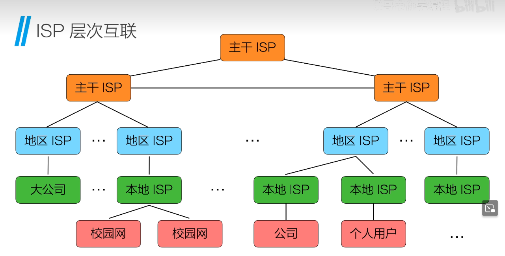


报文（message）：网络中交换与传输的数据单元

分组（packet）：为了从源端系统向目的端系统发送一个报文，源端将长报文划分为较小的数据块，称为分组

计算机网络中，**带宽**用来表示网络中某信道传送数据的能力，网络带宽表示单位时间内网络中的某信道所能通过的“最高数据率”，带宽单位：bit/s，b/s。

网络分类：

- 按网络的使用者分类：公用网、专用网
- 按网络的交换方式分类：电路交换、报文交换、分组交换
- 按网络的拓扑结构分类：星型、总线型、环型、树型、网状型
- 按网络的传输介质分类：双绞线、同轴电缆、光纤、无线
- 按网络的用途分类：教育、科研、商业、企业、政府

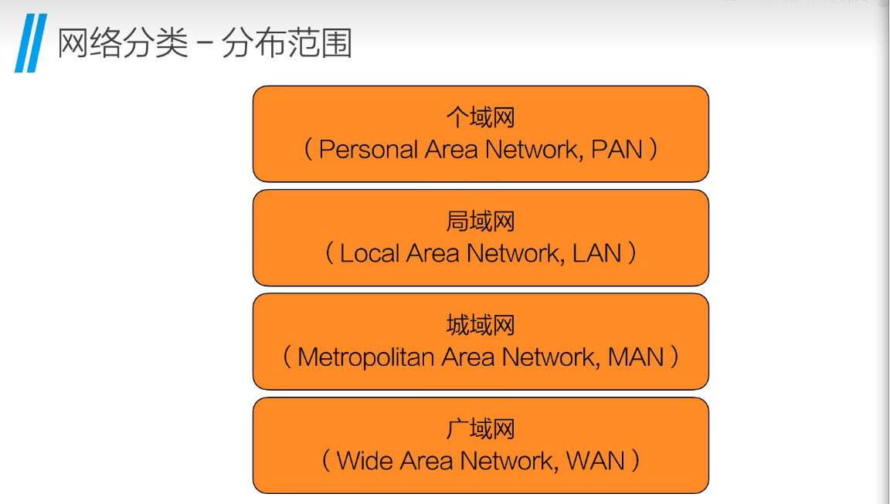


服务：指下一层向它上一层提供的一组原语（操作）

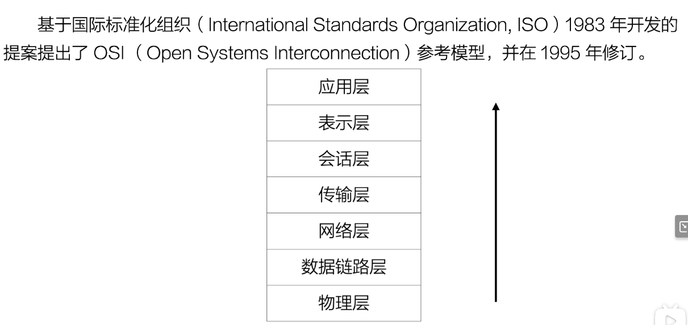

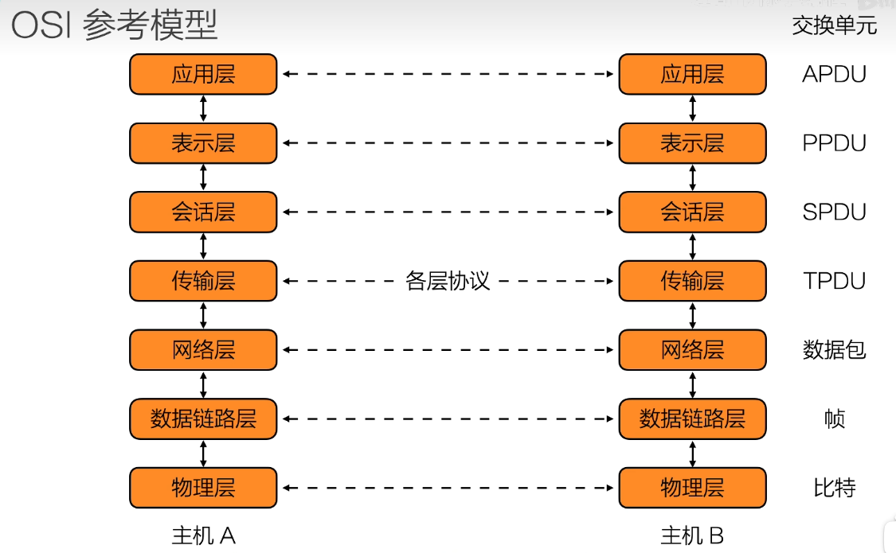

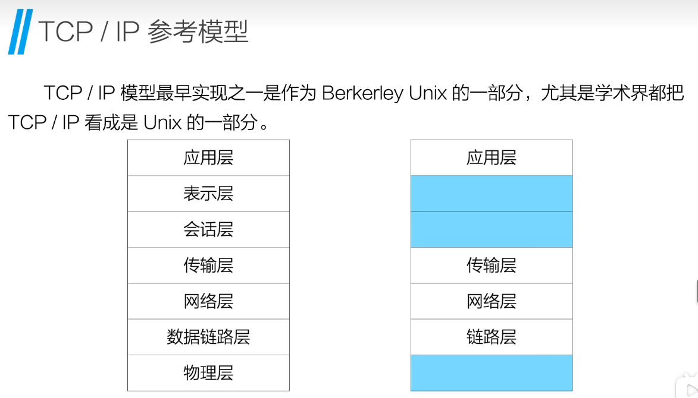

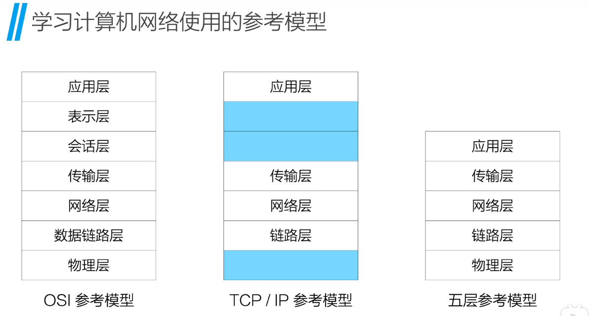

物理层（第一层）

- 用什么电子信号表示0和1 
- 一个比特传输需要持续多少纳秒
- 传输是否可以在两个方向同时进行

数据链路层（第二层）：数据链路层的核心任务是在物理层提供的比特流基础上，提供可靠的数据传输，并确保数据能正确地从一个设备发送到另一个设备

- 向网络层提供一个定义良好的服务接口
- 将比特序列组织成帧
- 错误检测和纠正
- 调节数据流

网络层（第三层）

- 将数据传输到目标地址
- 目标地址可以是多个网络通过路由器连接而成的某个地址
- 该层负责寻址和路由选择

传输层（第四层）：传输层的目标是向应用层上的进程提供高效的、可靠的和性价比合理的数据传输服务

会话层（第五层）：负责建立和断开通信连接

表示层（第六层）：主要负责数据格式的转换，将应用处理的信息转换为合适网络传输的格式，或者将下一层的数据转换为上层能够处理的格式

应用层（第七层）：为应用程序提供服务并规定应用程序中通信相关的细节


## 2 物理层

### 2.1 传输介质

**双绞线（Twisted Pair）**：双绞线由两根相互绝缘的铜线组成，铜线直径大约1mm。两根线绞在一起之后，他们产生的波会相会抵消，从而能显著降低电线的辐射。

双绞线既可以用于传输模拟信号，也可以用于传输数字信号。

双绞线分为外部有屏蔽的双绞线（Shielded Twisted Pair，STP）和没有屏蔽的双绞线（Unshielded Twisted Pair，UTP）


**光纤（Fiber）**：光纤传输系统由三部分组成，分别是光源、传输介质和检测器

光纤有单模光纤和多模光纤两种，二者传输距离不同

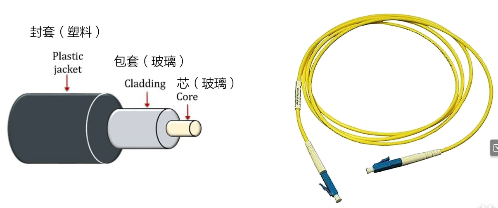

**同轴电缆（coaxial cable）**：比非屏蔽双绞线有更好的屏蔽特性和更大的带宽。过去用于电话系统长距离传输，现在已经被光纤取代。目前广泛应用于有线电视和城域网，有些地方用于互联网接入。

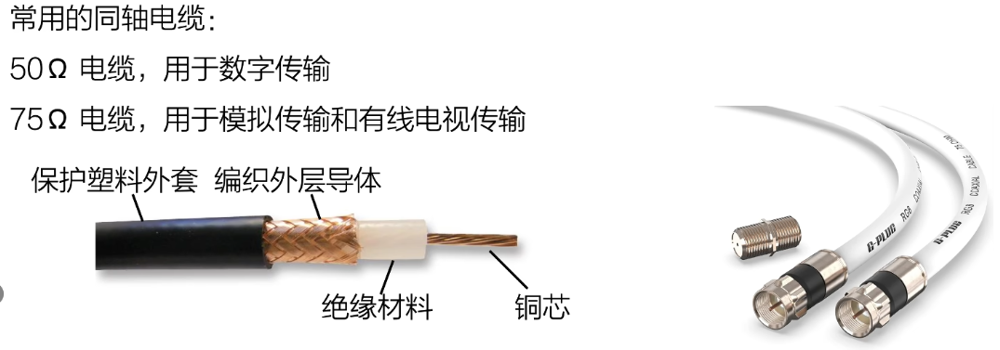

**传输标准命名规则**


调制方式

- BASE：baseband，基带信号，一根线缆只传输一个信号
- BROAD：broadband，宽频信号，一根线缆能够传输多个信号

传输媒介

- T：Twisted Pair 双绞线
- F：Fiber 光纤
- C：Co-axial 同轴电缆

编码体系

- 空：曼彻斯特编码
- x：快速以太网使用4B/5B作为分组码
- X：千兆以太网使用8B/10B作为分组码
- R：使用64B/66B作为分组码


### 2.2 编码

**归零编码（RZ编码，Return-to-Zero Code）**：正电平代表逻辑1，负电平代表逻辑0，每传输完一位数据，信号返回到零电平。

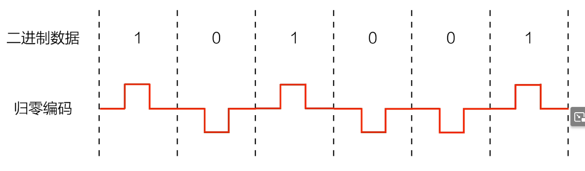

**不归零编码（NRZ编码，Non-Return-to-Zero Code）**：与归零编码相比，NRZ编码不需要归零。

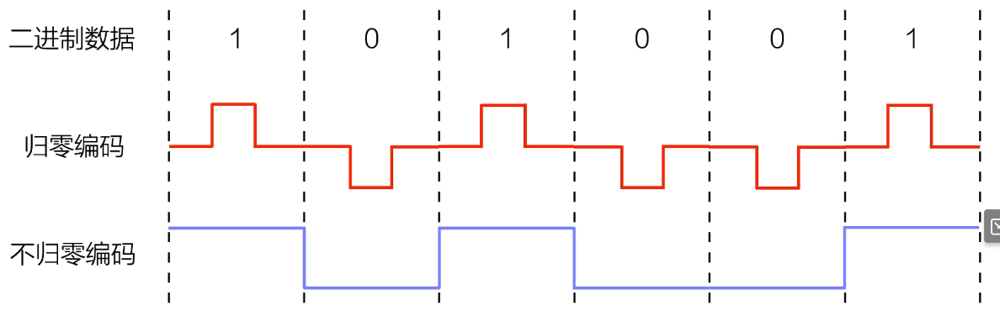

**曼彻斯特编码**

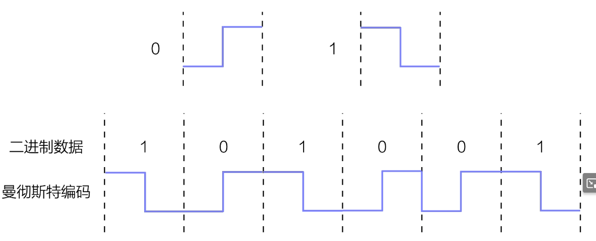


### 2.3 数字调制

数字调制：为了发送数字信息，必须设法使用模拟信号表示比特（数字信息）。比特与代表它们的信号之间的映射过程称为数字调制。

码元：码元就是数字调制过程中用来承载信息的基本信号单位，它通过特定的映射关系，将一组比特与一个独特的信号状态对应起来，从而实现数字信息的传输。

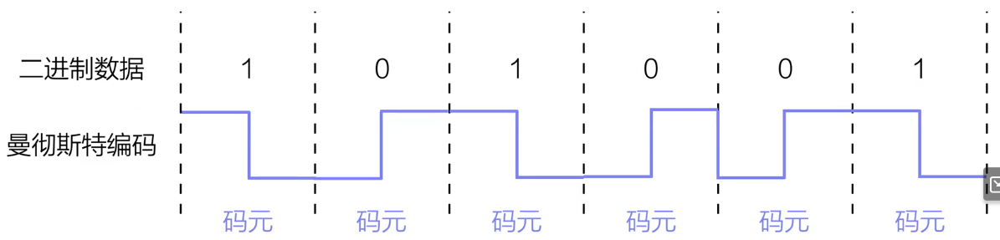


波特率：单位时间内传输的码元个数，可表示信号传输速率

比特率：单位时间内传输的比特个数，可表示数据传输速率

波特率关注的是物理信号的变化，即底层通信的速率

比特率关注的是实际传输的数据量，即有用信息的速率

数字调制中波特率与比特率的关系：
$$
C = B \cdot \log_2 N
$$
B：波特率	C：比特率	N：码元的离散状态数（每个码元所能表示的不同状态数量）

无噪声信道传输速率：
$$
C = 2H \cdot \log_2 N
$$
H：信道的带宽，即信道传输上、下限频率差值，单位为Hz

有噪声信道的最大传输速率为：
$$
C = H \cdot \log_2 (1 + S/N)
$$
S/N：信噪比

将数字信号调制成模拟信号，有调幅、调频和调相三种方式。

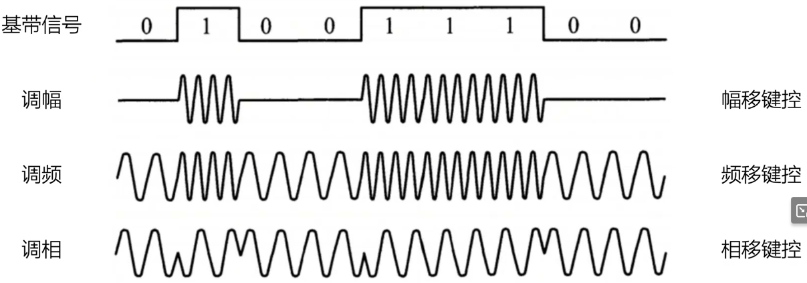


### 2.4 信道复用

信道复用（Channel Multiplexing）：指在有限的物理信道资源上，通过不同方式让多个信号共享同一个信道，以提高资源利用率和通信效率。对物理信道进行复用主要有三种方法：频率、时间和编码。

常见的信道复用技术有：频分复用、时分复用、码分复用，此外还有一种称为波分复用，本质上是频分复用的光学形式。

频分多路复用（FDM，Frequency Division Multiplexing）：将可用带宽划分为多个频段，每个信号占据不同的频段进行传输。

时分多路复用（TDM，Time Division Multiplexing）：多个信号按照时间片轮流占用整个信道，每个信号在不同的时间间隔内传输。

码分多路复用（CDM，Code Division Multiplexing）：又称码分多址CDMA，所有用户在相同的频率和时间共享信道，但每个用户使用不同的编码来区分信号。

码片：在CDMA中，一比特会被再细分成多个码片，码片是比比特更短的单位。每个比特由多个码片组成。通常情况下，一个比特被分为64或128个码片。

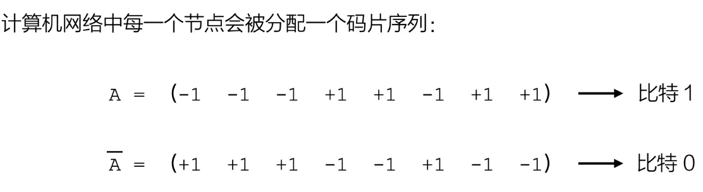

在计算机网路中，任意两个节点的码片序列是正交的，从而实现多用户共存且互不干扰

从数学角度看，所谓正交就是任意两个不同的码片归一化内积为0

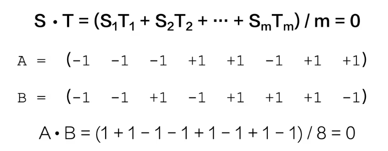

任何码片与自身归一化内积一定为1

任何码片与自身反码归一化内积一定为-1

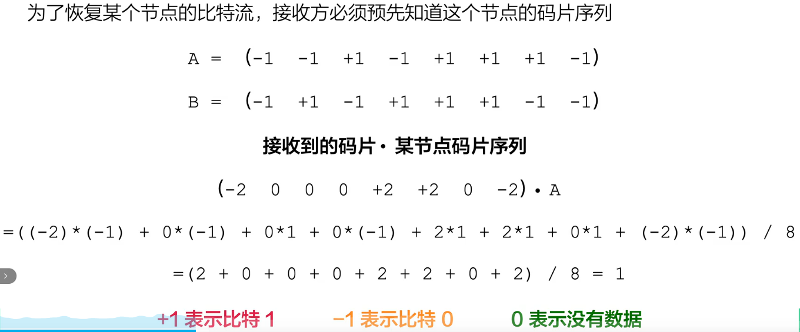


## 3 数据链路层

### 3.1 封装成帧

在数据链路层，数据以“帧（Frame）”的形式进行传输，每一帧通常包含以下三部分：

帧头（Header）：包含地址信息（源地址、目标地址）、帧类型、控制信息等

数据（payload）：承载来自网络层的数据报文（通常是IP数据报）

帧尾（Trailer）：通常包含校验和用于检测数据传输错误

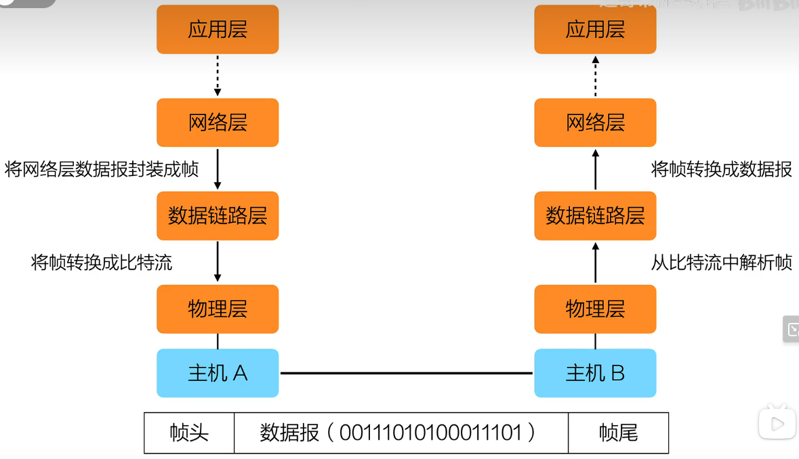


**字节计数法**：在帧的头部添加一个字段，指明该帧的字节数

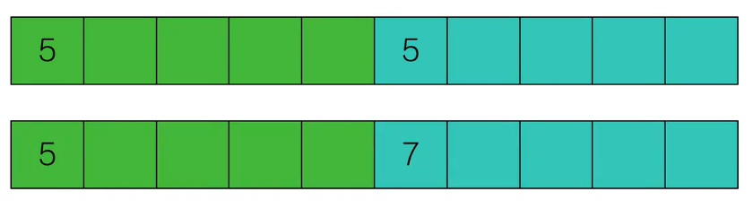

优点：简单易实现，占用的额外开销少

缺点：如果计数字段的数据被传输错误，会导致数据同步错误，接收端可能会错误地解析数据


**字符填充法**：使用特殊字符（如SOH代表帧起始，EOT代表帧结束），并在数据部分中避免特殊字符的冲突


如果数据中包含SOH或EOT，则用ESC（转义字符）来填充，避免误判

优点：解决了字节计数法的同步问题，适用于字符流

缺点：增加了额外的转义字符，可能会占用带宽


**比特填充法**：使用特定的比特模式作为帧的起始和终止标志，并在数据部分中避免比特模式的冲突

数据中如果出现连续5个1，则自动填充0

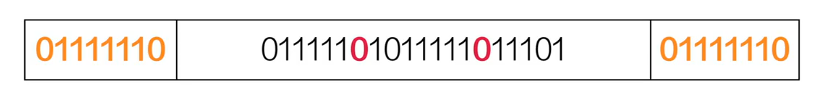

优点：适用于任何比特流，不局限于字符编码（比字符填充更通用）

缺点：需要额外的比特填充，稍微增加了传输开销


**物理层编码法**：数据报封装成帧后，直接在物理层使用信号的变化来标识帧的起始和结束，而不是依赖特定的比特模式

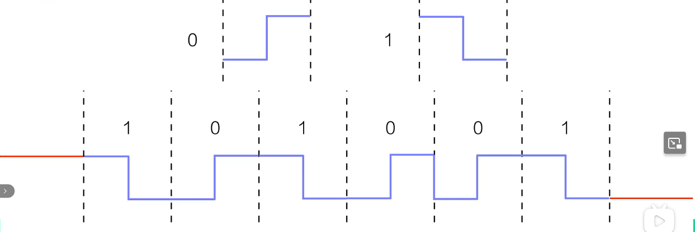

优点：不需要填充比特，不会增加额外的开销

缺点：依赖物理层的编码方式，不适用于所有链路层协议


### 3.2 错误检测

数据在传输过程中，由于各种因素（如干扰、噪声、信号衰减），可能导致比特错误（比特翻转）。数据链路层提供错误检测机制，保证数据传输的可靠性，使得接收端能检测出数据的错误并采取相应措施（如请求重传）。

**奇偶校验（Parity Check）**

- 奇校验还是偶校验是发送方与接收方事先协商好的
- 不论是奇校验还是偶校验，判断依据都是数据中1的个数的奇偶性
- 数据的1的个数 + 校验位 = 满足奇校验或偶校验的要求

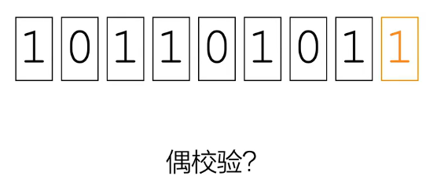

当数据传输错误时，通过奇偶检验就可以检测出

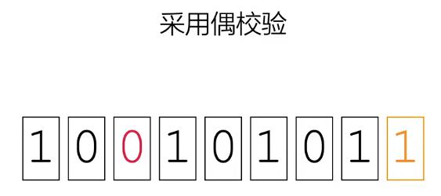

优点：实现简单，开销小

缺点：检测能力弱，只能检测奇数个比特的错误，偶数个比特错误无法检测 


**校验和（Checksum）**：一种常用的错误检测方法，广泛应用于TCP/IP协议中

- 发送方将待发送的数据分为若干段（通常16位为一组）
- 将这些数据段进行二进制求和
- 若求和过程中产生进位，则将进位部分回卷相加（循环进位）
- 最后将求和结果取反，作为校验和附加在数据后发送
- 接收方验证后如果结果全部是1说明数据无误，否则数据有问题

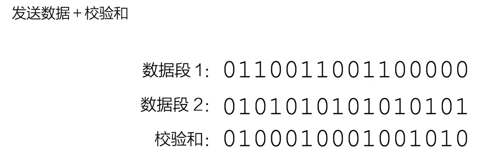

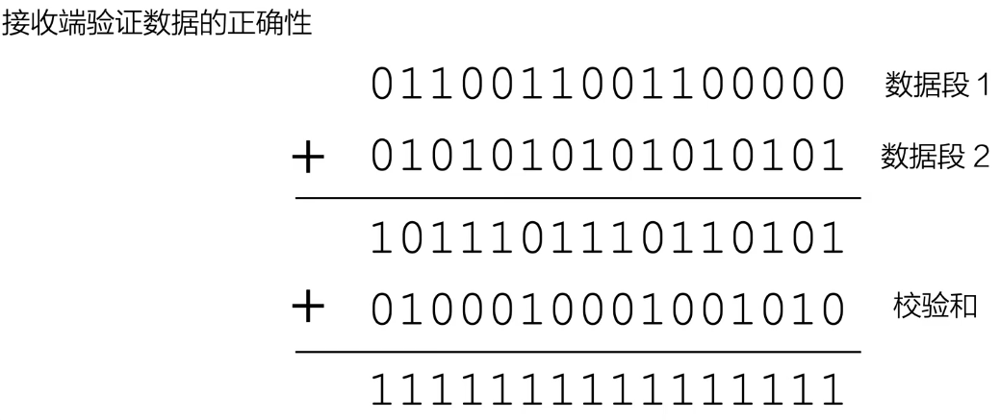

优点：比奇偶校验强，能检测更多错误，简单高效，计算量小

缺点：不能检测所有错误（例如数据中部分比特位置翻转后总和仍相同，无法发现）


**循环冗余校验（Cyclic Redundancy Check）**：CRC是一种广泛用于数据链路层的错误检测方法，常用于以太网、HDLC、PPP等协议

- 发送方和接收方事先约定一个叫作生成多项式的二进制序列
- 生成多项式如果有n位，发送方在发送数据末尾添加n-1个0
- 发送方使用末尾添加0的数据除以生成多项式，得到的余数为CRC码
- 发送方发送原始数据 + CRC
- 接收端收到数据后，用同样的生成多项式去除。如果余数为0，则数据无误，否则数据有误

原始数据：1011001

生成多项式：1101

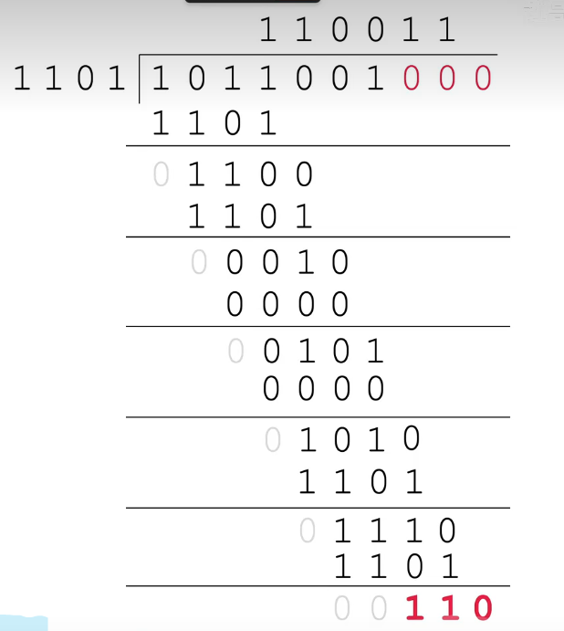

最终发送数据为原始数据 + CRC码：1011001110

接收方使用生成多项式验证数据是否正确，使用接收到的数据除以生成多项式，若余数为0，说明数据正确无误

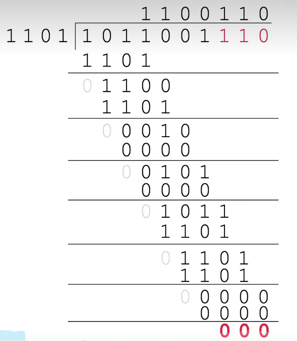


### 3.3 流量控制与可靠传输

**停止-等待协议（Stop-and-Wait）**

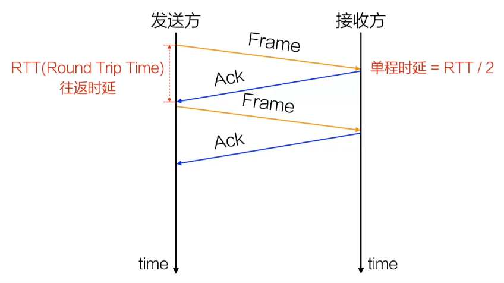

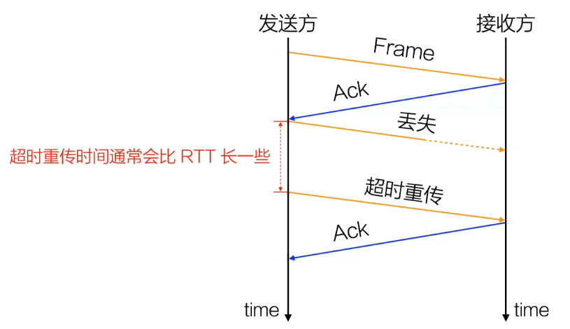

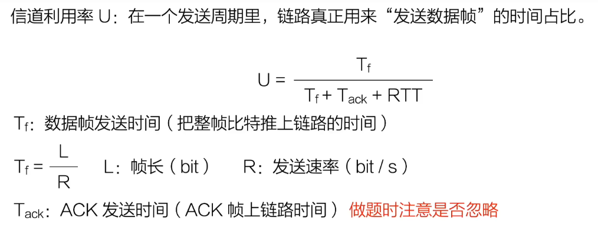

**滑动窗口**

发送窗口（Send Window）：允许发送未确认的数据帧序号范围

接收窗口（Receive Window）：接收方当前愿意接收/缓存的数据帧序号范围

窗口滑动（Slide）：左边界右移，释放额度

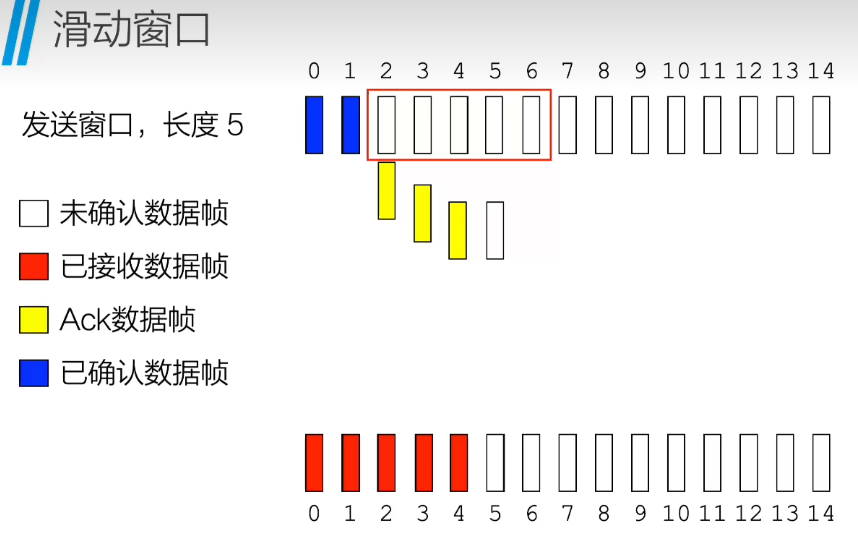

后退n帧协议（Go Back N，GBN）：接收方只按序接收；一旦缺一帧，后面都丢；发送方超时后从缺失处起“一串重传”

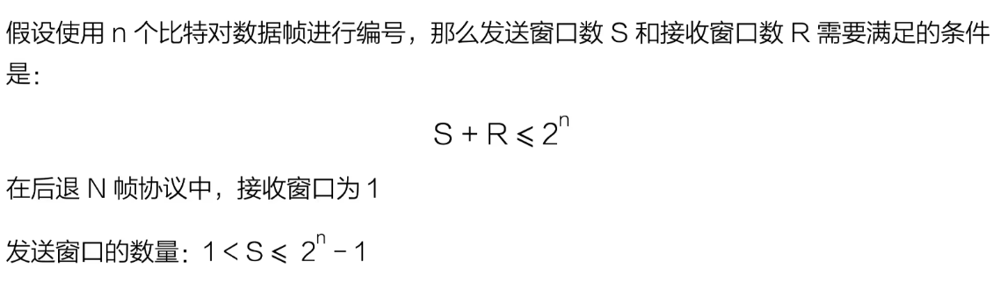

选择重传协议（Select Repeat，SR）：接收方允许乱序接收并缓存；只重传丢的那几帧

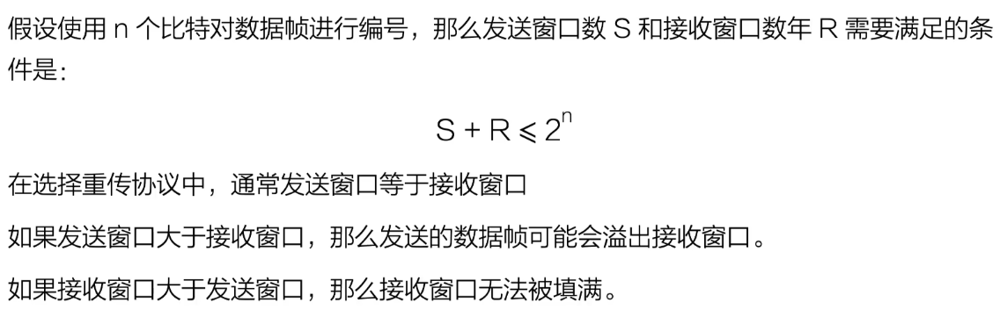

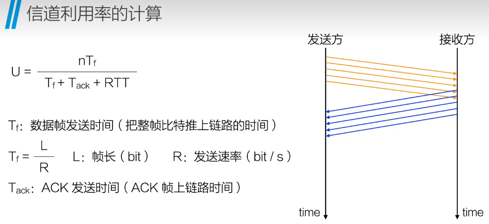


### 3.4 介质访问控制子层（MAC）

**介质访问控制子层（Medium Access Control，MAC）**：属于数据链路层的一个子层，主要负责在共享介质上协调多个节点的传输，确保各节点按照一定规则访问信道

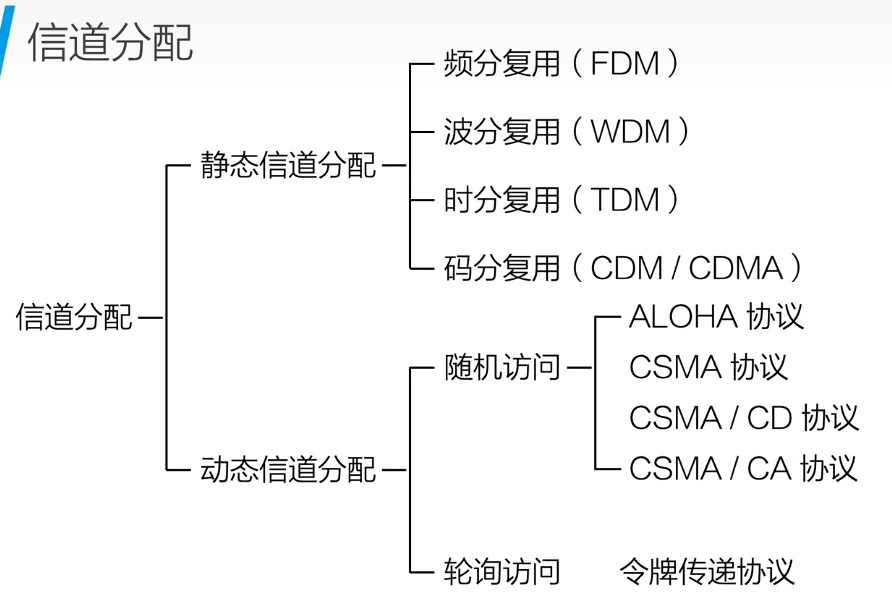


**网络链路**

- 点对点链路：由链路一端的单个发送方和链路另外一端的单个接收方组成
- 广播链路：多个发送方和接收方都连接到相同的、单一的、共享的广播信道上

广播：当任何一个节点传输一帧数据时，其他节点都会收到一个副本


**ALOHA协议**

发送机制：

- 节点一旦有数据就立即发送，无需监听信道状态
- 不关心其他节点是否在发送，属于“盲发”

冲突处理：节点会等待一段时间（随即避退）后再次尝试发送

理论最大信道利用率：约18.4%

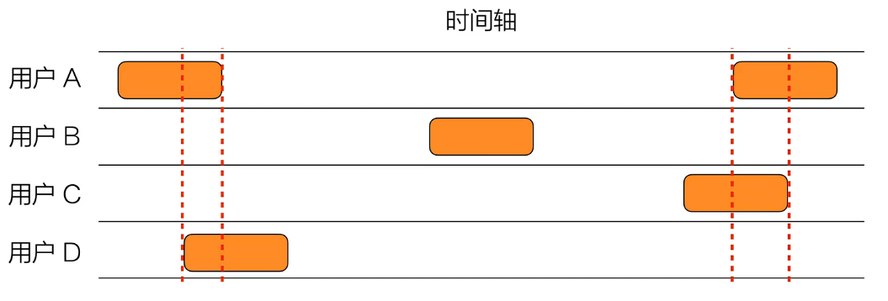


**时隙ALOHA**

- 将时间划分为“时隙”，节点只能在时隙开始时发数据
- 冲突只能发生在同一个时隙内，不再有“部分重叠”，冲突概率降低
- 理论最大信道利用率36.8%
- 要求各节点系统时间同步，增加了实现复杂度

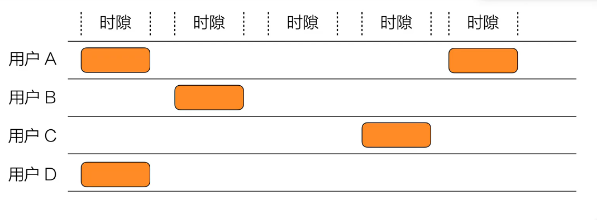


**CSMA（载波监听多路复用协议）**

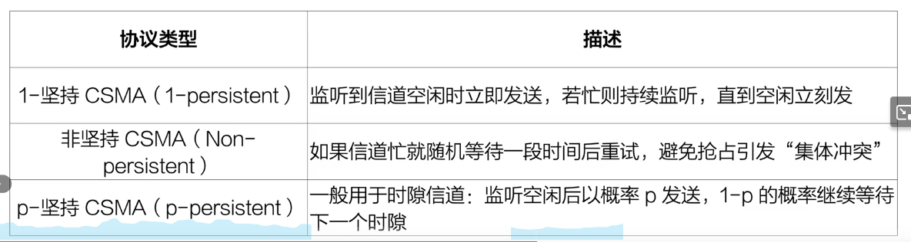


**CSMA/CD（CSMA with Collision Detection）**

- 边发边听，发现冲突马上停止，并等待随即时间再试一次
- 节点不仅发送前监听，还在发送的同时持续监听，一旦听到有别的节点的数据与自己数据冲突，立即停下来
- 边发边听，冲突即停，随即等待后重试。是以太网经典共享介质环境下的核心协议

传播延迟：数据或信号从发送节点传到接收节点的时间

最大传播延迟：最远两个节点之间信号传播的时间，这就是最大传播延迟。它决定了，最坏情况下，发送节点多久才能得知是否发生冲突

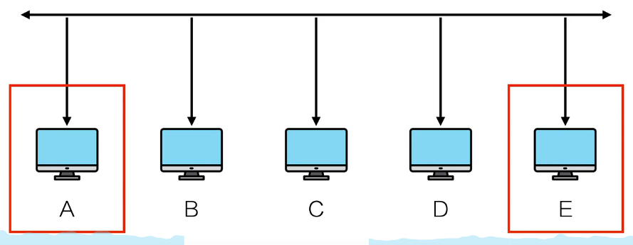

争用期（往返传播延迟）：发送节点多久才能得知是否发生冲突，最大传播延迟为T，则争用期为2T

最小帧长：最小帧长的目的，是保证数据帧发送所用的最短时间>=往返传播延迟

如果数据帧过小，那么碰撞发生之前监听就停止了，那么就无法检测冲突
$$
最小帧长（bit）=2T(争用期, s)×传输速率（bit/s）
$$
退避时间：当多个节点同时发现冲突、同时停下后，如果都同时重新发送，一定再冲突，所以设计了随机等待机制（退避），避免持续碰撞
$$
退避时间=争用期（2T）×随机数K(K∈[0,2n−1])
$$
n为重传次数，n的值最大为10，重传次数最多16次


**无线LAN问题**

1. 信号微弱：

- 在有线局域网中，当一个站发出一帧时，所有其他站都能接收到这个帧
- 在无线局域网中，由于无线电传输范围有限，无法向所有的站传输帧，也无法接收来自所有其他站的帧
- 在无线局域网中，相对于发射信号而言，接收到的信号可能很微弱，因此，在无线信道中进行冲突检测非常困难，硬件成本高

2. 隐藏站问题

- 站B在站A和站C的信号覆盖范围内，可以接收站A和站C的数据，由于竞争者离得太远而导致无法检测到潜在的竞争者，这个问题称为隐藏站问题

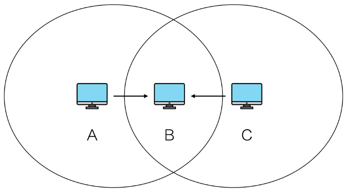

3. 暴露站问题

- 站B向站A传输数据，站C向站D传输数据。当站C侦听到该范围内有数据传输，为了避免冲突，站C暂停向站D传输数据。不过站C的结论是错误的

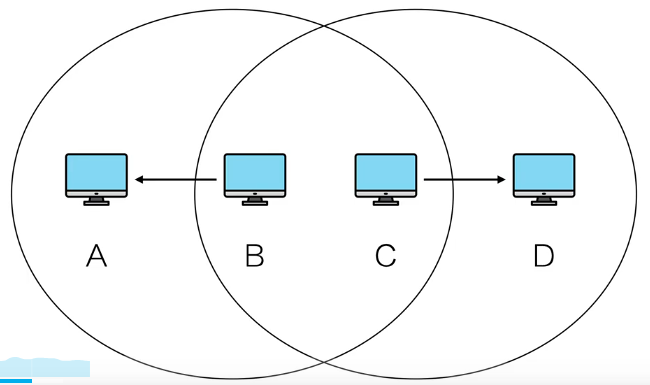


**CSMA/CA（CSMA with Collision Avoidance）**

- 节点在发送数据之前监听无线信道，如果信号强度超过一定阈值则认为当前有其他节点在该信道上发送数据，此时随即等一段时间后再次监听
- 如果检测到信道空闲，需要等待一个帧间间隔（InterFrame Space，IFS）之后再发送数据，在等待的时候保持监听

DIFS（Distributed InterFrame Space）分布式帧间间隔

- 用于普通数据帧之间的间隔
- 节点在发送数据帧之前，需要监听信道是否空闲，若信道空闲，则等待DIFS时间再发送

SIFS（Short InterFrame Space）短帧间间隔

- 用于控制帧（如ACK、RTS/CTS等）之间的间隔
- SIFS是最短的间隔，通常用于控制信道使用的帧

信道预约

- 在发送数据帧之前，发送方首先广播一个RTS（Request to Send）帧，这个RTS帧能够被其范围内的所有站点侦听到
- 接收方收到RTS帧之后，发送一个CTS（Clear to Send）帧作为应答，收到CTS帧之后开始进行数据传输
- 任何一个站若监听到RTS帧，这些站必须保持沉默，等待足够长的时间，以便发送站接收CTS帧
- 任何一个站监听到CTS帧，则这些站在接下来数据传输过程中必须保持沉默
- 尽管有了预约信道来预防碰撞，但是如果多个发送方同时发送RTS帧，这些帧将发生冲突，从而丢失数据。发送方没有在期望的时间间隔内收到CTS帧，则判定发生冲突。发送方将等待一段随机时间后，再进行重试

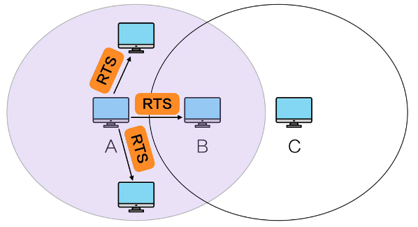

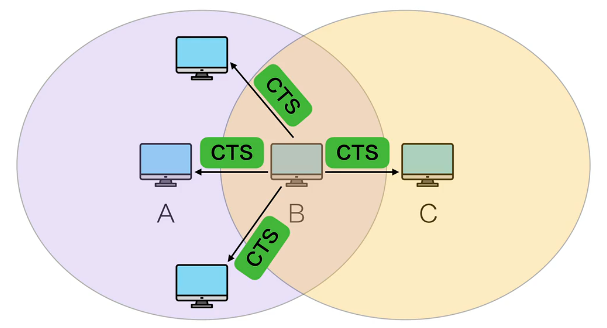

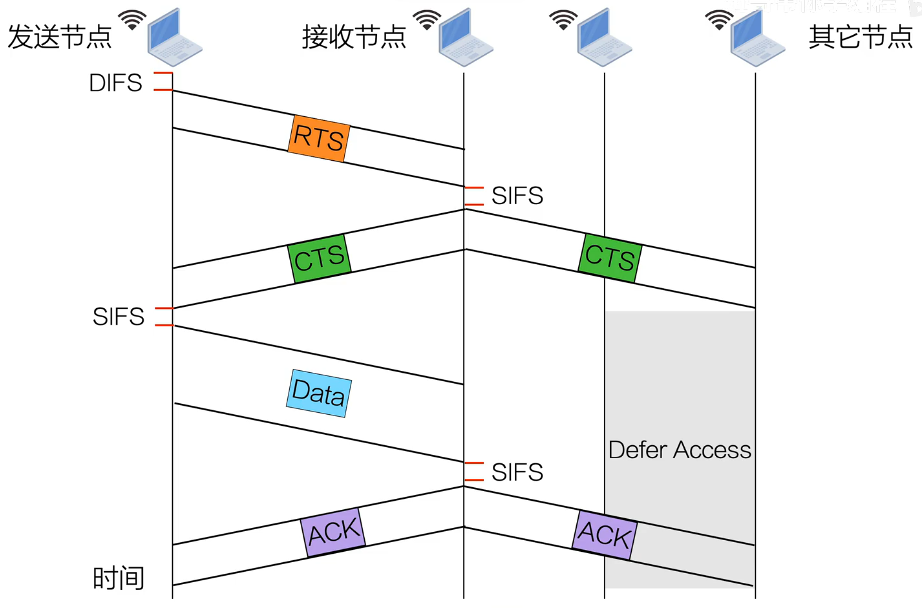


**轮询访问**

​	当链路中大部分主机都比较繁忙，多台主机同时发送数据频率高，如果采用随即访问的方式，发生冲突的概率会比较高，可以采用轮询访问

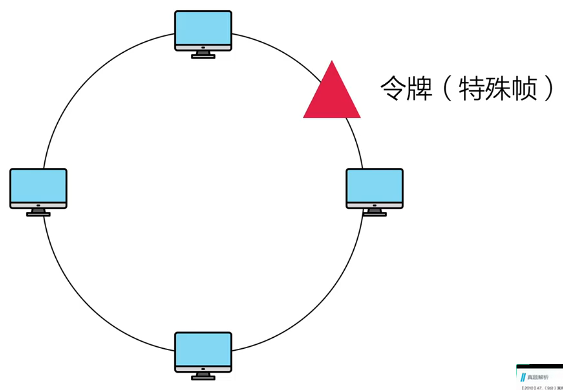


**介质访问控制子层（MAC）各协议对比**

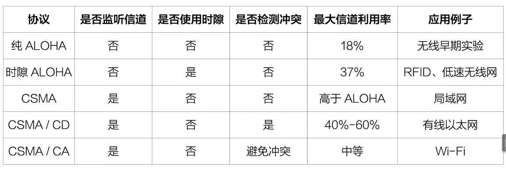


### 3.5 以太网

**数据/信号传输模式**

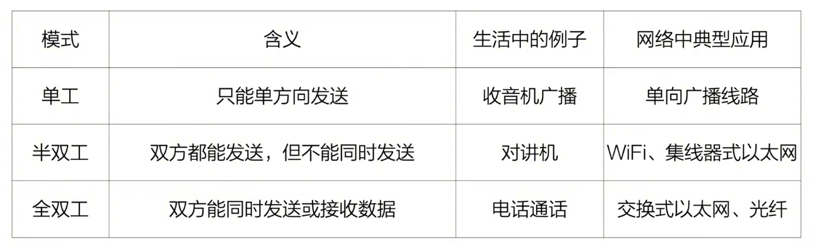

**局域网（LAN）**

概念：是一种覆盖范围较小的计算机网络，典型的使用场景是一个办公室、一个实验室、一栋楼甚至一个小型园区

特点：传输距离短、速度快、管理成单、成本低

局域网的关键功能：实现本地设备间的高速通信和资源共享

**以太网（Ethernet）**

概念：以太网是一种具体的局域网通信协议标准，定义了物理层和数据链路层的实现方式

起源与发展：最早由Xerox公司提出，后由DEC、Intel和Xerox联合推广形成DIX标准，之后成为IEEE 802.3标准的核心

功能：规定了MAC地址、帧结构、介质访问控制（如CSMA/CD机制）、传输速率（10Mbps->100Mbps->1Gbps及以上）等

**局域网VS以太网**

局域网是应用范围（在一个有限区域内实现网络互联）

以太网是实现技术（怎么连、用什么协议、什么硬件）

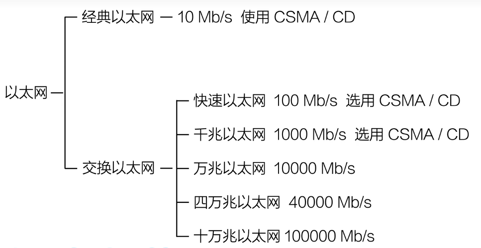

**经典以太网**

经典以太网帧格式

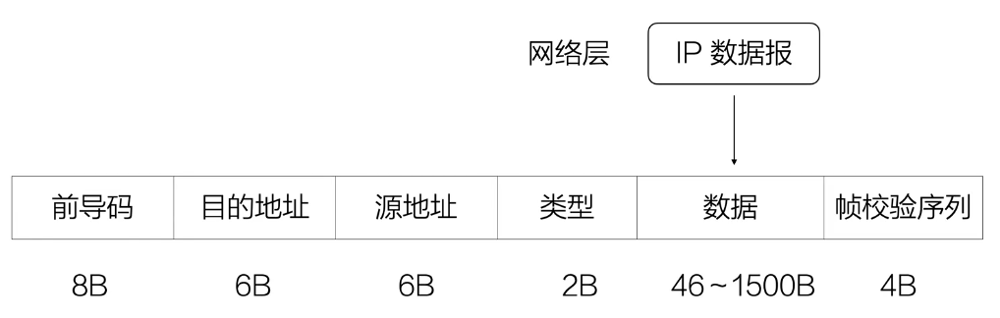

以太网有效数据的最大传输单元（MTU）1500字节，如果数据报超过1500字节，主机必须将该数据报分片。如果小于46个字节，需要将数据报填充到46字节

前导码：7个字节前同步码----10101010重复，让接收端调好时钟节拍；1个字节帧开始定界符-----10101011，标志着帧的正式开始

目的地址：接收方mac地址

源地址：发送方mac地址

类型：指出“数据”字段的协议类型或长度（0x0800----IPV4 、0x0806----ARP、0x86D0----IPV6）

帧校验序列（FCS）：使用CRC检查帧是否损坏

MAC地址：又被称为硬件地址或物理地址，由48个比特位（6个字节）组成。MAC地址是全球唯一的

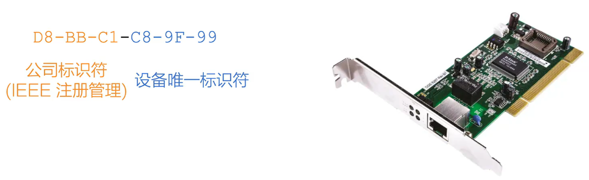

**快速以太网**

基本思想：保留原来的帧格式、接口和过程规则

将比特的传输速率从10Mb/s提升到100Mb/s，为了保证及时的检测冲突，只要将电缆的最大长度降低到1/10即可


## 4 网络层

### 4.1 数据传输方式

**无连接服务**

定义：每个数据包（数据报）都是独立的，彼此之间没有任何关联。每个数据包携带了足够的信息，以便能够独立地从源地址传输到目的地址。没有事先建立连接，也不需要维护连接状态。在这样的环境中，数据包通常被称为数据报，这种网络通常被称为数据报网络

特点：

- 无需建立连接：发送方和接收方之间不需要建立连接，数据包可以直接发送
- 每个数据包独立：每个数据包都有完整的目的地址和路由信息，发送和接收的数据包之间没有任何关联
- 不保证可靠性：每个数据包是独立的，网络层不保证数据包的可靠传输，数据包可能丢失、乱序或者重复
- 适用场景：适用于那些对实时性要求高且可以容忍丢包的应用，如视频会议、实时游戏等

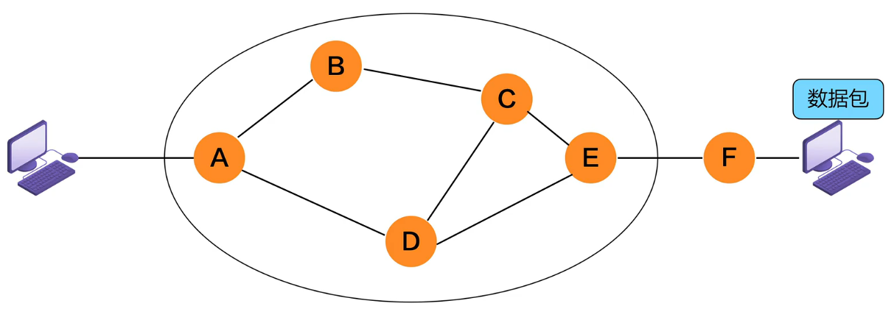

**有连接服务**

定义：发送方和接收方在数据传输之前需要通过网络建立一条虚拟的通信路径（虚电路），所有数据包通过这条虚电路进行传输。虚电路在通信过程中始终存在，直到通信结束。这种网络称为虚电路网络

特点：

- 建立连接：发送方和接收方在数据传输前必须进行连接建立，通过建立虚拟电路来保证数据能够按照特定的顺序到达接收方
- 可靠传输：在虚电路网络中，数据包的顺序和完整性都能得到保证，网络层会对数据包进行确认和重传
- 固定路径：所有的数据包都会沿着同一路径传输，这样便于提供高效的流量控制和错误检测
- 适用场景：适用于对可靠性要求高、数据顺序需要保证的应用，如文件传输、电子邮件等


### 4.2 IP数据报

**IP数据报格式**


版本：规定了数据报的IP协议版本，通过版本号，路由器能确定如何解释IP数据报的剩余部分

首部长度：表示IP数据报首部长度（以4字节为单位）。该字段取值范围5～15（0101～1111），大多数IP数据报不包含选项，所以一般IP数据报首部是20字节

服务类型：前6位用来表示数据报的服务类型，后2位用来携带拥塞通知信息，配合TCP实现端到端拥塞管理

数据报长度：整个IP数据报（头部 + 数据）的长度，单位字节。IP数据报理论最大长度是65535字节，但很少有超过1500字节的

标识：唯一标识一个原始数据报，用于分片与重组。当一个大的数据报被分片后，各分片都带相同的标识值，以便目的端正确重组

标志：第一位----保留位，必须为0。第二位----DF（Don‘t Fragment，不分片），置1为不分片。第三位----MF（More Fragments，后续还有分片），除最后一片外的所有分片，MF = 1；最后一片MF = 0

片偏移量：当前分片在原始数据报中的位置，单位为8字节。重组时，目的端根据偏移值把各片按正确顺序拼回原始数据

生存时间：用于限制数据报生存时间的计数器，最初是以秒计数，最大生存时间为255s。现在是跳计数器，每经过一个路由器，计数器减1，当减到0时，数据报被丢弃。这样做的意义在于防止循环转发导致数据报在网络中“无限存活”

上层协议：该字段当一个IP数据报到达最终目的地时才会有用。该字段的值指示了IP数据报应该交给哪个特定的传输层协议。例如，1 = ICMP，6 = TCP，17 = UDP等

首部校验和：用来校验数据报的首部，不包括数据部分，接收端验证头部在传输过程中是否出错，若不匹配则丢弃数据报


**IP地址**

IP地址（Internet Protocol Address）是网络中每台设备的唯一标识符，类似于一个“门牌号”，它由32位二进制数组成，网络中每一台主机和路由器都有一个IP地址，一个IP地址并不是指向一台主机，而是一个网络接口

绝大多数主机都在一个网络中，所以只有一个IP地址，而路由器有多个 接口，所以有多个IP地址


**子网掩码**

网络中的主机被分配IP地址的同时，还会指定子网掩码

通过将IP地址和子网掩码两者进行按位与操作，可以得到IP地址所属的网络地址（网络号）


**CIDR**

无分类域间路由选择（Classless Inter-Domain Routing，CIDR）

CIDR是一种新的IP地址划分方法，是一种更灵活的IP地址分配与路由方法，它打破了传统的A、B、C类IP地址的限制。CIDR使用一个斜杠后跟网络前缀长度（即网络部分的位数）来表示IP地址和子网的关系


### 4.3 ICMP协议

**ICMP**（Inter Control Message Protocol，网络控制消息协议）：当路由器正在处理一个数据包的过程中有意外事情发生时，可通过ICMP向发送方报告。

场景举例：

- 目标主机不可达：客户端访问服务器超时，却不知到底是目的主机挂掉还是路由断链？
- TTL超时：数据包在网络环路中陷入“无限转发”？
- 路径探测：如何知道数据包经过了哪些中间路由？

**ping**：发送ECHO（回显）到目的地址，判断目的地址的设备是否还“活着”，如果目的地址回复ECHO REPLY（回显应答），说明还“活着”。

**traceroute**：给目标发送一系列的数据包，分别将TTL设置为1，2，3，...，这些数据包的TTL数值沿着路径在后续的路由器上到达0，这些路由器上到达0，这些路由器各自送回一个超时消息给主机，利用这种技巧，可以确定沿途路由器的IP地址。


### 4.4 DHCP协议

**DHCP**（Dynamic Host Configuration Protocol）动态主机配置协议


### 4.5 ARP协议

**ARP**（Address Resolution Protocol）地址解析协议

背景：以太网中，网络层用IP地址找到目标主机，但链路层需要MAC地址才能发送帧

作用：在统一局域网内，通过ARP将基于目的IP地址找到对应的MAC地址


**网关**（Gateway）：是指连接不同网络、负责转发数据包的网络设备或路由器接口，它是网络边界的出入口


**NAT**（Network Address Translation）网络地址转换

公网IPv4地址有限，而内部网络设备却日益增多，导致IPv4地址枯竭

NAT在数据包经过路由器时，修改其源（或目的）IP地址和/或端口号，并维护一个映射表


### 4.6 路由协议

**路由器**是工作在网络层的设备，可以连接多个局域网或广域网，提供路由和转发两个功能

- 转发：在每个数据包到达路由器时，在路由表中查找此数据包应该使用哪条输出线路
- 路由：负责填充和更新路由表

**RIP协议**：路由信息协议（Routing Information Protocol，RIP），工作在应用层，基于UDP协议封装报文

- 基于距离向量路由算法
- 距离度量标准设置为跳数，每经历一个路由器跳数加1
- 最大跳数为15，跳数等于16时表示两者距离无限大（不可达）
- 相邻的路由器之间交换完整的路由表信息，时间间隔30s，定期交换路由信息
- 若长时间未收到某一路由表项的相关信息，则该表项标记为无效
- 路由表包含字段：目的网络、跳数、下一跳IP地址

**OSPF协议**：开放式最短路径优先协议（Open Shortest Path First，OSPF）

- 与RIP协议不同，两个路由器之间的代价大于1（带宽、时延、MTU）
- OSPF协议工作在网络层，数据封装在IP分组中进行传输
- OSPF支持负载均衡，把负载分散到多条线路上
- 与RIP协议相比，OSPF适用于规模更大的网络场景

**BGP协议**：边界网关协议（Border Gateway Protocol，BGP）

- 基于路径向量路由算法
- BGP协议工作在应用层，基于TCP协议封装报文
- OSPF协议能支持路由条目在一万条左右，而BGP协议可以承载十万条以上路由条目，适用于大型跨域网络


## 5 传输层

### 5.1 UDP与TCP

传输层的目标是向应用层上的进程提供高效的、可靠的和性价比合理的数据传输服务

传输层的协议为运行在不同主机上的应用进程提供了逻辑通信功能


端口：端口号的长度为16位比特，取值范围是0～65535


传输层提供了两种协议，分别是UDP和TCP，UDP段头8字节，TCP断头20字节


UDP数据报


UDP长度：表示整个UDP报文的长度，包括8字节的UDP头部和UDP数据部分，单位是字节。取值范围最小为8（仅有头部，无数据），最大为65535（头部 + 数据）。

校验和：通常是对“伪首部 + UDP头部 + UDP数据”这一整段字节流按16位逐一累加求和后，取反的结果。


TCP报文


序号：指“本报文段所携带数据的第一个字节”在整个数据段的序列号。用于在接收端进行重组与排序。在三次握手时，通信双方各自选择一个随机初始序号，然后后续每发送一个字节，序号递增1。

确认号：只有当ACK位为1时，该字段才有效。确认号表示“期待接收的下一个字节序列”。例如：接收方若正确收到序号1000（共500字节），下一次要接收的数据序号就是1500，于是接收方就向发送方发送ack确认号字段填1500。

头部长度：指明TCP头部占用的长度，以4字节为单位，最小值5，最大值15

控制位：


窗口大小：接收方通告发送方的“滑动窗口大小”，即本端当前可接收的缓冲区剩余空间

校验和：与UDP类似，覆盖伪首部、TCP头部、以及TCP数据，用于差错检测

紧急指针：仅当URG = 1时该字段才有效。它指示“紧急数据”的末尾在本报文段中的偏移量 


# 数据结构与算法

## 1 线性表

线性表：由 n（*n* ⩾ 0）个数据特性相同的元素构成的有限序列，称为线性表

线性表中元素的个数 n（*n* ⩾ 0）定义为线性表的长度，当 n=0 时称之为空表

对于非空的线性表或线性结构，其特点是：

- 存在唯一的一个被称作“第一个”的数据元素
- 存在唯一的一个被称作“最后一个”的数据元素
- 除第一个元素外，结构中的每个数据元素均只有一个前驱
- 除最后一个元素外，结构中的每个数据元素均只有一个后继

### 1.1 顺序表

顺序表：用一组连续的内存单元依次存储线性表的各个元素，也就是说，逻辑上相邻的元素，实际的物理存储空间也是连续的

存储结构：

```C++
#define MAXSIZE = 100
typedef int ElemType;

typedef struct{
    ElemType data[MAXSIZE];
    int length;
}SeqList;
```

初始化：

```C++
#define MAXSIZE 100
typedef int ElemType;

typedef struct{
    ElemType data[MAXSIZE];
    int length;
}SeqList;

void initList(SeqList *L)
{
    L->length = 0;
}

//-------------------------------动态内存分配----------------------------------------
#define MAXSIZE 100
typedef int ElemType;

typedef struct{
    ElemType *data;
    int length;
}SeqList;

SeqList* initList()
{
    SeqList *L = (SeqList*)malloc(sizeof(SeqList));
    L->data = (EldemType*)malloc(sizeof(ElemType) * MAXSIZE);
    L->length = 0;
    return L;
}
```

在尾部添加元素：

```C++
int appendElem(SeqList *L, ElemType e)
{
    if (L->length>=MAXSIZE)
    {
        printf("顺序表已满\n");
        return 0;
    }
    
    L->data[L->length] = e;
    L->length++;
    return 1;
}
```

遍历：

```C++
void listElem(SeqList *L)
{
    for (int i = 0; i < L->length; i++)
    {
        printf("%d ", L->data[i]);
    }
    
    printf("\n");
}
```

插入元素：

```C++
int insertElem(SeqList *L, int pos, ElemType e)
{
    if (L->length>=MAXSIZE)
    {
        printf("顺序表已满\n");
        return 0;
    }
    
    if(pos < 1 || pos > L->length)
    {
        printf("插入位置错误\n");
        return 0; 
    }
    
    if (pos <= L->length)
    {
        for (int i = L->length-1; i >= pos-1; i--)
        {
            L->data[i+1] = L->data[i];
        }
        
        L->data[pos-1] = e;
        L->length++;
    }
    return 1;
}
```

删除元素：

```C++
int deleteElem(SeqList *L, int pos, ElemType *e)  //ElemType *e会给这个指针里面添加的是要删除的那个值
{
    if(L->length == 0)
    {
        printf("空表\n");
        return 0;
    }
    
    if (pos < 1 || pos > L->length)
    {
        printf("删除数据位置有误\n");
        return 0;
    }
    
    *e = L->data[pos-1];  //找到e指向的那个一片内存空间，把值赋给他，把要删除的数据放入这个指针里
    
    if (pos < L->length)
    {
        for (int i = pos-1; i < L->length-1; i++)  //从要删除的那个位置开始向后循环，一直循环到最大的元素个数那个位置，然后往前依次覆盖
        {
            L->data[i] = L->data[i+1];
        }
    }
    L->length--;
    return 1;
}
```

查找元素：

```C++
int findElem(SeqList *L, ElemType e)
{
    for (int i = 0; i < L->length; i++)
    {
        if(L->data[i] == e)
        {
            return i + 1; //i是数组下标，所以加一才是顺序表当中的位置
        }
    }
    return 0;
}
```

C++实现：

```C++
#include <iostream>
#include <vector>
#include <algorithm>

using namespace std;

int main()
{
    // 顺序表初始化
    std::vector<int> SeqList;
    SeqList.reserve(100);

    // 在尾部添加元素
    SeqList.push_back(1);
    SeqList.push_back(2);
    SeqList.push_back(3);

    // 遍历
    for(int x : SeqList)
        std::cout << x << std::endl;
    std::cout << std::endl;

    // 插入元素
    SeqList.insert(SeqList.begin(),100);

    // 删除元素
    SeqList.erase(SeqList.begin());

    // 查找元素
    auto pos = find(SeqList.begin(),SeqList.end(),2);

    if(pos != SeqList.end())
        std::cout << "位置是：" << pos - SeqList.begin() + 1 << std::endl;
    else
        std::cout << "没找到" << std::endl;

    return 0;
}
```


### 1.2 链表

线性表链式存储结构的特点是：用一组任意的存储单元存储线性表的数据元素（这组存储单元可以是连续的，也可以是不连续的）


单链表：


单链表存储结构：

```C++
typedef int ElemType;

typedef struct node{
    ElemType data;
    struct node *next;
}Node;
```

单链表初始化：

```C++
Node* initList()
{
    Node *head = (Node*)malloc(sizeof(Node));
    head->data = 0;
    head->next = NULL;
    return head;
}

int main()
{
    Node *list = initList();
    return 1;
}
```

单链表头插法：

```C++
int insertHead(Node* L, ElemType e) 
{ 
     Node *p = (Node*)malloc(sizeof(Node)); 
     p->data = e; 
     p->next = L->next; 
     L->next = p; 
} 
int main() 
{ 
     Node *list = initList(); 
     insertHead(list, 10); 
     insertHead(list, 20); 
}
```

单链表遍历：

```C++
void listNode(Node* L) 
{ 
     Node *p = L->next; 
     while(p != NULL) 
     { 
        printf("%d\n", p->data); 
		p = p->next; 
     } 
     printf("\n"); 
}
```

单链表尾插法：

```C++
Node* get_tail(Node *L) 
{ 
     Node *p = L; 
     while(p->next != NULL) 
     { 
      	p = p->next; 
     } 
     return p; 
}

Node* insertTail(Node *tail, ElemType e) 
{ 
     Node *p = (Node*)malloc(sizeof(Node)); 
     p->data = e; 
     tail->next = p; 
     p->next = NULL; 
     return p; 
}
```

单链表在指定位置插入数据：

```C++
int insertNode(Node *L, int pos, ElemType e)
{
    Node *p = L;
    int i = 0;
    while(i < pos-1)
    {
        p = p->next;
        i++;
        if (p == NULL)
        {
            return 0;
        }
    }

    Node *q = (Node*)malloc(sizeof(Node));
    q->data = e;
    q->next = p->next;
    p->next =q;
    return 1;
}
```

单链表删除节点：

```C++
int  deleteNode(Node *L, int pos)
{
    Node *p = L;
    int i = 0;
    while(i < pos-1)
    {
        p = p->next;
        i++;
        if (p == NULL)
        {
            return 0;
        }
    }

    if(p->next == NULL)
    {
        printf("要删除的位置错误\n");
        return 0;
    }

    Node *q = p->next;
    p->next = q->next;
    free(q);
    return 1;
}
```

单链表获取链表长度：

```C++
int listLength(Node *L) 
{ 
     Node *p = L; 
     int len = 0; 
     while(p != NULL) 
     { 
        p = p->next; 
        len++; 
     } 
     return len; 
}
```

单链表释放链表：

```C++
void freeList(Node *L) 
{ 
     Node *p = L->next; 
     Node *q; 
     while(p != NULL) 
     { 
        q = p->next; 
        free(p); 
        p = q; 
     } 
     L->next = NULL; 
}
```

双向链表：


双向链表存储结构：

```C++
typedef int ElemType;

typedef struct node
{
    ElemType data;
    struct node *prev, *next;
}Node;
```

双向链表初始化：

```C++
Node* initList()
{
    Node *head = (Node*)malloc(sizeof(Node));
    head->data = 0;
    head->next = NULL;
    head->prev = NULL;
    return head;
}
```

双向链表头插法：

```C++
int insertHead(Node* L, ElemType e)
{
    Node *p = (Node*)malloc(sizeof(Node));
    p->data = e;
    p->prev = L;
    p->next = L->next;
    if (L->next != NULL)
    {
        L->next->prev = p;
    }
    L->next = p;
    return 1;
}
```

双向链表遍历：

```C++
void listNode(Node* L) 
{ 
     Node *p = L->next; 
     while(p != NULL) 
     { 
        printf("%d\n", p->data); 
		p = p->next; 
     } 
     printf("\n"); 
}
```

双向链表尾插法：

```C++
Node* get_tail(Node* L) {
    Node* p = L;
    while (p->next != NULL) {
        p = p->next;
    }
    return p;
}

Node* insertTail(Node *tail, ElemType e)
{
    Node *p = (Node*)malloc(sizeof(Node));
    p->data = e;
    p->prev = tail;
    tail->next = p;
    p->next = NULL;
    return  p;
}
```

双向链表在指定位置插入数据：

```C++
int insertNode(Node *L, int pos, ElemType e)
{
    Node *p = L;
    int i = 0;
    while(i < pos-1)
    {
        p = p->next;
        i++;
        if(p == NULL)
        {
            return 0;
        }
    }

    Node *q = (Node*)malloc(sizeof(Node));
    q->data = e;
    q->prev = p;
    q->next = p->next;
    p->next->prev = q;
    p->next = q;
    return 1;
}
```

双向链表删除节点：

```C++
int deleteNode(Node *L, int pos)
{
    Node *p = L;
    int i = 0;
    while(i < pos-1)
    {
        p = p->next;
        i++;
        if(p == NULL)
        {
            return  0;
        }
    }
    
    if(p->next == NULL)
    {
        printf("要删除的位置错误\n");
        return 0;
    }

    Node *q = p->next;
    p->next = q->next;
    q->next->prev = p;
    free(q);
    return 1;
}
```

C++实现：

```C++
#include <iostream>
#include <vector>
#include <algorithm>
#include <list>

using namespace std;

int main()
{
    // 链表初始化
    list<int> L;

    // 头插法
    L.push_front(1);
    L.push_front(2);
    L.push_front(3);

    // 遍历
    for(int x : L)
        std::cout << x << std::endl;
    std::cout << std::endl;

    // 尾插法
    L.push_back(1);
    L.push_back(2);
    L.push_back(3);

    // 在指定位置插入数据
    L.insert(L.begin(), 100);

    // 删除节点
    L.erase(L.begin());
}
```


## 2 栈与队列

### 2.1 栈

栈（stack）是限定仅在表尾进行插入或删除操作的线性表。因此对栈来说，表尾端有其特殊含义，称为栈顶（top），相应地，表头端称为栈底（bottom）。不含元素的空表称为空栈。 

假设 S=(a1, a2, …, an)，则称 a1 为栈底元素，an 为栈顶元素。栈中元素按 a1, a2, …, an 的次序进栈，退栈的第一个元素应为栈顶元素。换句话说，栈的修改是按照后进先出的原则进行的。因此，栈又称为后进先出（Last In First Out, LIFO）的线性表。

栈是限制插入和删除操作只能在一个位置进行的表，该位置是表的末端，叫作栈顶（top）。对栈的基本操作有进栈（push）和出栈（Pop），前者相当于插入，后者则是删除最后插入的元素。


栈的存储结构----顺序结构：

```C++
#define MAXSIZE = 100 
typedef int ElemType; 

typedef struct{ 
     ElemType data[MAXSIZE]; 
     int top; // 指向栈顶的下标值
}Stack
```

栈初始化----顺序结构：

```C++
#define MAXSIZE = 100 
typedef int ElemType; 

typedef struct{ 
     ElemType data[MAXSIZE]; 
     int top; 
}Stack; 

void initStack(Stack *s) 
{ 
     s->top = -1; 
}

//-------------------------动态内存分配--------------------------
#define MAXSIZE 100 
typedef int ElemType; 

typedef struct 
{ 
     ElemType *data; 
     int top; 
}Stack; 

Stack* initStack() 
{ 
     Stack *s = (Stack*)malloc(sizeof(Stack)); 
     s->data = (ElemType*)malloc(sizeof(ElemType) * MAXSIZE); 
     s->top = -1; 
     return s; 
}
```

判断栈是否为空----顺序结构：

```C++
int isEmpty(Stack *s) 
{ 
     if (s->top == -1) 
     { 
        printf("空的\n"); 
        return 1; 
     } 
     else 
     { 
        return 0; 
     } 
}
```

进栈----顺序结构：

```C++
int push(Stack *s, ElemType e) 
{ 
     if (s->top >= MAXSIZE - 1) 
     { 
        printf("满了\n"); 
        return 0; 
     } 
     s->top++; 
     s->data[s->top] = e; 
     return 1; 
}
```

出栈----顺序结构：

```C++
ElemType pop(Stack *s, ElemType *e) 
{ 
     if (s->top == -1) 
     { 
        printf("空的\n"); 
        return 0; 
     } 
     *e = s->data[s->top]; 
     s->top--; 
     return 1; 
}
```

获取栈顶元素----顺序结构：

```C++
int getTop(Stack *s, ElemType *e) 
{ 
     if (s->top == -1)
     { 
        printf("空的\n"); 
        return 0; 
     } 
     *e = s->data[s->top]; 
     return 1; 
}
```


栈的存储结构----链式结构：

```C++
typedef int ElemType;

typedef struct stack
{
    ElemType data;
    struct stack *next;
}Stack;
```

栈初始化----链式结构：

```C++
typedef int ElemType;

typedef struct stack
{
    ElemType data;
    struct stack *next;
}Stack;

Stack* initStack()
{
    Stack *s = (Stack*)malloc(sizeof(Stack));
    s->data = 0;
    s->next = NULL;
    return s;
}
```

判断栈是否为空----链式结构：

```C++
int isEmpty(Stack *s)
{
    if (s->next == NULL)
    {
        printf("空的\n");
        return 1;
    }
    else
    {
        return 0;
    }
}
```

进栈----链式结构：

```C++
int push(Stack *s, ElemType e)
{
    Stack *p = (Stack*)malloc(sizeof(Stack));
    p->data = e;
    p->next = s->next;
    s->next = p;
    return 1;
}
```

出栈----链式结构：

```C++
int pop(Stack *s, ElemType *e)
{
    if(s->next == NULL)
    {
        printf("空的\n");
        return 0;
    }
    
    *e = s->next->data;
    Stack *q = s->next;
    s->next = q->next;
    free(q);
    return 1;
}
```

获取栈顶元素----链式结构：

```C++
int getTop(Stack *s, ElemType *e)
{
    if (s->next == NULL)
    {
        printf("空的\n");
        return 0;
    }
    
    *e = s->next->data;
    return 1;
}
```

C++实现：

```C++
#include <iostream>
#include <vector>
#include <algorithm>
#include <list>
#include <stack>

using namespace std;

int main()
{
    // 栈初始化
    stack<int> s;

    // 判断栈是否为空
    if(s.empty() == 1)
        std::cout << "栈为空" << std::endl;
    else
        std::cout << "栈的大小为：" << s.size() << std::endl;
   
    // 进栈
    s.push(1);
    s.push(2);
    s.push(3);

    // 出栈
    s.pop();

    // 获取栈顶元素
    int top = s.top();
    std::cout << "top: " << top << std::endl;
}
```


### 2.2 队列

队列（queue）是一种先进先出（First In First Out, FIFO）的线性表。它只允许在表的一端进行插入，而在另一端删除元素。在队列中，允许插入的一端称为队尾（rear）,允许删除的一端则称为队头（front）。假设队列为 q = (a1 , a2 , …,an )，那么，a1 就是队头元素，an 就是队尾元素。队列中的元素是按照 a1 , a2 , …,an 的顺序进入的，退出队列也只能按照这个次序依次退出，也就是说，只有在 a1 ,a2 , …, an-1 都离开队列之后，an才能退出队列。


队列的存储结构----顺序结构：

```C++
#define MAXSIZE 100
typedef int ElemType;

typedef struct
{
    ElemType data[MAXSIZE];
    int front;
    int rear;
}Queue;

//-------------------------动态内存分配--------------------------
#define MAXSIZE 100
typedef int ElemType;

typedef struct
{
    ElemType *data;
    int front;
    int rear;
}Queue;

Queue* initQueue()
{
    Queue *q = (Queue*)malloc(sizeof(Queue));
    q->data = (ElemType*)malloc(sizeof(ElemType) * MAXSIZE);
    q->front = 0;
    q->rear = 0;
    return q;
}
```

队列初始化----顺序结构：

```C++
#define MAXSIZE 100
typedef int ElemType;

typedef struct
{
    ElemType data[MAXSIZE];
    int front;
    int rear;
}Queue; 

void initQueue(Queue *Q) 
{
    Q->front = 0;
    Q->rear = 0;
}
```

判断队列是否为空----顺序结构：

```C++
int isEmpty(Queue *Q)
{
    if (Q->front == Q->rear)
    {
        printf("空的\n");
        return 1;
    }
    else
    {
        return 0;
    }
}
```

出队----顺序结构：

```C++
ElemType dequeue(Queue *Q)
{
    if (Q->front == Q->rear)
    {
        printf("空的\n");
        return 0;
    }
    
    ElemType e = Q->data[Q->front];
    Q->front++;
    return e;
}
```

调整队列----顺序结构：

```C++
int queueFull(Queue *Q)
{
    if (Q->front > 0)//判断队头是否大于0，等于0，说明队头有数据；大于0，说明前面有空位置
    {
        int step = Q->front;//step是做差值的变量，相当与step表示前面有多少空位置
        for (int i = Q->front; i < Q->rear; ++i)
        {
            Q->data[i - step] = Q->data[i];//依次挪动操作过程
        }
        Q->front = 0;
        Q->rear = Q->rear - step;
        return 0; //这个0会在入队的!queueFull(Q)中判断
    }
    else
    {
        printf("真的满了\n");
        return 1;
    }
}
```

入队----顺序结构：

```C++
int equeue(Queue *Q, ElemType e)
{
    if (Q->rear >= MAXSIZE)
    {
        if(queueFull(Q))
        {
            return 0;
        }
    }
    
    Q->data[Q->rear] = e;
    Q->rear++;
    return 1;
}
```

获取队头元素----顺序结构：

```C++
int getHead(Queue *Q, ElemType *e)
{
    if (Q->front == Q->rear)
    {
        printf("空的\n");
        return 0;
    }
    
    *e = Q->data[Q->front];
    return 1;
}
```


循环队列：


循环队列入队----顺序结构：

```C++
int equeue(Queue *Q, ElemType e)
{
    if ((Q->rear + 1) % MAXSIZE == Q->front)
    {
        printf("满了\n");
        return 0;
    }
    
    Q->data[Q->rear] = e;
    Q->rear = (Q->rear + 1) % MAXSIZE;
    return 1;
}
```

循环队列出队----顺序结构：

```C++
int dequeue(Queue *Q, ElemType *e)
{
    if (Q->front == Q->rear)
    {
        printf("空的\n");
        return 0;
    }
    
    *e = Q->data[Q->front];
    Q->front = (Q->front + 1) % MAXSIZE;
    return 1;
}
```


队列的存储结构----链式结构：

```C++
typedef struct QueueNode
{
    ElemType data;
    struct QueueNode *next;
}QueueNode;

typedef struct
{
    QueueNode *front;
    QueueNode *rear;
}Queue;
```

队列初始化----链式结构：

```C++
Queue* initQueue()
{
    Queue *q = (Queue*)malloc(sizeof(Queue));
    QueueNode *node = (QueueNode*)malloc(sizeof(QueueNode));
    node->data = 0;
    node->next = NULL;
    q->front = node;
    q->rear = node;
    return q;
}
```

判断队列是否为空----链式结构：

```C++
int isEmpty(Queue *q)
{
    if (q->front == q->rear)
    {
        return 1;
    }
    else
    {
        return 0;
    }
}
```

入队----链式结构：

```C++
void equeue(Queue *q, ElemType e)
{
    QueueNode *node = (QueueNode*)malloc(sizeof(QueueNode));
    node->data = e;
    node->next = NULL;
    q->rear->next = node;
    q->rear = node;
}
```

出队----链式结构：

```C++
int dequeue(Queue *q, ElemType *e)
{
    QueueNode *node = q->front->next;
    *e = node->data;
    q->front->next = node->next;
    
    if (q->rear == node)
    {
        q->rear = q->front;
    }
    
    free(node);
    return 1;
}
```

获取队头元素----链式结构：

```C++
ElemType getFront(Queue *q)
{
    if (isEmpty(q))
    {
        printf("空的\n");
        return 0;
    }
    
    return q->front->next->data;
}
```

C++实现：

```C++
#include <iostream>
#include <vector>
#include <algorithm>
#include <list>
#include <stack>
#include <queue>

using namespace std;

int main()
{
    // 队列初始化
    queue<int> q;

    // 判断队列是否为空
    if(q.empty() == 1)
        std::cout << "队列为空" << std::endl;
    else
        std::cout << "队列大小为：" << q.size() << std::endl;

    // 入队
    q.push(1);
    q.push(2);
    q.push(3);
 
    // 出队
    q.pop();

    // 获取队头元素
    int top = q.front();
    std::cout << "队头元素为：" << top << std::endl;
}
```


### 2.3 递归

递归：在函数调用过程中，调用自己本身

斐波那契数列（Fibonacci sequence），又称黄金分割数列，因数学家莱昂纳多·斐波那契（Leonardo Fibonacci）以兔子繁殖为例子而引入，故又称“兔子数列”，其数值为：1、1、2、3、5、8、13、21、34……第 1、2 项为 1，从第 3 项开始每一项的值为前两项的和。

求斐波那契数列第n项值----非递归方式：

```C++
int fibonacci(int n)
{
    int last1 = 1;
    int last2 = 1;
    int result = 0;
    for (int i = 3; i <= n; i++)
    {
        result = last1 + last2;
        last2 = last1;
        last1 = result;
    }
    return result;
}
```

求斐波那契数列第n项值----递归方式：

```C++
int fibonacci(int n)
{
    if (n == 1 || n == 2)
    {
        return 1;
    }
    else
    {
        return fibonacci(n - 1) + fibonacci(n - 2);
    }
}
```


## 3 树与二叉树

### 3.1 树


**树**是一个或多个结点的有限集合，存在一个称为根的特定结点。其余的结点被分为 n 个互不相交的集合 T1,T2, …, Tn, 其中的每个集合都是一棵树。T1,T2, …,Tn称为根节点的子树。

- **结点**：树中的一个独立单元。
- **结点的度**：结点拥有的子树数称为结点的度。
- **树的度**：树内各结点度的最大值。
- **叶子**：度为 0 的结点或终端结点。
- **非终端结点**：度不为 0 的结点。
- **双亲和孩子**：结点的子树的根称为该结点的孩子，相应地，该结点称为孩子的双亲。
- **层次**：结点的层次从根开始定义，根为第一层，根的孩子为第二层，以此类推。

**树的基本性质：**树中所有结点数等于所有结点的度数之和加 1


### 3.2 二叉树


**二叉树**（Binary Tree）是 n（ n ⩾ 0 ）个结点所构成的集合，它或为空树（n=0），或为非空树。

**对于非空树 T：**

- 有且仅有一个称为根的结点
- 除根结点以外的其余结点分为两个互不相交的子集 T1 和 T2 ，分别称为 T 的左子树和右子树，且 T1 和 T2 本身又都是二叉树
- 二叉树每个结点至多只有两棵子树
- 二叉树的子树有左右之分，其次序不能任意颠倒

**二叉树基本形态：**


**二叉树的性质：**

性质一：二叉树的第 i 层最多有2 的 i -1 次方（ i ⩾ 1 ）个结点

性质二：深度为 k 的二叉树最多有2 的 k 次方 -1（ k ⩾ 1 ）个结点

性质三：对于任何非空的二叉树T，如果叶子结点的个数为n0 ，而度为2的结点数为n2 ，则n0 =n2 +1


**满二叉树**：深度为 k 且含有 2 的 k 次方 -1个结点的二叉树

- 所有的叶子结点只能出现在最后一层
- 对于同样深度的二叉树，满二叉树的结点个数最多，叶子结点的数量也是最多的
- 如果对满二叉树进行编号，根结点从1开始，从上到下，从左到右，对于编号为i的结点，若存在左孩子，则左孩子的编号为2i，右孩子为2i+1


**完全二叉树：**深度为 k 的、有 n 个结点的二叉树，当且仅当其每一个结点都与深度为 k 的满二叉树中编号从 1 至 n 的结点一一对应时，称之为完全二叉树。

**完全二叉树的特点：**

- 叶子结点只可能在层次最大的两层上出现
- 对任一结点，若其右分支下的子孙的最大层次为 l，则其左分支下的子孙的最大层次必为 l 或 l+1


二叉树的存储结构----链式结构：

```C++
typedef char ElemType; 

typedef struct TreeNode 
{ 
     ElemType data; 
     TreeNode *lchild; 
     TreeNode *rchild; 
}TreeNode; 

typedef TreeNode* BiTree;
```


二叉树的遍历----前序遍历：

```C++
void preOrder(BiTree T) 
{ 
     if (T == NULL) 
     { 
        return; 
     } 
     
     printf("%c ", T->data); 
     preOrder(T->lchild); 
     preOrder(T->rchild); 
}
```


二叉树的遍历----中序遍历：

```C++
void preOrder(BiTree T) 
{ 
     if (T == NULL) 
     { 
        return; 
     } 
     
     preOrder(T->lchild); 
     printf("%c ", T->data); 
     preOrder(T->rchild); 
}
```

二叉树的遍历----后序遍历：

```C++
void preOrder(BiTree T) 
{ 
     if (T == NULL) 
     { 
        return; 
     } 
     
     preOrder(T->lchild); 
     preOrder(T->rchild); 
     printf("%c ", T->data); 
}
```

二叉树的遍历----层序遍历：

```C++
int maxDepth(TreeNode *root)
{
    if(root == NULL)
        return 0;
    
    int depth = 0;
    Queue *q = initQueue();
    equeue(q, root);
    
    while(!isEmpty(q))
    {
       	int count = queueSize(q);
        while(count > 0)
        {
            TreeNode *curr;
            dequeue(q, &curr);
            if(curr->lchild != NULL)
                equeue(q, curr->lchild);
            if(curr->rchild != NULL)
                equeue(q, curr->rchild);
            
            count--;
        }
        
        depth++;
    }
    
    return depth;
}
```

C++实现：

```C++
#include <iostream>
#include <vector>
#include <algorithm>
#include <list>
#include <stack>
#include <queue>

using namespace std;

// 二叉树节点：保存当前节点的数据，以及左右孩子指针
struct TreeNode
{
    char data;
    TreeNode *lchild;
    TreeNode *rchild;

    // 构造一个值为 x 的节点，初始时没有左右孩子
    TreeNode(char x)
    {
        data = x;
        lchild = nullptr;
        rchild = nullptr;
    }
};

// 前序遍历：根 -> 左子树 -> 右子树
void preOrder(TreeNode *T)
{
    if(T == nullptr)
        return;

    std::cout << T->data << " ";
    preOrder(T->lchild);
    preOrder(T->rchild);
}

// 层序遍历：按从上到下、从左到右的顺序访问节点
void levelOrder(TreeNode *T)
{
    if(T == nullptr)
        return;

    // queue 用来保存下一批要访问的节点
    queue<TreeNode *> q;
    q.push(T);

    while(!q.empty())
    {
        // 当前队列中的节点数，就是这一层的节点数
        int count = q.size();

        while(count > 0)
        {
            TreeNode *cur = q.front();
            q.pop();

            std::cout << cur->data << " ";

            // 先左后右入队，保证输出顺序是从左到右
            if(cur->lchild != nullptr)
                q.push(cur->lchild);
            
            if(cur->rchild != nullptr)
                q.push(cur->rchild);

            count--;
        }

        std::cout << std::endl;
    }
}

int main()
{
    // 手动构造一棵测试二叉树：
    //        A
    //      /   \
    //     B     C
    //    / \
    //   D   E
    TreeNode *root = new TreeNode('A');
    root->lchild = new TreeNode('B');
    root->rchild = new TreeNode('C');
    root->lchild->lchild = new TreeNode('D');
    root->lchild->rchild = new TreeNode('E');

    std::cout << "前序：";
    preOrder(root);

    std::cout << "\n层序遍历: \n";
    levelOrder(root);
    
}
```


### 3.3 哈夫曼树

**路径**：从树中一个结点到另一个结点之间的分支构成这两个结点之间的路径

**路径长度**：路径上的分支数目

**树的路径长度**：从树根到每一个结点的路径长度之和

**结点的权**：在实际应用中，给树中的结点赋予代表某种含义的数值

**结点的带权路径长度**：从该节点到树根之间的路径长度与该结点权的乘积

**树的带权路径长度（WPL）**：树中所有叶节点的带权路径长度之和

**哈夫曼树**：带权路径长度 WPL 最小的二叉树称为哈夫曼树


**构造哈夫曼树**：

1. 先把有权值的叶子结点按照从小到大的顺序排列成一个有序序列


2. 取两个最小权值的结点作为一个新结点 N1 的子结点


3. 将结点 N1 替换刚刚取出的两个结点，并加入到有序序列中


4. 重复步骤 2 ，将 N1 和 “及格”作为一个新结点 N2 的子结点


5. 将结点 N2 替换刚刚取出的两个结点，并加入到有序序列中


6. 重复步骤 2 ，将 N2 和 “良好”作为一个新结点 N3 的子结点


7. 将结点 N3 替换刚刚取出的两个结点，并加入到有序序列中


8. 重复步骤 2 ，将 N3 和 “中等”作为一个新结点 N4 的子结点


## 4 图

### 4.1 图的基本概念

图是由顶点的有穷非空集合和顶点之间边的集合组成的。通记为 G(V, E)，其中 G 表示一个图，V 是图 G 中顶点的集合，E 是边的集合。V(G) 和 E(G) 通常分别表示图 G 的顶点集合和边集合。

注意：对于图这种数据结构，不允许没有顶点，但边集可以为空。


无向图与有向图：


简单图与多重图：

限制一：图中不能有从顶点到其自身的边

限制二：同一条边在图中不能出现两次或者两次以上

不满足以上两条限制的图称为多重图


完全图：具有最多边数的图

对于一个具有 n 个顶点的无向完全图，边数量的最大值为 n(n - 1) / 2

对于一个具有 n 个顶点的有向完全图，边数量的最大值为 n(n - 1)


路径和路径长度：

路径：从一个顶点开始，经过一系列的边到达另外一个顶点形成的顶点序列

路径长度：路径上边的条数

回路（环）：起点和终点相同，路径 {0, 3, 1, 0} 是一个回路（环）


简单路径：如果路径中不出现相同的顶点，则称为简单路径

简单回路：除第一个顶点和最后一个顶点外，其余顶点不重复出现的回路称为简单回路


顶点的度：

度：对于无向图，顶点的度指的是与顶点相关联边的数目

入度：在有向图中，对于顶点 v，箭头指向 v 的边的数目

出度：在有向图中，对于顶点 v，从该顶点出发的边的数目


度与边的关系：

在无向图中，假设具有 n 个顶点，e 条边

图中所有顶点度之和等于边数的两倍

对于有向图，所有顶点的出度之和与入度之和相等，弧的数量也相等


连通图：

连通：在无向图中，如果从顶点 V 到顶点 w 有路径，则称顶点 v 到顶点 w 是连通的

如果对于图中任意两个顶点都是连通的，则称此图为连通图


连通分量：

- 无向图中的极大连通子图称为连通分量
- 连通分量为子图，子图为连通图
- “极大”的意思是指这个连通子图已经大到不能再加任何新的点了，否则就不连通了。
- 连通分量其实就是图中不能再扩展的“完整连通区域”，每个连通分量都是一个“最大但不能更大”的连通子图


强连通图：在有向图中，对于每一对顶点 v 和 w ，从 v 到 w 和从 w 到 v 都有路径，则称该有向图是强连通图

有向图中的极大强连通子图称为有向图的强连通分量

强连通分量就是那些不能再加点的、最完整的互通子图


生成树：对于一张连通无向图，从中选出一些边，使得图中所有顶点都被连通起来，且没有形成任何回路，所构成的子图就叫做这张图的生成树

注意：包含所有顶点 n，但只有足以构成一棵树的 n-1 条边

可以把“生成树”理解为，用尽可能少的连接，把图中所有点都连起来，而且不能有重复绕圈的边


权：在一个图中，每条边可以标注上一个代表某种含义的数值，该数值称为这个边的权值

网：边上带权值的图，也称为带权图


### 4.2 图的存储结构

邻接矩阵：


```C++
typedef char VertexType;   // 顶点类型
typedef int EdgeType;      // 边的权值类型（0 或 1）
#define MAXSIZE 100        // 最大顶点数

// 图的邻接矩阵结构体定义
typedef struct
{
    VertexType vertex[MAXSIZE];         // 顶点数组
    EdgeType arc[MAXSIZE][MAXSIZE];     // 邻接矩阵（二维数组）
    int vertex_num;                     // 顶点个数
    int edge_num;                       // 边的条数
} Mat_Grph; 

// 创建图的邻接矩阵
void create_graph(Mat_Grph* G)
{
    G->vertex_num = 4;   // 顶点数：V0~V3
    G->edge_num = 5;     // 边数

    // 顶点命名
    G->vertex[0] = '0';
    G->vertex[1] = '1';
    G->vertex[2] = '2';
    G->vertex[3] = '3';

    // 初始化邻接矩阵
    for (int i = 0; i < G->vertex_num; i++)
    {
        for (int j = 0; j < G->vertex_num; j++)
        {
            G->arc[i][j] = 0;
        }
    }

    // 添加边（无向图，因此要对称赋值）
    G->arc[0][1] = 1;  G->arc[1][0] = 1;  // V0-V1
    G->arc[0][2] = 1;  G->arc[2][0] = 1;  // V0-V2
    G->arc[0][3] = 1;  G->arc[3][0] = 1;  // V0-V3
    G->arc[1][2] = 1;  G->arc[2][1] = 1;  // V1-V2
    G->arc[2][3] = 1;  G->arc[3][2] = 1;  // V2-V3
}
```


邻接表：


```C++
#define MAXVEX 100  // 最大顶点数

// 定义边表结点结构体
typedef struct EdgeNode {
    int adjvex;                    // 邻接点在顶点数组中的下标
    struct EdgeNode *next;        // 指向下一个邻接点
} EdgeNode;

// 定义顶点表结点结构体
typedef struct VertexNode {
    char data;                    // 顶点信息（这里用字符代替）
    EdgeNode *firstedge;         // 指向边表的头指针
} VertexNode;

// 图的结构体
typedef struct {
    VertexNode adjList[MAXVEX];   // 邻接表
    int numVertexes;              // 顶点数
    int numEdges;                 // 边数
} GraphAdjList;

// 创建图 邻接表（无向图）
void createGraph(GraphAdjList *G) {
    G->numVertexes = 4;
    G->numEdges = 5;

    // 顶点命名（V0 ~ V3）
    for (int i = 0; i < G->numVertexes; i++) {
        G->adjList[i].data = '0' + i;
        G->adjList[i].firstedge = NULL;
    }

    // 边集合（无向边，需添加两次）
    int edges[5][2] = {
        {0, 1}, {0, 2}, {0, 3},
        {1, 2}, {2, 3}
    };

    for (int i = 0; i < G->numEdges; i++) {
        int from = edges[i][0];
        int to = edges[i][1];

        // from → to
        EdgeNode *e1 = (EdgeNode *)malloc(sizeof(EdgeNode));
        e1->adjvex = to;
        e1->next = G->adjList[from].firstedge;
        G->adjList[from].firstedge = e1;

        // to → from（因为是无向图）
        EdgeNode *e2 = (EdgeNode *)malloc(sizeof(EdgeNode));
        e2->adjvex = from;
        e2->next = G->adjList[to].firstedge;
        G->adjList[to].firstedge = e2;
    }
}
```

C++实现：

```C++
#include <iostream>
#include <vector>
#include <algorithm>
#include <list>
#include <stack>
#include <queue>

using namespace std;

// 图的邻接表表示
struct Graph
{
    vector<char> vertex;        // 顶点数组，保存每个顶点的数据
    vector<vector<int>> adj;    // 邻接表，adj[i] 保存与第 i 个顶点相连的顶点下标
    int edge_num;               // 边的数量
};

// 添加一条无向边 from - to
void addEdge(Graph &G, int from, int to)
{
    // from 的邻接表中加入 to
    G.adj[from].push_back(to);

    // 无向图需要双向保存，所以 to 的邻接表中也要加入 from
    G.adj[to].push_back(from);  // 无向图，所以反过来也要加
    G.edge_num++;
}

// 创建一个测试用的无向图
Graph createGraph()
{
    Graph G;

    // 初始化 4 个顶点，分别是 '0'、'1'、'2'、'3'
    G.vertex = {'0','1','2','3'};
    int n = G.vertex.size();

    // 根据顶点数量创建邻接表，每个顶点先对应一个空 vector
    G.adj.resize(n);
    G.edge_num = 0;

    // 添加边：
    // 0 - 1, 0 - 2, 0 - 3, 1 - 2, 2 - 3
    addEdge(G,0,1);
    addEdge(G,0,2);
    addEdge(G,0,3);
    addEdge(G,1,2);
    addEdge(G,2,3);

    return G;
}

// 打印邻接表
void printGraph(const Graph &G)
{
    for(int i = 0; i < G.vertex.size(); i++)
    {
        cout << G.vertex[i] << ": ";

        // 输出第 i 个顶点的所有邻接点下标
        for(int j = 0; j < G.adj[i].size(); j++)
            cout << G.adj[i][j] << " ";

        cout << endl;
    }
}

int main()
{
    // 创建图并输出它的邻接表
    Graph G = createGraph();

    printGraph(G);

}
```


### 4.3 图的遍历

深度优先遍历：


```C++
#include <stdio.h>

typedef char VertexType;
typedef int EdgeType;

#define MAXSIZE 100


typedef struct
{
	VertexType vertex[MAXSIZE];
	EdgeType arc[MAXSIZE][MAXSIZE];
	int vertex_num;
	int edge_num;
}Mat_Grph;

int visited[MAXSIZE];

void create_graph(Mat_Grph* G)
{
	G->vertex_num = 9;
	G->edge_num = 15;
	G->vertex[0] = 'A';
	G->vertex[1] = 'B';
	G->vertex[2] = 'C';
	G->vertex[3] = 'D';
	G->vertex[4] = 'E';
	G->vertex[5] = 'F';
	G->vertex[6] = 'G';
	G->vertex[7] = 'H';
	G->vertex[8] = 'I';

	for (int i = 0; i < G->vertex_num; i++)
	{
		for (int j = 0; j < G->vertex_num; j++)
		{
			G->arc[i][j] = 0;
		}
	}

	//A-B A-F
	G->arc[0][1] = 1;
	G->arc[0][5] = 1;

	//B-C B-G B-I
	G->arc[1][2] = 1;
	G->arc[1][6] = 1;
	G->arc[1][8] = 1;

	//C-D C-I
	G->arc[2][3] = 1;
	G->arc[2][8] = 1;

	//D-E D-G D-H D-I
	G->arc[3][4] = 1;
	G->arc[3][6] = 1;
	G->arc[3][7] = 1;
	G->arc[3][8] = 1;

	//E-F E-H
	G->arc[4][5] = 1;
	G->arc[4][7] = 1;

	//F-G
	G->arc[5][6] = 1;

	//G-H
	G->arc[6][7] = 1;

	for (int i = 0; i < G->vertex_num; i++)
	{
		for (int j = 0; j < G->vertex_num; j++)
		{
			G->arc[j][i] = G->arc[i][j];
		}
	}
}

void dfs(Mat_Grph G, int i)
{
	visited[i] = 1;
	printf("%c\n", G.vertex[i]);

	for (int j = 0; j < G.vertex_num; j++)
	{
		if (G.arc[i][j] == 1 && visited[j] == 0)
		{
			dfs(G, j);
		}
	}
}

int main(int argc, char const *argv[])
{
	Mat_Grph G;
	create_graph(&G);

	for (int i = 0; i < G.vertex_num; i++)
	{
		visited[i] = 0;
	}
	dfs(G, 0);
	return 0;
}
```


广度优先遍历：


```C++
#include <stdio.h>

typedef char VertexType;
typedef int EdgeType;

#define MAXSIZE 100


typedef struct
{
	VertexType vertex[MAXSIZE];
	EdgeType arc[MAXSIZE][MAXSIZE];
	int vertex_num;
	int edge_num;
}Mat_Grph;

int visited[MAXSIZE];
int front = 0;
int rear = 0;
int queue[MAXSIZE];

void create_graph(Mat_Grph* G)
{
	G->vertex_num = 9;
	G->edge_num = 15;
	G->vertex[0] = 'A';
	G->vertex[1] = 'B';
	G->vertex[2] = 'C';
	G->vertex[3] = 'D';
	G->vertex[4] = 'E';
	G->vertex[5] = 'F';
	G->vertex[6] = 'G';
	G->vertex[7] = 'H';
	G->vertex[8] = 'I';

	for (int i = 0; i < G->vertex_num; i++)
	{
		for (int j = 0; j < G->vertex_num; j++)
		{
			G->arc[i][j] = 0;
		}
	}

	//A-B A-F
	G->arc[0][1] = 1;
	G->arc[0][5] = 1;

	//B-C B-G B-I
	G->arc[1][2] = 1;
	G->arc[1][6] = 1;
	G->arc[1][8] = 1;

	//C-D C-I
	G->arc[2][3] = 1;
	G->arc[2][8] = 1;

	//D-E D-G D-H D-I
	G->arc[3][4] = 1;
	G->arc[3][6] = 1;
	G->arc[3][7] = 1;
	G->arc[3][8] = 1;

	//E-F E-H
	G->arc[4][5] = 1;
	G->arc[4][7] = 1;

	//F-G
	G->arc[5][6] = 1;

	//G-H
	G->arc[6][7] = 1;

	for (int i = 0; i < G->vertex_num; i++)
	{
		for (int j = 0; j < G->vertex_num; j++)
		{
			G->arc[j][i] = G->arc[i][j];
		}
	}
}

void bfs(Mat_Grph G)
{
	int i = 0;
	visited[i] = 1;
	printf("%c\n", G.vertex[i]);
	queue[rear] = i;
	rear++;
	while(front != rear)
	{
		i = queue[front];
		front++;
		for (int j = 0; j < G.vertex_num; j++)
		{
			if (G.arc[i][j] == 1 && visited[j] == 0)
			{
				visited[j] = 1;
				printf("%c\n", G.vertex[j]);
				queue[rear] = j;
				rear++;
			}
		}
	}

}

int main(int argc, char const *argv[])
{
	Mat_Grph G;
	create_graph(&G);

	for (int i = 0; i < G.vertex_num; i++)
	{
		visited[i] = 0;
	}
	bfs(G);
	return 0;
}
```

C++实现：

```C++
#include <iostream>
#include <vector>
#include <algorithm>
#include <list>
#include <stack>
#include <queue>

using namespace std;

// 使用邻接表存储无向图
struct Graph
{
    vector<char> vertex;        // 顶点数组，保存每个顶点的数据
    vector<vector<int>> adj;    // 邻接表，adj[i] 保存第 i 个顶点的邻接点下标
    int edge_num;               // 无向边数量
};

// 添加一条无向边 from - to
void addEdge(Graph &G, int from, int to)
{
    // from 和 to 互为邻接点
    G.adj[from].push_back(to);
    G.adj[to].push_back(from);
    G.edge_num++;
}

// 创建一个测试用的无向图
Graph createGraph()
{
    Graph G;

    // 初始化 6 个顶点，分别是 '0' 到 '5'
    G.vertex = {'0','1','2','3','4','5'};
    int n = G.vertex.size();

    // 根据顶点数量创建邻接表，每个顶点先对应一个空 vector
    G.adj.resize(n);
    G.edge_num = 0;

    // 添加边：0-1, 0-3, 0-5, 1-2, 3-4
    addEdge(G,0,1);
    addEdge(G,0,3);
    addEdge(G,0,5);
    addEdge(G,1,2);
    addEdge(G,3,4);

    return G;
}

// 打印每个顶点以及它的所有邻接点下标
void printGraph(const Graph &G)
{
    for(int i = 0; i < G.vertex.size(); i++)
    {
        cout << G.vertex[i] << ": ";

        for(int j = 0; j < G.adj[i].size(); j++)
            cout << G.adj[i][j] << " ";

        cout << endl;
    }
}

// 从 index 顶点开始递归进行深度优先遍历
void dfs(Graph &G, int index, vector<bool> &visited)
{   
    visited[index] = true;

    cout << G.vertex[index] << " ";

    for(int i = 0; i < G.adj[index].size(); i++)
    {
        int next = G.adj[index][i];

        if(!visited[next])
            dfs(G, next, visited);
    }
}

// 从 index 顶点开始使用队列进行广度优先遍历
void bfs(Graph &G, int index)
{
    vector<bool> visited(G.vertex.size(), false);
    visited[index] = true;

    queue<int> q;
    q.push(index);

    while(!q.empty())
    {
        index = q.front();
        q.pop();

        cout << G.vertex[index] << " ";

        for(int i = 0; i < G.adj[index].size(); i++)
        {
            int next = G.adj[index][i];

            if(!visited[next])
            {
                visited[next] = true;
                q.push(next);
            }
        }
    }


}

int main()
{
    // 创建图，输出邻接表，并从 0 号顶点开始分别进行 DFS 和 BFS
    Graph G = createGraph();
    vector<bool> visited(G.vertex.size(), false);

    printGraph(G);

    cout << "DFS: ";
    dfs(G, 0, visited);
    cout << endl;

    cout << "BFS: ";
    bfs(G, 0);
    cout << endl;
}
```


### 4.4 最小生成树算法

普里姆（Prim）算法：


```C++
#include <stdio.h>
#include <stdlib.h>

typedef char VertexType;
typedef int EdgeType;

#define MAXSIZE 100
#define MAX 0x7fffffff

typedef struct
{
	VertexType vertex[MAXSIZE];
	EdgeType arc[MAXSIZE][MAXSIZE];
	int vertex_num;
	int edge_num;
}Mat_Grph;


void create_graph(Mat_Grph* G)
{
	G->vertex_num = 9;
	G->edge_num = 15;

	G->vertex[0] = 'A';
	G->vertex[1] = 'B';
	G->vertex[2] = 'C';
	G->vertex[3] = 'D';
	G->vertex[4] = 'E';
	G->vertex[5] = 'F';
	G->vertex[6] = 'G';
	G->vertex[7] = 'H';
	G->vertex[8] = 'I';

	for (int i = 0; i < G->vertex_num; i++)
	{
		for (int j = 0; j < G->vertex_num; j++)
		{
			if (i == j)
			{
				G->arc[i][j] = 0;
			}
			else
			{
				G->arc[i][j] = MAX;
			}
			
		}
	}

	//A-B A-F
	G->arc[0][1] = 10;
	G->arc[0][5] = 11;

	//B-C B-G B-I
	G->arc[1][2] = 18;
	G->arc[1][6] = 16;
	G->arc[1][8] = 12;

	//C-D C-I
	G->arc[2][3] = 22;
	G->arc[2][8] = 8;

	//D-E D-G D-H D-I
	G->arc[3][4] = 20;
	G->arc[3][6] = 24;
	G->arc[3][7] = 16;
	G->arc[3][8] = 21;

	//E-F E-H
	G->arc[4][5] = 26;
	G->arc[4][7] = 7;

	//F-G
	G->arc[5][6] = 17;

	//G-H
	G->arc[6][7] = 19;

	for (int i = 0; i < G->vertex_num; i++)
	{
		for (int j = 0; j < G->vertex_num; j++)
		{
			G->arc[j][i] = G->arc[i][j];
		}
	}
}

void prim(Mat_Grph* G)
{
	int i, j, k;
	int min;
	int weight[MAXSIZE];//候选边
	int vex_index[MAXSIZE];//值表示出发点，下标表示到达点

	//先从顶点A开始
	weight[0] = 0; //vex_index某点与下标对应点的权重
	vex_index[0] = 0;

	for (i = 1; i < G->vertex_num; i++)
	{
		weight[i] = G->arc[0][i];
		vex_index[i] = 0;
	}

	for (int i = 1; i < G->vertex_num; i++)
	{
		min = MAX;
		j = 0;
		k = 0;
		//找到最小的，与之连接
		while(j < G->vertex_num)
		{
			if (weight[j] != 0 && weight[j] < min)
			{
				min = weight[j];
				k = j;
			}
			j++;
		}

		//printf("(%d, %d)\n", vex_index[k], k);
		printf("(%c, %c)\n", G->vertex[vex_index[k]], G->vertex[k]);
		weight[k] = 0;

		//找新连接结点的待选路径
		for (j = 0; j < G->vertex_num; j++)
		{
			//与新结点可连接的边进行比较，有比weight小的就替换
			if (weight[j] != 0 && G->arc[k][j] < weight[j])
			{
				weight[j] = G->arc[k][j];
				vex_index[j] = k;
			}
		}

	}
}

int main(int argc, char const *argv[])
{
	//Mat_Grph* G = (Mat_Grph*)malloc(sizeof(Mat_Grph));
	Mat_Grph G;
	create_graph(&G);
	prim(&G);
	return 0;	return 0;
}
```


克鲁斯卡尔（Kruskal）算法：


```C++
#include <stdio.h>
#include <stdlib.h>

typedef char VertexType;
typedef int EdgeType;

#define MAXSIZE 100
#define MAXEDGE 200
#define MAX 0x7fffffff

typedef struct
{
	VertexType vertex[MAXSIZE];
	EdgeType arc[MAXSIZE][MAXSIZE];
	int vertex_num;
	int edge_num;
}Mat_Grph;

typedef struct
{
	int beigin;
	int end;
	int weight;
}Edge;


void create_graph(Mat_Grph* G)
{
	G->vertex_num = 9;
	G->edge_num = 15;

	G->vertex[0] = 'A';
	G->vertex[1] = 'B';
	G->vertex[2] = 'C';
	G->vertex[3] = 'D';
	G->vertex[4] = 'E';
	G->vertex[5] = 'F';
	G->vertex[6] = 'G';
	G->vertex[7] = 'H';
	G->vertex[8] = 'I';

	for (int i = 0; i < G->vertex_num; i++)
	{
		for (int j = 0; j < G->vertex_num; j++)
		{
			if (i == j)
			{
				G->arc[i][j] = 0;
			}
			else
			{
				G->arc[i][j] = MAX;
			}
			
		}
	}

	//A-B A-F
	G->arc[0][1] = 10;
	G->arc[0][5] = 11;

	//B-C B-G B-I
	G->arc[1][2] = 18;
	G->arc[1][6] = 16;
	G->arc[1][8] = 12;

	//C-D C-I
	G->arc[2][3] = 22;
	G->arc[2][8] = 8;

	//D-E D-G D-H D-I
	G->arc[3][4] = 20;
	G->arc[3][6] = 24;
	G->arc[3][7] = 16;
	G->arc[3][8] = 21;

	//E-F E-H
	G->arc[4][5] = 26;
	G->arc[4][7] = 7;

	//F-G
	G->arc[5][6] = 17;

	//G-H
	G->arc[6][7] = 19;

	for (int i = 0; i < G->vertex_num; i++)
	{
		for (int j = 0; j < G->vertex_num; j++)
		{
			G->arc[j][i] = G->arc[i][j];
		}
	}
}

void swap(Edge* edges, int i, int j)
{
	int temp;
	temp = edges[i].beigin;
	edges[i].beigin = edges[j].beigin;
	edges[j].beigin = temp;

	temp = edges[i].end;
	edges[i].end = edges[j].end;
	edges[j].end = temp;

	temp = edges[i].weight;
	edges[i].weight = edges[j].weight;
	edges[j].weight = temp;
}

void sortEdges(Edge edges[], int edge_num)
{
	for (int i = 0; i < edge_num; i++)
	{
		for (int j = i + 1; j < edge_num; j++)
		{
			if (edges[i].weight > edges[j].weight)
			{
				swap(edges, i, j);
			}
		}
	}
}

int find(int* parent, int index)
{
	while(parent[index] > 0)
	{
		index = parent[index];
	}
	return index;
}

void Kruskal(Mat_Grph G)
{
	Edge edges[MAXEDGE];
	int k = 0;

	for (int i = 0; i < G.vertex_num; i++)
	{
		for (int j = i + 1; j < G.vertex_num; j++)
		{
			if (G.arc[i][j] < MAX)
			{
				edges[k].beigin = i;
				edges[k].end = j;
				edges[k].weight = G.arc[i][j];
				k++;
			}
		}
	}

	sortEdges(edges, G.edge_num);

	int parent[MAXSIZE];

	for (int i = 0; i < G.vertex_num; i++)
	{
		parent[i] = 0;
	}

	int n, m;
	for (int i = 0; i < G.edge_num; i++)
	{
		n = find(parent, edges[i].beigin);//6
		m = find(parent, edges[i].end);//6

		if (n != m)
		{
			parent[n] = m;
			//printf("(%d, %d) %d\n", edges[i].beigin, edges[i].end, edges[i].weight);
			printf("(%c, %c) %d\n", G.vertex[edges[i].beigin], G.vertex[edges[i].end], 											edges[i].weight);
		}
	}
}

int main(int argc, char const *argv[])
{
	Mat_Grph G;
	create_graph(&G);
	Kruskal(G);
	return 0;
}
```


### 4.5 最短路径算法

单源最短路径：从某一个顶点出发，到图中所有其他顶点的最短路径

任意两点之间的最短路径：即图中任意两个顶点之间的最短路径

迪杰斯特拉（Dijkstra）算法：核心思想可以理解为一个“逐层扩展、步步为营”的过程

1. 从起点出发，初始化到各个顶点的距离（起点为 0，其他为无穷大）
2. 每次从“未访问的顶点”中，找出“当前距离起点最近的那个”
3. 以这个顶点为中转，尝试“放松”它所有相邻顶点的距离
4. 重复第 2、3 步，直到所有顶点都被“确定”最短距离为止


```C++
#include <stdio.h>

typedef int VertexType;
typedef int EdgeType;

#define MAXSIZE 100
#define MAXEDGE 200
#define MAX 0x10000

typedef struct
{
	VertexType vertex[MAXSIZE];
	EdgeType arc[MAXSIZE][MAXSIZE];
	int vertex_num;
	int edge_num;
}Mat_Graph;

void createGraph(Mat_Graph* G)
{
	G->vertex_num = 9;
	G->edge_num = 16;

	for (int i = 0; i < G->vertex_num; i++)
	{
		G->vertex[i] = i;
	}

	for (int i = 0; i < G->vertex_num; i++)
	{
		for (int j = 0; j < G->vertex_num; j++)
		{
			if (i == j)
			{
				G->arc[i][j] = 0;
			}
			else
			{
				G->arc[i][j] = MAX;
			}
		}
	}

	
	G->arc[0][1] = 1;
	G->arc[0][2] = 5;
	
	G->arc[1][2] = 3;
	G->arc[1][3] = 7;
	G->arc[1][4] = 5;
	
	G->arc[2][4] = 1;
	G->arc[2][5] = 7;
	
	G->arc[3][4] = 2;
	G->arc[3][6] = 3;
	
	G->arc[4][5] = 3;
	G->arc[4][6] = 6;
	G->arc[4][7] = 9;
	
	G->arc[5][7] = 5;
	
	G->arc[6][7] = 2;
	G->arc[6][8] = 7;
	
	G->arc[7][8] = 4;

	for (int i = 0; i < G->vertex_num; i++)
	{
		for (int j = i; j < G->vertex_num; j++)
		{
			G->arc[j][i] = G->arc[i][j];
		}
	}
}

//返回下一次要观察哪一个顶点
int choose(int distance[], int found[], int vertex_num)
{
	int min = MAX;
	int minPos = -1;
	for (int i = 0; i < vertex_num; i++)
	{
		if (distance[i] < min && found[i] == 0)
		{
			min = distance[i];
			minPos = i;
		}
	}
	return minPos;
}

void dijkstra(Mat_Graph G, int begin)
{
	int found[MAXSIZE];//顶点是否已走过
	int path[MAXSIZE];//路径
	int distance[MAXSIZE];//beigin到达每一个顶点最短距离
	for (int i = 0; i < G.vertex_num; i++)
	{
		found[i] = 0;
		path[i] = -1;
		distance[i] = G.arc[begin][i];
	}

	found[begin] = 1;
	distance[begin] = 0;

	int next;//下一个要观察的顶点　
	for (int i = 1; i < G.vertex_num; i++)
	{	//4
		next = choose(distance, found, G.vertex_num);
		//printf("%d", next);
		found[next] = 1;
		for (int j = 0; j < G.vertex_num; j++)
		{
			if (found[j] == 0)
			{
				if (distance[next] + G.arc[next][j] < distance[j])
				{
					distance[j] = distance[next] + G.arc[next][j];
					path[j] = next;
				}
			}
		}
	}
	
	

	for (int i = 1; i < G.vertex_num; i++)
	{
		printf("V0 -> v%d : %d\n", i, distance[i]);

		int j = i;
		printf("V%d <- ", i);
		while(path[j] != -1)
		{
			printf("V%d <- ", path[j]);
			j = path[j];
		}
		printf("V0\n");

	}
	
}

int main(int argc, char const *argv[])
{
	Mat_Graph G;
	createGraph(&G);
	int begin = 0;
	dijkstra(G, begin);
	return 0;
}
```

C++实现：

```C++
#include <iostream>
#include <vector>
#include <algorithm>
#include <list>
#include <stack>
#include <queue>
#include <limits>
#include <utility>

using namespace std;

// 使用邻接表存储无向图
struct Graph
{
    vector<char> vertex;                    // 顶点数组，保存每个顶点的数据
    vector<vector<pair<int, int>>> adj;     // pair.first 是邻接点下标，pair.second 是边权
    int edge_num;                           // 无向边数量
};

// 添加一条带权无向边 from - to
void addEdge(Graph &G, int from, int to, int weight)
{
    // from 和 to 互为邻接点
    G.adj[from].push_back({to, weight});
    G.adj[to].push_back({from, weight});
    G.edge_num++;
}

// 创建一个测试用的无向图
Graph createGraph()
{
    Graph G;

    // 初始化 9 个顶点，分别是 'A' 到 'I'
    G.vertex = {'A','B','C','D','E','F','G','H','I'};
    int n = G.vertex.size();

    // 根据顶点数量创建邻接表，每个顶点先对应一个空 vector
    G.adj.resize(n);
    G.edge_num = 0;

    // 添加带权边
    addEdge(G,0,1,10);  // A-B
    addEdge(G,0,5,11);  // A-F
    addEdge(G,1,2,18);  // B-C
    addEdge(G,1,6,16);  // B-G
    addEdge(G,1,8,12);  // B-I
    addEdge(G,2,3,22);  // C-D
    addEdge(G,2,8,8);   // C-I
    addEdge(G,3,4,20);  // D-E
    addEdge(G,3,6,24);  // D-G
    addEdge(G,3,7,16);  // D-H
    addEdge(G,3,8,21);  // D-I
    addEdge(G,4,5,26);  // E-F
    addEdge(G,4,7,7);   // E-H
    addEdge(G,5,6,17);  // F-G
    addEdge(G,6,7,19);  // G-H

    return G;
}

// 打印每个顶点以及它的所有邻接点和边权
void printGraph(const Graph &G)
{
    for(int i = 0; i < G.vertex.size(); i++)
    {
        cout << G.vertex[i] << ": ";

        for(int j = 0; j < G.adj[i].size(); j++)
            cout << G.vertex[G.adj[i][j].first] << "(" << G.adj[i][j].second << ") ";

        cout << endl;
    }
}

// Dijkstra 算法：求 start 到其他所有顶点的最短距离
// dist[i] 保存 start 到顶点 i 的最短距离
// lastPoint[i] 保存最短路径上，顶点 i 的前一个顶点
void dijkstra(Graph &G, int start, vector<int> &dist, vector<int> &lastPoint)
{
    // visited[i] 表示顶点 i 的最短距离是否已经确定
    vector<bool> visited(G.vertex.size(), false);

    // 起点到自己的距离是 0
    dist[start] = 0;

    // 每一轮确定一个顶点的最短距离
    for(int i = 0; i < G.vertex.size(); i++)
    {
        // k 保存本轮找到的最近顶点
        int k = -1;

        // minDist 保存当前找到的最短距离
        int minDist = numeric_limits<int>::max();

        // 在所有还没确定最短距离的顶点里，找到 dist 最小的顶点
        for(int j = 0; j < G.vertex.size(); j++)
        {
            if(!visited[j] && dist[j] < minDist)
            {
                minDist = dist[j];
                k = j;
            }
        }

        // 如果找不到这样的顶点，说明剩下的顶点都不可达
        if(k == -1)
            break;

        // 顶点 k 的最短距离已经确定
        visited[k] = true;

        // 以 k 为中转点，尝试更新它的所有邻接点
        for(int j = 0; j < G.adj[k].size(); j++)
        {
            int nearbyPoint = G.adj[k][j].first;
            int weight = G.adj[k][j].second;

            // 如果 start -> k -> nearbyPoint 更短，就更新距离和前驱顶点
            if(!visited[nearbyPoint] && dist[k] + weight < dist[nearbyPoint])
            {
                dist[nearbyPoint] = dist[k] + weight;
                lastPoint[nearbyPoint] = k;
            }
        }
    }
} 

// 打印 start 到其他顶点的最短距离和对应路径
void printShortestPaths(Graph &G, int start, vector<int> &dist, vector<int> &lastPoint)
{
    cout << "Dijkstra:" << endl;

    for(int i = 0; i < G.vertex.size(); i++)
    {
        if(i == start)
            continue;

        cout << G.vertex[start] << "->" << G.vertex[i] << ": " << dist[i] << " path: ";

        stack<int> path;

        // 根据 lastPoint 从终点往前找，先得到反向路径
        for(int j = i; j != -1; j = lastPoint[j])
        {
            path.push(j);
        }

        // 栈会先弹出起点，所以可以按起点到终点的顺序输出
        bool first = true;
        while(!path.empty())
        {
            if(!first)
                cout << "->";

            cout << G.vertex[path.top()];
            path.pop();
            first = false;
        }

        cout << endl;
    }
}

int main()
{
    // 创建图并打印邻接表
    Graph G = createGraph();
    printGraph(G);

    // dist[i] 保存起点到顶点 i 的当前最短距离
    vector<int> dist(G.vertex.size(), numeric_limits<int>::max());

    // lastPoint[i] 保存最短路径中顶点 i 的前一个顶点
    vector<int> lastPoint(G.vertex.size(),-1);

    // 从 0 号顶点开始求最短路径，并打印结果
    dijkstra(G, 0, dist, lastPoint);
    printShortestPaths(G, 0, dist, lastPoint);
}
```


弗洛伊德（Floyd）算法：

在交通路径规划中，不仅关心从出发地到目的地的最短路线，还希望可以一口气获得所有城市两两之间的最短路径信息，以便快速查找和调度。这时候，弗洛伊德算法（Floyd）就登场了

Floyd 算法的核心思路是——尝试让每一个顶点去作为“中转点”，看看能不能让两个点之间的路径变得更短。假设图中有 n 个顶点，那么就依次尝试用顶点 0, 1, ..., n-1 作为“中转站”去更新任意两个顶点之间的路径长度


```C++
#include <stdio.h>

typedef int VertexType;
typedef int EdgeType;

#define MAXSIZE 100
#define MAXEDGE 200
#define MAX 0x10000

typedef struct
{
	VertexType vertex[MAXSIZE];
	EdgeType arc[MAXSIZE][MAXSIZE];
	int vertex_num;
	int edge_num;
}Mat_Graph;

void createGraph(Mat_Graph* G)
{
	G->vertex_num = 9;
	G->edge_num = 16;

	for (int i = 0; i < G->vertex_num; i++)
	{
		G->vertex[i] = i;
	}

	for (int i = 0; i < G->vertex_num; i++)
	{
		for (int j = 0; j < G->vertex_num; j++)
		{
			if (i == j)
			{
				G->arc[i][j] = 0;
			}
			else
			{
				G->arc[i][j] = MAX;
			}
		}
	}

	
	G->arc[0][1] = 1;
	G->arc[0][2] = 5;
	
	G->arc[1][2] = 3;
	G->arc[1][3] = 7;
	G->arc[1][4] = 5;
	
	G->arc[2][4] = 1;
	G->arc[2][5] = 7;
	
	G->arc[3][4] = 2;
	G->arc[3][6] = 3;
	
	G->arc[4][5] = 3;
	G->arc[4][6] = 6;
	G->arc[4][7] = 9;
	
	G->arc[5][7] = 5;
	
	G->arc[6][7] = 2;
	G->arc[6][8] = 7;
	
	G->arc[7][8] = 4;

	for (int i = 0; i < G->vertex_num; i++)
	{
		for (int j = i; j < G->vertex_num; j++)
		{
			G->arc[j][i] = G->arc[i][j];
		}
	}
}

void floyd(Mat_Graph G)
{
	int path[MAXSIZE][MAXSIZE];
	int distance[MAXSIZE][MAXSIZE];
	
	for (int i = 0; i < G.vertex_num; i++)
	{
		for (int j = 0; j < G.vertex_num; j++)
		{
			distance[i][j] = G.arc[i][j];
			path[i][j] = j;
		}
	}
	// j:起始顶点　i:中转顶点　k:终止顶点
	for (int i = 0; i < G.vertex_num; i++)
	{
		for (int j = 0; j < G.vertex_num; j++)
		{
			for (int k = 0; k < G.vertex_num; k++)
			{
				if (distance[j][k] > distance[j][i] + distance[i][k])
				{
					distance[j][k] = distance[j][i] + distance[i][k];
					path[j][k] = path[j][i];
				}
			}
		}
	}

	int k;
	for (int i = 0; i < G.vertex_num; i++)
	{
		for (int j = i + 1; j < G.vertex_num; j++)
		{
			printf("V%d->V%d weight:%d ", i, j, distance[i][j]);
			k = path[i][j];
			printf("path:V%d", i);
			while(k != j)
			{
				printf("->V%d", k);
				k = path[k][j];
			}
			printf("->V%d\n", j);
		}
		printf("\n");
	}

}


int main(int argc, char const *argv[])
{
	Mat_Graph G;
	createGraph(&G);
	floyd(G);
	
	return 0;
}
```


## 5 查找

### 5.1 查找的基本概念

**查找表**：是由一组具有相同数据类型的数据元素组成的集合，这些元素通常保存在一张结构化的数据表中，用于支持对其中元素的查找操作。

可以把查找表理解成一个“装着数据的仓库”，就像超市货架那样。你想找某个商品（数据），就要在这张“表”中查一查它在哪儿。而查找表的主要作用，就是为了方便你“找东西”。

**关键字**：数据元素中能唯一标识该元素的属性值，查找时就是通过关键字来定位对应的数据元素的。

关键字就像“身份证号”或“商品条码”，它是用来区分每个数据的“标签”。比如你要查找学生信息，就得知道学号；要找图书，就要用ISBN；这些就是关键字。

**查找**：在查找表中根据给定的“关键字”找出对应数据元素的过程 。

查找就像“翻书找页码”或者“在通讯录里找某个人的电话”。你给出一个线索（关键字），系统就帮你从表里把它找出来，告诉你在哪。查得快慢、准不准，就是我们后面要学习的重点。

**平均查找长度**：是指在一种查找方法下，查找一个元素所需要比较的关键字的平均次数，是衡量查找算法效率的一个重要指标。它通常分为两种情况来讨论：查找成功和查找失败。


如果表中有 n 个元素，第 i 个元素被查到的概率为 Pi ，查找它需要比较 Ci 次关键字


### 5.2 顺序查找


```C++
#include <stdio.h>

//顺序查找函数
int search(int* data, int len, int value)
{
	//data:查找表 len:表中元素个数 value:要查找的内容
	for (int i = 0; i < len; i++)
	{
		//逐个比对是表中元素与要查找数据是否一致
		if (data[i] == value)
		{
			return i;//返回找到的元素下标
		}
	}
	return -1;//没有查到返回-1
}

int main(int argc, char const *argv[])
{
	int arr[] = {15, 54, 76, 6, 9, 45, 12}; //查找表
	int len = sizeof(arr) / sizeof(arr[0]); //数组长度
	int pos = search(arr, len, 45); //调用函数查找45
	printf("%d\n", pos);
	return 0;
}
```

C++实现：

```C++
#include <iostream>
#include <vector>
#include <algorithm>
#include <list>
#include <stack>
#include <queue>
#include <limits>
#include <utility>

using namespace std;

int main()
{
    // 顺序查找
    vector<int> arr ={15, 15, 54, 76, 6, 9, 45, 12};

    auto it = find(arr.begin(), arr.end(), 45);

    if(it == arr.end())
        cout << "没找到数据" << endl;
    else
        cout << "数据下标：" << it - arr.begin() << endl;

    return 0;
}
```


### 5.3 折半查找（二分查找）

折半查找的前提是：查找表必须是有序的，这一点非常关键。无序的数据使用折半查找是完全没有意义的。

1. 假设查找表的起始下标为low，结束下标为high
2. 计算中间下标：mid = (low + high) / 2（向下取整，例如4.5，取4）
3. 如果关键字等于a[mid]，查找成功，返回下标
4. 如果关键字小于a[mid]，则在左半部分继续查找，令 high = mid - 1
5. 如果关键字大于a[mid]，则在右半部分继续查找，令 low = mid + 1


```C++
#include <stdio.h>

//折半查找函数
int binary_search(int* data, int len, int value)
{
	//data:查找表 len:表中元素个数 value:要查找的内容
	int low = 0; //查找表的起始下标为low
	int high = len - 1; //假设查找表的结束下标为high
	int mid;
	while(low <= high)
	{
		mid = (low + high) / 2; //计算中间下标：mid = (low + high) / 2
		if (value > data[mid])
		{
			low = mid + 1; //如果关键字大于a[mid]，则在右半部分继续查找，令low = mid + 1
		}
		else if(value < data[mid])
		{
			high = mid - 1; //如果关键字小于data[mid]，则在左半部分继续查找，令high = mid - 1
		}
		else
		{
			return mid; //如果关键字等于data[mid]，查找成功，返回下标
		}
	}
	return -1;
}

int main(int argc, char const *argv[])
{
	int arr[] = {2, 13, 22, 38, 46, 58, 66, 77, 85, 98}; //查找表
	int len = sizeof(arr) / sizeof(arr[0]); //数组长度
	int pos = binary_search(arr, len, 66); //调用函数查找66
	printf("%d\n", pos);
	return 0;
}
```

C++实现：

```C++
#include <iostream>
#include <vector>
#include <algorithm>
#include <list>
#include <stack>
#include <queue>
#include <limits>
#include <utility>

using namespace std;

int main()
{
    // 二分查找要求数组有序，所以先排序
    vector<int> arr ={15, 15, 54, 76, 6, 9, 45, 12};
    sort(arr.begin(), arr.end());

    // lower_bound 会返回第一个大于等于 45 的位置
    auto it = lower_bound(arr.begin(), arr.end(), 45);

    if(it == arr.end() || *it != 45)
        cout << "没找到数据" << endl;
    else
        cout << "数据下标：" << it - arr.begin() << endl;

    return 0;
}
```


### 5.4 二叉排序树

二叉排序树（Binary Search Tree，BST）是一种特殊的二叉树，它通过巧妙的节点排列方式，实现了“查找效率高、插入删除灵活”的目标， 它满足以下特性：

- 对于树中任意一个节点，其左子树上所有节点的值都小于该节点的值
- 对于树中任意一个节点，其右子树上所有节点的值都大于该节点的值，并且左右子树本身也都是一棵二叉排序树

注意：构造二叉排序树的目的，并不是为了排序，而是为了提高查找、插入以及删除关键字的速度。


```C++
#include <stdio.h>
#include <stdlib.h>

// 定义数据类型
typedef int ElemType;

// 定义树的节点结构
typedef struct TreeNode
{
	ElemType data;
	struct TreeNode *lchild;  // 左子树
	struct TreeNode *rchild;  // 右子树
}TreeNode;

typedef TreeNode* BiTree;

// 前序遍历：递归地访问根、左、右
void preOrder(BiTree T)
{
	if (T == NULL)
	{
		return;
	}

	printf("%d ", T->data);
	preOrder(T->lchild);
	preOrder(T->rchild);
}

// 查找指定值，若找到将pos指向该节点，若未找到则pos指向待插入位置的双亲节点
int search_bst(BiTree T, int value, BiTree parent, BiTree *pos)
{
	if (T == NULL)
	{
		*pos = parent;  // 没找到，返回最后访问的节点
		return 0;
	}

	if (T->data == value)
	{
		*pos = T;  // 找到，pos指向该节点
		return 1;
	}

	if (T->data > value)
	{
		return search_bst(T->lchild, value, T, pos);
	}
	else
	{
		return search_bst(T->rchild, value, T, pos);
	}
}

// 插入操作，若值不存在，则插入到合适位置
int insert_bst(BiTree *T, int value)
{
	BiTree parent, pos;
	BiTree curr;

	int status = search_bst(*T, value, NULL, &pos);
	if(status == 0)
	{
		// 创建新节点
		curr = (BiTree)malloc(sizeof(TreeNode));
		curr->data = value;
		curr->lchild = NULL;
		curr->rchild = NULL;

		// 如果是根节点
		if (pos == NULL)
		{
			*T = curr;
		}
		else if (value < pos->data)
		{
			pos->lchild = curr;
		}
		else
		{
			pos->rchild = curr;
		}
		return 1;
	}
	else
	{
		// 已存在该值
		return 0;
	}
}

// 真正执行删除的操作（分三种情况）
int delete(BiTree *d)
{
	BiTree temp, record;

	if((*d)->rchild == NULL)
	{
		// 情况1：只有左子树或无子节点
		temp = *d;
		*d = (*d)->lchild;
		free(temp);
	}
	else if ((*d)->lchild == NULL)
	{
		// 情况2：只有右子树
		temp = *d;
		*d = (*d)->rchild;
		free(temp);
	}
	else
	{
		// 情况3：左右子树都有，找左子树中最大的节点替换
		temp = *d;
		record = (*d)->lchild;
		while(record->rchild != NULL)
		{
			temp = record;
			record = record->rchild;
		}

		// 替换当前值
		(*d)->data = record->data;

		// 删除替代节点
		if (temp != *d)
		{
			temp->rchild = record->lchild;
		}
		else
		{
			temp->lchild = record->lchild;
		}
		free(record);
	}
	return 1;
}

// 递归查找并删除目标节点
int delete_bst(BiTree *T, int value)
{
	if (*T == NULL)
	{
		printf("not found!\n");
		return 0;
	}
	else
	{
		if ((*T)->data == value)
		{
			return delete(T);
		}
		else if ((*T)->data > value)
		{
			return delete_bst(&(*T)->lchild, value);
		}
		else
		{
			return delete_bst(&(*T)->rchild, value);
		}
	}
}

int main(int argc, char const *argv[])
{
	int i = 0;
	BiTree T = NULL;
	// 构建初始二叉排序树
	int treeArr[] = {70, 55, 49, 30, 39, 53, 80, 75, 98, 95};
	for (int i = 0; i < 10; i++)
	{
		insert_bst(&T, treeArr[i]);
	}

	preOrder(T);  // 输出原始树结构
	printf("\n");

	delete_bst(&T, 49);  // 删除指定节点

	preOrder(T);  // 再次输出
	printf("\n");
	return 0;
}
```


## 6 排序

排序：将一组数据元素按照某种规则（通常是关键字的大小）重新排列成有序的过程。


对于不同的排序算法，除了要掌握算法的实现思想及具体实现外，我们需要关注排序算法的三个核心指标：

- 时间复杂度：排序一组规模为 n 的数据，算法需要执行多少次基本操作？这会直接影响排序效率。
- 空间复杂度：排序过程中需要使用多少额外的内存空间？
- 排序的稳定性：排序前后，相等元素之间的相对顺序是否保持不变？


### 6.1 简单的排序算法

冒泡排序：


```C++
#include <stdio.h>

// 交换数组中下标为 m 和 n 的两个元素的值
void swap(int* data, int m, int n)
{
	int temp = data[m];
	data[m] = data[n];
	data[n] = temp;
}

// 实现冒泡排序：将数组 data 中的元素按升序排列
void bubbleSort(int* data, int len)
{
	// 外层循环控制“趟数”，共需 len 次比较（严格来说是 len - 1 次）
	for (int i = 0; i < len; i++)
	{
		// 内层循环控制每趟中相邻元素的比较和交换
		// 每次比较到 len - i - 1，因为右侧已经排好序
		for(int j = 0; j < len - i - 1; j++)
		{
			// 如果前一个元素比后一个大，则交换它们
			if (data[j] > data[j + 1])
			{
				swap(data, j, j+1); // 调用 swap 函数进行交换
			}
		}
	}
}

int main(int argc, char const *argv[])
{
	// 定义待排序的整数数组
	int data[] = {47, 35, 60, 95, 77, 15, 28};

	// 计算数组中元素的个数
	int len = sizeof(data) / sizeof(data[0]);

	// 调用冒泡排序函数进行排序
	bubbleSort(data, len);

	// 输出排序后的数组
	for(int i = 0; i < len; i++)
	{
		printf("%d ", data[i]);
	}

	return 0;
}
```


插入排序：


```C++
#include <stdio.h>

// 插入排序函数
void insertSort(int* data, int len)
{
	int key; // 用于暂存当前待插入的元素
	for (int i = 1; i < len; i++) // 从第二个元素开始逐个插入
	{
		key = data[i];        // 将当前元素保存为 key
		int j = i - 1;         // 从已排序序列的最后一个元素开始向前比较

		// 向前查找插入位置，移动比 key 大的元素
		while(j >= 0 && data[j] > key)
		{
			data[j+1] = data[j]; // 将比 key 大的元素后移
			j--;                 // 向前继续比较
		}

		// 找到插入位置后，将 key 插入
		data[j+1] = key;
	}
}

int main(int argc, char const *argv[])
{
	//47，35，60， 95， 77
	int data[] = {47, 35, 60, 95, 77, 15, 28}; // 初始化数组
	int len = sizeof(data) / sizeof(data[0]); // 计算数组长度

	insertSort(data, len); // 对数组进行插入排序

	// 输出排序后的结果
	for(int i = 0; i < len; i++)
	{
		printf("%d ", data[i]);
	}
    
	return 0;
}
```


折半插入排序：


```C++
#include <stdio.h>

// 折半插入排序
void binaryInsertSort(int* data, int len)
{
	int low, high, mid;
	int key;

	// 从第二个元素开始遍历，将其插入到前面已经排好序的子序列中
	for (int i = 1; i < len; i++)
	{
		key = data[i];         // 记录当前待插入的值
		low = 0;               // 设置当前有序序列的最小下标
		high = i - 1;          // 设置当前有序序列的最大下标

		// 使用折半查找法找出 key 应该插入的位置（即 low 最终的位置）
		while(low <= high)
		{
			mid = (low + high) / 2;
			if (data[mid] > key)
			{
				high = mid - 1; // 插入点在左半边
			}
			else
			{
				low = mid + 1;  // 插入点在右半边
			}
		}

		// 从后往前依次将大于 key 的元素后移，为 key 腾出位置
		int j = i - 1;
		while(j >= low)
		{
			data[j+1] = data[j];
			j--;
		}

		// 插入 key 到正确的位置
		data[low] = key;
	}
}

int main(int argc, char const *argv[])
{
	int data[] = {47, 35, 60, 95, 77, 15, 28};
	int len = sizeof(data) / sizeof(data[0]);

	// 调用折半插入排序
	binaryInsertSort(data, len);

	// 输出排好序的结果
	for(int i = 0; i < len; i++)
	{
		printf("%d ", data[i]);
	}
	return 0;
}
```


选择排序：


```C++
#include <stdio.h>

// 交换数组中下标为 m 和 n 的两个元素
void swap(int* data, int m, int n)
{
	int temp = data[m];
	data[m] = data[n];
	data[n] = temp;
}

// 简单选择排序函数
void selectSort(int* data, int len)
{
	int min;
	// 外层循环：控制每一轮的起始位置
	for (int i = 0; i < len; i++)
	{
		// 假设当前位置 i 是最小值
		min = i;
		// 内层循环：从当前位置 i 向后寻找最小值的位置
		for (int j = i; j < len; j++)
		{
			// 如果发现比当前最小值还小的元素，更新最小值的位置
			if (data[min] > data[j])
			{
				min = j;
			}
		}
		// 如果找到的最小值不是当前位置，则进行交换
		if (i != min)
		{
			swap(data, i, min);
		}
	}
}

int main(int argc, char const *argv[])
{
	// 初始化数组
	int data[] = {47, 35, 60, 95, 77, 15, 28};
	// 计算数组长度
	int len = sizeof(data) / sizeof(data[0]);
	// 执行选择排序
	selectSort(data, len);
	// 输出排序后的结果
	for(int i = 0; i < len; i++)
	{
		printf("%d ", data[i]);
	}
	return 0;
}
```


### 6.2 堆与堆排序

堆排序（Heap Sort）是一种基于完全二叉树结构的选择排序，它利用堆这种特殊的数据结构来选出当前无序部分的最大（或最小）元素，进而完成排序操作。

这里的“堆”不是平时程序中提到的“内存堆区”，而是一种满足特定性质的树状结构。在堆排序中，我们通常使用的是大根堆 / 最大堆（每个节点都大于等于其子节点）或小根堆 / 最小堆（每个节点都小于等于其子节点）。


堆的插入操作：

1. 保证形态为完全二叉树的基础上插入
2. 逐层调整

堆的删除操作：

1. 用最后一个结点替换要删除的结点
2. 逐层调整

建堆：从最后一个非叶子节点开始向前遍历，每个节点都执行一次向下调整，最终构成一个大根堆。

排序：不断将堆顶（最大值）放到数组末尾，并重新调整剩下部分为大根堆。

```C++
#include <stdio.h>

// 交换数组中两个元素的值
void swap(int* data, int m, int n)
{
	int temp = data[m];
	data[m] = data[n];
	data[n] = temp;
}

// 向下调整堆（从 root 开始，len 为当前堆的大小）
void adjust(int* data, int root, int len)
{
	int child;
	int temp = data[root];  // 保存当前根节点的值
	child = 2 * root;        // 左孩子下标

	// 只要存在孩子节点
	while(child <= len)
	{
		// 如果有右孩子，且右孩子比左孩子大，则选右孩子
		if (child < len && data[child] < data[child+1])
		{
			child++;  // 右孩子下标
		}
		// 如果当前节点比较大，不需要调整
		if (temp > data[child])
		{
			break;
		}
		// 将子节点的值上移
		data[child/2] = data[child];
		// 继续向下调整
		child = child * 2;
	}
	// 把原 root 的值放到最终位置
	data[child/2] = temp;
}

// 堆排序主函数
void heapSort(int* data, int len)
{
	// 1. 建堆过程：从最后一个非叶子节点开始向上调整
	for (int i = len / 2; i > 0; i--)
	{
		adjust(data, i, len);
	}

	// 2. 排序过程：将堆顶最大值依次交换到数组末尾，并调整剩余部分为大根堆
	for(int i = len; i > 1; i--)
	{
		swap(data, 1, i);         // 将当前最大值（堆顶）移到末尾
		adjust(data, 1, i-1);     // 对剩余部分重新建堆
	}
}

int main(int argc, char const *argv[])
{
	// 注意：data[0]未使用，占位是为了从 data[1] 开始建堆
	int data[] = {-1, 47, 35, 60, 95, 77, 15, 28};
	int len = sizeof(data) / sizeof(data[0]);

	// 调用堆排序函数（不包含占位的 data[0]）
	heapSort(data, len-1);

	// 输出排序结果
	for(int i = 1; i < len; i++)
	{
		printf("%d ", data[i]);
	}
	return 0;
}
```


### 6.3 高效的排序算法

希尔排序：希尔排序的灵感就来自于，能不能先让数据“基本有序”，再进行排序。它的核心思想是先按一定“步长”分组进行排序，逐步减小步长，最终步长为 1 时完成最终的排序。


步长的选取非常关键，目前还是一个数学难题，没有找到一种最好的步长序列
注意：最后一个步长必须为 1

```C++
#include <stdio.h>

// 希尔排序函数
void shellSort(int* data, int len)
{
	int temp;
	// 初始化步长为数组长度的一半
	int step = len / 2;
	while(step >= 1)  // 当步长不小于1时继续排序
	{
		// 对每个分组执行插入排序
		for (int i = step; i < len; i++)
		{
			// 当前元素小于其步长距离前的元素 → 需要插入排序
			if (data[i] < data[i-step])
			{
				temp = data[i];  // 暂存当前值
				int j = i - step;

				// 向前寻找合适插入位置，并逐步移动大于 temp 的元素
				while(j >= 0 && temp < data[j])
				{
					data[j + step] = data[j];  // 将较大值后移
					j = j - step;
				}
				// 插入 temp 到正确位置
				data[j + step] = temp;
			}
		}
		// 缩小步长，通常除以2
		step = step / 2;
	}
}

int main(int argc, char const *argv[])
{
	// 待排序数组
	int data[] = {47, 35, 60, 95, 77, 15, 28, 52};
	int len = sizeof(data) / sizeof(data[0]);  // 计算数组长度

	shellSort(data, len);  // 调用希尔排序

	// 输出排序结果
	for(int i = 0; i < len; i++)
	{
		printf("%d ", data[i]);
	}
	return 0;
}
```


归并排序：归并排序是一种典型的“分治合”思想的应用。简单来说，它的做法是把一个大问题，拆成小问题分别解决，再把解决后的结果合并起来。

- 分：就是把数组分成两半，一直分，直到每个子数组只剩一个元素。
- 治：就是递归地对每个子数组排序。
- 合：把两个有序的子数组合并成一个有序数组。


```C++
#include <stdio.h>

// 合并两个有序子序列
// 第一个子序列是 data[left...mid]
// 第二个子序列是 data[mid+1...right]
void merge(int* data, int left, int mid, int right)
{
    int temp[100]; // 临时数组，用于存放合并结果
    int i = left;      // 左半部分起始索引
    int j = mid + 1;   // 右半部分起始索引
    int k = 0;         // temp 数组下标
    // 将两个有序部分按照大小关系依次放入 temp 中
    while (i <= mid && j <= right)
    {
        if (data[i] <= data[j])
        {
            temp[k++] = data[i++];
        }
        else
        {
            temp[k++] = data[j++];
        }
    }
    // 将剩余的左边部分拷贝到 temp 中（如果有）
    while (i <= mid)
    {
        temp[k++] = data[i++];
    }
    // 将剩余的右边部分拷贝到 temp 中（如果有）
    while (j <= right)
    {
        temp[k++] = data[j++];
    }
    // 将 temp 中的结果拷贝回原数组中，完成合并
    for (int t = 0; t < k; t++)
    {
        data[left + t] = temp[t];
    }
}

// 归并排序的递归函数
// 对 data[left...right] 这一段进行排序
void mergeSort(int* data, int left, int right)
{
    if (left < right) // 至少两个元素才需要排序
    {
        int mid = (left + right) / 2;

        // 对左半部分排序
        mergeSort(data, left, mid);

        // 对右半部分排序
        mergeSort(data, mid + 1, right);

        // 将排好序的左右两部分合并
        merge(data, left, mid, right);
    }
}

int main(int argc, char const *argv[])
{
    int data[] = {47, 35, 60, 95, 77, 15, 28, 52, 80};
    int len = sizeof(data) / sizeof(data[0]);
    mergeSort(data, 0, len - 1); // 对整个数组进行排序
    
    // 输出排序后的结果
    for (int i = 0; i < len; i++)
    {
        printf("%d ", data[i]);
    }
    return 0;
}
```


快速排序：快速排序是一种非常高效的排序算法，采用了分治思想（Divide and Conquer）。

其基本策略是：

1. 从序列中选择一个“基准元素”
2. 将序列划分为两个子序列，所有比基准元素小的放到左边，比基准元素大的放到右边
3. 对左右两个子序列递归进行快速排序
4. 直到子序列长度为 1 或 0，排序完成


```C++
#include <stdio.h>

// partition 函数用于将数组划分为左右两个部分，返回基准值的最终位置
int partition(int* data, int low, int high)
{
    // 选择最左侧元素作为基准值
    int pivot = data[low];

    // 当 low 与 high 没有相遇时，继续循环
    while(low < high)
    {
        // 从右向左寻找第一个比 pivot 小的数
        while(low < high && data[high] >= pivot)
        {
            high--;
        }
        // 将较小值填入左侧“坑”中
        data[low] = data[high];

        // 从左向右寻找第一个比 pivot 大的数
        while(low < high && data[low] <= pivot)
        {
            low++;
        }
        // 将较大值填入右侧“坑”中
        data[high] = data[low];
    }

    // 当 low == high 时，即找到 pivot 应该放置的位置
    data[low] = pivot;
    return low; // 返回 pivot 的最终位置
}

// 快速排序主函数，采用递归方式
void quickSort(int* data, int low, int high)
{
    int pivot;
    if (low < high)
    {
        // 对当前区间进行划分，并获取 pivot 的位置
        pivot = partition(data, low, high);

        // 对 pivot 左侧子数组递归进行快速排序
        quickSort(data, low, pivot - 1);

        // 对 pivot 右侧子数组递归进行快速排序
        quickSort(data, pivot + 1, high);
    }
}

int main(int argc, char const *argv[])
{
    int data[] = {47, 35, 60, 95, 77, 15, 28};
    int len = sizeof(data) / sizeof(data[0]);

    // 执行快速排序
    quickSort(data, 0, len-1);

    // 输出排序后的结果
    for(int i = 0; i < len; i++)
    {
        printf("%d ", data[i]);
    }

    return 0;
}
```


基数排序：基数排序是一种“分配式”的排序方法，适用于整数排序，尤其在处理大批量数据时表现亮眼。它的核心思想是：把整数按“位”分配到不同的桶中，再按位合并，通过多轮这样的分配和合并，最终完成排序。


```C++
#include <stdio.h>
#include <stdlib.h>
#include <string.h>

#define MAX 100
#define RADIX 10 // 十进制：桶的数量为10（0~9）

// 获取某个数在某一位上的数字
int getDigit(int num, int pos)
{
    int radix = 1;
    for (int i = 1; i < pos; i++)
    {
        radix *= 10;
    }
    return (num / radix) % 10;
}

// 获取数组中最大数的位数
int getMaxDigit(int *data, int len)
{
    int max = data[0];
    for (int i = 1; i < len; i++)
    {
        if (data[i] > max)
        {
            max = data[i];
        }
    }

    int digit = 0;
    while (max != 0)
    {
        digit++;
        max /= 10;
    }

    return digit;
}

// 基数排序
void radixSort(int *data, int len)
{
    int maxDigit = getMaxDigit(data, len); // 获取最大位数，决定排序轮数
    int bucket[RADIX][MAX];                // 定义10个桶，每个桶最多装 MAX 个元素
    int count[RADIX];                      // 每个桶中的元素数量

    for (int pos = 1; pos <= maxDigit; pos++) // 从个位开始，依次对每一位进行排序
    {
        memset(count, 0, sizeof(count)); // 清空计数器，准备新一轮

        // 分配阶段：将每个元素放入对应的桶中
        for (int i = 0; i < len; i++)
        {
            int digit = getDigit(data[i], pos);           // 获取当前位置的数字
            bucket[digit][count[digit]++] = data[i];      // 放入对应桶中
        }

        // 收集阶段：按桶的顺序重新收集数据
        int index = 0;
        for (int i = 0; i < RADIX; i++) // 依次从0到9号桶取出数据
        {
            for (int j = 0; j < count[i]; j++)
            {
                data[index++] = bucket[i][j];
            }
        }
    }
}

// 主函数测试
int main(int argc, char const *argv[])
{
    int data[] = {170, 201, 321, 95, 843, 996, 57, 8, 241, 30};
    int len = sizeof(data) / sizeof(data[0]);

    radixSort(data, len);

    for (int i = 0; i < len; i++)
    {
        printf("%d ", data[i]);
    }

    return 0;
}
```


C++实现：

```C++
#include <iostream>
#include <vector>
#include <algorithm>
#include <list>
#include <stack>
#include <queue>
#include <limits>
#include <utility>

using namespace std;

int main()
{
    // 定义待排序的数组
    vector<int> data = {47, 35, 60, 95, 77, 15, 28};

    // 使用 STL 的 sort 进行升序排序
    sort(data.begin(), data.end());

    // 输出排序后的结果
    for(int num : data)
        cout << num << " ";

    cout << endl;

    return 0;
}
```


# linux基础命令

## 1 linux简介


## 2 Vim编译器使用


## 3 常用命令


## 4 Shell脚本

Shell 是 Linux/Unix 系统中的**命令解释器**，负责接收用户输入的命令，并调用系统程序或内核完成操作。

常见 Shell 有：`sh`、`bash`、`zsh`、`fish` 等，Linux 中常用的是 `bash`。

Shell 脚本就是把多条命令写进一个文件中，让系统按顺序自动执行。

常见用途：

- 自动备份文件
- 自动部署程序
- 定时清理日志
- 简化重复性操作

脚本示例：

```bash
#!/bin/bash

echo "Hello Shell"
date
whoami
```

运行脚本：

```bash
chmod 777 hello.sh
./hello.sh

或bash hello.sh

区别：./hello.sh 需要执行权限，bash hello.sh 不需要。
```

变量定义和输入输出：

```bash
#定义变量时，等号两边不能有空格
name=Tom

#使用变量时加 $
echo $name

#读取用户输入
read name
echo "你好，$name"
```

脚本参数：

```bash
#执行脚本时可以传入参数
./test.sh hello world

#脚本中可以这样获取
echo $1   # 第 1 个参数：hello
echo $2   # 第 2 个参数：world
echo $#   # 参数个数
echo $0   # 脚本名称
```

常用特殊变量：

| 变量       | 含义               |
| ---------- | ------------------ |
| `$0`       | 当前脚本名         |
| `$1`、`$2` | 第 1、2 个参数     |
| `$#`       | 参数个数           |
| `$?`       | 上一条命令执行状态 |
| `$$`       | 当前进程 PID       |

条件判断：

```bash
if [[ 条件 ]]; then
    命令
else
    命令
fi

#示例
if [[ $num -gt 10 ]]; then
    echo "大于 10"
fi
```

数字比较常用：

| 符号  | 含义     |
| ----- | -------- |
| `-eq` | 等于     |
| `-ne` | 不等于   |
| `-lt` | 小于     |
| `-le` | 小于等于 |
| `-gt` | 大于     |
| `-ge` | 大于等于 |

for循环：

```bash
#遍历列表
for item in 1 2 3 4 5
do
    echo $item
done

#遍历文件
for file in *.txt
do
    echo "处理文件：$file"
done

#C 语言风格写法
for ((i=1; i<=5; i++))
do
    echo $i
done
```

while循环：

```bash
while [[ 条件 ]]
do
    命令
done

#示例
i=1
while [[ $i -le 5 ]]
do
    echo $i
    i=$((i + 1))
done

#无限循环
while true
do
    命令
done
```

命令替换：

```bash
result=$(命令)

#示例
today=$(date)
echo $today
```

最常用命令速记：

```bash
cat /etc/shells        # 查看系统支持的 Shell
echo $SHELL            # 查看默认 Shell
echo $0                # 查看当前 Shell
chmod 777 test.sh      # 给脚本添加执行权限
./test.sh              # 执行脚本
bash test.sh           # 用 bash 执行脚本
export name=Tom        # 设置环境变量
source ~/.bashrc       # 重新加载配置文件
```


# linux应用层开发

## 1 文件I/O

### 1.1 标准 I/O 库函数

**（1）fopen：打开文件**

```c++
#include <cstdio>
#include <cstring>

int main()
{
    //     /* 打开文件
    //     char *__restrict __filename: 字符串表示要打开文件的路径和名称
    //     char *__restrict __modes: 字符串表示访问模式
    //         (1)"r": 只读模式 没有文件打开失败
    //         (2)"w": 只写模式 存在文件写入会清空文件,不存在文件则创建新文件
    //         (3)"a": 只追加写模式 不会覆盖原有内容 新内容写到末尾，如果文件不存在则创建
    //         (4)"r+": 读写模式 文件必须存在 写入是从头一个一个覆盖
    //         (5)"w+": 读写模式 可读取,写入同样会清空文件内容，不存在则创建新文件
    //         (6)"a+": 读写追加模式 可读取,写入从文件末尾开始，如果文件不存在则创建
    //     return: FILE * 结构体指针 表示一个文件
    //     FILE *fopen (const char *__restrict __filename,
    //             const char *__restrict __modes)
    //     */
    const char *filename = "io.txt";
    FILE *ioFile = fopen(filename, "a+");
    if (ioFile == NULL)
    {
        std::printf("FAILED, a+不能打开不存在的文件\n");
    }
    else
    {
        std::printf("SUCCESS, a+能打开不存在的文件\n");
    }
}
```


**（2）fclose：关闭文件**

```C++
#include <cstdio>
#include <cstring>

int main()
{
    //     /* 打开文件
    //     char *__restrict __filename: 字符串表示要打开文件的路径和名称
    //     char *__restrict __modes: 字符串表示访问模式
    //         (1)"r": 只读模式 没有文件打开失败
    //         (2)"w": 只写模式 存在文件写入会清空文件,不存在文件则创建新文件
    //         (3)"a": 只追加写模式 不会覆盖原有内容 新内容写到末尾，如果文件不存在则创建
    //         (4)"r+": 读写模式 文件必须存在 写入是从头一个一个覆盖
    //         (5)"w+": 读写模式 可读取,写入同样会清空文件内容，不存在则创建新文件
    //         (6)"a+": 读写追加模式 可读取,写入从文件末尾开始，如果文件不存在则创建
    //     return: FILE * 结构体指针 表示一个文件
    //     FILE *fopen (const char *__restrict __filename,
    //             const char *__restrict __modes)
    //     */
    const char *filename = "io.txt";
    FILE *ioFile = fopen(filename, "a+");
    if (ioFile == NULL)
    {
        std::printf("FAILED, a+不能打开不存在的文件\n");
    }
    else
    {
        std::printf("SUCCESS, a+能打开不存在的文件\n");
    }

    //     /*
    //     FILE *__stream: 需要关闭的文件
    //     return: 成功返回0 失败返回EOF(负数) 通常失败会造成系统崩溃
    //     int fclose (FILE *__stream)
    //     */
    fclose(ioFile);

    return 0;
}
```


**（3）fprintf：写入数据**

```C++
#include <cstdio>
#include <cstring>

int main()
{
    //     /* 打开文件
    //     char *__restrict __filename: 字符串表示要打开文件的路径和名称
    //     char *__restrict __modes: 字符串表示访问模式
    //         (1)"r": 只读模式 没有文件打开失败
    //         (2)"w": 只写模式 存在文件写入会清空文件,不存在文件则创建新文件
    //         (3)"a": 只追加写模式 不会覆盖原有内容 新内容写到末尾，如果文件不存在则创建
    //         (4)"r+": 读写模式 文件必须存在 写入是从头一个一个覆盖
    //         (5)"w+": 读写模式 可读取,写入同样会清空文件内容，不存在则创建新文件
    //         (6)"a+": 读写追加模式 可读取,写入从文件末尾开始，如果文件不存在则创建
    //     return: FILE * 结构体指针 表示一个文件
    //     FILE *fopen (const char *__restrict __filename,
    //             const char *__restrict __modes)
    //     */
    const char *filename = "io.txt";
    FILE *ioFile = fopen(filename, "a+");
    if (ioFile == NULL)
    {
        std::printf("FAILED, a+不能打开不存在的文件\n");
    }
    else
    {
        std::printf("SUCCESS, a+能打开不存在的文件\n");
    }

    //     /*
    //     FILE *__restrict __stream: 要写入的文件,写在哪里取决于访问模式
    //     char *__restrict __fmt: 格式化字符串
    //     ...: 变长参数列表
    //     return: 成功返回正整数(写入字符总数不包含换行符) 失败返回EOF
    //     fprintf (FILE *__restrict __stream, const char *__restrict __fmt, ...)
    //     */
    const char *name = "大海";
    int fprintfR = fprintf(ioFile, "你的名字是什么: %s", name);
    if (fprintfR == EOF)
    {
        std::printf("写入字符串失败");
    }
    else
    {
        std::printf("写入字符串成功:%d\n", fprintfR);
    }

    //     /*
    //     FILE *__stream: 需要关闭的文件
    //     return: 成功返回0 失败返回EOF(负数) 通常失败会造成系统崩溃
    //     int fclose (FILE *__stream)
    //     */
    fclose(ioFile);

    return 0;
}
```


**（4）fgets：读取数据**

```C++
#include <cstdio>
#include <cstring>

int main()
{
    // 打开文件
    FILE *ioFile = fopen("io.txt", "r");
    if (ioFile == NULL)
    {
        printf("不能读不存在的文件");
    }

    //     /*
    //     char *__restrict __s: 接收读取的数据字符串
    //     int __n: 能够接收数据的长度
    //     FILE *__restrict __stream: 需要读取的文件
    //     return: 成功返回字符串 失败返回NULL(可以直接用于while)
    //     fgets (char *__restrict __s, int __n, FILE *__restrict __stream)
    //     */
    char buffer[100];
    while (fgets(buffer, sizeof(buffer), ioFile))
    {
        printf("%s", buffer);
    }

    fclose(ioFile);

    return 0;
}
```


**（5）fscanf：读取数据**

```C++
#include <cstdio>
#include <cstring>

int main()
{
    // 打开文件
    FILE *ioFile = fopen("io.txt", "r");
    if (ioFile == NULL)
    {
        printf("不能读不存在的文件");
    }

    //     /*
    //     FILE *__restrict __stream: 读取的文件
    //     char *__restrict __format: 读取的匹配表达式
    //     ...: 变长参数列表 用于接收匹配的数据
    //     return: 成功返回参数的个数 失败返回0 报错或结束返回EOF
    //     int fscanf (FILE *__restrict __stream,  const char *__restrict __format, ...)
    //     */
    char buffer[50];
    int scanfR;
    while (fscanf(ioFile, "%s", buffer) != EOF)
    {
        printf("%s", buffer);
    }

    fclose(ioFile);

    return 0;
}
```


### 1.2 文件相关系统调用

系统调用是操作系统内核提供给应用程序，使其可以间接访问硬件资源的接口。

**（1）open：打开文件**

open()系统调用用于打开一个标准的文件描述符。

```C++
#include <unistd.h>
#include <fcntl.h>

/*
    const char *__path: 文件路径
    int __oflag: 用于指定打开文件的方式,可以是以下选项的组合:
        (1) O_RDONLY: 以只读方式打开文件 
        (2) O_WRONLY: 以只写方式打开文件 
        (3) O_RDWR: 以读写方式打开文件 
        (4) O_CREAT: 如果文件不存在,则创建一个新文件 
        (5) O_APPEND: 将所有写入操作追加到文件的末尾 
        (6) O_TRUNC: 如果文件存在并且以写入模式打开,则截断文件长度为0 
    可选参数: mode -> 仅在使用了O_CREAT标志且文件尚不存在的情况下生效,用于指定新创建文件的权限位 权限位通常由三位八进制数字组成,分别代表文件所有者、同组用户和其他用户的读写执行权限
    return: (1) 成功时返回非负的文件描述符。
            (2) 失败时返回-1，并设置全局变量errno以指示错误原因。
*/
int open (const char *__path, int __oflag, ...);
```


**（2）close：关闭文件**

close()系统调用用于在使用完成之后，关闭对文件描述符的引用。

```C++
#include <unistd.h>

/*
    int __fd:一个整数,表示要关闭的文件描述符
    return: (1) 成功关闭时 返回0
            (2) 失败时 返回-1
*/
int close (int __fd);
```


**（3）write：写入数据**

write()系统调用用于对打开的文件描述符写入内容。

```C++
#include <unistd.h>

/*
    int __fd:一个整数,表示要写入数据的文件描述符
    void *__buf:一个指向缓冲区的指针,写入的数据需要先存放到这个缓冲区中
    size_t __n:一个size_t类型的整数,表示要写入的字节数 write()函数会尝试写入__n个字节的数据,但实际写入的字节数可能会少于请求的数量
    return: (1) 成功时,write()返回实际写入的字节数 这个值可能小于__n,如果写入操作因故提前结束,例如: 磁盘满、网络阻塞等情况 
            (2) 失败时,write()将返回-1
*/
ssize_t write (int __fd, const void *__buf, size_t __n);
```


**（4）read：读取数据**

read()系统调用用于读取已经打开的文件描述符。

```C++
#include <unistd.h>

/*
    int __fd:一个整数,表示要从中读取数据的文件描述符
    void *__buf:一个指向缓冲区的指针,读取的数据将被存放到这个缓冲区中
    size_t __nbytes:一个size_t类型的整数,表示要读取的最大字节数 系统调用将尝试读取最多这么多字节的数据,但实际读取的字节数可能会少于请求的数量
    return: (1) 成功时,read()返回实际读取的字节数 这个值可能小于__nbytes,如果遇到了文件结尾（EOF）或者因为网络读取等原因提前结束读取 
            (2) 失败时,read()将返回-1
*/
ssize_t read (int __fd, void *__buf, size_t __nbytes);
```


### 1.3 文件描述符

在Linux系统中，当我们打开或创建一个文件（或套接字）时，操作系统会提供一个文件描述符（File Descriptor，FD），这是一个非负整数，我们可以通过它来进行读写等操作。

然而，文件描述符本身只是操作系统为应用程序操作底层资源（如文件、套接字等）所提供的一个引用或“句柄”。

在Linux中，文件描述符0、1、2是有特殊含义的。

- 0是标准输入（stdin）的文件描述符
- 1是标准输出（stdout）的文件描述符
- 2是标准错误（stderr）的文件描述符


当我们执行open()等系统调用时，内核会创建一个新的struct file，这个数据结构记录了文件的元数据（文件类型、权限等）、文件路径、支持的操作等，然后分配文件描述符，将struct file维护在文件描述符表中，最后将文件描述符返回给应用程序。我们可以通过后者对文件执行它所支持的各种函数操作，而这些函数的函数指针都维护在struct file_operations数据结构中。文件描述符实质上是底层数据结构struct file的一个引用或者句柄，它为用户提供了操作底层文件的入口。


## 2 进程处理

### 2.1 进程简介

顾名思义，进程（Process）是正在运行的程序，是操作系统进行资源分配和调度的基本单位。程序是存储在硬盘或内存的一段二进制序列，是静态的，而进程是动态的。进程包括代码、数据以及分配给它的其他系统资源（如文件描述符、网络连接等）。

**使用system函数生成子进程：**system函数是标准库中执行shell指令的函数。

```C++
#include <cstdio>
#include <cstdlib>

int main()
{
    /*
    根据传入的命令启动一个进程
    参数: 传入可执行的shell命令
    return: 成功返回0 不支持shell返回-1 失败返回非0
    */
    int result = system("ping -c 10 www.atguigu.com");
    if (result != 0)
    {
        std::printf("无法执行命令");
        return 1;
    }

    return 0;
}
```


### 2.2 进程相关系统调用

**（1）C 标准中的 main 函数声明**

无参数形式：

```C++
int main(void);
或int main();
```

有参数形式：

```C++
int main(int argc, char *argv[]);
```

- argc：传递给程序的命令行参数的数量
- argv：指向字符串数组的指针，存储了命令行参数
- argv[0]通常是程序的名称
- argv[1]到argv[argc-1]是实际的命令行参数


**（2）_exit 和 exit：终止进程**

_exit() 是由 POSIX 标准定义的系统调用，用于立即终止一个进程，定义在 unistd.h 中。这个调用确保进程立即退出，不执行任何清理操作。

```C++
#include <unistd.h>

/**
 * 立即终止当前进程，且不进行正常的清理操作，如关闭文件、释放内存等。这个函数通常在程序遇到严重错误需要立即退出时使用，或者在某些情况下希望避免清理工作时调用。
 * 
 * int status: 父进程可接收到的退出状态码 0表示成功 非0表示各种不同的错误
 */
void _exit(int status);
```

exit()函数是由C标准库提供的，定义在stdlib.h中。

```C++
#include <stdlib.h>

/**
 * 终止当前进程,但是在此之前会执行3种清理操作
 * (1) 调用所有通过atexit()注册的终止处理函数(自定义)
 * (2) 刷新所有标准I/O缓冲区(刷写缓存到文件)
 * (3) 关闭所有打开的标准I/O流(比如通过fopen打开的文件)
 * 
 * int status: 父进程可接收到的退出状态码 0表示成功 非0表示各种不同的错误
 */
void exit(int status);
```

- 通常在父进程中使用exit()，以确保程序在退出前能执行清理操作，如关闭文件和刷新输出。
- 在子进程中，特别是在fork()之后立即调用了一个执行操作（如exec()）但执行失败时，推荐使用_exit()来确保子进程的快速、干净地退出，避免执行标准的清理操作，这些操作可能会与父进程发生冲突或不必要的重复。


**（3）fork：创建一个子进程**

```C++
/**
 * @brief 创建一个子进程(相当于复制,包括内存空间)
 * void: 不需要填写参数
 *  
 * @return pid_t pid_t(int值) 
 *  (1) 在父进程中 返回子进程的PID
 *  (2) 在子进程中 返回0
 *  (3) 发生错误 返回-1
 */
pid_t fork(void);
```

```C++
#include <sys/types.h>
#include <unistd.h>

/**
 * @brief 返回调用进程的PID
 * 
 * @return pid_t 不会失败，必然返回进程PID
 */
pid_t getpid(void);
```

```C++
#include <sys/types.h>
#include <unistd.h>

/**
 * @brief 返回调用进程父进程的PID
 * 
 * @return pid_t 不会失败，必然返回父进程PID，即PPID
 */
pid_t getppid(void);
```

测试案例：

```C++
#include <cstdio>
#include <sys/types.h>
#include <unistd.h>

int main()
{
    std::printf("获得当前进程ID: %d\n", getpid());

    // 创建一个新的进程
    pid_t pid = fork();

    if (pid < 0)
    {
        // 创建新进程失败
        std::printf("创建新进程失败\n");
        return 1;
    }
    else if (pid == 0)
    {
        // 子进程 
        std::printf("子进程ID: %d, 父进程ID: %d\n", getpid(), getppid());
        return 0;
    }
    else
    {
        // 父进程
        std::printf("父进程ID: %d, 子进程ID: %d\n", getpid(), pid);
    }

    return 0;
}
```


**（4）execve：跳转进程**

```C++
#include <cstdio>
#include <cstdlib>
#include <unistd.h>

int main()
{
    std::printf("当前进程ID: %d\n", getpid());

    //     /*exec系列函数  父进程跳转进入一个新进程
    //     推荐使用execve
    //     char *__path: 需要执行程序的完整路径名
    //     char *const __argv[]: 指向字符串数组的指针 需要传入多个参数
    //         (1) 需要执行的程序命令(同*__path)
    //         (2) 执行程序需要传入的参数
    //         (3) 最后一个参数必须是NULL
    //     char *const __envp[]: 指向字符串数组的指针 需要传入多个环境变量参数
    //         (1) 环境变量参数 固定格式 key=value
    //         (2) 最后一个参数必须是NULL
    //     return: 成功就回不来了 下面的代码都没有意义
    //             失败返回-1
    //     int execve (const char *__path, char *const __argv[], char *const __envp[])
    //     */
    char prog_path[] = "/home/czq/桌面/test/aaa";
    char *const args[] = {prog_path, NULL};
    execve(prog_path, args, NULL);
 
    return 0;
}

//==========================另一个进程程序=============================
#include <cstdio>
#include <sys/types.h>
#include <unistd.h>

int main()
{
    std::printf("我是另一个进程, 我的进程ID: %d, 我的父进程ID: %d\n", getpid(), getppid());

    return 0;
}
```


**（5）execve + fork：标准进程写法**

```C++
#include <cstdio>
#include <cstdlib>
#include <unistd.h>
#include <sys/types.h>

int main(int argc, char const *argv[])
{
    std::printf("我是主进程, 我的进程ID: %d, 我的父进程ID: %d\n", getpid(), getppid());

    pid_t pid = fork();

    if (pid == 0)
    {
        char prog_path[] = "/home/czq/桌面/test/aaa";
        char *const args[] = {prog_path, NULL};
        execve(prog_path, args, NULL);
    }

    sleep(1);
    return 0;
}

//==========================另一个进程程序=============================
#include <cstdio>
#include <sys/types.h>
#include <unistd.h>

int main()
{
    std::printf("我是另一个进程, 我的进程ID: %d, 我的父进程ID: %d\n", getpid(), getppid());

    return 0;
}
```


**（6）waitpid：等待进程完成并执行回收工作**

Linux 中父进程除了可以启动子进程，还要负责回收子进程的状态。如果子进程结束后父进程没有正常回收，那么子进程就会变成一个僵尸进程——即程序执行完成，但是进程没有完全结束，其内核中 PCB 结构体没有释放。如果父进程在子进程结束前就结束了，那么子进程就变成了一个孤儿进程，子进程的回收工作就交给了父进程的父进程的父进程（省略若干父进程）。

```C++
/**
 * 功能灵活 可以设置不同的模式 可以等待特定的子进程
 * 
 * pid: 等待的模式
 *      (1) 小于-1 例如 -1 * pgid，则等待进程组ID等于pgid的所有进程终止
 *      (2) 等于-1 会等待任何子进程终止，并返回最先终止的那个子进程的进程ID -> 儿孙都算
 *      (3) 等于0 等待同一进程组中任何子进程终止（但不包括组领导进程） -> 只算儿子
 *      (4) 大于0 仅等待指定进程ID的子进程终止
 * wstatus: 整数指针，子进程返回的状态码会保存到该int
 * options: 选项的值是以下常量之一或多个的按位或（OR）运算的结果;二进制对应选项,可多选：
 *      (1) WNOHANG 如果没有子进程终止，也立即返回;用于查看子进程状态而非等待
 *      (2) WUNTRACED 收到子进程处于信号停止的状态，也返回。
 *      (3) WCONTINUED（自Linux 2.6.10起）如果通过发送SIGCONT信号恢复了一个已停止的子进程，则也返回。
 * return: (1) 成功等到子进程停止 返回pid
 *         (2) 没等到并且没有设置WNOHANG 一直等
 *         (3) 没等到设置WNOHANG 返回0
 *         (4) 出错返回-1
 */
pid_t waitpid(pid_t pid, int *wstatus, int options);
```

```C++
#include <unistd.h>
#include <cstdio>
#include <sys/types.h>
#include <sys/wait.h>

int main(int argc, char const *argv[])
{    
    std::printf("当前进程ID: %d\n", getpid());

    // 创建子进程
    pid_t pid = fork();

    // 子进程执行的代码
    if (pid == 0)
    {
        char prog_path[] = "/usr/bin/ping";
        char arg1[] = "-c";
        char arg2[] = "5";
        char arg3[] = "www.atguigu.com";
        char *const args[] = {prog_path, arg1, arg2, arg3, NULL};
        execve(prog_path, args, NULL);
    }

    // 等待子进程结束
    int subprocess_status;
    waitpid(pid, &subprocess_status, 0);

    return 0;
}
```


### 2.3 进程间通信

进程之间的内存是隔离的，如果多个进程之间需要进行信息交换，常用的方法有以下几种：

- Unix Domain Socket IPC
- 管道（有名管道、无名管道）
- 共享内存
- 消息队列
- 信号量


**（1）pipe：匿名管道**

匿名管道是位于内核的一块缓冲区，用于进程间通信。创建匿名管道的系统调用为pipe。

```C++
#include <unistd.h>

/**
 * 在内核空间创建管道，用于父子进程或者其他相关联的进程之间通过管道进行双向的数据传输。
 * 
 * pipefd: 用于返回指向管道两端的两个文件描述符。pipefd[0]指向管道的读端。pipefd[1]指向管道的写端。
 * return: 成功   0
 *         不成功 -1，并且pipefd不会改变
 */
int pipe(int pipefd[2]);
```

```C++
#include <sys/types.h>  // pid_t 类型定义
#include <sys/wait.h>   // waitpid
#include <iostream>     // std::cout, std::endl
#include <unistd.h>     // pipe, fork, read, write, close, getpid

int main(int argc, char const *argv[])
{
    // 创建匿名管道：pipefd[0] 为读端，pipefd[1] 为写端
    int pipefd[2];
    pipe(pipefd);

    // 创建子进程
    pid_t pid = fork();

    if (pid == 0)
    {
        // ========== 子进程：从管道读取数据 ==========
        close(pipefd[1]);   // 关闭写端（子进程只需要读）

        // 逐个字节从管道读取，直到写端关闭（read 返回 0）
        char buf;
        while (read(pipefd[0], &buf, 1) > 0)
        {
            std::cout << "子进程ID: " << getpid() << ", 读取到的字节: " << buf << std::endl;
        }

        close(pipefd[0]);   // 读取完毕，关闭读端
        return 0;
    }
    else
    {
        // ========== 父进程：向管道写入数据 ==========
        close(pipefd[0]);   // 关闭读端（父进程只需要写）
        std::cout << "父进程ID: " << getpid() << std::endl;

        // 逐个字节向管道写入字符 'A' ~ 'E'
        for (int i = 0; i < 5; ++i)
        {
            char buf = 'A' + i;
            write(pipefd[1], &buf, 1);
        }

        close(pipefd[1]);   // 写入完毕，关闭写端

        // 等待子进程结束，回收资源，避免僵尸进程
        waitpid(pid, nullptr, 0);
    }

    return 0;
}
```

使用管道的限制：

1. 两个进程通过一个管道只能实现单向通信，比如父进程写子进程读，如果有时候也需要子进程写父进程读，就必须另开一个管道。
2. 管道的读写端通过打开的文件描述符来传递，因此要通信的两个进程必须从它们的公共祖先那里继承管道文件描述符。上面的例子是父进程把文件描述符传给子进程之后父子进程之间通信，也可以父进程fork两次，把文件描述符传给两个子进程，然后两个子进程之间通信，总之需要通过fork传递文件描述符使两个进程都能访问同一管道，它们才能通信。


**（2）mkfifo：有名管道**

```C++
#include <sys/types.h>
#include <sys/stat.h>

/**
 * @brief 用于创建有名管道。该函数可以创建一个路径为pathname的FIFO专用文件，mode指定了FIFO的权限，FIFO的权限和它绑定的文件是一致的。FIFO和pipe唯一的区别在于创建方式的差异。一旦创建了FIFO专用文件，任何进程都可以像操作文件一样打开FIFO，执行读写操作。
 * 
 * @param pathname 有名管道绑定的文件路径
 * @param mode 有名管道绑定文件的权限
 * @return int 
 */
int mkfifo(const char *pathname, mode_t mode);
```

```c++
#include <sys/types.h>  // pid_t, mode_t
#include <sys/stat.h>   // mkfifo
#include <sys/wait.h>   // waitpid
#include <fcntl.h>      // O_RDONLY, O_WRONLY
#include <iostream>     // std::cout, std::endl, std::cerr
#include <unistd.h>     // fork, read, write, close, getpid, unlink

const char *FIFO_PATH = "./myfifo";

int main()
{
    // ========== 1. 创建有名管道（FIFO）专用文件 ==========
    // 与匿名管道 pipe() 不同，mkfifo() 在文件系统中创建一个具名节点，
    // 任意进程只要知道路径即可通过 open() 读写，无需父子关系。
    mkfifo(FIFO_PATH, 0664);  // 创建 FIFO 文件，权限为 rw-rw-r-- (用户和组可读写，其他用户只读)

    std::cout << "有名管道已创建: " << FIFO_PATH << std::endl;

    // ========== 2. 创建子进程 ==========
    pid_t pid = fork();

    if (pid == 0)
    {
        // ========== 子进程：打开 FIFO 并读取数据 ==========
        // O_RDONLY 打开会阻塞，直到另一端（父进程）以写方式打开
        int fd = open(FIFO_PATH, O_RDONLY);

        // 逐个字节读取，直到写端关闭（read 返回 0）
        char buf;
        while (read(fd, &buf, 1) > 0)
        {
            std::cout << "[子进程 " << getpid() << "] 读取到的字节: " << buf << std::endl;
        }

        close(fd);  // 关闭读端
        return 0;
    }
    else if (pid > 0)
    {
        // ========== 父进程：打开 FIFO 并写入数据 ==========
        // O_WRONLY 打开会阻塞，直到另一端（子进程）以读方式打开
        int fd = open(FIFO_PATH, O_WRONLY);

        // 逐个字节写入字符 'A' ~ 'E'
        for (int i = 0; i < 5; ++i)
        {
            char buf = 'A' + i;
            write(fd, &buf, 1);
            std::cout << "[父进程 " << getpid() << "] 写入字节: " << buf << std::endl;
        }

        close(fd);                              // 关闭写端
        waitpid(pid, nullptr, 0);               // 等待子进程退出
        unlink(FIFO_PATH);                      // 删除 FIFO 文件，清理资源
    }

    return 0;
}
```

注意：

- 调用open()打开有名管道时，flags设置为O_WRONLY则当前进程用于向有名管道写入数据，设置为O_RDONLY则当前进程用于从有名管道读取数据。设置为O_RDWR从技术上是可行的，但此时管道既读又写很可能导致一个进程读取到自己发送的数据，导致通信出现混乱。
- 内核为每个被进程打开的FIFO专用文件维护一个管道对象。当进程通过FIFO交换数据时，内核会在内部传递所有数据，不会将其写入文件系统。因此，文件大小始终为0。


**（3）shm_open、ftruncate、mmap、munmap 和 shm_unlink：使用共享内存**

shm_open可以开启一块共享内存对象，我们可以像使用一般文件描述符一样使用这块内存对象。

```C++
#include <sys/mman.h>

/**
 * const char *name: 这是共享内存对象的名称，直接写一个文件名称，本身会保存在 /dev/shm 。名称必须是唯一的，以便不同进程可以定位同一个共享内存段。
 * 命名规则：必须是以正斜杠/开头，以\0结尾的字符串，中间可以包含若干字符，但不能有正斜杠
 * int oflag: 打开模式 二进制可拼接
 *      (1) O_CREAT：如果不存在则创建新的共享内存对象
 *      (2) O_EXCL：当与 O_CREAT 一起使用时，如果共享内存对象已经存在，则返回错误（避免覆盖现有对象）
 *      (3) O_RDONLY：以只读方式打开
 *      (4) O_RDWR：以读写方式打开
 *      (5) O_TRUNC 用于截断现有对象至0长度（只有在打开模式中包含 O_RDWR 时才有效）。
 * mode_t mode: 当创建新共享内存对象时使用的权限位，类似于文件的权限模式,一般0644即可
 * return: 成功执行,它将返回一个新的描述符;发生错误,返回值为 -1
 */
int shm_open(const char *name, int oflag, mode_t mode);

/**
 * 删除一个先前由 shm_open() 创建的命名共享内存对象。
 *
 * char *name: 要删除的共享内存对象名称
 * return: 成功返回0 失败返回-1
 */
int shm_unlink(const char *name);
```

ftruncate可以将文件缩放到指定大小，如果文件被缩小，截断部分的数据丢失，如果文件空间被放大，扩展的部分均为\0字符。缩放前后文件的偏移量不会更改。缩放成功返回0，失败返回-1。

```C++
#include <unistd.h>
#include <sys/types.h>

/**
 * 将指定文件描述符扩展或截取到指定大小
 * 
 * int fd: 文件描述符 需要打开并且有写权限
 * off_t length: 指定长度 单位字节
 * return: int 成功 0 失败 -1
 */
int ftruncate(int fd, off_t length);
```

mmap系统调用可以将文件映射到内存地址，我们在内存中寻址就相当于在读取这个文件指定地址的数据。父进程在创建一个共享内存对象并将其映射到内存区后，子进程可以正常读写该内存区，并且父进程也能看到更改。

```C++
#include <sys/mman.h>

/**
 * 将文件映射到内存，直接通过内存读写文件，实现高效 I/O
 *
 * addr   : 期望映射的起始地址，通常传 NULL 由系统自动选择
 * length : 映射区域的字节长度
 * prot   : 保护标志（可组合）
 *          PROT_READ  可读 / PROT_WRITE 可写 / PROT_EXEC 可执行 / PROT_NONE 不可访问
 * flags  : 映射选项（可组合）
 *          MAP_SHARED    共享映射，修改会写回文件并对其他进程可见（常用）
 *          MAP_PRIVATE   私有映射，修改不写回文件（写时拷贝）
 *          MAP_ANONYMOUS 匿名映射，不与文件关联，fd 传 -1
 *          MAP_FIXED     强制使用 addr 地址，失败则报错
 * fd     : 要映射的文件描述符（匿名映射时忽略）
 * offset : 文件内偏移，映射起始位置
 * return : 成功返回映射区域起始地址，失败返回 (void*)-1 并设置 errno
 */
void *mmap(void *addr, size_t length, int prot, int flags,
           int fd, off_t offset);

/**
 * 解除 mmap() 建立的映射
 *
 * addr   : mmap 返回的映射地址
 * length : 映射时传入的大小，必须一致
 * return : 成功 0，失败 -1
 */
int munmap(void *addr, size_t length);
```

测试案例：

```C++
#include <sys/mman.h>   // shm_open, mmap, munmap, shm_unlink
#include <sys/types.h>  // pid_t, mode_t
#include <sys/wait.h>   // waitpid
#include <fcntl.h>      // O_CREAT, O_RDWR
#include <unistd.h>     // fork, getpid, ftruncate, close

#include <iostream>     // std::cout, std::cerr, std::endl
#include <string>       // std::string, std::to_string
#include <cstring>      // std::strcpy, std::strerror
#include <cerrno>       // errno

int main()
{
    // 1. 生成唯一的共享内存名称
    std::string shm_name = "/shm_" + std::to_string(getpid());

    // 2. shm_open：创建/打开命名共享内存对象
    int fd = shm_open(shm_name.c_str(), O_CREAT | O_RDWR, 0644);

    // 3. ftruncate：设置共享内存大小
    const int SHM_SIZE = 100;
    ftruncate(fd, SHM_SIZE);

    // 4. mmap：将共享内存对象映射到进程地址空间
    char *share = static_cast<char *>(mmap(nullptr, SHM_SIZE, PROT_READ | PROT_WRITE, MAP_SHARED, fd, 0));

    // 5. 映射完成后即可关闭 fd
    close(fd);

    // 6. 创建子进程
    pid_t pid = fork();

    if (pid == 0)
    {
        // 子进程：向共享内存写入回信
        std::strcpy(share, "你是个好人!\n");
        std::cout << "[子进程 " << getpid() << "] 已写入回信" << std::endl;
        return 0;
    }

    // 父进程：等待子进程写入，然后读取
    waitpid(pid, nullptr, 0);

    std::cout << "[父进程 " << getpid() << "] 收到子进程 " << pid << " 的回信: " << share;

    // 7. munmap：解除映射
    munmap(share, SHM_SIZE);

    // 8. shm_unlink：删除共享内存对象
    shm_unlink(shm_name.c_str());

    return 0;
}
```


**（4）mq_open、mq_send、mq_receive 和 mq_unlink：使用消息队列**

```C++
#include <fcntl.h>    
#include <sys/stat.h>
#include <mqueue.h>

/**
 * @brief 创建或打开一个已存在的POSIX消息队列，消息队列是通过名称唯一标识的。
 *
 * @param name 消息队列的名称
 * 命名规则：必须是以正斜杠/开头，以\0结尾的字符串，中间可以包含若干字符，但不能有正斜杠
 * @param oflag 指定消息队列的控制权限，必须也只能包含以下三者之一
 * O_RDONLY 打开的消息队列只用于接收消息
 * O_WRONLY 打开的消息队列只用于发送消息
 * O_RDWR 打开的消息队列可以用于收发消息
 * 可以与以下选项中的0至多个或操作之后作为oflag
 * O_CLOEXEC 设置close-on-exec标记，这个标记表示执行exec时关闭文件描述符
 * O_CREAT 当文件描述符不存在时创建它，如果指定了这一标记，需要额外提供mode和attr参数
 * O_EXCL 创建一个当前进程独占的消息队列，要同时指定O_CREAT，要求创建的消息队列不存在，否则将会失败，并提示错误EEXIST
 * O_NONBLOCK 以非阻塞模式打开消息队列，如果设置了这个选项，在默认情况下收发消息发生阻塞时，会转而失败，并提示错误EAGAIN
 * @param mode 每个消息队列在mqueue文件系统对应一个文件，mode是用来指定消息队列对应文件的权限的
 * @param attr 属性信息，如果为NULL，则队列以默认属性创建
 *
 * @return mqd_t 成功则返回消息队列描述符，失败则返回(mqd_t)-1，同时设置errno以指明错误原因
 */
mqd_t mq_open(const char *name, int oflag, mode_t mode, struct mq_attr *attr);


/**
 * @brief 消息队列的属性信息
 * mq_flags 标记，对于mq_open，忽略它，因为这个标记是通过前者的调用传递的
 * mq_maxmsg 队列可以容纳的消息的最大数量
 * mq_msgsize 单条消息的最大允许大小，以字节为单位
 * mq_curmsgs 当前队列中的消息数量，对于mq_open，忽略它
 */
struct mq_attr {
    long mq_flags;   
    long mq_maxmsg;  
    long mq_msgsize; 
    long mq_curmsgs; 
};
```

```C++
#include <mqueue.h>

/**
 * @brief 将msg_ptr指向的消息追加到消息队列描述符mqdes指向的消息队列的尾部。如果消息队列已满，默认情况下调用阻塞直至有充足的空间允许新的消息入队。
 *
 * @param mqdes 消息队列描述符
 * @param msg_ptr 指向消息的指针
 * @param msg_len msg_ptr指向的消息长度，不能超过队列的mq_msgsize属性指定的队列最大容量，长度为0的消息是被允许的
 * @param msg_prio 一个非负整数，指定了消息的优先级，消息队列中的数据是按照优先级降序排列的，如果新旧消息的优先级相同，则新的消息排在后面。0表示最低优先级
 * @return int 成功返回0，失败返回-1，同时设置errno以指明错误原因
 */
int mq_send(mqd_t mqdes, const char *msg_ptr, size_t msg_len, unsigned int msg_prio);


/**
 * @brief 从消息队列中取走最早入队且优先级最高的消息，将其放入msg_ptr指向的缓存中。如果消息队列为空，默认情况下调用阻塞直至有新消息入队。
 *
 * @param mqdes 消息队列描述符
 * @param msg_ptr 接收消息的缓存
 * @param msg_len msg_ptr指向的缓存区的大小，必须大于等于mq_msgsize属性指定的队列单条消息最大字节数
 * @param msg_prio 如果不为NULL，则用于接收消息的优先级
 * @return ssize_t 成功则返回接收到的消息的字节数，失败返回-1，并设置errno指明错误原因
 */
ssize_t mq_receive(mqd_t mqdes, char *msg_ptr, size_t msg_len, unsigned int *msg_prio);
```

```C++
#include <mqueue.h>

/**
 * @brief 清除name对应的消息队列，mqueue文件系统中的对应文件被立即清除。消息队列本身的清除必须等待所有指向该消息队列的描述符全部关闭之后才会发生。
 *
 * @param name 消息队列名称
 * @return int 成功返回0，失败返回-1，并设置errno指明错误原因
 */
int mq_unlink(const char *name);
```

测试案例：

```C++
#include <fcntl.h>       // O_CREAT, O_RDWR
#include <sys/stat.h>    // mode_t
#include <mqueue.h>      // mq_open, mq_send, mq_receive, mq_close, mq_unlink
#include <unistd.h>      // fork, getpid
#include <sys/types.h>   // pid_t
#include <sys/wait.h>    // waitpid

#include <cstdio>        // perror
#include <cstdlib>       // exit, EXIT_FAILURE
#include <cstring>       // strcpy, strlen
#include <iostream>      // std::cout, std::endl

int main()
{
    // 1. 设置消息队列属性
    struct mq_attr attr;
    attr.mq_maxmsg  = 10;    // 消息队列最大消息数
    attr.mq_msgsize = 100;   // 每条消息的最大长度
    attr.mq_flags   = 0;     // 创建时忽略
    attr.mq_curmsgs = 0;     // 创建时忽略

    // 2. 生成唯一的消息队列名称
    std::string mq_name = "/mq_" + std::to_string(getpid());

    // 3. mq_open：创建/打开消息队列
    mqd_t mqdes = mq_open(mq_name.c_str(), O_CREAT | O_RDWR, 0644, &attr);

    // 4. 创建子进程
    pid_t pid = fork();

    if (pid == 0)
    {
        // 子进程：向消息队列发送回信
        char send_buf[100] = {};
        std::strcpy(send_buf, "你是个好人!\n");

        mq_send(mqdes, send_buf, strlen(send_buf), 0);
 
        std::cout << "[子进程 " << getpid() << "] 已发送回信" << std::endl;

        // 子进程关闭消息队列引用
        mq_close(mqdes);
        return 0;
    }

    // 父进程：等待子进程发送，然后接收
    waitpid(pid, nullptr, 0);

    char read_buf[100] = {};
    
    mq_receive(mqdes, read_buf, 100, nullptr);

    std::cout << "[父进程 " << getpid() << "] 收到子进程 " << pid << " 的回信: " << read_buf;
    
    // 5. 关闭消息队列引用
    mq_close(mqdes);

    // 6. 删除消息队列（只需执行一次）
    mq_unlink(mq_name.c_str());

    return 0;
}
```


### 2.4 信号

在Linux中，信号是一种用于通知进程发生了某种事件的机制。信号可以由内核、其他进程或者通过命令行工具发送给目标进程。Linux系统中有多种信号，每种信号都用一个唯一的整数值来表示，例如，常见的信号包括：

- SIGINT（2）：这是当用户在终端按下Ctrl+C时发送给前台进程的信号，通常用于请求进程终止。
- SIGKILL（9）：这是一种强制终止进程的信号，它会立即终止目标进程，且不能被捕获或忽略。
- SIGTERM（15）：这是一种用于请求进程终止的信号，通常由系统管理员或其他进程发送给目标进程。
- SIGUSR1（10）和SIGUSR2（12）：这两个信号是用户自定义的信号，可以由应用程序使用。
- SIGSEGV（11）：这是一种表示进程非法内存访问的信号，通常是由于进程尝试访问未分配的内存或者试图执行非法指令而导致的。
- SIGALRM（14）：这是一个定时器信号，通常用于在一定时间间隔后向目标进程发送信号。

每种信号都有其特定的含义和行为，进程可以通过注册信号处理函数来捕获信号并执行相应的操作，例如终止进程、忽略信号或者执行特定的处理逻辑。

```C++
#include <signal.h>

/**
 * signal系统调用会注册某一信号对应的处理函数。如果注册成功，当进程收到这一信号时，将不会调用默认的处理函数，而是调用这里的自定义函数
 *
 * @param signum 要处理的信号
 * @param handler 当收到对应的signum信号时，要调用的函数
 * @return sighandler_t 返回之前的信号处理函数，如果错误会返回SIG_ERR
 */
sighandler_t signal(int signum, sighandler_t handler);
```

测试案例：

```C++
#include <csignal>      // std::signal, SIGINT, SIG_ERR
#include <cstdlib>      // std::exit
#include <unistd.h>     // sleep
#include <iostream>     // std::cout, std::endl

// 定义信号处理函数
void sigint_handler(int signum)
{
    std::cout << "\n收到" << signum << "信号,停止程序!" << std::endl;
    std::exit(signum);
}

int main()
{
    // 注册SIGINT信号处理函数 收到ctrl+c信号之后不执行默认的函数,而是执行新的注册函数
    if (std::signal(SIGINT, sigint_handler) == SIG_ERR)
    {
        std::perror("注册新的信号处理函数失败");
        return 1;
    }

    // 无限循环等待信号
    while (true)
    {
        sleep(1);
        std::cout << "你好,在吗?" << std::endl;
    }

    return 0;
}
```


## 3 线程处理

### 3.1 线程简介

Linux 中的线程是指轻量级的执行单元，相比于进程，具有以下特点：

- 进程（Process）是正在执行的程序的实例。每个进程都有自己的地址空间、代码段、数据段和打开的文件描述符等资源。线程（Thread）是进程内的一个执行单元，它共享相同的地址空间和其他资源，包括文件描述符、信号处理等，但每个线程都有自己的栈空间。
- 由于共享地址空间和数据段，同一进程的多线程之间进行数据交换比进程间通信方便很多，但也由此带来线程同步问题。
- 同一进程的多线程共享大部分资源，除了每个线程独立的栈空间。这代表线程的创建、销毁、切换要比进程的创建、销毁、切换的资源消耗小很多，所以多线程比多进程更适合高并发。


### 3.2 线程控制

**（1）std::thread thread_object(function, args...)：创建一个线程**

```C++
#include <iostream>
#include <thread>

/**
 * 创建一个线程
 *
 * C++11 使用 std::thread 类创建线程。构造 std::thread 对象后，
 * 新线程会立即开始执行指定的可调用对象。
 *
 * 常用形式：
 *     std::thread thread_object(function, args...);
 *
 * @param function 线程的入口，可以是普通函数、Lambda 表达式、函数对象或成员函数。
 * 
 * @param args     传给 function 的参数，可以有零个或多个。默认情况下参数会被拷贝；如需传递引用，可以使用 std::ref 或 std::cref。
 *
 * @note std::thread 构造成功后不直接返回错误码。如果线程创建失败，会抛出 std::system_error 异常。
 * 
 * @note std::thread 对象销毁前必须调用 join() 或 detach()。
 */

// 线程入口函数
void threadTask(int value)
{
    std::cout << "子线程正在运行，参数为: " << value << '\n';
}

int main()
{
    // 创建线程：threadTask 是入口函数，42 是传给它的参数
    std::thread worker(threadTask, 42);

    // 等待子线程执行完成
    worker.join();

    std::cout << "子线程已结束\n";
    return 0;
}
```


**（2）thread.join() 或 thread.detach()：终止一个线程**

```C++
#include <chrono>
#include <iostream>
#include <thread>

/**
 * @brief 等待指定线程结束，并回收线程资源
 *
 * 常用形式：
 *     thread.join();
 *
 * @return void 没有返回值
 *
 * join() 本身不返回线程执行结果。需要结果时，可在 join() 之后调用 future.get()。
 */

/**
 * @brief 将线程与 std::thread 对象分离
 *
 * 常用形式：
 *     thread.detach();
 *
 * @return void 没有返回值
 *
 * detach() 后不能再对该线程调用 join()。线程结束后，资源由系统自动回收。必须保证分离线程访问的对象在其执行期间一直有效。
 */

void workerTask()
{
    std::cout << "可 join 线程正在执行\n";
    // 函数执行完毕或 return 后，线程结束
}

void detachedTask()
{
    std::cout << "分离线程正在执行\n";
}

int main()
{
    // join：主线程等待 worker 线程结束
    std::thread worker(workerTask);
    worker.join();

    // detach：主线程不等待 detachedWorker 线程
    std::thread detachedWorker(detachedTask);
    detachedWorker.detach();

    // 只是为了让演示中的分离线程有时间输出
    std::this_thread::sleep_for(std::chrono::milliseconds(100));

    return 0;
}
```


### 3.3 线程同步

锁主要用于互斥，即在同一时间只允许一个执行单元（进程或线程）访问共享资源。常见的锁机制共有三种：

- 互斥锁（Mutex）：保证同一时刻只有一个线程可以执行临界区的代码。
- 读写锁（Reader/Writer Locks）：允许多个读者同时读共享数据，但写者的访问是互斥的。
- 自旋锁（Spinlocks）：在获取锁之前，线程在循环中忙等待，适用于锁持有时间非常短的场景，一般是Linux内核使用。


**（1）mutex.lock()、mutex.try_lock() 和 mutex.unlock()：互斥锁**

```c++
#include <iostream>
#include <mutex>
#include <thread>

/**
 * @brief 获取锁，如果锁已被其他线程持有，当前线程将阻塞
 *
 * 常用形式：
 *     mutex.lock();
 *
 * @return void 没有返回值
 */

/**
 * @brief 尝试获取锁，不会阻塞
 *
 * 常用形式：
 *     bool success = mutex.try_lock();
 *
 * @return bool 获取成功返回 true，获取失败返回 false
 */

/**
 * @brief 释放当前线程持有的锁
 *
 * 常用形式：
 *     mutex.unlock();
 *
 * @return void 没有返回值
 */

// 两个线程共用同一把互斥锁和计数器
std::mutex counterMutex;
int counter = 0;

// 将计数器累加 1000 次
void addCounter()
{
    for (int i = 0; i < 1000; ++i)
    {
        // 获取锁，其他线程必须等待
        counterMutex.lock();

        // 同一时间只有一个线程可以修改 counter
        ++counter;

        // 释放锁，允许其他线程获取
        counterMutex.unlock();
    }
}

int main()
{
    // 创建两个线程，同时执行 addCounter
    std::thread thread1(addCounter);
    std::thread thread2(addCounter);

    // 等待两个线程执行完成
    thread1.join();
    thread2.join();

    // 最终结果应为 2000
    std::cout << "counter = " << counter << '\n';

    // 非阻塞尝试获取锁
    if (counterMutex.try_lock())
    {
        std::cout << "try_lock 获取锁成功\n";
        // try_lock 成功后也需要释放锁
        counterMutex.unlock();
    }
    else
    {
        std::cout << "try_lock 获取锁失败\n";
    }

    return 0;
}
```


**（2）std::shared_mutex、std::shared_lock 和 std::unique_lock：读写锁**

```C++
#include <chrono>
#include <iostream>
#include <mutex>
#include <shared_mutex>
#include <thread>

/**
 * @brief 创建读写锁
 *
 * C++17 使用 std::shared_mutex 表示读写锁：
 *     std::shared_mutex rwMutex;
 *
 * 创建对象时会自动初始化，离开作用域时会自动销毁。
 */

/**
 * @brief 使用 std::shared_lock 获取读锁
 *
 * 常用形式：
 *     std::shared_lock<std::shared_mutex> lock(rwMutex);
 *
 * @param rwMutex 要锁定的 std::shared_mutex 读写锁
 *
 * 创建 shared_lock 对象时会自动获取读锁。多个线程可以同时持有读锁；如果写锁已被持有，当前线程会阻塞等待。
 * shared_lock 对象离开作用域时，会自动释放读锁。
 */

/**
 * @brief 使用 std::unique_lock 获取写锁 
 *			  std::unique_lock 本质只是一个锁管理器
 *
 * 常用形式：
 *     std::unique_lock<std::shared_mutex> lock(rwMutex);
 *
 * @param rwMutex 要锁定的 std::shared_mutex 读写锁
 *
 * 创建 unique_lock 对象时会自动获取独占写锁。如果已有任何线程持有读锁或写锁，当前线程会阻塞等待。
 * unique_lock 对象离开作用域时，会自动释放写锁。
 */

// 读线程和写线程共用的读写锁与数据
std::shared_mutex rwMutex;
int sharedData = 100;

// 读操作：多个线程可以同时持有读锁
void readData(int readerId)
{
    // 创建时自动获取读锁，函数结束时自动释放
    std::shared_lock<std::shared_mutex> lock(rwMutex);

    std::cout << "读线程" << readerId << "读取数据: " << sharedData << '\n';

    // 模拟耗时的读操作，此期间一直持有读锁
    std::this_thread::sleep_for(std::chrono::milliseconds(100));
}

// 写操作：写锁是独占的，同一时间只能有一个写线程
void writeData()
{
    // 创建时自动获取写锁，如果读锁未释放则阻塞等待
    std::unique_lock<std::shared_mutex> lock(rwMutex);

    sharedData = 200;
    std::cout << "写线程修改数据: " << sharedData << '\n';
    // 函数结束时 unique_lock 自动释放写锁
}

int main()
{
    // 启动两个读线程，它们可以并发读取数据
    std::thread reader1(readData, 1);
    std::thread reader2(readData, 2);

    // 给读线程留出获取读锁的时间
    std::this_thread::sleep_for(std::chrono::milliseconds(10));

    // 启动写线程，它会等待所有读锁释放
    std::thread writer(writeData);

    // 等待所有线程执行完成
    reader1.join();
    reader2.join();
    writer.join();

    return 0;
}
```


**（3）std::condition_variable、condition.wait(lock, [] { return ready; }) 和 condition.notify_one()：条件变量**

```C++
#include <chrono>
#include <condition_variable>
#include <iostream>
#include <mutex>
#include <thread>

/**
 * @brief 创建条件变量
 *
 * C++ 使用 std::condition_variable 表示条件变量：
 *     std::condition_variable condition;
 *
 * 创建对象时会自动初始化，离开作用域时会自动销毁。
 */

/**
 * @brief 等待条件成立
 *
 * 常用形式：
 *     condition.wait(lock, [] { return ready; });
 *
 * @param lock  已经获取互斥锁的 std::unique_lock
 * @param pred  用于判断条件是否成立的函数
 *
 * 条件不成立时，wait() 会释放互斥锁并阻塞当前线程。
 * 线程被唤醒后，wait() 会重新获取互斥锁并检查条件。
 */

/**
 * @brief 唤醒一个正在等待的线程
 *
 * 常用形式：
 *     condition.notify_one();
 *
 * 在生产者—消费者模型中，生产者生成一份数据后，通常使用 notify_one() 唤醒一个消费者。
 *
 * @return void 没有返回值
 */

// 保护共享数据的互斥锁
std::mutex mutex;

// 用于通知消费者“数据已准备好”
std::condition_variable condition;

// 生产者和消费者共享的数据及状态
int data = 0;
bool hasData = false;

// 生产者：生成数据并通知消费者
void producerTask()
{
    // 模拟生产数据所需的时间
    std::this_thread::sleep_for(std::chrono::milliseconds(100));

    {
        // unique_lock 创建时自动加锁
        std::unique_lock<std::mutex> lock(mutex);
        data = 100;
        hasData = true;
        std::cout << "生产者生成数据: " << data << '\n';
    } // unique_lock 离开作用域，自动释放互斥锁

    // 唤醒一个正在等待的消费者
    condition.notify_one();
}

// 消费者：等待并读取生产者生成的数据
void consumerTask()
{
    // condition_variable::wait() 需要配合 unique_lock 使用
    std::unique_lock<std::mutex> lock(mutex);

    // hasData 为 false 时，自动释放锁并进入等待
    // 被唤醒后会重新获取锁，并再次检查 hasData
    condition.wait(lock, [] { return hasData; });

    // 此时 hasData 为 true，并且消费者持有互斥锁
    std::cout << "消费者获取数据: " << data << '\n';
}

int main()
{
    // 创建消费者线程和生产者线程
    std::thread consumer(consumerTask);
    std::thread producer(producerTask);

    // 等待两个线程执行完成
    producer.join();
    consumer.join();
    return 0;
}
```


**（4）sem_init、sem_wait、sem_post 和 sem_destroy：无名信号量**

```C++
#include <chrono>
#include <iostream>
#include <semaphore.h>
#include <thread>

/**
 * @brief 初始化无名信号量
 *
 * 函数原型：
 *     int sem_init(sem_t* sem, int pshared, unsigned int value);
 *
 * @param sem     要初始化的信号量
 * @param pshared 设为 0，表示信号量用于同一进程内的线程间同步
 * @param value   信号量的初始值
 * @return int    成功返回 0，失败返回 -1
 */

/**
 * @brief 等待并获取信号量
 *
 * 函数原型：
 *     int sem_wait(sem_t* sem);
 *
 * 信号量大于 0 时将其减一并继续执行；
 * 信号量等于 0 时，当前线程会阻塞等待。
 *
 * @return int 成功返回 0，失败返回 -1
 */

/**
 * @brief 释放信号量
 *
 * 函数原型：
 *     int sem_post(sem_t* sem);
 *
 * 将信号量加一，并可能唤醒一个正在等待的线程。
 *
 * @return int 成功返回 0，失败返回 -1
 */

/**
 * @brief 销毁无名信号量
 *
 * 函数原型：
 *     int sem_destroy(sem_t* sem);
 *
 * 应在所有线程都不再使用信号量后调用。
 *
 * @return int 成功返回 0，失败返回 -1
 */

// 无名信号量：用于通知消费者“数据已准备好”
sem_t dataReady;

// 生产者和消费者共享的数据
int data = 0;

// 生产者：生成数据并通知消费者
void producerTask()
{
    // 模拟生产数据所需的时间
    std::this_thread::sleep_for(std::chrono::milliseconds(100));

    data = 100;
    std::cout << "生产者生成数据: " << data << '\n';

    // 信号量加一，唤醒消费者
    sem_post(&dataReady);
}

// 消费者：等待并读取生产者生成的数据
void consumerTask()
{
    // 初始值为 0，消费者在此阻塞
    sem_wait(&dataReady);

    std::cout << "消费者获取数据: " << data << '\n';
}

int main()
{
    // pshared 为 0：线程间共享；初始值为 0：消费者需要等待
    if (sem_init(&dataReady, 0, 0) == -1)
    {
        std::cerr << "信号量初始化失败\n";
        return 1;
    }

    // 创建一个消费者线程和一个生产者线程
    std::thread consumer(consumerTask);
    std::thread producer(producerTask);

    producer.join();
    consumer.join();

    // 所有线程结束后销毁信号量
    sem_destroy(&dataReady);

    return 0;
}
```


**（5）sem_open、sem_wait、sem_post 、sem_close 和 sem_unlink：有名信号量**

```C++
#include <chrono>
#include <fcntl.h>
#include <iostream>
#include <semaphore.h>
#include <sys/stat.h>
#include <sys/wait.h>
#include <thread>
#include <unistd.h>

/**
 * @brief 创建或打开有名信号量
 *
 * 创建时的常用形式：
 *     sem_t* semaphore = sem_open(name, O_CREAT, 0600, 0);
 *
 * @param name  信号量名称，必须以 / 开头
 * @param oflag O_CREAT 表示信号量不存在时创建
 * @param mode  访问权限，0600 表示当前用户可读写
 * @param value 信号量的初始值
 * @return sem_t* 成功返回信号量指针，失败返回 SEM_FAILED
 */

/**
 * @brief 等待信号量
 *
 *     sem_wait(semaphore);
 *
 * 信号量为 0 时，调用进程会阻塞等待。
 */

/**
 * @brief 释放信号量
 *
 *     sem_post(semaphore);
 *
 * 将信号量加一，并唤醒一个正在等待的进程。
 */

/**
 * @brief 关闭和删除有名信号量
 *
 * 关闭当前进程的引用：
 *     sem_close(semaphore);
 *
 * 删除信号量名称：
 *     sem_unlink(name);
 */

int main()
{
    // POSIX 有名信号量的名称必须以 / 开头
    const char* semaphoreName = "/simple_process_semaphore";

    // 信号量不存在时创建，并将初始值设为 0
    // 如果同名信号量已存在，则直接打开，不会重新设置它的值
    sem_t* semaphore = sem_open(semaphoreName, O_CREAT, 0600, 0);

    // 创建子进程，子进程会继承已打开的信号量引用
    const pid_t pid = fork();

    if (pid == 0)
    {
        // 子进程：信号量为 0 时，sem_wait() 会阻塞等待
        std::cout << "子进程正在等待..." << std::endl;
        sem_wait(semaphore);

        // 父进程调用 sem_post() 后，子进程从 sem_wait() 继续执行
        std::cout << "子进程收到通知" << std::endl;

        // 关闭子进程对有名信号量的引用
        sem_close(semaphore);

        return 0;
    }

    // 暂停只是为了清楚演示子进程先进入等待状态
    std::this_thread::sleep_for(std::chrono::milliseconds(100));

    // 父进程：将信号量加一，唤醒子进程
    std::cout << "父进程发送通知" << std::endl;
    sem_post(semaphore);

    // 等待并回收子进程，避免产生僵尸进程
    waitpid(pid, nullptr, 0);

    // 关闭父进程的引用，并删除有名信号量的名称
    sem_close(semaphore);
    sem_unlink(semaphoreName);

    return 0;
}
```


**（6）boost::asio::thread_pool pool()、boost::asio::post() 和 pool.join()：线程池**

```C++
#include <boost/asio/post.hpp>
#include <boost/asio/thread_pool.hpp>
#include <iostream>

/**
 * @brief 创建固定数量线程的线程池
 *
 * 常用形式：
 *     boost::asio::thread_pool pool(threadCount);
 *
 * @param threadCount 线程池中的工作线程数量
 *
 * 线程池会重复使用这些工作线程执行任务，避免为每个任务单独创建和销毁线程。
 */

/**
 * @brief 向线程池提交任务
 *
 * 常用形式：
 *     boost::asio::post(pool, [] {
 *         // 任务代码
 *     });
 *
 * @param pool 接收任务的线程池
 * @param task 要执行的函数、Lambda 或其他可调用对象
 *
 * post() 会将任务放入队列并立即返回，任务稍后由线程池中的某个工作线程执行。
 */

/**
 * @brief 等待线程池中的任务执行完成
 *
 * 常用形式：
 *     pool.join();
 *
 * join() 会阻塞当前线程，直到线程池中的工作线程结束。
 */

int main()
{
    // 创建包含两个工作线程的线程池
    boost::asio::thread_pool pool(2);

    // 提交第一个任务
    boost::asio::post(pool, [] {
        std::cout << "执行任务1\n";
    });

    // 提交第二个任务
    boost::asio::post(pool, [] {
        std::cout << "执行任务2\n";
    });

    // 等待两个任务和所有工作线程结束
    pool.join();

    return 0;
}
```


## 4 网络编程

### 4.1 TCP 网络编程

**服务端流程：**

```text
socket() → bind() → listen() → accept() → recv()/send() → close()
```

**客户端流程：**

```text
socket() → connect() → send()/recv() → close()
```


**（1）socket()：创建套接字**

```c++
/**
 * @brief 创建套接字，并返回对应的文件描述符
 *
 * 函数原型：
 *     int socket(int domain, int type, int protocol);
 *
 * @param domain 地址族
 *        AF_INET：使用 IPv4；
 *        AF_INET6：使用 IPv6。
 *
 * @param type 套接字类型
 *        SOCK_STREAM：TCP 字节流套接字；
 *        SOCK_DGRAM：UDP 数据报套接字。
 *
 * @param protocol 具体协议，通常设置为 0，由系统自动选择
 *
 * @return 成功时返回非负文件描述符；失败时返回 -1，并设置 errno
 */
```

示例：

```c++
int sockfd = ::socket(AF_INET, SOCK_STREAM, 0);
if (sockfd == -1) {
    perror("socket");
}
```


**（2）bind()：绑定 IP 和端口**

```c++
/**
 * @brief 将 Socket 与本机的 IP 地址和端口绑定
 *
 * 函数原型：
 *     int bind(int sockfd, const sockaddr* addr, socklen_t addrlen);
 *
 * 该函数主要由服务端使用。
 *
 * @param sockfd socket() 返回的文件描述符
 * @param addr 保存本机 IP 地址和端口的地址结构体
 * @param addrlen addr 指向的地址结构体大小
 *
 * @return 成功时返回 0；失败时返回 -1，并设置 errno
 */
```

示例：

```c++
sockaddr_in server_addr{};
server_addr.sin_family = AF_INET;
server_addr.sin_port = htons(8080);
server_addr.sin_addr.s_addr = htonl(INADDR_ANY);

int ret = ::bind(
    sockfd,
    reinterpret_cast<sockaddr*>(&server_addr),
    sizeof(server_addr)
);
```

`INADDR_ANY` 表示绑定本机所有 IPv4 网卡。


**（3）listen()：监听客户端连接**

```c++
/**
 * @brief 将 Socket 设置为监听状态，等待客户端连接
 *
 * 函数原型：
 *     int listen(int sockfd, int backlog);
 *
 * @param sockfd 已经通过 bind() 绑定地址和端口的 Socket 文件描述符
 * @param backlog 等待处理的连接队列的最大长度
 *
 * @return 成功时返回 0；失败时返回 -1，并设置 errno
 */
```

示例：

```c++
if (::listen(sockfd, 10) == -1) {
    perror("listen");
}
```


**（4）accept()：接收客户端连接**

```c++
/**
 * @brief 从连接队列中接收一个客户端连接
 *
 * 函数原型：
 *     int accept(int sockfd, sockaddr* addr, socklen_t* addrlen);
 *
 * accept() 成功后会返回一个新的 Socket，用于与客户端通信。
 * 原来的 sockfd 仍然负责监听其他客户端的连接。
 *
 * @param sockfd 处于监听状态的 Socket 文件描述符
 * @param addr 用于保存客户端的 IP 地址和端口
 * @param addrlen 调用前保存 addr 的大小，调用后保存实际地址长度
 *
 * @return 成功时返回用于客户端通信的新 Socket 文件描述符；
 *         失败时返回 -1，并设置 errno
 */
```

示例：

```c++
sockaddr_in client_addr{};
socklen_t client_len = sizeof(client_addr);

int client_fd = ::accept(
    sockfd,
    reinterpret_cast<sockaddr*>(&client_addr),
    &client_len
);
```


**（5）connect()：连接服务端**

```c++
/**
 * @brief 向服务端发起 TCP 连接
 *
 * 函数原型：
 *     int connect(int sockfd, const sockaddr* addr, socklen_t addrlen);
 *
 * 该函数主要由客户端调用。
 *
 * @param sockfd 客户端的 Socket 文件描述符
 * @param addr 保存服务端 IP 地址和端口的地址结构体
 * @param addrlen addr 指向的地址结构体大小
 *
 * @return 成功时返回 0；失败时返回 -1，并设置 errno
 */
```

示例：

```c++
sockaddr_in server_addr{};
server_addr.sin_family = AF_INET;
server_addr.sin_port = htons(8080);
::inet_pton(AF_INET, "127.0.0.1", &server_addr.sin_addr);

int ret = ::connect(
    sockfd,
    reinterpret_cast<sockaddr*>(&server_addr),
    sizeof(server_addr)
);
```


**（6）send()：发送数据**

```c++
/**
 * @brief 通过已经建立连接的 Socket 发送数据
 *
 * 函数原型：
 *     ssize_t send(int sockfd, const void* buf, size_t len, int flags);
 *
 * @param sockfd 用于通信的 Socket 文件描述符
 * @param buf 指向待发送数据缓冲区的指针
 * @param len 需要发送的数据字节数
 * @param flags 发送选项，通常设置为 0
 *
 * @return 成功时返回本次实际发送的字节数；
 *         失败时返回 -1，并设置 errno
 *
 * @note 一次 send() 不一定发送完所有数据，应根据返回值继续发送剩余数据。
 */
```

示例：

```c++
const char message[] = "hello";

ssize_t sent_size = ::send(
    sockfd,
    message,
    sizeof(message) - 1, // 不发送字符串末尾的 '\0'
    0
);
```

注意：一次 `send()` 不一定发送完所有数据，实际程序应根据返回值继续发送剩余内容。


**（7）recv()：接收数据**

```c++
/**
 * @brief 从已经建立连接的 Socket 中接收数据
 *
 * 函数原型：
 *     ssize_t recv(int sockfd, void* buf, size_t len, int flags);
 *
 * @param sockfd 用于通信的 Socket 文件描述符
 * @param buf 用于保存接收数据的缓冲区
 * @param len 接收缓冲区的最大容量
 * @param flags 接收选项，通常设置为 0
 *
 * @return 大于 0 时表示本次实际接收到的字节数；
 *         等于 0 时表示对方已经正常关闭连接；
 *         等于 -1 时表示接收失败，并设置 errno
 *
 * @note TCP 是字节流协议，一次 recv() 不一定能收到一条完整消息。
 */
```

示例：

```c++
char buffer[1024]{};
ssize_t n = ::recv(sockfd, buffer, sizeof(buffer), 0);

if (n > 0) {
    std::string message(buffer, static_cast<std::size_t>(n));
} else if (n == 0) {
    // 对方关闭连接
} else {
    perror("recv");
}
```


**（8）shutdown()：关闭部分通信方向**

```c++
/**
 * @brief 关闭 Socket 的读方向、写方向或读写两个方向
 *
 * 函数原型：
 *     int shutdown(int sockfd, int how);
 *
 * @param sockfd 要关闭通信方向的 Socket 文件描述符
 * @param how 指定关闭方式
 *        SHUT_RD：关闭读方向，不能再接收数据；
 *        SHUT_WR：关闭写方向，不能再发送数据；
 *        SHUT_RDWR：同时关闭读方向和写方向。
 *
 * @return 成功时返回 0；
 *         失败时返回 -1，并设置 errno
 *
 * @note shutdown() 只关闭 Socket 的通信方向，不会释放文件描述符。使用完成后仍然需要调用 close()。
 */
```

示例：

```c++
::shutdown(sockfd, SHUT_WR);
```

`shutdown()` 可以只关闭一个通信方向，而 `close()` 用于释放整个文件描述符。


**（9）close()：关闭套接字**

```c++
/**
 * @brief 关闭 Socket 文件描述符并释放相关资源
 *
 * 函数原型：
 *     int close(int fd);
 *
 * @param fd 要关闭的 Socket 文件描述符
 *
 * @return 成功时返回 0；
 *         失败时返回 -1，并设置 errno
 *
 * @note Socket 使用完毕后应及时调用 close()，避免文件描述符和系统资源泄漏。
 */
```

示例：

```c++
::close(sockfd);
```


**（10）网络字节序与 IP 地址转换函数**

```cpp
/**
 * @brief 网络字节序与 IP 地址转换函数
 *
 * 网络字节序采用大端序。设置端口、IPv4 地址等网络数据时，需要根据实际情况完成字节序或地址格式转换。
 *
 * 一、字节序转换函数
 *
 *     uint16_t htons(uint16_t value);
 *     uint32_t htonl(uint32_t value);
 *     uint16_t ntohs(uint16_t value);
 *     uint32_t ntohl(uint32_t value);
 *
 * htons()：将 16 位数据从主机字节序转换为网络字节序；
 * htonl()：将 32 位数据从主机字节序转换为网络字节序；
 * ntohs()：将 16 位数据从网络字节序转换为主机字节序；
 * ntohl()：将 32 位数据从网络字节序转换为主机字节序。
 *
 * 常见用法：
 *     server_addr.sin_port = htons(8080);
 *     std::cout << ntohs(client_addr.sin_port) << '\n';
 *
 * 二、IP 地址转换函数
 *
 *     int inet_pton(int af, const char* src, void* dst);
 *	   const char* inet_ntop(int af, const void* src, char* dst, socklen_t size);
 *
 * inet_pton() 将字符串形式的 IP 地址转换为网络使用的二进制地址。
 *
 * @param af 地址族，可以是 AF_INET 或 AF_INET6
 * @param src 字符串形式的 IP 地址
 * @param dst 用于保存转换后的二进制地址
 *
 * @return 转换成功时返回 1；
 *         IP 地址格式错误时返回 0；
 *         调用失败时返回 -1。
 *
 * 常见用法：
 *     sockaddr_in address{};
 *     inet_pton(AF_INET, "127.0.0.1", &address.sin_addr);
 *
 * inet_ntop() 将二进制 IP 地址转换为字符串形式。
 *
 * 常见用法：
 *     char ip[INET_ADDRSTRLEN]{};
 *     inet_ntop(AF_INET, &client_addr.sin_addr, ip, sizeof(ip));
 */
```


**函数总结：**

| 函数         | 主要作用           | 使用方         |
| ------------ | ------------------ | -------------- |
| `socket()`   | 创建套接字         | 服务端、客户端 |
| `bind()`     | 绑定本地 IP 和端口 | 服务端         |
| `listen()`   | 监听连接           | 服务端         |
| `accept()`   | 接收客户端连接     | 服务端         |
| `connect()`  | 连接服务端         | 客户端         |
| `send()`     | 发送数据           | 服务端、客户端 |
| `recv()`     | 接收数据           | 服务端、客户端 |
| `shutdown()` | 关闭读写方向       | 服务端、客户端 |
| `close()`    | 关闭并释放 Socket  | 服务端、客户端 |

**函数案例：**

```C++
#include <arpa/inet.h>
#include <netinet/in.h>
#include <sys/socket.h>
#include <unistd.h>

#include <iostream>
#include <string>

constexpr int BUFFER_SIZE = 1024;

/**
 * @brief 启动 TCP 服务端，接收一条消息并向客户端回复
 */
int run_server()
{
    // 1. 创建 TCP Socket
    int server_fd = ::socket(AF_INET, SOCK_STREAM, 0);

    // 2. 绑定本机地址和端口
    sockaddr_in server_addr{};
    server_addr.sin_family = AF_INET;
    server_addr.sin_port = htons(8080);
    server_addr.sin_addr.s_addr = htonl(INADDR_ANY);

    ::bind(server_fd, reinterpret_cast<const sockaddr*>(&server_addr), sizeof(server_addr));

    // 3. 监听客户端连接
    ::listen(server_fd, 5);

    std::cout << "服务端已启动，正在监听 127.0.0.1: 8080" << "\n";

    // 4. 接收一个客户端连接
    sockaddr_in client_addr{};
    socklen_t client_addr_len = sizeof(client_addr);
    int client_fd = ::accept(server_fd, reinterpret_cast<sockaddr*>(&client_addr), &client_addr_len);

    // 5. 接收客户端发送的数据
    char buffer[BUFFER_SIZE]{};
    ssize_t received_size = ::recv(client_fd, buffer, sizeof(buffer), 0);

    if (received_size > 0) 
    {
        std::string message(buffer, static_cast<std::size_t>(received_size));
        std::cout << "收到客户端消息：" << message << '\n';

        // 6. 向客户端发送回复
        const char reply[] = "你好，我是服务端";
        ::send(client_fd, reply, sizeof(reply), 0);
    }

    // 7. 关闭通信 Socket 和监听 Socket
    ::close(client_fd);
    ::close(server_fd);
    return 0;
}

/**
 * @brief 启动 TCP 客户端，向服务端发送消息并接收回复
 */
int run_client()
{
    // 1. 创建 TCP Socket
    int sockfd = ::socket(AF_INET, SOCK_STREAM, 0);

    // 2. 设置服务端 IP 地址和端口
    sockaddr_in server_addr{};
    server_addr.sin_family = AF_INET;
    server_addr.sin_port = htons(8080);
    server_addr.sin_addr.s_addr = ::inet_addr("127.0.0.1");

    // 3. 连接服务
    ::connect(sockfd, reinterpret_cast<const sockaddr*>(&server_addr), sizeof(server_addr));

    // 4. 向服务端发送数据
    const char message[] = "你好，我是客户端";
    ::send(sockfd, message, sizeof(message), 0);

    // 5. 接收服务端回复
    char buffer[BUFFER_SIZE]{};
    ssize_t received_size = ::recv(sockfd, buffer, sizeof(buffer), 0);

    if (received_size > 0) 
    {
        std::string reply(buffer, static_cast<std::size_t>(received_size));
        std::cout << "收到服务端回复：" << reply << '\n';
    }

    // 6. 关闭 Socket
    ::close(sockfd);
    return 0;
}

int main(int argc, char* argv[])
{
    if (argc != 2) 
    {
        std::cout << "使用方法：\n"
                  << "  启动服务端：" << argv[0] << " server\n"
                  << "  启动客户端：" << argv[0] << " client\n";
        return 1;
    }

    std::string mode = argv[1];

    if (mode == "server") 
    {
        return run_server();
    }

    if (mode == "client") 
    {
        return run_client();
    }

    std::cerr << "参数错误，请使用 server 或 client\n";
    return 1;
}
```


### 4.2 UDP 网络编程

**服务端流程：**

```text
socket() → bind() → recvfrom() → sendto() → close()
```

**客户端流程：**

```text
socket() → sendto() → recvfrom() → close()
```


**（1）socket()：创建套接字**

```c++
/**
 * @brief 创建 UDP 套接字
 *
 * 函数原型：
 *     int socket(int domain, int type, int protocol);
 *
 * @param domain 地址族，IPv4 使用 AF_INET
 * @param type 套接字类型，UDP 使用 SOCK_DGRAM
 * @param protocol 具体协议，通常设置为 0
 *
 * @return 成功时返回非负文件描述符；
 *         失败时返回 -1，并设置 errno
 */
```

常见用法：

```c++
int sockfd = ::socket(AF_INET, SOCK_DGRAM, 0);
```

TCP 使用 `SOCK_STREAM`，UDP 使用 `SOCK_DGRAM`。


**（2）bind()：绑定 IP 和端口**

```c++
/**
 * @brief 将 UDP Socket 与本机 IP 地址和端口绑定
 *
 * 函数原型：
 *     int bind(int sockfd, const sockaddr* addr, socklen_t addrlen);
 *
 * @param sockfd socket() 返回的文件描述符
 * @param addr 保存本机 IP 地址和端口的地址结构体
 * @param addrlen addr 指向的地址结构体大小
 *
 * @return 成功时返回 0；
 *         失败时返回 -1，并设置 errno
 */
```

服务端通常需要绑定固定端口：

```c++
sockaddr_in server_addr{};
server_addr.sin_family = AF_INET;
server_addr.sin_port = htons(8080);
server_addr.sin_addr.s_addr = htonl(INADDR_ANY);

::bind(
    sockfd,
    reinterpret_cast<const sockaddr*>(&server_addr),
    sizeof(server_addr)
);
```

客户端通常不需要主动调用 `bind()`，系统会自动分配本地端口。


**（3）recvfrom()：接收 UDP 数据**

```c++
/**
 * @brief 接收 UDP 数据，并获取发送方的地址信息
 *
 * 函数原型：
 *     ssize_t recvfrom(int sockfd, void* buf, size_t len, int flags,
 *                      sockaddr* src_addr, socklen_t* addrlen);
 *
 * @param sockfd UDP Socket 文件描述符
 * @param buf 用于保存接收数据的缓冲区
 * @param len 接收缓冲区的最大容量
 * @param flags 接收选项，通常设置为 0
 * @param src_addr 用于保存发送方的 IP 地址和端口
 * @param addrlen 调用前保存地址结构体大小，调用后保存实际地址长度
 *
 * @return 成功时返回实际接收到的字节数；
 *         失败时返回 -1，并设置 errno
 */
```

常见用法：

```c++
char buffer[1024]{};
sockaddr_in client_addr{};
socklen_t client_addr_len = sizeof(client_addr);

ssize_t received_size = ::recvfrom(
    sockfd,
    buffer,
    sizeof(buffer),
    0,
    reinterpret_cast<sockaddr*>(&client_addr),
    &client_addr_len
);
```

`src_addr` 和 `addrlen` 可以传入空指针，表示不获取发送方地址：

```c++
::recvfrom(sockfd, buffer, sizeof(buffer), 0, nullptr, nullptr);
```


**（4）sendto()：发送 UDP 数据**

```c++
/**
 * @brief 向指定的 IP 地址和端口发送 UDP 数据
 *
 * 函数原型：
 *     ssize_t sendto(int sockfd, const void* buf, size_t len, int flags,
 *                    const sockaddr* dest_addr, socklen_t addrlen);
 *
 * @param sockfd UDP Socket 文件描述符
 * @param buf 指向待发送数据缓冲区的指针
 * @param len 需要发送的数据字节数
 * @param flags 发送选项，通常设置为 0
 * @param dest_addr 保存目标 IP 地址和端口的地址结构体
 * @param addrlen dest_addr 指向的地址结构体大小
 *
 * @return 成功时返回实际发送的字节数；
 *         失败时返回 -1，并设置 errno
 */
```

常见用法：

```c++
sockaddr_in server_addr{};
server_addr.sin_family = AF_INET;
server_addr.sin_port = htons(8080);
server_addr.sin_addr.s_addr = ::inet_addr("127.0.0.1");

const std::string message = "你好，我是客户端";

::sendto(
    sockfd,
    message.data(),
    message.size(),
    0,
    reinterpret_cast<const sockaddr*>(&server_addr),
    sizeof(server_addr)
);
```


**（5）close()：关闭 UDP 套接字**

```c++
/**
 * @brief 关闭 UDP Socket 文件描述符并释放相关资源
 *
 * 函数原型：
 *     int close(int fd);
 *
 * @param fd 要关闭的 Socket 文件描述符
 *
 * @return 成功时返回 0；
 *         失败时返回 -1，并设置 errno
 */
```

常见用法：

```c++
::close(sockfd);
```


**函数案例：**

```C++
#include <arpa/inet.h>
#include <netinet/in.h>
#include <sys/socket.h>
#include <unistd.h>

#include <iostream>
#include <string>

constexpr int BUFFER_SIZE = 1024;

/**
 * @brief 启动 UDP 服务端，接收一条消息并回复客户端
 */
int run_server()
{
    // 1. 创建 UDP Socket
    int server_fd = ::socket(AF_INET, SOCK_DGRAM, 0);

    // 2. 绑定本机地址和端口
    sockaddr_in server_addr{};
    server_addr.sin_family = AF_INET;
    server_addr.sin_port = htons(8080);
    server_addr.sin_addr.s_addr = htonl(INADDR_ANY);

    ::bind(server_fd, reinterpret_cast<const sockaddr*>(&server_addr), sizeof(server_addr));

    std::cout << "UDP 服务端正在等待数据……\n";

    // 3. 接收客户端发送的数据，并记录客户端地址
    char buffer[BUFFER_SIZE]{};
    sockaddr_in client_addr{};
    socklen_t client_addr_len = sizeof(client_addr);

    ssize_t received_size = ::recvfrom(
        server_fd,
        buffer,
        sizeof(buffer),
        0,
        reinterpret_cast<sockaddr*>(&client_addr),
        &client_addr_len
    );

    if (received_size > 0)
    {
        std::string message(buffer, static_cast<std::size_t>(received_size));
        std::cout << "收到客户端消息：" << message << '\n';

        // 4. 根据客户端地址发送回复
        const std::string reply = "你好，我是 UDP 服务端";
        ::sendto(
            server_fd,
            reply.data(),
            reply.size(),
            0,
            reinterpret_cast<const sockaddr*>(&client_addr),
            client_addr_len
        );
    }

    // 5. 关闭 UDP Socket
    ::close(server_fd);
    return 0;
}

/**
 * @brief 启动 UDP 客户端，向服务端发送消息并接收回复
 */
int run_client()
{
    // 1. 创建 UDP Socket
    int sockfd = ::socket(AF_INET, SOCK_DGRAM, 0);

    // 2. 设置服务端 IP 地址和端口
    sockaddr_in server_addr{};
    server_addr.sin_family = AF_INET;
    server_addr.sin_port = htons(8080);
    server_addr.sin_addr.s_addr = ::inet_addr("127.0.0.1");

    // 3. 向服务端发送数据
    const std::string message = "你好，我是 UDP 客户端";
    ::sendto(
        sockfd,
        message.data(),
        message.size(),
        0,
        reinterpret_cast<const sockaddr*>(&server_addr),
        sizeof(server_addr)
    );

    // 4. 接收服务端回复
    char buffer[BUFFER_SIZE]{};
    ssize_t received_size = ::recvfrom(
        sockfd,
        buffer,
        sizeof(buffer),
        0,
        nullptr,
        nullptr
    );

    if (received_size > 0)
    {
        std::string reply(buffer, static_cast<std::size_t>(received_size));
        std::cout << "收到服务端回复：" << reply << '\n';
    }

    // 5. 关闭 UDP Socket
    ::close(sockfd);
    return 0;
}

int main(int argc, char* argv[])
{
    if (argc != 2)
    {
        std::cout << "使用方法：\n"
                  << "  启动服务端：" << argv[0] << " server\n"
                  << "  启动客户端：" << argv[0] << " client\n";
        return 1;
    }

    std::string mode = argv[1];

    if (mode == "server")
    {
        return run_server();
    }

    if (mode == "client")
    {
        return run_client();
    }

    std::cerr << "参数错误，请使用 server 或 client\n";
    return 1;
}
```


**TCP 与 UDP 函数对比：**

| 功能        | TCP                               | UDP                              |
| ----------- | --------------------------------- | -------------------------------- |
| 创建 Socket | `socket(AF_INET, SOCK_STREAM, 0)` | `socket(AF_INET, SOCK_DGRAM, 0)` |
| 绑定地址    | `bind()`                          | `bind()`                         |
| 监听连接    | `listen()`                        | 不需要                           |
| 接收连接    | `accept()`                        | 不需要                           |
| 建立连接    | `connect()`                       | 不需要                           |
| 发送数据    | `send()`                          | `sendto()`                       |
| 接收数据    | `recv()`                          | `recvfrom()`                     |
| 关闭 Socket | `close()`                         | `close()`                        |


# linux环境工具链

## 1 Git项目管理


### 1.1 本地仓库

**（1）初始化设置**

```bash
# 配置用户名
git config --global user.name "Your Name"

# 配置邮箱
git config --global user.email "mail@example.com"

# 查看全局配置
git config --global --list

# 存储配置
git config --global credential.helper store
```


**（2）创建仓库和查看仓库状态**

```bash
# 创建⼀个新的本地仓库（省略 project-name 则在当前⽬录创建）
git init <project-name>

# 克隆⼀个远程仓库
git clone <url>
```

```bash
# 查看仓库状态
git status

# 更紧凑的状态输出
git status --short
```


**（3）添加与提交**

```bash
# 添加⼀个⽂件到暂存区，⽐如 git add . 就表示添加所有⽂件到暂存区
git add <file>

# 提交所有暂存区的⽂件到本地仓库
git commit -m "message"

# 提交所有已修改的⽂件到本地仓库
git commit -am "message"
```


**（4）查看历史和差异**

```bash
# 查看提交历史
git log

# 单行显示提交历史
git log --oneline

# 图形化查看所有分支历史
git log --oneline --graph --decorate --all

# 查看工作区与暂存区之间的差异（未暂存变化）
git diff

# 查看暂存区与 HEAD 之间的差异（已暂存变化）
git diff --staged

# 查看两个提交之间的差异
git diff <commit-a> <commit-b>

# 查看某个提交的详情
git show <commit-id>
```


### 1.2 分支

**（1）查看、创建与切换分支**

```bash
# 查看本地分支
git branch

# 查看远程跟踪分支
git branch -r

# 查看本地与远程跟踪分支
git branch -a

# 创建分支但不切换
git branch <branch-name>

# 创建并切换分支（推荐）
git switch -c <branch-name>

# 切换到已有分支（推荐）
git switch <branch-name>
```


**（2）删除分支**

```bash
# 删除已经合并的本地分支
git branch -d <branch-name>

# 强制删除本地分支，不检查是否合并
git branch -D <branch-name>

# 删除远程分支
git push <remote-name> --delete <branch-name>
```


**（3）重命名分支**

```bash
# 重命名当前分支
git branch -m <new-name>

# 重命名指定分支
git branch -m <old-name> <new-name>
```


**（4）合并分支**

```bash
# 合并时要记住一句话：先切换到接收代码的分支，再合并另一个分支
# 把 feature 分支合并到 main 分支
git switch main
git merge feature
# 上面的命令表示：把 feature 分支中的修改合并到当前的 main 分支
```


### 1.3 远程仓库

```bash
# 查看远程仓库
git remote -v

# 添加远程仓库
git remote add <remote-name> <remote-url>

# 重命名远程仓库
git remote rename <old-name> <new-name>

# 删除远程仓库配置
git remote remove <remote-name>
```


**（1）Fetch：只下载，暂不合并**

```bash
# 获取远程仓库的最新内容，并更新远程跟踪分支
git fetch <remote-name>

# 获取指定分支对应的最新内容
git fetch <remote-name> <branch-name>

# 获取所有已配置的远程仓库
git fetch --all

# 清理远程已删除但本地仍保留的远程跟踪分支
git fetch --prune
```

执行 `fetch` 后，当前分支和工作区文件不会自动改变。可以先检查远程改了什么，再决定是否合并：

```bash
# 查看本地 main 与远程 origin/main 的提交差异
git log --oneline main..origin/main

# 确认无误后，将远程变化合并到本地 main
git switch main
git merge origin/main
```


**（2）Pull：下载后立即合并**

```bash
# 拉取当前分支设置的远程仓库分支
git pull

# 获取并合并指定远程仓库分支
git pull <remote-name> <branch-name>
```


**（3）Push：把本地提交上传到远程**

```bash
# 首次推送当前分支，并设置对应的远程仓库分支
# 例如当前分支为 feature/login
git push -u origin feature/login

# 已设置远程仓库分支后，推送当前分支
git push

# 推送本地分支到远程
git push <remote-name> <branch-name>
```

推送前，本地变化必须已经提交：

```bash
git add .
git commit -m "message"
git push
```

如果远程分支包含本地没有的提交，普通 `push` 通常会被拒绝。此时先执行 `git pull`，或者先 `git fetch`、检查变化后再手动合并。


### 1.4 其他

**（1）标签**

```bash
# 创建轻量标签
git tag <tag-name>

# 创建附注标签，发布版本时更常用
git tag -a <tag-name> -m "message"

# 查看标签
git tag

# 推送指定标签
git push origin <tag-name>

# 推送所有标签
git push origin --tags
```


**（2）移动与删除文件**

```bash
# 移动或重命名文件，同时暂存该变化
git mv <file> <new-file>

# 从工作区和暂存区删除文件，并暂存删除操作
git rm <file>

# 只从暂存区/索引中移除，保留工作区文件
git rm --cached <file>
```


**（3）撤销暂存区与恢复工作区**

```bash
# 将文件从暂存区撤回，工作区内容保持不变
git restore --staged <file>

# 恢复为暂存区中的版本；丢弃工作区的未暂存修改
git restore <file>

# 恢复指定提交中的文件内容到工作区
git restore --source=<commit-id> -- <file>
```


**（4）重置某个提交**

```bash
# 只移动 HEAD；暂存区和工作区保持不变
git reset --soft <commit-id>

# 移动 HEAD，并重置暂存区；工作区保持不变（默认模式）
git reset --mixed <commit-id>

# 移动 HEAD，并将暂存区和工作区都重置为目标提交
git reset --hard <commit-id>
```

| 模式      | HEAD | 暂存区 | 工作区 |
| --------- | ---: | -----: | -----: |
| `--soft`  | 改变 |   保持 |   保持 |
| `--mixed` | 改变 |   重置 |   保持 |
| `--hard`  | 改变 |   重置 |   重置 |

用 reflog 找回误操作前的位置

```bash
git reflog
git reset --hard <old-commit-id>
```


**（5）GitFlow**


示例：

```bash
# 新建功能分支
git switch develop
git switch -c feature/login

# 开发完成后合并回 develop
git switch develop
git merge feature/login
git branch -d feature/login
```


## 2 CMake构建

### 2.1 CMake 基础

CMake 是跨平台的项目构建工具。我们在 `CMakeLists.txt` 中描述项目，CMake 根据当前平台生成 Makefile、Ninja 文件或 IDE 工程文件，再调用相应工具完成编译。

```text
CMakeLists.txt
      ↓
CMake 配置并生成构建文件
      ↓
Make / Ninja / IDE 执行编译
      ↓
可执行程序或库文件
```

假设目录中只有一个 `main.cpp`：

```text
hello/
├── CMakeLists.txt
└── main.cpp
```

`CMakeLists.txt`：

```cmake
cmake_minimum_required(VERSION 3.16)

project(Hello LANGUAGES CXX)

set(CMAKE_CXX_STANDARD 17)

add_executable(app main.cpp)
```

| 命令                           | 作用                         |
| ------------------------------ | ---------------------------- |
| `cmake_minimum_required(...)`  | 指定最低 CMake 版本          |
| `project(Hello ...)`           | 定义项目名称和使用的语言     |
| `set(CMAKE_CXX_STANDARD 17)`   | 使用 C++17 标准              |
| `add_executable(app main.cpp)` | 用 `main.cpp` 生成目标 `app` |

注意：`Hello` 是项目名，`app` 是目标名，两者不要求相同。


### 2.2 CMake 使用

**（1）定义和使用变量**

使用 `set()` 定义变量，使用 `${变量名}` 读取：

```cmake
set(APP_NAME app)
set(SOURCES main.cpp add.cpp sub.cpp)

add_executable(${APP_NAME} ${SOURCES})
```

CMake 列表内部使用分号分隔，下面两种写法效果相同：

```cmake
set(SOURCES main.cpp add.cpp sub.cpp)
set(SOURCES main.cpp;add.cpp;sub.cpp)
```

变量名区分大小写，`${SOURCES}` 和 `${sources}` 是不同变量。


**（2）搜索源文件**

搜索指定目录中的源文件：

```cmake
aux_source_directory(${PROJECT_SOURCE_DIR}/src SOURCES)
```

使用通配符：

```cmake
# 只搜索 src 当前目录
file(GLOB SOURCES "${PROJECT_SOURCE_DIR}/src/*.cpp")

# 递归搜索 src 及其子目录
file(GLOB_RECURSE ALL_SOURCES "${PROJECT_SOURCE_DIR}/src/*.cpp")
```

| 选项           | 作用               |
| -------------- | ------------------ |
| `GLOB`         | 搜索指定目录       |
| `GLOB_RECURSE` | 递归搜索所有子目录 |


**（3） 包含头文件目录**

添加头文件目录：

```cmake
target_include_directories(app PRIVATE ${PROJECT_SOURCE_DIR}/include)
```


**（4） 设置产物输出目录**

```cmake
# 可执行程序输出目录
set(CMAKE_RUNTIME_OUTPUT_DIRECTORY ${PROJECT_SOURCE_DIR}/bin)

# 动态库输出目录
set(CMAKE_LIBRARY_OUTPUT_DIRECTORY ${PROJECT_SOURCE_DIR}/lib)

# 静态库输出目录
set(CMAKE_ARCHIVE_OUTPUT_DIRECTORY ${PROJECT_SOURCE_DIR}/lib)
```


**（5） 输出日志**

```cmake
# 普通状态信息
message(STATUS "source dir: ${PROJECT_SOURCE_DIR}")

# 警告，但继续配置
message(WARNING "this is a warning")

# 报错并停止配置
message(FATAL_ERROR "configuration failed")
```


### 2.3 生成与链接库

**（1） 生成库**

```cmake
# 生成静态库
add_library(库目标名 STATIC 源文件...)

# 生成动态库
add_library(库目标名 SHARED 源文件...)
```

| 对比项               | 静态库             | 动态库               |
| -------------------- | ------------------ | -------------------- |
| CMake 类型           | `STATIC`           | `SHARED`             |
| Linux 文件           | `.a`               | `.so`                |
| 链接方式             | 库代码进入最终程序 | 程序运行时加载库     |
| 程序体积             | 通常较大           | 通常较小             |
| 运行时是否需要库文件 | 通常不需要         | 需要                 |
| 部署难度             | 较简单             | 需要保证系统能找到库 |


**（2） 给库设置头文件目录**

```cmake
add_library(calc STATIC
    src/add.cpp
    src/sub.cpp
)

target_include_directories(calc PUBLIC ${PROJECT_SOURCE_DIR}/include)
```

这里使用 `PUBLIC`，表示 `calc` 自己和链接 `calc` 的其他目标都需要该头文件目录。

| 关键字      | 当前目标使用 | 传递给使用者 |
| ----------- | ------------ | ------------ |
| `PRIVATE`   | 是           | 否           |
| `PUBLIC`    | 是           | 是           |
| `INTERFACE` | 否           | 是           |


**（3） 链接库**

```cmake
# 添加库的路径
link_directories(<lib path>)

# 生成可执行文件
add_executable(app src/main.cpp)

# 链接库
target_link_libraries(app PRIVATE calc)
```

必须先创建 `app`，再为它链接库。


### 2.4 GDB 调试

**编译时加调试信息：**

```bash
g++ -g test.cpp -o test
```

**启动 GDB：**

```bash
gdb ./test

run        # 运行程序，简写 r
list       # 查看源码，简写 l
quit       # 退出 GDB，简写 q
```

**设置断点：**

```bash
break main
break 20
break test.cpp:20

# 简写
b main

# 查看断点
info b

# 删除断点
delete 1
```

**程序执行：**

```bash
run        # 开始运行，r
continue   # 继续到下一个断点，c
next       # 执行下一行，不进入函数，n
step       # 执行下一行，进入函数，s
finish     # 执行完当前函数并返回
```

**查看变量：**

```bash
print x
print arr[0]
print &x

# 简写
p x
```

**Watchpoint：**

如果知道某个变量的值不对，但不知道是谁修改的：

```bash
watch x
continue
```

当 `x` 的值发生变化时，GDB 会自动停下来，并显示类似：

```bash
Old value = 10
New value = 20
```

记住：

```bash
break  → 代码运行到某个位置时停
watch  → 某个变量发生变化时停
```

**Core Dump：**

程序崩溃后，可以通过 Core 文件分析现场。

开启 Core Dump：

```bash
ulimit -c unlimited
```

程序崩溃后：

```bash
gdb ./test core
```

**调试正在运行的程序：**

```bash
gdb -p PID
```

**最常用命令速记：**

| 命令              | 作用               |
| ----------------- | ------------------ |
| `b`               | 设置断点           |
| `r`               | 运行               |
| `c`               | 继续运行           |
| `n`               | 下一行，不进入函数 |
| `s`               | 下一行，进入函数   |
| `p`               | 查看变量           |
| `watch`           | 监视变量变化       |
| `info b`          | 查看断点           |
| `gdb ./程序 core` | 分析崩溃           |
| `gdb -p PID`      | 调试运行中的程序   |


## 3 Docker容器化

### 3.1 核心概念

Docker 的作用可以简单理解为：

> **把应用和它需要的运行环境一起打包，保证在不同机器上都能尽量一致地运行。**

Docker 相比虚拟机更轻量。虚拟机会运行一套完整操作系统，而 Docker 容器共享宿主机的 Linux 内核，本质上仍然是宿主机上的进程。


**（1）开启和关闭 Docker 命令**

```text
开启 Docker：
sudo systemctl start docker

关闭 Docker：
sudo systemctl stop docker.service docker.socket containerd.service

查看状态：
systemctl status docker
```


**（2）Image 镜像**：可以理解成一个应用环境模板 / 安装包

```text
nginx
mysql
redis
mongo
python
ubuntu
```

这些都可以作为 Docker 镜像。

一个镜像可以创建多个容器：

```text
nginx 镜像
├── nginx 容器 1
├── nginx 容器 2
└── nginx 容器 3
```


**（3）Container 容器**：容器是镜像实际运行之后产生的实例

```bash
docker run nginx
```

就是根据 `nginx` 镜像创建并运行一个容器。

镜像本身是静态的，而容器是运行中的。


**（4）Registry 镜像仓库**：存放和分享镜像，例如 Docker Hub

```bash
docker pull nginx
```

就是从镜像仓库下载 Nginx 镜像。

镜像完整格式大概是：

```text
registry/namespace/image:tag
```

日常使用官方镜像时通常可以直接简写：

```bash
docker pull nginx
```

或者指定版本：

```bash
docker pull nginx:1.27
```


**（5）常用镜像命令**

下载镜像：

```bash
docker pull nginx
```

查看本地镜像：

```bash
docker images
```

删除镜像：

```bash
docker rmi nginx
```

也可以通过 Image ID 删除：

```bash
docker rmi IMAGE_ID
```


### 3.2 容器运行

Docker 日常使用中，最常接触的就是：

```text
docker run
docker ps
docker logs
docker exec
docker stop
docker start
docker rm
```


**（1）创建并运行容器**

最简单：

```bash
docker run nginx
```

后台运行：

```bash
docker run -d nginx
```

给容器起名字：

```bash
docker run -d --name my_nginx nginx
```

之后可以直接：

```bash
docker stop my_nginx
docker start my_nginx
docker logs my_nginx
```


**（2）查看容器**

只查看正在运行：

```bash
docker ps
```

查看所有容器：

```bash
docker ps -a
```

例如可能看到：

```text
CONTAINER ID
IMAGE
COMMAND
STATUS
PORTS
NAMES
```

其中最常关注：

```text
IMAGE
→ 使用哪个镜像

STATUS
→ 是否运行

PORTS
→ 端口映射

NAMES
→ 容器名称
```


**（3）停止、启动和删除容器**

停止容器：

```bash
docker stop my_nginx
```

重新启动容器：

```bash
docker start my_nginx
```

删除容器：

```bash
docker rm my_nginx
```

如果容器还在运行，需要先停止，或者强制删除：

```bash
docker rm -f my_nginx
```


**（4）端口映射**

端口映射：

```bash
docker run -d --name nginx -p 8080:80 nginx

-p 宿主机端口:容器端口
```


**（5）查看日志**

容器程序出问题时，第一件事通常不是进入容器，而是看日志：

```bash
docker logs my_nginx
```

持续实时查看：

```bash
docker logs -f my_nginx
```


**（6）进入容器**

进入正在运行的容器：

```bash
docker exec -it my_nginx bash
```

其中：

```text
-i
→ 保持标准输入

-t
→ 分配终端
```

很多精简镜像没有 `bash`。

这时可以使用：

```bash
docker exec -it my_nginx sh
```


**（7）查看容器详细配置**

```bash
docker inspect my_nginx
```

可以查看：

- 容器 IP
- 网络配置
- 环境变量
- Volume
- 端口映射
- 启动参数
- 镜像信息

输出一般是 JSON。

当你想知道：

```text
这个容器到底挂载了什么？
用了什么网络？
环境变量是什么？
IP 是多少？
```

就可以使用 `docker inspect`。


**（8）环境变量**

容器运行时经常需要传入配置。

例如：

```bash
docker run -d -e USERNAME=admin -e PASSWORD=123456 image_name
```

环境变量常用于：

```text
数据库地址
数据库用户名
数据库密码
API Key
运行环境
端口
应用配置
```

例如某个 MySQL 镜像可能要求：

```bash
-e MYSQL_ROOT_PASSWORD=123456
```


**（9）数据持久化**

如果数据只放在容器内部：

```text
Container
└── 数据
```

当容器被删除后：

```bash
docker rm container
```

里面的数据也可能一起被删除。

数据持久化常见有两种方式：

```text
Bind Mount
Docker Volume
```

Bind Mount：

```bash
docker run -d -v ./html:/usr/share/nginx/html nginx

-v 宿主机路径:容器路径
```

Docker Volume：

```bash
创建卷：docker volume create mysql_data

查看卷：docker volume ls

详细信息：docker volume inspect mysql_data

删除卷：docker volume rm mysql_data

清理没有被使用的 Volume：docker volume prune

运行数据库时可以：docker run -d -v mysql_data:/var/lib/mysql mysql
```


**（10）Docker 网络**

Docker 默认会使用 Bridge 网络。

查看网络：

```bash
docker network ls
```

创建自定义网络：

```bash
docker network create my_network
```

启动容器时加入：

```bash
docker run -d --network my_network --name mysql mysql
```

此时访问数据库时，可以使用容器名作为主机名：

因为 Docker 会提供名称解析。

所以同一个自定义 Docker 网络中：

```text
Container Name
≈ Hostname
```

Docker 常见网络模式：

```text
bridge
host
none
```

`bridge`：

```text
默认模式
Docker 自己管理容器网络
```

`host`：

```bash
容器直接共享宿主机网络。
docker run --network host nginx
```

`none`：

```text
容器没有网络
```


### 3.3 Dockerfile

**（1）Dockerfile：**把自己的项目制作成 Docker 镜像

一个简单 Python 项目可能是：

```text
project/
├── main.py
├── requirements.txt
└── Dockerfile
```

Dockerfile：

```dockerfile
# 使用 Python 3.13 的精简版镜像
FROM python:3.13-slim

# 设置容器内工作目录
WORKDIR /app

# 把当前项目所有文件复制到容器的 /app
COPY . .

# 安装 Python 依赖
RUN pip install -r requirements.txt

# 声明容器使用 8000 端口
EXPOSE 8000

# 容器启动时执行 main.py
CMD ["python3", "main.py"]
```


**（2）构建镜像**

有 Dockerfile 后：

```bash
docker build -t my_app .
```

其中：

```text
docker build
→ 构建镜像

-t my_app
→ 镜像名称

.
→ Build Context 是当前目录
```


### 3.4 Docker Compose

**（1）Docker Compose 是什么**

Docker Compose 用一个 YAML 文件描述：

- 项目中有哪些容器
- 每个容器使用什么镜像
- 端口如何映射
- 环境变量怎么设置
- 容器之间有什么依赖关系
- 多个容器如何一起运行

例如：

```yaml
services:

  database:
    image: mongo

  backend:
    image: my_backend
    ports:
      - "8000:8000"
    depends_on:
      - database
```

这里定义了两个 Service：

```text
database
backend
```

Compose 启动后，会根据这些配置创建并运行对应的容器。


**（2）Compose 与 docker run 的对应关系**

很多 `docker run` 参数，都可以直接写进 `compose.yaml`。

```text
docker run        compose.yaml

镜像              image

-p                ports

-v                volumes

-e                environment

--name            service 名

--network         Compose 自动创建网络
```

例如：

```bash
docker run -d -p 8000:8000 -e ENV=production my_backend
```

换成 Compose：

```yaml
services:

  backend:
    image: my_backend

    ports:
      - "8000:8000"

    environment:
      ENV: production
```

可以理解为：

> `docker run` 是把配置写在命令行里，Docker Compose 是把这些配置统一写进 YAML 文件。

当容器越来越多时，Compose 会更方便管理。


**（3） Compose 容器之间的网络通信**

同一个 Compose 项目中的 Service，默认会加入同一个 Docker 网络。

例如：

```yaml
services:

  backend:
    image: my_backend

  mongodb:
    image: mongo
```

`backend` 可以直接通过 Service 名访问 MongoDB：

```text
mongodb:27017
```

这里：

```text
mongodb
→ Service 名

27017
→ MongoDB 容器端口
```

也就是说，同一个 Compose 项目中：

```text
Service 名
≈ 容器之间通信时使用的主机名
```

因此一般不需要记容器 IP。


**（4）Docker Compose 常用命令**

启动 Compose：

```bash
docker compose up -d
```

查看运行状态：

```bash
docker compose ps
```

查看日志：

```bash
docker compose logs
```

实时查看日志：

```bash
docker compose logs -f
```

停止容器：

```bash
docker compose stop
```

重新启动：

```bash
docker compose start
```

停止并删除 Compose 创建的容器和网络：

```bash
docker compose down
```

最常用的一套流程：

```bash
docker compose up -d
docker compose ps
docker compose logs -f
docker compose down
```


## 4 MySQL数据库

### 4.1 SQL 基础

**（1）SQL 分类**

| 分类 | 名称         | 用途                     | 关键字                       |
| ---- | ------------ | ------------------------ | ---------------------------- |
| DDL  | 数据定义语言 | 定义数据库、表、列等对象 | `CREATE`、`DROP`、`ALTER`    |
| DML  | 数据操作语言 | 对数据进行增、删、改     | `INSERT`、`DELETE`、`UPDATE` |
| DQL  | 数据查询语言 | 查询表中的记录           | `SELECT`、`WHERE`            |
| DCL  | 数据控制语言 | 定义访问权限和安全级别   | `GRANT`、`REVOKE`            |
| TCL  | 事务控制语言 | 管理事务                 | `COMMIT`、`ROLLBACK`         |


**（2）常用数据类型**

| 类别     | 数据类型                                                     |
| -------- | ------------------------------------------------------------ |
| 整数     | `INTEGER` / `INT`、`SMALLINT`、`TINYINT`、`MEDIUMINT`、`BIGINT` |
| 定点数   | `DECIMAL`、`NUMERIC`                                         |
| 浮点数   | `FLOAT`、`DOUBLE`                                            |
| 日期时间 | `DATE`、`DATETIME`、`TIMESTAMP`、`TIME`、`YEAR`              |
| 字符串   | `CHAR`、`VARCHAR`、`BINARY`、`VARBINARY`、`BLOB`、`TEXT`、`ENUM`、`SET` |


**（3）登录与常用终端命令**

```bash
# 登录本地 MySQL，-u 指定用户，-p 使用密码登录
mysql -u root -p

# 登录远程 MySQL，-h 指定主机 IP
mysql -h 10.211.55.5 -u root -p
```

```sql
USE database_name;  -- 切换数据库
SHOW TABLES;        -- 显示所有表
EXIT;               -- 退出
```


**（4）创建与删除数据库**

```sql
# 创建数据库
CREATE DATABASE game;

# 删除数据库
DROP DATABASE game;
```


**（5）创建表**

```sql
CREATE [TEMPORARY] TABLE (表的结构定义)
```

```sql
CREATE TABLE player (
  id int DEFAULT NULL,             -- 玩家编号，整数类型
  name varchar(45) DEFAULT NULL,   -- 玩家名称，最多 45 个字符
  level int DEFAULT NULL,          -- 玩家等级
  exp int DEFAULT NULL,            -- 玩家经验值
  gold decimal(10,2) DEFAULT NULL  -- 金币，最多 10 位，其中 2 位小数
)
```


**（6）删除表或数据**

```sql
DELETE FROM player WHERE condition;  -- 删除满足条件的数据
TRUNCATE TABLE player;               -- 清空整张表，保留表结构
DROP TABLE player;                   -- 删除表结构和所有数据
```

- `DELETE`：只删除满足指定条件的数据。
- `TRUNCATE`：清空整张表的所有数据，但保留表结构。
- `DROP`：删除表结构和所有数据。


### 4.2 数据查询

**（1）SELECT 与 DISTINCT**

```sql
SELECT name, level  -- 查询姓名和等级字段
FROM player         -- 从 player 表中查询
WHERE level = 1     -- 只保留等级为 1 的记录
ORDER BY gold       -- 按金币数量升序排列
LIMIT 3;            -- 只返回前 3 条记录
```

`SELECT` 中可以使用 `*` 表示所有字段，也可以使用表达式或函数。

`DISTINCT` 用于去除重复值。

```sql
SELECT DISTINCT sex  -- 获取不重复的 sex 值
FROM player;         -- 从 player 表中查询
```


**（2）WHERE 条件**

```sql
SELECT column1, column2  -- 指定需要返回的列
FROM table_name          -- 指定数据表
WHERE condition;         -- 按条件过滤数据
```

```sql
SELECT *             -- 查询所有字段
FROM player          -- 从 player 表中查询
WHERE level >= 10;   -- 只保留等级大于或等于 10 的记录
```

多个条件可使用 `AND`、`OR`、`NOT` 组合，优先级为：

```text
NOT > AND > OR
```


**（3）IN、BETWEEN、LIKE 和 REGEXP**

`IN` 用于在 `WHERE` 中指定多个值。

```sql
SELECT *                       -- 查询所有字段
FROM player                    -- 从 player 表中查询
WHERE level IN (1, 3, 5);      -- 等级为 1、3 或 5
```

`BETWEEN` 用于选取介于两个值之间的数据。

```sql
SELECT *                       -- 查询所有字段
FROM player                    -- 从 player 表中查询
WHERE level BETWEEN 1 AND 10;  -- 等级介于 1 和 10 之间
```

`LIKE` 用于搜索满足指定模式的值。

```sql
SELECT *                 -- 查询所有字段
FROM player              -- 从 player 表中查询
WHERE name LIKE '张%';   -- 匹配以“张”开头的名称
```

`REGEXP` 用于通过正则表达式搜索数据。

```sql
SELECT *                      -- 查询所有字段
FROM player                   -- 从 player 表中查询
WHERE name REGEXP '^张.?';    -- 使用正则表达式匹配名称
```


**（4）GROUP BY 与 HAVING**

```sql
SELECT *                            -- 查询字段
FROM player                         -- 从 player 表中查询
GROUP BY SUBSTR(name, 1, 1)         -- 按名称的第一个字符分组
HAVING COUNT(*) >= 5;               -- 只保留记录数不少于 5 的组
```

- `GROUP BY`：结合聚合函数，根据一列或多列对结果进行分组。
- 常用聚合函数：`COUNT`、`SUM`、`AVG`、`MIN`、`MAX`。
- `HAVING`：筛选分组后的数据。


**（5）ORDER BY 与 LIMIT**

`ORDER BY` 按指定列升序或降序排列结果，对应关键字为 `ASC` 和 `DESC`。

```sql
SELECT *                  -- 查询所有字段
FROM player               -- 从 player 表中查询
ORDER BY level DESC;      -- 按等级降序排列
```

`LIMIT` 用于限制返回的记录数量。

```sql
SELECT *        -- 查询所有字段
FROM player     -- 从 player 表中查询
LIMIT 3;        -- 只返回前 3 条记录
```


### 4.3 连接与索引

**（1）集合查询**

`UNION` 用于合并多个 `SELECT` 的结果，默认去重；需要保留重复值时使用 `UNION ALL`。

```sql
SELECT column_name FROM table1  -- 获取第一个查询结果
UNION                           -- 合并结果并去除重复值
SELECT column_name FROM table2; -- 获取第二个查询结果
```

`INTERSECT` 用于获取多个查询结果的交集。

```sql
SELECT column_name FROM table1  -- 获取第一个查询结果
INTERSECT                       -- 取两个结果的交集
SELECT column_name FROM table2; -- 获取第二个查询结果
```

`EXCEPT` 用于获取多个查询结果的差集。

```sql
SELECT column_name FROM table1  -- 获取第一个查询结果
EXCEPT                          -- 取第一个结果相对第二个结果的差集
SELECT column_name FROM table2; -- 获取第二个查询结果
```


**（2）表连接**

`INNER JOIN` 表示内连接，返回两张表中能够匹配的数据。

```sql
SELECT *                            -- 查询两张表的所有字段
FROM player                         -- 主表为 player
INNER JOIN equip                    -- 内连接 equip 表
ON player.id = equip.player_id;     -- 按玩家编号匹配两张表
```

`LEFT JOIN` 表示左连接。

```sql
SELECT *                            -- 查询两张表的所有字段
FROM player                         -- 左表为 player
LEFT JOIN equip                     -- 左连接 equip 表
ON player.id = equip.player_id;     -- 按玩家编号匹配两张表
```

`RIGHT JOIN` 表示右连接。

```sql
SELECT *                            -- 查询两张表的所有字段
FROM player                         -- 左表为 player
RIGHT JOIN equip                    -- 右连接 equip 表
ON player.id = equip.player_id;     -- 按玩家编号匹配两张表
```

`FULL JOIN` 表示全连接。

```sql
SELECT *                            -- 查询两张表的所有字段
FROM player                         -- 第一张表为 player
FULL JOIN equip                     -- 全连接 equip 表
ON player.id = equip.player_id;     -- 按玩家编号匹配两张表
```


**（3）索引**

创建索引：

```sql
CREATE [UNIQUE | FULLTEXT | SPATIAL] INDEX index_name  -- 指定索引类型和索引名
ON table_name (column_name);                           -- 在指定表的指定列上创建索引
```

查看索引：

```sql
SHOW INDEX FROM table_name;  -- 查看指定表的索引
```

删除索引：

```sql
DROP INDEX index_name ON table_name;  -- 从指定表中删除索引
```


